# Radiant — Inline & Text Layout

> **Last verified against tree:** 2026-10-11 *(§11 clamp/ellipsis, intrinsic wrapping and computed paint spacing; other sections retain their prior verification scope)*
> **Scoped slice-edge refresh:** 2026-10-30 — source-aware decoration membership and shared line-relative edge projection (§8); qualified in writing-mode M79 with recorded existing audit limits.
>
> **Scoped inline-box refresh:** 2026-10-30 — per-line inline-box metrics and normalized auto-export origins (§8); qualified in writing-mode M78 with recorded independent residue and audit limits.
> **Scoped source refresh:** 2026-10-19 — paragraph balance constraints and float-aware line-count probes (§12); following-punctuation constraints across inline boundaries (§5); fitting hyphen lookahead, source styles and mixed-font leading (§4).
> **Scoped bidi/whitespace refresh:** 2026-10-19 — advance-based text range publication after visual reordering (§2.3); source newline preprocessing, DOM CR spacing and source-owned separator wrapping (§2.3). Complex-script paint remains separate.
> **Scoped paragraph bidi refresh:** 2026-10-30 — source-paragraph embedding levels, collapsed-space handoff, isolate line admission and atomic continuation frames (§2.3); focused/browser/export checks pass, full Radiant qualification remains pending in writing-mode M80.

> **Scoped bidi refresh:** 2026-10-28 — retained in-flow block siblings delimit bidi counting/filling (§2.3); qualification is tracked in [writing-mode M51](../../../vibe/impl/Radiant_Impl_Writing_Modes_WPT.md#m51--preserve-physical-relative-offsets-through-vertical-publication).

> **Scoped vertical baseline refresh:** 2026-10-28 — published block-child baseline sets and shared sideways inline projection (§8); qualified in writing-mode M55.

> **Scoped direction refresh:** 2026-10-29 — computed/used direction separation and upright bidi classes (§2.3); validation and browser-reference limitations are tracked in writing-mode M61.

> **Scoped glyph/range refresh:** 2026-10-29 — shared vertical unit metrics, selected-face oriented glyph queries and physical inline-axis bidi/source ranges (§2.3, §9); qualification is tracked in writing-mode M62.

> **Scoped composition refresh:** 2026-10-29 — effective text-combine units, logical intrinsic sizing, shared lookahead and horizontal glyph/range frames (§2.3, §9); qualification is tracked in writing-mode M64.

> **Scoped constrained-measurement refresh:** 2026-10-29 — shaped vertical paragraph break units (§13); qualified in [writing-mode M66](../../../vibe/impl/Radiant_Impl_Writing_Modes_WPT.md#m66--measure-constrained-vertical-paragraphs-from-shaped-break-units).

> **Scoped cell/range refresh:** 2026-10-30 — shared computed alignment setup and published word-justification advances in forward/inverse event queries; qualified in [writing-mode M72](../../../vibe/impl/Radiant_Impl_Writing_Modes_WPT.md#m72--use-the-orthogonal-cells-inline-region-for-text-and-track-contributions).

> **Scoped atomic-line refresh:** 2026-10-30 — pending/retained atomic line membership and line-relative inline margins; qualification is tracked in [writing-mode M76](../../../vibe/impl/Radiant_Impl_Writing_Modes_WPT.md#m76--keep-rtl-atomic-lines-within-their-own-inline-region).

> **Part of the [Radiant detailed-design set](RAD_00_Overview.md).** This document covers how Radiant turns a run of DOM text plus inline elements (``, ` `, `<wbr>`, inline-block, images) into positioned line boxes. It describes the inline formatting entry (`layout_inline`), the single-function streaming line-breaker (`layout_text`) with its per-character `do…while` loop and `goto` back-edge, the `Linebox` break-cursor model tagged by `BreakKind`, whitespace collapsing / trailing / hanging spaces, the ASCII-Latin measurement fast path versus the per-codepoint glyph loop, codepoint-based kerning, and the two-pass vertical alignment performed in `line_break`. The actual font engine (rasterization, cache, fallback, GPOS tables) is a separate concern — see [RAD_07 — Fonts](RAD_07_Fonts.md).
>
> **Primary sources:** `radiant/layout_text.cpp` (`layout_text`, `line_break`, `output_text`, and the measurement helpers), `radiant/layout.hpp`, `radiant/layout_inline.cpp` (`layout_inline`, `compute_span_bounding_box`, block-in-inline splitting), `radiant/layout.hpp` (`struct Linebox`, `struct BlockContext`, `enum BreakKind`, `enum LineFillStatus`), and `radiant/render_text.cpp` (the re-measurement seam).
> **Audience:** engine developers. **Convention:** `file:line` references drift; confirm against the symbol name.

---

## 1. What this area does

Inline and text layout is the one place where CSS's inline formatting context (CSS 2.1 §9.4.2, CSS Text 3) is realized. Block layout ([RAD_03 — Layout Driver, Block Layout & BFC](RAD_03_Layout_Driver_Block_BFC.md)) walks a block's children and, for each in-flow inline-level node, calls either `layout_inline` (an element) or `layout_text` (a text leaf) after `setup_font` has populated `lycon->font` and `lycon->block`. Those two functions cooperatively fill one in-progress line box — `lycon->line`, a `Linebox` — placing `TextRect` fragments and inline `View`s, and flush it with `line_break` when the line fills or a forced break occurs.

The design is deliberately a **streaming, single-pass, per-character line-breaker**: there is no separate itemize → shape → reflow pipeline. `layout_text` (`layout_text.cpp:2612`) is one ~1370-line function whose main body is a `do…while(*str)` loop over the node's UTF-8 bytes, with a `goto LAYOUT_TEXT` back-edge that restarts the loop after every internal wrap. Line state accumulates on the `Linebox`; on overflow the breaker rewinds to a single recorded break cursor (`last_space`) and flushes. This is cache-friendly and simple, but it forgoes any global optimal-break (no Knuth-Plass) and does real shaping only on the ASCII fast path ([§6](#6-measurement-the-latin-fast-path-vs-the-per-codepoint-loop)). The known limits of this approach (no general complex-script shaping) are collected in [§10](#10-known-issues--future-improvements).

The whole subsystem is unusually spec-annotated: nearly every branch cites a CSS 2.1, CSS Text 3, or UAX #14 clause. That annotation is load-bearing — the branch structure of `layout_text` *is* the spec's decision tree, so the citations are the map to the code.

---

## 2. The data model: Linebox, BreakKind, TextRect

### 2.1 `Linebox` — the in-progress line

`struct Linebox` (`layout.hpp:205`) is a large single-line state struct. Its fields fall into groups: the horizontal bounds (`left`, `right`, and the float-adjusted `effective_left`/`effective_right`), the running cursor `advance_x`, the vertical extents `max_ascender`/`max_descender`, the **break cursor** (`last_space`, `last_space_pos`, `last_space_kind`), a soft-hyphen fallback cursor (`last_non_shy_space*`), trailing/committed/hanging-space bookkeeping, the vertical-align second-pass metrics (`parent_font_*`, `max_top_height`, `max_bottom_height`, `max_top_bottom_height`), and kerning state (`prev_codepoint`, `prev_glyph_index`). The inline `reset_space()` method (`layout.hpp:281`) clears just the break/space cursors without disturbing the rest of the line, while `line_reset` (`layout_text.cpp:1390`) resets the whole line for a new line box and `line_init` (`layout_text.cpp:1487`) establishes its bounds and recomputes float intrusion.

The single most important design choice in the struct is that there is exactly **one break cursor** (`last_space`), not a list of break opportunities. Every character that constitutes a soft wrap opportunity overwrites `last_space` with its byte position, records the pixel position in `last_space_pos`, and tags what kind of break it is in `last_space_kind`. On overflow the breaker rewinds to that one cursor. The only auxiliary cursor is `last_non_shy_space`, kept so a soft-hyphen break can fall back to the previous real break opportunity when the visible hyphen would itself overflow ([§7](#7-soft-hyphens-hanging-spaces-and-trailing-space-trim)).

### 2.2 `BreakKind` — semantic tagging of the cursor

`enum BreakKind` (`layout.hpp:173`) is what lets a single cursor stand in for every break class. It maps CSS Text 3 §4–5 plus UAX #14 line-break classes onto a tag stored in `last_space_kind`:

| Group | Values | Meaning |
|---|---|---|
| Content | `BRK_TEXT` | ordinary word/grapheme content (not a break itself) |
| Whitespace | `BRK_SPACE`, `BRK_PRESERVED_SPACE`, `BRK_TAB`, `BRK_HARD_BREAK` | collapsible/preserved space, tab, forced newline |
| Glue | `BRK_GLUE`, `BRK_GLUE_ZW`, `BRK_ZWJ` | NBSP/NNBSP, word-joiner/ZWNBSP, zero-width joiner (suppress break) |
| Break opportunities | `BRK_ZERO_WIDTH_BREAK`, `BRK_SOFT_HYPHEN`, `BRK_HYPHEN` | ZWSP, SHY (renders visible `-` when broken), explicit hyphen/dash |
| UAX #14 classes | `BRK_CJK`, `BRK_OP`, `BRK_CL`, `BRK_NS`, `BRK_EX_IS_SY`, `BRK_CJ` | ideograph, opening/closing punctuation, non-starter, EX/IS/SY, conditional-Japanese |
| Ideographic | `BRK_IDEOGRAPHIC_SPACE` | U+3000 (hangable break opportunity) |

At the wrap point the tag drives class-specific behavior: `BRK_SOFT_HYPHEN` renders a visible hyphen and consults the fallback cursor; `BRK_IDEOGRAPHIC_SPACE` and preserved spaces *hang* rather than break; CJK tags respect `word-break: keep-all`.

### 2.3 `TextRect` — the emitted fragment

Upright vertical typography uses LTR direction while retaining computed
direction for inheritance ([Writing Modes 3 §5.1](https://www.w3.org/TR/css-writing-modes-3/#text-orientation)).
The shared used-direction selector excludes sideways typographic modes and
uses the containing line's mode for non-replaced inlines. Plaintext paragraph
search, inline bidi scope controls and UAX #9 character classification apply
the same policy. FriBidi receives explicit strong-LTR types for upright source
characters; source bytes and CSS-generated control scopes remain intact. The
local fallback applies the same strong-class policy. Glyph metrics and painting
use the separate shared orientation query described in §9. Both preserve
selected-view ownership (**D4.5.1v4 / D4.1.4v5**).

Each visual text fragment on one line is a `TextRect` (defined in `view.hpp`, owned by `ViewText`): `x, y, width, height`, the `start_index`/`length` **byte range** into the node's text, `line_number`, `hanging_trim`, `has_trailing_hyphen`/`has_trailing_ellipsis`, and a `next` pointer forming a linked list. Critically the rect stores only a byte range and a width — **not** a shaped glyph buffer. Layout and rendering both walk the raw bytes and re-measure independently ([§9](#9-the-render_text-re-measurement-seam)). `output_text` (`layout_text.cpp:2447`) commits a rect into the `ViewText.rect` list, advances `advance_x`, and records the last-text-rect/view plus trailing-space bookkeeping for later trimming.

For an eligible `text-combine-upright` run, that fragment represents one effective
em square. `layout_text_combine_upright_applies` (`radiant/layout.cpp:2085`)
shares inheritance, resets and variable substitution
with CSSOM. Emission, line-fill lookahead and logical intrinsic measurement consume
the same unit; they do not measure internal tracking or split preserved line feeds.
Outside break decisions still inspect the actual source characters. A whitespace-only
explicit inline keeps its square, while collapsed anonymous whitespace creates no
unit. Width changes caused by perpendicular inline-to-inline-block computation remain
governed by Writing Modes 3 §3.2. The core intrinsic fast path covers plain undecorated
owners; nested/decorated combinations retain the general fallback and remain partial.

Vertical publication maps relative `bidi_runs` through the same writing-mode
frame as their source rectangle. `inline_is_vertical` and `inline_reversed`
record the physical inline axis and sideways-lr reversal; shared inline accessors
keep paint slices and recombined directional runs on that axis. Complete logical
vertical RTL runs retain their contextual shaping width instead of summing
isolated character widths. Horizontal text keeps its existing projection path.

`layout_bidi_paragraph.cpp` resolves complete source paragraphs before
`layout_bidi.cpp` reorders their established line fragments and inline edges.
CSS scope controls enter that paragraph once and close/reopen at forced
paragraph boundaries; raw Unicode formatting ends at those boundaries. Copied
levels and source indexes belong to `LayoutContext::pass_arena`, borrowed by
the flow context for its inline pass under **D4.1.4v5 / D4.5.1v4**. Line
placement removes synthetic scope replays before using the source levels.
Unresolved shadow-slot projection retains the legacy per-line fallback;
complete projection and no-FriBidi conformance remain partial. The private
module retains **D7.3.3–D7.3.4** boundaries.

`TextRect::collapsed_space_advance` carries actual whitespace removal into
bidi measurement, including wrapping at the current separator. Collapsed bytes
keep source/caret ownership without creating disconnected anonymous boxes;
visual runs retain suffix suppression for paint and vertical DOM ranges.
Collapsed LF becomes a space before paragraph and line input, while preserved
LF remains a paragraph boundary. Isolates participate only through emitted
fragments on the current line. Current-line translation includes an atomic box
at a continuation's start, and nested atomic border boxes use their parent's
used line axis while retaining independent content coordinates.

After resolving levels, contextual directional runs use the shared segment
shaper's advance before scratch widths are normalized to the emitted `TextRect`.
Joining therefore changes its own run's share, preserving adjacent Latin/CJK
origins. Upright units remain isolated. Remaining scratch character advances are
normalized to each emitted `TextRect` width;
`bidi_place_visual_line` uses those advances for placement and range unions,
as [CSSOM View §9](https://www.w3.org/TR/cssom-view-1/#dom-range-getclientrects)
requires. Fallback bitmap ink and side bearings belong to paint and cannot
replace the range advance. Preserved segment breaks are excluded from character
fragments without suppressing neighboring fallback advances. Seventeen controls
cover Arabic/Hebrew, LF/CRLF, RTL, styled runs, tabs, document fonts and retained
family changes at 1×/2×. This local geometry pass does not change style/snapshot
ownership (**D4.5.1v4 / D4.1.4v5**) or implement complex-script shaping. Contextual arrow fallback remains open. The earlier explicit-CRLF intrinsic
width diagnosis is superseded by the source/DOM distinction below.

An in-flow block sibling terminates the current anonymous inline context
(CSS 2.2 §9.2.1.1). `bidi_ends_inline_paragraph` shares that boundary between
counting and filling, carrying termination through nested inline scopes.
Retained geometry on a later block must neither abort current-line bidi
placement nor introduce a later isolated paragraph's scope controls. Scratch
counts/fill state remains pass-local; selected-view ownership stays under
**D4.5.1v4 / D4.1.4v5**.

An atomic inline has no line membership until its fit/wrap decision completes.
`setup_inline` invalidates retained atomic memberships within the rebuilt inline
flow, and `layout_block` keeps a newly materialized pending item unassigned until
placement selects its line. Otherwise the item that triggers a wrap can enter
the preceding line's bidi input, or an unvisited retained item can enter a new
line with its old index. Bidi consumes only the committed inline line under
[CSS 2.2 §9.4.2](https://www.w3.org/TR/CSS22/visuren.html#inline-formatting).

`layout_line_relative_margin_edges` shares line-left/right and block-start/end
mapping between float metrics, atomic source placement and bidi advances.
Physical top is not line-left in sideways-lr. Apply that conversion before
physical publication, using [Writing Modes 3 §6.3](https://www.w3.org/TR/css-writing-modes-3/#line-directions).
The existing item membership field and transient frame calculation retain
**D4.5.1v4 / D4.1.4v5** ownership; no CSS computed value or allocation owner changes.

HTML input preprocessing normalizes literal CR/CRLF to LF in the tokenizer's
actual byte-reading path; fast DATA/RCDATA/RAWTEXT and CDATA scans stop at CR.
A numeric-reference CR remains present in DOM/source ranges. For CSS processing,
`layout_text_resolve_css_whitespace` gives that CR U+0020 semantics and
`layout_text_is_segment_break` recognizes LF. Actual layout, bidi,
justification, intrinsic paragraph collection and export share this distinction,
as [CSS Text §4](https://www.w3.org/TR/css-text-3/#white-space-processing) requires.
Parser/Input ownership remains **D4.2.6**; selected styles remain
**D4.5.1v4 / D4.1.4v5**. CSS processing does not rewrite DOM bytes.

The edge-codepoint lookup can return its source text node. A space-created wrap
uses that node's wrapping policy rather than inheriting permission from an
inline ancestor ([CSS Text §5.5](https://www.w3.org/TR/css-text-3/#line-break-details));
this covers pre/nowrap separators with nested normal overrides and keeps atomic
edges distinct. Source/retained/paint controls cover all six white-space modes.
The browser's preserved-CR omission is isolated with an explicit, source-checked
standards reference; the original raw capture and strict comparisons remain.
Remaining G/H wrapping in `control-chars-00D` is still reported as partial.

`BlockContext` (`layout.hpp:81`) supplies the driving state text layout reads but does not own: `line_height`/`line_height_is_normal`, `init_ascender`/`init_descender`, `lead_y`, `advance_y`, `text_align`/`text_align_last`, `direction`, `block_container_font` (used for the tab-stop advance), `text_indent`, `is_first_line`, `line_number`, and the float lists.

---

## 3. Inline element handling (`layout_inline`)

`layout_inline` (`layout_inline.cpp:1142`) dispatches inline-level *elements*. It handles a few special tags up front before the general span path.

**`<wbr>`** (`layout_inline.cpp:1148`): HTML5 §4.5.27 — a zero-box line-break opportunity, equivalent to U+200B ZWSP. It stamps a zero-size `RDT_VIEW_INLINE` and records a soft wrap opportunity by setting `line.last_space` to the *element pointer itself* (`layout_inline.cpp:1159`) as a non-null sentinel, tagged `BRK_ZERO_WIDTH_BREAK`. Because that pointer never falls inside a text buffer, the wrap logic in `layout_text` recognizes it via its "last_space outside the text" branch and breaks at the element boundary.

**` `** (`layout_inline.cpp:1167`): a forced break — stamps `RDT_VIEW_BR`, positions it at the trimmed content edge (LTR) or the line start (RTL), sets height to the font cell height (`font_get_cell_height`), then sets `is_last_line = true` and calls `line_break`. It also handles `-webkit-line-clamp` ellipsis width and `clear` on the ` ` (progressive float clearance, CSS 2.1 §9.5.2, `layout_inline.cpp:1205`). The ` ` height rule is an admitted approximation — see [§10](#10-known-issues--future-improvements).

**General spans** (`layout_inline.cpp:1285` onward): saves the parent `FontBox`/vertical-align state, stamps `RDT_VIEW_INLINE`, resolves style (`dom_node_resolve_style`), pushes a counter scope and generates `::before`/`::after` pseudo-content, sets up the span's font (`setup_font`), and re-resolves line-height when the element has its own `line-height`/`font` declaration or when font-size changed and the inherited line-height is a `<number>`/`normal` (CSS number-inheritance rule, `layout_inline.cpp:1418`). Inline margin/border/padding is applied as an *inline-axis edge* (CSS 2.1 §8.3): `inline_left_edge`/`inline_right_edge` are accumulated (`layout_inline.cpp:1458`), the left edge advances the cursor and is tracked in `line.inline_start_edge_pending` so it can be re-applied after a wrap, and the right edge is added after the children close. Children are laid out by recursing through `layout_flow_node` ([RAD_03](RAD_03_Layout_Driver_Block_BFC.md)) at `layout_inline.cpp:1716`.

### 3.1 Block-in-inline splitting

CSS 2.1 §9.2.1.1: an inline element containing block-level children must be split into anonymous block boxes. `layout_inline` scans children (`layout_inline.cpp:1477`) classifying each as block-level or table-internal, taking care to treat absolutely/fixed-positioned and floated children as out-of-flow so they do *not* trigger splitting. When block children exist it delegates to `layout_inline_with_block_children` (`layout_inline.cpp:825`, invoked at `:1556`), then reconstructs the span's bounding box to span the full containing-block width and to cover the leading/trailing anonymous-block struts (`layout_inline.cpp:1584`–`1674`). Table-internal-only children are wrapped in an anonymous inline-table (`wrap_orphaned_table_children`) instead ([RAD_10](RAD_10_Table_Layout.md)).

### 3.2 Span bounding boxes across fragments

A span that wraps across lines produces multiple line fragments, so its bounding box is not simply its first-child geometry. `compute_span_bounding_box` (`layout_inline.cpp:400`) unions child line-fragment rects into the span box, handling the truly-empty case (only inline-axis borders/padding/margin keep a zero-content inline box "present", CSS Inline 3 §2.1), and the multi-line case. Fragment tracking is helped by `inline_span_has_multiple_line_fragments` (`layout_inline.cpp:174`), the split-fragment union recorded via `span_record_split_inline_fragment` (`layout_inline.cpp:310`), and the collapsed-fragment union consumed by `compute_span_from_collapsed_line_fragment` (`layout_inline.cpp:364`) for spans whose only content was trimmed away.

---

## 4. The streaming line-breaker (`layout_text`)

`layout_text` (`layout_text.cpp:2612`) is the heart of the engine. Its structure:

1. **Setup** (`:2640`–`2684`): resolve `white-space` via `get_white_space_value` (walked from the ancestor chain — see [§10](#10-known-issues--future-improvements)) into `collapse_spaces`/`collapse_newlines`/`wrap_lines` (wrapping is disabled in max-content mode). Resolve `word-break`/`line-break`/`overflow-wrap` into `break_all`/`keep_all`/`break_word`, `text-transform`, `text-spacing-trim`, and `lang` for the CJ line-break class (`cj_is_non_starter`, `:2674`).
2. **Leading-space skip** (`:2694`): if collapsing and at a collapsible text edge (`line_is_at_collapsible_text_edge`) or after a prior space, skip the leading collapsible run; a fully-collapsed node becomes `RDT_VIEW_NONE` but may still record a `wrap_opportunity_before_nowrap` (CSS Text 3 §5).
3. **`LAYOUT_TEXT` label** (`:2715`): the `goto` re-entry point after every internal wrap. It re-skips a boundary space, guards against runaway `goto` loops with `layout_text_iterations > 500` (`:2733`), checks whether the cursor is already past the line end, and performs the **first-word-fit** check (`measure_first_word_width`, `:2782`) so an over-long first word wraps to a fresh line before any rect is started.
4. **Rect allocation** (`:2801`–`2876`): allocate/reuse the `ViewText`, handle the font-size-0 case, allocate a `TextRect`, and compute its `y` from the current vertical-align mode (middle/bottom/top or the baseline half-leading model, `:2851`).
5. **Main `do…while(*str)` loop** (`:2887`): per character, measure a width `wd`, add it to the rect, test overflow, and record any break opportunity ([§5](#5-the-per-character-loop-measure-overflow-record)).
6. **End of node** (`:3900`): if `last_space` is set and a look-ahead (`view_has_line_filled`, `layout_text.cpp:2411`) says the remaining content overflows, rewind to `last_space` and break; otherwise `output_text` the whole rect. Timing is accumulated into `g_text_layout_time` (`:3981`).

The look-ahead helpers `text_has_line_filled` / `node_has_line_filled` / `view_has_line_filled` (`layout_text.cpp:2267`/`2383`/`2411`) return a `LineFillStatus` (`layout.hpp:294`: `RDT_NOT_SURE`/`RDT_LINE_NOT_FILLED`/`RDT_LINE_FILLED`) so the end-of-node decision can peek across sibling nodes without committing.

`text_has_line_filled` records a literal hyphen opportunity only after its
visible glyph fits the float-adjusted line edge. Conditional hyphens use the
existing `measure_hyphenate_character` and require the prefix plus generated
mark to fit; empty/custom marks and `hyphens:none` retain their source meaning
([CSS Text 3 §5.3](https://www.w3.org/TR/css-text-3/#hyphens-property)).
`span_has_line_filled` scopes the following inline's view/font and resolves
stale styles under `ComputeSize`, restoring its caller's flow context. This
keeps lookahead observational and preserves selected style owners
(**D4.5.1v4 /D4.1.4v5**). Inline boundaries do not create extra word breaks.

Plain-text lookahead also scopes the following text owner's computed font,
including the active first-line font. Leaving a nested code/span must not
measure its parent's punctuation with the preceding child's font or spacing.
`layout_lookahead_text_owner_font.html` checks fitting and overflowing direct,
nested, decorated, spaced and reverse-size cases; retained width/font changes
and both device scales exercise restoration of the borrowed font context.

Unbreakable inline probes carry the source-measured advance through sibling
boxes instead of substituting isolated intrinsic widths, which trim edge
spaces. `LineFillProbe` retains collapsing state across owners; nowrap/pre
spaces stay with the adjoining word, while preserved LF and nested normal
separators keep their own break policy (CSS Text 3 §4.1.1/§5.5). Preserved TAB
measurement shares the actual layout helper. GL/WJ/ZWJ classification reuses
the existing Unicode boundary data, including NBSP's atomic compatibility
exception. `layout_nowrap_separator_lookahead.html` covers 30 grouped/direct,
source-font, spacing, forced-break and collapsed-owner cases with retained
width/white-space edits at 1×/2×.

A retained font-group reset may leave the active font aliasing that cleared
group. `ensure_font` then obtains the family from the DOM parent rather than
mistaking the cleared source for a missing inheritance value. This preserves
[CSS Fonts 3 §3.1](https://www.w3.org/TR/css-fonts-3/#font-family-prop) inheritance
and the selected style owners (**D4.5.1v4 /D4.1.4v5**); the source/parent family
assertion catches a formerly hidden fallback exposed by 2× line metrics.

Actual size/face differences use subpixel tolerance when comparing the union
of each inline's leading with the block strut (CSS 2.2 §10.8.1). A real 22px
union cannot be discarded as 2px rounding around a 20px strut; the original
uniform-font rounding path remains separate. The 26 controls in
`layout_hyphen_lookahead_fit.html` verify these line origins/heights, including
nested/smaller-font prefixes, source-owned marks, neighboring fitting breaks,
nowrap/break-all and retained width/marker changes at both device densities.

---

## 5. The per-character loop: measure, overflow, record

Each loop iteration (`layout_text.cpp:2887`) does three things.

**Measure `wd`.** The order of cases is: (a) the ASCII-Latin fast path (`measure_shaped_simple_latin_run`, [§6](#6-measurement-the-latin-fast-path-vs-the-per-codepoint-loop)) shapes a whole `[A-Za-z]` run in one call; (b) a preserved newline forces `output_text` + `line_break` + `goto LAYOUT_TEXT` (`:2894`); (c) a space uses `measure_current_space_advance` (`:2973`), with tab handling computing the next tab stop from `tab-size × space advance` measured in the **block container's** font (CSS Text 3 §4.2, `:2976`, default tab-size 8); (d) any other codepoint is decoded from UTF-8, run through `apply_text_transform_full` and small-caps, checked for Unicode fixed-width/zero-width spaces (`get_unicode_space_width_em`), and otherwise measured per-glyph via `font_load_glyph` with a VS16 peek routing to `font_load_glyph_emoji` (`:3110`). The glyph advance is divided by `pixel_ratio` back to CSS pixels. ZWJ emoji sequences zero the following glyph's advance (heuristic — see [§10](#10-known-issues--future-improvements)); small-caps lowercase glyphs are scaled ×0.7; fallback-font metrics blend into `max_ascender`/`max_descender` only when line-height is `normal`.

**Kerning** (`:3241`): when `font.style->has_kerning`, `font_get_kerning(handle, prev_codepoint, codepoint)` is applied to `rect->width` (or `rect->x` at rect start). Kerning is **codepoint-based, not glyph-index-based** (`prev_codepoint` tracked on the `Linebox`) — a deliberate choice so it works with CoreText GPOS on macOS. The shaped-Latin run supplies its first codepoint as the kerning codepoint so kerning at run boundaries is still applied.

**Overflow / wrap decision** (`:3292`): the test is `wrap_lines && rect->x + rect->width - trailing_letter_spacing > line_right + 0.001f` (`line_right` is `effective_right` under float intrusion). The cascade of cases: a U+3000 or pre-wrap trailing space *hangs* rather than breaks; break-spaces with break-all rewinds to the prior break; a space breaks at the current space (collapsible spaces are removed, break-spaces spaces are kept per CSS Text 3 §3); pre-wrap hanging content that fits without its trailing spaces does not wrap; otherwise break at `last_space` (with the soft-hyphen fallback); an emergency mid-word break handles `overflow-wrap`/`break-word` when no break opportunity exists. Each breaking case ends by calling `output_text` + `line_break` and jumping back to `LAYOUT_TEXT`.

**Break-opportunity recording** (`:3644` onward): after a non-breaking character, the loop records the current position as `last_space` and tags `last_space_kind`. Spaces set `BRK_SPACE` (and, for collapsible whitespace, `has_space`, `trailing_space_width`, and hanging-space accumulation); U+3000 sets `BRK_IDEOGRAPHIC_SPACE`; the CJK/break-all path uses `has_id_line_break_class` / `is_break_all_text_unit` and applies the shared following-character constraints. `peek_next_inline_codepoint` reads the remaining text first, then adjoining inline content without crossing an atomic box. Segment-break transformation shares that lookup: a collapsed newline beside ZWSP is removed; other separators are preserved conservatively.

Closing-punctuation candidates share the same contextual check as letter
boundaries. This prevents a candidate after `)` from replacing an earlier
fitting space when the next character is `]`, `!`, `/` or an infix separator,
including across nested or padded inline boxes (CSS Text 3 §5.5; UAX #14 LB13/
LB15d). The check retains the explicit `line-break:anywhere` override. Twelve
controls in `layout_closing_punctuation_context.html` cover ordinary and
preserved spaces, same-node punctuation, nested/padded spans, atomic content,
nowrap and anywhere; the native regression checks text rectangles and box
geometry through retained reflow at both densities. Broader Unicode boundary
and paint fidelity remain separate limits.

---

Normal punctuation wrapping (verified 2026-10-19) uses
`layout_text_allows_ascii_opening_break` in `text_metrics.cpp`, shared by
actual layout, lookahead and intrinsic measurement. It implements a general
printable-ASCII compatibility classification before opening punctuation;
it is UA tailoring allowed by CSS Text 3 §5/§5.5, rather than a default UAX #14
mandate or an operator-string exception. ASCII symbols of line-break class AL
also participate in break-all's character-unit path. Fitting candidates reuse
`record_fitting_text_break`: sliced end edges are charged when their box ends,
and clone end edges at each fragment, including nested owners. A candidate
past the available measure cannot replace an earlier fitting opportunity.
`layout_ascii_opening_breaks.html` covers normal/property/inline seams and
intrinsic consumers; raw raster residue is kept separately from geometry.

## 6. Measurement: the Latin fast path vs the per-codepoint loop

Several measurement strategies coexist. The scalar path loads individual glyphs with `font_load_glyph` and sums advances; it does not provide contextual substitutions by itself. The fast path `measure_shaped_simple_latin_run` (`layout_text.cpp:976`) shapes a whole run of simple ASCII-Latin bytes with a single `font_measure_text` call, letting the engine apply its own internal kerning. It is gated by `can_shape_simple_latin_run` (`layout_text.cpp:963`), which requires: no text-transform, no small-caps, no letter-spacing, and not `break-all`/`break-word` — i.e. the conditions under which a run has no per-character break points or per-character adjustments. The run must be at least two bytes and every byte must resolve to a real glyph (`font_get_glyph` id non-zero), else it bails to the per-codepoint loop. The contextual-script and emoji-cluster helpers also measure shaped advances. Selected-face color-cluster paint is described in [RAD_07 §3.4](RAD_07_Fonts.md#34-selected-face-color-clusters), and ordinary combining-cluster/transformed paint in [RAD_07 §3.5](RAD_07_Fonts.md#35-combining-clusters-and-transformed-paint); general contextual-script paint remains separate.

The distinction between "layout dimensions are float" and the occasional `(int)` cast (e.g. byte lengths) follows the repository rule; text widths and positions are all `float`.

Emergency Latin wrapping (`break-all` / `break-word` / `anywhere`) uses
`layout_measure_inline_text_context` for per-unit advances while preserving the
unbroken word's shaping. Upright glyphs retain their vertical advances. The
existing following-context flag owns each outgoing pair: Latin ranges continue
updating the ordinary kerning state at punctuation/non-ASCII boundaries, unlike
cursive contextual units. This keeps final layout consistent with intrinsic
max-content measurement without expanding its size to fit isolated glyph sums.
Writing-mode M68 records qualification and the remaining mixed-font/orientation
intrinsic-size limitation; metric equality with an ordinary-shaping control
does not establish complete intrinsic support for that combination.

---

## 7. Soft hyphens, hanging spaces, and trailing-space trim

Three of the subtlest behaviors live in the interaction between the main loop and `line_break`.

**Soft hyphens** (SHY, U+00AD): recorded as a zero-width `BRK_SOFT_HYPHEN` break opportunity (`layout_text.cpp:3069`). When the line breaks at a SHY, a visible `-` is rendered and its width added (`:3428`, `:3916`). If the hyphen itself would overflow, the breaker falls back to `last_non_shy_space` — the previous real break opportunity saved when the SHY was recorded. The rect is flagged `has_trailing_hyphen` for the renderer.

**Hanging spaces** (CSS Text 3 §4.1.3): in `pre-wrap`, trailing preserved spaces "hang" past the line's end and do not count for overflow. The loop accumulates `hanging_space_width`/`hanging_space_text_trim` and saves them alongside `last_space`; `line_break` (`layout_text.cpp:1832`) stores a `hanging_trim` on the last rect for JSON/DOMRect output, subtracts the hanging width from `advance_x`, and in RTL saves `rtl_hanging_space` so `line_align` can shift the rect leftward (`:1932`). U+3000 hangs in every white-space mode except `pre`.

**Trailing-space trim** (CSS 2.1 §16.6.1): collapsible trailing spaces at the end of a line are removed. `line_break` trims the last rect's width using either the live `trailing_space_width` (`:1783`) or the *committed* trailing-space info (`:1805`) that survives cross-node character processing — a text rect can have trailing space, then unrelated inline content is processed (clearing the live value), then the line breaks with that rect still last. `output_text` commits the trailing info (`layout_text.cpp:2457`) precisely so `line_break` can trim it correctly. Trailing letter-spacing (CSS Text 3 §8) is likewise trimmed at line ends.

---

## 8. The `line_break` second pass, alignment, and advance

`InlineLineBoxScope` captures an active inline's own font-leading/alignment
metrics on the C++ stack. `BlockContext::inline_box_metrics` borrows that
immutable chain for the current pass (**D4.5.1v4 / D4.1.4v5**).
`layout_commit_inline_boxes` includes enclosing boxes when text commits, source
whitespace creates a possibly empty fragment, an atomic box accepts its line,
or an empty inline contributes its strut. `layout_include_inline_box_metrics`
shares the baseline/top/bottom union and line-height classification.
Continuation lines collect again after `line_reset`; no per-line cache stamp
survives speculative rollback. Independent block flows filter by their flow
owner; ruby annotations clear and restore the base chain. Nothing retains a
stack frame in a view or computed record.

This replaces premature entry-only classification: a larger inline line-height
must participate on each occupied line, including around tighter child leading,
and cease when that inline closes. The native model verifies allocation and
every word's block coordinate across writing modes. M79 also repairs the
decorated RTL inline-axis offsets in that model; the ruby leading discrepancy
remains separate work. The
export bound walker also uses `view_get_layout_position` before its existing
transform/clip projection, so inline ancestors cannot be counted twice when
auto-sizing a surface. See [M78's evidence and qualification status](../../../vibe/impl/Radiant_Impl_Writing_Modes_WPT.md#m78--collect-inline-box-line-heights-on-every-occupied-line).

Sliced inline decoration ownership inspects the complete source through
`layout_inline_text_edge_codepoint`, including unvisited text and atomic/BR
boundaries. A pending source edge cannot belong to an earlier placed fragment.
The existing per-flow setup clears view pass markers. Committed text stamps
its marker without erasing cached TextRect lines needed by retained reflow;
no new retained owner or epoch is introduced
(**D4.5.1v4 / D4.1.4v5**). Bidi and inline consumption share
`layout_inline_span_edge_extent`, so line-left/right use the same physical
sides in horizontal, vertical and sideways modes. CSS Writing Modes 3 §2.4.5
and CSS Break 3 §5.4 supply the first/last-line rule. M79's independent model
checks every word and owner rectangle in 320 retained states and removes all
416 M78 decorated-RTL coordinate disagreements. Separate clone normalization,
trailing-whitespace final-line and atomic/BR empty-line discrepancies remain
recorded in [M79](../../../vibe/impl/Radiant_Impl_Writing_Modes_WPT.md#m79--source-aware-ownership-of-sliced-rtl-inline-edges).

`line_break` (`layout_text.cpp:1780`) finalizes a line in order: (1) trailing/committed-space trim; (2) hanging-space handling; (3) trailing-letter-spacing trim; (4) `contribute_block_root_strut` (the block's zero-width strut, CSS 2.1 §10.8.1) and non-rendered table-marker finalization; (5) a **vertical-alignment second pass** — when inline content exceeds the strut, a different inline font is present, replaced content is on the line, or top/bottom-aligned boxes exist, it re-walks the line's views calling `view_vertical_align` (in `layout.cpp`) to position each inline box relative to the resolved baseline (`:1886`–`1920`); (6) `align_forced_break_rect_to_line_baseline`; (7) horizontal alignment/justification via `line_align` (`layout.cpp:1723`, shared with the block driver — [RAD_03](RAD_03_Layout_Driver_Block_BFC.md)); (8) the RTL hanging-space rect shift; (9) computing the used line height and advancing `block.advance_y`.

The used-line-height computation (`:1941`–`2030`) is intricate: it takes `max(css_line_height, font_line_height)` for mixed-font / replaced-content / normal-line-height lines, honors an explicit `line-height: 0`, applies a ±2px tolerance to absorb font-metric rounding, and tracks per-inline `max_inline_line_height`/`max_normal_line_height`/`max_atomic_inline_height` so that a small replaced element does not inflate the block advance. Finally it increments `line_number`, applies `-webkit-line-clamp`, and calls `line_reset`/`line_init` to start the next line box (recomputing float bounds via `update_line_for_bfc_floats`, `layout_text.cpp:1246`).

Vertical block sequences export their contributing children's first/last
baseline sets after `layout_publish_vertical_children` places those children
in physical coordinates. Each child baseline is projected from its own
block-start edge into the containing block's block-start frame. Surrogate Y
advances cannot supply those offsets: they consumed child inline extents,
whereas the physical stack consumes block extents. The active `LayoutContext`
and cached `BlockProp` sets are updated together. Inline-line contributions
keep their line owner, fragmented columns keep their fragmentation owner, and
fieldset body baselines exclude the rendered legend through the existing
rendered-legend selector (**D4.5.1v4 / D4.1.4v5**).

Sideways text uses the same finalized line-baseline alignment as other text.
Atomic placement preserves the complete source inline cursor, including
preceding text and bidi placement. Sideways-lr reverses that cursor once;
sideways-rl does not add an inline reversal. Glyph projection uses the containing
block's used flow rather than a non-applying inline computed writing mode.
`VerticalBlockSequenceBaselinesUsePublishedChildOffsets` checks retained
mode/size/selection restoration and ignores an out-of-flow trailing descendant;
`VerticalSourceBaselineOriginsIncludePaddingOnce` protects fieldset body and
other formatting-context baseline ownership. CSS authority and independent
controls are recorded in writing-mode M55.

`layout_middle_inline_contribution` supplies the same ascent/descent for line
extents and final positioning. CSS `middle` includes half the parent's x-height;
the typed `-webkit-baseline-middle` value centers on the parent baseline alone
([HTML Rendering §15.4.3](https://html.spec.whatwg.org/multipage/rendering.html#attributes-for-embedded-content-and-images)).
The shared HTML adapter covers images, iframes, embeds, objects and image-button
inputs. Its borrowed author-hint declaration participates in ordinary cascade
ordering, layers and `revert` through `style_tree_get_declaration_with_fallback`.
The lookup leaves shared style snapshots untouched (**D4.5.1v4 /D4.1.4v5**),
and the keyword enum is appended to retain existing IDs (**D4.6.1v4**).
`LegacyReplacedAlignmentUsesTheParentBaselineAndAuthorCascade` verifies text and
replaced-box geometry, computed values and retained attribute/type/float changes
at both device densities. The `bottom` legacy hint remains a recorded
spec/browser disagreement; this milestone does not claim full alias conformance.

---

## 9. The `render_text` re-measurement seam

Rendering does **not** consume a shaped buffer from layout. `render_text.cpp` re-runs `setup_font` on the `ViewText.font` (`render_text.cpp:124`), then for each `TextRect` re-decodes the byte range `[start_index, start_index+length)` and re-loads each glyph (`render_text_load_glyph_for_paint`, `render_text.cpp:646`) to paint shadows, decorations (with skip-ink gaps), inline background/border, and gradient text-fill. Because `TextRect` stores only a byte range and a total width — never per-glyph positions — layout and paint independently walk the same bytes and re-measure. This keeps the layout struct small and avoids persisting a glyph buffer, but duplicates glyph work and risks layout/paint metric divergence if the two paths ever measure differently ([§10](#10-known-issues--future-improvements)). The render side is documented in [RAD_13 — Render Walk & Painters](RAD_13_Render_Walk_Painters.md).

Vertical glyph consumers share `text_visit_glyph_segments` and
`text_visit_glyph_unit`. UAX #50 selects upright or sideways units; upright units
use `vert` substitutions and authored vertical metrics, or synthesized font-cell
metrics. Sideways segments keep logical cursive context and the resolved bidi
direction. `font_visit_face_text` borrows the selected face synchronously and
returns glyph positions, advance and optional source-range caret offsets. The
native selected face also owns parsed font tables, keeping collection glyph IDs,
fallback metrics, raster glyphs and outlines in the same namespace
(**D4.5.1v4 / D4.1.4v5**).

`render_visit_oriented_text_run_glyphs` projects the shared glyph frame for native
paint and vector/PDF consumers. `render_text_run_range_bounds` measures ranges
through that same segment walk. Source bounds first expand to whole typographic
units, including partial surrogate pairs, as required by
[CSSOM View §9](https://www.w3.org/TR/cssom-view/#dom-range-getclientrects).
`TextSourceRangeMap` carries original byte boundaries through whitespace collapse
and case expansion; canonical font matching maps those unit boundaries through
normalization without rewriting DOM text. Non-macOS selected-ID raster/shaping,
vertical collapsed-caret placement, complex decorations and uncommon shaping or
justification combinations remain partial; M62's completion record owns the
bounded verification evidence.

Combined text uses `text_visit_combined_glyphs` (`radiant/text_metrics.cpp:371`) instead of the ordinary vertical
segment walk. It shapes an isolated horizontal paragraph, preserves an explicit
bidi override, applies complete-unit width variants before positions, then scales
and centers the result in its em square. Internal whitespace normalization and the
inverse full-width transform keep original source boundaries. The public range
resolver (`dom_range_text_rect_bounds`, `radiant/dom_range_resolver.cpp:43`) and layout text clients query this same frame; the stored square remains
the line-layout contribution. Native bitmap lowering (`render_glyph_run_bitmap_raster_lower`,
`radiant/render_glyph_run_raster_lower.hpp:12`) preserves fractional bearings
until the full affine placement is applied. Selected handles are borrowed only
inside synchronous visits (**D4.5.1v4 / D4.1.4v5**). Mixed fallback-face compositions
and portable shaping beyond the selected-face native API remain partial; writing-mode
M64 records the bounded controls and aggregate qualification.

---

## 10. Known Issues & Future Improvements

1. **Bidi and complex-script paint remain separate.** `layout_bidi.cpp` resolves visual order for established line fragments, using optional FriBidi or its local fallback, and publishes advance-based ranges (§2.3). That geometry does not provide Arabic joining, Indic shaping or full bidi glyph substitution; the existing paint and fallback limitations still apply. This scoped refresh does not qualify the complete UAX #9 surface.
2. **No general complex-script shaping.** Only the ASCII-Latin fast path calls `font_measure_text` (`layout_text.cpp:976`); every other script is measured per-codepoint with no GSUB. Arabic joining, Indic reordering, and ligatures beyond the font's simple advance are not handled. The comment at `layout_text.cpp:884` notes the ZWJ-emoji handling is a heuristic "without HarfBuzz text shaping". *Improvement:* integrate a shaper (HarfBuzz) and persist a shaped buffer (see item 5).
3. **Emoji ZWJ sequences are heuristic.** `is_emoji_for_zwj` (`layout_text.cpp:877`) and `is_zwj_composition_base` use hardcoded codepoint ranges to zero post-ZWJ advances, rather than proper UAX #29 grapheme clustering; non-standard emoji sequences will mis-measure.
4. **` ` reported height is an approximation.** `layout_inline.cpp:1180` admits the rule "is not fully understood" and uses the font cell height, whereas Chrome's reported ` ` height varies by context.
5. **Layout and render re-measure independently from byte ranges.** `TextRect` stores only `start_index`/`length`/`width`, so `render_text.cpp` re-decodes and re-loads every glyph ([§9](#9-the-render_text-re-measurement-seam)). This duplicates work and risks layout/paint divergence. *Improvement:* a shared shaped-glyph buffer keyed by the rect's byte range.
6. **`white-space` is re-walked per text node.** `layout_text.cpp:2642` carries `todo: white-space should be put in BlockContext`; `get_white_space_value` climbs the ancestor chain on every text node. Related: `:2700` `todo: probably should still set it bounds` for fully-collapsed whitespace nodes.
7. **Hardcoded fallbacks.** tab-size default `8` (`layout_text.cpp:2983`), small-caps lowercase scale `0.7f` (multiple sites, `:3094`/`:3133`/`:3235`), and C1-control line-height synthesis ratios. These are correct for common cases but not configurable.
8. **Legacy `@font-face` cruft in the font bridge.** `font_face.cpp:341` `parse_font_face_rule_OLD` is a dead lexbor path (fonts are [RAD_07](RAD_07_Fonts.md)'s domain, cross-linked here only because it is reached from the inline text path via `setup_font`).
9. **Infinite-`goto` guard.** `layout_text` caps its `goto LAYOUT_TEXT` re-entries at `layout_text_iterations > 500` (`layout_text.cpp:2733`) — an explicit admission that the goto-driven control flow can loop under degenerate layouts (extreme negative margins), aborting text layout rather than hanging.
10. **`layout_text` is a single ~1370-line function.** The overflow/wrap cascade and break-recording tail are long and deeply nested; correctness depends on many interacting `Linebox` flags. There is no unit-level test of individual branches — regressions surface only through the layout suite.

---

## 11. Horizontal overflow paint projection (2026-10-11)

Under **D4.5.1v4 / D4.1.4v5** and **D7.3.3–D7.3.4**, layout keeps the original `TextRect` byte range and geometry. Reaching a clamp boundary records a candidate marker; paint checks that content was discarded before fitting that line. `RenderTextPaintScope` collects block-local lines once and `RenderTextPaintIterator` supplies temporary visible prefixes/suffixes or block-styled markers to raster/SVG/PDF. Fitting respects the existing grapheme helper and case expansion; the first visual cluster is clipped when necessary. Horizontal RTL overflow retains a source byte offset and x position, with an independent marker before the suffix. Mixed bidi, RTL clamp, vertical/atomic/scroll and broader shaping remain open in P1.3/P2.1.

`layout_inline` now restores the containing block's definite width/height immediately after resolving a non-replaced inline's style. Letting the child's style resolution clear those dimensions caused absolute boxes to expand to overflowing span text after their inner layout. The absolute multi-run export reference and live fixture retain the authored width.

Clamp counts use the shared positive-integer grammar and typed numeric evaluator.
The post-font style pass computes owner-relative ratios; CSSOM uses the existing
owner-font adapter even before relayout. Explicit inheritance copies the parent's
computed scalar, while invalid substituted values and non-inherited resets
compute to `none`. Declaration-backed serialization keeps transient ancestor
counters out of CSSOM. The shared propagation helper stops at independent
formatting contexts ([CSS Overflow 4 §5.2](https://drafts.csswg.org/css-overflow-4/#max-lines)).
Repeated computed reads release their scratch pools (**D4.5.1v4 / D4.1.4v5**).
The bounded grammar/math fixture has 320 assertions, with 16 further literal-count
references in PNG/SVG/PDF at 1×/2×. The legacy display/orientation gate now
shares computed state between CSSOM and layout, including inherited display,
strict four-keyword orientation grammar and dirty variable/default reads.
Unclamped legacy boxes retain their computed spelling and use orientation for
the flex axis without rewriting computed flex-direction.

Break-all now contributes letter/grapheme boundaries to min-content measurement;
flex's fast text path supplies inherited wrap properties. Unwrapped max-content
retains whole-run shaping independently of the added wrap opportunities. Flex-item flow shares
block clamp initialization/result storage, and refreshes its overflow viewport
after final height refinement. The 380-check live fixture covers causal changes
and restoration; 22 further Chromium references match PNG/SVG/PDF at 1×/2×.
Modern shorthand/longhands, broader legacy mappings and writing modes remain open.
Ownership and stable catalog identity follow **D4.5.1v4 / D4.1.4v5 / D4.6.1v4**.

The RTL fixture adds 114 live assertions, including 98 Chromium attributes and
16 paint checks; 14 independent suffix references pass PNG/SVG/PDF at 1×/2×.
Retained slices preserve capitalization state from the original source whitespace
in fitting, raster, blurred shadows and export. `text-transform` computed reads
use the shared cascade serializer instead of the lazy layout enum, and shared
keyword-set grammar rejects invalid/duplicate/conflicting tokens. Combined and
language-sensitive transform paint remains partial. The contracts are
[FT-14 and FT-15](../../../vibe/radiant/Radiant_Design_Font_Text.md#14-visual-edge-overflow-projection-contract-2026-10-11).

Fitting and paint now reuse `text_character_spacing` and `text_space_advance`
from `layout.hpp`, including signed authored word spacing and the existing
letter-spacing suppression. Export slices retain their source whitespace context:
collapsed separators advance once, while preserved separators keep each advance.
Source byte offsets remain unchanged when fitting a prefix or suffix. Recorded
glyph-run spacing stores only extra justification; the captured font style owns
authored spacing (**D4.5.1v4 / D4.1.4v5**). Eight independent spacing references
pass PNG/SVG/PDF at both densities, and 139 live assertions cover causal inherited
changes, computed reads, committed geometry and pixels. Geometry follows the
non-forcing DOM frame contract in [DOM API §3.4](../../../vibe/radiant/Radiant_Design_DOM_API.md#34-cssom-layout-and-geometry).
Tabs, complete Unicode separators, cross-node/shaping/vertical spacing and
decoration placement remain open; see [FT-16](../../../vibe/radiant/Radiant_Design_Font_Text.md#16-computed-spacing-in-paint-2026-10-11).

M72's caret/range word advances also consume the finalized rect's word
expansion through `text_rect_justification`. The forward and inverse event
walks share that advance calculation, so a justified separator does not shift
the next character's selection box away from its glyph. Computed font spacing
remains owned by the selected style (**D4.5.1v4 / D4.1.4v5**). Cell and ordinary
inline formatting share `layout_setup_inline_text_alignment` for both computed
alignment properties. Broader unexpandable-text justification policy remains
a separate standards audit; M72's selected core and aggregate gates are qualified.

## 12. Balancing paragraphs separated by forced breaks (2026-10-19)

[CSS Text 4 §5.4](https://www.w3.org/TR/css-text-4/#text-wrap-style)
balances each group separated by a forced break independently. Block setup
uses `TextWrapBalanceProbe` to choose a constraint from the normal line count;
the auto fallback starts above ten lines. The shared `layout_collect_inline_text`
preserves ` ` and preserved newline boundaries. `BlockContext` stores the
owning DOM block, paragraph index, available width and consumed clamp lines.
At a real forced break, `line_break` advances that owner's paragraph before
resetting the line. Terminal flushes and nested formatting contexts do not
consume the owner's next paragraph.

Each probe owns its temporary text and releases it on return
(**D4.5.1v4 / D4.1.4v5**); no string or scratch pointer enters retained state.
Single-paragraph styled content reuses the richer DOM intrinsic provider.
Complex block/float heights retain their intrinsic line-count estimate, since
total height does not identify the number of inline line boxes. Float-aware
text probes reuse `update_line_for_bfc_floats` and
`find_line_y_for_width_with_floats` through the shared word-height counter.
Trials preserve normal clearance so narrowing a virtual constraint cannot
move the paragraph to a new origin below its floats.

The shared inline-height probe honors resolved `text-wrap-mode`: overflowing
`pre`/`nowrap` text adds lines only at forced boundaries. A terminal forced
break does not create another empty line box. `layout_intrinsic_text_wrap.html`
checks grid row contributions for inherited/default `pre`, explicit wrap mode,
blank groups and terminal newline/` ` boundaries through retained reflow.

`layout_balance_paragraphs.html` checks direct and nested breaks, reversed
paragraph lengths, blank preserved lines, center alignment, six-line text,
normal line counts, float exclusion and clearance over retained reflow.
Chromium leaves some later forced-break groups unbalanced; independent block
controls supply the specified paragraph contract in those comparisons.
Mixed-font paragraph probes, full script shaping, paragraph-wide float
optimization and exact clamped-prefix selection remain partial.

## 13. Constrained vertical paragraph contributions (2026-10-29)

`layout_measure_text_intrinsic_lines` (`radiant/intrinsic_sizing.cpp:2077`)
measures each forced line through `measure_text_intrinsic_segments`
(`radiant/intrinsic_sizing.cpp:1689`). The same shaped glyph/grapheme advances,
native break opportunities, orientation, spacing and nonbreaking glue that
produce intrinsic inline widths also feed `IntrinsicTextLinePacking`
(`radiant/intrinsic_sizing.cpp:1632`). `compute_text_height_at_width`
(`radiant/intrinsic_sizing.cpp:2294`) shares that packer. Vertical column extent uses the actual
number of packed lines
times the computed line advance, summing preserved forced lines. The former
code-point-capacity estimator is removed.

The caller retains the resolved whitespace mode after normalization, so
`nowrap` remains unbreakable. Forced-line inline advances do not become a
physical-width minimum in a vertical box: its block stack supplies that
dimension (CSS Writing Modes 3 §7.3; CSS Text 3 §§4–5). Queries retain transient
scalar packing state and existing computed/font ownership
(**D4.5.1v4 / D4.1.4v5**).

`VerticalTableAutoSizesPackMeasuredWordsAndTrimLineEdgeSpaces` covers ordinary
wrapping, unbreakable/nbsp overflow, nowrap/pre, forced lines and retained
font/leading changes against an ordinary inline-block. M66 tracks the canonical
suite and independent Chromium controls. Cross-node fragment aggregation,
preserved tab-stop wrapping and emergency-break details still require their
own evidence; this paragraph does not claim general inline-flow equivalence.

## Appendix A — Source map

| File | Responsibility (this doc) |
|---|---|
| `radiant/layout_text.cpp` | `layout_text` (the streaming breaker), `line_break` (trim + vertical-align pass + advance), `output_text`, the Latin fast path and per-codepoint measurement helpers, UAX #14 break classification, kerning. |
| `radiant/layout.hpp` | `get_white_space_value`, `text_codepoint_has_zero_advance` declarations. |
| `radiant/layout_inline.cpp` | `layout_inline` (spans, ` `, `<wbr>`), inline margin/border/padding edges, block-in-inline splitting, `compute_span_bounding_box` and fragment-union helpers. |
| `radiant/layout.hpp` | `struct Linebox`, `struct BlockContext`, `enum BreakKind`, `enum LineFillStatus`. |
| `radiant/render_text.cpp` | The re-measurement seam — re-decodes `TextRect` byte ranges and re-loads glyphs for painting. |

## Appendix B — Related documents

- [RAD_00 — Overview](RAD_00_Overview.md) — the set index and architecture.
- [RAD_01 — View & DOM Model](RAD_01_View_and_DOM_Model.md) — `ViewText`/`ViewSpan` wrappers and the `TextRect` ownership these functions populate.
- [RAD_03 — Layout Driver, Block Layout & BFC](RAD_03_Layout_Driver_Block_BFC.md) — the block driver that calls `layout_inline`/`layout_text` and shares `line_align`.
- [RAD_05 — Intrinsic Sizing](RAD_05_Intrinsic_Sizing.md) — reuses the same measurement helpers so min/max-content widths agree with wrapping.
- [RAD_07 — Fonts](RAD_07_Fonts.md) — the CSS→engine font bridge (`setup_font`, `@font-face`) and the `lib/font/` engine (glyph rasterization, cache, fallback, GPOS kerning) that this doc's measurement calls into.
- [RAD_13 — Render Walk & Painters](RAD_13_Render_Walk_Painters.md) — consumes the emitted `TextRect` list and re-measures for painting.
