# Radiant — CSS Grid Layout

> **Last verified against tree:** 2026-07-15 *(initial stamp from git history)*
> **Scoped source refresh:** 2026-10-11 — storage, placement references/extents and owner-font math, calculated repeat counts, repeat expansion, decoded area grammar and grid component cascade/CSSOM (§2.3–2.5, §4, §7–8). Older driver/measurement references retain their historical stamp.

> **Part of the [Radiant detailed-design set](RAD_00_Overview.md).** This document covers Radiant's CSS Grid implementation: `grid-template-*` and `repeat()` expansion, definite and auto placement (dense/sparse) over an occupancy matrix, the CSS Grid §11.4–11.8 track-sizing algorithm (intrinsic sizing, `fr`, `minmax`, `fit-content`, auto-stretch), track offsetting and content/self alignment, baseline alignment, and per-item content layout. The defining structural fact is a **single canonical computed-track model**: `GridContainerLayout` stores `radiant::grid::TrackArray` objects, and parsed `GridTrackSize` syntax is converted into that model once when a sizing pass initializes.
>
> **Primary sources:** `radiant/layout.hpp` (public grid state and shared layout declarations), `radiant/layout_grid_multipass.cpp` (the multipass driver `layout_grid_content`), `radiant/layout_grid.cpp` (`layout_grid_container` — the grid algorithm proper), `radiant/grid_positioning.cpp` (track offsets, item alignment, and baseline groups), `radiant/grid_sizing.cpp` (track allocation + enhanced-sizing wrapper), `radiant/grid_utils.cpp` (template-area parsing + intrinsic API), and the internal implementation headers `radiant/grid_track.hpp`, `radiant/grid_occupancy.hpp`, `radiant/grid_placement.hpp`, `radiant/grid_sizing_algorithm.hpp`, and `radiant/grid_enhanced_adapter.hpp`.
> **Audience:** engine developers. **Convention:** `file:line` references drift; confirm against the symbol name.

---

## 1. What Grid is, and the canonical track model

Grid is entered from block layout as one of the display-mode branches (see [RAD_03 — Layout Driver, Block Layout & BFC](RAD_03_Layout_Driver_Block_BFC.md)); the entry point is `layout_grid_content(LayoutContext*, ViewBlock*)` (`layout_grid_multipass.cpp:390`). Grid containers and their items are the same in-place-tagged `ViewBlock` nodes described in [RAD_01 — View & DOM Model](RAD_01_View_and_DOM_Model.md); grid does not build a parallel tree, it decorates the view nodes with computed track and placement data.

Radiant's computed grid model is the C+ port of the Rust [Taffy](https://github.com/DioxusLabs/taffy) grid module, expressed without STL. The historical `GridTrack` representation and its per-pass conversion/copy-back seam have been retired. `GridContainerLayout : GridProp` (`layout.hpp`) remains the central orchestration state, but its `computed_rows` and `computed_columns` fields point directly to `TrackArray`. It also owns the item pointer array, explicit/implicit/negative-implicit counts, auto cursors, container/content dimensions, the auto-fit masks, and a `lycon` back-reference.

`GridTrackSize` (`layout.hpp`) is input syntax only. Its `GridTrackSizeType` variants (`LENGTH`, `PERCENTAGE`, `FR`, `MIN_CONTENT`, `MAX_CONTENT`, `AUTO`, `FIT_CONTENT`, `MINMAX`, and `REPEAT`) retain parsed `minmax` children and `repeat()` metadata. `initialize_grid_axis` converts those definitions once into `EnhancedGridTrack` values in scratch-owned `TrackArray` storage. Placement inputs and outputs continue to live on `GridItemProp`, reached through `grid_item_prop(item)`.

`grid_enhanced_adapter.hpp` retains its historical filename, but it is now integration code rather than a computed-model adapter. It converts parsed sizing functions and hosts the two live drivers: `place_items_with_occupancy` and `run_enhanced_track_sizing`. Both operate on the canonical structures in place.

Nested grid passes use the shared `LayoutContext.depth` / `MAX_LAYOUT_DEPTH` native-stack guard (**D5.1.1v3**), including direct grid-item recursion that bypasses `layout_flow_node`. Grid scratch is pass-owned; the legacy four-level limit assumed an obsolete 1.5 MB optimized frame. The current optimized frame is approximately 1.6 KB. The headless-view regression covers a twelve-level auto-sized grid whose leaf must be laid out, and a four-hundred-level grid with definite sizes that must stop safely at the shared limit.

---

## 2. The data model

### 2.1 Dual coordinate system (`layout.hpp`)

Grid lines are represented in two coordinate systems, following Taffy's design (documented at `layout.hpp`). `GridLine` (`layout.hpp`) is the CSS-spec 1-based coordinate: line 1 is the start of the explicit grid, line -1 is its end, 0 is invalid. `OriginZeroLine` (`layout.hpp`) is the normalized 0-based coordinate the algorithm computes in: 0 is the explicit-grid start, negatives extend up/left into the negative implicit grid. `OriginZeroLine` carries the helpers `implied_negative_implicit_tracks()` (`layout.hpp`) and `implied_positive_implicit_tracks(explicit_count)` (`layout.hpp`) that tell placement how many implicit tracks a given line forces into existence. `LineSpan` (`layout.hpp`), `TrackCounts` (`layout.hpp`, three fields: `negative_implicit`, `explicit_count`, `positive_implicit`, with conversion helpers between the two coordinate systems), `AbsoluteAxis` (`layout.hpp`), and the `CellOccupancyState` enum (`layout.hpp`: `Unoccupied`/`DefinitelyPlaced`/`AutoPlaced`) round out the module.

### 2.2 Canonical tracks (`grid_track.hpp`)

Taffy separates a track's minimum and maximum sizing functions. `MinTrackSizingFunction` (`grid_track.hpp:58`) and `MaxTrackSizingFunction` (`grid_track.hpp:121`) are distinct types over `SizingFunctionType` (`grid_track.hpp:41`), with predicates `is_intrinsic()`/`is_percent()`/`is_fr()` and a `fit_content_limit()`; a `TrackSizingFunction` (`grid_track.hpp` minmax pair) bundles the two. `EnhancedGridTrack` (`grid_track.hpp:290`) is the algorithm's per-track working struct: `base_size`, `growth_limit`, plus the §11 scratch fields (`item_incurred_increase`, `base_size_planned_increase`, `growth_limit_planned_increase`, `infinitely_growable`, `content_alignment_adjustment`) — these named scratch fields are what make the port a faithful translation of the Rust freeze/plan algorithm rather than a reinvention. `GridTrackKind` (`grid_track.hpp:277`) distinguishes real `Track` entries from `Gutter` (gap) entries, since gaps are modelled as inert tracks in the array.

### 2.3 Scoped growable arrays

`TrackArray`, `IndexArray`, `ItemInfoArray` and `ContribArray` share `GridArray<T>`, a checked `lam::ArrayList<T>` owner. There is no item/contribution-count cap. Sizing temporaries allocate for the actual track count. Computed track objects live under a grid scratch mark, and `cleanup_grid_container` destroys their heap backing before restoring the mark; reinitialization destroys the previous array. Retained parsed definitions remain owned by the view-property pool under **D4.5.1v4 / D4.1.4v5**.

The extent policy is separate from storage capacity: at most 10,000 explicit tracks, with origin-zero lines bounded to [-10000,10000]. `grid_clamp_line_span` clips a crossing area and moves a wholly outside area into the last track on its edge, following [CSS Grid 2 §5.4](https://www.w3.org/TR/css-grid-2/#overlarge-grids). Authored declarations are preserved. Allocation failure marks the placement/sizing owner and prevents treating partial arrays as a complete result.

### 2.4 Sparse occupancy (`grid_occupancy.hpp`)

`CellOccupancyMatrix` retains origin-zero rectangles and per-axis `TrackCounts`. `ensure_fits` expands counts without shifting occupancy or allocating all empty cells. `mark_area_as` appends a rectangle; later marks, including clears, override earlier states. Collision checks intersect occupied rectangles; the less common clear path preserves cell-level overwrite semantics. This replaces the dense buffer and its independent one-million-cell clamp, which could shrink existing dimensions during expansion.

### 2.5 Retained resolved track values

`GridLayoutScope::close` serializes final track sizes and expanded explicit line-name sets before releasing pass scratch. Browsing `GridProp` owns the combined row/column text in its property pool. Independent `ViewNodeState` owns the corresponding projection through its model arena, including checkpoint rollback and generation retirement (**D4.5.1v4 / D4.1.4v5**). Computed reads borrow that snapshot and copy the full value into caller-owned storage; non-grid reads compute owner-font lengths while retaining repeat/math syntax. Dirty host callbacks retain the existing non-forcing geometry contract.

Placement references, omitted shorthand members and canonical serialization share the CSS-owned `css_grid_*` helpers in `lambda/input/css/css_value.cpp`. CSSOM member mutation expands overlapping placement shorthands, preserving siblings. Pending projections retain their original shorthand grammar through declaration ownership, then substitute and project at computed-value time. The implementation record's 50-assertion fixture covers browsing values and inline mutation; independent retention has a native control, while independent paged grid layout remains open.

Calculated line references retain a borrowed expression during validation and an owned syntax tree after shorthand projection. Layout and CSSOM supply their existing owner-font math adapters at computation; specified serialization keeps unrounded expressions. Inheritance reads the parent's computed component even when its native item storage is inapplicable. Deferred zero clamps to line one, while CSS-wide defaults are never implicit-line names. Source-pool retirement and 256 repeated caller-pool reads preserve **D4.5.1v4 / D4.1.4v5** ownership. `css_grid_line_math` covers 342 specified/computed/geometry checks with causal font/value edits and restoration; six comparisons explicitly follow Radiant's numeric/extent limits rather than Chromium's larger limits.

Area rows use the same CSS-owned decoded-string tokenizer and rectangularity
validator for declaration acceptance, computed substitution and canonical
serialization ([CSS Grid 2 §7.3](https://www.w3.org/TR/css-grid-2/#grid-template-areas)).
The visitor exposes borrowed bounds only after every row validates; layout
copies names into its property pool and applies the explicit-grid extent policy.
Invalid declarations preserve earlier winners, while invalid substituted values
default before projection. The 66-assertion live fixture exercises inline and
rule mutation; six reference pairs at 1×/2× cover PNG/SVG/PDF pixels. Area-form
grid-definition shorthand and independent paged layout remain open.

---

## 3. The multipass driver

`layout_grid_content` (`layout_grid_multipass.cpp:390`) orchestrates the whole thing, following the same multipass shape as flex (`layout_grid_multipass.cpp:23` notes it mirrors `layout_flex_multipass.cpp`; cross-reference [RAD_08 — Flexbox Layout](RAD_08_Flexbox_Layout.md)). It guards nested-grid recursion through the shared `LayoutContext.depth` / `MAX_LAYOUT_DEPTH` policy described in §1 (**D5.1.1v3**). It then consults the shared Taffy-style layout-pass cache via `layout_pass_cache_get(...,"GRID")` (`layout_grid_multipass.cpp:437`) and, in `RunMode::ComputeSize` with both dimensions already known, returns the cached size without laying out (`layout_grid_multipass.cpp:448`). Otherwise it runs the passes.

- **Pass 0 — `resolve_grid_item_styles`** (`layout_grid_multipass.cpp:828`): creates the item `View`s and resolves their CSS; no layout, no measurement. Returns the item count.
- **Pass 1 — `measure_grid_items`** (`layout_grid_multipass.cpp:967`): intrinsic min/max-content measurement per item, feeding the track-sizing contributions. This is the seam into [RAD_05 — Intrinsic Sizing](RAD_05_Intrinsic_Sizing.md); grid items participate in the shared `IntrinsicSizes` model.
- **Pass 2 — `layout_grid_container`** (`layout_grid.cpp:186`): the grid algorithm proper — collect items, expand `repeat()`, place, size tracks, position, align. Detailed in [§4](#4-placement-and-auto-placement)–[§6](#6-positioning-alignment-and-baselines).
- **Pass 3 — `layout_final_grid_content`** (`layout_grid_multipass.cpp:1140`): lays out each item's real content at the determined cell size, recursing (`layout_grid_content` at `:1238` for nested grids, `layout_flex_container_with_nested_content` at `:1253` for nested flex). It then **reconciles** auto/intrinsic row heights up from the actual laid-out content heights (`layout_grid_multipass.cpp:547`), because the Pass-1 intrinsic height "may underestimate" complex flex/margin content (`:547-548`). Fixed-size tracks (length/percentage) are excluded from reconciliation per CSS Grid §7.2.1 (`layout_grid_multipass.cpp:578-580`).
- **Absolute path — `layout_grid_absolute_children`** (`layout_grid_multipass.cpp:1558`): lays out absolutely-positioned grid children against the grid area, invoked after the main passes (`:807`) and on the empty-container short path (`:518`).

The `ComputeSize`-only branch (`layout_grid_multipass.cpp:517`) runs just `layout_grid_container` + `layout_grid_absolute_children` to answer a measurement query without full content layout — the grid analogue of the measure/layout split described in [RAD_05](RAD_05_Intrinsic_Sizing.md).

---

## 4. Placement and auto-placement

`layout_grid_container` collects order-modified items, expands automatic repeats, registers line names, places items, sizes tracks, then positions and aligns them. `place_items_with_occupancy` extracts local `GridPlacement` references without rewriting authored item fields. `grid_axis_placement` shares numeric/named edge, span and conflict resolution. Negative authored numeric indices resolve against the explicit grid; physical zero/negative coordinates remain definite. Named references retain decoded aliases, positive/negative occurrences, anchored spans and implicit-name fallback.

`place_grid_items` tracks occupied areas and advances the sparse cursor, or resets it for dense packing. `apply_placement_to_item` writes `computed_grid_*` fields with the negative-implicit offset. The primary extent includes definite item positions before accommodating automatic spans; `none` does not invent an explicit track. Placement searches terminate at the declared grid extent instead of an unrelated iteration count. Broader flow/order and logical-axis combinations remain unqualified.

When neither edge anchors an axis, a named span becomes one and a competing end span is discarded; numeric start spans keep their computed count. The shared axis adapter applies these rules to both axes without rewriting authored references. Eight independent absolute-reference cases cover line math, inherited placement, substituted defaults and unanchored spans in PNG/SVG/PDF at both scales.

The placement steps choose their fixed/search axes from `grid-auto-flow`, so column flow transposes the row-flow algorithm. Sparse locked items start after earlier locked items whose secondary spans overlap; dense placement may fill earlier gaps. Definite-primary and fully automatic items share the same cursor, whose position remains at the placed item's start line. `css_grid_flow` checks both axes and packing modes, order, spans and negative implicit extents, then changes density and flow direction and restores the original styles. Broader writing-mode/alignment and fragmentation combinations remain open.

After placement, `determine_grid_size` recomputes track counts from item end positions. Placement already established counts that include negative implicit tracks, which that recomputation cannot infer, so a guard preserves the placement-established lower bound. Orthogonal-flow items (vertical writing modes) then have their width contributions re-measured per CSS Grid §11.7.1.

---

## 5. Track sizing (§11.4–§11.8)

The single track-sizing entry is `grid_adapter::run_enhanced_track_sizing`, reached through `resolve_track_sizes_enhanced` in `grid_sizing.cpp`. The earlier incomplete parallel driver that skipped §11.5 intrinsic sizing has been deleted, protecting the invariant that every caller runs the complete live sequence.

Before sizing, `initialize_track_sizes` allocates scratch-owned canonical `TrackArray` objects for rows and columns, clamps both counts to `MAX_GRID_TRACKS`, and converts parsed explicit or implicit sizing definitions. Implicit tracks cycle through `grid-auto-rows`/`grid-auto-columns`, including backward wrap for negative implicit tracks.

`run_enhanced_track_sizing` then processes those canonical arrays in place, columns followed by rows:

1. **§12.5 indefinite handling** (`grid_enhanced_adapter.hpp:968-993`): for an indefinite container, percentage-bearing tracks (bare `%`, `fit-content(%)`, `minmax(*,%)`) are temporarily demoted to auto/max-content for the first pass, then re-resolved against the determined container size afterward. Percentage column gaps are likewise saved and treated as `gap=0` for the first pass (`grid_enhanced_adapter.hpp:943-948`).
2. **§11.4 `initialize_track_sizes`** (`grid_sizing_algorithm.hpp:105`) — set `base_size`/`growth_limit` floors from the min/max sizing functions.
3. **§11.5 intrinsic sizing**: `collect_item_contributions` (`grid_enhanced_adapter.hpp:769`) gathers each item's min/max-content contribution — including margins per §12.1 (`grid_enhanced_adapter.hpp:824`), with percentage margins resolved to 0 against an indefinite basis — then `resolve_intrinsic_track_sizes` (`grid_sizing_algorithm.hpp:549`) distributes them span-1-first then by increasing span (`increase_sizes_for_spanning_item` at `grid_sizing_algorithm.hpp:294`, `spanned_tracks_size` at `:264`), sorted and batched per Taffy's ItemBatcher (`grid_sizing_algorithm.hpp:526`/`543`). Definite-width containers additionally cap auto-track growth limits to avoid max-content overflow (`grid_enhanced_adapter.hpp:1002-1082`).
4. **§11.6 `maximize_tracks`** (`grid_sizing_algorithm.hpp:1154`) grows tracks toward their growth limits with any free space.
5. **§11.7 `expand_flexible_tracks`** (`grid_sizing_algorithm.hpp:1236`) distributes remaining space across `fr` tracks using an iterative freeze loop (`FlexInfo` at `:1301`, `item_crosses_flexible_track` at `:502`).
6. **§11.8 `stretch_auto_tracks`** (`grid_sizing_algorithm.hpp:1456`) stretches auto tracks to fill positive free space when content-alignment is `normal`/`stretch`.

Finally `finalize_track_used_sizes` applies **largest-remainder apportionment** directly to the canonical array so its integer-pixel track sizes sum to the rounded float total, avoiding accumulated seams. `compute_track_offsets` then turns those sizes into positions and applies gap offsets. Percentage second passes restore a snapshot of the original sizing definitions into the same canonical array before re-running the sizing phases.

---

## 6. Positioning, alignment, and baselines

`position_grid_items` (`grid_positioning.cpp:19`) converts track sizes into line positions and folds in `justify-content`/`align-content`. It guards zero-track grids up front (`grid_positioning.cpp:22-24`, a fuzzer-found crash). For `space-between`/`space-around`/`space-evenly` it calls the shared `radiant::alignment_is_space_distribution` / space-distribution helpers when there is positive free space (`grid_positioning.cpp:70-74`), otherwise a simple offset via `compute_alignment_offset_simple`; negative free space with a space-* value falls back to a start-like alignment (`grid_positioning.cpp:81-84`). `align_grid_items` (`grid_positioning.cpp:389`) / `align_grid_item` (`grid_positioning.cpp:535`) then apply `justify-self`/`align-self` and margins within each item's cell (`resolve_margin_side` at `grid_positioning.cpp:328`).

Baseline alignment now runs directly inside `align_grid_items` (`grid_positioning.cpp`). It detects baseline-aligned rows, calls `compute_grid_item_alignment_baseline` (which delegates to the shared `radiant::compute_element_first_baseline` API declared in `layout.hpp`), computes each row's maximum above/below-baseline extents in scratch arrays, grows rows when a baseline-sharing group requires it, and shifts each participating item. The former standalone baseline driver was dead and has been removed.

**Item content layout reuses flex machinery.** Pass 3's per-item layout consumes the shared flex declarations from `layout.hpp`, shares the measurement cache with flex (`layout_grid_multipass.cpp:1049`), and dispatches nested flex containers straight into `layout_flex_container_with_nested_content` (`layout_grid_multipass.cpp:1253`). The stretch-vs-auto item sizing logic explicitly mirrors flex (`layout_grid_multipass.cpp:837`, "Same pattern as flex layout"). See [RAD_08 — Flexbox Layout](RAD_08_Flexbox_Layout.md) for the shared item-layout and measurement plumbing.

---

## 7. `repeat()`, template areas, and utilities

`expand_auto_repeat_tracks` computes repetitions from the definite axis size and fixed-track/gutter space. It preserves the explicit repeat count for placement; `run_enhanced_track_sizing` collapses unoccupied `auto-fit` tracks afterward. Collapsed gutters overlap, leaving one gutter between surviving tracks and none at the edges. Automatic-repeat names merge internal boundaries and retain surrounding aliases. Fixed-repeat parsing uses the same retained name representation; truncated authored names do not move onto the capped boundary.

`css_integer_value_valid` distinguishes integer tokens from typed number-valued math. `css_compute_integer_value` shares nearest-integer rounding and range clamping between placement and fixed repeats; repeat layout supplies the owning computed font context. Specified repeat math keeps its unrounded value and unresolved dimensional grouping, while computed reads serialize the rounded count. The owned simplifier and computed repeat-name projection allocate only in the caller's pool (**D4.5.1v4 / D4.1.4v5**); repeated reads retire that pool without retained document growth. Real grid boxes project merged repeat boundaries for the legacy computed template shorthand; non-grid elements retain the computed repeated pattern.

`css_grid_repeat_structure` preserves the final auto-repeat line-name set required by [CSS Grid 2 §7.2.5](https://www.w3.org/TR/css-grid-2/#computed-tracks). Chromium 152 drops `[b]` in computed `repeat(auto-fill,10px[b])` when no leading named line exists. Its [auto-repeat serializer](https://raw.githubusercontent.com/chromium/chromium/main/third_party/blink/renderer/core/css/properties/computed_style_utils.cc) bounds trailing-name iteration by entry count, consistent with the reproduced omission. Three raw browser comparisons remain recorded as reference differences; the fixture does not discard the valid line name.

`css_grid_visit_template_areas` validates decoded rows and streams cell tokens into full-length named bounds; `parse_grid_template_areas` only projects validated bounds into the layout owner. Cardinality versus bounding-box area checks rectangularity without retaining a cell matrix. `GridProp::template_area_rows/columns` retain the full bounded dimensions, including unnamed cells; computed row/column counts belong to `GridContainerLayout`. Missing explicit track sizes follow the `grid-auto-*` pattern. Generated `-start`/`-end` aliases allocate from actual name lengths. Parse-time and substituted-value rejection/defaulting and canonical area CSSOM share this validator. Broader named-area placement and pseudo/paged contexts remain open.

---

### Grid-definition cascade and CSSOM

`css_grid_property_members` is the shared immutable identity table for placement and definition components. `css_grid_shorthand_longhand` parses `grid-template` / `grid` once per projection and clones the selected member into its caller's pool (**D4.5.1v4 / D4.1.4v5**). Area strings use the same decoded rectangle validator as the longhand; adjacent row-boundary name groups merge, omitted row sizes become `auto`, and area-form column tracks exclude `repeat()`. The `grid` auto-flow branches set either axis and reset the other auto/template members; `grid-template` leaves the implicit-grid members alone.

`resolve_grid_components` uses the existing physical-component cascade for both placement and definition shorthands, longhands, `all`, importance and layer rollback. Placement's noncontiguous members use the shared CSS-owned mask, so a lower-priority longhand cannot overwrite a shorthand through traversal order. Variable substitution validates the original shorthand before projecting members, including after CSSOM expands a partially overridden pending declaration. `dom_cssom.cpp` uses the same member mask and serializer for specified reads, partial override/removal and recomposition. Inherited native area metadata copies names into the receiving owner.

Computed `grid-template` preserves computed track functions and owner-relative lengths; an entirely implicit axis uses its resolved track list. Computed `grid` preserves Chromium's legacy slash-separated rows / columns / areas / flow / auto-rows / auto-columns projection. Specified shorthands remain grammar-round-trippable. Both specified and computed `grid-auto-flow` omit the default `row` when `dense` is present. This compatibility behavior follows [CSSOM's legacy serialization allowance](https://drafts.csswg.org/cssom/#serializing-css-values) and the [Chromium computed-style source](https://raw.githubusercontent.com/chromium/chromium/main/third_party/blink/renderer/core/css/properties/computed_style_utils.cc); it does not introduce another retained layout model.

## 8. Known Issues & Future Improvements

1. **Broad flow, ordering and logical-axis qualification remains open.** The focused dense/sparse and both-flow capacity controls do not establish every placement combination.
2. **Track/area CSSOM and grammar remain partial.** Shared grid-definition and decoded-area grammar now supply parse-time/substituted-value validation, component cascade, owned projection and CSSOM mutation. Calculated repeat counts have owner-font, inheritance, variable/defaulting, specified/computed and mutation controls. Pseudo-element reads and broader owner-unit/track grammar remain open.
3. **Pass-3 row-height reconciliation remains heuristic.** It repairs underestimated intrinsic heights from laid-out content and applies only to non-fixed tracks.
4. **Placement counts still have a preservation guard.** Post-placement item endpoints cannot reconstruct the entire negative-implicit extent, so recomputation must preserve placement-established counts.
5. **Independent paged grid remains unqualified.** Browsing and PNG/SVG/PDF controls do not establish fragmented-grid behavior.

Focused evidence: `css_grid_auto_fit`, `css_grid_named_lines`, `css_grid_capacity`, `css_grid_extent_policy`, `GridStorage.*`, retained-clone retirement and `RenderOutputParity.Grid*` cases. The active [CSS support plan](../../../vibe/impl/Radiant_Impl_CSS_Support.md) records dated qualification and remaining P0–P2 work.

---

## Appendix A — Source map

| File | Responsibility (this doc) |
|---|---|
| `radiant/layout.hpp` / `layout_grid_multipass.cpp` | Public grid declarations and the multipass driver `layout_grid_content`; passes 0–3, depth guard, pass cache, Pass-3 row-height reconciliation, per-item content layout (flex reuse). |
| `radiant/layout_grid.cpp` | Pass-2 `layout_grid_container`: shrink-to-fit, item collection, `repeat()` expansion, placement dispatch, `determine_grid_size` + shrink guard, orthogonal-flow re-measure, automatic-repeat expansion and collapse projection. |
| `radiant/grid_positioning.cpp` | `position_grid_items` (track offsets + content alignment/space distribution), `align_grid_items`/`align_grid_item` (self-alignment + margins). |
| `radiant/grid_sizing.cpp` | Scratch-owned canonical `TrackArray` initialization, one-time parsed-sizing conversion, implicit cycling and checked growable storage, and the `resolve_track_sizes_enhanced` wrapper. |
| `radiant/grid_utils.cpp` | Template-area parsing, area resolution, `calculate_grid_item_intrinsic_sizes` intrinsic bridge. |
| `radiant/layout.hpp` | Grid orchestration state (`GridContainerLayout` with canonical `TrackArray` pointers), parsed syntax (`GridTrackSize`), per-item state, and dual grid coordinates. |
| `radiant/grid_track.hpp` | Canonical computed tracks: min/max sizing functions, `EnhancedGridTrack` scratch fields, and `TrackArray`/`IndexArray` owners. |
| `radiant/grid_occupancy.hpp` | `CellOccupancyMatrix` (sparse rectangles, `mark_area_as`, count expansion). |
| `radiant/grid_placement.hpp` | `GridCursor`/`GridAutoFlow`/`GridPlacement`/`GridItemInfo`; spec-ordered `place_grid_items`, dense/sparse packing. |
| `radiant/grid_sizing_algorithm.hpp` | Shared §11.4–§11.8 algorithm bodies consumed by the single live sizing entry. |
| `radiant/grid_enhanced_adapter.hpp` | Parsed-sizing conversion, in-place largest-remainder finalization, placement integration, and the single live `run_enhanced_track_sizing` driver. |

## Appendix B — Related documents

- [RAD_00 — Overview](RAD_00_Overview.md) — the set index and architecture.
- [RAD_01 — View & DOM Model](RAD_01_View_and_DOM_Model.md) — grid containers/items are in-place-tagged `ViewBlock` nodes, not a separate tree.
- [RAD_03 — Layout Driver, Block Layout & BFC](RAD_03_Layout_Driver_Block_BFC.md) — the display-mode dispatch that enters `layout_grid_content`.
- [RAD_04 — Box Model & Containing Blocks](RAD_04_Box_Model_Containing_Blocks.md) — content-box/border-padding math the container-sizing steps rely on.
- [RAD_05 — Intrinsic Sizing](RAD_05_Intrinsic_Sizing.md) — the Pass-1 measurement seam and the shared `IntrinsicSizes` model + layout-pass cache.
- [RAD_08 — Flexbox Layout](RAD_08_Flexbox_Layout.md) — grid items reuse flex item layout/measurement; the multipass shape mirrors flex.
