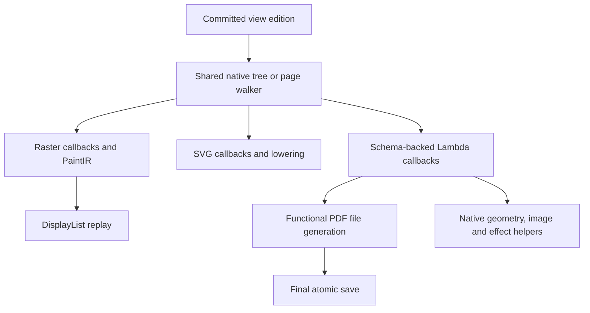

# Radiant — Render Walk, Painters & Export

> **Last verified against tree:** 2026-10-11 *(§11 text projection, selected-font SVG outlines and computed spacing; §12 selected background/marker/border images, retained marker fonts and export density; other sections retain their prior verification scope)*
> **PDF migration verified:** 2026-10-15 (Lambda generator and native save adapter; qualification evidence in `vibe/impl/Lambda_Impl_PDF_Output_Phase2.md` §14).

> **Software Gaussian blur verified:** 2026-10-13 (§6 amendment).
> **Focus presentation verified:** 2026-10-15 (§4 CSS outlines and editable-only carets).
> **Scoped source refresh:** 2026-10-19 — shared float paint phases and document/semantic-visit ownership (§2.4).
> **Scoped source refresh:** 2026-10-25 — hidden retained records excluded from positioned and signed stacking collections (§2.4).
> **Viewport clipping verified:** 2026-10-23 — caret overflow ancestry and raster vector list markers (`editor_viewport` and Word `viewport` replays).
> **Scaled caret presentation verified:** 2026-10-26 — DOM-text caret client-matrix painting and shared transformed rectangles (§4).

> **Part of the [Radiant detailed-design set](RAD_00_Overview.md).** This document covers how a laid-out view tree becomes output. One shared tree walk (`render_walk.cpp`) traverses the tree through shared paint phases and dispatches every drawing decision through a `RenderBackend` vtable; each output target (raster window/PNG/JPEG, PDF, SVG) supplies its own callback set. It describes the walker (z-order, effect groups, transforms), the raster record→lower→replay pipeline, the per-feature painters (`render_bound` and its background/border/shadow/text/image/clip/effect/filter/composite kin), the PDF backend, capability gating, output targets, and the profiler. The *IR machinery itself* — PaintIR shape, the DisplayList, record/replay internals — is [RAD_12](RAD_12_Paint_IR_Display_List.md)'s job; this doc is the walk, the painters, and the export seams.
>
> **Primary sources:** `radiant/render.hpp` (the `RenderBackend` vtable, `RenderWalkState`, the `RenderContext` base and `RasterRenderContext`, backend capabilities, profiling, and the `rc_*` seam), `radiant/render_walk.cpp` (the shared walker), `radiant/render_raster_walk.cpp` (raster backend + dispatcher), `radiant/render.cpp` (iframe embed), `radiant/render_block.cpp` (block paint pipeline), the per-feature painter `.cpp` files, `radiant/render_output.cpp` (targets, tiled/strip/selective/retained), `radiant/render_pdf.cpp` (Lambda export/save adapter), `lambda/module/radiant/radiant_pdf_walk.cpp` (schema-backed callbacks), `lmd/package/doc/pdf/output.ls` (PDF generation), `radiant/render_backend_caps.cpp`, `radiant/render_profiler.cpp`, and `radiant/render_painter.cpp`.
> **Audience:** engine developers. **Convention:** `file:line` references drift; confirm against the symbol name.

---

## 1. Purpose and the two pipelines

Radiant renders the *same* view tree that layout tagged in place ([RAD_01](RAD_01_View_and_DOM_Model.md)) into three structurally different outputs, but it refuses to duplicate the tree walk for each. The walk lives once in `render_walk.cpp`; the divergence is pushed into a vtable of function pointers, `struct RenderBackend` (`render.hpp`). Every backend receives the walker's per-node position/font/color and decides how to draw.

There are two lowering strategies behind that one walk:

- **Raster** (screen, PNG, JPEG, tiled/strip PNG) records a **semantic paint IR** (`PaintList`), lowers each fragment into a **DisplayList**, then replays that list to pixels in an `ImageSurface`. The painters never touch the surface directly — they emit through the `rc_*` gateway ([§5](#5-the-rc_-paint-ir-seam)).
- **SVG export** records PaintIR and lowers it directly to SVG markup. **PDF export** invokes pure Lambda callbacks with schema-backed view records; Lambda emits PDF operators and objects. Native helpers resolve bounded geometry, glyphs and images, and replay complex graphics/effect groups when necessary (S2.6.6v3, D7.4.4).

PaintIR remains private native machinery for shared raster/SVG helpers; the PDF callback ABI exposes declared views and owned resource values rather than a document paint-command stream. SVG export is a sibling of the PDF path and is documented in [RAD_14](RAD_14_SVG_Vector_Graph.md); this doc treats it as one more backend on the same walker.

---

## 2. The `RenderBackend` vtable and the shared walker

### 2.1 The vtable

`struct RenderBackend` (`render.hpp`) carries `ctx`, a `RenderContext*` that points at the backend's own context — `RasterRenderContext` for raster, `SvgRenderContext` for SVG, `PdfWalkContext` for PDF. All three derive from the `RenderContext` base, which holds the state every backend's walk carries (`font`, `block`, `color`, `ui_context`); callbacks take that base and cast down to their own context. Beside `ctx` sit two tiers of callbacks. The **full-node overrides** `render_block`/`render_inline` (`render.hpp`) let a backend take over an entire node; when null, the walker recurses through the generic path. The **per-feature callbacks** are the finer-grained ones the generic walker calls itself: `render_bound`, `render_text`, `render_image`, `render_inline_svg`, `render_marker`, `render_column_rules`, the `begin/end_block_children` and `begin/end_inline_children` container wrappers, the `begin/end_effect_group` and `begin/end_transform` stacking wrappers, and `on_font_change` (`render.hpp`). All coordinates passed to callbacks are CSS logical pixels; HiDPI scaling is a raster-side concern applied later.

The walker carries `struct RenderWalkState` (`render.hpp`): the accumulated absolute `x,y`, the inherited `FontBox font` and `Color color`, and the `UiContext*`. This is the walk's cursor — position is accumulated as `state->x += block->x` on entry and restored on exit (`render_walk.cpp:138`, `:247`).

### 2.2 Block traversal — four phases

`render_walk_block` (`render_walk.cpp:253`) drives a block through `render_paint_block_run` (declared `render.hpp`) with a four-callback `RenderPaintBlockOps` structure — `begin`, `paint_self`, `paint_children`, `finish`. This phase decomposition is shared verbatim by the raster path ([§4](#4-render_bound-and-the-block-paint-pipeline)), which is precisely why both the vector and raster paths agree on ordering.

- `render_walk_block_begin` (`render_walk.cpp:118`) saves the parent cursor, calls `setup_font` and `on_font_change` if the block sets a font, advances the cursor, then opens a transform group (if `block->transform->functions` and the backend supports `begin_transform`/`end_transform`) and an effect group.
- `render_walk_block_paint_self` (`render_walk.cpp:159`) calls `backend->render_bound` if the block has a `bound`, applies the block's own text color, and dispatches SVG/image/webview-layer self-content. Inline SVG sets `stop_after_self` so children are not re-walked.
- `render_walk_block_paint_children` (`render_walk.cpp:198`) wraps `begin/end_block_children` around: in-flow children, then positioned children, then positive-z descendants (ordering below).
- `render_walk_block_finish` (`render_walk.cpp:224`) paints column rules, closes the effect group and transform, and restores the saved cursor/font/color.

`render_walk_inline` (`render_walk.cpp:269`) mirrors this for spans but is flatter — inline elements have no transform group and their effect group has no visual-overflow bounds (`render_walk_inline_effect_group`, `render_walk.cpp:97`).

### 2.3 Whether an effect group is needed

`render_walk_block_effect_group` (`render_walk.cpp:67`) decides whether stacking effects require an isolated group: it returns true when opacity is below `0.9995`, a `mix-blend-mode` other than normal is set, a `filter` or `backdrop-filter` chain is present, or a `box-shadow` exists. When true it computes the group `bounds` expanded by `render_geometry_block_visual_overflow` and packs opacity, blend mode (cast to int for PaintIR serialization, `render_walk.cpp:89`), filter pointers, and the shadow/backdrop flags into a `PaintEffectGroup`. A backend that leaves `begin_effect_group` null simply never isolates — acceptable for SVG/PDF which flatten.

### 2.4 Paint order and z-index

Document-order-plus-z is the walker's responsibility (`render_walk.cpp`), following the
layer sequence in [CSS Appendix E](https://www.w3.org/TR/CSS22/zindex.html#painting-order):

1. Negative positioned blocks are collected at their nearest stacking context and stable-sorted by z-index. They paint after that context's background and before flow content. Numeric zero is distinguished from auto in `PositionProp::has_z_index`; intervening paragraph/overflow scopes are replayed without repainting ancestor backgrounds.
   `isolation:isolate` is a validated computed property and a stacking boundary;
   it keeps negative layers above that container's background even with auto z-index.
2. `render_walk_children` walks in-flow children, **skipping** negative positioned blocks, out-of-flow positioned children (`absolute`/`fixed`) and positive-z positioned children. In-flow positioned children (`relative`/`sticky`) with `z-index` auto or 0 (`radiant_stack_is_in_flow_positioned_step8`) paint in a second loop after their non-positioned siblings, in tree order — CSS 2.1 Appendix E step 8.
3. `render_walk_positioned_children` collects the block's `first_abs_child` chain, excluding signed layers already owned by a stacking context, and paints the remaining entries in stable ascending z-index order. Custom layouts retain their local signed sequence.
4. `render_walk_positive_z_descendants` collects positive-z positioned descendants at their nearest real stacking context and paints them last in stable ascending order. Positive and negative collection share ancestry traversal and clip replay. `layout_positioned_parent_offset` translates absolute/fixed layer coordinates from the replayed DOM-parent frame to their containing-block frame.

All collections exclude `RDT_VIEW_NONE` records before classifying their retained
styles. Signed traversal also stops at a hidden ancestor. A `display:none` record
can retain border/shadow properties and old dimensions in the selected view's
storage (D4.1.4v5); these records cannot contribute stacking paint or hit layers.
`RadiantTextQuery.HiddenPositionedPopupDoesNotPaintRetainedDecoration` and
`test/ui/slide_menu_dismiss.json` cover closing and reopening styled popups.

Zero-level descendant lifting remains partial. Absolute/fixed children follow in-flow step-8 boxes rather than interleaving with them by tree order. Negative positioned inline spans and complete isolation/flex/grid context rules remain outside the signed block-layer path. The shared helper preserves source order for equal z-index entries. `event.cpp` consumes its lists in reverse, testing negative layers after flow children and before the context's own background. `test/ui/{negative,positive}_stacking.{html,json}` and the corresponding `RenderOutputParity` cases cover paragraph anchors, nested zero contexts, ancestor clips, containing-block offsets, hit order and PNG/SVG/PDF parity.

When ordinary blocks or floating descendants require separate layers, `render_walk_children`
uses `RadiantPaintPhase` in the shared `RenderContext`: ordinary block
backgrounds/borders, float subtrees, then foreground. Ordinary ancestors remain
traversable in every phase so offsets, inherited fonts and clips keep their
original owner. The shared classifiers in `stacking_order.cpp` preserve atomic
inline-block/inline-table, flex/grid item and stacking-context roots. Each such
root owns a complete visit. A shared phase bitset omits the float pass when none is present, and
inline-only sequences keep the single-pass path. The existing positioned-layer
limits above still apply.

Outermost SVG fragments and `foreignObject` establish stacking contexts under
[SVG 2 §3.4.1](https://www.w3.org/TR/SVG2/render.html#EstablishingStackingContex).
The host HTML walk treats the SVG fragment atomically; walking its descendants
in a host background phase would paint foreign HTML without the SVG transform.
`svg_draw_foreign_object_html` resets the copied local context to a complete
paint stack, including when an external SVG image is captured during the host's
foreground phase. The existing `svg_foreign_object*` UI cases cover backgrounds,
clipping, transformed input, scrolling, and moving/removing/reinserting content.

Boundary emission, replaced content, outlines/rules and special raster dispatch
respect the active phase. Embedded documents own a new complete stack inside the
frame's content layer, rather than inheriting an outer foreground-only visit.
`visit_element` accompanies foreground once per logical element: repeated scope
visits must not duplicate PDF destinations, links or callback events. Native
paint, generic SVG/PDF walking and reverse hit testing share this phase policy.
The view/style and cached resource ownership remains **D4.5.1v4 /D4.1.4v5**;
module placement remains **D7.3.3–D7.3.4**.

`layout_float_paint_order.html` exercises opaque/translucent and nested floats,
overlapping inline ink, positioned overlays, clipping, an opacity owner,
pointer-events:none, block SVG/HTML content and an embedded document. Native
checks include two densities, retained repaint, causal background mutation,
matching hit targets, no-float overlapping backgrounds and one semantic callback visit. Whole-subtree cache
eligibility for split visits is described in [RAD_12 §6](RAD_12_Paint_IR_Display_List.md#6-retained-incremental-replay).

### 2.5 Per-node dispatch

`render_walk_view` (`render_walk.cpp:315`) is the type switch keyed on `view->view_type`: block-family tags route to `render_block` or `render_walk_block`; `RDT_VIEW_INLINE` to `render_inline`/`render_walk_inline`; `RDT_VIEW_TEXT` to `render_text`; `RDT_VIEW_MARKER` to `render_marker`. The `lam::view_require_*` casts (`lib/tagged.hpp`, see [RAD_01](RAD_01_View_and_DOM_Model.md)) are the zero-cost reinterpretations that make dispatch safe.

---

## 3. The raster backend and dispatcher

The raster path is a `RenderBackend` whose full-node overrides are wired in `render_raster_backend_init` (`render_raster_walk.cpp:160`): `render_block`, `render_inline`, `render_text`, `render_marker`. It intentionally leaves `render_bound`/`render_image`/effect/transform callbacks null because the raster overrides do that work themselves inside the richer `RenderContext` machinery (scrollbars, HiDPI, dirty tracking) rather than through the generic walker — the header calls this a staged migration (`render.hpp`).

`render_raster_view_tree` (`render_raster_walk.cpp:216`) enters at the `<html>` root and calls `render_children`, which builds a raster backend + `RenderWalkState` seeded from the `RenderContext` (`render_raster_walk.cpp:170`) and hands off to the shared `render_walk_children`. So even the raster path flows through the one walker.

`render_raster_dispatch_block` (`render_raster_walk.cpp:26`) is the raster feature router invoked per block override. In order it checks: viewport-miss cull; `RDT_VIEW_LIST_ITEM` → `render_litem_view`; form control → `render_block_view`; `HTM_TAG_SVG` → `render_inline_svg`; `embed->img` → `render_image_view`; `embed->video` → video content (guarded by dirty-miss / retained-fragment, wrapped in an element marker with suppression depth); webview layer → `render_webview_layer_content`; `embed->doc` → `render_embed_doc` (iframe); list-style → `render_list_view`; otherwise `render_block_view`. Each branch times itself into the profiler ([§8](#8-profiling-and-path-traces)).

Positioned and positive-z children have their own raster entry points (`render_raster_positioned_children`, `render_raster_positive_z_descendants`, `render_raster_walk.cpp:180`/`190`) that rebuild a backend and delegate to the shared `render_walk_positioned_children`/`render_walk_positive_z_descendants` — keeping z-order logic in exactly one place.

---

## 4. `render_bound` and the block paint pipeline

`render_bound` (`render_block.cpp:186`) is the boundary orchestrator — the single most-called painter, run for every block/inline with a `BoundaryProp`. Its order is fixed and CSS-correct (shadows under, borders over):

1. resolve percentage border-radius against the element's own box (`resolve_border_radius_percentages`, `render_block.cpp:193`);
2. `render_box_shadow` — outer shadows, painted *before* background so they sit underneath (`render_block.cpp:198`, entry `render_background.cpp:1226`);
3. an optional radial-gradient **mask** clip push (`render_block.cpp:204`);
4. `render_background` — solid color, gradients, and background-image (`render_block.cpp:220`, entry `render_background.cpp:83`);
5. `render_box_shadow_inset` — inset shadows *after* background so they land inside (`render_block.cpp:225`, entry `render_background.cpp:1401`);
6. `render_border` — or, for `border-collapse` table cells, resolved collapsed edges filled directly via `rc_fill_surface_rect` centered on cell edges per CSS 2.1 §17.6.2 (`render_block.cpp:240-292`, entry `render_border.cpp:533`).

Outlines are painted **separately and later** by `render_outline_deferred` (`render_block.cpp:303`, entry `render_outline` at `render_border.cpp:837`), invoked after children so an outline is not overdrawn by descendants; `render_block_deferred_child_outlines` (`render_block.cpp:525`) walks child blocks for their deferred outlines.

Focus indicators use this same CSS outline path. Native form painters and the
UI overlay no longer add independent blue rings; inline links share the deferred
outline painter. UA `:focus-visible` defaults
and author rules share cascade, clipping, and export behavior. Insertion-caret
paint reads the editable-only visibility projection described in
[RAD_17](RAD_17_Interaction_State.md#3-the-data-model) (D7.2.5).

The DOM-text caret in `render_overlay.cpp` maps its containing-block snapshot
through the view's client matrix, embedding offset and raster scale. It uses
`render_painter_fill_transformed_rect`, shared with the context-rectangle
painter, inside the existing overflow clips. This keeps a scaled or rotated
editor's caret beside its glyphs instead of painting at untransformed layout
coordinates (D7.2.5/D4.5.1v4).

The raster block paint itself is decomposed into the same four phases as the walker, driven through `render_paint_block_run`. `render_block_view` (`render_block.cpp:691`) first calls `render_block_skip_paint` (`render_block.cpp:368`) — empty-clip, fully-transparent (opacity ≈ 0), viewport-miss, dirty-miss, and retained-fragment-hit early exits — then runs the pipeline: `render_block_begin_phase` (`render_block.cpp:437`, element marker, visibility, transform push, font, default list marker, CSS-clip scope, effect group), `render_block_paint_self` (`render_block.cpp:458`, `render_bound` + vector path + form control), `render_block_paint_children_phase` (`render_block.cpp:593`, inherited color, scroller, overflow clip, `render_children`, positioned, positive-z), and `render_block_finish_phase` (`render_block.cpp:599`, scroller chrome, column rules, effect-group finish, clip pop, transform pop, restore, marker end). Inline elements are painted by `render_inline_view` (`render.cpp:194`), which suppresses inline background/border on the aggregate box and defers them to per-line-fragment painting in the text path so a wrapping `<code>` breaks its decoration at line boundaries (`render.cpp:200-221`). The generic inline walker (`render_walk_inline`) records no span boundary, so SVG and PDF paint the same per-fragment box from their text painters (`render_text_view_svg`, `pdf_walk_text`) through `render_paint_text_inline_box`, which shares the raster painter's padding and border geometry (`render_text_inline_padding_box`, `render_text_inline_border_box`).

### 4.1 The individual painters

- **Background** (`render_background.cpp`): `render_background` at `:83` handles color, `background-image`, and gradients. `render_paint_boundary.cpp` builds the gradient PaintIR primitives (`render_paint_boundary_build_linear_gradient` `:305`, `_build_radial_gradient` `:348`) and can emit a whole simple boundary into PaintIR in one shot (`render_paint_boundary_emit_simple` `:141`).
- **Border / outline** (`render_border.cpp`): `render_border` `:533` draws the four edges (solid/dashed/dotted/double, per-corner radius); `render_outline` `:837` draws the outline that sits outside the border box.
- **Shadows** (`render_background.cpp`): outer `render_box_shadow` `:1226` and inset `render_box_shadow_inset` `:1401`, both blurring through the filter path ([§6](#6-filters-effects-and-composite)).
- **Text** (`render_text.cpp`): `render_text_view` `:75` lays glyphs, loading each through `font_load_glyph` and emitting via `rc_draw_glyph`; inline background/border fragments are painted here per line. Glyph rasterization and font handling proper are [RAD_06](RAD_06_Inline_and_Text_Layout.md)/[RAD_07](RAD_07_Fonts.md).
- **Image** (`render_img.cpp`): `render_image_view` handles `object-fit`/scaling and blits decoded pixels; this file also owns `save_surface_to_png` `:50` and `save_surface_to_jpeg` `:106`, the raster export encoders.
- **Clip** (`render_clip.cpp`): `RenderClipScope` (`render.hpp`) is an RAII-style scope; `render_clip_push_css_scope` / `_push_rect_scope` / `_push_overflow_scope` push a `ClipShape` onto the `RenderContext::clip_shapes[]` stack (bounded by `RDT_MAX_CLIP_SHAPES`, `render_clip.cpp:402`) and `render_clip_pop_scope` pops it.
- **Effect group** (`render_effects.cpp`): `render_effect_group_begin`/`_finish` (`render.hpp`) snapshot backdrop pixels for opacity, `mix-blend-mode`, and filter/backdrop-filter, then composite on finish.

---

## 5. The `rc_*` paint-IR seam

Every raster painter draws indirectly. The `rc_*` wrappers (`render.hpp`, impl `render_painter.cpp`) — `rc_fill_rect`, `rc_fill_rounded_rect`, `rc_fill_path`, `rc_stroke_path`, `rc_fill_linear_gradient` / `_radial_gradient`, `rc_draw_image`, `rc_draw_glyph`, `rc_draw_picture`, `rc_push_clip` / `rc_pop_clip`, `rc_outer_shadow`, `rc_box_blur_region` / `_inset`, `rc_apply_filter`, `rc_composite_opacity`, `rc_apply_blend_mode`, `rc_video_placeholder`, `rc_webview_layer_placeholder` — each delegate to a `paint_record_*` inline (`render.hpp`). Each `paint_record_*` records the primitive into the `PaintList` (semantic IR) through a `PaintBuilder` and then **immediately** `paint_ir_lower_raster_fragment` lowers that one fragment into the `DisplayList` and clears the list (`render.hpp`). The comment on `RenderContext::paint_list` (`render.hpp:34-37`) fixes the contract: the lowering is byte-identical to the legacy direct `dl_*` calls, so the raster path genuinely flows through the semantic IR one fragment at a time. If either target is missing, `paint_record_missing` logs an error rather than silently dropping (`render.hpp`). The IR/DisplayList structures and the lowering rules are [RAD_12](RAD_12_Paint_IR_Display_List.md).

---

## 6. Filters, effects, and composite

`render_composite.cpp` implements the CSS `mix-blend-mode` math (`render_blend_multiply`/`screen`/`overlay`/… at `:12+`) and the compositors `render_composite_apply_blend` `:122`, `render_composite_source_over_premul` `:140`, and `render_composite_opacity` `:172`. These operate on captured backdrop pixels: an effect group saves the backdrop, paints its subtree, then composites.

Blur is where platform acceleration appears. `render_filter.cpp` uses Apple's Accelerate framework on `__APPLE__`: it includes `<Accelerate/Accelerate.h>` (with a `Rect`→`MacOSRect` rename to dodge the name clash, `render_filter.cpp:1-5`) and blurs via `vImageBoxConvolve_ARGB8888` in three passes to approximate a Gaussian, gated on `caps->gaussian_blur` (`render_filter.cpp:285-313`). On non-Apple platforms (`#ifndef __APPLE__`, `render_filter.cpp:204`) it falls back to a software `box_blur_region` targeting σ = b/2 (`render_filter.cpp:480-492`); outer box shadows also use that approximation.

**Software Gaussian amendment (2026-10-13).** Inset shadows and SVG filter
graphs share `render_gaussian_blur_axis` in `render_svg_filter.cpp`. Each pass
preserves its normalized finite Gaussian kernel, extension mode and packing.
Flat scanline runs whose entire kernel lies inside the run and sample region
reuse one computed result; edge/run boundaries still convolve normally.
Coverage masks with identical RGBA channels accumulate once and replicate
before packing. This removes redundant work when scrolling large beveled
surfaces without changing their paint or introducing another state owner
(**S12.1.5v2**). Color-channel, pitch and all three extension-mode checks live
in `RdtVectorTest.GaussianFlatRunsPreserveEdgesChannelsAndPitches`.

---

## 7. Output targets and the raster driver

`render_output.cpp` owns target selection and the raster record→replay driver. `render_output_kind_from_file` (`:79`) maps an extension to a `RenderOutputKind` (`.jpg`/`.jpeg`→JPEG, `.pdf`→PDF, `.svg`→SVG, else PNG; null→SCREEN). `render_output_render_view_tree_to_target` (`:481`) dispatches: SCREEN/PNG/JPEG go to the raster target; TILED_PNG to the strip path; PDF/SVG **reject** the in-memory view-tree entry and require the file-level `render_html_to_*` path because they build their own headless `UiContext` (`:497-500`).

`render_output_render_raster_target` (`:356`) is the record→replay driver:

1. `render_output_init_context` (`:155`) zeroes a `RasterRenderContext`, allocates the `PaintList`, binds `RdtVector` to `surface->pixels`, logs the live backend caps, sets scale from `pixel_ratio`, sets the default font, and sets the root clip to the surface bounds.
2. `render_output_canvas_background` (`:205`) resolves the canvas color by propagating the `<html>` background, else the `<body>` background per CSS. `render_output_clear_surface` (`:238`) then either clears the whole surface or, when the `DirtyTracker` has regions and `is_dirty` is false, clears **only** the dirty rects and records a `dirty_union` for selective repaint ([RAD_16](RAD_16_Animation_Frame_Scheduling.md)).
3. Record: `render_raster_view_tree` walks the tree into the `DisplayList` via the raster backend; retained-fragment capture is bracketed with `retained_dl_cache_begin_frame` / `retained_dl_cache_capture` (`:381`, `:409`).
4. Replay: `render_output_replay_display_list` (`:291`) chooses **threaded tiled** replay (`TileGrid` + `RenderPool`, gated off when the list has glyphs or a selective-dirty replay is active) else single-threaded `dl_replay` (`:309-339`).
5. Post: `render_video_frames`, profiler event + `RenderPathTrace`, and `save_surface_to_jpeg`/`save_surface_to_png` (`:455-462`).

**Tiled/strip PNG** for pages too tall for one surface: `render_output_render_tiled_png` (`:594`) records the full page once to a `DisplayList`, then replays it per 4096px horizontal strip (`RADIANT_TILE_STRIP_H`-overridable) via `dl_replay_tile`, streaming each strip's rows straight into libpng so peak memory is bounded by strip height, not page height (`:683-720`).

**Retained fragments** let an unchanged subtree skip re-recording: `render_block_try_retained_fragment` (`render_block.cpp:109`) looks up a cached `RetainedDisplayListFragment` by the block's `view->id`, validates it against the current video/glyph generations, and appends it for the dirty region — a hit short-circuits the whole subtree.

**Iframe embed** (`render_embed_doc`, `render.cpp:54`) constrains the clip to the iframe content box, swaps the active document, resets color/font, propagates the embedded body/html background to fill the viewport, and recurses into the embedded view tree.

---

## 8. PDF export

PDF generation is functional through the completed file value (S2.6.6v3,
D2.6.12v3, D8.2.6v2). `render_pdf.cpp` lends an already committed
`RenderExportSession` to the bundled `lambda.doc.pdf.output.render_view` function
and saves its result atomically. It reuses an active runtime, or owns a runtime
at a quiescent host boundary; it never replaces an active evaluator (D5.4.1).
The old HPDF renderer and `lib/pdf_writer.{c,h}` have been retired.

`radiant_pdf_walk.cpp` supplies the shared `RenderBackend` and secondary-page
visitor. Pure Lambda callbacks read schema-backed properties without tree links.
`output.ls` chooses PDF operators, allocates resource/object numbers, compresses
streams once, measures the frozen chunks, and emits the cross-reference table,
metadata, links, destinations, outline hierarchy and page labels. Fixed pages
carry source boxes, rotation and placement through the same adapter.

`radiant_pdf_graphic.cpp` supplies bounded geometric resources, including SVG
fills/strokes, and owned RGB/alpha snapshots for unsupported resource geometry.
Simple opacity groups become PDF transparency forms; other effects use shared
native replay with page backdrop history and retain an invisible text layer.
Semantic visits continue while captured child paint callbacks are suppressed.
Paint-list destruction releases payloads; backdrop recordings retain temporary
images until their page retires.

Text export (verified 2026-10-18) uses `radiant_pdf_text.cpp`,
`render_visit_text_run_glyphs` (`render_glyph_path.cpp`) and
`font_export_face` (`lib/font/font_export.c`). Static TrueType/CFF faces are
embedded, with collection face extraction. Other native, variable and color
glyphs use Type 3 font programs. `text_fragment` (`output.ls`) emits positioned
text-show operators, ToUnicode and logical ActualText; fonts are shared across
pages. Affine transforms preserve text. Continuous solid SVG text is captured
before path lowering. Subsetting, complex SVG text paints and warped replacement
text remain follow-up work; paged inline SVG publication is a separate gap.

### 8.1 Capability gating

Two capability structures decide native-vs-fallback. **Runtime** `RenderBackendCaps` (`== RdtVectorCaps`, `render.hpp`), queried via `render_backend_get_caps` (`render_backend_caps.cpp:5`), reports what the *live* vector rasterizer can do (vector_paths, gradients, nested_clips, gaussian_blur, color_matrix_filters, native_text_runs, tile_offsets…). `render_backend_supports_filter_chain` (`render_backend_caps.cpp:17`) walks a `FilterProp` chain against those caps and always rejects `DROP_SHADOW`/`URL`. **Static** `RenderExportTargetCaps` (`render.hpp`) is a compile-time feature matrix for SVG vs PDF; both mark `blend_modes`/`filters`/`shadows` as false (`:49-51`, `:67-69`), which is what deterministically forces the PDF/SVG lowering into raster fallback rather than dropping the effect.

### 8.2 Procedural export boundary

Pure `lambda.doc.pdf.output.render(source, options)` returns the completed PDF file;
only `output(file, destination)` performs file I/O (S2.6.6v3).

`radiant.export_document(html, destination, options)` remains a procedural native
module operation (D7.5.3/S12.1.1v2). Its required `format` selects `png`, `jpeg`,
`svg`, or `pdf`; optional positive integral `width`/`height`, `scale`,
`device_scale`, JPEG `quality`, `pagination`, `base_url`, and `local_resources`
configure the same export sessions as the CLI. It returns `true` or a diagnostic
string; package facades convert diagnostics to raised errors (S7.4.2).
`source_format:"xhtml"` explicitly selects the XML HTML loader for in-memory
source, preserving foreign and native page-control namespaces (**D2.10**).
The default `"html"` uses HTML parsing. XHTML must be well formed, including
escaped CSS/text and closed void elements; both syntaxes use the same export
session, ownership and resource policy.
Continuous PNG also accepts `transparent:true` to preserve canvas alpha for image
compositions; authored backgrounds still paint normally. The default canvas
remains opaque. Other output formats and paged output reject transparency.
PNG and data-URI encoding convert premultiplied paint into straight channels
through one shared row conversion; retained source pixels remain unchanged.

`load_html_source_doc` transfers the source URL/parser-pool owner to the transient
document; it disables embedded scripts. `render_html_source_to_output_target`
shares font admission, continuous/paged layout, and existing encoders. Native
copies keep source/path strings valid across allocating layout callbacks
(D4.5.1v4/D5.3.3). Normal and strip PNG/JPEG encoder failures reach the caller.
The procedural timeline export regression checks valid encodings and invalid
destinations in `test/lambda/proc/timeline_export.ls`.

In-memory measurement/SVG layout sets both physical surface dimensions and the
logical viewport; CSS viewport units therefore use the caller's dimensions.
Decoded images with no URL are admitted by the existing PaintIR image lowering
path, which embeds their pixel bytes in SVG. Page backdrop recording uses raster
fragment lowering: clip/transform scopes can span multiple streamed callbacks,
so a fragment cannot be validated as a complete balanced PaintList. The owning
render walk supplies those scopes. Focused viewport, recorded-image, and
cross-fragment clipping regressions pass (verified 2026-10-11).

---

## 9. Profiling and path traces

`RenderProfiler` (`render.hpp`) accumulates per-zone counters/timers keyed by `RenderProfileZone` (`render.hpp`) — glyph load/draw, setup-font, bound, text, image, SVG, filter, clip, opacity, blend, block, inline, dispatch, block-self, children, overflow-clip, font-metrics. The painters bracket their work with `render_profiler_add_sample`/`_add_time`. At the end of a raster render, `render_output_render_raster_target` emits a `RenderProfilerEvent` and a `RenderPathTrace` (`render.hpp`) — a one-shot record of which path ran (target, replay mode, selective/tiled flags, DisplayList item count, backend caps snapshot, retained-cache stats). File-level PDF/SVG exports emit a `file_export` path trace with no DisplayList (`render_output.cpp:518-530`). These traces are the primary way to confirm, after the fact, that (say) a page took the tiled or selective path.

---

## 10. Known Issues & Future Improvements

1. **CSS stacking contexts are still partial.** Signed positioned block layers belong to their nearest context, including `isolation:isolate`, with shared paint/hit order. Zero-level descendant lifting, floats, negative inline spans, blend-group isolation and complete flex/grid context rules still need the full CSS stacking-context algorithm.
2. **PDF success paths emit `log_error` noise.** Multiple non-error PDF outcomes log at error level — e.g. "fallback effect group rendered as passthrough content" (`render_pdf.cpp:1033`) and the raster-fallback effect-group notice (`:598`) fire on the *success* path where a fallback is the intended behavior. This makes real PDF errors hard to spot. *Improvement:* demote intended fallbacks to `log_debug`.
3. **Duplicated body-background propagation.** `render_output_canvas_background` (`render_output.cpp:205`) and the iframe branch of `render_embed_doc` (`render.cpp:122-156`) reimplement the same `<html>`-then-`<body>` background walk. *Improvement:* extract one shared helper.
4. **File sprawl (~50 `render_*` files, ~26.8k LOC).** Painter logic, low-level pixel ops, and IO decode are interleaved; the largest are `render_svg_inline.cpp` (5633), `render_pdf.cpp` (2384), `render_background.cpp` (2107), `render_svg.cpp` (1978). No TODO/FIXME/HACK markers exist — the debt is structural (sprawl + duplication), not annotated.
5. **The raster path is only partway onto the shared abstraction.** The header comments admit it: `render.hpp` describes richer raster block state being "migrated in staged slices," and `render.hpp:15-37` labels the PaintIR routing "Phase C." The raster backend deliberately leaves `render_bound`/effect/transform callbacks null and does that work inside `RenderContext` instead of the generic walker, so the two paths are not yet fully unified.
6. **PDF/SVG re-do layout headlessly.** `render_html_to_pdf` (`render_pdf.cpp:2262`) reloads and re-lays-out the HTML rather than reusing an existing view tree, and cannot be driven from the in-memory `render_output_render_view_tree_to_target` (`render_output.cpp:497`). Two parallel entry conventions (`render_html_to_*` vs `render_output_*`) coexist. *Improvement:* allow vector export off a pre-laid view tree.
7. **Effect-group need vs. capability is decided in two places.** The walker's `render_walk_block_effect_group` (`render_walk.cpp:67`) decides an effect group is *needed*; the backend caps decide it is *supported*. A backend that opens a group it cannot honor relies on flatten/fallback correctness elsewhere — there is no single assertion tying the two together.

---

## 11. Scoped text overflow and visible export bounds (2026-10-11)

The block children paint phases install a shared `RenderTextPaintScope`; nested block scopes restore their parent's plan on exit. The plan borrows live views/fonts and owns only per-paint scratch, following **D4.5.1v4 / D4.1.4v5**. Raster, SVG and PDF iterate the same projections, including a separate marker when its block font/color differs from the last visible run. Compatible prefixes and markers stay in one run to preserve fractional positioning. PDF now consumes generated ellipsis as well as generated hyphens.

`calculate_content_bounds()` uses document geometry and the existing ancestor overflow-clip helper, retaining float coordinates until conversion to integral export extents. It composes the paint transform matrices before projecting each box and its overflow clip; translated list content therefore contributes its translated bottom edge. Projective rectangles crossing `w=0` retain the prior finite-box fallback and remain unqualified. Clipped text below a clamp no longer enlarges the exported canvas. `OverflowEllipsisAndClampMatchExplicitTextAcrossOutputs` and `RtlOverflowMatchesVisibleSuffixesAcrossOutputs` each check 14 browser-verified references at both densities; mixed bidi, RTL clamp, atomic/scroll/vertical and decorated-inline contexts remain partial. See [the text design contract](../../../vibe/radiant/Radiant_Design_Font_Text.md#11-text-overflow-paint-contract-2026-10-11).

Native SVG plain HTML text now uses `render_path_create_text_run`, the shared PDF
outline helper, to retain the selected font's advances and ink bounds. Existing
semantic-group commands preserve escaped accessible titles for outlined labels. A viewer's
font substitution previously let the ellipsis overlap retained RTL text. Effect
fallback keeps glyph runs; decorations, shadows and missing-outline fallback can
still emit live text. Outlined SVG text loses search/selection. Existing command
path ownership releases temporary outlines after lowering (**D4.5.1v4 / D4.1.4v5**).
The focused source verification is 2026-10-11; other sections retain their earlier
verification stamp. See [FT-15](../../../vibe/radiant/Radiant_Design_Font_Text.md#15-selected-font-svg-text-contract-2026-10-11).

Direct raster text, blurred shadows, SVG/PDF outlines and recorded effect text now
use the shared computed character/space advances. `PaintGlyphRun.word_spacing`
contains extra justification only; authored spacing is read from its captured
`FontProp`. Export text normalization follows the source's whitespace mode and
keeps collapsed-separator context when fitting starts inside a byte range.
Live SVG text emits negative as well as positive word/letter spacing. The bounded
controls compare eight explicit references through PNG, independent SVG
rasterization and PDF at 1×/2×. Tabs, complete Unicode separators, cross-node,
shaping/vertical and decorated contexts remain partial under
[FT-16](../../../vibe/radiant/Radiant_Design_Font_Text.md#16-computed-spacing-in-paint-2026-10-11).

## 12. Selected background images and export density (2026-10-11)

`render_paint_background_image()` uses the raster painter's shared positioning,
origin/clip/attachment rectangles and tile plan. SVG and PDF lower its owned
rounded clip and common image/picture commands, including natural raster size
divided by the selected `image-set()` resolution. URL-less raster resources
embed their decoded pixels in SVG. Retained clips and image payloads follow
**D4.5.1v4 / D4.1.4v5**. See
[CI-17](../../../vibe/radiant/Radiant_CSS_Cascade.md#317-css-image-selection-and-retained-paint-payloads-partially-implemented).

`RenderExportSession` receives the caller's explicit device environment for
asset selection. Physical export density stays independent under
[RSC6–RSC7](../../../vibe/radiant/Radiant_Scale.md#rsc6--paint-semantics-are-logical-raster-lowering-is-physical).
`render_font_pixel_to_css()` converts glyph-cache advances and bitmap placement
to logical coordinates for effect fallback, SVG/PDF width measurement and SVG
emphasis. `EffectGlyphBitmapsAndAdvancesUseLogicalPaintCoordinates` checks the
1×/2× boundary; the RTL filtered suffix references pass at both densities.

`CssImageSetsMatchSelectedNaturalImageSizesAcrossOutputs` compares ten selected
image cases with explicit replacements at both device scales through PNG, SVG
and PDF. Chromium agrees on eighteen export references; its two pseudo-image
references have the inline baseline difference recorded in CI-17. Complete
multilayer ordering/blending, transformed sampling, independent/paged producers
and standalone file resources remain unqualified.

`render_paint_border_image()` and the raster painter call one nine-slice
implementation in `render_border.cpp`. Region clips, source crops, auto widths
and repeated tiles share geometry; deferred linear-gradient tiles retain owned
paths and stops. `render_paint_boundary_emit_box()` yields its solid-ring fast
path to an image source. `render_paint_marker_image()` shares URL-marker image
rectangles with raster and uses the common image resource producer. The raster
marker painter converts logical marker dimensions once; retained marker source
and suppression refresh during layout (**D4.5.1v4 / D4.1.4v5**, CI-17).
Geometric raster markers share the text's CSS transform while their inherited
scroll clip remains in destination coordinates. A shared contour builder feeds
the fill/stroke path. `ZoomedListBulletsShareTextTransformsAndScrollClipping`
checks visible disc pixels and the absence of marker ink above the scrollport
at 110% zoom; Word's viewport replay also checks both sides of that boundary.

`CssImageSetMarkersAndBordersKeepVisiblePixelsAcrossOutputs` compares seven
URL/linear-gradient controls, both untranslated and translated, at two densities (28 references), including filtered gradient
retention. Exact references remain within each format; independent selected-color
coverage excludes matching omissions. URL markers consume the current raster paint
transform, while border slice clips use the same transform as their tiles. The live fixture has 54 Chromium-matching
assertions. Outside-marker placement, gradient marker export, radial/conic or SVG
border images, broader transformed sampling, PDF profile/edge rasterization, output
canvas padding and independent/paged producers remain separate limits.

## Appendix A — Source map

| File | Responsibility (this doc) |
|---|---|
| `radiant/render.hpp` | The `RenderBackend` vtable and `RenderWalkState`; shared-walker API. |
| `radiant/render_walk.cpp` | The single tree walk: block/inline phases, effect-group decision, z-order, transform wrappers. |
| `radiant/render.hpp` / `stacking_order.cpp` | Shared positioned/positive-z collection and stable paint-order sorting consumed by render and hit-testing. |
| `radiant/render_raster_walk.cpp` | Raster backend wiring + `render_raster_dispatch_block` feature router + `render_children`. |
| `radiant/render.hpp` / `render.cpp` | `RasterRenderContext` god-struct (on the shared `RenderContext` base); `render_inline_view`; iframe `render_embed_doc`. |
| `radiant/render_block.cpp` | `render_bound` orchestrator, `render_outline_deferred`, the four-phase raster block pipeline, skip/dirty/retained gating. |
| `radiant/render.hpp` | `RenderPaintBlockOps` — the shared four-phase block driver used by walker and raster. |
| `radiant/render_background.cpp` | `render_background`, `render_box_shadow`, `render_box_shadow_inset`. |
| `radiant/render_border.cpp` | `render_border`, `render_outline`. |
| `radiant/render_paint_boundary.cpp` | Builds boundary/gradient PaintIR primitives. |
| `radiant/render_text.cpp` | `render_text_view` glyph emission and per-fragment inline decoration. |
| `radiant/render_img.cpp` | `render_image_view`; `save_surface_to_png` / `save_surface_to_jpeg`. |
| `radiant/render_clip.cpp` | `RenderClipScope` push/pop over `clip_shapes[]`. |
| `radiant/render_effects.cpp` | `render_effect_group_begin`/`_finish` — opacity/blend/filter isolation. |
| `radiant/render_filter.cpp` | CSS filters; Apple vImage blur vs software box blur. |
| `radiant/render_composite.cpp` | `mix-blend-mode` math and backdrop compositors. |
| `radiant/render.hpp` / `render_painter.cpp` | The `rc_*` gateway → PaintIR → DisplayList lowering seam. |
| `radiant/render_output.cpp` | Output-target dispatch; raster record→replay; tiled/strip PNG; selective repaint; retained capture. |
| `radiant/render_pdf.cpp` | Lambda PDF package invocation and atomic save of completed bytes. |
| `radiant/render.hpp` / `render_backend_caps.cpp` | Runtime `RenderBackendCaps` vs static `RenderExportTargetCaps`; filter-chain support. |
| `radiant/render.hpp` / `render_profiler.cpp` | Per-zone counters, `RenderPathTrace`. |
| `radiant/surface.cpp` | `ImageSurface` ABGR8888 buffer, lazy decode, tile offsets. |

## Appendix B — Related documents

- [RAD_00 — Overview](RAD_00_Overview.md) — the set index and architecture.
- [RAD_01 — View & DOM Model](RAD_01_View_and_DOM_Model.md) — the tagged view tree this walk consumes; the `lam::view_*` casts.
- [RAD_12 — Paint IR & Display List](RAD_12_Paint_IR_Display_List.md) — the IR/DisplayList structures and record/replay machinery this doc's painters emit into.
- [RAD_14 — SVG & Vector Graphics](RAD_14_SVG_Vector_Graph.md) — the SVG export backend (sibling of the PDF path on the same walker) and inline-SVG rendering.
- [RAD_06 — Inline & Text Layout](RAD_06_Inline_and_Text_Layout.md) and [RAD_07 — Fonts](RAD_07_Fonts.md) — glyph rasterization and font handling behind `render_text_view`.
- [RAD_16 — Animation & Frame Scheduling](RAD_16_Animation_Frame_Scheduling.md) — the dirty-region scheduling that feeds selective repaint and retained fragments.
- [RAD_20 — Application Shell & Browsing](RAD_20_Application_Shell_Browsing.md) — the window surface and `UiContext` this render targets.
