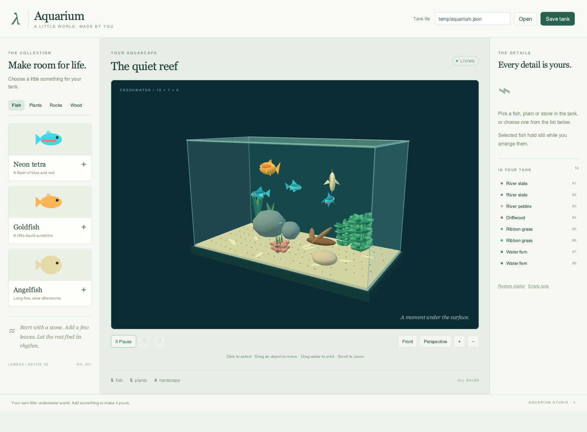

# Aquarium

A native Lambda aquarium builder. Everything in the tank is generated in code;
the application runs in Radiant using `lambda.scene3d`.

```sh
./lambda.exe demo aquarium
# Equivalent direct entry:
./lambda.exe view test/demo/aquarium/aquarium.ls
```



Choose **Fish**, **Plants**, **Rocks**, or **Wood**, then click a card to add an
object. The collection includes neon tetras, goldfish, angelfish, ribbon grass,
water ferns, red lotus, slate, pebbles, and driftwood. The starter aquascape has
14 objects; a tank can contain up to 60.

Click an object in the tank or the resident list to select it. The inspector
controls its three position coordinates, size, and rotation. **Duplicate** and
**Remove** act on the selection. Selected fish hold still while being arranged.
Drag fish in a plane facing the camera; plants, rocks, and wood move across a
horizontal plane at their current height. Shift-drag also moves fish horizontally.
Size and position are constrained to the tank's bounds. Objects can overlap.

Drag empty water to orbit, or Alt-drag anywhere to orbit without selecting.
Scroll or use **+ / −** to zoom. **Front** and **Perspective** restore useful
camera views. **Pause** stops swimming and plant sway while keeping editing
available. **Undo / Redo** restore edits, including a complete drag, clearing
the tank, restoring the starter, and opening another tank.

| Key | Action |
| --- | --- |
| Ctrl/Cmd+Z | Undo |
| Ctrl/Cmd+Shift+Z | Redo |
| Ctrl/Cmd+D | Duplicate selection |
| Delete / Backspace | Remove selection |
| Escape | Deselect |
| Space | Play / pause |
| + / − | Zoom |
| Ctrl/Cmd+S | Save tank |

Keyboard shortcuts apply outside input fields; sliders retain their native
arrow, Home, and End controls.

Enter a `.json` path beside **Open** / **Save tank**. The default is
`temp/aquarium.json`, relative to the process's working directory. Save uses
an atomic write. Files contain a versioned `lambda-aquarium` document with
species, stable IDs, authored positions, sizes, and rotations. Swimming poses,
camera, selection, and animation time are session state. Opening validates the
schema, supported species, finite transforms, unique IDs, and object quota
before replacing the tank; errors appear in the status bar.

## Implementation and verification

The finite milestone is an offline aquascape editor: construct a visible tank,
add/select/move/resize/rotate/remove each object category, retain geometry during
animation and transforms, undo edits, and save/reopen the composition. This is
an editor and ambient animation demo; fish care, breeding, inter-object
collisions, physical water/refraction, multiplayer, and website embeds are
outside this milestone. Picking uses rotated bounding ellipsoids.

`mod_model.ls` owns pure state, bounds, picking, history, and file validation.
`mod_scene.ls` builds shared meshes and procedural models. `mod_ui.ls` builds
the shell; `mod_present.ls` reconciles retained objects and updates transforms;
`aquarium.ls` handles input, files, and frame scheduling. No JavaScript
application, Three.js runtime, model downloads, or textures are required.

The package boundary follows **D7.2.4v4 / D7.5.3v2**; pure scene construction
and effectful event handlers follow **S12.1.3**. Scene nodes and controls are
retained under **D4.5.1v4**. The shared `lambda.scene3d.dom.mount` helper was
extracted from CellScope so both demos preserve typed geometry/transform arrays
when creating DOM nodes. No language or engine ruling changes are introduced.

From the repository root, with native graphics access:

```sh
./test/test_lambda_gtest.exe --gtest_filter='AutoDiscovered/*scene3d_aquarium*'
LAMBDA_EXEC_BACKEND=interp ./test/test_lambda_gtest.exe --gtest_filter='AutoDiscovered/*scene3d_aquarium*'
LAMBDA_EXEC_BACKEND=jit ./test/test_lambda_gtest.exe --gtest_filter='AutoDiscovered/*scene3d_aquarium*'
./test/test_radiant_view_gtest.exe --gtest_filter='Scene3dTest.Aquarium*'
```

The model golden checks scene validation, edits, history, JSON round trips,
invalid files, bounds, animation, picking, drag projection, and quota. The
desktop replay verifies actual rendered pixels, retained geometry, paused
animation, all inspector properties, duplicate/remove, undo/redo, disk
save/reopen, each library category, physical orbit/object drags, keyboard
resizing, and window teardown. The 390px replay checks canvas sizing, overflow,
pixels, and adding a fish. CellScope's local native replay protects the shared
mount helper; demo command tests cover catalog lookup and launch options.

Verified on 2026-10-26: aquarium goldens pass on interp, auto, and jit; both
native aquarium replays, the local CellScope replay, and demo command checks
pass. The broader Scene3D goldens pass 15/15 on interp and auto. On jit, 14/15
pass: the separate `scene3d_formats` GLB-export check returns `type.null` where
its golden expects `binary`; it also fails in isolation. That exporter/runtime
path is unchanged by this demo and remains a qualification limit.

Direct replay and captures:

```sh
LAMBDA_HEADLESS_GLFW_WINDOW=1 ./lambda.exe demo aquarium --headless \
  --event-file test/demo/aquarium/tests/aquarium_editor.json \
  --event-result temp/aquarium-editor-result.json
```

The replay writes `temp/aquarium-desktop.png`, `temp/aquarium-edited.png`, and
`temp/aquarium-replay.json`. The mobile replay writes `temp/aquarium-mobile.png`.
Refresh the catalog tile with `sh test/demo/previews/capture.sh aquarium`.

## References

- [Aquarius procedural aquarium write-up](https://discourse.threejs.org/t/aquarius-a-3d-aquarium-game-where-every-fish-plant-and-rock-is-made-in-code/95698)
  and [Aquarius](https://playaquarius.com/): procedural fish and scenery, a living tank.
- [Maya's Aquarium Maker 3D](https://aquarium3d.may.as/) and its
  [source](https://github.com/m4ym4y/mayas-aquarium-3d), inspected at
  `5e6b9f158b5e60743946eada904c130995ef2986`: placement, transform controls,
  tank bounds, and edit history. No upstream code or assets are copied.

These are design references, not compatibility or visual-parity claims.
