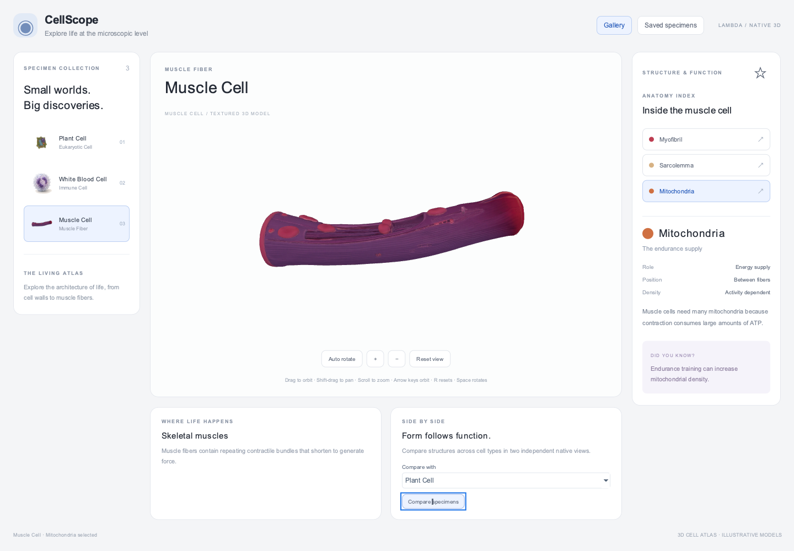

# CellScope

A native Lambda Scene3D port of the gallery in
[cclank/cell-architecture-studio](https://github.com/cclank/cell-architecture-studio),
based on commit `1cab982e7a0f96af854a696430c0724707764358`, with the
Muscle model from the [deployed gallery](https://cell-architecture-studio.lanshuagent.com/).

```sh
./lambda.exe demo cellscope
# Equivalent direct entry:
./lambda.exe view test/demo/cellscope/cellscope.ls
```



The initial **plant cell** is a real textured mesh: **11,382 vertices and
9,152 triangles**, reduced from upstream's `plant-cell-first001.glb`. Its
irregular wall, organelles, authored normals, UVs, and original 4096px color
texture are retained. `plant.bin` is **237 KB / 231 KiB** (90% smaller than the
first port), using mesh reduction and `KHR_mesh_quantization`; small structures
show more facets when enlarged. The bundled model occupies about **2.9 MB** including its
original JPEG; the native
viewer uploads the plant texture at 2048px and the much larger white-blood-cell
model's texture at 1024px to leave room for geometry and render
targets within Scene3D's existing GPU budget.

Only the plant model is stored in this repository. Other published models load
on selection from the web, using Lambda's HTTP input cache under `temp/cache/`.
The gallery contains Plant, White Blood Cell, and Muscle. White Blood Cell uses
the pinned GitHub revision; Muscle uses the deployed site's asset CDN:

| Specimen | Model source | Approximate download |
|---|---|---:|
| Plant | Local reduced glTF, binary buffer, and JPEG | None |
| White blood cell | `white-blood-cell-user.glb` | 56.6 MB |
| Muscle | `muscle-cell-tripo-skeletal-fiber-textured-pbr.glb.bin` from the gallery CDN | 65.3 MB |

The first remote selection can take time to download, decode, and mount.
A centered **Loading 3D specimen** popup shows the specimen name before work
starts, for the main and comparison views. Its bar is indeterminate: the
synchronous loader does not expose byte progress. Separate document frames
paint the popup before HTTP/decode/mount work (**D7.5.3**); it closes when loading
finishes or an error is displayed. Changing the selection cancels a queued load.
Failures display an error with **Retry model**. Remote specimens and their
thumbnails need a network connection on first use. Camera changes reuse the
selected model; switching between imported specimens replaces the viewport's model.

Muscle uses the same textured Tripo GLB as the deployed browser gallery:
**1,047,437 source vertices and 1,978,833 triangles**, without mesh simplification.
Scene3D partitions it into draw batches while preserving all triangles, authored
normals, UVs, and the base-color texture (uploaded at 2048px). Its initial pose
faces the cutaway toward the camera and fits the shared viewport. The deployed
browser's automatic rotation can show a different side. The GitHub snapshot's
procedural Muscle fallback is not the model used by the deployed website;
that fallback has been removed from CellScope. The CDN URL, source hash, and
observed browser bundle are recorded in [assets/muscle-source.json](assets/muscle-source.json).

Select an organelle to read its description, properties, and a short fact.
The imported models have no organelle segmentation, so the procedural
Focus/Cutaway controls are omitted. **Compare specimens**
opens a second viewport with a synchronized camera. The star saves specimens
for the current session; **Saved specimens** shows those favorites.

Drag to orbit, Shift-drag to pan, and scroll to zoom. When a scene is focused,
use arrow keys to orbit, `+` / `-` to zoom, `R` to reset, or Space to toggle
rotation. Dragging stops automatic rotation. Toolbar buttons provide the same
zoom, reset, and rotation controls.
Zoom supports about 30 `+` clicks from the initial view. After the camera
reaches its clearance distance, further zoom narrows the field of view;
the camera stays outside the specimen. Comparison views use the same zoom.

The application, event handlers, and frame callbacks are Lambda. The
`lambda.scene3d` package describes retained geometry and materials (**D7.2.4**);
handlers update DOM attributes (**S12.1.3**, **D4.5.1v4**). GLB decoding uses the
native input layer and Input-owned values (**D4.1.3**). Runtime operation needs
no React, Three.js, JavaScript application, or npm installation.

Models are illustrative and not to scale; imported organelles cannot be picked individually.
The upstream quiz, tutor, notebook, progression, and export features are outside
this demo. Scene3D uses Lambert lighting, so upstream's PBR highlights,
environment lighting, normal/roughness maps, and contact shadows are not reproduced.
Matching the source mesh does not make the shading pixel-identical to the browser.

`mod_assets.ls` owns sources and lazy mounting; `mod_data.ls` contains specimen
information; `mod_model.ls` handles state; `mod_scene.ls`
builds scene frames; `mod_ui.ls` / `mod_present.ls`
build and update the page; `cellscope.ls` handles events.

The upstream code's MIT notice is in [LICENSE.upstream](LICENSE.upstream).
Model provenance and the reproducible plant preparation command are in
[assets/plant/README.md](assets/plant/README.md) and
[assets/muscle-source.json](assets/muscle-source.json). The upstream asset ledger
identifies plant and white-blood-cell files as user-provided and does not give
them a separate asset license; the code license is not asserted to cover them.

## Verification

From the repository root:

```sh
./test/test_input_model_gtest.exe
./test/test_lambda_gtest.exe --gtest_filter='AutoDiscovered/*cellscope_*'
./test/test_radiant_view_gtest.exe --gtest_filter='Scene3dTest.CellScope*'
```

Golden checks verify exactly one local model, the pinned White Blood Cell source and the
deployed Muscle URL, the
plant's actual mesh/texture data, quantized attributes and strict 250 KB buffer
budget, the three remaining specimens, saved filtering, and expanded zoom. Native
UI fixtures cover desktop, 1024px, and 390px layouts without downloading remote
3D models, plus loading-popup painting before import, cancellation, Retry,
comparison loads, and mobile popup sizing. The online fixture verifies Muscle's
full triangle count, normals,
UVs, texture, retained model on zoom, comparison, and actual rendered pixels,
then the White Blood Cell GLB:

```sh
LAMBDA_HEADLESS_GLFW_WINDOW=1 ./lambda.exe view test/demo/cellscope/cellscope.ls \
  --headless --event-file test/demo/cellscope/tests/cellscope_remote.json \
  --event-result temp/cellscope-remote-result.json
```

To refresh the Plant thumbnail, replay `tests/cellscope_smoke.json` with the
same flags and copy `temp/cellscope-plant.png` to `assets/plant.png`.
The online fixture captures `temp/cellscope-remote-muscle.png` and
`temp/cellscope-muscle-page.png` for `assets/muscle.png` and `preview.png`.
The other remote-model previews remain web URLs.
