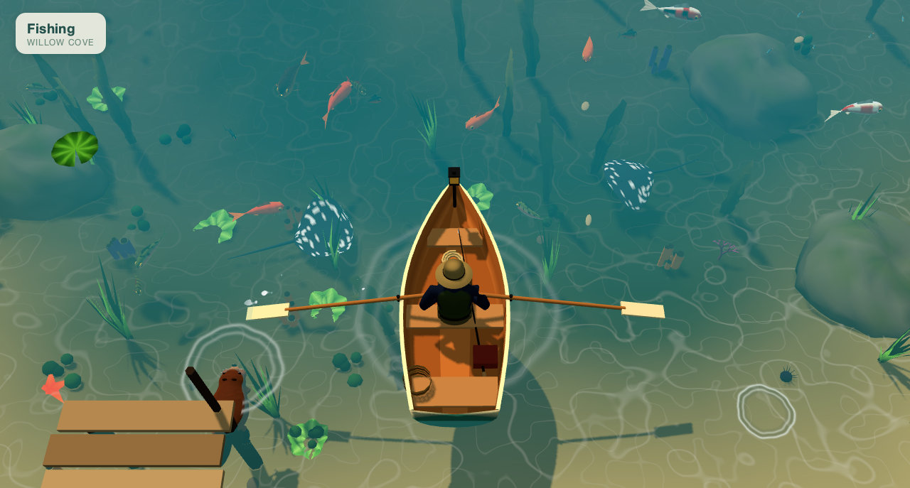

# Fishing

A cozy top-down fishing game in native Lambda. Row a little boat around Willow
Cove, cast, wait for a bite and strike. Everything is generated in code (the
cove, the boat and angler, every fish and the beaver), and the game runs in
Radiant using `lambda.scene3d`.

```sh
./lambda.exe demo fishing
# Equivalent direct entry:
./lambda.exe view test/demo/fishing/fishing.ls
```



| Key | Action |
| --- | --- |
| ↑ / W | Row forward |
| ↓ / S | Back water |
| ← → / A D | Turn |
| Space, Enter, or a tap on the water | Cast · reel in · strike |
| T | Strike assist on/off |

Space casts while the boat is drifting slowly. A fish comes to the bobber,
nibbles once or twice (the float twitches and rings), then takes it: the float
is dragged under. Strike within about a second to hook it. The angler then
fights it to the boatside, lifts it out for a look, and lets it go, and the
catch badge counts it. Rowing reels the line in first. The strike assist strikes
for you a beat after the bite.

## The cove

- **Water**: a GLSL film over the lit floor. It has a depth tint, a fresnel sky
  sheen, a broken foam lip at the beach, and toon sun glints cut from an
  animated wave normal, glittering in drifting bands. A second film lays thin
  drifting caustics on the floor, brightest in the shallows.
- **Ripples**: natural water rings rather than circles. Each is one disc of
  vertex colour and alpha: a bright leading crest with a darker trough behind
  it, then weaker trailing rings. The edges wobble a little, the bands widen as
  they spread, and they fade. Three ripple emitters (small, medium, large), a
  foam crown and splash droplets are spawned where the oar blades bite and leave
  the water, behind the boat, at the bobber, under nibbles and bites, where a
  hooked fish thrashes, where fish rise to sip, behind the beaver and where its
  tail slaps.
- **Plants and stones**: 70 noise-sculpted boulders with shaded crevices, lichen
  on top and algae below. 179 water-lily pads (notched, cupped, veined, fresh
  green to old gold), about one in five carrying a white, pink or yellow lily.
  Five lotus stands with round wavy leaves (some held above the water on
  stems), tall layered pink flowers with seed pods, and buds. Under water:
  lettuce-like rosettes, kelp, purple sea fans, moss balls, seagrass, tube
  sponges, starfish and urchins. Instanced plants sway in shared wind clips and
  stay below the surface.
- **Fish**: 44 skinned fish of eight species: koi, rainbow trout, perch,
  bluegill, common carp, and schools of minnows and blue tang. Each has a blunt
  head with a darker mouth, a gill-cover line, a lateral line, scale shimmer,
  eyes with iris, pupil and highlight, and fins with rays; carp have barbels. A
  looping clip of travelling body waves drives each one, and its rate and
  weight follow swimming speed in bands with hysteresis. Steering eases into
  turns and depth changes, and the body's pitch and roll ease too, so nothing
  snaps between frames. Three spotted rays glide near the floor on
  flapping wings. Fish wander, school, shy from the boat, rise to the surface,
  come to the bobber (biting species only), and cast shadows on the floor.
  They cruise in the top half-metre or so, where the water is clear enough to
  see them. Most loners start in view, and wanderers are curious: about three
  times in four they pick their next spot just outside the boat's shy radius.
  A spot that would land on the bank swings to the cove side, so wherever the
  boat stops, fish gather round within a few seconds. A startled school
  re-forms once the scare is over.
- **Beaver**: one chubby skinned body with a round head, puffy cheeks, a pale
  muzzle, a shiny black nose, orange buck teeth, beady eyes, round ears and
  whiskers, little forepaws with claws holding a leafy twig, big webbed hind
  feet and a flat scaly paddle of a tail. It swims head-up with alternating
  hind strokes and the twig under its chin, keeps the boat company, gnaws the
  twig with quick little nods while the boat rests, and slaps its tail on the
  water with a splash at every catch.
- **Boat and fisher**: a lofted rowboat with floorboards above the waterline,
  and a seated adult as one skinned mesh: canvas bucket hat, bearded face, navy
  sweater under a waxed vest, khaki trousers and boots. Rowing, casting,
  nibbles, bites, the strike and the release are clips sampled from pose
  functions, and a two-bone IK solve places the hands on the oar handles, the
  rod grip or the reel. The fishing line is a skinned ribbon whose bones ride
  at the rod tip, mid-line, bobber and hook.

## How it is built

The scene is built once and its DOM never changes, so it is never re-projected.
Each frame the game steps as a pure function (**S12.1.1v5**) and hands the host
three kinds of command through the explicit Radiant contracts (**D9.5.6v2**):

- one physics command of pose targets for every kinematic body (boat, fish,
  beaver, camera rig);
- an animation batch when a clip must switch or a fish's tail-beat changes;
- a particle batch for the frame's ripples and splashes.

The HUD (catch badge, hint, toast) changes only when its text does, and the
toast and badge pop through the presentation channel.

| Module | Owns |
| --- | --- |
| `mod_world.ls` | Shore, floor depth and colour, rocks, pads, plants, jetty, navigation |
| `mod_glsl.ls` | Water and caustic shader bodies |
| `mod_rig.ls` | Shared skinning helpers: aim and two-bone IK, automatic weights, smooth surfaces, tubes, ellipsoids |
| `mod_flora.ls` | Boulders, water lilies, lotus, and underwater rosettes, kelp, sea fans and moss balls |
| `mod_lagoon.ls` | The cove's merged meshes, instanced plants, water films, wind and tide clips |
| `mod_fish.ls` | Species, roster, skinned fish and ray buffers, skeletons and swim clips |
| `mod_beaver.ls` | The beaver's body, rig and swim, gnaw and tail-slap clips |
| `mod_fisher.ls` | The fisher's skinned body and rig, and IK tracks from hand targets |
| `mod_boat.ls` | Hull, gear, oars, rod, line rig and bobber, and the boat body holding the fisher |
| `mod_angler.ls` | Pose functions with hand targets, the catch path, and the clips sampled from them |
| `mod_scene.ls` | Physics world, lights, emitters, camera rig, and the assembled scene |
| `mod_sim.ls` | The game step: rowing, the fishing sequence, fish, beaver and camera |
| `mod_present.ls` | Pose targets, clip and particle batches, and HUD writes |
| `mod_hud.ls`, `fishing.ls` | The page, input handlers and the frame loop |

The demo reuses Midtown's numeric and mesh helpers (`mod_util`, `mod_mesh`,
`mod_camera`), plus procart's seeded `rng` and `noise`.

Development aids:

- `FISHING_PROFILE=1` prints each frame's Lambda step and host hand-off cost
  (about 1 ms and 0.2 ms on a debug build).
- `FISHING_ASSIST=1` starts with the strike assist on.
- `FISHING_STAGE=bite` starts with the line out and a koi nibbling, which
  reaches the strike in about a second.

## Verification

From the repository root, with native graphics access:

```sh
./test/test_lambda_gtest.exe --gtest_filter='AutoDiscovered/*scene3d_fishing*'
./test/test_radiant_view_gtest.exe --gtest_filter='Scene3dTest.Fishing*'
LAMBDA_HEADLESS_GLFW_WINDOW=1 ./lambda.exe demo fishing --headless \
  --event-file test/demo/fishing/tests/catch.json --event-result temp/fishing-catch.json
```

The model golden (`test/lambda/scene3d/fishing.ls`) checks the cove layout and
flora counts, the roster and its skinned buffers, the angler's rod tip, bobber, blades, catch path
and clips, and the pure game step. That covers rowing out, gliding to a stop, a
cast, a reel-in, and a staged bite that the assist lands, counts and releases.
`tests/desktop.json` rows, turns, casts, reels in and rows away, checking each
mode change and that the scene draws and moves. `tests/catch.json` turns on the
assist, casts and waits for a natural bite to be caught and counted. Refresh the
catalog tile with `sh test/demo/previews/capture.sh fishing`.

## Design reference

The genre and mechanics follow cozy top-down fishing games, such as *Slackwater*,
a short game shown on raea.io: row, cast, watch the float, strike. Its source is
not published, and nothing of it is used here. The cove, characters, palette,
models and code are original to this demo.
