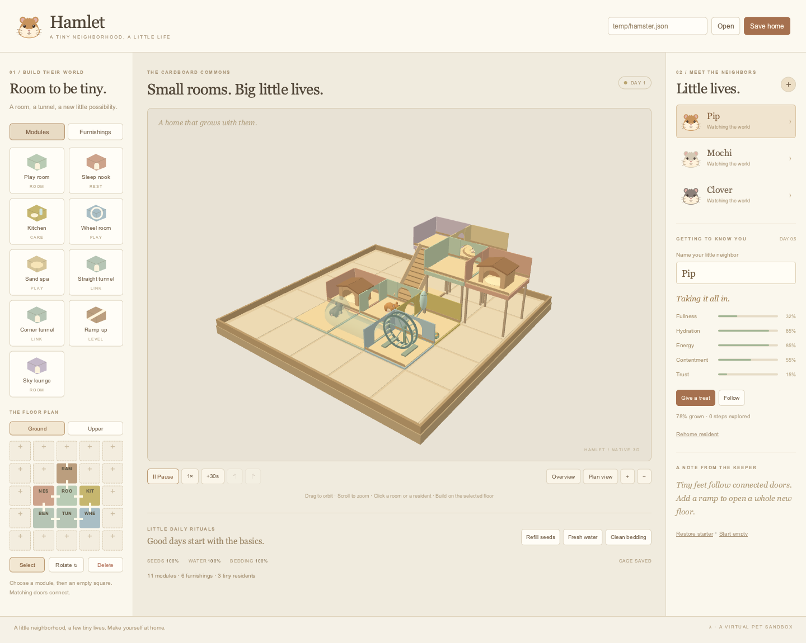
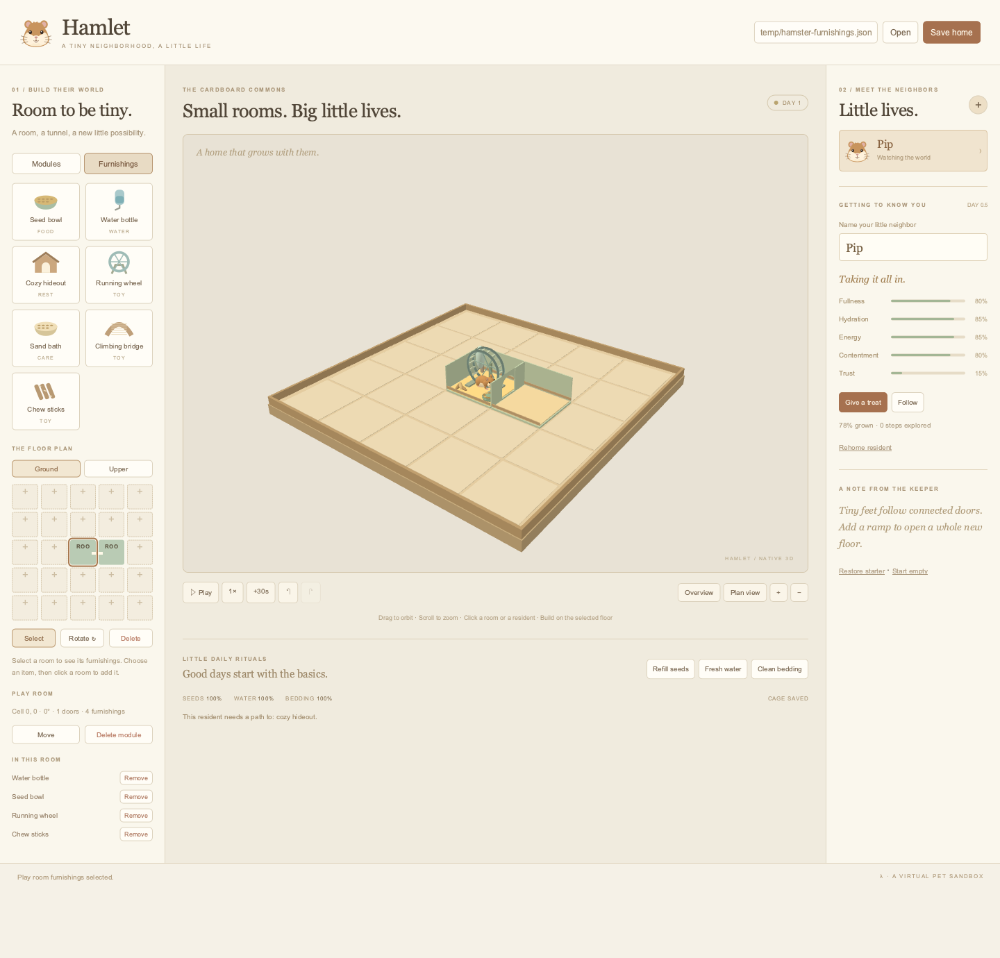

# Hamlet — Lambda Hamster

A native 3D hamster neighborhood built from modular cardboard rooms. Build a
home, adopt virtual residents, and watch them find their own way to food,
water, nests, tunnels, wheels, and sand baths.

```sh
./lambda.exe demo hamster
# Equivalent direct entry:
./lambda.exe view test/demo/hamster/hamster.ls
```



## Build a neighborhood

The starter has 11 connected modules on two floors and three residents: Pip,
Mochi, and Clover. **Start empty** begins with an empty tray; place a room and
click **+** beside Little lives to adopt your first hamster. **Restore starter**
resets the cage and residents to the initial neighborhood.

Choose **Modules**, pick a module from the palette, then click an empty square in the floor
plan or in the 3D scene. Occupied cells select their existing module. Each cell
holds one module; the plan is five by five with ground and upper floors, up to
40 modules total. Modules snap to cells. **Move** relocates a selected module
to an empty cell; **Rotate** turns a selected module, or the pending placement,
by 90 degrees. **Delete** enables a tool that removes the next module you click
on the plan or in the scene. You can also select a module and choose **Delete
module**, or press Delete / Backspace. Furnishings inside the room are removed
with it. Residents using the deleted room move into free rooms in their old
connected home. Deletion is refused when there is no room to keep them apart;
add a connected room or rehome a resident first.

| Module | Purpose and connections |
| --- | --- |
| Play room | Open space; doors on all four sides |
| Sleep nook | A cardboard hideaway for sleeping; four doors |
| Kitchen | Seed bowl and water bottle; four doors |
| Wheel room | Exercise wheel; four doors |
| Sand spa | Sand bath; four doors |
| Straight tunnel | Opposite doors, initially east/west |
| Corner tunnel | Adjacent doors, initially east/north |
| Ramp up | West door on the ground, east door on the upper floor; rotates with the module |
| Sky lounge | Another room for exploring; four doors |

Adjacent doors connect only when their elevations match. Ramps start on the
ground floor. Upper modules have support posts and need a reachable ramp to
join the ground-floor neighborhood. Floor-plan port marks show actual
connections. Selecting an isolated resident displays the missing reachable
care furnishings. Hamsters stay within their connected component.

**Undo / Redo** restores modules and their furnishings. Undo cannot erase a room
that a resident now occupies. A hamster already crossing a retained connection
finishes that edge; future routes are replanned after topology changes. Moving
an occupied room carries its resident with it. Adoption, care, resets, and
simulation progress are separate from cage edit history.

## Furnish the rooms

Open **Furnishings**, choose an item, and click an existing room on either the
floor plan or the 3D scene. Select a room to see **In this room**, with a
**Remove** button beside each furnishing. **Select** clears the placement tool.
Tunnels and ramps stay clear of furnishings.

| Furnishing | What residents do with it |
| --- | --- |
| Seed bowl | Eat seeds supplied by Refill seeds |
| Water bottle | Drink water supplied by Fresh water |
| Cozy hideout | Sleep and recover energy |
| Running wheel | Exercise; the wheel spins while in use |
| Sand bath | Groom and gain contentment |
| Climbing bridge | Play and gain contentment |
| Chew sticks | Investigate and gain contentment |

A room has space for one bowl, one bottle, one set of chew sticks, and one
large furnishing: a hideout, wheel, sand bath, or bridge. Remove the large item
before replacing it. Kitchen, sleep, wheel, and sand modules start furnished;
all open room types can be furnished independently. Removing a bottle from a
kitchen removes its drinking service. Moving and rotating rooms carries their
contents. Placement, removal, module deletion, undo/redo, and saving all preserve
the room's item list.



## Raise the residents

Each hamster has its own fullness, hydration, energy, contentment, trust, age,
and explored distance. Residents prioritize reachable resources: thirsty
hamsters seek bottles, hungry ones find bowls, tired ones find hideouts, and restless
ones use wheels, sand baths, bridges, or chew toys. These activities depend on
the furnishings present, rather than the room's name. Otherwise they explore the connected rooms
and tunnels. Food and water supplies are consumed; bedding gets dirty.

Residents exclude one another. A hamster reserves its current room and the
next room on its route, waits at busy connections, and replans through free
rooms. Swept body-clearance checks prevent residents on nearby paths from
crossing through each other. Clearance covers the adult body, so growing
hamsters stay separated too. Turn-taking priority rotates between residents.
Leave spare connected rooms for passing; a completely occupied narrow corridor
can wait until space becomes available.

Use **Refill seeds**, **Fresh water**, and **Clean bedding** for supplies.
Residents must still reach a bowl or bottle to eat or drink. **Give a treat** improves
the selected hamster's fullness, contentment, and trust. The **+** button adopts
another resident, up to six. Select a resident card or click a hamster in the
scene, edit its name, or use **Rehome resident** to remove it.
New residents move into a free connected room. If none is available, adoption
waits until a room clears or you expand that part of the cage.

Hamsters grow gradually from their starting size toward adult size over five
simulated age days. One age day is 120 simulation seconds. **Pause** freezes
ordinary simulation while preserving editing and care controls. **1× / 4×**
changes the simulation rate; **+30s** advances thirty simulation seconds even
while paused. Progress advances only while this demo is running; reopening a
save does not add offline time.

Drag the scene to orbit and scroll to zoom. **Overview** returns to the cage
camera; **Plan view** looks down on the tray. **Follow** tracks the selected
hamster at close range ([native close-up](resident.png)). Camera controls continue
working in follow mode.

The procedural bodies have cream bellies, rounded haunches and shoulders,
four articulated legs with toes and claws, inset ears, cheek pouches, a pink
nose, paired incisors, whiskers, and a short segmented tail. Walking moves the
legs; idle residents sniff and blink, and sleeping residents close their eyes.
The adult clearance envelope still covers the detailed bodies as they grow.

| Key, outside text fields | Action |
| --- | --- |
| Space | Play / pause |
| R | Rotate module or pending placement |
| Delete / Backspace | Remove selected module |
| Escape | Select tool; cancel pending move |
| + / − | Zoom |
| Ctrl/Cmd+Z | Undo cage edit |
| Ctrl/Cmd+Shift+Z | Redo cage edit |
| Ctrl/Cmd+S | Save cage and resident progress |

## Save and reopen

Enter a `.json` path in the header and choose **Save home** or **Open**. The
default is `temp/hamster.json`, relative to the process's working directory.
Saving uses an atomic write. A versioned `lambda-hamster` document contains the
module layout and furnishings, residents and their needs, names, coats, ages, explored distance,
simulation clock, supplies, and bedding cleanliness. Opening validates types,
bounds, IDs, occupancy, module rotations, quotas, and resident room references
before replacing the session. Errors appear in the status bar.
Older saves with co-located residents are spread into free connected rooms.
Older room records without an item list receive that module type's starter
furnishings. An explicit empty item list stays empty on reopening. Unknown,
duplicate, incompatible, or oversized furnishing lists are rejected.
A save with insufficient space is refused, preserving the current session.
Edits and undo operations also preserve resident separation.

Camera, selection, undo history, active routes, and animation phase are session
state. Loaded residents restart their activities from the saved current room.
The saved/unsaved indicator tracks cage edits; save again to capture later
resident progress and supplies.

## Implementation and verification

The delivered milestone is a native, editable modular cage with autonomous
care activities, growth, adoption/naming, connected movement, and save/load.
Breeding, genetics, death, free-form mesh editing, and a physical rigid-body
simulation are outside this milestone. Movement
follows the module graph with ramp-aware height and curved tunnel waypoints;
this is a virtual pet sandbox.

`mod_items.ls` owns the furnishing catalog, room slots, legacy defaults, and
activity services. `mod_cage.ls` owns the module catalog, grid, matching ports, ramp elevations, and
breadth-first routes. `mod_sim.ls` advances independent residents in bounded
substeps. `mod_model.ls` owns editing, care, adoption, and file validation.
`mod_scene.ls` builds the procedural geometry; `mod_ui.ls` builds the shell;
`mod_present.ls` retains resident meshes across simulation frames; `hamster.ls`
handles native events, files, and frame scheduling.

Scene descriptions and simulation are pure values (**S12.1.3**); handlers own
effects through the documented package boundary (**D7.2.4v4 / D7.5.3v2**).
Retained DOM ownership follows **D4.5.1v4**. Shared `lambda.scene3d.dom` helpers
serve Hamlet, Aquarium, and CellScope. `history_snapshot` reuses the existing
editor undo/redo implementation, and shared surface grid indices serve sphere,
torus, and tunnel geometry. No engine or formal-spec ruling changes are made.
Runtime operation needs no JavaScript application, Three.js, downloaded models,
textures, or npm installation.

Verification budget: model goldens on interp/auto/jit, native desktop/mobile
interaction replays, the existing Aquarium and CellScope replays for shared
helpers, demo command tests, and the editor transaction-history golden.
The furnishings milestone adds item use and validation, occupied deletion and
evacuation, save/load and undo checks, and native desktop/mobile tab, inventory,
keyboard deletion, and detailed body checks. The prior exclusion replay remains
part of its acceptance gate.
Verified 2026-10-26: all selected checks pass. The desktop replay has 40
assertions across 87 events; its narrow companion checks a 390px layout and
physical module placement. Focused regressions first reproduced incorrect ramp
height and bend waypoints, then passed after geometry-aware traversal was added.

The exclusion regression samples converging and opposing traffic, a six-resident
neighborhood, separate floors, and a ramp passing beneath an occupied upper
room. It checks continued movement and feeding as well as clearance, including
resuming after a neighbor leaves. The native exclusion replay verifies rendered
resident separation, retained geometry, crowded adoption, migration of old
co-located saves, and refusal of an overcrowded save without replacing the
current session. These checks pass on interp, auto, and jit alongside the
desktop and mobile replays.

```sh
./test/test_lambda_gtest.exe --gtest_filter='AutoDiscovered/*scene3d_hamster*'
LAMBDA_EXEC_BACKEND=interp ./test/test_lambda_gtest.exe --gtest_filter='AutoDiscovered/*scene3d_hamster*'
LAMBDA_EXEC_BACKEND=jit ./test/test_lambda_gtest.exe --gtest_filter='AutoDiscovered/*scene3d_hamster*'
./test/test_radiant_view_gtest.exe --gtest_filter='Scene3dTest.Hamster*'

LAMBDA_HEADLESS_GLFW_WINDOW=1 ./lambda.exe demo hamster --headless \
  --event-file test/demo/hamster/tests/hamster_editor.json \
  --event-result temp/hamster-editor-result.json
```

The direct replay writes `temp/hamster-desktop.png`, `temp/hamster-follow.png`,
and `temp/hamster-replay.json`. The mobile fixture writes
`temp/hamster-mobile.png`. Native graphics access is required. Refresh the
catalog tile with `sh test/demo/previews/capture.sh hamster`.

The [Artificial Analysis reference](https://artificialanalysis.ai/microevals/create-a-3d-hamster-cage-simulation-with-multiple-autonomous-1781915895426)
inspired the autonomous care activities. The user's cardboard fortress image
inspired connected rooms, arched doorways, tunnels, and multiple floors. All
application code, geometry, and UI artwork here are authored for Lambda.
