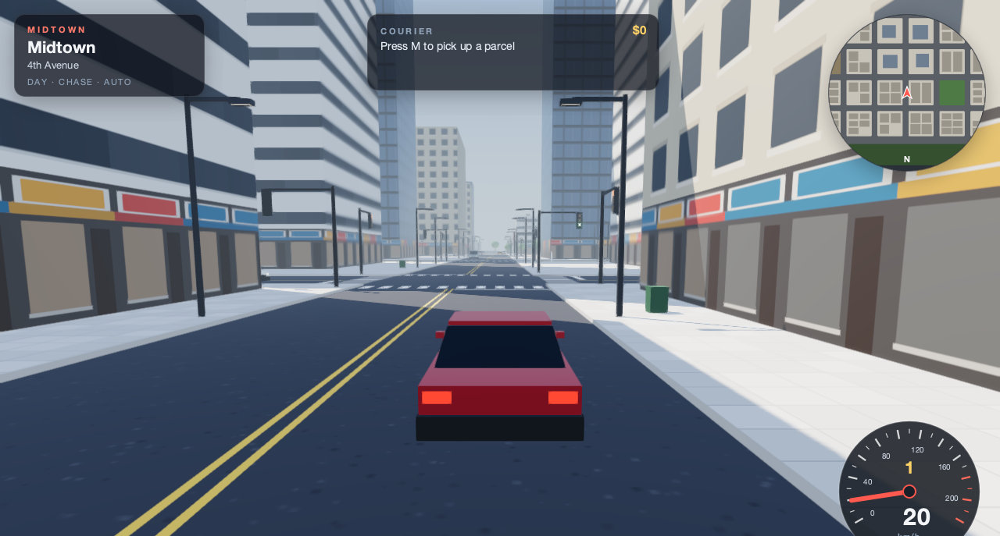

# Midtown

An open-city driving sandbox written in Lambda Script on native Scene3D. Drive
around Lumen Bay, a procedural city of thirty-six blocks: towers downtown, offices
and flats, two parks, a plaza with a fountain, a construction yard with a slewing
crane, a stunt lot, and a harbour promenade beyond the south barrier.

```sh
./lambda.exe demo midtown
# Equivalent direct entry:
./lambda.exe view test/demo/midtown/midtown.ls
```



The genre and feature set follow open-world driving games such as the
[OpenLiberty](https://github.com/openfw-game/OpenLiberty) Godot project's vehicle
prototype: an engine with automatic gears and a reverse speed limit, smoothed
steering, a chase camera that swings with the car, headlights, and day and night.
OpenLiberty loads the user's own copy of a commercial game's files; Midtown uses
none of them. Its city, rules, models and textures are original and generated in Lambda.

## Driving

- **W / ↑** accelerate, **S / ↓** brake and then reverse, **A D / ← →** steer,
  **Space** handbrake (the rear steps out, so the car drifts), **C** hold to look back.
- **V** cycles the chase, wide, bumper and overhead cameras. Drag the scene to look
  around; the view drifts back behind the car once it moves.
- **N** cycles day, dusk and night. Dusk and night light the windows, shop fronts,
  street lamps and their pools of light, and switch the headlights on; **L** or **Z**
  toggles them.
- **M** starts a courier run: drive to the green beacon to collect a parcel, then
  to the amber beacon before the clock runs out. Each delivery pays a fare plus the
  seconds to spare, multiplied by the streak, and the next pickup appears at once.
- **O** hands the car to Auto drive, which follows the lanes and signals like
  traffic. Any driving key takes the wheel back. **R** puts the car back on the
  nearest lane, **P** or **Esc** pauses, **H** lists the keys.
- On small or touch screens, pedals and steering buttons appear at the bottom.

Traffic keeps to the right-hand lane, picks a turn at every junction, stops for red
and amber lights, queues behind whatever is ahead (the player included), and waits
for oncoming cars before turning left. A bumped car stops for a moment. Pedestrians
walk the sidewalk loop around their block and hop clear of a car bearing down on
them. The stunt lot has two ramps that launch the car across the neighbouring
streets, crate pyramids, a cone slalom and barrels; the yard and some sidewalks have
more props. Buildings, parked cars, lamp posts, trees and signal poles are solid.

## How it works

| Module | Role |
| --- | --- |
| `mod_city.ls` | The plan: grid, block kinds, buildings, furniture, signals, parked cars, props, ground height, collision boxes and their cell index, place names. |
| `mod_vehicle.ls` | Car dynamics: gearbox, speed-sensitive steering, tyre grip and drifting, curbs, ramps and airtime, separating-axis collisions with buildings and traffic. |
| `mod_traffic.ls` | Lane-following traffic and signal timing; also places the player's car on the nearest lane for Reset and Auto drive. |
| `mod_peds.ls`, `mod_mission.ls`, `mod_camera.ls` | Pedestrians, courier runs, camera rigs. |
| `mod_mesh.ls`, `mod_textures.ls` | Buffer geometry for the city, vehicles, people and props; procedural SVG facades, storefronts and ground textures. |
| `mod_scene.ls` | The native scene: merged city meshes, instanced furniture, the physics world, clips, lighting looks and post effects. |
| `mod_hud.ls`, `mod_present.ls`, `midtown.ls` | HUD markup, the per-frame step and sync, and the page with its event handlers. |

The simulation is pure Lambda: each frame `advance()` steps the car, traffic,
people, courier and camera. Everything that moves on screen is a physics body,
including the camera, so `sync()` hands the whole frame to Radiant as one batch of
kinematic pose targets; no scene element is edited per frame (a camera attribute
edit would relayout the page). Bodies apply their targets on the next physics tick
at 120 Hz, so the camera and the car move together. The car pushes the crates,
cones, barrels and bins, which are dynamic bodies; their contact events count the
props scattered. Signal lamps, the crane, harbour ripples and beacon pulses are
native clips on the scene clock, which the traffic also reads, so cars and lamps
agree. The chase camera casts a native ray to stay in front of buildings.
Lighting looks and headlights are attribute edits made once per change; the HUD's
moving readouts update through the presentation channel, without layout.

The scene sets `'max-pixel-ratio': 1.0`: on a Retina display it renders one
pixel per CSS pixel and the GPU upsamples the finished frame once (with the GPU
compositor, while it composites the frame into the window). Its
multisampled HDR targets at full density would exceed Radiant's 512 MiB graphics
budget. Measured live on a Retina MacBook (release build, full 1280×800 window),
the Lambda step and sync take about 1 ms a frame and the page holds about
31 fps. Radiant sets that rate: the synchronous readback of the scene image
waits about 6 ms for the GPU, and the translucent HUD panels are recomposited
over the moving scene each frame. The window now composites the scene on the GPU
by default instead of reading it back (`RADIANT_GPU_COMPOSITOR=off` restores the readback)
([GPU compositor](../../../vibe/radiant/Radiant_Design_GPU_Compositor.md)) and repaints
only the HUD readouts that changed; the page then holds about 56 fps, with a median
frame of one 60 Hz vsync. `MIDTOWN_PROFILE=1` prints each frame's interval, step
and sync times; `MIDTOWN_SPAWN=x,z,heading` starts the car elsewhere, for example
`MIDTOWN_SPAWN=-178,168,1.5708` in front of the stunt ramp.

## Verification

```sh
./test/test_lambda_gtest.exe --gtest_filter='*scene3d_midtown*'
./test/test_radiant_view_gtest.exe --gtest_filter='Scene3dTest.Midtown*'
# Direct replays after changing just the Lambda demo (also tests/mobile.json):
LAMBDA_HEADLESS_GLFW_WINDOW=1 ./lambda.exe view test/demo/midtown/midtown.ls \
  --headless --event-file test/demo/midtown/tests/desktop.json \
  --event-result temp/midtown/desktop-result.json
```

The golden `test/lambda/scene3d/midtown.ls` checks the city, the car's dynamics,
a simulated minute of traffic with no overlaps and no car off the road, pedestrian
dodging, the courier cycle, the cameras and scene validation on all tiers. The
desktop replay checks start, driving, courier, the night look and its headlights,
cameras, Auto drive, pause, the keys card and reset against native render stats and
pixel changes; the mobile replay drives with the touch pedals at phone width.
Recapture the index tile with
`LAMBDA_HEADLESS_GLFW_WINDOW=1 sh test/demo/previews/capture.sh midtown`.
