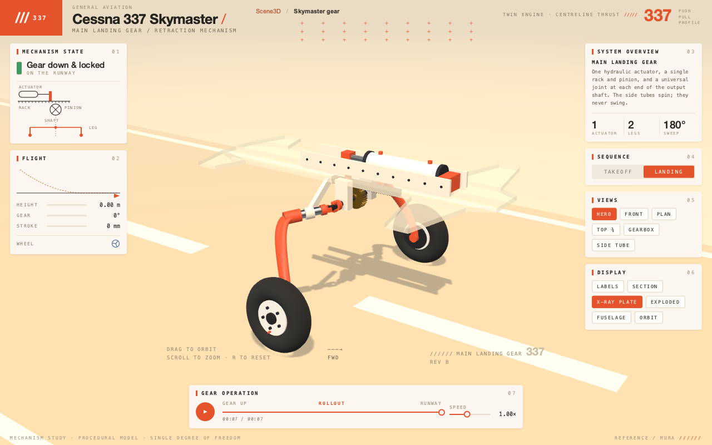

# Skymaster gear

A native Lambda Scene3D mechanism study inspired by
[Mura's Cessna 337 landing-gear post](https://x.com/0x_mura/status/2116209868331987001).
The procedural geometry and illustrative dimensions are authored locally;
there is no downloaded model or remote runtime dependency.

```sh
./lambda.exe view test/demo/scene3d/skymaster/skymaster.ls
# Also available from: ./lambda.exe demo scene3d
```



One hydraulic actuator translates a rack, which turns the pinion and transverse
shaft. Mirrored universal joints rotate the swept side tubes about their own
axes, folding both spring legs inward through a half-turn. The model includes
the piston and rod-end connector, rack teeth, shaft bearings, joint forks,
spring legs, tyre profiles, hubs and wheel bolts.

- **Landing / Takeoff:** deployment and retraction, changing ground clearance,
  runway motion, touchdown flex, wheel roll and airborne spin-down.
- **Playback:** pause/resume, replay from the end, a scrubber and 0.25–2× speed.
  Scrubbing pauses and snaps to the live native runtime's simulation tick.
- **Inspection:** Hero, Front, Plan, Top ¾, Gearbox and Side Tube cameras;
  projected labels, cylinder section, X-ray plate, exploded assemblies,
  translucent fuselage context and automatic orbit.
- **Input:** drag to orbit, scroll or `+`/`-` to zoom, arrows to turn, `R` for
  the hero view, and Space to pause/resume the focused scene. Focus a slider
  and use arrows or Home/End to adjust it. Manual camera input stops orbit.
- **Small windows:** the stage stays above the playback bar; instrument panels
  scroll inside the app. Breadcrumb navigation returns to the Scene3D collection.

`mod_rig.ls` owns the mechanism's single degree of freedom, rigid transforms,
flight sequences and sampled native tracks. `mod_mesh.ls` builds indexed meshes;
`mod_model.ls` assembles the fixed and moving parts. `mod_scene.ls` supplies
native materials, lighting, shadows and clips. `mod_camera.ls`, `mod_ui.ls` and
`mod_present.ls` handle inspection, panels and projected callouts.

The native runtime owns playback time. Handlers sample that clock for the
instrument panel; geometry animation stays in the native clip. The page is
built once, with live presentation changes owned by its session handlers
(**S12.1.5v2**); typed scene edits cross the explicit DOM boundary
(**D7.5.3v2**). The model is a kinematic illustration; it does not solve
hydraulic pressure, spring stress or contact forces.

Verification:

```sh
./test/test_lambda_gtest.exe --gtest_filter='*scene3d_skymaster*'
./test/test_radiant_view_gtest.exe --gtest_filter='Scene3dTest.Skymaster*'
# Direct replay after changing just the Lambda demo:
LAMBDA_HEADLESS_GLFW_WINDOW=1 ./lambda.exe view test/demo/scene3d/skymaster/skymaster.ls \
  --headless --event-file test/demo/scene3d/skymaster/tests/desktop.json \
  --event-result temp/sky/desktop-result.json
```

The paired `test/lambda/scene3d/skymaster.ls` / `.txt` golden checks kinematics,
symmetry, contact height, tick rounding, clip shapes, camera projection and mesh
buffers on interpreter/auto/JIT. Registered desktop and mobile event replays
check native input, visible pixel changes, runtime state, all camera presets,
display modes, end-of-sequence stopping, retained rendering and navigation.
Native graphics access is required for these event replays.
