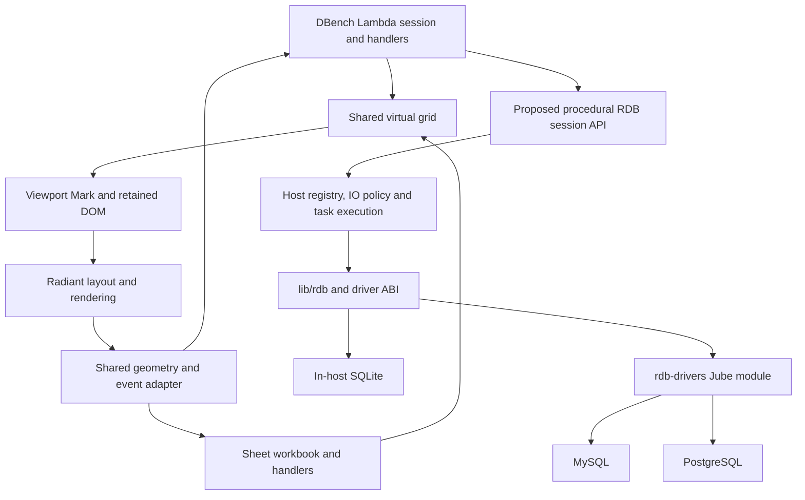

# DBench — Database Workbench Demo Proposal

**Status:** Working proposal, 2026-11-04. DBench and the shared virtual grid are
under implementation; the [implementation checkpoint](impl/Lambda_Impl_DBench.md)
records completed behavior, verification and remaining work.

**User requirements:** a new Lambda demo named `dbench`, similar to DBeaver,
with SQLite, MySQL and PostgreSQL connections. Reuse Sheet's grid interaction
code where appropriate. **Both DBench and Sheet must use virtual grid
rendering: generate and mount only the visible rows and columns, with a small,
bounded overscan margin.** This is a core performance requirement.

**Scope:** the native Lambda/Radiant desktop demo, a reusable virtual grid,
Sheet's migration to that grid, and the database API additions needed for an
interactive workbench. Existing database drivers remain the foundation.

**Specification linkage:** [Formal Semantics](../doc/Lambda_Formal_Semantics.md)
S1.4v2 (explicit value state), S12.1.1v3 and S12.1.3v2 (pure rendering and
procedural handlers), S12.4.1v3–S12.4.3 (resource acquisition and scoped
cleanup), S12.4.4v4 (SQLite transaction boundaries), S13.1.1v3 and
S13.3.1v2 (tasks and document ownership), S13.3.2 (cancellation).
[Formal Design](../doc/Lambda_Formal_Design.md) D9.1.2 and D11.1.2 (IO
ownership and policy), D10.2.1 (DOM editing-policy boundary), D9.4.2–D9.4.4
(Jube loading and module boundaries), D9.5.1 (opaque resource IDs),
D9.5.6 (Lambda/Radiant boundary), D5.5.1/D5.5.2 (native ownership), and
D6.3.3 (precise native rooting). Database-specific records without a formal
ruling are RDB1–RDB9, RDB11/RDB12 and JA16.1–JA16.4 in
[Lambda_IO_RDB.md §13](Lambda_IO_RDB.md#13-network--embedded-drivers-the-rdb-drivers-jube-module).
That section retains its own proposal/ratification status; reuse of its
implementation does not ratify its outstanding decisions. No language or
runtime ruling changes are made here.


## 1. Product direction

DBench demonstrates a practical database administration and query application
written in Lambda: connect, explore a schema, inspect a large table, run SQL,
review results, make controlled changes, and export data.

The reference interaction is DBeaver's connection navigator, SQL editor and
tabbed data editor. Its [SQL Editor](https://dbeaver.com/docs/dbeaver/SQL-Editor/)
and [result navigation](https://dbeaver.com/docs/dbeaver/Navigation/) provide
useful precedents for connection-bound scripts and incremental fetching.
DBench should deliver that everyday workflow with a smaller feature set.

Proposed entry point:

```sh
./lambda.exe demo dbench
```

The default experience opens a bundled SQLite sample, with realistic tables,
foreign keys, nulls, dates and enough rows to demonstrate virtualization.
MySQL and PostgreSQL use real connections supplied by the user; an unavailable
driver or server produces an actionable connection error. Sample mode is
clearly identified and never silently substitutes for a failed connection.

### Initial feature boundary

| Area | Proposed core behavior |
| --- | --- |
| Connections | Named SQLite/MySQL/PostgreSQL profiles; connect, test, disconnect, reconnect; visible engine, target and read/write mode |
| Navigator | Tables and views; columns, primary keys, indexes and foreign keys; refresh and name filtering |
| Table browser | Virtual result grid, server-side sort/filter, incremental fetch, row details and foreign-key navigation |
| SQL editor | Multiple tabs, editable SQL, execute explicit selection or a single statement, parameters, errors, timing and cancellation |
| Results | Ordered columns and positional rows, null/type display, rectangular selection, copy, column resize and CSV/JSON export |
| Administration | Object properties and available DDL; explicit writable SQL and staged table edits in later milestones |
| Workspace | Resizable panes, query history, saved scripts and non-secret connection settings |

Defer ER diagrams, visual schema migration, server monitoring, role/grant
editors, SSH tunnels, native backup/restore, stored-procedure debugging,
spreadsheet formulas in DBench, and additional engines. SQL can cover many
administrative tasks before specialized dialogs are justified.

## 2. Window and interaction model

```text
+------------------------------------------------------------------------+
| DBench  [Connection: Local sample v]  [+ Connect] [SQL] [Refresh]        |
+----------------------+-------------------------------------------------+
| Connections          | customers [Data | Columns | Keys | DDL]  query.sql|
|  Local sample        +-------------------------------------------------+
|   Tables             | SELECT customer_id, name FROM customers          |
|    customers         | WHERE active = ?                                 |
|    orders            | [Run] [Cancel] [Parameters] [Max rows: 1000]      |
|   Views              +-------------------------------------------------+
|  MySQL / development | Results 1 | Messages | History                   |
|  Postgres / staging  | # | customer_id | name       | ...                |
|                      |   |             virtual grid                    |
+----------------------+-------------------------------------------------+
| Read only | SQLite | 256 rows fetched | More available | 18 ms          |
+------------------------------------------------------------------------+
```

The navigator and main region have a draggable divider. The SQL editor and
results have a second divider. A table tab can give the grid the full main
region. A row-details panel shows the selected value, including multiline
text, JSON, decimal spelling and binary metadata, without making every grid
row variable-height. Large values use a bounded inspector or streamed export
rather than unbounded allocation.

Each SQL tab records its connection and database/schema context. Changing the
navigator selection does not retarget an existing tab. Disconnecting marks its
results as a retained snapshot and disables execution until reconnection;
reconnection creates a new session generation. Unsaved scripts and staged
edits have independent dirty indicators.

Keyboard support includes grid arrows, Shift selection, Page Up/Down,
Home/End, copy, F2 for eligible edits, Escape to cancel a draft, and
Ctrl/Cmd-Enter to run the selection or single statement. Whole-row selection
and copying operate on logical rows, including rows outside the mounted window.

## 3. Reuse and the actual starting point

The inspected tree already contains substantial pieces, but neither a
production SQL workbench API nor a shared virtual grid.

| Existing source | Reuse | Work still needed |
| --- | --- | --- |
| [Sheet](../test/demo/sheet/README.md), `mod_view.ls`, `mod_selection.ls`, `mod_resize.ls`, `mod_model.ls` | Cell/range selection, keyboard navigation, editor behavior, column/row sizing, clipboard and geometry conventions | Remove Sheet-specific assumptions from reusable behavior; virtualize both axes |
| [Finder design](Lambda_Demo_Finder.md), `test/demo/finder/mod_model.ls`, `mod_ui.ls`, `finder.js` | Measured viewport, spacer-based row windows and retained publication | Extend the approach to a two-dimensional grid; avoid its render-everything fallback before first measurement |
| `lambda.ui.workspace`, `lambda.ui.core.splitter`, `.menu`, `.publish` | Desktop controls, pane sizing, pointer capture, menus and targeted DOM updates | Supply workbench-specific composition and grid presentation |
| [lib/rdb.h](../lib/rdb.h), [lib/rdb_abi.h](../lib/rdb_abi.h) | Backend-neutral connections, schema metadata, prepared parameters, result descriptors, row/batch access, cancellation and timeouts | Interactive session surface, execution status, fuller metadata and bounded streaming |
| `lib/rdb_sqlite.c`, `lambda/module/rdb/rdb_pg.cpp`, `rdb_mysql.cpp` | SQLite plus existing PostgreSQL/libpq and MySQL/Connector-C drivers | Qualify the workbench operations through their common interface |
| [lambda.io.sqlite](../doc/Lambda_Sys_Func.md#lambdaiosqlite) | Parameterized queries/writes and scoped SQLite transactions | Current calls materialize bounded arrays; they are not a paged, metadata-rich workbench session API |

**Sheet currently renders its entire table.** Its default is 60 × 20, and
loaded workbooks are limited to 500 rows and 100 columns. `mod_view.grid`
generates every row and cell and constructs calculated display values before
rendering. `mod_formula.cell` searches the sparse cell array. Reusing that
whole rendering path would preserve the large-grid bottleneck.

The network drivers also currently buffer results: PostgreSQL uses
`PQexecParams`; MySQL uses `mysql_stmt_store_result`. Neither advertises
`RDB_CAP_STREAMING`. `rdb_fetch_batch` provides a common batch interface, but
batching already buffered results does not bound driver memory. PostgreSQL's
[chunked-result documentation](https://www.postgresql.org/docs/current/libpq-single-row-mode.html)
describes the public client API available for changing this on the Lambda
driver side. Vendor source changes are unnecessary.

## 4. Shared virtual grid — mandatory for both applications

### 4.1 Contract and ownership

Build one reusable grid and migrate Sheet onto it before building DBench's
table and result views. The proposed split is neutral geometry/interaction in
`lambda.ui.core.virtual_grid` and desktop presentation in
`lambda.ui.workspace.grid`. These are proposed package names, not existing
imports. Extract and parameterize the existing helpers; do not copy Sheet's
grid into DBench or create two viewport implementations.

The grid receives dimensions, row/column identity, sizes, selection and a
provider for cells in a requested window. It reports navigation, selection,
resize and edit intents. Sheet owns workbook/formula/history policy; DBench
owns result fetching, database identity, type conversion and SQL mutations.
The shared grid knows neither spreadsheet formulas nor SQL.

Rendering is a pure transformation of accepted viewport metrics and available
values. DOM measurement, scroll changes, publication and fetching occur in
procedural handlers, following S12.1.1v3, S12.1.3v2 and D9.5.6. A small shared
JS bridge may relay scroll/resize metrics, as Finder does; it owns no workbook
or database state.

### 4.2 Generate only the window

1. Measure the scrollport's width, height, scroll offsets and header sizes.
2. Compute the first and last intersecting logical row and column using the
   axis size indexes; include partially visible cells.
3. Expand by a bounded overscan margin, initially two rows and one column on
   either side. Clamp the ranges to the logical grid.
4. Invoke cell providers and generate Mark/DOM only for that rectangle.
   Generate column headers only for its columns and row headers only for its
   rows. Maintain a fixed corner and synchronized header layers.
5. Use a scroll extent and offset/spacer geometry to represent omitted cells.
   They have no individual Mark elements, DOM nodes, formatted strings or
   measured layout boxes.

For visible counts `Vr` and `Vc`, the number of generated cells is bounded by
`(Vr + 4) × (Vc + 2)`, plus a fixed amount of header/editor structure. It does
not depend on the total logical row/column count. Overscan is deliberately
small and configurable; it cannot grow to include the full grid.

**Clipping or hiding a fully generated table is not virtualization.** Neither
is generating all rows as Lambda values and slicing only before DOM insertion.
The window must be selected before cell generation and formatting. The first
render uses a small provisional window; missing measurements must never
trigger full-grid generation. A hidden or zero-size grid generates no body
cells and measures again when shown.

### 4.3 Geometry, resizing and publication

DBench starts with fixed-height rows and resizable columns. Sheet retains
custom row heights, custom column widths and zoom. Use cumulative size indexes
with binary search for variable axes and arithmetic for uniform axes. Sparse
default-size runs can avoid allocating a size entry for every empty row.
Index construction occurs on geometry changes, not on every scroll.

Use fractional pixel geometry. Account for headers, borders, zoom and partial
cells consistently in window lookup, hit testing and reveal. Resizing updates
only affected geometry and preserves a visible anchor. Sheet's manually sized
wrapped rows retain their current clipping behavior; any automatic height
measurements are cached and applied with anchor preservation.

Keep the scrollport and headers mounted. Reuse overlapping cells by stable
logical identity and update only entering/leaving cells and changed content.
Coalesce scroll measurements to one scheduled update and avoid work when the
window is unchanged. Pane/window resizing, zoom and column resizing also
invalidate measurements. Pointer capture belongs to a persistent grid owner,
so removing a cell during a drag does not lose the gesture.

The initial supported extent must stay within measured Radiant scroll-range
and coordinate limits. Extreme spreadsheet dimensions may need segmented
scrolling later; the proposal does not promise an unlimited pixel extent.

### 4.4 Selection, focus and editing across windows

Selection and the active cell use logical coordinates; DOM indices are never
their identity. Sheet additionally identifies the worksheet; DBench identifies
the result generation and, for editable table rows, the primary-key tuple.

Keyboard navigation and address jumps compute the destination, move the
viewport, mount that cell, then reveal/focus it. Drag selection uses logical
hit testing and edge autoscroll, including beyond the currently mounted rows.
Grid accessibility exposes logical row/column indices and known totals;
`aria-activedescendant` only references a mounted node. Unknown database totals
remain unknown rather than reporting the fetched count as the total.

Use a single editor overlay and store its draft in application state. When an
edited cell leaves the viewport, apply an explicit commit/cancel policy before
unmounting it; never lose the draft or pin a growing collection of offscreen
editors. Selection overlays are clipped to the window. Copy and other range
operations read model/provider values, not DOM text. Large copies use explicit
limits or an export operation.

### 4.5 Sheet migration includes the computational path

Remove the full-grid loops in `mod_view.grid` and the render-time pass over
all populated cells. Build a reusable sparse coordinate index for cell lookup.
Cache calculated values by workbook revision and share dependency work across
visible cells. Scrolling must not recalculate the workbook; genuine formula
dependencies may still require offscreen values. Preserve existing formula
results and error behavior.

Move selected-range statistics off the scroll path. Recompute them when the
selection or relevant values change, and bound work for very large ranges.
File save/export and explicit whole-range operations can traverse the model;
ordinary viewport rendering cannot. Formula scalability is a separate cost
from virtualization and must be measured honestly.

Raise Sheet's current loader limits only with sparse-storage, geometry and
resource-limit tests. A proposed first large-sheet target is **100,000 rows ×
1,000 columns with sparse populated cells**, not 100 million resident cell
objects. Retain `.sheet.json` compatibility and all existing editing,
selection, resize, zoom, history and save/open behavior. Dense workbooks and
large dependency graphs remain subject to separate explicit budgets.

## 5. Database architecture



### 5.1 Connection and backend policy

SQLite remains in-host. MySQL and PostgreSQL reuse the `rdb-drivers` module,
its host-owned TLS bridge and its client libraries. Keep all three behind the
same application adapter. Driver differences belong in dialect/capability
records, not duplicated application branches (D9.4.2–D9.4.4; RDB1–RDB7).

| Backend | Connection UI | Metadata boundary and qualification |
| --- | --- | --- |
| SQLite | Existing file picker/path, read-only toggle; separate explicit create action | Open-existing must not create a missing file; inspect tables/views, keys and indexes |
| MySQL | Host, port, database, user, password and TLS/CA options | Existing introspection is for the current database; server-wide browsing needs an extension |
| PostgreSQL | Host, port, database, schema, user, password and TLS/CA options | Existing introspection is for `current_schema()`; multi-schema enumeration and qualified identity need an extension |

Save non-secret profiles; prompt for passwords each session initially. Never
save plaintext passwords in demo fixtures or profile files. Reuse the host's
credential redaction and TLS policy (RDB9, RDB11/RDB12); verified TLS is the
proposed remote-connection default. Unsupported client certificates, channel
binding and platform transport combinations must be visible limitations,
not silently ignored options. The existing bridge's Windows transport is
unfinished, so cross-platform network support is a qualification dependency.

Native handles stay in the host registry and never enter ordinary UI state
(D9.5.1; JA16.1–JA16.4). A document-owned procedure owns each interactive
session in a lexical resource scope and processes commands serially. Results
sent to the view are immutable values. Closing a tab/connection or document
joins outstanding work and releases statements, batches and connections in
order (S12.4.2/S12.4.3, S13.3.1v2). Cancellation must be reachable while an
operation is running, through host task cancellation rather than a message
queued behind that operation. Metadata can use a separate read-only session
to avoid blocking or changing a SQL tab's session context.

Connection establishment, introspection, execution and fetching must park or
offload blocking native work so a slow server cannot freeze the UI. The
existing SQLite bridge still opens and commits on its owner thread; measure
and address those stalls as part of workbench qualification rather than
assuming procedural syntax guarantees nonblocking execution.

### 5.2 Minimal native surface to propose

The candidate built-in namespace is `lambda.io.rdb`; final names and resource
types need review against the existing `lambda.io.sqlite` API. This is an API
proposal, not runnable syntax or a newly ratified lifecycle contract.

| Operation | Required behavior |
| --- | --- |
| Acquire a session | Open an authorized target with explicit mode, deadlines and backend options; scoped cleanup |
| Describe objects | Return qualified tables/views, ordered columns, keys/indexes/FKs and available DDL |
| Execute one statement | Bind parameters, retain session context, distinguish rows from command completion |
| Fetch a batch | Return ordered descriptors and positional values with bounded memory and an end/more indication |
| Cancel / set deadlines | Integrate host task cancellation and driver capabilities; report unsupported operations accurately |
| Finish a result | Finalize once, release batches and leave the session in a known usable or invalid state |

Expose row count affected, command status, SQLSTATE/native error code and
available error position/notices through additive, size-gated ABI changes.
The current generic driver API does not provide all of these. Result metadata
must exist for zero-row results and duplicate labels; positional rows avoid
collapsing `SELECT a.id, b.id` into one map field.

Keep raw types and values separate from display text: distinguish SQL NULL,
empty text, binary, exact large integers/decimals and timestamp timezone
information. Do not convert exact numerics through floating point or write
formatted text back to the database. Display unsupported native types as
explicit typed text/binary with editing disabled until conversion is defined.
Qualify exact decimal and binary parameter transport as well as reads; the
existing common parameter record needs extensions for some of these values.

Reuse `rdb_prepare`, `rdb_bind_param`, dialect quoting and placeholders.
Bind user data; quote catalog/schema/table/column identifiers separately.
Loading IO or executing SQL inside a pure cell renderer is prohibited by
S12.1.1v3. `input()` remains the value-oriented input surface under
S12.4.1v3; a long-lived interactive connection is a separate resource.

### 5.3 Virtual rendering and bounded fetching are separate

A virtual UI must not fetch or retain an entire million-row result just to
display forty rows. Use an initial fetch size of 256 rows, at most one
prefetch batch, and a bounded cache, initially capped at 2,048 rows **and**
16 MiB. Apply separate per-cell and driver-buffer limits; oversized values
must not force unbounded allocation before display truncation. These are
proposed defaults to tune with release measurements.

For table browsing, push filters, projection and ordering to SQL. Use stable
ordering with the complete primary key as a tiebreaker and keyset pagination
when available. Record page-boundary keys for revisiting pages. A no-key table
can use bounded offset pages, with an explicit warning that concurrent writes
can move rows. Random jumps can be slower and are not implied by smooth local
scrolling. Do not run `COUNT(*)` just to open a tab.

For arbitrary SQL, execute the exact selected statement once and consume its
result progressively. Do not rewrite SQL with a regex-appended `LIMIT`, rerun
it for each scroll, or sort/filter only the fetched page while implying a
whole-result operation. Preserve backward navigation through a bounded,
temporary result spool under `./temp/dbench/` when batches are evicted. Give
the spool a disk quota and clean it on result/tab close; reaching its quota
stops fetching visibly. Unknown totals use fetched extent plus a fetch-more
sentinel until end-of-result is known.

PostgreSQL and MySQL need real streaming/bounded retrieval in Lambda-owned
driver wrappers before large arbitrary-result support is complete. Inspect
capabilities rather than assuming a row/batch interface guarantees streaming.
The first read-only milestone may use explicitly bounded SQL/table pages;
it must state any remaining arbitrary-query buffering limit. Finalizing a
partially read result must drain/cancel safely or discard the session before
reuse. Partial results after a later error remain marked incomplete.

Tag every execution/fetch with connection, tab, query and ordering generations.
Discard late responses after reconnect, rerun, filter changes or tab close.
Keep one statement active per session initially; other tabs use independent
sessions. A timeout or cancellation joins the native operation before cleanup.
Never automatically retry a potentially modifying statement after connection
loss; an uncertain commit is shown as uncertain.

### 5.4 SQL execution, changes and transaction boundaries

Start with single-statement execution and explicit selected SQL. A later
Run Script action needs dialect-aware statement boundaries, including quoted
strings, comments and PostgreSQL dollar quoting; splitting on semicolons is
insufficient. Schema-based completion and highlighting can follow the core
editor; a controlled text editor is sufficient for the first milestone.

Open connections in read-only mode by default. An application toggle is not
a security boundary: enforce supported driver/server controls and recommend
read-only database credentials. Writable SQL is an explicit profile/tab mode
and shows its target before execution. Surface actual server capabilities;
do not infer safety from a statement's first keyword.

For grid editing, initially allow only direct table tabs with a reliable,
complete primary key and writable columns. Stage inserts, updates and deletes
locally; show pending changes and generated parameterized SQL. **Apply** sends
one explicit batch; **Revert** discards local drafts. Optimistic predicates
use an available version value or original values with null-safe comparison.
Zero affected rows is a conflict; more than one is a correctness failure.
Never identify a writable row by its displayed row number. Joined queries,
views, generated columns and tables without usable keys remain read-only.

SQLite Apply uses one lexical `open` transaction: clean exit commits;
error/cancellation rolls back; a failed statement makes it rollback-only,
even when handled (S12.4.4v4). Review/validation occurs before acquisition.
Do not keep that transaction open across independent UI callbacks or add
manual commit calls inside the existing scope.

Network write transactions need an explicit reviewed RDB resource contract;
S12.4.4v4 currently specifies SQLite, not every backend. Until that extension
is agreed and implemented, network atomic Apply and manual Commit/Rollback
controls remain unavailable. SQL administration also needs backend-specific
expectations: [MySQL documents implicit commits for many DDL statements](https://dev.mysql.com/doc/refman/8.4/en/implicit-commit.html).
DBench cannot promise that a DDL script or mixed DDL/DML batch rolls back as a
unit. Database rollback and Lambda document-state rollback are distinct.

### 5.5 Persistence and export

Persist pane sizes, column widths, scripts, connection profile references and
bounded query history with the existing authorized/atomic file APIs. Do not
persist credentials or query result caches as part of a workspace snapshot.
Offer history clearing and avoid recording bound parameter values by default.

Export explicitly means selected cells, fetched rows, or the complete result.
Complete-result export streams batches to a chosen file with progress,
cancellation and temporary publication; it does not build one giant string
or fetch everything into the grid. Preserve query/snapshot context or identify
an intentional rerun; rerunning a statement that can modify data is forbidden
as an export shortcut. CSV and JSON preserve null/type distinctions as their
formats permit, independently of grid display formatting.

## 6. Milestones and acceptance

These are bounded delivery slices. Detailed implementation checkpoints belong
in a subsequent `vibe/impl/` plan; each slice records behavior, verification
evidence and remaining limits there.

| Milestone | Deliverable | Acceptance boundary |
| --- | --- | --- |
| M0 — shared grid and Sheet | Extract shared geometry/interaction; two-axis virtual generation; migrate Sheet; indexed lookup and revision-based display cache | Existing Sheet workflows pass; large sparse fixture scrolls/jumps on both axes; no full-grid generation, first-render fallback or scroll-triggered recalculation |
| M1 — three-engine explorer | DBench shell, SQLite sample, real SQLite/MySQL/PostgreSQL connection forms, navigator and bounded table browser | Each engine connects, inspects tables/views, reads values, sorts/filters on the server and disconnects cleanly; DBench uses the same grid as Sheet |
| M2 — SQL workbench | Metadata-rich single-statement results, true bounded retrieval, cancel/deadlines, tabs, history, saved SQL and streaming export | Large query stays responsive and bounded; duplicate/zero-row columns survive; cancellation and late-result handling are correct on all three engines |
| M3 — controlled writes and administration | Explicit writable execution, object/DDL inspection and staged eligible-table changes | SQLite Apply is atomic under S12.4.4v4; network writes/atomic Apply are qualified against an agreed contract; conflicts and uncertain outcomes stay visible |
| M4 — delivery polish | Demo catalog/CLI registration, README, preview capture, keyboard/accessibility checks and platform packaging | `demo dbench` launches with an offline sample; required driver bundles and platform limitations are documented; both demos retain bounded rendering |

M0 is shared product work, not a DBench-only optimization. A release claiming
the requested large-grid capability requires both applications to pass it.
M1 alone is a useful explorer but is not the completed writable workbench.

## 7. Verification and performance criteria

### Correctness

- Shared grid model goldens cover fractional offsets, empty/one-cell grids,
  exact boundaries, partial cells, variable sizes, zoom, hidden panes,
  first measurement, reveal and selection across unmounted ranges.
- Sheet UI replays retain editing, copy/paste, range gestures, sizing,
  formulas, zoom, history and workbook round trips. Add edge-autoscroll,
  offscreen active-cell reveal and draft-unmount cases.
- DBench fixtures cover all three engines with Unicode/quoted identifiers,
  null/empty text, duplicate result labels, large integers/decimals, composite
  keys, zero rows, unsupported types, cancellation, disconnect, stale replies
  and conflicts. SQLite tests run offline; live MySQL/PostgreSQL checks use
  explicit test URIs and disposable databases. A skipped live suite is not
  evidence of support.
- Resource checks cover tab/document close during fetch, repeated result
  replacement, worker cancellation, forced GC and spool cleanup. New native
  values use precise RootFrame/Rooted ownership (D6.3.3).

### Performance gates

Use release builds only and record machine, binary/commit, viewport, dataset,
warm/cold state and backend. Follow the worktree restrictions in
[Developer Guide §7](../doc/dev/Developer_Guide.md#7-worktrees-and-agent-gotchas).
Numbers below are proposed acceptance targets, not measured claims.

| Case | Required evidence |
| --- | --- |
| Sheet: 100,000 × 1,000 sparse sheet | Direct jump to bottom-right, continuous diagonal scroll, resize and zoom without generating intervening cells |
| DBench: 1,000,000-row table and a wide-table fixture | Bounded page/driver/cache/spool usage; both row and column windows remain bounded |
| Same viewport, 10× logical extent | Generated/mounted cell count stays within the window formula; no proportional growth in scroll-time formatting or layout work |
| Repeated scrolling and tab replacement | Live grid nodes and retained cache memory plateau; no cumulative detached-cell growth |
| Warm cached scrolling | Target p95 viewport update ≤ 16 ms; cached distant reveal ≤ 100 ms on the recorded reference machine |
| Slow remote fetch | Placeholders and cancel/status controls remain responsive; network latency is reported separately from grid rendering |

Instrument generated cell count as well as mounted DOM nodes: DOM-only
measurements would miss full Mark generation. Also record formula evaluations,
batch/cache bytes, driver buffering, spool bytes and native layout time.
Generating a smaller viewport is insufficient if scrolling still scans every
stored cell or recalculates every formula.

Use focused model/UI/database checks during implementation. At milestone
boundaries run the existing Sheet suites and relevant shared UI/RDB gates.
Runtime changes require `make test-lambda-baseline`; Radiant engine changes
require `make test-radiant-baseline`. Run the existing `test_rdb_gtest`,
`test_rdb_query_gtest` and `test_input_rdb_gtest` executables and
`make test-rdb-drivers` where applicable. Every added golden-driven
`.ls` test has its matching `.txt`. Documentation-only review of this proposal
does not require an engine build.

## 8. Decisions to resolve before dependent implementation

The requested application and shared virtualization requirement are settled.
The following remain explicit proposals rather than invented formal rulings:

- Final generic RDB namespace, resource type and relationship to
  `lambda.io.sqlite`; expose the smallest common surface proven by the demo.
- Network transaction semantics and error/uncertain-outcome handling before
  enabling atomic network Apply or manual transaction controls.
- Qualified metadata and schema discovery extensions, including preserving
  composite foreign-key grouping and database/schema identity in the ABI.
- Release-supported platforms for the existing host TLS bridge, plus memory,
  disk, logical extent and formula budgets after M0/M2 measurements.

When a decision changes a language/runtime ruling, update the formal spec and
its working design record together under [Doc Convention](../doc/Doc_Convention.md).
Application choices such as pane layout and overscan tuning do not introduce
language semantics.

## Appendix A. Proposed source organization

This is a placement sketch; extract from current modules rather than creating
parallel helpers. Implementation details and progress move to the impl plan.

```text
lmd/package/ui/core/virtual_grid.ls     shared window/axis/selection behavior
lmd/package/ui/workspace/grid.ls       shared desktop grid presentation
test/demo/sheet/                       existing app migrated to shared grid
test/demo/dbench/
    dbench.ls                         retained session and event dispatch
    dbench.css                        workbench layout and theme
    mod_model.ls                      tabs, profiles, result/edit state
    mod_db.ls                         generic RDB API adapter and tasks
    mod_schema.ls                     navigator/object presentation model
    mod_sql.ls                        scripts, parameters, execution requests
    mod_results.ls                    bounded pages/spool and grid provider
    mod_changes.ls                    staged table mutations and conflicts
    mod_io.ls                         profiles, scripts and exports
    mod_view.ls                       pure workbench composition
    README.md
    tests/                            model/adapter cases with goldens
```

Register the completed demo in `lambda/main.cpp` and `test/demo/index.ls`,
and add its preview to `test/demo/previews/capture.sh`. Reuse the shared entry
resource resolver and UI event harness. Any native session/driver additions
stay in their existing Lambda/IO/RDB ownership layers; no database policy
moves into Radiant layout code and no vendored dependency is edited.
