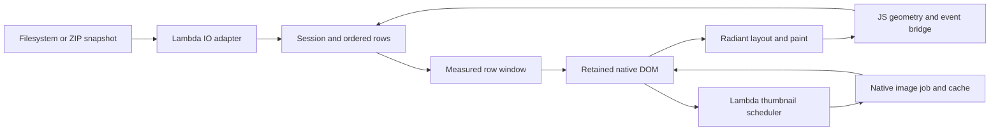

# Finder Demo: Design and Tuning

**Status:** Implemented application design, with tuning history and measured
results. This records the delivered demo; it introduces no new language or
runtime rulings.

**Last verified against tree:** 2026-10-16.

**Scope:** `test/demo/finder/`, its native Radiant dependencies, and the tuning
through the latest large-directory work. Usage and shortcuts remain in the
[Finder README](../test/demo/finder/README.md).

**Specification linkage:** [Formal Semantics](../doc/Lambda_Formal_Semantics.md)
S1.4, S12.1.1v3 and S12.1.3 cover session values, effects and reactive handlers;
S7.6.7v4 covers procedure error handling; S12.4.1v3 and S14.3.1v3 cover captured
filesystem/archive values and deferred member content.
[Formal Design](../doc/Lambda_Formal_Design.md) D4.5.1v4/D4.5.2 cover native
ownership, D5.3.3 precise rooting, D5.4.1 evaluator ownership, D7.1.2v2 source IO,
and D7.2.5 the shared DOM editing policy. The design applies these contracts.

## 1. Product and architectural direction

Finder is a native Lambda/Radiant file manager inspired by macOS Finder. It uses
HTML/CSS as its presentation vocabulary while providing file-manager behavior:
whole-item selection, icon/list/column views, folder navigation, context menus,
drag moves, file operations, rendered previews and Quick Look.

The application keeps navigation and operation policy in Lambda. Radiant supplies
layout, rendering, native events, DOM mechanisms, embedded document views and
image-job transport. A small JavaScript bridge reports geometry and events that
need capture at the JS/window boundary. It does not own the directory model or
perform filesystem mutations.

The central performance choice is to retain the complete directory model while
mounting only a viewport of rows. Search, selection and navigation therefore have
whole-folder semantics without requiring a native tile for every entry.



### Module boundaries

| Module | Responsibility |
| --- | --- |
| `finder.ls` | Session owner, command dispatch, retained publication, dialogs, selection events and preview resizing |
| `mod_model.ls` | Pure path/session transitions, ordering, selection, column snapshots, cache keys and row-window calculation |
| `mod_io.ls` | Capture file metadata, navigate physical/archive locations, select preview representation, validate and perform operations |
| `mod_ui.ls` | Pure element construction, file graphics, rows, columns, previews and destination picker |
| `mod_thumbnails.ls` | Admission, priority, polling, cancellation and release of raster thumbnail slots |
| `mod_dom.ls` | Attribute updates that avoid writing an unchanged value |
| `finder.js` | Post-layout activation, geometry measurement, window/column event relay and native drag-and-drop relay |
| `finder.css` | App chrome, responsive layout, selection states, tile geometry and preview layout |
| `../mod_resources.ls` | Resolve bundled resources from the entry script independently of the current working directory |

Pure transformations and element construction stay in `fn` code; mutations and
operation effects run in `pn` handlers, following S12.1.1v3/S12.1.3. Errors from
procedures are captured in statement handlers under S7.6.7v4.

## 2. Directory state, navigation and columns

Each directory read captures entry metadata into ordinary records: name, path,
physical directory flag, extension, byte size, modification time and display kind.
Rendering uses these records rather than repeatedly querying live filesystem
properties. The captured-value boundary follows S12.4.1v3; a refresh acquires a
new snapshot.

The session owns the current path and entries, history/cursor, selected paths,
focused path and range anchor, query/sort/hidden settings, column snapshots,
preview state, dialogs, operation/drag state, thumbnail work and viewport metrics.
Transitions create updated session values under S1.4. Paths carry entry identity;
DOM row indices describe positions in the current ordering.

Column view represents one visited branch. A folder click opens its contents in
the next column. Ancestors retain their snapshots, query and scrollport; choosing
another branch drops the abandoned suffix. An unrelated sidebar or Go to Folder
destination starts a new column root. Search applies to the active column;
sorting and hidden-file settings apply across the displayed branch.

Earlier columns mark the child on the current trail separately from the active
file selection. Right-clicking an ancestor row activates that column's selection
context before opening its menu. Left returns to the previous column; Right
opens the selected browsable entry. Changing view preserves the current location
and selection, and returns keyboard focus to the file browser.

Retaining ancestors is a usability requirement as well as a performance choice:
it preserves scroll positions and avoids replacing a first-click target before
the second click of a double-click arrives.

## 3. Retained publication and large-directory rendering

### 3.1 Separate the model from the mounted rows

The model contains every entry in the captured directory and every matching entry
in the ordered listing. The mounted DOM contains only the visible rows plus one
surrounding row on either side, in all three views.

The file region has three parts: a top spacer, the mounted rows, and a bottom
spacer. Spacers account for omitted rows so the scrollbar still describes the
complete folder. Empty folders and empty search results use their normal empty
state instead of a row window.

Selection, range selection, Select All, search, sorting and Home/End operate on
the complete matching sequence. Home/End explicitly choose its endpoints even
when no item was previously focused. Arrow movement uses the measured icon
column count. A requested keyboard or view-change reveal brings the focused
entry into the mounted window before scrolling it into view.

Rows expose their global `aria-posinset` and full `aria-setsize`. List stripe
parity also uses the global position, rather than the position within the mounted
slice. Row IDs use global indices; `data-path` carries file identity. DOM identity
is retained while the publication window is unchanged; rows leaving a window
are retired and their thumbnail pixels are released.

### 3.2 Derive the window from actual CSS geometry

The JS bridge measures the scrollport height and scroll offset, a row's height,
row/column gaps, row-container padding and icon column count. The model derives
the slice and spacer sizes from those measurements. It does not assume a fixed
number of columns or duplicate pixel dimensions from the stylesheet.

Icon labels reserve two lines (`height: 3em` at `line-height: 1.5`) so short and
wrapped names share one tile height. This is necessary for a uniform row stride.
The full filename remains available in the row's name and tooltip. List and
column rows retain their fixed presentation geometry.

For a nonempty listing, let `N` be the matching entry count, `C` the column count,
`h` the row height, `g` the row gap, `P` the top padding, `H` the viewport height
and `T` its scroll offset. The calculation uses:

```text
stride = h + g
total_rows = ceil(N / C)
first_row = clamp(floor((T - P) / stride) - 1, 0, total_rows - 1)
end_row = clamp(ceil((T + H - P) / stride) + 1, first_row, total_rows)

first_entry = first_row * C
end_entry = min(N, end_row * C)             # exclusive
top_spacer = first_row * stride
bottom_spacer = (total_rows - end_row) * stride
```

Focus revelation can adjust the effective `T` before this calculation. The row
container supplies its own padding and internal gaps, so the final extent ends
at the final row plus the intended bottom padding.

The small bundled startup directory renders before the first JS measurement.
Once measurement is active, an unmeasured view can bootstrap with one row; a
following frame supplies its geometry and publishes the correct window. A new
folder may reuse same-mode geometry until its own measurements arrive.

### 3.3 Invalidate ordering and presentation independently

Sorted rows are cached per directory path with this key:

```text
snapshot revision + query + sort key + sort direction + hidden-file setting
```

Reads/reloads assign snapshot revisions; activating a retained ancestor preserves
its revision. Selection and dialog changes reuse the ordering. Changing the query
or sort settings computes a new ordering. This separates full-folder model work
from ordinary viewport and selection updates.

The publication key adds location, view mode and the computed row window. If it
is unchanged, `publish` retains the rows and updates selection/focus attributes
and other affected regions. New markup already contains selection/focus values,
avoiding a redundant attribute sweep immediately after creating every row.
Column publication replaces only the columns/windows that changed. This follows
S12.1.3 while preserving native ownership under D4.5.1v4.

Revisions also protect archive laziness. Structural equality on entry arrays can
inspect native member nodes and force their content. Cache and publication keys
compare small metadata tokens instead, preserving S14.3.1v3.

### 3.4 Measurement and resize notifications

The bridge activates after the first layout. The main file scrollport requests a
`finder_measure` frame; captured non-bubbling column scrolls relay measurements
to `finder_viewport`. The handler republishes only if the computed window changes,
then updates thumbnail admission. Pixel motion within the same window does not
rebuild the listing.

Window resize, preview-divider changes and preview visibility changes all request
measurements after layout. A `finder_measure` notification asks JS to obtain
geometry; `finder_viewport` consumes that geometry. Sending an unmeasured frame
notification directly to the consumer loses the information needed to update the
window. Geometry changes can reveal the current focus; ordinary manual scrolling
does not continually pull the viewport back to the selected item.

### 3.5 What still scales with folder size

Viewport rendering bounds mounted tile layout, SVG/icon construction and native
row updates. It does not make every operation constant-time. Capturing metadata,
filtering/sorting on a cache miss, path lookup, range selection and Select All
still process the full model. The model retains metadata for the active column
branch. Very large folders and deep branches therefore still consume memory and
model-processing time proportional to their entries.

## 4. Progressive thumbnails and memory ownership

Raster slots begin with a file icon and a minimal canvas. The Lambda scheduler
admits visible slots plus a surrounding row, prioritizing Quick Look, then the
selected preview, then file tiles. It submits one raster decode at a time through
the native thumbnail channel. SVG uses the existing vector/image path.

The decoder preserves aspect ratio and normalizes orientation. Animated GIF uses
its first display frame; TIFF uses its first page. Transparent images have a
checkerboard. A corrupt or unsupported image retains its icon and a diagnostic.

The scheduler reads slot geometry as a batch and caches it. Polling a decode
reuses those measurements because uploading pixels does not resize its fixed CSS
slot. Publication, scrolling or resizing invalidates the measurements. Offscreen
and retired canvases release their pixels; a window change does not leave image
buffers attached to abandoned rows.

Native jobs copy paths and own decoded bytes; completion values are copied into
retained canvases under D4.5.2. Source reads remain in `lambda-io` under D7.1.2v2.
Generation counters, job tokens and slot/size checks reject stale completions.
Cancellation leaves retained ancestor slots eligible to retry, and closing the
window cancels and joins workers.

The document's thumbnail LRU holds up to 128 entries, including negative results.
Its 32 MiB retained-pixel budget accounts for application canvases and the pending
upload before admitting cached pixels. Keys include canonical path, file size,
subsecond modification time, file identity and physical output size. The decoder
rechecks source identity after reading. Refresh invalidates the cache, including
replacements whose timestamps were deliberately preserved. Shared image admission
and scratch limits still apply to small thumbnails.

## 5. Preview and property panel

The right panel combines a preview with file metadata. Formats supported by the
native document viewer use an iframe and the existing loader: rendered Markdown,
HTML, PDF, DOCX, EPUB, LaTeX, diagrams and Lambda documents, for example. Raster
images use the thumbnail path; SVG remains a vector image. Source without a native
document presentation falls back to bounded text: at most a 128 KiB source and
6,000 displayed characters. Other files show metadata and a fallback graphic.

Quick Look uses the same preview selection and remains available when the right
panel is hidden. Unchanged preview markup retains the iframe, browsing state and
scroll position. Hiding/closing a preview releases its embedded view.

The divider supports pointer capture, keyboard adjustment, min/max sizing and
Escape cancellation. Width is clamped against the available workspace, reserving
160 px for the browser and 6 px for the divider, with a maximum panel width of
600 px. The nominal minimum of 180 px shrinks when the workspace requires it.

The embedded document's viewport follows the iframe's content box. A resize
reflows text, viewport units and media queries in the existing document; it does
not repeat the initial load handler. Removing an iframe during a handler defers
its native document destruction until evaluator execution is quiescent, preserving
D5.4.1 and the caller's precise roots under D5.3.3.

## 6. ZIPs as files and navigable containers

A ZIP retains its physical file identity, kind, byte size and modification time.
It is also browsable: double-click opens it in icon/list view, and single-click
expands it in column view. The ZIP's own information stays in the right panel
until a member is selected. Physical directory kind, navigation capability and
write capability are separate properties.

Opening captures the native archive snapshot/index under S12.4.1v3. Listing
members does not decode their payloads. Content access performs deferred decoding,
CRC checking and parsing under S14.3.1v3. Nested ZIPs open explicitly from captured
member nodes; no extraction is needed.

Joined paths are UI/navigation keys. Member reads use native nodes and locators
containing the outer archive path and member chain. History stores small locators;
the active archive/column branch retains captured nodes. Leaving that branch can
release its cache and later reopen it from the locator.

Members are read-only. Creation, rename, move, deletion and drag sources or drop
destinations inside archives are disabled in both controls and command validation.
The outer ZIP remains writable in its physical containing directory. Archive
image tiles retain icons until selected, avoiding eager payload decoding during
listing. Selected member previews support HTML, Markdown, images and bounded text.
Relative HTML links to sibling archive members are not currently resolved.

## 7. File-manager interaction policy

Filename presses select items rather than text ranges. App chrome uses
`user-select: none`; editable fields, preview text and metadata values explicitly
allow text selection. The shared Lambda DOM mouse policy honors cascaded
`user-select`, including `auto` ancestry and an explicit `text` override, following
D7.2.5. Native cursor inheritance keeps filename glyphs on the button's pointer
cursor while ordinary or explicitly selectable text retains its text cursor.

Context menus use the standard `contextmenu` event for right mouse or trackpad
secondary clicks. Target resolution climbs from text, icons and chevrons to their
file row/column. Ordinary primary-click navigation is kept separate, so a
secondary click does not open a folder before the menu can select its target.
The toolbar and keyboard menu entry points share the same operation policy.

Create, rename, move and delete use one validation/operation path. Plans reject
invalid names, missing sources, collisions and moves into an item's own subtree
before a batch starts. Move uses filesystem rename and currently requires one
filesystem. Delete is permanent and requires confirmation. A partial batch failure
refreshes the browser and reports completed effects; there is no batch undo.

The Move dialog includes a path field and folder selector with breadcrumbs,
Parent/Home/Current controls and disabled invalid destinations. Browsing changes
the destination without altering the source selection. Only confirmation moves
the files. Drag moves use the same validation, and native transport keeps its
event and target precisely rooted across callbacks under D5.3.3.

Dialogs trap focus, restore it on close, and show action labels immediately.
Secondary text uses shared darker grey tokens. These are interaction and visual
corrections; they are not the source of the large-directory speedup.

## Appendix A. Tuning history and root causes

### A.1 Progressive image work

The thumbnail work introduced bounded native jobs, priority for the selected
preview, source/size-aware caching, negative caching, offscreen release and
generation-based cancellation. This avoids synchronously decoding every raster
file merely to show a directory. Pixel budgets cover the cache and visible
canvases together rather than treating cache size as the whole memory cost.

### A.2 Retain rows, contain the scrollport, reuse thumbnail geometry

The first large-directory pass, committed as `f69f3bf6d`, addressed repeated work
in publication and intrinsic sizing:

- Keep the listing when its inputs have not changed, rather than regenerating all
  row markup for selection or dialogs.
- Include selection/focus attributes in newly constructed markup, avoiding a
  second per-row write pass on navigation.
- Apply `contain: size layout` to the flex-sized file scrollport so ancestor
  intrinsic measurement need not traverse the entire grid.
- Cache thumbnail slot measurements during decode polling; remeasure on actual
  presentation/viewport changes.
- Use native node identity for slot matching and preserve cancellation state when
  adding preview data to a session.

Retained rows also fixed double-click stability and became the basis for retained
ancestor columns. This pass still mounted the complete folder.

### A.3 Interaction and preview corrections

Home/navigation and filename presentation were corrected in `fd563ac6d`: read
the system home path with `#` before constructing destinations or expanding `~`
(S2.4.3v3), and clamp long icon labels while retaining their full names. The latest
uniform two-line label area builds on that clamping behavior.

Column navigation, drag moves, CRUD, context menus and the destination browser
were added and refined. The `4899584ef` commit includes the menu and Move picker
fixes. Delete/primary action styles were ordered so their normal background and
white label apply on the initial popup, without needing hover.

Later work darkened secondary text, made the preview panel resizable and replaced
document source previews with the native rendered view. Two shared native defects
were corrected alongside that work:

- Retiring an embedded document inside a DOM mutation could disturb the active
  evaluator/root-stack owner. Destruction is deferred to a safe event-turn boundary.
- Asynchronously loaded/navigated iframe documents lacked the same source/viewport
  tracking as synchronous loads. Tracking now covers both; resize uses the content
  box, keeps the document, and avoids reinitializing its session.

Filename text selection also required a shared policy fix: CSSOM exposed the
cascaded `user-select`, and the Lambda mouse-selection policy respected it instead
of starting a text range inside an item button.

### A.4 Remove repeated native StateStore scans

The next large-folder investigation found substantial post-reflow state cleanup
cost even after row markup was retained. Hash-table deletion compacts buckets;
restarting iteration after each removed interaction flag or orphan repeatedly
scanned the same map. Checking each state's owner by searching the full DOM
introduced another multiplicative traversal.

The fix collects matching keys in one scan and erases them afterward through a
shared helper. Registered node addresses are validated before checking connection
through their parent chain. Nonregistered legacy owners retain the appropriate
tree-search path. Stale payloads are still released, and allocation-pressure
fallbacks preserve cleanup correctness. Live form values, focus and form caches
remain intact under D4.5.1v4. The full folder was still mounted after this pass.

### A.5 Latest pass: bound the mounted work

CPU samples of release builds showed repeated flex/grid layout and intrinsic text
measurement over thousands of existing tiles. Filesystem snapshot capture was a
small fraction of the delay. Retaining all those nodes avoided reconstruction,
but selection could still trigger native work across the whole folder.

The latest pass introduced the measured row window, revision-keyed ordering cache
and window-keyed publication described in §3. This bounds the tile population
itself. It also preserves full-folder selection/navigation and retains existing
rows during unchanged-window updates. A `content-visibility: auto` experiment was
not shipped: it retained the full tile population and did not deliver the required
responsiveness in the measured native pipeline.

The pass exposed and fixed several correctness dependencies:

| Symptom | Root cause and correction |
| --- | --- |
| Excess space below the final icon row | Grid multipass layout only grew an auto height, retaining an overestimated provisional height. Replace it with the final row-track extent before the existing overflow policy. Explicit heights and size containment retain their separate behavior. |
| Wrong virtual scroll extent | CSSOM returned zero gap longhands when spacing came from `gap`. Select the winning shorthand/longhand by cascade order and project its row/column component through the shared CSS helper. |
| Filename I-beam despite a pointer button | The runtime inherited-property whitelist omitted `cursor`. Add it so native glyph hit testing receives the inherited value. |
| Different tile heights for short/wrapped names | Reserve two label lines with an explicit height and prevent label flex shrink. A provisional `min-height` attempt did not establish the required geometry. |
| Window stale after resize | Request a measurement frame, then consume its geometry; also measure after divider and preview-visibility changes. |
| Selection jumps or becomes unreachable after a view change | Reveal focus using complete model indices, and return keyboard focus to the browser. Home/End choose endpoints directly even without a prior selection. |
| Stripe/accessibility positions restart while scrolling | Use global entry indices for parity, row IDs and accessibility ordinals. |
| Archive cache comparisons parse members | Replace structural entry equality with snapshot revisions so comparison cannot force lazy native payloads. |

The original non-windowed `./test` reproducer had a 19,698 px grid with its last
row ending at 17,872 px. With the native height correction, the same retained
full-listing reproduction measured 17,902 px: exactly the final row plus 30 px of
bottom padding. The whitespace fix was verified independently of viewport rendering.

## Appendix B. Measurements and reproduction

All performance figures below are release-build measurements on macOS. They are
different experiments with different folder sizes and baselines; their speedups
must not be multiplied or treated as one continuous dataset.

### B.1 First retained-publication pass

The recorded three-run comparison against `476e9075f` used 463 matching entries in
`./test`: opening fell from 2,944 to 558 ms; selection from 1,579 to 722 ms.
This measured the initial containment/publication/thumbnail-geometry changes.

### B.2 Native state-cleanup pass

Identical Finder sources, 2,157 matching entries in the then-current `./temp`, and
three alternating runs per release host isolated the native cleanup change:

| View | Open before → after | Select before → after |
| --- | --- | --- |
| Icons | 7,801 → 3,267 ms | 11,834 → 3,029 ms |
| List | 6,243 → 1,806 ms | 10,576 → 1,747 ms |
| Columns | 8,999 → 3,121 ms | 14,565 → 2,806 ms |

Artifacts: `temp/finder/large-performance/comparison/{icons,list,columns}/`.

### B.3 Latest viewport/cache pass

A frozen 2,997-entry corpus captured names from `./temp`; regular files were
hard-linked and directories were empty. The reference used the saved full-listing
Finder sources, and both versions ran on the same release host containing the
native corrections. Three alternating runs per version/view produced these medians:

| View | Open before → after | Select before → after |
| --- | --- | --- |
| Icons | 4,496 → 66 ms | 4,350 → 47 ms |
| List | 2,604 → 68 ms | 2,379 → 43 ms |
| Columns | 4,343 → 70 ms | 3,973 → 45 ms |

The icon-view phase breakdown makes the source of the improvement visible:

| Phase | Full listing | Viewport rendering |
| --- | ---: | ---: |
| Directory command / metadata capture | 24.006 ms | 21.771 ms |
| UI publication | 239.180 ms | 5.715 ms |
| Following frame intervals | 4,236.640 ms | 38.346 ms |
| Total opening | 4,496.124 ms | 65.832 ms |
| Selection publication + following frames | 4,349.988 ms | 46.539 ms |

Phase medians are calculated separately and need not sum to the median total.
The command timing includes navigation/metadata work; the frame interval includes
native layout/render and scheduling work, rather than isolating layout alone.
This latest comparison isolates the app's window/cache changes, since its native
host is shared by reference and current runs. It is not a separate measurement
of the cursor, gap or grid-height fix.

The benchmark instruments copies of the app, times navigation through following
frame callbacks, and includes any bootstrap/measurement publications. Startup is
excluded. Selection Ctrl-clicks the first row so column view does not navigate
into a child. Assertions verify full matching entry count and selection even
when only a slice is mounted. Measurement order alternates to reduce warmup/order
bias. Timings vary with machine load; this is neither a cold-filesystem nor an
end-to-end application-start benchmark.

Artifacts: `temp/finder/responsiveness/verified-{icons,list,columns}/results.json`,
the generated reference/current sources, replay results, logs and phase traces.
The native host was `temp/finder/responsiveness/lambda-verified.exe`. Scratch
artifacts are local evidence and may be cleaned; the tables preserve their results.

From the repository root, rebuild a release host and measure any folder/view:

```sh
make release
python3 test/demo/finder/benchmark.py --binary ./lambda.exe \
  --directory ./temp --view icons --repetitions 3 \
  --output-dir ./temp/finder/performance/current-icons
```

For comparison, `--reference-dir` accepts saved Finder sources including their
assets; `--reference-binary` can isolate a native-host change. `--reference` accepts
a compatible historical Git revision. Use a stable corpus for comparisons: writing
benchmark artifacts into a live `./temp` also changes that directory's contents.
Keep each view's output separate and avoid simultaneous builds or expensive tests
while timing. The benchmark rejects known debug hosts.

## Appendix C. Implementation anchors and verification

### C.1 Source anchors

| Concern | Source and symbols |
| --- | --- |
| Ordering cache and virtual geometry | [mod_model.ls](../test/demo/finder/mod_model.ls): `visible_key`, `visible`, `prepare`, `window`, `listing`, `column` |
| Retained publication and focus | [finder.ls](../test/demo/finder/finder.ls): `listing_key`, `publish`, `publish_columns`, `finder_viewport`, `keydown` |
| Geometry/event transport | [finder.js](../test/demo/finder/finder.js): `finderMeasurements`, `finder_measure`, resize/column scroll and drag listeners |
| Row slice, spacers and global indices | [mod_ui.ls](../test/demo/finder/mod_ui.ls): `file_rows`, `column`, `finder_scrollport`; [finder.css](../test/demo/finder/finder.css) |
| Captured locations, previews and operations | [mod_io.ls](../test/demo/finder/mod_io.ls): `entry_info`, `read_location`, `archive_member`, `preview`, `plan`, `perform`, `reload` |
| Thumbnail lifecycle | [mod_thumbnails.ls](../test/demo/finder/mod_thumbnails.ls): `measure`, `schedule`, `tick`, `cancel_jobs`, `release` |
| Native state cleanup | [state_store.cpp](../radiant/state_store.cpp): `state_map_erase_matching`, `state_store_tree_contains_node`, orphan pruning |
| Final auto grid extent | [layout_grid_multipass.cpp](../radiant/layout_grid_multipass.cpp): `layout_grid_content`; [layout_grid.cpp](../radiant/layout_grid.cpp): `layout_grid_row_border_box_extent` |
| Cursor inheritance and gap CSSOM | [css_prop_table.cpp](../radiant/css_prop_table.cpp): `css_property_runtime_inherited`, `computed_decl`; [css_properties.cpp](../lambda/input/css/css_properties.cpp): `css_project_shorthand_longhand` |
| Embedded preview resizing | [layout_block.cpp](../radiant/layout_block.cpp): `layout_iframe_track_source`, `layout_iframe_embedded_doc`, `layout_ensure_iframe_document`; [event.cpp](../radiant/event.cpp): `navigation_commit_iframe_document` |
| Embedded document retirement | [view_pool.cpp](../radiant/view_pool.cpp): `release_embedded_document`; [ui_context.cpp](../radiant/ui_context.cpp): `radiant_defer_document_destroy`, `radiant_drain_document_destruction` |
| Text-selection policy | [mouse.ls](../lmd/package/dom/mouse.ls): `selection_value`, `selection_operation` |
| Benchmark protocol | [benchmark.py](../test/demo/finder/benchmark.py): instrumented copies, alternating runs and marker aggregation |

### C.2 Delivered verification

The latest round passed seven Finder golden cases in auto, interpreter and JIT
modes. Finder UI coverage spans 16 fixtures, with focused reruns after adapting
offscreen targets to use search rather than assuming every file has a mounted row.
The final large-directory fixture passes 29 assertions, including retained rows,
filtering/sorting, full-folder Select All, first/last navigation, final padding,
resize and preview visibility changes. Column and item-selection fixtures pass
40 and 29 assertions respectively.

The real thumbnail scrolling replay passes 28 assertions, including release of
retired canvas pixels, Unicode/fragment-like names, orientation and refresh.
The operation replay passes 37 UI assertions plus independent filesystem checks
under forced collection and freed-memory poisoning. A separate replay of the live
`./temp` passes 10 assertions across all three views.

Native text/layout tests pass 137/137, including:

- `AutoGridHeightUsesItsFinalRowsAfterWidthChanges`;
- `FilenameGlyphsKeepTheirInheritedPointerCursor`;
- `ComputedGapLonghandsProjectTheirWinningShorthand`.

The StateStore bulk-pruning regression checks retained values, detached state and
focus-path rebuilding. Shared iframe resize/retirement and `user-select` fixtures
cover the earlier preview and item-selection corrections. Native integer-cast lint
and scoped whitespace checks passed.

The required full Radiant baseline completed with 5,644 passing, 183 failing,
158 partial and one skipped result out of 5,986. The preceding run had 5,640
passing, 184 failing, 158 partial and one skipped result out of 5,983. The 55
view-reuse failures and 51 general UI failures match the preceding failure sets;
layout classification remains 3,103 passing, 154 partial and 37 failing. Existing
WPT input timeout and render-gate failure remain. These results do not constitute
a green aggregate baseline. CSS inventory validation also encountered an existing
missing qualification reference to the PDF transparency-group test.

Reproduction commands and fixture locations are listed in the
[Finder README](../test/demo/finder/README.md). Latest detailed evidence is under
`temp/finder/responsiveness/`; future work should rerun focused checks and required
engine gates for the subsystem it changes, rather than treating these dated
numbers as permanent coverage.
