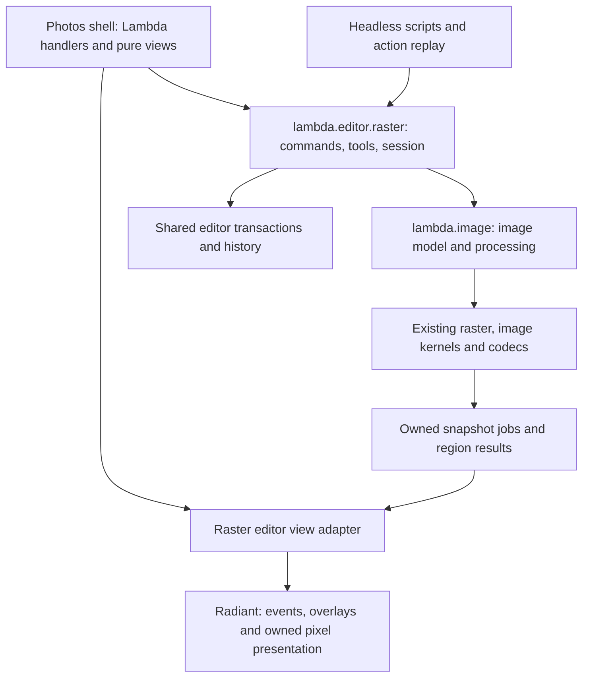

# Lambda Photos — Enhanced Raster Editor Proposal

**Date:** 2026-10-19.

**Status:** implementation started on 2026-10-19 in `codex/photos-20261019`.
The [implementation record](impl/Lambda_Impl_Photos.md) distinguishes the initial
layered editor from the remaining enhanced milestones. Product targets below
are not ratified language rulings or claims that every feature is implemented.

**Scope:** build an enhanced, multilayer photo editor at `test/demo/photos/`,
with reusable editing code exposed as `lambda.editor.raster`. Use the common
image model from [Lambda_Pkg_Image](Lambda_Pkg_Image.md) and the local
[PhotoCraft reference](../ref/Photocraft/README.md) for UI, features and
implementation ideas. The target is comparable everyday editing workflows:
layered composition, selection and masking, painting, retouching, adjustments,
filters, text/shapes, history and PSD exchange.

**Specification linkage:** [Formal Semantics](../doc/Lambda_Formal_Semantics.md)
**S1.4 / S9.1.1–S9.1.3 / S9.2.2** govern values, mutation, borrows and snapshots;
**S9.1.5v2** governs tree-shaped authored values; **S12.1.1v3 / S12.1.3** govern
procedural effects and pure reactive views; **S7.4.1–S7.4.5 / S17.8.1** govern
errors and options. [Formal Design](../doc/Lambda_Formal_Design.md)
**D7.1.1 / D7.1.2v2 / D7.1.3 / D7.2.4v3** govern native/package boundaries and import paths;
**D7.4.4 / D7.4.5v2** govern Raster's declared virtual-element interface;
**D4.1.4v5 / D4.5.1v4 / D4.5.2 / D5.3.3 / D7.5.3v2** govern native storage,
document resources, precise roots and host boundaries. This proposal applies
those contracts without changing either formal spec.

## 1. Product direction and starting point

Photos should feel like a compact desktop raster editor. A user can open several
images as layers, isolate a subject with a selection and mask, paint or retouch,
apply reversible color/effect edits, add a title, save an editable document and
export the final image. PSD support must preserve supported layer structure and
pixels through an actual edit/save/reopen cycle.

PhotoCraft supplies a useful reference for this experience: a central canvas,
tool rail, contextual options, layer and properties docks, and a command engine
shared by UI and automation. Its own
[parity assessment](../ref/Photocraft/docs/target-app-parity.md) distinguishes
feature presence from dependable workflows. Adopt that distinction: acceptance
requires working tools and saved results, rather than a matching menu inventory.

There is substantial existing Lambda work to reuse:

| Existing component | Reusable foundation | Gap for Photos |
|---|---|---|
| [Current photo demo](../test/demo/photo/README.md) | Adjustments, presets, crop/orientation, vector/text overlays, retained canvas, asynchronous previews/exports, gesture history and native replays | Its source-photo recipe and normalized overlays do not provide a general multilayer raster document |
| [Image package](../doc/Lambda_Image.md), `lmd/package/image.ls` | Raster values, common image/stack/layer schema, gray masks, normal source-over, isolated groups, structural editing and basic layered PSD read/write | Contiguous `u8` storage, eager region rendering; broader blending, retained transforms/effects, high depth and ICC conversion remain outstanding |
| `lambda.image.edit`, `lambda.editor.mod_history` | Immutable document snapshots, grouped transactions, undo/redo and original-byte checks | Raster tool sessions, history memory accounting, labels and selection restoration |
| [Drawing package](../lmd/package/editor/draw/README.md) | Command/session organization, geometry, viewport and gesture patterns, retained controls | Raster-specific selection, paint targets and dirty regions |
| Native image/Radiant infrastructure | Decode/encode, image processing, owned pixel uploads, events, pointer capture, document resources and UI automation | Region/tile publication and additional kernels where the selected workflows need them |

This inventory was checked against local source and the
[image implementation record](impl/Lambda_Impl_Image.md); it is not a fresh
runtime qualification. The image proposal remains the design reference while
its initial implementation status is described by the API and implementation
record.

The new entry is proposed as `test/demo/photos/photos.ls`, launched with
`./lambda.exe view test/demo/photos/photos.ls`. Register `demo photos` when the
demo is delivered. Keep the existing singular `photo` demo usable during
development; extract reusable behavior into packages and use forwarding modules
where needed, avoiding a second copy of its processing pipeline.

## 2. Feature target

Deliver a useful layered editor first, then complete the enhanced core below.
The latter is the proposed feature-comparable release boundary. Later extensions
are recorded separately so specialist parity does not make that boundary endless.
Milestones M0–M5 are defined in Appendix B.

| Area | First layered editor — M1 | Enhanced core — M2–M4 | Later extensions |
|---|---|---|---|
| Documents/files | New, open PNG/JPEG/supported PSD, place image as layer, save supported layered PSD, export PNG/JPEG | Native rich-project save/reopen, multiple document tabs, duplicate document, export sizing/quality/alpha policy, available additional codecs | PSB, broad professional interchange, animation editing |
| Layers/groups | Add/delete/duplicate/rename, foreground-first reorder, visibility, opacity, isolated groups, move/nudge, merge/flatten | Multiselect, group/ungroup, locks, clipping, pass-through groups, common blend modes, linked mask movement, copy/cut/paste as layer | Layer comps, advanced blending options, complete Photoshop group behavior |
| Selections/masks | Add/remove raster mask and select pixel/mask target; inspect imported masks | Rectangular/elliptical marquee, free/polygon lasso, color wand, add/subtract/intersect, feather/invert, quick mask, selection-to-mask, mask enable/invert/apply | Edge-aware subject selection, advanced Select and Mask workspace |
| Paint/fill | Basic clear/fill through commands | Brush/pencil/eraser, size/hardness/spacing/opacity/flow, foreground/background colors, eyedropper, bucket, linear/radial gradient, selection clipping | Tablet dynamics, textured/mixer brushes, extensive brush asset compatibility |
| Transform/canvas | Layer translation, fit/100%/zoom/pan, canvas and image size | Free transform: scale/rotate/flip with handles and numeric fields; crop/straighten, aspect presets, canvas anchor, align/distribute | Perspective, warp, puppet transform, liquify |
| Adjustments | Explicit baked adjustments using existing image kernels | Reversible exposure, brightness/contrast, levels, curves, saturation, temperature, monochrome; adjustment layers and masks; histogram | Full adjustment catalogue and advanced matching/LUT workflows |
| Filters/styles | Existing bounded blur/sharpen where supported | Ordered editable filter effects, Gaussian blur, sharpen/unsharp, vignette, noise; drop shadow, stroke and color overlay | Full filter gallery and Photoshop effect compatibility |
| Retouching | Layer/mask edits and color corrections | Clone stamp with source preview and aligned mode, local healing, dodge/burn, bounded blur/sharpen brush | Patch/content-aware workflows, generative removal/fill |
| Text/shapes/paths | Preserve or diagnose imported unsupported content | Editable multiline text, font/size/alignment/color; rectangle/ellipse/line/basic paths, fill/stroke; explicit rasterization | Full typography, text-on-path, advanced pen/path operations, smart-object editing |
| Panels/navigation | Layers, Properties, History, tool options, status/zoom | Color/Swatches, Histogram, Channels and basic Paths, navigator, rulers/guides, command search, shortcuts | Tear-off docks, broad workspace customization, specialist panels |
| Automation | Shared commands and deterministic package tests | Parameterized headless edit/export, action recording/replay, native event replays, batch processing | External MCP/control service and third-party plugin compatibility |
| Color/scale | Current declared sRGB/gray `u8` profile and explicit limits | Tiled COW and region processing enter at M2; M5 qualifies high-depth/color and larger scenes | CMYK/Lab editing, soft proof, HDR display, disk-backed tile spill, GPU compute |

Start common blending with normal, multiply, screen, overlay, darken, lighten,
difference and exclusion. Qualify each against its declared color/blend space;
do not infer Photoshop fidelity from a matching mode name. Expand the set only
after this core behaves correctly with opacity, masks and nested groups.

Retouching and text/shapes are part of the enhanced target, not optional menu
placeholders. AI features, a RAW-development workspace, video, cloud services and
Photoshop plugin compatibility are outside this delivery boundary.

## 3. Workspace and interaction

Use PhotoCraft's workspace grammar with Lambda/Radiant HTML/CSS and existing UI
components. Reuse theme tokens and available SVG icons; Photos has its own name
and assets. The reference's Rust/egui UI is implementation study material, not a
new runtime dependency.

```text
+-----------------------------------------------------------------------+
| File Edit Image Layer Select Filter View Window Help       document *  |
| Active tool options: brush/transform/selection fields    Apply  Cancel |
+------+--------------------------------------------------+-------------+
| Tool | Document tabs                                    | Properties  |
| rail |                                                  | Adjustments |
|      |            Canvas on neutral workspace           | Histogram   |
|      |     checkerboard, selections, handles, guides     +-------------+
|      |                                                  | Layers      |
| FG/BG|                                                  | Channels    |
|      |                                                  | Paths       |
+------+--------------------------------------------------+-------------+
| Zoom | dimensions / color / depth / target | jobs/status | History     |
+-----------------------------------------------------------------------+
```

The canvas and overlays are separate retained surfaces. The checkerboard,
marching ants, cursor, guides and transform handles never enter exported pixels.
Keep layer rows and focused controls stable while pixels or tool values change
(**S12.1.3 / D4.5.1v4**). Properties follow the selected layer, mask or effect.
Layer rows show thumbnails, visibility, name, kind, mask, effects and lock state;
clicking a mask thumbnail explicitly changes the paint target.

Tools use familiar shortcuts: V move, M marquee, L lasso, W wand, B brush,
E eraser, S clone, J heal, G fill/gradient, I eyedropper, C crop, T text,
H hand and Z zoom. Ctrl/Cmd+Z undoes, Shift+Ctrl/Cmd+Z redoes,
Ctrl/Cmd+T transforms, Ctrl/Cmd+S saves, and brackets change brush size.
Shortcut dispatch leaves text inputs and active composition sessions in control
of text editing. Space temporarily pans when the current interaction permits it.

Every gesture has begin/update/commit/cancel states. Pointer capture keeps a drag
owned until completion; Escape restores the starting value. A transform or filter
dialog has an explicit commit/cancel path, and one completed gesture creates one
history item. An unchanged or canceled gesture creates none. Keyboard alternatives
must reach layer operations, numeric transforms and dialog actions.

At narrow widths collapse the right dock into a drawer and scroll long tool
options; preserve the canvas and access to the Layers panel. Test desktop and
compact layouts at multiple display scales. Multiple documents retain independent
selection, camera, history, jobs and dirty state. Closing a changed document offers
Save/Discard/Cancel; failed saving keeps it open.

## 4. Shared document and editor state

### 4.1 One image model

Adopt the schema already selected in
[Lambda_Pkg_Image §§1–4](Lambda_Pkg_Image.md#1-selected-model):

```text
image(width, height, working color, metadata)
  assets(profile/font/palette/captured-source/embedded-content ...)
  stack                         # isolated root; foreground first
    layer                       # raster, text, vector, fill, object, adjustment
      primary content
      mask*
      effect*
    stack                       # nested group, with explicit isolation
      layer / stack ...
```

Groups are nested stacks. A still image has a direct root stack; timed frames
are retained by the shared package, but a timeline UI is later scope. Opening an
animation for still editing requires an explicit frame choice and preserves the
original source. A layer Raster and its mask are distinct owners. A saved preview
is derived data and cannot replace editable primary content implicitly.

Coordinates are document pixels, origin at top left; sample access is
`[y,x,channel]`. Regions use half-open bounds. Allow negative layer offsets and
masks whose bounds differ from their layer. M1 uses supported integral placement;
retained affine transforms require a shared compositor extension. Moving a group
updates descendant placement, as the image proposal specifies; do not introduce
an implicit group-local coordinate system.

Use stable document-scoped IDs for commands and selection, with paths resolved
from the current tree. Raw child indices also include assets/masks/effects and
must not be confused with visible layer-list indices. Duplicate operations allocate
fresh IDs and remap internal references. Layer locks are editor command policy;
their persistence is an explicit project/PSD capability, rather than an assumed
property of the native compositor.

### 4.2 Session and history

The session owns the current image, saved checkpoint, active/selected layer IDs,
pixel-versus-mask target, selection coverage, camera, tool/options, gesture draft,
clipboard, history, open panels, diagnostics and job generations. Selection
coverage uses a gray Raster plus document-space bounds. It becomes image content
only through an explicit operation such as selection-to-mask or saved channel.

Commands return replacement values under **S1.4 / S9.1.1–S9.1.3**. Reuse
`lambda.image.edit` and `lambda.editor.mod_history`; extend their shared
transaction metadata for labels, target/selection restoration and memory budgets
instead of introducing a second undo implementation. Snapshot history shares
unchanged raster/tile storage (**S9.2.2**). A stroke retains its starting document
and working replacement and commits once; it does not push a snapshot per dab.

Camera, hover and panel changes are transient. Selection commands may update
session history; they do not mark image content dirty. Pixel/layer/effect edits
record both content and relevant target/selection state. Undo restores that
context; editing after undo clears redo. Track a saved content checkpoint so
undoing back to it clears the dirty indicator, independently of camera state.

## 5. Architecture and package boundary



`lambda.image` owns Raster storage, composition, sample/color operations, codecs
and image-model validation. `lambda.editor.raster` owns editing commands,
selection/tool state machines, transactions and view models. The demo owns its
menus, styling, bundled examples, application file dialogs and workspace layout.
This follows **D7.1.1 / D7.1.2v2 / D7.1.3 / D7.2.4v3**.

Ship the public entry as `lmd/package/editor/raster.ls`; supporting modules live
under `lmd/package/editor/raster/`. `import raster: lambda.editor.raster` resolves
through the existing package rules. Keep the value API usable without Radiant;
mounting belongs in an explicit `lambda.editor.raster.view` adapter, following the
existing drawing package pattern.

The proposed public surface has these responsibilities; exact names are provisional:

| API family | Proposed entry points | Contract |
|---|---|---|
| Session | `new_document`, `open_session`, `validate` | Construct/check values and initialize editor state |
| Commands | `commands`, `command_state`, `exec`, `transaction` | Shared parameter validation, enablement and atomic edits |
| Inspection | `layers`, `target`, `selection`, `properties`, `history_items` | Pure view models with stable identities |
| Interaction | `update(session,input)`, `overlays`, `cursor` | Tool transitions and drawing primitives independent of DOM |
| History | `undo`, `redo`, `can_undo`, `can_redo` | Delegate to shared transaction/history mechanisms |
| Actions | `record_action`, `replay`, `batch` | Explicit targets/options, deterministic parameterized commands |
| View adapter | `mount`, `publish`, `dispose` | Effectful document-owned presentation and event transport |

Core computation is pure; handlers, mounting, acquisition and file publication
use procedures (**S12.1.1v3 / S12.1.3**). A command that needs I/O produces an
explicit effect request consumed by the application procedure; it cannot hide a
file read inside a pure edit. Checked wrappers expose the established error
contracts (**S7.4.1–S7.4.5**); unknown options fail (**S17.8.1**).

### 5.1 Commands are the common editing path

A command descriptor supplies a stable ID, label, menu/shortcut metadata,
parameter schema, supported targets, enablement reason and transaction policy.
Use IDs such as `layer.duplicate`, `mask.from_selection`, `paint.stroke`,
`adjust.curves`, `filter.gaussian_blur` and `document.resize`. Menus, tools,
numeric inspectors and headless actions dispatch the same implementation.

Resolve targets, validate capabilities/locks/budgets, compute a replacement,
then publish once. Failure leaves the current image and history unchanged.
Long jobs capture the intended document and target revision; completion may
commit only while those preconditions still hold. Otherwise discard the stale
result and report the outcome. View/query commands do not enter edit history.

Record command parameters and explicit stroke samples in actions, including
random seeds where needed. Coordinate space, source sampling and target IDs must
be declared; replay cannot depend on pointer timing, current hover or hidden
selection. Parameterized actions may deliberately target the active layer, but
must say so. External control/MCP can later wrap this registry without becoming
a prerequisite for the editor.

### 5.2 Selection, paint and retouch behavior

Tools produce normalized document-space input and overlay primitives. Selection
operations combine finite coverage masks with documented add/subtract/intersect
rules; feather/invert operate within explicit bounds. Painting maps coverage
through the target transform into its local pixels or mask. Pixel and mask
targets share one stroke engine with different channel/coverage policies.

Resample input strokes by distance so dab density is independent of event rate.
Apply hardness, spacing, flow and opacity consistently; preserve alpha and hidden
RGB according to the image profile. Painting beyond a layer's current extent
expands its sparse storage/bounds without shifting existing document pixels.
Flood fill has explicit contiguous/tolerance/sample-source options.

Clone and healing commands capture their source snapshot and sampling policy
(active layer or supported merged sample). This avoids sampling partially written
destination pixels accidentally. Clone supports aligned/un-aligned source offsets;
healing starts with a bounded local algorithm and an honest capability description.
Retouching, brushes, fills and masks all honor the current selection and locks.

Copy captures selected pixels with alpha and document-space origin; Copy Merged
explicitly samples the composite. Paste creates a new layer, and Cut clears only
the selected coverage as one transaction. The system clipboard boundary is an
effectful host service. Channels displays composite/component views and saved
selection masks; replacing a channel is an explicit checked edit. Text and shapes
reuse existing font/vector rendering for both preview and export so their geometry
does not diverge between the canvas and the saved image.

## 6. Processing, responsiveness and ownership

Extend the existing native raster/image subsystem. Dense per-pixel Lambda loops
and a separate editor-owned image engine would defeat the shared package model.
Keep reference CPU kernels available for export and correctness checks; GPU
acceleration is a later implementation option, with the CPU result as oracle.

M1 can use contiguous storage within existing limits. M2 introduces sparse,
immutable COW tiles behind the same Raster interface before broad interactive
painting. Use PhotoCraft's 256 × 256 tile size as an initial candidate, measured
against Lambda workloads rather than exposed as a public contract. Account for
tile-index copying as well as changed payloads: a tiny edit must not clone all
pixel bytes. No native handle may mutate a shared history snapshot.

Build region evaluation from the shared image proposal's extent/input-region/halo
contracts. Existing `render_region` eagerly renders then crops; true demand
evaluation is development work. Dirty regions include transformed old/new bounds,
filter halos, masks, clipping dependents and affected group/backdrop results.
Cache immutable outputs by source identity and content version, operation options,
color/alpha profile, region and scale. Invalidate merged previews, thumbnails and
histograms when their actual dependencies change.

Use preview-scale evaluation during gestures and full-resolution evaluation for
commit/export. Preview and export share the operation definitions; reduced-scale
approximations are declared, then replaced by the final result. Keep brush cursor,
selection and transform feedback independent of an expensive composite.

Reuse the current photo demo's latest-request-wins scheduling and separate export
work as patterns, promoting existing helpers where appropriate. Coalesce preview
requests and admit bounded work rather than queueing every slider event. Jobs
retain immutable native source snapshots and return owned results, tagged with
document identity and generation. Cancellation, document replacement and window
close retire the work; teardown cancels/joins workers and releases leases.

Workers retain no borrowed GC Items, evaluator context or DOM pointers
(**D4.5.2 / D5.3.3 / D7.5.3v2**). Runtime bridges use precise `RootFrame`/`Rooted`
ownership. Radiant receives copied pixels or explicit native leases owned by its
document resources (**D4.5.1v4**). Textures and display caches are derived resources;
they never become the only copy of editable pixels. Native COW storage uses the
existing allocation substrate (**D4.1.4v5**).

Initially retain the image package's published limits: 16 million pixels/64 MiB
per Raster, 128 MiB PSD source/output and 256 MiB decoded PSD storage. More layers
are not a reason to bypass aggregate limits. Budget live pixels, history-exclusive
storage, decoded sources, scratch, pending jobs and derived caches separately;
evict recomputable caches before history. Report history truncation and reject
an edit that cannot fit safely while retaining the current document.

M5 adds native `u16`/`f16`/`f32` storage and `f32` processing, explicit ICC
conversion and display transforms through `lambda.image`. Do not quantize to
RGBA8 and label the result high-depth. Current tagged samples with unknown color
identity need a real conversion or an explicit user-chosen profile assignment;
strict rendering must not silently relabel them sRGB. Declare blend-space behavior
and qualify PSD appearance independently from normal linear-light compositing.

## 7. Persistence and PSD compatibility

### 7.1 Save editable content; export appearance

At M1, layered PSD is the editable format for the qualified raster profile. It
must round-trip layer/group order, names, placement, opacity, visibility, supported
masks and current pixels, with a regenerated merged composite. Use the existing
reader/writer; extend its capabilities in the shared image layer as required.
Current group-mask/inverted-mask writing limitations remain explicit blockers
for those saves until qualified.

By M3, retained effects and adjustment layers require rich-project persistence.
Propose a versioned `.lphotos` bundle containing a manifest of the shared image
tree, captured assets/source records and deduplicated sample/tile payloads.
The sample/document serializer belongs with `lambda.image`; the editor adds
optional workspace and saved-channel metadata. Reuse existing archive/I/O code.
Restoration validates versions, dimensions, IDs, references, checksums and expanded
resource budgets before replacing the active session. Process pointers, cache
identities, live jobs and escaping writable views are never serialized.

Deliver this persistence before exposing edits that a normal Save would lose.
PSD remains required interchange; rich projects preserve Lambda edits that its
qualified PSD writer cannot represent. Text uses image-scoped font requirements
or captured permitted font data; missing fonts produce a diagnosis and explicit
substitution/rasterization choice. Apply the image proposal's asset rules rather
than inventing demo-only font/image loading semantics.

PNG/JPEG and other available flat encoders export an explicitly rendered image.
JPEG requires a chosen background when alpha is present. Export sizing, color
conversion, metadata and layer/frame selection are explicit options. Save/export
publishes a completed file atomically; failure preserves the existing file and
active edits. Save captures a content checkpoint: completion marks that checkpoint
saved even if newer edits have occurred, leaving those newer edits dirty.

### 7.2 Capability and preservation reports

Follow [Lambda_Pkg_Image §5](Lambda_Pkg_Image.md#5-format-importexport): distinguish
parsing, editable preservation, rendering and export. Unsupported visible content
must not disappear from a successful strict render/save. Offer clear choices:
preserve the captured original, inspect a validated source preview, choose a
supported edit profile, or explicitly rasterize/flatten with a loss report.
An edit invalidates a source composite; it cannot remain the apparent result.

Preserved opaque PSD bytes are not proof of safe edited round trips. Exact
original-byte output applies only to an unchanged document with captured bytes.
Edited output regenerates known structures and rejects dependencies it cannot
preserve safely. Reports identify preserved, regenerated, rasterized, omitted and
rejected features. Source PSDs and user files are not overwritten through a
fallback flatten operation without an explicit destination/choice.

Native rich-project save/reopen, Lambda PSD round trips, independent PSD reader
acceptance, and Photoshop appearance are separate qualifications. Start with the
supported RGB/grayscale8 profile; add higher depths, blend modes, group semantics
and source records only as their reader, renderer and writer gates pass together.

## Appendix A. Source organization and reuse

These are proposed responsibility boundaries; keep modules small enough for
cohesive behavior, and extract existing helpers before adding near-duplicates.

```text
test/demo/photos/
  photos.ls                     # entry, session owner and effectful handlers
  photos.css                    # workspace and theme tokens
  mod_scene.ls                  # pure shell, menus, docks and dialogs
  mod_present.ls                # retained control/canvas publication
  mod_files.ls                  # app file commands and persistence feedback
  assets/                       # attributed samples and original demo artwork
  tests/                        # demo integration fixtures and goldens
  benchmark.py                  # release scenarios and report generation
  README.md

lmd/package/editor/raster.ls     # public value/command facade
lmd/package/editor/raster/
  model.ls                      # session, targets, IDs and validation
  commands.ls                   # descriptors, enablement and dispatch
  interaction.ls                # shared gesture lifecycle and tool routing
  selection.ls                  # coverage operations and selection commands
  paint.ls                      # stroke parameters and paint/retouch commands
  effects.ls                    # adjustment/filter/style editing policy
  viewport.ls                   # camera, hit testing and overlays
  actions.ls                    # recording, replay and batch orchestration
  view.ls                       # explicit native DOM/canvas adapter
```

Pixel-heavy operations called by these modules belong in the existing
`lib/raster.*`, `lib/image_process.*` and their runtime bridges. Composition
extends `lambda/runtime/image_composite.cpp`; document/format work reuses
`lambda/runtime/image_document.cpp`, `lib/image_psd.*`, runtime PSD adapters and
`lambda/io/image_io.*`. Reuse `test/demo/photo`'s processing coefficients,
orientation/crop behavior and job ownership, plus shared editor geometry/history
where their contracts fit. An editor wrapper must not duplicate a codec or kernel.

Build declarations change through `build_lambda_config.json`; no generated Lua
or vendored source edits are part of this plan. Native code follows the project's
C+ conventions and library types. Implementation progress belongs in a future
`vibe/impl/Lambda_Impl_Photos.md`, linked from this proposal.

## Appendix B. Delivery milestones

Prioritize complete workflows and shared dependencies. The initial M1 editor is
a useful checkpoint; the enhanced target requires M2–M4, and photo-scale/color
qualification adds M5. No calendar estimate is asserted before M0 measurements.

| Milestone | Deliverable and dependency | Acceptance boundary |
|---|---|---|
| M0 — Reuse and measurement | Inventory existing commands/kernels/jobs; establish package facade, fixtures and baseline timings | A headless script builds a two-layer document and performs a supported PSD edit/save/reopen through existing image APIs; record actual gaps and release host/memory evidence |
| M1 — Layered workspace | Native Photos shell, layer/group inspector, translation, opacity/visibility, masks, history, supported PSD save and flat export | Open/place three images, group/reorder/mask/move them, undo/redo, save/reopen PSD and compare structure/pixels; failed open/save keeps the session intact |
| M2 — Raster interaction | Shared tiled COW/region foundation, selection coverage, brush/eraser/fill/gradient, mask painting and tool cancellation | Cut out a region, convert selection to a mask, paint through it across tile boundaries, cancel a stroke, undo/redo another stroke; old channel/document snapshots remain unchanged under forced GC |
| M3 — Composite and color tools | Affine transforms, common blending/clipping/pass-through, reversible adjustments/filters, histogram and rich-project persistence | Composite foreground/background, transform and grade them, toggle/reorder effects, save/reopen editable parameters; export pixels agree with full-resolution reference evaluation |
| M4 — Enhanced photo workflows | Clone/heal/dodge/burn, editable text/shapes/basic paths, layer styles, channels, multi-document tabs and actions/batch | Complete retouch, design, mask/composite and action-replay workflows below with working file persistence and one coherent command/history path |
| M5 — Scale, precision and qualification | Native high depth/ICC, larger bounded scenes, UI polish and compatibility corpus | Preserve supported precision/profile data through project and codec round trips; meet declared release budgets, pass independent PSD checks and publish the exact remaining capability limits |

New image capabilities are shared `lambda.image` increments, not hidden Photos
features. A milestone does not pass by flattening all editable data. If a feature
misses its acceptance boundary, keep it explicitly partial and complete the
selected core before starting unrelated specialist extensions.

## Appendix C. Verification and performance budget

### C.1 End-to-end acceptance workflows

1. **Layered PSD exchange:** import a bounded RGB8 PSD containing negative
   offsets, transparency, nested groups and an independently bounded mask;
   rename/reorder/paint, save and reopen. Check hierarchy, names, geometry, mask
   samples and current composite; an independent layered reader inspects output.
2. **Cut-out/composite:** place two images, select a foreground region, refine
   with feather and mask painting, transform it, blend and color-correct.
   Save/reopen retains all editable inputs; export excludes UI overlays.
3. **Painting:** paint smooth and hard strokes across tile boundaries, erase,
   fill a selected region, switch to a mask, cancel and undo/redo. Compare sparse
   and dense reference pixels and confirm memory sharing.
4. **Retouch:** choose a clone source, paint aligned/un-aligned strokes on a new
   layer, heal a bounded blemish and apply local tonal edits. Undo restores pixels
   and target state; source snapshots and neighboring layers remain unchanged.
5. **Design:** add multiline text, a shape, gradient and drop shadow above a photo;
   resize the canvas, edit content after project reopen, then export. Diagnose
   missing fonts and unsupported native PSD text/style export explicitly.
6. **Automation/lifecycle:** run the same edits through commands and UI; replay
   recorded actions on a declared target. Switch/close documents during preview,
   export and canceled jobs. Stale results never publish into another document,
   and teardown releases all tracked resources.

Use small hand-computable fixtures for alpha/order/masks/blends and independent
reference images for filters/transforms/color. Exact structural and neutral pixel
checks remain exact; tolerances for resampling, quantization, high-depth and color
transforms are declared per operation. PhotoCraft is a differential reference,
not the normative oracle for Lambda semantics or Photoshop appearance.

### C.2 Gates and verification budget

During each milestone, run the smallest relevant native/package/UI checks after
related edits. At its boundary, run the complete Photos workflow set and required
aggregate gates from [test/README.md](../test/README.md):
`make test-lambda-baseline` for package/runtime changes, and
`make test-radiant-baseline` when native presentation/events/layout change. Parser
or formatter changes also take their mapped input gates. Keep failures visible;
do not weaken fixtures or substitute cached previews to pass qualification.

Package model/command fixtures belong under `test/lambda/editor/` with a Photos
prefix; native replays register in the existing UI/Radiant harness. Every new
golden-driven `.ls` gets its `.txt`. Include automatic execution, forced
interpreter/JIT runs (**D8.1.1v18**), forced GC, poisoned frees, malformed/truncated
PSD/project data, unsupported saves, write failure and pending-job teardown.
Compare exported data as well as screenshots and DOM assertions.

Repeat broad gates only after relevant new changes or unresolved failures. Run
document/link/whitespace checks for this proposal; engine builds and regression
suites are unnecessary for a documentation-only change. All generated files,
captures and benchmark artifacts stay under `./temp/photos/`.

### C.3 Proposed release targets

M0 records a named machine, optimized binary/revision, image fixtures and cold/warm
baselines. These are targets for the completed tiled editor, not existing results:

| Scenario | Proposed target | Measurement |
|---|---|---|
| Warm pan/zoom, 2 MP visible viewport | p95 frame time ≤ 33 ms | Full presented-frame timing, with UI overlays active |
| Ordinary pointer/slider handler | p95 ≤ 8 ms | Handler time reported separately from worker/render time |
| Brush on a supported target | p95 input-to-visible result ≤ 50 ms | Timestamped input and presentation; cursor-only feedback does not count as painted pixels |
| Warm adjustment preview, 2 MP | p95 ≤ 250 ms | Request through completed presentation, including upload |
| 100 small strokes on a 24 MP, 40-layer sparse fixture | Resident working set ≤ 1 GiB | Count unique native pixel/history/cache allocations and report process peak RSS separately |

The larger fixture is enabled only after shared storage and admission limits have
been deliberately revised and qualified; M1 retains current limits. Define the
40-layer fixture's actual tile residency and stroke coverage so the memory result
is reproducible. UI/display scale, cache state and export concurrency belong in
the report. Also report PSD/project open-save latency and export throughput rather
than promising a constant time for arbitrary layer/effect counts.

Performance tests use release binaries only. Main-checkout builds and worktree
restrictions follow [Developer Guide §7](../doc/dev/Developer_Guide.md#7-worktrees-and-agent-gotchas).
Record processing, scheduling, upload and presentation separately; existing upload
timers alone do not establish input-to-display latency.

## Appendix D. PhotoCraft reference map

References below are local checkout evidence reviewed on 2026-10-19. Its docs and
implementation may differ; inspect the relevant behavior before adopting it.
Study the designs and algorithms while implementing against Lambda's existing
owners, modules, rendering and codec boundaries.

| Reference | Use in Photos |
|---|---|
| [Workspace screenshot](../ref/Photocraft/docs/images/photocraft-demo.jpg), [UI design](../ref/Photocraft/docs/ui-design.md), `crates/ui-egui/src/` | Canvas/dock proportions, tool options, layer/mask targeting, properties, transform affordances and compact-layout behavior |
| [Architecture](../ref/Photocraft/docs/architecture.md), [command registry](../ref/Photocraft/crates/engine/src/commands.rs) | Engine/UI separation, command metadata, enablement and common automation path |
| [Document model](../ref/Photocraft/crates/doc/src/lib.rs), [history](../ref/Photocraft/crates/ops/src/lib.rs) | Stable layer identities, masks/effects, snapshots and bounded history; adapt to Lambda's selected stack schema |
| [Raster storage](../ref/Photocraft/crates/raster/src/lib.rs), [CPU composition](../ref/Photocraft/crates/compose/src/lib.rs) | Sparse COW tiles, default coverage, region/band evaluation and reference composition |
| [Brush](../ref/Photocraft/crates/paint/src/brush.rs), [retouch](../ref/Photocraft/crates/paint/src/retouch.rs), `crates/algo/src/` | Dab generation, dynamics boundaries, clone/healing and reusable selection/filter kernel shapes |
| [PSD crate](../ref/Photocraft/crates/psd/README.md), `crates/io/src/`, `crates/format/src/` | Separation of binary parsing, document mapping, editable project persistence and atomic publication |
| [Parity assessment](../ref/Photocraft/docs/target-app-parity.md), [roadmap](../ref/Photocraft/ROADMAP.md), [brush parity](../ref/Photocraft/docs/brush-parity.md) | Identify workflow/feel gaps and avoid equating command presence or successful self-round-trips with dependable editing |

The principal delivery risks are tile/history ownership, correct region
invalidation, transform/selection coordinates, color/blend compatibility and
editable persistence. M2 addresses the storage foundation, M3 couples richer
editing with saving, and the workflow/independent-reader gates keep those risks
visible before widening the feature catalogue.


## Implementation checkpoint — 2026-10-20

The current editor covers the bounded M4 workflow core: retouch,
editable embedded-font text/shapes/basic paths, shadow/glow/color overlay,
coverage channels, independent tabs and sequential action batches. This builds
on M2 painting/storage and M3 composition/projects, using shared image values
(**S9.1.2 / S9.2.2**) and explicit procedural acquisition/publication
(**S12.1.1v3**). [Implementation and qualification](impl/Lambda_Impl_Photos.md)
record the actual supported profiles, acceptance evidence and remaining gate
failures. High depth/ICC, wider text/style/PSD parity, asynchronous jobs and M5
scale/latency qualification remain outstanding; the implementation does not
claim the full PhotoCraft catalogue or the proposed performance targets.

Brush-latency tuning now resumes native coverage across preview frames and
recomposites changed regions for scenes without effects/styles. The stage updates
during a gesture; histograms/inspectors refresh at completion or cancellation.
Exact pressure/spacing/flow/opacity, immutable snapshots and one-stroke history
remain the acceptance cases (**S9.1.2 / S9.2.2 / S12.1.3**). The focused native
replay measures edit/publication costs separately from actual display latency;
it does not close the broader M5 scene/device matrix. Measurements and remaining
limits are in the [implementation record](impl/Lambda_Impl_Photos.md).

The next usability increment adds explicit canvas crop drafts with Apply/Cancel,
layer alignment and equal-gap distribution, and configurable PNG/JPEG output
size, transparency/background and JPEG quality. Crop previews and export
settings remain outside authored history; applying a crop or arranging layers
commits through the shared command history (**S9.1.2 / S9.2.2 / S12.1.3**).
Export derives pixels from the original snapshot and publishes atomically
(**S12.1.1v3**).

The 2026-10-21 increment adds eight anchored canvas resize handles and rotation
for one unlocked leaf layer, with Shift proportions/15° snapping, centered Alt
scaling and shared cancel/undo. Levels and RGB/channel piecewise-linear Curves
are editable retained effects; graph/text drafts apply explicitly, preserve
source samples/alpha and persist through projects/actions (**S9.1.2 / S9.2.2**).
The subsequent canvas milestone adds descendant-affine group/multiselection
transforms, horizontal/vertical reference-line straightening and project guides
with screen-distance move snapping. These use the same source-preserving edits
and gesture history (**S9.1.2 / S9.2.2 / S12.1.3**). Masked/filtered groups remain
outside this transform profile. Rulers/grids/navigator,
perspective/warp and the larger M5 items remain outstanding. Actual
verification is recorded in [the implementation record](impl/Lambda_Impl_Photos.md).


The 2026-10-22 adjustment milestone adds independent pointwise color-adjustment
layers with selection-derived/paintable masks, scoped lower-sibling processing,
masked opacity and project persistence. Levels and Curves can create new
adjustment layers or edit existing retained effects. Optional shape-preserving
smooth curves keep the existing linear default and share processing with the
graph preview (**S9.1.2 / S9.2.2 / D4.5.2**). Spatial backdrop filters, adjustment
transforms/clipping/styles and native PSD adjustment interchange remain outside
this profile. See [qualification and limits](impl/Lambda_Impl_Photos.md).


The next canvas-controls increment delivers common crop aspect presets, nine
canvas resize anchors and snapping to other visible layer/group bounds. Crop
previews and per-tab settings stay outside authored history; applying a crop,
anchored resize or completed move records one edit. Artwork, group masks, guides
and active/saved coverage share document-origin shifts without resampling source
samples (**S9.1.2 / S9.2.2 / S12.1.3**). Snapping caches initial target bounds
for the drag and retains screen-distance/Alt behavior. Custom crop ratios/handles,
rulers/grids/navigator and equal-gap smart guides remain outside this increment.


### Pixel navigation and precision increment — 2026-10-22

Photos now supplies adaptive pixel rulers with captured guide creation, a
major/subdivision grid with independent visibility/snapping settings, and a
composite navigator with viewport outline, captured panning and keyboard pan/
center. These are per-tab view settings, outside authored history; new guides
reuse authored guide transactions (**S9.1.2 / S9.2.2 / S12.1.3**). Shared pure
camera geometry drives every overlay. Grid generation/rasterization is limited
to the visible interval; navigator resizing/upload waits until live editing
finishes and reuses the retained composite (**D4.5.2**). Rulers use pixels only,
guide positions and Move placement retain whole-pixel semantics. Physical units,
guide locks/layout presets, custom crop handles/ratios and equal-gap smart guides
remain outside this profile, alongside the previously recorded typography, PSD,
background-processing, project-compression and M5 limitations.


### Editable crop and guide-layout increment — 2026-10-22

The crop overlay now has eight resize handles, interior translation and thirds
lines. Free/constrained geometry shares one fitting path and the transform handle
catalogue; custom positive width:height ratios are tool settings. Edits derive
from the pointer-down draft, keep valid canvas bounds and preserve Apply/Cancel/
undo semantics. Escape restores an edited draft before discarding the whole
crop (**S9.1.2 / S9.2.2 / S12.1.3**).

Guide locking is per tab: authored guide commands are rejected, artwork remains
hittable beneath guides, and snapping/document resizing still work. Center,
thirds, quarters and custom equal-margin/gutter layouts replace or append
integer guide coordinates atomically, retain unchanged IDs, deduplicate and
respect the existing 64-guide limit. Guide/channel metadata now preserves block
order so same-size canvas resizing stays outside history (**S9.1.2 / S9.2.2**).

Remaining precision/canvas work includes physical ruler units, named user layout
presets, equal-gap smart guides, perspective/warp and group-mask/filter affines.
The previously recorded typography/styles/PSD, background processing, project
compression and M5 precision/color/scale limits remain open.
