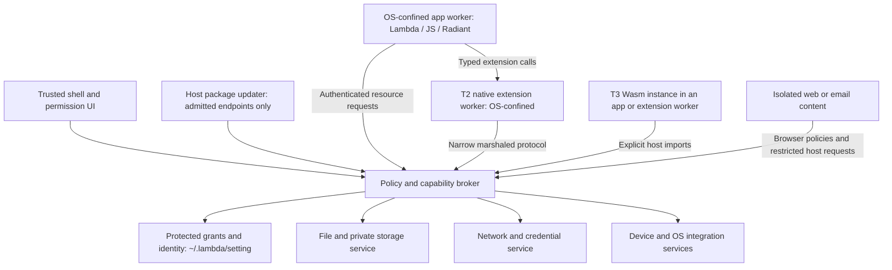

# Lambda App Safety

**Status:** script/app defaults, protected grant storage, and package-update
policy ratified by the user on 2026-11-02 (**D7.5.5–D7.5.8**), with private-data
retention on uninstall ratified on 2026-11-03 (**D7.5.9**). Remaining
architecture and delivery details are proposals. Policy, anchored I/O,
grant-store/file-broker and scoped Lambda source/input/parser-resource/path/task
components, host ad-hoc admission/source manifests and grant restoration,
context-owned transactions, unsupported-adapter refusals, bounded
broker IPC, an experimental signed T0 worker, a verified macOS supervisor,
once-only terminal consent, resource monitoring, guarded IPC response publication
and protected updater controls, plus broker-owned per-principal persistent data,
are implemented; update delivery and full production enforcement remain pending,
tracked in the
[implementation plan](impl/Lambda_Impl_App_Safety.md#6-implementation-progress).

**Date:** 2026-11-02.

**Scope:** installed Lambda apps, scripts launched as apps, Radiant documents,
web content, email, Jube extensions, and their access to host resources.

**Authority:** the [formal design](../doc/Lambda_Formal_Design.md) and
[formal semantics](../doc/Lambda_Formal_Semantics.md) remain authoritative.
This design develops **D7.5.1–D7.5.2 / DO19**, continuing
[JA10 and JA16](Lambda_Design_Jube_Architecture.md). The approved defaults map
to **D7.5.5** (execution root and loading), **D7.5.6** (create versus overwrite),
**D7.5.7** (protected settings), and **D7.5.8** (network denial and package
updates), and **D7.5.9** (retention on uninstall). Other recommendations remain proposed requirements unless identified
as existing rulings. This document does not allocate a competing security ledger.

**Current platform investigation (2026-11-03):** the shared App Sandbox helper
and an ad-hoc per-principal re-signing spike do not establish distinct Lambda
principals. The latter failed a same-ID/valid-parent native cross-container read
control. An experimental deny-native-IO process policy now runs before runtime
initialization, with host readback before broker callbacks. It uses private
Darwin APIs, is qualified only by the recorded macOS 26.5.2 arm64 component
probes, and was approved by the user on 2026-11-03 as an **experimental backend**.
It must be qualified before any default rollout. The launcher now clears inherited
user Mach ports before startup, and the worker rejects ptrace at the syscall
filter. Before source acquisition, the worker also checks for one bootstrap
thread and the exact descriptor roles, refusing leaked handles or redirected
stdio: native file descriptors and mappings survive sandbox installation.
The direct-linked worker also fails native-constructor qualification: mappings
can outlive closed descriptors. An opt-in minimal bootstrap now installs policy
before loading the separate T0 runtime, following the delayed-runtime model in
[Chromium's sandbox design](https://chromium.googlesource.com/chromium/src/+/main/sandbox/mac/seatbelt_sandbox_design.md).
Its local composition controls do not qualify hardened publisher loading.
Signing-identity setup is skipped by the user; kernel task-access/debug and
publisher/deployment gates remain open. No ordinary CLI default has changed. The
backend-independent private-data service uses a channel-bound virtual
`/.lambda/app-data` mount, stored beneath protected `~/.lambda/app-data`,
with no source authority and bounded writes. Details and remaining gates are in
the [implementation progress](impl/Lambda_Impl_App_Safety.md#6-implementation-progress)
(**D7.5.1–D7.5.2, D7.5.5–D7.5.7**).

## 1. Recommended direction

Lambda should provide an **OS-backed app sandbox with explicit, revocable
capabilities and one host-owned I/O policy layer**. An app or ad-hoc script
starts with its approved app/project root, approved shipped libraries, and
private storage. It can read its root and create new files there by default;
overwriting existing files requires user approval. The user grants additional
files/directories, named network destinations, and specific devices or services.
There is no ambient access to the user's home directory, credentials, other
apps, shell, native libraries, or Lambda's installation and policy stores.
Grants are kept by the host under **`~/.lambda/setting`**, protected from app
and user-script manipulation. Network access is denied by default. A separate
host package updater may poll and download from an admitted package's designated
endpoint without granting network access to that package or its callers.

Use three complementary layers:

1. **Authority:** a manifest declares possible needs; trusted user interaction
   grants particular resources. Every operation is checked against the current
   principal and its live grants.
2. **Containment:** app execution, hostile documents, and third-party native
   modules run behind appropriate process/OS or Wasm boundaries. Assume an
   interpreter, JIT, parser, or native module can be compromised.
3. **Content security:** web origins, browser policies, and a stricter email
   profile govern remote content. Displaying a page inside an app never gives
   the page the app's privileges.

The aim is to protect **confidentiality, integrity, and availability**. File and
network allowlists alone are insufficient: credential use, IPC, updates,
resource exhaustion, misleading prompts, and combinations of otherwise valid
permissions also need explicit designs.

### 1.1 Relationship to existing rulings

| Existing authority | Constraint on this proposal |
|---|---|
| **D7.5.1** | Preserve T1 trusted native, T2 process + OS sandbox + broker, and T3 sandboxed Wasm. Third-party native modules never enter the runtime process. A T1 DSO is not a security boundary. |
| **D7.5.2** | Use one central I/O door across Lambda, Radiant, and modules; policy includes capabilities, isolation, audit, and quotas. |
| **D7.5.5–D7.5.8** | Approved app/script loading scope, default new-file creation with overwrite approval, protected per-principal settings, and pull-only host package updates. Detailed rules are in §4.1, §6.4, §7.3, and §8.3. |
| **D7.3.2–D7.3.4, D7.3.6** | Preserve module integrity/ABI admission, transactional registration, the host API, and export allowlist. These are necessary admission controls, not proof of native-code safety. |
| **D7.4.1v2–D7.4.2v2** | Keep raw pointers out of script interfaces, resources in host-owned rid tables, and async completion under host control. Across processes, marshal values instead of transmitting pointer-bearing `Item` bits. |
| **S2.4.4** | Logical target resolution obeys sandboxing and capabilities; resolving an address does not itself perform I/O or confer access. |
| **S12.1.1v3, S12.4.1v3–S12.4.3** | Effect classification and scoped resources remain intact. A permitted `pn` effect still needs authorization; eager `input()` reads and resource discovery also need checks. |
| **S13.3.1v2–S13.3.2** | Revocation integrates with task ownership, cancellation, and cleanup. Cancellation at park points is not a hard CPU limit. |
| **D5.3.3** | Native adapters use precise `RootFrame` / `Rooted` ownership; sandbox work must not restore conservative stack scanning. |
| **D7.5.4** | Preserve origin-based audible-output activation. It does not grant file, network, microphone, or credential access. |
| **D7.2.7v2; S1.8** | TeX stays within its existing read-only resource boundary; document data must not acquire executable-source authority. |
| **Mail ML5v2, ML6** in [Lambda_Demo_Mail](Lambda_Demo_Mail.md) | Message scripts remain disabled; secrets belong in the OS secret store. Interactive mail would require a later explicit design decision. |

## 2. Prior art and lessons

Sources below were consulted on 2026-11-02. The final column is a recommendation
for Lambda, not a claim that the other platform provides Lambda's proposed
guarantees. Platform APIs and available protections must be checked against each
supported release.

| System | Useful design or architectural precedent | Lesson for Lambda |
|---|---|---|
| **Java** | The historical Security Manager mediated operations inside the JVM. It is permanently disabled from JDK 24; it is not a current sandbox deployment strategy. [Oracle migration guidance](https://docs.oracle.com/en/java/javase/24/security/security-manager-is-permanently-disabled.html). | Retain language-level checks, but avoid making a large, privileged runtime the only boundary for hostile code. Put the OS boundary outside the runtime. |
| **Node.js** | Its opt-in permission model restricts resource APIs, but the documentation explicitly excludes protection against malicious code. [Node permissions](https://nodejs.org/api/permissions.html). | Adopt clear, scoped resource permissions and useful denial errors. Do not equate a permission flag, JS realm, or API wrapper with adversarial isolation. |
| **Deno** | Denies ordinary ambient I/O by default and provides scoped grants for resources. Its documentation also warns about the authority of subprocesses and dynamic libraries. [Security model](https://docs.deno.com/runtime/fundamentals/security/), [permission reference](https://docs.deno.com/runtime/reference/permissions/). | Make least privilege usable in scripts and manifests. Native loading, process execution, and code acquisition need their own gates. |
| **Chromium** | Treats sandboxed renderers as potentially compromised; a broker handles authorized privileged operations. Site Isolation adds separation between sites beyond language-level origin checks. [Sandbox architecture](https://chromium.googlesource.com/chromium/src/+/HEAD/docs/design/sandbox.md), [Site Isolation](https://www.chromium.org/Home/chromium-security/site-isolation/). | Separate trusted control/UI from execution and parsing. Authenticate IPC senders and avoid putting unrelated principals' secrets in one process. |
| **Web platform** | Origins define web authority; Fetch/CORS, CSP, and Permissions Policy constrain different aspects of web behavior. [HTML origins](https://html.spec.whatwg.org/multipage/browsers.html#origin), [Fetch](https://fetch.spec.whatwg.org/), [CSP](https://www.w3.org/TR/CSP3/), [Permissions Policy](https://www.w3.org/TR/permissions-policy/). | Preserve web semantics. These controls complement the app sandbox and do not replace it. |
| **iOS / iPadOS** | Kernel-enforced app isolation, private app homes, signed entitlements, protected system resources, and constrained background execution. [Apple runtime security](https://support.apple.com/en-au/guide/security/sec15bfe098e/web). | Give apps stable identities and private containers; keep privileged services outside them. Permission declarations cannot be rewritten by the running app. |
| **macOS App Sandbox** | User-selected file access and security-scoped bookmarks support narrow, persistent resource grants; each helper target needs its own sandbox configuration. [File access](https://developer.apple.com/documentation/security/accessing-files-from-the-macos-app-sandbox), [sandbox entitlements](https://developer.apple.com/library/archive/documentation/Miscellaneous/Reference/EntitlementKeyReference/Chapters/EnablingAppSandbox.html). | Use trusted pickers, retain scoped grants deliberately, and audit helpers independently. One sandbox around the whole Lambda application does not isolate Lambda apps from one another. |
| **Android** | Per-app UIDs/processes and kernel controls isolate applications, including native code; SELinux adds mandatory controls. [Application Sandbox](https://source.android.com/docs/security/app-sandbox), [security features](https://source.android.com/docs/security/features). | Identity and OS enforcement matter more than source language. Native extensions must not receive exemptions merely because they implement a library API. |
| **Electron** | Recommends disabling Node integration for remote content, context isolation, renderer sandboxing, constrained navigation, and validating IPC senders. [Electron security guide](https://www.electronjs.org/docs/latest/tutorial/security). | A web-to-native bridge is a privileged API. Expose named operations with narrow authority, never a general command or evaluation channel. |
| **Wasm / WASI / Wasmtime** | Bounded guest memory and explicit imports support capability-oriented hosting; the host chooses exposed resources. [WASI security](https://wasi.dev/security), [Wasmtime security](https://docs.wasmtime.dev/security.html). | Prefer T3 for portable untrusted extensions. Unsafe host imports can defeat the intended restriction; quotas and host validation remain essential. |
| **Flatpak and portals** | Restricted desktop apps can request resources through mediated portal interactions instead of blanket host filesystem access. [Sandbox permissions](https://docs.flatpak.org/en/latest/sandbox-permissions.html). | File pickers, sharing, printing, and device selection should be broker services with user-visible scope. |
| **Windows AppContainer** | Separates files, credentials, devices, network access, processes, and windows using application identity and resource grants. [AppContainer isolation](https://learn.microsoft.com/en-us/windows/win32/secauthz/appcontainer-isolation). | Build a Windows adapter with real OS isolation; a job object or separate process alone is insufficient. |
| **Email clients** | Thunderbird blocks remote message resources by default because they can disclose reading activity and identifying information. [Remote content policy](https://support.mozilla.org/en-US/kb/remote-content-in-messages). | Email is a stricter content class than a visited website. Loading images is a privacy decision even with scripts disabled. |
| **The Update Framework (TUF)** | Authenticated metadata and target verification address compromised repositories, rollback, and stale update information. [TUF specification](https://theupdateframework.github.io/specification/latest/). | A designated HTTPS endpoint alone is insufficient; verify the release and its freshness before activation. The protocol selection remains an implementation decision. |

The synthesis is **browser-style compartmentalization + mobile-style app
identity + capability-based I/O + trusted desktop resource pickers**. No single
precedent solves the whole problem, and code signing establishes identity and
integrity rather than benevolent behavior.

## 3. Threat model and security claims

Protect user documents, mail, credentials, browsing sessions, app-private data,
Lambda code and configuration, OS state, devices, and host responsiveness.
Attackers may control an app, dependency, native extension, remote server,
document, email body, attachment, redirect, filename, or IPC request. They may
exploit memory corruption in a parser or JIT to gain arbitrary code execution
inside an app/content worker.

The trusted computing base comprises the OS isolation mechanisms, launcher,
small broker and policy store, trusted permission UI, required browser engine
security services, and admitted T1 code in privileged processes. Keep rich
document parsing, app code, and third-party plugins out of the broker. A
successful sandbox escape or broker exploit remains a security vulnerability.

| Threat | Required defense |
|---|---|
| Malicious app reads home directory or another app's storage | Private namespaces, deny-by-default grants, OS restrictions, no inherited host handles. |
| A runtime/JIT/native-library exploit bypasses API checks | OS-confined worker with no ambient file/network/device authority; broker validates independently. |
| Email or web content uses the containing app as a deputy | Separate content principal, no inherited app capabilities, narrow authenticated bridge. |
| A selected path escapes via links, races, mounts, or aliases | Handle-relative resolution, protected-object checks, safe mutation semantics, OS containment. |
| Approved network name redirects/rebinds to a local service | Broker-owned resolution/connect, destination and address checks on every connection/hop. |
| An authorized app leaks data to an authorized server | Minimize combined grants; disclose the combination; offer offline/private processing and explicit export. |
| An app rewrites its permissions or persists malicious code | Protected broker-owned settings, approved code loading, overwrite consent, and controlled installer/updater. New-file permission never grants execution in a stronger principal. |
| A parser or infinite loop exhausts the machine | Separate workers, bounded resource budgets, external watchdog and termination. |

**Limits:** this is not protection against an already compromised kernel or
administrator, physical attacks, every hardware side channel, or all social
engineering. It cannot retract data already read, delivered, displayed, or
sent. If an app has both readable private data and unrestricted egress, the
sandbox cannot promise that the data stays private. These limits must remain
visible in product claims.

## 4. Principals and default profiles

An **app principal** is bound by the trusted installer/launcher to an installed
app identity, publisher or explicit local-development identity, package
version/digest, and user profile. A name in an untrusted manifest is not proof
of identity. Unsigned local apps receive their own identity and do not inherit
the grants of a signed app with the same name.

A **content principal** additionally records the security profile, web origin
where applicable, top-level embedding context, storage partition, document
instance, and navigation generation. The host derives these fields; scripts
and IPC payloads cannot choose them. Task and callback execution preserve the
requesting principal even when work is offloaded to another thread.

| Profile | Initial authority | How it can grow |
|---|---|---|
| Installed app | Read its approved app root and create new files there; private data/cache/temp under quota; its own window | Existing root files require overwrite approval; additional capabilities require trusted grants, bounded by administrator/OS policy. |
| Ad-hoc script/project | Entry file, approved source/resource root, and approved shipped packages; new-file creation within the root | Select additional roots/files, approve replacement of existing files, or grant named network destinations. Grants belong to this script identity, not every `.ls` file. |
| Local document or attachment | The explicitly opened object and authorized document resources; no general directory, credential, or shell access | Trusted picker for additional inputs/exports; format-specific restrictions remain in force. |
| Web page | Web-origin authority and browser-governed network/storage inside its embedding policy | Standard browser permissions and explicit host-approved web features; never general app or Jube authority. |
| Email message | Message bytes and same-message `cid:` parts; scripts and remote loads disabled | User may allow specified remote content for that message or a configured sender rule. This does not enable scripts or mailbox access. |
| T2/T3 extension | Only the explicitly delegated subset needed for its operation | Delegation can narrow existing app grants; an extension cannot prompt for host-wide authority itself. |
| Developer/CLI session | Explicitly selected execution profile and grants | An operator may deliberately choose a trusted-host compatibility mode; it must never be an automatic fallback for apps or content. |

Opening a file grants access to that file, not its parent directory or execution
of neighboring files. Documents needing relative assets request a document
resource directory through trusted UI. Existing format rules still apply;
for example, the TeX read scope in **D7.2.7v2** must also fit within the selected
document-resource grant. A downloaded `.ls`, HTML attachment, or saved page
does not become a trusted app merely by residing on disk.

Pure transformations and computations need no extra permissions. Policy is
enforced when a target is accessed or a resource is used, including implicit
loads, imports, previews, and cache hits. This preserves **S2.4.4** and the
effect distinction in **S12.1.1v3** without confusing purity with authority.

### 4.1 Default script loading and dependency scope

**Approved 2026-11-02; D7.5.5–D7.5.6.** Each run is a small sandboxed app
with an explicit source/resource root. An installed app has its admitted app
root; running a project uses the project directory selected by the user.
Opening a loose script initially grants its entry file and approved shipped
libraries. If it needs siblings, the trusted launcher requests a folder once;
opening a file never silently selects all of Downloads or the home directory.
Selecting a root grants reading/importing inside it and creating new files,
with overwrite approval and protected-resource exclusions still applying.

| Operation | Default after the root is selected |
|---|---|
| Load the entry and relative script dependencies inside the root | Allowed, including transitive imports; approved code-loading rules still apply. |
| Load approved shipped `lambda.*` packages | Allowed through the runtime's package mapping; not a grant to read the rest of Lambda's installation. |
| Read root-local data, configuration, images, and other assets | Allowed; implicit loads use the same scope as explicit `input()`. |
| Create a new file inside the root | Allowed through the broker's create-only operation (§7.3). |
| Modify or replace an existing root file | Ask for user approval; no implicit write grant follows from read/import permission. |
| Read or import outside the root | Require a selected-file/directory grant covering that dependency. |
| Fetch external web data/content | Denied until a destination grant exists. The host updater in §8.3 is a separate service exception. |
| Obtain executable code from the network | Require code admission as well as authorized acquisition; fetching data does not authorize executing it. |

For example, selecting `report/` allows `main.ls` to import `helpers.ls`, read
`data/sales.csv`, and create `output/report.html` if absent. If that output
already exists, the host seeks approval before replacing it. The relative
import rules remain **S16.9.8**: resolve from the importing file, then check
the resulting object against the approved roots (**S2.4.4**). Parent steps and
symlinks do not expand authority, and denial must not trigger a fallback to a
different dependency.

Imported code shares the calling app/script's grants; imports cannot add
permissions. Importing `io` exposes names, not filesystem/network authority.
Check every transitive dependency, top-level initializer read, and cache hit
before use. There is no unrestricted loading/compilation phase. A denied
required initializer fails the import under **D7.2.2**, without publishing
partially initialized state.

Before execution, collect declared requirements and discoverable imports into
one trusted permission summary. Discovery itself stays within already granted
resources; do not execute initializers with elevated access to discover their
needs. Dynamic requirements use structured denials or an explicit permission
request. Headless runs need preauthorized grants and never implicitly approve
an overwrite. A URI namespace declaration is not a remote code import;
this design does not invent new import syntax.

## 5. Process architecture and the single I/O door



The diagram shows authority boundaries, not a requirement to put every service
in one process. In particular, the network stack and complex device services
may use dedicated helpers. The broker should run as the ordinary user, with
the smallest OS authority it needs, not as a root daemon.

**App execution:** use a separate OS-confined worker for each app security
principal. Threads/realms inside it are performance and language-organization
tools, not independent hostile-native-code boundaries. Put content with weaker
trust or materially different grants in separate workers. A T3 instance may
share an app worker only within the security guarantees of its selected Wasm
engine and host imports; it never runs in the policy broker.

**One policy contract:** Lambda builtins, Node compatibility, DOM fetch,
Radiant resources, native service adapters, and module APIs submit requests to
the same authority model (**D7.5.2**). Surface adapters preserve language/web
semantics; they do not maintain competing authorization databases. Raw I/O
mechanisms remain under `lib`/reviewed platform services. Source and binary
checks prevent accidental bypasses, while the OS prevents adversarial bypasses.

**Browser integration:** a system webview may own its network and renderer
processes. It can be a delegated enforcement component only where its supported
APIs enforce the selected profile for all requests, redirects, subresources,
workers, and storage. A navigation callback alone is not complete mediation.
If an embedding cannot enforce an app's restrictions, refuse that embedding or
offer an explicit handoff to an external browser; never silently relax policy.

**Broker protocol:** authenticate the peer using the established process
channel, never a caller-supplied app ID. Validate operation, message size,
integer arithmetic, encoding, resource type, ownership, generation, and quota
before work. Do not expose arbitrary function names, pointers, path-opening
proxies, shell commands, or generic native dispatch. Bound queues and rates;
fuzz the broker as a hostile-input parser. Shared memory carries bounded data,
not policy tables or trusted command objects, and mutable peer buffers must
not change between validation and use.

Before any untrusted entrypoint or library constructor runs, the launcher
closes unintended descriptors, sanitizes environment and loader configuration,
installs the OS sandbox, binds the principal, and confirms the restricted
profile. Failure to establish a required boundary stops launch.

## 6. Capabilities, consent, delegation, and revocation

### 6.1 Authority calculation

For each requested operation:

```text
allowed = platform and administrator policy permit it
      AND the execution profile permits it
      AND the app's declared capability ceiling permits it
      AND a live grant/delegation covers this resource and operation
      AND any applicable web/content policy permits it
      AND identity, lifetime, quota, and protected-resource checks pass
```

App-private defaults are host-issued grants under this same model. A manifest
is a request and ceiling, not consent. Reject unknown schema versions,
duplicate or ambiguous security fields, and malformed scope expressions
before execution; a parser disagreement must never widen authority.
An OS grant to the Lambda host is an
outer ceiling, not a grant to every app it runs. Denials win; absent or unknown
security-critical policy fields cannot silently produce broad access.

Capabilities identify an operation set, a resource or constrained namespace,
the grantee, expiry/owner lifetime, delegation rights, and a policy generation.
Represent them as opaque host-owned resources. An integer rid is only an index
into a principal-scoped, generation-checked table, never an OS descriptor or
authority a different principal can claim by guessing (**D7.4.1v2**).

Delegation can only narrow resource, operations, duration, and onward delegation.
Ordinary serialization, `postMessage`, file storage, or copying a rid never
transfers authority; an explicit broker transfer mints a recipient-bound
capability. Revocation follows the delegation graph.

Code imported into one app realm ordinarily executes with that realm's
authority. Per-package metadata cannot promise dependency isolation inside a
shared address space. Less-trusted dependencies require a separate compartment
and explicit message/capability transfer. No call-stack inspection or
`doPrivileged`-style escape is proposed.

### 6.2 Permission taxonomy

| Capability family | Scope and important distinctions |
|---|---|
| Files | Read bytes, enumerate, inspect metadata, create, replace, append, rename, delete, watch; a file grant and a recursive directory grant differ. No implied execution. |
| Network | Scheme/host/port and optionally broker-enforced HTTP method/path; outbound, listening, LAN/loopback, and raw transport are separate grants. |
| Devices | Selected camera/microphone/screen/USB/Bluetooth device and operation; foreground/session lifetime and visible usage indicators. |
| OS integration | Clipboard read versus write, print, notification, location, external URL launch, selected contacts/photos/calendar entries. |
| Credentials/accounts | App-scoped secret namespace; named account, service, and permitted operation. Reading mail, sending mail, and changing account settings are distinct. |
| Processes | Named executable/service plus argument contract, environment, working directory, and inherited grant subset; no implicit shell. |
| Modules/code | Approved module identity/version/digest and trust tier; permission to load is distinct from each I/O operation it performs. |
| Background/IPC | Named service/channel, message schema, lifetime and budget; no global socket, agent, scheduler, or debug-port access. |

**Illustrative manifest fragment only:** this is not a shipped filename,
schema, CLI flag, or Lambda language extension. Actual granted file handles and
consent records live outside the package.

```json
{
  "safety_schema": 1,
  "app_id": "example.photo-editor",
  "profile": "app",
  "requests": {
    "files": { "selection": "user-picker", "operations": ["read", "export"] },
    "network": { "optional_origins": ["https://sync.example.com:443"] },
    "devices": { "optional": ["camera"] },
    "extensions": [{ "id": "image-filter", "tier": "T3" }]
  }
}
```

### 6.3 Consent and revocation behavior

The trusted shell renders prompts outside app-controlled content. Show the
verified app identity, requested resource/destination, operation, and duration.
Prefer a picker or a concrete action such as exporting one document. Offer
once/session/persistent grants where appropriate; persistence is explicit.
Denial is a normal, actionable error, not an empty successful result.

Low-level I/O never grants consent or renders its own permission dialog. An
attempt to overwrite an existing root file returns an approval challenge to
the trusted shell, which prompts before any destructive action (§7.3). Other
explicit permission requests require foreground trusted interaction. Prompts
are rate-limited and cannot be impersonated by an invisible frame or
synthesized click; background requests remain pending or denied until the
user can review them. Headless execution fails with a structured denial
unless grants were supplied by its operator.
The user can inspect and revoke grants in one host-owned permissions view.

Revocation invalidates future operations, queued requests, delegated grants,
and delivery of sensitive async results. Check authority both before dispatch
and before exposing completion. Close streams, stop device capture, cancel
subscriptions/tasks, and prevent retry/reconnect after revocation. A navigation
generation prevents late results from reaching a replacement document.

Already-open native descriptors and memory mappings are not generally
revocable merely by changing a policy bit. Prefer brokered operations for
revocable external resources; if a worker has received raw handles, terminate
that worker when needed to enforce revocation. Revoke/kill cannot erase bytes
already copied by it, undo a completed write, or recall a packet. These are
explicit limits, not reasons to leave future access enabled.

### 6.4 Protected settings and grant persistence

**Approved 2026-11-02; D7.5.7.** The host stores what is granted to each
installed app and each ad-hoc script under **`~/.lambda/setting`**. This is
host security state, not app configuration. Persistent records include the
host-assigned principal, admitted identity/root, resource and operation scope,
approval provenance, lifetime/expiry, delegation, revocation generation, and
package-update preferences. Session/once grants may be recorded for audit but
must not become permanent merely because a record survives a restart.

Use distinct identities for apps and individual ad-hoc scripts. A display name,
filename, or caller-supplied ID cannot claim another record. Bind local-script
records to the host-admitted entry/root and code identity; revalidate changed
code, moved roots, reinstalls, and publisher changes before reusing authority.
A new script placed at an old path cannot silently inherit its grants.
The exact on-disk schema is implementation work, not a script-facing API.

Only the trusted settings/permission service can mutate this directory. Apps,
user scripts, their imported code, native workers, and update payloads cannot
read unrelated grants or create, edit, replace, delete, rename, or redirect
the policy store. Protect the directory's parents and aliases against rename,
symlink, hard-link, and mount substitution. Broad root/file grants and normal
overwrite approval cannot override this protection, even if the selected
project contains `~/.lambda/setting`. Apps can query their own effective
permissions through a narrow broker API and request changes; only a trusted
user decision can grant or restore authority.

Host-controlled user-home resolution chooses this path; app environment
variables, `LAMBDA_HOME`, a working directory, or a manifest cannot redirect
it. Owner-only filesystem permissions are defense in depth, not sufficient
isolation from another process running with the same user ID. OS confinement
must deny app/script access, and the broker must enforce the same exclusion.
Use atomic validated writes and restrictive ownership; malformed, substituted,
or missing records fail to minimal defaults, never full access. Concurrent
updates and backup recovery must preserve revocations and monotonic policy
generations. Store credentials in the OS secret store, not this directory.

Users manage these settings through trusted Lambda UI/CLI. This protects
against sandboxed app/user-script manipulation; it does not claim to prevent
the OS account owner or administrator deliberately changing files outside the
sandbox. An unrestricted host-compatibility session cannot claim this protection.

## 7. Filesystem and protected directories

### 7.1 Storage model

| Storage class | Proposed access |
|---|---|
| App/project source and resource root | Read/import and create new files by default; existing-file modification requires user approval (§7.3). Protected descendants remain excluded. |
| Managed Lambda runtime and shared dependency images | Read-only to app/script workers, integrity-checked; the trusted install/update service replaces them. This protection does not make every ordinary project file immutable. |
| App data | Private to the app principal, mutable under quota; separate from executable code. |
| App cache | Private, bounded, non-executable storage; the trusted host may evict it without changing persistent app data. |
| App temporary files | Private per admission, under a per-principal aggregate quota; unpredictable physical session names and cleanup after exit/crash, with abandoned-session recovery. |
| User-selected file | Only granted operations on that object; read-only by default. |
| User-selected directory | Explicit recursive scope and operation set, with protected descendants still excluded. |
| OS/runtime resources needed to execute | Minimal read-only runtime view, not general access to host configuration. |
| Other app containers, host policy, trust store, updater and credential storage | Inaccessible to ordinary apps, including through broad directory grants. |
| `~/.lambda/setting` | Protected host-owned grants and update preferences; no app/user-script manipulation, including through an ancestor grant (§6.4). |

Protect OS administration/startup locations, Lambda binaries, managed module
search paths, shared dependencies, policy/grant databases, update keys, and privileged
configuration from app writes. Protect credential stores, SSH/cloud/browser
credentials, host environment secrets, and other apps' private data from both
reading and writing. Derive protected locations through platform APIs and
object identity; a list of familiar path strings is not sufficient.

Separate executable configuration from mutable preferences. A private data
directory being writable must not let an app replace code that later executes
with a stronger principal. Code acquisition/import from user data, downloaded
content, archives, or caches remains subject to explicit executable-source
admission; setting a directory `noexec` does not constrain an interpreter.

The experimental broker implements data/cache/temp through channel-bound
virtual mounts (`/.lambda/app-data`, `/.lambda/app-cache`, `/.lambda/app-temp`)
under **D7.5.2, D7.5.5–D7.5.7**. Temp files are isolated between concurrent
admissions; the quota counts all of that principal's sessions. A held lease,
not a PID or age threshold, distinguishes live temp trees from abandoned ones.
Joined teardown and trusted cache eviction use bounded, identity-checked
removal; cleanup failure is visible to the host.

Uninstall retains persistent app data by default (**D7.5.9**, USER,
2026-11-03). Deletion is a separate explicit action in trusted Lambda management;
neither uninstall nor permission revocation silently erases it. Retained data
grants no permission to reinstall or execute code. Cache/temp remain discardable.
The experimental host exposes usage/quota inspection and an explicit data-reset
command. Reset refuses live admissions, records a principal/object-bound random
intent before deletion and keeps new admissions blocked until bounded cleanup
finishes. An interrupted reset requires trusted resumption with that intent's
ID; ordinary script launch never resumes deletion. Cache, grants, updater state
and other principals are preserved. This resets valid persistent storage; it
does not adopt or repair an unverified data owner record. Installed-app uninstall
integration, corrupt-state repair, full power-loss qualification and graphical quota UI
remain pending. See the
[storage component](../lambda/host/safety/README.md#broker-owned-private-data-cache-and-temporary-files).

Persistent security/private state uses ordered namespace publication under
**D7.5.2, D7.5.7**. Creating a directory syncs its inode and its parent's name
before returning; create-mode retries also sync retained directories. A new
lock/lease stream is returned only after the empty file and parent have synced.
Protected settings and private mounts additionally require `F_FULLFSYNC` on
macOS for writes, creation and removal, with no weaker fallback on error.
An error can follow a created or committed object; exclusive retries do not
authorize replacement, and unverified persistent state is never silently adopted.
These barriers address OS/device write ordering, not proof against every device,
filesystem corruption or physical power-loss scenario.
[Apple fsync](https://developer.apple.com/library/archive/documentation/System/Conceptual/ManPages_iPhoneOS/man2/fsync.2.html),
[Apple F_FULLFSYNC](https://developer.apple.com/library/archive/documentation/System/Conceptual/ManPages_iPhoneOS/man2/fcntl.2.html),
[Linux directory syncing](https://man7.org/linux/man-pages/man2/fsync.2.html).

Trusted quota management stores per-principal overrides under the protected
`~/.lambda/setting` namespace (**D7.5.2, D7.5.7**). Missing overrides use the
trusted host's defaults. Saved records bind the principal kind/digest and account
profile, retain a monotonically increasing generation and survive app-code
revalidation and data reset. Corrupt or copied records refuse admission;
restoring defaults never silently replaces a corrupt record. No worker request
can edit this policy.

The host loads policy while holding the same owner lock that serializes quota
edits and admission creation. Editing requires no live admission or pending data
reset and an exact inspected generation. Default restoration persists a new
generation. Lowering limits retains all data and reports over-quota state;
replacement can shrink a file when the resulting class fits both byte and entry
limits. Other writes continue to enforce the full class budget. Entry limits
remain bounded at 4,096 per class, with at least three internal temp entries
required for an admission. Request/session budgets and source denial remain
independent. Trusted CLI quota inspection/edit/default restoration are available
in the experimental host; graphical controls and installed-app integration
remain pending.

Normal pickers cannot override protected-resource policy. An editor needing a
sensitive configuration change should use a dedicated, narrowly reviewed host
operation or an explicit operator workflow, not a generic app permission to
rewrite the host. Broad selections such as the home directory require clear
scope disclosure and still do not include protected subtrees.

### 7.2 Correct path and mutation semantics

Authorize the **object actually accessed**, not just a normalized path string.
Resolve relative to broker-held directory handles; enforce containment during
resolution and validate final type/identity. Reject ambiguous encodings and
forbidden special files. A `realpath` check followed by an ordinary open leaves
a race and is not an acceptable boundary.

Cover symlinks, hard links, rename races, mount changes, Windows reparse points,
UNC/device paths, alternate data streams, case aliases, and platform path
normalization. Links and special files are denied by default in selected
trees; any future allowance needs a defined object-level rule. For broad
writable trees, reject mutation of multiply-linked files unless confinement
can be established. Where a platform cannot prove a safe operation, deny it
or import/export a broker-owned copy.

Creating a file requires authority to the parent and destination; renaming
requires the relevant rights at both ends. Replacements use a temporary file
in the authorized destination directory followed by a checked atomic commit;
revalidate the grant before commit. Overwrite/delete rights are distinct from
creating a new export. Preserve recovery/version history where practical for
user documents; a writable folder otherwise permits ransomware-like damage
within that folder.

Directory enumeration, search, globbing, watchers, thumbnails, metadata, and
error messages must obey the same scope. Denied reads must not leak existence
through a more privileged cache or service. File URLs and custom schemes
must resolve through this policy rather than opening a second I/O door.

### 7.3 Default creation and approval before overwrite

**Approved 2026-11-02; D7.5.6.** Creating a new ordinary file under the
approved app/project root is granted by default, subject to quotas, protected
locations, and OS restrictions. Creating necessary ordinary subdirectories is
part of that operation. It does not grant arbitrary deletion, renaming,
executable installation, or alteration of existing files.

The broker uses an atomic **create-if-absent** operation, not an existence
check followed by a truncating open. The creating stream may write the new
object until it closes; a later reopen of that now-existing file is subject
to the overwrite policy. If another process creates the destination first,
the write becomes an approval request or fails; it never silently truncates
the winner. Atomic-save publication must likewise use no-replace semantics
unless an overwrite has been approved.

Overwriting includes truncation, in-place modification, appending, replacement
by rename, and any equivalent operation on an existing file. Present the
verified app/script identity, target, and intended change in trusted UI before
committing it. Bind consent to the target object/version and operation; if
the destination changes while approval is pending, stop and revalidate rather
than applying approval to an unexpected object. Declining leaves the original
file untouched. A script cannot avoid approval by deleting then recreating a
file: destructive namespace operations require their own authorization.

The default is approval for the particular write. A user may explicitly
remember a narrowly scoped replacement grant in `~/.lambda/setting`; a past
read grant, a successful creation, or one approved write never silently becomes
a general overwrite grant. A headless run without such approval fails clearly.
Do not hold a global broker lock while waiting for consent.

**Enforcement matters:** the worker cannot receive an OS-writable mapping of
the whole project root, because malicious native code could then bypass the
prompt. Broker all root mutations and retain the distinction between a newly
created object and an approved replacement. Protected settings, runtime files,
and other apps' storage remain denied even when the user approves an ordinary
root write. Dedicated private data/cache stores use their separate mutable
storage grants (§7.1); those grants do not extend to existing project files.

Creating source files does not grant execution in a stronger principal.
Approved edits to app/script source invalidate the affected admitted code
identity/caches and trigger loading-policy revalidation. They must not remain
misrepresented as an unchanged signed release. Managed runtime/shared package
updates use the updater's restricted installation path, not a generic script
overwrite exemption.

## 8. Network, devices, and other I/O

### 8.1 Network policy

Apps and ad-hoc scripts have no network access until granted (**D7.5.8**).
The host updater's narrow exception (§8.3) does not grant them network access.
Scope a grant to parsed
scheme/hostname/port; use exact hosts by default, not textual suffix matches.
An HTTP method/path restriction is valid only when the broker mediates the
application request. Passing a raw connected socket cannot enforce it.

The network service owns DNS resolution, connection establishment, TLS policy,
redirect handling, proxy configuration, and credential attachment. Check the
resolved endpoint and each redirect/reconnect against current grants. Tie the
approved address to the actual connection, revalidate new DNS answers, and
cover IPv4, IPv6, mapped forms, and alternate URL encodings. Separate explicit
LAN/loopback grants from Internet access; block link-local metadata services,
Unix-domain sockets, named pipes, and local administration endpoints by default.
Arbitrary DNS queries are themselves network egress and are not a free service.

Use validated TLS and reject insecure downgrade in the default app profile.
Do not forward cookies, authorization headers, client keys, or secrets to a
different destination after a redirect. Keep connection pools, authentication,
DNS/HTTP caches, and cookies correctly partitioned; cache hits never bypass
authorization. Constrain proxy/CONNECT and other tunneling paths as well.

For web content, keep standard Fetch/CORS checks in addition to the embedding
app's network ceiling. **CORS governs cross-origin response sharing and some
request preflights; it is not a general outbound firewall.** Images, forms,
beacons, navigations, and other loads can disclose data without exposing a
response to script. The policy must cover those channels too.
[Fetch CORS protocol](https://fetch.spec.whatwg.org/#http-cors-protocol).

Server sockets require a distinct listen grant, with address/port and lifetime.
Loopback listeners used by tools/OAuth require unguessable session binding and
appropriate origin/request validation; binding to localhost is not client
authentication. Remote imports and dependency downloads are code acquisition,
not merely a consequence of permission to contact a server.

### 8.2 Hardware and host services

Device APIs broker access to a selected resource, not arbitrary device nodes
or `ioctl` calls. Camera/microphone/screen capture use host-owned indicators
and stop on revocation; OS consent and Lambda consent must both hold. Screen
and window selection must not silently expand to all displays. Background
capture needs an explicit separate policy.

Clipboard reads, selected contacts/photos, location, printing, notifications,
accessibility automation, and global keyboard hooks are sensitive services.
Expose focused operations and user-selected subsets; global input injection,
debugging other processes, and unrestricted accessibility control are outside
the normal app profile. Audible output continues to follow **D7.5.4**.

Cover process spawn, environment access, standard streams, filesystem watchers,
GPU/media services, local IPC, clipboard, diagnostics, and crash reporting in
the I/O inventory. GPU/device helpers get bounded command/data interfaces;
rendering permission is not permission to read other windows or GPU clients.
Children inherit at most the delegated grant subset and the OS restrictions.
Do not inherit host tokens, SSH-agent sockets, credentials, or unrestricted
stdout destinations; app output is also a potential data sink.

### 8.3 Host-controlled package auto-update

**Approved 2026-11-02; D7.5.8.** Lambda provides a host mechanism to poll and
download package updates from the package's **designated update endpoint**.
This is a pull-only service exception to default network denial. The installed
package declares update metadata at admission; package code does not implement
the poller, choose arbitrary requests, or receive a network-capable handle.
An ad-hoc script can use an installed package without inheriting the updater's
authority. Loose scripts do not gain an updater simply by containing a URL.

The trusted installer records package identity, update endpoint, release
channel, authenticity roots, and any explicitly admitted artifact/CDN origins.
The host scheduler constructs requests from that protected record, independent
of app execution and user data. Package code cannot alter the endpoint, query,
headers, body, schedule, or download destination, or invoke a general fetch
through the updater. Endpoint/key changes require authenticated update policy
and host admission, never an arbitrary URL from a running app. A redirect or
artifact URL outside the admitted endpoint set is denied.

**Pull-only and privacy:** use host-generated HTTPS GET/HEAD requests for
public release metadata and package artifacts, without upload bodies. Do not
send user documents, local paths, source code, account details, secrets,
telemetry, installation UUIDs, machine identifiers, or an inventory of other
packages. No shared browser cookies, referrers, ambient credentials, or
server-assigned persistent tracking tokens. Fetch a public release index and
compare installed versions locally where possible; select only the necessary
public package/channel/platform/architecture artifact. Package-controlled
query parameters and data-dependent polling cannot be used as an exfiltration
channel. Logs and failure reports are local by default.

A network pull necessarily sends a request: the endpoint can observe the
connecting IP address, timing, and requested package/artifact. **No user data
upload does not mean anonymous or literally one-way transport.** Minimize
request metadata and avoid unique request identifiers; any future authenticated
private-repository mode requires a separate explicit account/privacy grant,
not an exception hidden in default updating. HTTP's privacy considerations
also identify disclosure through connection information and request metadata.
[RFC 9110 §17.8, request-log privacy](https://www.rfc-editor.org/rfc/rfc9110.html#section-17.8).

**Verification and installation:** download into private, bounded staging;
validate metadata signatures, expected artifact hashes/lengths, publisher,
version/freshness, and safe archive extraction before activation. Use
anti-rollback/freeze protections and authenticated key rotation; a hash supplied
by the same untrusted download alone is insufficient. TUF is a useful reference
for this verification model, without committing Lambda to a particular wire
format. [TUF client workflow](https://theupdateframework.github.io/specification/latest/).

The updater may activate verified replacements only in its admitted managed
package installation. It cannot overwrite user project files, grants, or
secrets; package install hooks do not execute with updater authority. If a
package is vendored into a mutable user project, replacing those existing
files still requires §7.3 approval. Stage updates while a version is in use
and activate at a safe boundary; do not hot-unload native modules contrary
to **D7.3.2**. New capability requests do not inherit consent: retain existing
restrictions and seek user approval before enabling the additional operations.

**User controls:** expose per-package and global controls in trusted settings,
persisted under `~/.lambda/setting`:

| Control/state | Behavior |
|---|---|
| Enabled | The host periodically checks the admitted endpoint and downloads verified updates within its budgets. This does not grant app networking. |
| Pause | Suspend checks, downloads, and automatic activation; stop in-flight work safely. Remain paused until resume or an explicit user-selected expiry. |
| Disable | Stop automatic checks/downloads/activation persistently, including across restart, app launch, or package updates. |
| Restore/resume | The user re-enables automatic updating for the retained admitted endpoint/channel, subject to current trust and revocation checks. No app may do this itself. |

Restore means restoring the update service, not resetting other permissions,
installing a revoked version, or erasing a user's disabled state. A trusted
manual "check/download now" may authorize one update operation while automatic
updates remain disabled; it does not silently re-enable the schedule. A global
offline/no-network setting overrides the updater exception. Normal app network
denial alone does not disable this separate service. Permission revocation or
pause/disable arriving during staging is rechecked before publication/activation;
already transmitted requests cannot be recalled.

Default polling cadence, installation-time presentation, and update schema
remain implementation choices. Use bounded downloads and retry backoff; an
update server cannot cause unbounded polling, storage growth, or grant changes.

**Current transport component (D7.5.2, D7.5.7–D7.5.8; 2026-11-03):**
`host/safety/update_download` constructs a GET for a public repository-relative
name from the admitted package record. It permits at most three redirects,
checking the exact admitted origin and canonical public HTTPS syntax on every
hop. Queries, fragments, credentials, noncanonical escapes, literal dot segments and local
hostnames are refused before dispatch. The mechanism in `lib/https_pull` checks
each resolved socket address before connecting; private, link-local, multicast,
mapped/translated and other special-use address ranges are excluded by its
conservative public-unicast profile. DNS resolution is not itself authority.

Every hop uses a fresh handle without browser cache/cookies, proxy, netrc,
credentials, TLS sessions, compression or persistent server tokens. Requests
have a fixed User-Agent and identity encoding. TLS verifies the hostname against
OS roots independently of ordinary `SSL_CERT_FILE` overrides; the current
adapter requires libcurl 8.10.1+, mbedTLS and asynchronous DNS. Ambient TLS key
logging, including retained initialization history, refuses this service.
There is one body-byte budget across a download's hops (maximum 256 MiB), a
16 KiB aggregate header limit per hop, a 4,096-byte URL buffer and an overall
deadline no longer than the live job. Policy is rechecked during transfer and
under a short final handoff lease; no network wait holds a settings lock.
Already transmitted bytes cannot be recalled.

This is a trusted-host component, with no app builtin, worker opcode or URL
fetch command. Successful downloads are explicitly **unverified bytes**. Signed
metadata/freshness, trust-root rotation, safe staging/extraction, activation and
installed-package catalog integration remain required before update delivery
is available. Transport tests do not qualify M2 or enable default rollout.

**Selected verifier implementation (USER, 2026-11-03; D7.5.8):** implement
TUF metadata parsing, canonical signing bytes, threshold verification, root
rotation, rollback/freshness checks, delegated lookup and refresh sequencing
in Lambda Script. Use native primitives for public-key signature math and
trusted host mechanisms for admitted downloads, protected checkpoints and
staging. No Python/Rust client runtime or package-executed updater is required.
The reusable verifier functions carry no IO or installation authority.

The current implementation under `lmd/package/security/tuf*` emits fetch and
durable-checkpoint actions. The dedicated `update_refresh` host adapter executes them; it
must bind state to the live package job, immutable verifier code and protected
cache. Accepted roots and metadata are persisted before later fetches. Root
rotation that changes timestamp/snapshot keys atomically drops both cached
roles. The host cache stores opaque signed bytes with profile/authority binding,
generation comparison and a persisted observed-clock watermark under D7.5.7.
This is not a hardware-backed counter or an app-callable state store.

Under **D7.5.2, D7.5.7–D7.5.8**, role labels remain opaque UTF-8 values inside
that record, with exact identity and a 128-byte ceiling. They never select
settings filenames. The verifier percent-encodes whole role components;
target references preserve canonical existing escapes exactly once. Native
transport checks canonical escapes, UTF-8, controls and literal dot segments
before parsing. Encoded separators remain URL data. Exact plain origins/bases,
origin/peer rechecks and the default app-network denial remain in force.

The offline verifier uses the interpreter and an immutable embedded source
closure in a separate early-confined process. A dedicated bounded, sequence-bound
channel carries actions; the app channel exposes no updater call. Native code
enforces process budgets, live policy, aggregate transfer limits and atomic
checkpoints. The final opaque artifact binds the random job reservation and
requires revalidation on each handoff. Equal timestamp metadata resumes target
verification from the old trusted envelope, allowing interrupted downloads to
retry without accepting new same-version expiry/references.

The initial **D7.5.2, D7.5.8** offline decoder implements its ZIP namespace and
streaming policy in Lambda Script, using the existing native bounded reader.
It validates all paths before emission and sends one exact member at a time,
requiring host acknowledgement between members. It writes no files and runs no
package hooks. The initial image-member profile admits printable ASCII names,
rejects case collisions and reserved/device names, and caps archive/expanded
bytes at 64 MiB, members at 16 MiB, entries at 4,096 and path depth at 32.
Unicode image names require a qualified filesystem alias policy; signed TUF
role/target UTF-8 support is unaffected. See the [decoder contract](../lmd/package/security/Stage.md).
The native host adapter now consumes only the live reservation-bound opaque
artifact and independently validates output before writing an inactive image
under strict protected anchors. A single pending stage, random identity,
checksummed intent and exact per-file receipt bound storage and cleanup. Each
write rechecks policy; ready publication follows clean decoder exit and a final
lease. Identity-bound bounded cleanup works offline/paused and never deletes
retained app data. Managed-image admission/publication, activation and installed
catalog coordination remain pending; a staging receipt does not authorize them.

The [initial verifier profile](../lmd/package/security/tuf/README.md) documents
supported algorithms, paths, delegation forms and bounds. Bracket patterns and
succinct-role delegations currently fail closed. Focused signed fixtures do not
establish TUF conformance. Owned TLS/offline-worker composition passes with an
explicitly unhardened fixture. Successful hardened publisher launch, full conformance,
managed-image admission/publication, crash-safe activation and deployed qualification remain
open; delivery and default sandbox rollout stay disabled.

## 9. Jube and executable-code admission

Apply the existing **D7.5.1** tiers without conflating package signing and trust:

| Tier | Admission and execution | Safety consequence |
|---|---|---|
| T1 system | Explicit platform-maintained trusted set; integrity/ABI checks; reviewed host API and per-operation policy | Same authority as the containing process. Keep the set small, especially in brokers. Ordinary third-party installation cannot promote a module to T1. |
| T2 confined native | Dedicated OS-confined process; narrow marshaled service interface; delegated capabilities | Required route for third-party native code. A raw syscall must still fail when it skips the Jube API. |
| T3 sandboxed Wasm | Validated module, bounded memory/execution, explicitly granted imports | Preferred portable extension route. Host imports, resource ownership, and denial semantics remain part of the boundary. |

Admission covers manifest, artifact integrity, publisher policy, ABI,
dependencies, target tier, and capability ceiling **before loading code**.
Native constructors can run during `dlopen`/`LoadLibrary`, before the exported
entrypoint; checking only the module's init function is too late. Trusted
pre-load metadata and post-load descriptor checks have different jobs.
Verify the exact immutable image that will execute and constrain transitive
native dependencies and loader search paths. A hash in an attacker-writable
manifest provides consistency, not publisher authentication.

Calling an admitted module still checks resource authority. A grant to load
an image decoder does not authorize it to read files, reach the network, or
load another DSO. Environment-driven module paths and development bypasses
must be unavailable in app/content profiles.

T2 needs a versioned wire protocol: bounded value serialization, opaque remote
resource handles, cancellation, backpressure, and crash/error reporting. Raw
`Item` values, pointers, function addresses, and native host-object layouts do
not cross the process boundary (**D7.4.1v2**). Modules whose synchronous
callbacks or shared-memory assumptions cannot be expressed safely remain
unsupported in T2 until redesigned; do not fall back to T1.

For T1 vendor libraries that internally perform I/O, register and constrain
their service operations under **D7.5.2**; a checker exemption does not make
their native code confined. Existing connection-lifecycle proposals
**JA16.1–JA16.4** in [Lambda_IO_RDB](Lambda_IO_RDB.md) remain part of that work.
For T2, even vendor I/O must be limited by the worker's OS profile or mediated
service channel. Do not patch vendor sources as a substitute for host policy.

## 10. Web pages and email

### 10.1 Web content

Use the established web security model for both JavaScript and any future
Lambda scripting exposed to a web document. Changing script language must not
change origin authority. Required controls include:

- Origin-correct DOM access, navigation, workers, messaging, and storage;
  Fetch/CORS response filtering; correctly partitioned cookies and credentials.
- CSP for resource/execution policy; iframe sandbox flags; Permissions Policy
  for sensitive features; secure-context and mixed-content rules.
- Appropriate opener/embedder isolation, MIME checking, download restrictions,
  trusted user activation, and bounded popups/external navigation.

These mechanisms have distinct scopes and must follow their standards rather
than an approximate hostname check. Browser process isolation is an additional
boundary, not something an iframe attribute creates.
[HTML security model](https://html.spec.whatwg.org/multipage/browsers.html),
[CSP](https://www.w3.org/TR/CSP3/),
[Permissions Policy](https://www.w3.org/TR/permissions-policy/).

**Recommended initial delivery:** use a maintained native web engine for
arbitrary active Internet pages, with the embedding controls qualified for the
chosen profile. Radiant's own renderer/DOM can serve app UI and restricted
documents; advertise native active-web support only after explicit origin,
network, storage, script, and isolation gates pass. A successful layout or
Test262 suite is not web-security qualification.

Remote frames never receive app file handles, Node filesystem/process APIs,
Jube loaders, mailbox access, or a generic Lambda bridge. If an app needs a
content interaction, expose a small typed operation tied to the exact frame,
origin, principal, and navigation generation. Validate `postMessage` origin,
source, and payload; do not use `*` for privileged messages. Recheck the sender
after navigation. Custom package schemes expose admitted, version-bound
package resources, not arbitrary host paths, and require tested origin semantics.
Approved source edits invalidate the relevant resource/code admission.

Avoid rendering app-controlled content inside trusted permission chrome. An
app page fetching a remote script executes that script with the page's
authority; use packaged/pinned code and restrictive app CSP, and keep untrusted
content out of the app's principal. Context isolation alone cannot contain a
compromised native renderer. These recommendations follow the bridge hazards
identified by the [Electron security guide](https://www.electronjs.org/docs/latest/tutorial/security).

### 10.2 Email content

Preserve **ML5v2**: no message script runs. Disable scripts at the engine level,
including inline handlers, `javascript:` URLs, SVG script, nested `srcdoc`, and
other embedded active content; sanitize as an additional defense. Remote
resources are blocked by a per-document resource policy, including CSS, fonts,
media, redirects, and nested documents, not only `` tags.

Each message has an isolated content identity. The sender address, mailbox
account, or trusted mail-app origin is not its origin authority. `cid:` lookup
can address only that message's MIME parts. The renderer sees no mail account
tokens, message index, other messages, or host bridge. Forms, downloads, and
external protocol handlers require explicit host-mediated action; link
activation opens a separate web context without mail privileges.

Allowing remote images is separate from enabling scripts or trusting a sender.
Disclose tracking implications; suppress message credentials and unnecessary
referrers. A privacy proxy, if offered later, shifts trust and does not remove
all tracking, since unique URLs can still identify the message. Attachments
open in the untrusted-document profile and are never executed automatically.

If interactive email becomes a product requirement, design a separate opt-in
web compartment with an ephemeral origin/storage context, constrained network,
no mailbox capabilities, and no privileged bridge. This is future scope and
does not change ML5v2 or enable scripts in ordinary email. Being a known sender
or passing mail authentication does not grant execution authority.

## 11. Privacy, credentials, and safe sharing

**Account and secret isolation:** extend the existing OS-secret-store direction
(Mail **ML6**) with app/profile/account namespaces and broker authorization.
A service/account string supplied by an app is not permission to retrieve
that secret. Prefer broker operations such as authenticated fetch, signing,
or sending through a selected account without returning raw long-lived
credentials. Where an authorized app explicitly receives secret bytes, treat
that as disclosure; storage encryption cannot protect them from that app.

Mail reading, sending, deleting, and credential management are separate
capabilities. A granted account is not every account configured in Lambda.
Use short-lived, narrowly scoped tokens where the provider supports them,
and require explicit destination/operation scope for credential use.
Network-loaded pages and message bodies cannot call the secret API.

**Confidential data plus egress:** show combined permission effects in consent
and app settings. An allowlisted server can still receive all data readable
by the app. Offer an offline/private-processing profile with no network,
cross-app IPC, telemetry, or automatic external launch, and broker-mediated
user exports. Its explicit strict offline setting also suspends package-update
traffic; ordinary app network denial alone leaves §8.3's host service eligible.
Do not later add egress to a process or persistent workspace
holding private data without an explicit disclosure decision. This is a
coarse compartment policy, not a promise to track arbitrary transformed data
or eliminate covert channels.

**Sharing and destructive actions:** use trusted UI to select the exact file,
recipient, destination, or account. A picker-generated export capability is
preferable to giving an app all of Downloads or a whole mailbox. Where a user
requests one action, bind approval to that action rather than creating an
unbounded background permission. Bulk deletion/sending and persistent
automation need separately visible scope.

**Local privacy:** partition caches, cookies, history, recent files, search
indexes, previews, and crash artifacts by principal/profile. App data and
temporary outputs inherit the source's privacy policy. Uninstall revokes
grants and account bindings; the user chooses whether retained app data is
deleted. Backups and sync are explicit data destinations. Use OS data
protection/secret services where available; avoid inventing custom cryptography.

**Diagnostics:** do not log tokens, message bodies, file contents, full query
strings, or raw IPC payloads by default. Audit records contain actor, operation,
redacted resource, outcome, reason, grant ID, and policy version. Keep them
bounded, access-controlled, and outside the app's ability to erase or forge.
Collect crash reports or telemetry only under a defined consent and redaction
policy; logs are not a covert exception to network restrictions.

## 12. Further safety mechanisms

| Additional mechanism | Proposed behavior and reason |
|---|---|
| Resource budgets | Limit memory, CPU time, wall time, processes/tasks, open handles, network bytes, storage, output size, parse depth, archive expansion, and pending IPC. Include compiler/JIT and GPU work. Prevent denial of service before a user can revoke access. |
| External termination | A supervisor can stop an app even in an infinite native/JIT loop. Cooperative cancellation remains useful but does not cover non-yielding code (**S13.3.2**). Limit cleanup time before forced termination. |
| Hostile-input isolation | Parse/render complex documents, archives, images, fonts, and media in restricted workers with bounded results. Preserve archive rejection/quota rules in **S12.4.1v3** and TeX restrictions in **D7.2.7v2**. |
| Supply-chain integrity | Pin dependencies; authenticate releases and policy manifests; verify artifacts and transitive native dependencies; separate package download from activation. No automatic install scripts with host authority. |
| Safe updates | Host-owned pull-only updater under **D7.5.8**, atomic activation, protected trust roots, and recovery to an approved known-good version. New permissions require fresh grants; preserve user pause/disable choices and block rollback to revoked vulnerable releases. |
| Code/data separation | Protected managed runtime/dependency images and executable caches; explicit code loading and revalidation after approved project edits. Creating a source file never authorizes execution in a stronger principal or search-path injection into trusted host code. |
| Runtime hardening | Bounds/overflow checks, precise GC roots (**D5.3.3**), fuzzing, sanitizers, platform exploit mitigations, and writable/executable memory discipline. These reduce exploit risk but do not replace containment. |
| UI integrity | Host-owned prompts, verified app/destination identity, clear active-device indicators, anti-spam limits, and restrictions on fullscreen/popups around sensitive consent. |
| IPC and automation scope | Only named authenticated services; no ambient desktop bus, credential agent, shell, global automation, or debug endpoint. AI/automation features receive task-scoped grants; instructions in files/pages cannot mint permissions. |
| Security maintenance | Inventory dependencies and their advisories, supported-version policy, prompt updates, vulnerability reporting, reproducible attack regressions, and an emergency capability/module revocation mechanism. |

No debug/inspector port is exposed in the normal app profile. Developer attach
is explicit, bound to the chosen app and local authenticated session, and is
recorded as an authority expansion. A debug flag must not be set by app content
or inherited environment accidentally.

## 13. Alternatives and tradeoffs

| Alternative | Assessment |
|---|---|
| Runtime/API permission checks only | Useful first milestone and developer feedback; cannot contain native code or a runtime exploit. Must not be marketed as the full sandbox. |
| One OS sandbox around the whole Lambda desktop application | Protects some host resources but leaves all Lambda apps/content sharing its union of grants. Insufficient inter-app separation. |
| Separate processes without OS policy | Separates memory and crashes, but preserves ordinary user filesystem/network authority. Insufficient for T2 (**D7.5.1**). |
| All access through a general-purpose privileged RPC service | Simple to expose, difficult to secure; risks replacing direct access with a confused deputy. Prefer typed, bounded service operations. |
| Signed native modules in-process | Signing helps provenance; it does not constrain malicious behavior. Reserve T1 for explicitly trusted platform code. |
| Wasm for every app | Attractive containment and portability, but not required to deliver Lambda's native runtime. Start with T3 extensions and retain OS confinement for native app workers. |
| Comprehensive fine-grained information-flow tracking | Potentially useful later, but difficult across native code, UI, storage, and covert channels. Start with narrow grants and explicit offline/export compartments. |

Process isolation and broker mediation cost startup time, memory, and I/O
latency. Batch bounded I/O operations, stream with backpressure, and reuse
workers only inside the same authority boundary. Never pool hostile principals
under the union of their grants. Any direct-handle optimization must state its
revocation and confidentiality consequences. Measure release builds and retain
security checks in performance comparisons.

## 14. Approved decisions and remaining design work

The user approved the following on **2026-11-02**:

1. **D7.5.5:** an app/ad-hoc script has an admitted source/resource root;
   local dependencies and shipped libraries load under the same policy, and
   transitive imports/initializers never gain additional authority.
2. **D7.5.6:** creation of new files under the root is allowed by default;
   overwriting existing files prompts for approval. Protected resources remain
   excluded, and race/rename/delete-recreate paths cannot bypass the rule.
3. **D7.5.7:** per-app and per-ad-hoc-script grants are stored under
   `~/.lambda/setting`, protected from app/user-script manipulation.
4. **D7.5.8:** network access is denied by default. A separate host updater
   may poll/download from designated package endpoints without general user
   data uploads; users can pause, disable, and restore it.

The standalone-file read scope remains narrow until the user selects its
folder/project. Managed runtime/shared dependency images remain under the
protected installer/update path. This does not change the existing email
script prohibition (**ML5v2**) or native-module trust tiers (**D7.5.1**).

Remaining choices are the supported OS/version matrix, migration of existing
trusted CLI use, app identity/signing and local-code-change UX, manifest and
settings schemas, quota/polling presets, specific platform enforcement, and
qualified browser integration. These details must implement the approved
defaults, not reopen them by silently widening grants. Interactive email is
still later scope. **DO19** retains the unresolved integration work.

The formal spec and **JA16** now link these decisions. Future semantic changes
must also update the applicable S-ruling under
[Doc_Convention](../doc/Doc_Convention.md). The
[implementation plan](impl/Lambda_Impl_App_Safety.md) maps the source integration
points to bounded steps, platform proofs, and release gates.

## Appendix A. Current integration points and gaps

Source inspection on 2026-11-02 at `c5e40c521`; this is an entrypoint survey,
not a complete security audit or a claim that every existing gate is absent.

| Evidence in the current tree | Implication |
|---|---|
| Formal design Appendix A marks **D7.5.1** T2/T3 as directional/unbuilt and **D7.5.2** as an adopted central-I/O direction with unfinished extraction. | The present architecture must not be described as a completed adversarial app sandbox. |
| [`jube_node_permission.cpp`](../lambda/jube/jube_node_permission.cpp): `js_permission_init_from_argv`, per-session policy, read/write/net checks. | Reuse behavior and migration knowledge, but Node-specific optional permissions are not a complete cross-runtime security policy. |
| [`node_fs_module.cpp`](../lambda/module/node_fs/node_fs_module.cpp): host permission calls and session-owned filesystem module state. | Route the existing host seam into the central authority model instead of inventing a second filesystem gate. |
| [`jube_registry.cpp`](../lambda/jube/jube_registry.cpp): `jube_load_manifest_path_internal`, conditional digest verification, `jube_load_dynamic_module_checked`, environment loader. | Audit all admission paths, pre-load metadata, constructors and dependency resolution. Existing DSO loading is not T2 confinement. |
| [`input.cpp`](../lambda/input/input.cpp): `input_from_url` and direct file helpers; [`input_http.cpp`](../lambda/input/input_http.cpp): `input_from_http`, curl/cache/redirect handling. | Cover eager input, external assets, cache hits, and every redirect through policy, not just explicit app `open`/`fetch` calls. |
| [`dom_fetch.cpp`](../lambda/dom/dom_fetch.cpp) and [`webview_child_mac.mm`](../radiant/webview_child_mac.mm): document-owned async work, custom-scheme loading, injected bridge handler. | Audit origin propagation and custom scheme access. The inspected bridge handler logs input and leaves dispatch as a TODO; it is not a qualified privileged API. |
| [`io_secret.cpp`](../lambda/runtime/io_secret.cpp): `pn_io_secret_get/set/delete`; [`io_mail.cpp`](../lambda/runtime/io_mail.cpp): account/network operations. | OS secret storage and protocol support exist; app/account authorization and isolation must sit above the service strings and transport. |
| [Mail ML5v2 and MQ14](Lambda_Demo_Mail.md) distinguish engine script disabling from the unfinished engine-level remote-resource policy. | Preserve the existing script prohibition and close resource-policy gaps; a sanitizer is not complete mediation. |

Inventory every effectful entrypoint before declaring the single I/O door
complete: parser-relative resources, module/source loads, fonts/images/media,
archives, directory search, output/render/export, shell/process APIs, database
drivers, secret/mail APIs, native webviews, debug tools, and background tasks.
Classify each as broker mechanism, checked client, or explicit trusted native
exception with an owner. Mere absence from this table is not approval.

## Appendix B. Platform implementation approach

These are candidate adapters, not claims of implemented support or identical
guarantees across systems.

| Platform | Candidate enforcement | Qualification requirement |
|---|---|---|
| macOS | Signed sandboxed worker/helper targets, restricted entitlements, brokered file pickers and scoped bookmarks, appropriate hardened-runtime/JIT configuration. | Prove workers cannot access the host app's union of selected files, containers, entitlements, or secrets. USER 2026-11-03 permits the private-Darwin process backend as an experiment; qualify the actual OS/signing/process profile before any default rollout. API availability or a compiled profile is not an isolation proof. |
| Linux | Namespaces and restricted mounts, `no_new_privs`, seccomp, and Landlock/other supported mandatory controls; broker all unrestricted networking and external resources. | Probe kernel features and block launch when required controls are unavailable. Landlock's available rights vary by ABI; seccomp alone is not a complete sandbox. |
| Windows | AppContainer/restricted tokens and ACLs, constrained handles and IPC, process mitigations; job objects for lifetime/resource management. | Test filesystem/registry/device/network and child-process containment, not just job termination. No implicit inherited handles or unqualified network exemptions. |
| iOS / iPadOS, if targeted | OS app sandbox and approved entitlements/services; interpreter execution when runtime code generation is unavailable. | Desktop-style process spawning, arbitrary DSOs, and JIT must not be assumed available. A mobile profile may initially support only a narrower extension set. |

References for these mechanisms and limits:
[Apple sandbox targets](https://developer.apple.com/library/archive/documentation/Miscellaneous/Reference/EntitlementKeyReference/Chapters/EnablingAppSandbox.html),
[Landlock](https://docs.kernel.org/userspace-api/landlock.html),
[seccomp](https://docs.kernel.org/userspace-api/seccomp_filter.html),
[no_new_privs](https://www.kernel.org/doc/html/latest/userspace-api/no_new_privs.html),
[AppContainer](https://learn.microsoft.com/en-us/windows/win32/secauthz/appcontainer-isolation),
[Apple runtime restrictions](https://support.apple.com/en-au/guide/security/sec15bfe098e/web).
The strict refusal to downgrade a required profile is Lambda's recommendation,
not a claim about every upstream API's default behavior.

Lambda's T0/MIR execution policy remains governed by **D8.1.1v18**. A platform
that cannot safely support its requested JIT profile must use a supported
interpreter profile or reject the workload, with capability limits explicit.
No alternative C-text backend or weakened executable-memory policy is proposed.

## Appendix C. Delivery milestones and acceptance gates

See the [implementation plan](impl/Lambda_Impl_App_Safety.md) for code ownership,
dependencies, focused verification, and the first implementation batch.

Milestones are ordered by dependency and user impact, not speculative dates.
The first useful release should support offline apps with selected roots,
create-only outputs, overwrite approval, and protected persisted grants on one
qualified desktop OS. It should not wait for every
device or browser feature, and must refuse unsupported privileged features.

| Milestone | Bounded scope | Required evidence before claiming completion |
|---|---|---|
| M0: inventory and policy contract | Principal model, authority calculation, resource taxonomy, error contract, entrypoint inventory, platform spike | Every I/O/code entrypoint has an owner and enforcement path; no undocumented default-allow fallback. Threat model reviewed against real app/mail workflows. |
| M1: capability API | Root/dependency scope, private storage, create-only writes and overwrite consent, protected `~/.lambda/setting`, revocation, audit, Node/Lambda adapters | Cross-principal/stale-handle denial; traversal/link/create races; persisted grants and settings-tamper checks; task/callback identity tests; no claimed native containment yet. |
| M2: first complete app sandbox | Launcher, broker IPC, OS-confined worker, quotas/watchdog, trusted picker/export UI on one platform | Malicious worker makes raw syscalls, enumerates inherited handles, tampers with IPC, spins/crashes, and attempts protected writes: containment holds. Offline app still completes normal open/edit/export. |
| M3: network, accounts, devices | Exact endpoint grants, redirects/DNS checks, credential partition, selected device services, background limits | SSRF/rebinding/redirect cases, revocation during streams, account-crossing attempts, device stop/indicator checks, private-processing no-egress capture. Unsupported devices remain denied. |
| M3u: package updater | Host-only polling/downloads, designated endpoints, protected pause/disable/restore state, verified staging/activation | Captured requests contain no user payload, cookies, or unique client IDs; app fetch remains denied; endpoint injection, stale/tampered updates, toggle races, restart persistence, and project-overwrite approval pass. |
| M4: web and email | Qualified browser embedding, origin/storage separation, bridge policy, engine-enforced email resource blocking | Security WPT slices plus host-integration attacks; no message script or remote load before grant; web content cannot borrow app/mail capabilities. |
| M5: extension tiers and portability | Real T2 protocol and/or T3 engine for named extension use cases, update lifecycle, additional OS adapters | Constructor/syscall/dependency attacks, malformed module/IPC inputs, crash/cancel/resource tests; publish per-platform/profile guarantees and exclusions. |

Minimum adversarial regression matrix:

- Read-only grant cannot write, rename, delete, watch a parent, enumerate
  siblings, or execute content. Recursive grants cannot reach protected
  descendants through links, alternate names, special files, or replacement
  races. Save/export cancellation leaves no unauthorized commit.
- An app-root grant creates new files without prompting, but an existing target
  prompts before truncate, append, in-place write, or rename-over. Concurrent
  creation never truncates the winner; a destination change during consent is
  revalidated. Declining/headless denial leaves the existing bytes intact.
- Direct/indirect native writes, ancestor grants, symlink/rename attacks,
  environment overrides, and forged management calls cannot modify
  `~/.lambda/setting`. An app cannot steal another script's grants or erase a
  revocation. Once/session expiry survives persistence correctly.
- Forged, replayed, cross-app, wrong-type, revoked, and recycled rids fail.
  A child, callback, module, or stale navigation cannot gain the broker's or
  another document's principal. Shared caches cannot return denied data.
- Network tests cover redirect chains, DNS rebinding, IPv6/mapped addresses,
  loopback/LAN/metadata destinations, proxy tunnels, certificate failures,
  credential stripping, cache reuse, and image/CSS/beacon/WebSocket egress.
- With app networking denied, only the host updater can retrieve admitted
  update metadata/artifacts. Attempted app-supplied URLs, queries, headers,
  upload bodies, user-data inputs, and arbitrary destinations are rejected.
  Verify no automatic traffic while paused/disabled/offline and no silent
  re-enable after restart/update. Resume restores only the update service.
- Tampered, expired, rollback, wrong-package, unsafe-archive, and unexpected
  endpoint updates fail before activation. A newly requested permission is
  not auto-granted; staged downloads cannot replace existing project files or
  change the permission store. A late pause/disable prevents activation.
- Native tests call OS APIs without the host API, execute malicious load-time
  constructors, manipulate dependency paths, spawn children, and attack broker
  message lengths/handles. Missing sandbox support fails closed.
- Email tests cover nested frames, SVG/event handlers, `javascript:` URLs,
  CSS/font/image loads, external links, cross-message `cid:` lookups, and
  credential/account isolation. Enabling remote images never enables script.
- Resource tests exercise infinite interpreted/JIT/native loops, compilation
  storms, archive/decompression bombs, large render surfaces, full disk,
  exhausted handles, and stalled broker peers. The trusted UI remains usable.
- Lifecycle tests cover suspend/resume, persistent grants, update permission
  expansion, identity changes, uninstall, backup/restore, and revocation with
  pending I/O. An update or restored cache must not revive a revoked grant.

Run focused security tests during each milestone, then the affected aggregate
gates: `make test-lambda-baseline` for runtime changes,
`make test262-baseline` for JS changes, and `make test-radiant-baseline` for
Radiant changes. Add relevant module conformance gates under **D7.3.5**;
schedule broader Node qualification explicitly where needed. Fuzz protocol,
path, and resource-policy boundaries; include real OS denial tests in CI.
Language/DOM correctness suites and mocked permission tests alone do not prove
containment.

Performance qualification uses release builds and reports startup, idle
memory, broker latency, streaming throughput, and app responsiveness under
quota pressure. Record which platform/profile was actually qualified, and
keep incomplete surfaces visibly unavailable rather than enlarging grants to
make tests pass.

## Appendix S. Superseded proposal wording

- ~~A normal app's executable package/root is entirely read-only; only the
  installer/updater replaces its files.~~ Replaced on 2026-11-02 by
  **D7.5.6** for ordinary app/project roots: create new files by default and
  obtain approval before overwriting existing files. Managed runtime/shared
  dependencies retain their protected installation boundary (§7.1).
- ~~All writes to user files require an extra output-file or writable-directory
  grant.~~ Replaced by **D7.5.6** for new files inside the admitted app/project
  root; outside-root writes still require additional grants.
- ~~Network denial has no package-update exception.~~ Refined by **D7.5.8**:
  the trusted host may pull admitted package updates, independently of app
  network grants, with protected user pause/disable/restore controls.
