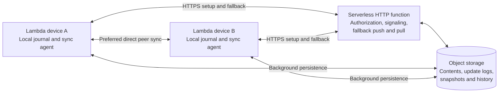
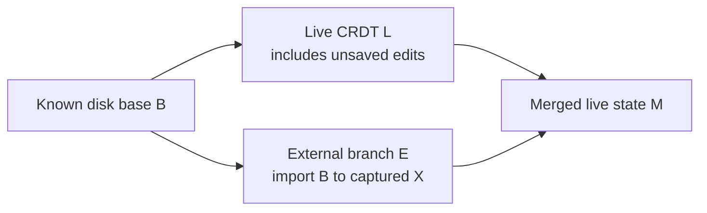

# Lambda Data Sync — Proposal

**Date:** 2026-11-11

**Status:** Draft proposal. The user confirmed the scope, provider independence,
P2P preference, serverless preference, and periodic polling for the first version.
The user also selected Text CRDT for source editing and a Mark-oriented CRDT
tree as both the editing and synchronization model for structured editing, with
format conversion at opening and saving. Binary handling is also confirmed:
atomic small binary fields, immutable blob revisions referenced by metadata,
and preservation of concurrent blob replacements. The CRDT core will be
implemented in Lambda Script, referencing existing open-source implementations.
The file/directory operation-log and missing-content exchange is confirmed.
The design also covers local and cloud version storage, permanent or periodic
history retention, and offline reconciliation. Restic-style immutable objects,
client-side authenticated encryption, content-defined chunking, deduplication,
snapshots, and recovery-oriented repository operations are selected designs.
Document history has two selected levels: detailed live CRDT synchronization
and saved file versions. Covered edit batches may be reduced to compact,
merge-safe state/deltas; replay of intermediate edits is not required.
User-defined retention can thin manual/automatic saves into daily or coarser
restore points and compact eligible CRDT representations across removed saves.
External file/directory changes are required inputs, including external edits
to a document open in Lambda with unsaved live changes. Reconcile those inputs
without discarding either side and warn about concurrent external editing.
Workspace transactions and ZIP-backed namespaces are selected extensions. The
experimental [CRDT protocol](Lambda_Design_CRDT_Protocol.md) implements document
replication and the ordered move-replay reference selected in §6.3. Detailed
repository publication, storage/retention and deployment policies still require
their own implementation gates. This document does not claim a production
implementation or ratification into the formal specifications.

**Scope:** Directory and file synchronization, collaborative documents, and
personal, family, and small-group sharing. Object storage holds the complete
durable dataset and retained history. Local repositories retain unpublished
work and support offline editing, history, and later reconciliation.

**Spec linkage:** Relies on S2.2.4, S2.3.1v2, S2.4.3v3–S2.4.4, S2.5.6,
S2.6.1v2–S2.6.5, S8.2.2v6, S12.1.1v3, S12.4.4v4, D1.7, D10.1.3, D10.2.1, and
D11.1.1–D11.2.4. Document-store details not yet covered by a formal ruling rely
on PTH50v3, PTH63v2, PTH64v2, PTH67v2, and PTH71v2 in
[Lambda_Design_Reference.md](Lambda_Design_Reference.md#9-decision-ledger).
No existing ruling changes.

**Prototype evidence:** The experimental [Lambda Script replication package](../lmd/package/sync/README.md)
implements an in-memory RGA/MV-register model for Text and bounded Mark editing,
external imports, packet compaction and saved endpoint recovery. Its
[implementation record](<impl/Lambda_Impl_Sync_Prototype (done).md>) states verification
and limits. It does not implement filesystem/GUI integration, directory moves,
networking, encrypted repositories or automatic maintenance.

**Related record:** [Device Sync over Passive Object Storage — Idea](idea/Passive_Storage_Sync.md).
That record explores passive storage; this proposal adds the selected product
scope, a small function endpoint, and an explicit P2P-first transport policy.

---

## 1. Proposed architecture

Use a local sync agent, direct authenticated peer connections, a generic
serverless HTTP function, and durable object storage.

Direct connections carry both file synchronization and collaborative document
updates. When a direct connection cannot be established, clients exchange the
same updates through short HTTP requests and periodic polling. Cloud persistence
continues independently of the selected peer delivery path.



The minimum cloud deployment is one HTTP function deployment and one object
store. The function can dispatch several operations internally. Its provider's
native HTTPS endpoint is sufficient; a separately configured API gateway is not
required. No persistent cloud WebSocket connection or application server is part
of the first version.

### 1.1 Confirmed direction

| Topic | Selected direction |
|---|---|
| Audience | Personal devices, families, and small private groups |
| Files | Directory synchronization, file revisions, sharing, and recovery |
| Documents | Concurrent editing and offline reconciliation |
| Delivery | Direct peers first, on LAN and across the Internet |
| Failed direct connection | HTTP push/pull with periodic polling |
| Cloud compute | Generic server-side functions; serverless preferred |
| Cloud storage | Provider-neutral object storage; an S3-compatible adapter is useful |
| Long-term data | All published content, metadata, document state, and retained history |
| First polling mode | Periodic requests that return promptly |
| Source editing | Text CRDT is the authoritative editing and synchronization state |
| Structured editing | Every supported input document maps to a Mark-oriented CRDT tree for editing and synchronization |
| Format conversion | Parse/import when opening external content; serialize/export when saving |
| Small binary fields | Atomic typed values within a defined inline limit |
| Attachments and binary files | Immutable blob revisions referenced by Mark/file metadata; direct peer transfer preferred |
| Concurrent blob replacement | Preserve both revisions for resolution |
| CRDT implementation | Lambda Script core, referencing established open-source CRDT implementations |
| File/directory protocol | Replicated metadata operations, immutable revisions, and requests for missing content |
| Offline operation | Record changes locally and merge when a peer or cloud path becomes available |
| Version storage | Define the versioned repository both locally and in object storage |
| History retention | Support permanent retention or policy-driven periodic purging |
| Saved-version thinning | User-defined time buckets, such as one saved version per completed day, with automatic retirement of eligible intermediate versions |
| Document history | Detailed live CRDT updates; durable file-level versions at save boundaries; intermediate edit replay is not required |
| External filesystem changes | Support external creates, edits, renames, moves and deletes in an ordinary working directory |
| Open-document external changes | Import external edits against their known disk base, merge with unsaved live CRDT state, and expose concurrent-edit warnings/conflicts |
| Repository design | Immutable objects, client-side authenticated encryption, content-defined chunking, deduplication, snapshots, and explicit check/repair/recovery operations |

P2P is a delivery mechanism. A CRDT or a file revision graph is a reconciliation
mechanism. Selecting P2P does not remove the need for either reconciliation
model.

### 1.2 Initial exclusions

The first version does not require a public DHT, a global peer directory, a
user-operated relay, long polling, or cloud WebSockets. It does not promise
arbitrary third-party file formats can merge concurrent edits automatically.
Large public workspaces and enterprise administration are outside this milestone.

## 2. Responsibilities and durability

### 2.1 Local agent

Each device keeps a durable journal, a local namespace index, cached content,
pending uploads, and synchronization positions. The agent detects local changes,
establishes peer sessions, verifies received updates, and materializes accepted
state into the local filesystem or editor.

Filesystem watchers provide prompt notification. Reconciliation scans recover
missed events and changes made while the agent was stopped. A failed or partial
scan must not be interpreted as a directory-wide deletion.

The synchronized working directory remains available to other applications;
exclusive ownership is limited to the sync agent's private repository state.
External filesystem observations enter the same revision/operation pipeline
as managed changes (§6.7). For an open document, the editor retains its live
state while an import bridge reconciles the changed disk content (§7.8).

### 2.2 Function endpoint

The function handles device enrollment, invitations, scoped storage access,
membership changes, connection signaling, and fallback push/pull. It can also
authorize publication or checkpoint changes where the storage adapter needs a
trusted writer.

An invocation must reconstruct the state it needs from durable records. Correctness
must not depend on warm-instance memory, invocation affinity, or a process-local
list of waiting clients. Caches are optional and reconstructible.

### 2.3 Object storage

Object storage holds the full durable dataset. It is not merely a transfer
mailbox. Contents remain recoverable when every peer is offline and when every
function instance has been replaced.

Clients normally transfer large content directly using scoped, expiring access.
Successful peer sessions do not route their live updates or file bytes through
the function. Occasional authorization and durable-publication requests are
separate from peer delivery.

### 2.4 User-visible states

| State | Required evidence |
|---|---|
| Saved locally | The local journal and referenced local content are durable |
| Replicated to peers | A peer acknowledged durable local receipt |
| Saved to cloud | Required objects and their discoverable publication records are durable |

A network send, a function's receipt of a request, or a completed CRDT handshake
is not a cloud durability acknowledgment. Keep unpublished work locally until
the required cloud acknowledgment is established.

These labels describe durability. Persisting an unsaved editing session locally
or in cloud storage does not create a saved file version (§7.7).

Peer-only work remains available during an Internet outage. A peer receiving it
also journals it before acknowledging replication. Designated peers may help
upload it, preserving the original author's signed update envelope.

## 3. Shared data model

### 3.1 Spaces and identities

A **space** is the unit of ownership, membership, history, and synchronization.
Examples are Personal, Family, and a shared project. A user can belong to several
spaces. A shared folder can appear as a mounted space in each member's local
directory tree.

Every file, directory, and collaborative document has a stable internal ID.
Its name and parent are mutable metadata. Renaming a directory does not relocate
its content objects. These internal synchronization IDs do not redefine
Lambda's path-based document identity or `===` (S2.4.3v3; PTH41–PTH45v2).

The model distinguishes:

- **Ordinary files:** immutable content revisions and competing revision heads.
- **Directories:** stable child identities with explicit name and parent changes.
- **Collaborative documents:** Text CRDT for source editing, or a Mark-oriented
  CRDT tree for structured editing, with one authoritative profile per document.
- **Attachments and binary files:** immutable content revisions referenced by
  document or file metadata; the bytes do not require a byte-level CRDT.
- **Control records:** membership, device grants, key epochs, and retention policy.

### 3.2 Update identity and causality

An update carries its protocol version, space ID, author device ID, durable
operation ID, dependency information, payload type, and integrity/authentication
information. Device sequence numbers and causal dependencies identify missing
work. Wall-clock timestamps are useful for display and diagnostics; they must not
silently discard a competing file revision.

Retries preserve the operation ID. Peers and fallback handlers deduplicate the
same operation across transports. A restored or cloned installation obtains a
fresh device identity before creating new operations.

Keep these positions distinct:

| Position | Meaning |
|---|---|
| Publication cursor | Which durable update batches a client has consumed |
| CRDT synchronization state | Which editing changes a document replica possesses |
| Local pending set | Authored or received work not yet acknowledged by cloud storage |
| Saved document frontier | Exact editing state captured by an immutable saved file version |

A publication cursor does not prove a CRDT replica is complete. Use the CRDT's
actual synchronization exchange, including deletion information, to repair it.

Document editing causality is also distinct from device publication order. A
device may publish an external-import branch based on an older disk frontier
after publishing its own unsaved edits; the branch must preserve that older
editing base (§7.8). Authorize document actor/branch identities under the
publishing device without reusing another actor's operation IDs.

The editing profile, schema version, and open/save format descriptor belong to
document metadata. Replicas must agree on the profile. Switching profiles is an
explicit coordinated conversion, not an independent choice by each editor.

## 4. Discovery and direct connections

### 4.1 Private discovery

Use invitation-based enrollment and authenticated device identities. Devices
learn authorized peers through space membership, cached contacts, and signaling.
Use mDNS/Bonjour to find nearby native agents. A browser participates through
its supported connection/signaling interfaces; browser code is not assumed to
enumerate arbitrary mDNS services.

Publish a small signed, expiring presence record per device. It can contain
protocol capabilities, candidate endpoints, and a last-seen indication. Presence
is advisory and may be stale. Discovering an address grants no permission to
read a space.

A public DHT is unnecessary for the selected private-group audience.

### 4.2 Transport choice

The first implemented native LAN profile uses the existing WebSocket transport
with explicit IPv4 binding, signed ephemeral device authentication and encrypted
application records. This limits new C++ to native mechanisms (D11.1.2); pairing,
framing and exchange policy stay in Lambda Script (S12.1.1v3).
[Peer API and protocol](../lmd/package/sync/PEER.md) define its bounds and explicit
checkpoint-authority grants. This compatibility transport uses explicit
LAN/reachable addresses.

The selected native connectivity profile adds private Bonjour discovery,
signed expiring HTTP rendezvous and WebRTC DataChannels. Its script agent reuses
the existing authenticated peer exchange, with bounded establishment attempts,
periodic cloud fallback and retry. See [connectivity API and
qualification](../lmd/package/sync/CONNECTIVITY.md). Native mechanisms remain at
the central IO boundary (D11.1.2); script policy follows S12.1.1v3 and task
ownership follows S12.4.4v4. Cross-NAT/physical-device, browser and hosted-provider
qualification must be recorded separately from local independent-process checks.

The common native/browser transport design uses WebRTC DataChannels, using
ICE/STUN for connectivity establishment. Reliable channels carry update batches
and requested file content; disposable presence can use a separate channel.
Application authentication binds the negotiated connection to an authorized
device identity. Encrypted transport alone does not establish group membership.

QUIC with TLS remains an alternative for a future native-only transport decision.
Do not build a second new stack as a prerequisite. QUIC alone does not supply
discovery or NAT traversal.

Signaling uses finite HTTP exchanges or a local connection established by the
native agents. An ordinary HTTP function is not a UDP STUN server. Use a
separately available STUN facility when needed; failure to obtain a usable direct
path leads to polling fallback. The selected fallback does not require TURN.
[ICE](https://www.rfc-editor.org/rfc/rfc8445) and
[WebRTC DataChannels](https://www.rfc-editor.org/rfc/rfc8831) define the relevant
connectivity and data transport mechanisms.

The native HTTP rendezvous uses conditional fixed slots per author/recipient,
with signatures, encrypted payloads, finite TTLs and retained sequence fences.
Offers bind both process instances; answers also bind the exact offer digest and
attempt ID. Neither discovery nor SDP grants membership. Continue the enrolled
device handshake and current-member checks on the established data channel.

### 4.3 Connection lifecycle

Attempt a direct connection with a bounded establishment budget. If it fails,
begin HTTP fallback without waiting indefinitely for traversal retries. Retry
direct connectivity in the background with backoff, and after network changes.

When direct connectivity returns, exchange synchronization positions, repair
missing updates, and resume direct delivery. Overlap during a transition is
allowed because update IDs and reconciliation rules make retries safe.

Periodic cloud checks can still discover other offline devices' published work
and control changes. They are not required for each update between connected
peers.

## 5. Durable storage and publication

### 5.1 Provider contract

Keep cloud-specific credentials, request signing, URLs, and version tokens behind
an object-store adapter. The stored protocol must not encode one provider's
account or bucket conventions as logical file identity.

Required capabilities are:

- Durable reads and writes of immutable objects.
- Strongly consistent reads for coordination and publication records.
- Atomic create-if-absent and conditional replacement using an opaque version token.
- Bounded reads, range downloads, and resumable large uploads.
- Scoped, expiring client access or an equivalent authorization mechanism.
- Enumeration sufficient for recovery and maintenance.

Use an independent content checksum; a provider's ETag is a version token and
is not assumed to equal the content hash. Enumerating a prefix does not create
an atomic snapshot across its objects.

Verify these properties for each adapter. For example, R2 documents atomic
conditional writes, while Cloud Storage supplies generation preconditions.
[R2 compatibility](https://developers.cloudflare.com/r2/api/s3/api/),
[Cloud Storage preconditions](https://docs.cloud.google.com/storage/docs/request-preconditions).

### 5.2 Publication structure

The proposed baseline uses immutable content and signed per-device update
streams. Each stream has one writer identity and a small discoverable head.
Shared control records and checkpoint pointers use conditional publication.
This avoids requiring a single globally ordered record for every live keystroke.

The storage contains content objects, immutable update batches, stream heads,
complete Text/Mark CRDT checkpoints with coverage information, and
membership/control history. A structured document's checkpoint retains the
Mark-oriented editing state and its replication metadata, regardless of the
external file format selected for saving.
Appendix A gives an illustrative layout; object names are not protocol commitments.

Publication follows **content first, discoverable reference last**:

1. Durably journal the local operation.
2. Upload all content required by the batch.
3. Upload the immutable batch, retaining the original operation IDs and authorship.
4. Conditionally advance the appropriate publication head.
5. Acknowledge cloud durability only after the batch is discoverable and complete.

A crash before the last publication leaves resumable work or unreferenced
objects. A crash after publication is repaired by reading the durable head and
replaying the same operation IDs. A helper uploading another device's signed
batch cannot replace that device's stream head without explicit authority.

If conditional head publication fails, reload it and reconcile before retrying.
Never overwrite a newer head unconditionally or advance past a missing dependency.
Treat an uncertain response as a read-and-verify case, not permission to create
a second logical operation.

### 5.3 Publication authority

Direct uploads are limited to the objects a device is authorized to create.
Writing immutable data does not grant authority to change membership, rewrite
another device's history, or delete retained content.

Prefer direct publication where scoped storage permissions and signed records
can enforce the selected access model. Otherwise, use a short function call to
validate and publish references after direct content upload. That call handles
durability and authorization; it does not relay a healthy peer session.

The exact relationship between direct publication, outstanding capabilities,
and revocation cutoffs is an implementation gate (§13). Do not promise immediate
revocation or strict admission ordering without a mechanism that enforces it.

### 5.4 Immutable versions and history

Use the same logical version objects locally and in object storage. Stable node
identity is independent of content identity and revision identity. A rename
changes placement metadata, not the file ID or the bytes of its content object.

| Record | Purpose |
|---|---|
| Content object | Immutable encrypted chunk or a manifest referencing reusable chunks |
| File revision | File ID, parent revision IDs, content reference, and the captured version's metadata |
| Changeset | Immutable batch of authored operations, causal dependencies, and references to new revisions |
| History snapshot | Namespace, file heads, and document versions at a specified causal frontier |
| Merge-safe checkpoint | Replica state plus the ordering/causal context needed to accept future operations |
| Mutable reference | Small conditional pointer to a published stream, checkpoint, or named history pin |

Version IDs identify immutable records using an agreed integrity/encoding
contract. A provider ETag remains a publication token, not a file revision ID.
Keep revision-parent relationships even when an old content payload is retired.

Each device can create changesets offline, based on the heads it knows. Concurrent
changesets form a DAG. Operations reconcile the namespace; parent revision links
identify concurrent replacements of an ordinary file. A resolution revision
records the competing parents it resolves. No cloud sequencer is needed to
allocate a local revision or changeset ID.

Create synchronization changesets automatically from managed editor transactions
or stable filesystem observations. Managed document transactions do not each
create a saved file revision: saves capture those versions under §7.7. Named
snapshots are optional user history pins; a manual Git-style staging step is
not required for normal synchronization.
Filesystem watching captures observed versions, not every intermediate write
made by an external application between observations.

Historical lookup follows stable IDs, so file history survives renames and moves.
A directory snapshot preserves historical placement as well as the selected file
versions. Restoring history creates new operations/revisions against the current
state; it does not move a shared reference backwards or erase later history.

### 5.5 Local repository and working tree

Keep a host-managed private repository per space, separate from the synchronized
working tree. It contains immutable content/revision/changeset objects, authored
and received journals, publication references, checkpoints, pending transfers,
and a derived namespace/history index. A local transactional database can index
these records; a mutable database alone is not the portable version store.

Before acknowledging a captured local change, persist its content and immutable
metadata, then commit the journal/index references. Publish the corresponding
local stream head only after its dependencies are durable. Recovery can discard
an unreferenced staging object or resume publication; it must not discover a
durable head whose required local objects were never persisted.

The working tree is a materialization. Capture new bytes before replacing an
entry, detect writes that race the capture or installation, and preserve pending
local work during remote installation. Private indexes, journals, and transfer
staging are not themselves watched and synchronized as user files.

Local storage can act as a complete history mirror or a bounded cache. Pin all
unpublished work, active revisions, unresolved conflicts, and the content selected
for offline use. Cached published history can be evicted when the configured
durable replica still holds it; eviction is not a shared history purge. A device
can promise offline access only for content it actually retains locally.

### 5.6 Cloud repository

Object storage holds the published content, revisions, changesets, history
snapshots, and replica checkpoints. Conditional per-device heads advertise
discoverable changesets. Publication uploads immutable dependencies first and
advances the head last (§5.2). Metadata operations and blob bytes use the same
version identities as the local repository.

Keep control state, retention manifests, and named history pins in separately
authorized records. Physical object-key prefixes are implementation details;
they do not encode the user's current directory paths. Appendix A shows both
cloud and local layouts.

Bucket-level object versioning is an optional recovery layer. Portable file
history comes from these application records, with explicit parentage and
retention policy. It does not depend on a particular provider's version listing.

### 5.7 Encrypted immutable repository

Adopt restic's repository principles as selected architecture: immutable data
objects, encryption before upload, content reuse, explicit snapshots, and
recoverable repository operations. Lambda defines its own repository format;
this is not a commitment to restic's wire format, cryptographic suite, or keys.
[restic repository design](https://restic.readthedocs.io/en/stable/100_references.html).

Encrypt and authenticate portable content and metadata objects on authorized
clients, including manifests, revisions, changesets, document checkpoints, and
history snapshots. Store the encrypted representation in both the private local
object repository and cloud storage. Functions and storage do not receive the
decryption keys by default. Opaque routing IDs, grants, envelope versions, sizes,
and control generations can remain service-readable as required by the protocol.

Protect decrypted local indexes, journals, and recovery material under an
explicit encrypted host-storage policy; otherwise those copies would defeat
repository metadata confidentiality. The editable working tree and live editor
memory have their own host/device protection contract. Do not describe client
encryption as encrypting every working file in place.

Use established authenticated-encryption and key-management primitives through
the host's crypto APIs. Bind each object's identity, type, and encryption context
to its authenticated representation. Do not implement a new cipher as part of
the Lambda Script CRDT port. Exact suites and key wrapping are implementation
gates; client-side encryption itself is selected.

### 5.8 Content-defined chunking and deduplication

Use content-defined chunking for file/blob payloads, with a single chunk for
small payloads. A manifest records the ordered logical chunk IDs, lengths, total
length, and reconstruction/integrity contract. A revision references the manifest;
inserting bytes near the start need not invalidate every later chunk.

Version the chunker algorithm and parameters in repository configuration so
authorized writers can reproduce boundaries. Select and qualify an established
implementation, using restic's Rabin-based design and FastCDC as references.
Choose minimum, target, and maximum sizes through release measurements rather
than adopting one provider's request limits as the document model.

The conceptual pipeline is:

```text
capture bytes
  -> content-defined chunks
  -> space-scoped keyed content IDs and authorized reuse lookup
  -> encrypt/authenticate chunks not already safely reusable
  -> persist chunks and manifest
  -> publish revision/changeset references
```

Chunking and logical deduplication operate on content before randomized
encryption. Reuse existing authenticated ciphertext when authorized, or encrypt
a fresh physical copy with proper nonce/key handling. Do not obtain deduplication
by deriving encryption keys solely from public plaintext hashes. Scope reuse to
the authorized space/security domain; shared file links do not grant a general
chunk-existence or download oracle for other contents.

Deduplication applies across versions, paths, and devices within that domain.
It does not combine revision identity or competing edits: equal bytes can be
shared while their revision histories remain distinct. A client transfers only
missing chunks and verifies each chunk and the reconstructed payload. Concurrent
uploads can leave duplicate physical copies; they must never overwrite a valid
immutable object to force one physical representation.

Keep logical content identity separate from encryption key epochs and physical
locations. Rekeying or repacking a verified copy does not become a user file edit.
Manifests/snapshots reference logical objects; derived locator indexes identify
authenticated physical copies, including their storage generation and encryption
descriptor. Index loss must be recoverable by scanning authenticated object or
pack metadata with authorized keys.

Immutable packing can amortize small-object request overhead where measurements
justify it. Authenticate independently retrievable chunk records and record their
ranges. Repacking writes and verifies a new pack and publishes its locations
before retiring an old one. Physical packing is a tuning choice; chunking,
deduplication, encryption, and recovery contracts are part of the baseline.

## 6. Directory and file synchronization

Maintain an index from local entries to stable node IDs, their last accepted
revisions, and pending changes. Exchange manifests and request only missing
content-defined chunks (§5.8). Small files can use a one-chunk manifest. Support
resumable transfers without changing file/revision identities.

Multipart upload resumes one transfer. Chunk reuse avoids retransmitting
unchanged content across revisions. Neither mechanism resolves concurrent edits.

### 6.1 Conflict behavior

| Concurrent activity | Intended result |
|---|---|
| Rename while another device edits | Preserve the file ID, rename, and content revision |
| Two replacements of the same file | Retain both revisions and expose a conflict copy |
| Two entries acquire the same name | Retain both identities and give a stable visible conflict name |
| Delete while another device edits offline | Preserve deletion and expose the unpublished edit as recoverable work |
| Concurrent directory moves | Derive one valid tree and retain unresolved move intent for resolution |
| Missing or inaccessible local directory | Report an incomplete scan; do not infer mass deletion |
| External file edit while its document has unsaved live edits | Import against the known disk base; merge into live state or retain both branches for review (§7.8) |
| External rename/delete while a document is open | Preserve the open editing state; follow a confirmed rename, or expose deletion with recoverable edits |

A directory merge must have one valid parent per visible node and no cycles.
Use the move-aware baseline proposed in §6.3, with the product policies in §6.4.
An independent last-writer-wins parent field is insufficient: two concurrent
moves can produce a cycle.

Local materialization uses verified downloads and safe replacement. It must
detect intervening local changes before replacing a file. Case collisions,
Unicode filename differences, and platform-invalid names must preserve remote
identities and expose a resolvable mapping. The first version can limit filesystem
objects to regular files and directories; link and permission semantics need an
explicit later contract.

### 6.2 Metadata and missing-content protocol

Use a versioned Lambda application protocol over the selected reliable peer
transport. HTTP fallback carries the same operation and revision records. The
message names below are proposed logical operations; their wire framing remains
to be specified.

1. **Authenticate and negotiate.** Exchange device identity, protocol version,
   authorized spaces, profiles, and supported transfer limits.
2. **Exchange positions.** Advertise contiguous per-device stream frontiers,
   changeset heads, checkpoint/epoch information, and relevant content availability.
3. **Request missing operations.** Exchange absent immutable batches, preserving
   operation identity, authorship, causal dependencies, and revision parents.
4. **Reconcile metadata.** Apply the directory algorithm and file revision rules.
   Buffer missing dependencies; identify needed file/document content.
5. **Request missing bytes.** Fetch content from authorized peers, local objects,
   or object storage. Support bounded/resumable requests and verify integrity.
6. **Journal and materialize.** Persist received records, install verified content
   safely, and acknowledge the actual receipt/durability level.

Operations include creating a node, changing its placement/name, publishing a
file revision, deleting it, and explicitly restoring it. Content edits reference
the stable file ID and parent revisions; they do not implicitly move the node.
Retries preserve IDs. A duplicated operation is harmless; two different payloads
claiming one author/sequence identity are an integrity error.

A frontier advances only through a complete validated prefix. A metadata
acknowledgment does not assert that all referenced blobs are present. Request
content for a pinned revision/object ID so that a simultaneous new file version
cannot change the bytes of an in-flight transfer.

On the first connection, load an authorized checkpoint and its uncovered
history; later sessions exchange incremental batches. If a late operation
requires ordering context absent from the checkpoint, recover that context
before applying it (§10.3). Do not infer synchronization solely from modification
times or compare current visible filenames as if they were stable identities.

### 6.3 Recommended move-aware directory algorithm

Port the algorithm from **Kleppmann, Mulligan, Gomes, and Beresford,
“A highly-available move operation for replicated trees”** into Lambda Script.
It provides an established baseline for concurrent parent changes with unique
node identity and acyclic placement. The authors provide a formalization and
reference implementation. [Paper](https://martin.kleppmann.com/papers/move-op.pdf),
[authors' repository](https://github.com/trvedata/move-op).

Use stable node IDs and unique, totally ordered logical operation keys. The
proposed key is `(Lamport counter, device ID, device sequence)`, respecting causal
dependencies without using wall-clock ordering. A placement operation carries
the child ID, destination parent ID, and edge metadata such as its name.

The algorithm interprets moves in key order and suppresses a move when it would
create a cycle. A late operation is inserted by undoing the affected suffix,
applying it, and replaying that suffix. Keep suppressed operations too: replay
can change whether they are safe. Undo context is derived during application,
not trusted as an author's description of another replica's prior tree.
[Algorithm and replay explanation](https://www.loro.dev/blog/movable-tree).

For example, two offline devices can move A under B and B under A. All replicas
derive the same key order; one placement takes effect and the cycle-forming
placement is suppressed. Receiving those messages in opposite orders must not
produce opposite final trees. Both operations remain in history.

Directories need an unordered child hierarchy; listing order is a view. The
ordered-child requirements of a rich Mark document are a separate CRDT contract.
Do not assume selecting this directory algorithm resolves every ordered-tree
editing operation.

Start with a faithful port and reference-derived tests. Batch late operations
before replay and index the log where useful, but retain a simple reference
interpreter for qualification. Old offline batches can require substantial
replay; measure that cost with release builds before choosing optimizations.
The paper's proof does not automatically prove Lambda's port or the additional
filesystem policies below.

### 6.4 Filesystem policies around the move primitive

These are proposed product rules around the placement algorithm, not properties
implicitly supplied by it:

- Keep node kind stable; a file cannot become a parent. The root cannot be
  moved or deleted. Validate references and fetch missing creation dependencies.
- Apply the parent/name placement tuple atomically. A concurrent rename and move
  of the same node can leave competing placement intent; retain it for inspection
  and let an explicit resolution create a new operation.
- A delete records lifecycle tombstones separately from placement. Ordinary edits
  or moves do not clear them. Restore explicitly acknowledges the deletions it
  clears; a concurrent unseen deletion still hides the node.
- A deleted directory hides nodes that remain beneath it after reconciliation.
  A concurrent explicit move of a descendant outside it can preserve that child
  visibly, with a delete/move conflict record. An ordinary content edit does not
  implicitly move it out or restore it.
- Preserve distinct nodes with the same logical name. Derive stable conflict
  names for the filesystem view; do not emit new rename operations merely because
  a replica rendered a conflict name. Keep logical names independent of local
  case/Unicode filename restrictions.

The retained operation history records suppressed moves and the intent of
competing placements. Visible conflict naming and recovery views do not allocate
duplicate logical nodes for the same moved directory.

### 6.5 Offline creation and reconciliation

Offline edits create local revisions, operation batches, and changesets against
the last known state. Device identity and counters are durable, so restarts do
not reuse operation IDs. Unpublished bytes and their base/context records remain
pinned locally. No function call or remote lock is needed to record the work.

On reconnect, refresh authorization/control state, exchange missing changesets,
repair dependency gaps, replay directory operations, and reconcile file heads.
Transfer missing content and publish complete local work. Use explicit merge or
restore operations to resolve conflicts; do not rewrite already shared operation
IDs or change the original causal position of an offline operation.

For two ordinary-file replacements from the same base, keep both revision heads.
The user or a selected merge adapter creates a resolution revision. Automated
three-way text merging can be an additional policy when the base content is
available; opaque binary contents keep the selected revision/conflict behavior.
If retention removed the base payload, preserve both results rather than invent
a base or silently choose one.

This supplies Git-like local history, branching, and explicit reconciliation
without requiring Git's repository format or a manual commit workflow. Automatic
reconciliation does not mean every concurrent user intention has a single
conflict-free result.

### 6.6 Workspace transactions and ZIP-backed namespaces

Use atomic workspace transactions for multi-entry creation, placement,
deletion/restore and saved-version publication. Content transactions keep their
Text/Mark document scope; a workspace transaction references captured document
versions. Stable member IDs let ZIP archives use the same namespace model.
Member changes replicate independently, and saving rebuilds the archive at a
captured frontier through the existing ZIP writer. External archive replacements
merge from the accepted baseline, preserving unsaved live changes.

The event, revision, move, lifecycle, save and external-import contracts are
defined once in [CRDT protocol §10](Lambda_Design_CRDT_Protocol.md#10-workspace-transactions-and-zip-workspaces).
ZIP input/output follows S12.4.1v3/S14.3.1v3 and the `fs` carrier under D9.5.5;
filesystem effects remain in host procedures under S12.1.1v3.

### 6.7 External directory and file changes

Support ordinary filesystem operations by other applications, both while the
agent runs and while it is stopped. External creates allocate node IDs;
captured file replacements create revisions; confirmed renames/moves create
placement operations; confirmed removals create lifecycle tombstones. An
external editor's save-by-replacement can preserve the logical file identity
even if the underlying filesystem object changes. Preserve that correspondence
when established rather than equating physical object identity with node ID.

Use notifications as prompts to reconcile against the durable local index, with
startup/periodic scans repairing missed events. Capture and journal changed
bytes before remote installation or import. Retry captures that detect an
intervening write; a quiet interval alone is not proof of an application-consistent
snapshot. Record observed stable versions, without claiming every transient
write or the external program's exact Save boundary. Watchers plus full scans
are established prior art. [Syncthing scanning](https://docs.syncthing.net/users/syncing.html).

Keep verified path/identity observations and use trustworthy rename evidence
where available. Equal content alone cannot prove a move or merge two node
identities. When offline observations cannot distinguish a move from copy/delete,
preserve the old history and new content, expose the ambiguous association, and
avoid claiming certain move-history continuity. A failed scan, unavailable root
or unmounted volume is an availability error rather than evidence of deletion.

Journal the exact provenance/content of Lambda's own exports and remote
materializations so repeated notifications do not create duplicate revisions
or import loops. Do not ignore all writes during a time window: an external
write in that window still requires capture. Private indexes, journals and
staging remain outside the synchronized user tree.

Files not open in an editor use the file-revision/conflict rules. An open Text
or Mark document uses §7.8, including when remote file publication or another
program changes its disk materialization. The agent must not reload the disk
file over an open editor's unsaved state. No exclusive working-directory lock
is required; supported safe-capture/save behavior is qualified per filesystem.

## 7. Collaborative documents

### 7.1 Two authoritative editing profiles

Use two profiles, selected by the document's editing contract:

| Profile | Authoritative editing and sync model | Examples |
|---|---|---|
| Source editing | Text CRDT | Plain text, Lambda scripts, JSON/XML/Mark source, Markdown source |
| Structured editing | Mark-oriented CRDT tree | Structured JSON/XML data, native Mark documents, rich documents and domain editors |

Each independently editable document has one authoritative CRDT state. Both
profiles use the same identity, transport, persistence, authorization, and
recovery machinery. Do not independently synchronize a source string and a
parsed tree as two authorities for the same document.

### 7.2 Mark-oriented structured editing

For structured editing, map every supported input document into a Mark-oriented
tree when opening it. The tree is the editing data model and the synchronization
data model. JSON, XML, Mark, and domain formats use import/export adapters around
that common model; their serialized syntax is not sent through separate
format-specific reconciliation engines on every edit.

The common model uses Lambda's persistent data vocabulary:

| Mark value | Replication behavior |
|---|---|
| Map | Independently editable fields, with explicit order metadata where needed |
| Array | Ordered CRDT sequence with stable item identities |
| Element | Tag, attribute map, and ordered child sequence |
| Editable text | Text CRDT inside the tree |
| Scalar | Typed atomic value with a defined field conflict policy |
| Binary payload | Atomic small value or immutable blob reference (§7.6) |

Preserve map order and unordered equality under S2.3.1v2. Arrays represent
persistent sequences; transient Lambda lists are not a new replicated container
kind (S2.5.6). Element projection follows S2.6.1v2–S2.6.5, including empty-item
removal and adjacent-string normalization.

Editing identities, text positions, and deletion information remain in the CRDT
state. A normalized Mark value alone cannot retain them. Keep this metadata
separate from user fields so that content normalization does not erase editing
anchors or introduce visible attributes into the user's document.

Specify exact scalar and name codecs. Large integers, decimals, symbols, dates,
and namespace-qualified names must not silently pass through a narrower JSON or
JavaScript value representation. In particular, preserve resolved namespace
identity under S8.2.2v6.

Mark is the shared data vocabulary; it does not require the sync protocol to
transmit textual `.mark` on each edit. A binary CRDT encoding can represent the
same tree and its replication metadata. Runtime-only values such as functions
and native handles are outside this portable document model. Importing document
data does not evaluate Lambda code or force embedded references (S2.4.4).

### 7.3 Source editing

For source editing, synchronize the text sequence directly. Parsing, syntax
highlighting, diagnostics, and structural previews are derived views of that
text. An incomplete expression or temporarily invalid JSON/XML is allowed while
typing; parsing failure does not invalidate the replica or stop synchronization.

Source saves write the source text using the document's encoding/newline
contract. Unsupported byte encodings can remain ordinary file revisions until
an explicit text adapter exists. Do not parse and reformat the source through a
Mark tree merely to send or save an editing update.

### 7.4 Opening, saving, and format identity

The structured workflow is:

```text
external document
  -- open / import --> Mark-oriented CRDT tree
  -- edit / sync ----> operations on that tree
  -- save / export --> selected external format
```

Conversion happens at the external open/save boundary. Reopening an existing
collaborative document restores its latest durable live CRDT checkpoint and
uncovered updates, including unsaved work; it does not reparse an export and
mint unrelated editing identities. Opening a historical saved version selects
that version's exact state instead. Background cloud persistence stores the
live CRDT state independently of explicit file saving (§7.7).

Keep the external format and domain schema in document metadata. A JSON document
can save as JSON and an XML document as XML while both edit and sync through the
common tree. A domain document can keep its own format name and extension even
when it uses Mark syntax (D10.1.3).

State each adapter's fidelity contract. Structured editing preserves the modeled
data; exact indentation, comments, lexical number spelling, or XML entity/prefix
spelling require explicit source metadata. A save must report an unsupported or
lossy conversion rather than silently dropping modeled data. Use the source
profile where preserving source spelling is the editing contract.

The repository records an unresolved Mark namespace-URI serialization ruling
under S8.2.2v6 / [LR03-40](Lambda_Issue_Ledger.md#lr03-40). This does not change
the selected common tree model, but it is a gate before claiming lossless XML
names through textual Mark export. Do not invent namespace syntax in this
proposal or treat that export as a complete CRDT checkpoint.

An external edit to an exported file enters the import/reconciliation bridge
in §7.8. That bridge can run automatically when its base and mapping are known;
ambiguous or conflicting input remains recoverable for review. It must preserve
unsaved live work and must not silently reset document or editing identities.

### 7.5 Lambda Script implementation and session behavior

Implement the CRDT core in Lambda Script for both Text CRDT and the Mark-oriented
tree. Existing open-source libraries provide algorithm references, behavioral
examples, and applicable test cases. Yjs/Yrs and Automerge are reference candidates;
the design no longer selects a JavaScript or native CRDT engine as its runtime
implementation. [Yjs](https://github.com/yjs/yjs),
[Yrs](https://github.com/y-crdt/y-crdt),
[Automerge](https://github.com/automerge/automerge).

The Lambda implementation owns operation identity, causal tracking, sequence
and field reconciliation, duplicate handling, checkpoint state, and update
encoding. Reuse one coherent set of replication primitives across source text,
editable text within Mark trees, and structured containers. Select and document
the reference algorithms before implementing their rules; combining isolated
rules from different implementations is not a convergence argument.

The experimental [document protocol v1](Lambda_Design_CRDT_Protocol.md) uses
RGA sequences and causal multi-value registers, referencing the RGA verification
work and Almeida et al.'s dot-kernel design. The Lambda Script package implements
typed encoding, authored atomic groups, bounded anti-entropy, admitted checkpoints,
exact-frontier saves, persistence bundles and explicit epoch recovery. It defines
fixed child ownership; arbitrary document subtree moves remain outside v1.
This qualifies the reference document protocol rather than deployed editor,
transport, filesystem, browser or encrypted-repository integration.

Keep deterministic state transitions and reconciliation in `fn` code. Supply
replica IDs, counters, operations, and state explicitly; do not derive merge
decisions from hidden clocks or network arrival order. Journaling, transport,
storage, and capability checks belong to effectful host integration (`pn`),
following S12.1.1v3. Distribute the Lambda core as source under D1.7.

Host/native support can provide network transport, storage, cryptography, and
other existing low-level services. These do not move the CRDT algorithms out of
Lambda Script. Every supported client must have a defined execution path for
the same core; verify browser hosting before including browser participation
in an acceptance milestone.

Referencing an upstream algorithm does not imply compatibility with its binary
protocol. Version Lambda's update/checkpoint encoding explicitly. Claim upstream
wire compatibility only if selected and demonstrated by interoperability tests.
Use reference behavior on the matching data-model subset to qualify the port,
and test Lambda-specific Mark semantics separately.

Apply local edits immediately and durably journal their updates. Direct peers
exchange updates promptly. When direct connectivity fails, publish small batches
and poll for missing updates. Changing transport does not change the profile.

Persist incremental updates until their information is durably covered by an
authorized merge-safe checkpoint or compact update. Preserve saved versions
and necessary replication context, without requiring a permanent replayable
edit log (§7.7). A text or Mark export is a materialized view, not a replacement
for that state.
The [Yjs update API](https://docs.yjs.dev/api/document-updates) is one reference
for incremental synchronization behavior, not a required implementation dependency.

Presence, cursors, and selections expire. They do not need permanent history.
Reduce or suspend their cloud publication when the session is idle. Define
schema compatibility, size limits, and undo behavior. Convergence does not
establish every domain invariant or make undo equivalent to restoring an old
whole-document file.

### 7.6 Blobs and binary data

CRDT libraries can carry binary values: for example, Yjs maps accept
`Uint8Array` values. Carrying bytes as a value does not provide a meaningful
merge of two edited images, PDFs, archives, or other opaque formats.
[Y.Map value types](https://docs.yjs.dev/api/shared-types/y.map).

The user-confirmed policy is:

| Binary use | Handling |
|---|---|
| Small binary field | Atomic typed value within a defined inline limit; replacement follows the field's conflict policy |
| Attachment or ordinary binary file | Immutable blob versions outside the CRDT, referenced by document/file metadata |
| Concurrent replacement of a blob | Preserve competing revision heads and expose resolution; do not silently choose one by timestamp |
| Domain-specific collaborative asset | Sync structured operations in a Mark tree when the application defines their meaning |

An attachment reference identifies a complete immutable blob descriptor, including
logical content/manifest identity, size, and integrity information. Treat that
descriptor as one version; independently merging its identity, size, or integrity
fields could produce an invalid combination. Each physical encrypted copy has
its own indivisible authenticated encryption/location descriptor (§5.8).
Captions, placement, and other editable metadata can remain ordinary CRDT fields.

Replacing bytes creates a new blob revision and updates the reference. Use the
file revision/conflict mechanism to preserve concurrent replacements rather than
implementing the reference as a bare last-writer-wins field. No first-version
byte-level CRDT is required. Repository chunking and deduplication reduce transfer
and storage without changing that conflict policy. Transfer deltas are a separate
optional optimization.

Prefer direct peer transfer for missing blobs, with object storage as the
durable source and fallback. Upload and verify a blob before cloud-publishing a
batch that references it (§5.2). Peers can receive its reference before the bulk
transfer finishes; show it as pending and distinguish metadata receipt from
complete content availability. Cloud durability includes every required blob.

Saving resolves references according to the selected output format: embed the
bytes, write companion assets, or emit supported links. Do not leak temporary
storage credentials into exported files. Zero-byte files remain present file
nodes with zero-length content, not missing values (S2.2.4).

Retain blobs reachable from current state, competing revisions, supported undo,
and retained history. Removing an attachment from the visible document does not
immediately authorize deleting its bytes; cleanup follows §10.

### 7.7 Two levels of history and document compaction

Manage document changes at two levels:

| Level | Retained meaning | Retention contract |
|---|---|---|
| Content-level live sync | Detailed Text/Mark edits exchanged during editing, with stable IDs and causal dependencies | Journal pending work; replace covered batches with compact merge-safe state/updates when qualified |
| File-level saved history | Immutable document versions captured by saves, with parent revision IDs and exact document frontiers | Retain forever or expire under the selected saved-version policy |

A save is a logical version boundary, not a global editing barrier. Capture a
dependency-complete frontier F and produce the exported content and saved CRDT
representation from that same state. New local or remote edits beyond F remain
live unsaved work. Saving works offline; publication and cloud acknowledgment
follow §5.2. Concurrent saves remain immutable versions; a later save of the
merged live state can record both saved parents. A save does not reset document
IDs, node/text identities, counters, or the replication epoch.

A saved revision identifies the document/profile/codec, frontier, saved content
manifest, and CRDT state reference sufficient to reopen that version. Use a
compact checkpoint or a base plus compact update, whichever the qualified
encoding makes efficient; every retained version must remain reconstructible
under §10.2. The active live-state reference is separate from the latest saved
revision, so crash recovery preserves cloud-persisted unsaved edits without
inventing an extra saved file version. Automatic save policies, if enabled,
explicitly create the same kind of saved revision.

Between saved versions A and B, retain a compact representation of their state
transition and any required continuing-merge context. Individual keystroke
packets, transaction boundaries, intermediate values and per-edit timing are
not a permanent product-history requirement. The compact representation need
not support replay of those intermediate states. Compaction may also run before
the next save to reduce active-session storage; it does not itself create a
saved version. A promised undo window or an explicitly pinned intermediate
state protects the information it actually requires, independently of save
history. Do not promise unlimited cross-save edit undo.

Compaction must preserve more than the visible difference between A and B.
It retains operation identity/deduplication coverage, causal and deletion
information, surviving text/tree identities and anchors, conflict state, and
other algorithm-specific context required by admitted future updates. For
example, text can be `ab` at both saves after inserting and deleting `x`, while
another peer has already inserted relative to `x`. An empty text diff cannot
replace the required anchor/order information. Deleted payload bytes may be
collectable even when an identity or equivalent ordering summary must remain.
The selected Mark-tree algorithm must separately qualify removal of losing or
suppressed operations; text-update compaction does not establish tree safety.

The correctness criterion is equivalent reconciliation: the compact state and
the uncompacted reference must yield the same accepted document/conflicts for
every future update allowed by the replication contract. This permits folding
edits and collecting obsolete payloads where the algorithm allows it. It does
not promise a globally smallest encoding or a bound independent of the number
of admitted offline writers. Stable-frontier collection or an explicit retired
epoch is required for reductions that lose old-replica merge context (§10.3).

Yjs provides useful reference behavior for merged binary updates and state-based
differences, while documenting that update merging alone does not garbage-collect
deleted content. This is an algorithm/encoding reference, not a selected runtime
dependency. [Yjs update API](https://docs.yjs.dev/api/document-updates).
Loro's shallow snapshots illustrate a stronger history cutoff with restrictions
on syncing older replicas. [Loro shallow snapshots](https://www.loro.dev/docs/concepts/shallow_snapshots).

Store checkpoints and compact interval updates as immutable encrypted repository
objects. Small batches need not be chunked individually; large encodings can
use chunk manifests and deduplication under §5.8. Saved A and B pin the content
and state needed to reconstruct each endpoint. Expiring the detailed packets
does not expire either saved version. Opening A for historical viewing does
not rewind the live head. Directory snapshots pin saved document revisions;
recovery checkpoints can also pin explicitly identified live unsaved state.

Retention can subsequently remove intermediate saved versions and compact
across their former boundaries (§10.2.1–§10.2.2). Save boundaries define capture
points, not permanent barriers to later compaction.

### 7.8 External edits while a document is open

Keep the following states distinct for every open, disk-backed document:

| State | Meaning |
|---|---|
| Disk base B | Last accepted materialized bytes, their saved/observed revision, exact CRDT frontier and source/tree identity mapping |
| Live state L | Current editor CRDT state, including unsaved local and received peer changes beyond B |
| External content X | Newly captured disk bytes, which may differ from both B and L |

Persist the disk-base association as part of the local journal. Pin its bytes
and sufficient CRDT context while reconciliation needs them; history thinning
or packet compaction cannot remove the only usable base/mapping for an open
session. An equivalent compact representation may satisfy this pin (§7.7).

The merge has two branches from B, rather than treating X as a replacement of L:



First capture X durably with a stable import ID, base reference and observation
fingerprint. Duplicate observations/retries resume the same import, and verified
self-generated export/materialization events do not generate an external branch.
Capture failure or a detected concurrent write leaves the input pending for
retry instead of clearing L or marking the file clean.

For the source profile, derive edits from B's text to X and map positions to
B's stable text identities. For the structured profile, parse X at this external
import boundary and derive a Mark-tree difference against B's modeled state,
preserving established node/field/sequence correspondences. Preserve X's raw
bytes even when parsing or mapping fails. A changed blob reference follows the
competing-revision rules (§7.6). Repeated siblings, wholesale replacement and
other ambiguous correspondences require a conflict/review path.

Represent the derived changes as an independently identified import branch E
with dependencies at B's frontier. The selected CRDT must support this operation
from retained base state; do not assume every upstream snapshot-checkout API
permits editing. The importing device authenticates its own observation and
branch, without claiming the external program supplied CRDT operations or
verified human authorship. Preserve those operation IDs across retries.

Do not author E as if it had observed all of L merely because the local agent
discovers X later. A separate admitted document actor/branch, or an equivalent
qualified causal mechanism, prevents device counter/publication order from
turning a concurrent external edit into a causally later overwrite of unsaved
changes. Define this identity/authority mapping in the wire profile (§13).

Merge E into the current live CRDT, retaining concurrent text/tree operations
and conflict alternatives. If L advances during preparation, reconcile E with
that newer state rather than install a result computed from a stale L. Source
diff/mapping, tree reconciliation and CRDT merge are deterministic `fn` work;
capture, journaling and publication remain `pn` effects (S12.1.1v3). Publish the
next editor state at its defined boundary: existing bound evaluation snapshots
and cursors retain their values under PTH50v3, PTH64v2 and PTH67v2; head-anchored
script writes still obey PTH63v2/PTH71v2 rather than acquiring new merge semantics.

Warn when external content arrives while L contains divergent unsaved edits.
A successful non-overlapping merge can show a non-blocking notice such as
"External changes merged; your unsaved edits are retained." Overlapping edits,
ambiguous bases/identities, parse failures or invalid domain state preserve both
inputs and expose review/keep-both actions. Convergence alone does not establish
user intent. Unresolved conflicts prevent an automatic save from silently
choosing one input; choosing to discard or replace work requires an explicit
resolution. A clean document can import an unambiguous external change without
a blocking prompt.

For a successful import, persist the original external saved content/revision
X and its branch state E, and advance the observed disk base to that exact
association. The merged M remains live; unsaved Lambda/peer edits not represented
by X remain unsaved. Neither importing X nor dismissing a notice implies that M
has been written to disk. A later manual/automatic save captures M under §7.7
and follows the normal publication/retention rules. Ordinary external editors
provide file-change boundaries, not guaranteed per-keystroke collaboration.

Before saving M, revalidate the current path/identity and observed disk content.
A newly detected external version requires capture/reconciliation before an
overwrite; a detected path/content race preserves recovery state and reports
the conflict. Qualify the supported host safe-save primitive and its race limits
under the existing overwrite grants (D11.2.1–D11.2.3); an unconditional rename
after a pre-check is not an atomic compare-and-replace against an uncooperative
writer. No promise is made to capture every transient external write.

An established rename/move updates the editor's file association without losing
the document's live CRDT state. External deletion retains the deletion and
unsaved recovery state, warns the user, and must not trigger automatic file
resurrection; restore/save-as follows an explicit user action (§6.4). If B's
actual relationship to X cannot be established, including a stale external
editor buffer, keep X and L as recovery/conflict inputs rather than invent a
base or apply a whole-document replacement. Persist the base/import/outcome
association so restart can resume without duplicating edits or losing either
the external bytes or Lambda's retained unsaved work.

## 8. Periodic HTTP fallback

### 8.1 First-version behavior

Use periodic polling first. Every pull returns promptly with available changes
or an unchanged result. The function does not sleep waiting for another
invocation, keep a connection open for updates, or perform a server-side polling
loop. Long polling is deferred.

A pull accepts a space, a durable publication cursor, bounded result limits,
and document synchronization information where needed. It returns missing
updates or references, a next cursor, and a continuation indication.

Pagination must not skip concurrent publications. A cursor advances only across
the data actually returned and durably consumed; it is not an arbitrary current
timestamp. A client journals received updates before acknowledging receipt or
advancing its persistent cursor.

Outgoing edits are independent of the incoming polling timer. Publish after a
short batching window; do not wait for the next pull to upload a local change.
Reconcile duplicate direct and HTTP deliveries by operation identity.

### 8.2 Adaptive schedule

These ranges are proposed tuning values, not measured guarantees:

| State | Incoming cloud-check policy |
|---|---|
| Direct peer session healthy | Direct delivery; slower checks for cloud-only work and control changes |
| Active document with no direct path | Poll every 0.5–1 second |
| Open but inactive document | Back off to 5–15 seconds |
| Background file synchronization | Back off to 30–120 seconds |
| Network or service failure | Exponential backoff with jitter |

Make one coalesced request for the relevant space/document subscriptions rather
than a timer per file. Bound concurrent pulls, avoid overlapping polls, honor
server backoff, and slow checks when the device is suspended or constrained.
Authorization failures require a permission refresh rather than an infinite
rapid retry loop.

Periodic polling adds approximately half its interval to detection latency
under uniformly distributed change times. Publication and network latency are
additional. The UI should identify the polling state without representing it
as guaranteed low-latency collaboration.

### 8.3 Cost rationale

Compare function requests, billed duration or CPU, storage operations, transfer,
and plan minimums. Request count alone is not a cost model.

For an idle client, an illustrative two-second poll with a 50 ms handler makes
about 1,800 invocations and uses 90 invocation-seconds per hour. Continuously
renewed 30-second long polls make about 120 invocations and occupy about 3,600
invocation-seconds. This excludes overhead and storage operations. Waiting can
be billed on a duration-based runtime; asynchronous waiting may be uncharged
on a CPU-billed runtime.
[Function billing models](https://aws.amazon.com/lambda/pricing/),
[CPU-based worker pricing](https://developers.cloudflare.com/workers/platform/pricing/).

Ordinary object storage has no provider-neutral watch operation. A stateless
long-poll handler would still need repeated storage checks or an additional
notification service. That is why long polling is not an automatic reduction
in backend work and is outside the first milestone.

Poll compact publication summaries before fetching unchanged document state.
Where authorization permits, background checks can read a small object directly.
A conditional unchanged response reduces bytes; it does not imply a free
request. Include all per-device head reads in the cost of a space pull, and
measure whether a compact shared change index is worthwhile before adding one.

## 9. Sharing and security

Start with space-level owner, administrator, editor, and viewer roles.
Invitations bind an authenticated user/device to an explicit grant. A recipient
of a single-file share must not receive a whole-space listing merely to fetch
that file. Fine-grained inherited exceptions can follow the initial shared-space
model.

Do not embed permanent cloud credentials in distributed clients. Use scoped,
expiring storage capabilities, with distinct authority for content creation,
publication, membership changes, and deletion. Validate protocol versions,
author identity, operation integrity, sizes, and quotas on every receiving path.
Forwarding an update preserves its original author; the forwarding device does
not grant the original author new authority.

An offline peer cannot learn a revocation immediately. Bound credential and
policy-cache lifetimes, refresh control state on reconnect, and preserve rejected
pending work in a recoverable branch. Applying rejected edits to an accepted
CRDT and later pretending they never arrived is not a safe reconciliation plan;
rebuild the accepted replica when needed and retain the rejected work separately.

TLS protects transport. Client-side authenticated repository encryption is
selected (§5.7), with per-space key domains. User filenames and document contents
belong to encrypted metadata/content objects. Functions validate grants, signed
envelopes, and routing constraints; authorized clients validate decrypted Mark
state, chunk identity, and checkpoints. Do not claim a function validates
plaintext it cannot read. Object sizes and access patterns remain observable.

Separate device signing keys, content-identity keys, and encryption/wrapping
keys. Provide authorized device enrollment and recovery wrapping for the space
keys, held in protected host storage. Define revocation, rotation, and continued
access to retained old key epochs before fixing the encoding. Key recovery must
work without storing plaintext repository keys in the function or object store;
possession of storage credentials alone does not supply decryption authority.

A single-file share receives only the decryption capabilities needed for its
selected manifest/content graph. It must not receive the space's general keys.
Specify object-key wrapping or an isolated encrypted export before enabling
file-link sharing; authorization of URLs alone does not establish that boundary.

Revocation governs future authorized access and publication. Previously
downloaded copies remain with their recipients. Expiring download capabilities
remain usable according to their defined lifetime unless the backend supports
earlier invalidation.

## 10. Version history, recovery, and retention

### 10.1 Snapshots and recovery

A new device loads a complete authorized checkpoint and then the uncovered
durable update batches. Coverage records state exactly which stream prefixes
and control generations the checkpoint includes. A checkpoint must represent
a consistent dependency set, not an arbitrary collection of latest heads.

Compaction must preserve file revision relationships, operation deduplication
information, tombstones, and CRDT identities required by supported replicas.
Include blob references from both current and competing revisions, retained
history, and supported undo when computing content reachability.
Serializing the visible document is not sufficient. Loading and merging CRDT
updates also does not automatically make every historical structure removable.

For the two document-history levels in §7.7, publish an immutable compact
replacement and an authenticated coverage record before retiring covered edit
payloads. Verify equivalent continuation, saved-version reconstructibility,
pending work, and supported undo. Preserve publication sequence/causal coverage
and the authorization evidence required by the checkpoint trust model; a
compactor cannot mint another author's signature. The exact independent
attestation or trusted-checkpoint authority is an implementation gate (§13).

A reader whose packets have been compacted obtains the replacement checkpoint
and missing state, keeping and merging its local pending work when still in
the admitted epoch. This is ordinary checkpoint recovery, distinct from
retired-epoch recovery below. Keep an explicit path from old publication
cursors to coverage/replacement records, including when one batch contains
both compactable document payloads and still-required namespace operations.
Reclaim superseded physical objects only through the fenced cleanup in §10.4.

If a checkpoint lacks ordering context for a late directory operation, obtain
the earlier log/checkpoint and replay the necessary history. A visible tree plus
a coverage vector is not automatically a merge-safe checkpoint for the move
algorithm. The initial implementation retains the necessary log rather than
assuming a snapshot makes arbitrary history truncation safe.

When a cursor belongs to a retired replication epoch, return an explicit bootstrap
requirement. Keep pending work and its context, load a current checkpoint, and
reconcile that work as a recovery branch/new operations where valid. Do not
silently feed an old operation into a history that can no longer interpret its
original order. Deleted targets produce recovery work, not silent resurrection.

### 10.2 User history policy

Support a space-level history policy with owner-authorized updates:

| Mode | Behavior |
|---|---|
| Retain forever | Retain captured published versions and their required content until the policy explicitly changes |
| Periodic purge | Retain versions selected by age/count rules and explicit pins; retire eligible older history on a schedule |

For managed documents, these are saved file versions, not every intermediate
CRDT edit. Retain-forever mode permits replacing detailed edit packets with
equivalent compact state/updates while preserving every retained saved version
and admitted merge behavior. Live unsaved state remains a protected recovery
root regardless of the saved-history policy.
Locally required external-import bases, mappings, raw pending inputs and
unresolved merge branches (§7.8) are protected while in use. An offline editor
keeps its own required base/context locally; it cannot rely on an unadvertised
local pin preventing shared cloud retention elsewhere.

Live revisions, unresolved conflict heads, explicit history pins, required
checkpoints, and active publication reservations are protected independently of
ordinary age/count rules. Configure limits explicitly; the proposal does not
choose a universal retention period. Use retention timestamps only for policy,
not for causal ordering or deciding which user's edit survives.

Keep a small revision header and ancestry record when a historical payload is
purged in the initial design. Mark its availability as retired by a versioned
retention manifest; an intentional historical expiry must be distinguishable
from a missing live object or a corrupt repository. Ancestor links in these
headers are historical references, not unconditional pins on every old payload.

Retained versions must remain restorable. If an encoding uses delta bases or
shared chunks, retain their required dependencies or materialize an independent
representation before purging a base. Managed Text/Mark replica compaction has
its own requirements; retiring a history entry is not proof that all related
CRDT state can be physically erased.

#### 10.2.1 Daily and tiered saved-version selection

Support user-defined time-bucket retention, applied under owner-authorized
space defaults or document overrides. Group saved versions by stable document
ID across devices, renames, and moves. Manual saves and automatic saves enter
the same history; a manual save is protected specially only when pinned or when
an explicit policy says so.

For a one-version-per-day policy, retain the last eligible saved version from
each completed calendar day. Keep the current day's saves until its bucket
closes; selected removal candidates then follow the configured deletion grace.
Use an explicit policy time zone. Day boundaries follow that zone, including
daylight-saving transitions, rather than each device's local zone or a fixed
24-hour interval. A day without a save
does not create a new version. A retention pass never manufactures a merged
saved version from live unsaved edits.

Record the save timestamp and first-publication timestamp separately. Bucket
selection uses the policy's defined save-time interpretation, with deterministic
ties; clock validation/skew handling is an implementation gate (§13). Prefer a
causal descendant within a resolved saved lineage when identifying its last
version. Timestamps never decide which concurrent document edits survive. Keep
unresolved heads/branches outside ordinary thinning until reconciliation or
explicit resolution; one daily restore point is a policy target in addition
to protected roots, not permission to erase competing work.

For example, a document might have saves at 09:00, 11:30, 15:00 and 23:00. After
that day closes, retain the 23:00 revision and mark the other three as eligible
for automatic removal, unless they are protected. Pins, retained directory or
repository snapshots, live state, admitted offline merge context, supported
undo and active publication reservations can retain additional versions or
their dependencies. A snapshot containing an intermediate version must expire
or release that pin before its required payload can be reclaimed.

Policies can combine granularities: retain every save for a recent interval,
one per day for a longer interval, then weekly or monthly representatives.
Define calendar buckets, age/count horizons and overlap behavior explicitly;
keep the union of matched rules and protected roots. The user's daily example
can retain one representative per day indefinitely, or apply a separate age
limit. No universal retention duration is selected here. Restic's calendar-based
retention and separate forget/prune phases are useful references, while Lambda
also protects active replication state. [Restic retention](https://restic.readthedocs.io/en/stable/060_forget.html).

Closing a day does not prove that every offline save has arrived. A newly
published offline save receives arrival protection for the configured grace,
preserves its pending branch/context, and causes its bucket to be re-evaluated.
Do not immediately delete it merely because its authored day is old. A cached
revision already declared retired follows the no-automatic-resurrection rule
below. Policy updates and late arrivals produce a new maintenance generation;
an old deletion plan cannot authorize reclaiming newly protected state.

#### 10.2.2 Compaction across expired save boundaries

Apply selection, CRDT compaction and physical reclamation as distinct,
restartable phases:

1. Capture the policy version and protected publication frontier. Select the
   retained saved revisions and mark other eligible revisions pending removal.
2. Build compact restore/continuation representations for retained endpoints
   and active state. If A and D remain while B and C expire, a qualified compact
   A-to-D update or independent D checkpoint can replace the B/C encoding chain.
   Preserve both retained endpoints and required offline merge behavior (§7.7).
3. Publish and verify the new representations, coverage, authorization evidence
   and dependency mappings before retiring the only copy of an old encoding.
   An alternate encoding has its own integrity/object ID and an authenticated
   binding to the original saved revision/frontier. It does not impersonate an
   old object's hash or rewrite saved revision IDs, signatures or parent links.
4. After candidate deletion grace expires, revalidate protected roots under
   the publication fence, then commit the retention generation. Mark eligible
   saved payloads retired and advertise that generation to peers;
   keep small ancestry/retirement records and any still-required dependencies.
5. With a fresh reachability/fencing check under §10.4, reclaim eligible
   unreferenced chunks, update packets, checkpoints and old representations.
   Shared objects remain while any retained root needs
   them; selecting fewer versions does not imply proportional space savings.

Readers can restore a retained revision through its authenticated alternate
representation map; superseded encoding references are explicitly covered,
rather than reported as unexplained missing dependencies. Rebuild derived
lookup indexes from the immutable binding/coverage records.

Thus daily thinning can compact across both live-edit and former save boundaries
without retaining replayable intermediate edits. It cannot remove identities,
anchors, conflict context or payloads still needed by protected state. Stronger
metadata cuts retain the stable-frontier/retired-epoch requirements of §10.3.
Increasing retention later cannot recover payloads already physically reclaimed.

Local cache policy and shared history policy are separate. A complete local
archive can retain history permanently; a cache can evict published old content
while retaining offline pins and unpublished work. A shared purge is advertised
by retention generation so another peer does not automatically re-upload an
expired historical payload just because it still has a cached copy. An explicit
restore creates a new live revision and can legitimately reintroduce content.

Provide periodic maintenance through a scheduled function invocation or an
authorized client job, using persisted progress between bounded runs. No
continuously running cleanup server is required. Managed purge cannot erase
copies held in disconnected devices, exports, or independent backups; replicas
apply their authorized retention rules when they reconnect.

With encrypted repository metadata, an authorized key-holding client constructs
the reachability/deletion plan. Functions can execute bounded steps from an
authorized persisted plan without reading filenames or document contents. A new
semantic plan requires a key holder; automatic planning while every client is
offline would require a separately entrusted worker and is not assumed here.
Bind the plan to the protected roots/control frontier captured under the
publication barrier; reject a stale plan rather than treating its signature as
proof that it still covers current publications.

End-of-day defines eligibility, not a guarantee of completion at midnight. A
scheduled function can enqueue due maintenance; encrypted selection/compaction
waits for a key-holding authorized client when none is available. The job then
catches up on completed buckets without creating a persistent cloud service.

### 10.3 Replication metadata is a separate retention problem

Retain namespace operations, including suppressed moves, and file ancestry
metadata in the initial implementation. Historical file payloads can be purged
without discarding that ordering context. This permits old offline directory
operations to be reconciled while keeping ordinary content retention configurable.
This directory-log baseline does not require permanently retaining individual
document edit packets; document-state compaction follows §7.7 and §10.1.

A move-log prefix can be discarded only when future admitted operations cannot
sort before its cutoff, or when the retained checkpoint provides equivalent
reconciliation context. Receiving every operation currently known to one device
is not sufficient: an offline writer may still have an earlier operation.
The reference algorithm's causal-stability requirement must be respected.
[Move algorithm and stability discussion](https://martin.kleppmann.com/papers/move-op.pdf).

Future bounded metadata retention needs a proven stable frontier across admitted
writers, or an explicit epoch transition that retires old-writer publication.
Late operations from a retired epoch remain recoverable work, but exact replay
into a discarded history is no longer promised. Do not advertise both arbitrary
metadata deletion and exact merging of arbitrarily old offline operations.

Offline devices do not have to keep every historical payload pinned forever.
They must keep their own pending bytes/context. If an old merge base was purged
elsewhere, preserve the returning revision and current revision as competing
heads when an automatic merge cannot be established.

### 10.4 Safe physical cleanup

Default the first delivery to retain history. Enable periodic destructive purge
after the maintenance protocol is qualified. Separate retiring history entries
from deleting newly unreachable bytes; both operations have restartable records.
Compute roots from live state, unresolved revisions, retained history, named
pins, checkpoints/continuations, and active uploads/publications.

Object age and a grace period alone are insufficient: an old unreferenced object
can be referenced by a new publication while a sweep is running. Cleanup needs
a coordinated publication barrier or an equivalent proven protocol. A lease
alone does not fence a paused worker after another worker takes over.

The proposed simple baseline is a per-space fenced maintenance generation that
pauses cloud reference publication during the destructive phase. Local editing
and peer delivery can continue while cloud publication queues. All publication
paths must honor the barrier, including direct publishers. If a backend cannot
enforce that rule, use trusted publication or keep destructive cleanup disabled
until an equivalent safe mechanism is available.

Record an immutable candidate set and retire its physical object keys before
deletion. Newly admitted publications must not reference those retired keys;
restoring identical content uses a fresh physical storage generation. Logical
content identity and physical storage location are separate. This prevents a
delayed cleanup request from deleting a newly reused object key after the barrier
is released. A generation check followed by an unconditional delete is not,
by itself, an atomic fence. The adapter must qualify outstanding-request,
crash/restart, and barrier-release behavior before enabling physical purge.

Storage versioning, where available, is an additional recovery measure. It does
not replace application history or make an incomplete multi-object publication
atomic. Retention pruning must never remove the only copy of live data.

### 10.5 Recovery-oriented repository operations

Make repository verification and recovery explicit product capabilities,
following restic's separation of checks, repair, recovery, restore, and retention.
[Repository operations](https://restic.readthedocs.io/en/stable/045_working_with_repos.html),
[recovery guidance](https://restic.readthedocs.io/en/stable/077_troubleshooting.html).

| Logical operation | Contract |
|---|---|
| Check | Validate authenticated metadata, references, indexes, snapshots, and declared retention state without mutation |
| Verify data | Read and authenticate selected or all content; verify chunk identities and reconstructability |
| Rebuild index | Derive locator/history indexes from authenticated immutable records; do not fabricate missing data |
| Recover | Identify complete unpublished/orphaned records and expose a recovery candidate without silently advancing a live head |
| Restore | Materialize a selected snapshot/revision into a staging/new target; changing live state creates new history |
| Repair content | Retrieve a verified copy from an authorized peer/mirror, write a fresh immutable physical object, and publish valid locations |
| Forget / prune | Retire selected history references, then separately reclaim eligible unreachable bytes under §10.4 |

Support dry-run/planning where an operation mutates repository state. Persist
progress so interrupted uploads, repair, index rebuild, repacking, and pruning
can resume or be safely restarted. Verification distinguishes intentional
retirement, absent content, corruption, and unavailable decryption keys. Never
silently drop an unrecoverable revision or present a missing chunk as valid data.
These are logical operation contracts, not finalized CLI command spellings.

## 11. Integration with Lambda

| Existing ruling | Integration requirement |
|---|---|
| **S2.4.3v3–S2.4.4** | Internal replica IDs do not alter language references. Resolution remains separate from IO and obeys capabilities. |
| **S12.1.1v3, D1.7** | Implement deterministic CRDT logic in Lambda Script `fn` code, integrate effects through `pn`, and distribute the core as source. |
| **S2.3.1v2, S2.5.6, S2.6.1v2–S2.6.5** | Mark-oriented editing preserves map semantics and persistent container/content rules; replication identities remain separate metadata. |
| **S8.2.2v6, D10.1.3** | Preserve resolved name identity and external domain format identity across the common structured model. |
| **S12.4.4v4** | Resource/transaction exit behavior stays unchanged; sync is not a new implicit transaction boundary. |
| **D10.2.1** | The DOM behavior package owns editing policy; the sync adapter carries its document operations. |
| **D11.1.1–D11.1.2** | Native dependencies obey admission/isolation rules. Local sync IO goes through the central IO boundary. |
| **D11.2.1–D11.2.3** | The trusted host owns folder, overwrite, and device grants; apps cannot expand them. |
| **D11.2.4** | Enabling the sync host service does not grant general network access to scripts. |
| **PTH50v3, PTH64v2, PTH67v2** | Incoming updates do not mutate already-bound evaluation snapshots; head visibility changes only at the defined boundary. |
| **PTH63v2, PTH71v2** | Existing atomic write-set and stale-anchor behavior remains distinct from cross-device reconciliation. |

External imports advance editor/store state through those same visibility and
transaction boundaries. They do not mutate already-bound values or expand a
script's filesystem/overwrite grants (PTH50v3, PTH64v2; D11.2.1–D11.2.3).

Language `commit`, local persistence, peer receipt, and cloud publication have
different contracts. PTH67v2 leaves durability to the store; do not silently make
every script transaction wait for Internet access or call it cloud-saved.

This proposal changes no language syntax and specifies no public sync package
API yet. Any later semantics change follows the formal-spec ratification process
in [Doc_Convention.md](../doc/Doc_Convention.md). Input/lib and Radiant-owned
implementation work remains in its owning project under D9.1.1v4 and D9.1.3v2.

## 12. Finite milestones and acceptance cases

### 12.1 File sync and periodic fallback

The [local repository implementation](<impl/Lambda_Impl_Sync_Local_Repository (done).md>)
now covers the native local foundation: encrypted immutable files, a rebuildable
SQLite locator catalog and encrypted local head, Gear chunking, complete scans,
workspace reconciliation, installation journals, snapshots and recovery. Policy
is Lambda Script (S12.1.1v3); C++ exposes crypto and file-anchor mechanisms through
D11.1.2. [API and current limits](../lmd/package/sync/LOCAL_REPOSITORY.md).
Internet traversal, cloud adapters, polling deployment, broader key management
and editor bindings remain subsequent acceptance work; this does not complete §12.1.

The [native peer milestone](<impl/Lambda_Impl_Sync_Peer (done).md>) adds independent-agent
pairing, encrypted enrollment, authenticated LAN exchange, missing-object transfer,
signed checkpoints, persisted peer acknowledgments and periodic client retries.
Its explicit full-space writer/checkpoint grants and host-supplied wrapping keys
do not qualify file-only sharing, account recovery, Internet traversal, cloud
publication, OS key-vault integration or the remaining §12.1 deployment gates.

The [cloud implementation](<impl/Lambda_Impl_Sync_Cloud (done).md>) adds the S3-compatible
adapter, immutable encrypted checkpoint publications, conditional per-device heads,
a stateless HTTP-function handler and periodic fallback. The current bounded
profile retains all objects and signed publication chains permanently. It uses
explicit checkpoint attestation; original transaction-signature relay remains
separate. [API, publication/recovery rules and bounds](../lmd/package/sync/CLOUD.md)
distinguish local S3/process qualification from actual hosted-cloud deployment.

Deliver a space with enrollment, regular files/directories, durable journaling,
direct peer transfer, object-store publication, periodic fallback, conflict
copies, and recovery. Include local/cloud revision objects and offline changeset
history, encrypted chunk/manifest storage, deduplication, snapshots, and baseline
verification/recovery operations, with permanent retention as the first safe
mode. Port and qualify the
recommended move algorithm before enabling directory reconciliation. First
prove one native transport and one object-store adapter against the
provider-neutral interfaces.

Acceptance cases:

1. Two LAN peers synchronize while the Internet is unavailable; cloud persistence
   catches up after reconnect without changing operation identity.
2. Two remote peers use direct connectivity when reachable and polling when the
   path fails; returning to direct transfer neither loses nor duplicates work.
3. Competing offline file replacements retain both revisions. Renaming while
   editing preserves identity; conflicting directory moves never produce cycles.
4. Killing a client or function before and after publication leaves either
   recoverable pending work or a complete discoverable cloud revision.
5. A fresh device recovers all live content from object storage with other peers
   offline. A failed local scan does not publish mass deletion.
6. A device creates changesets during an extended offline period, restarts, and
   later merges without reusing IDs, rewriting its original causal history, or
   losing its pending content.
7. Opposing A-under-B/B-under-A moves converge in every delivery order; also
   cover same-node moves, suppressed moves becoming applicable after replay,
   duplicate batches, root/parent-kind validation, names, and deletion overlays.
8. A late move predating a materialized snapshot obtains the required replay
   context. Restoring a historical file/directory creates new history and leaves
   intervening revisions available.
9. Repeated content across versions/devices reuses authorized chunks. Modified
   payloads reconstruct byte-for-byte, including after insertion/deletion near
   chunk boundaries and interrupted chunk uploads.
10. Tampered ciphertext, a wrong key/context, missing chunks, and incorrect
    indexes are detected without silently dropping a version. Rebuild a deleted
    derived index and recover complete orphaned records without inventing data.
11. An authorized fresh device recovers keys and restores a snapshot from cloud
    storage while original peers are offline. A file-only share cannot decrypt
    unrelated space contents.
12. Other applications create/edit/rename/move/delete files and directories
    while the agent runs and while it is stopped. Reconciliation captures their
    versions, preserves confirmed identities and reports ambiguous moves.
13. Save-by-replacement, repeated watcher events, Lambda exports and remote
    materialization do not create import loops or duplicate revisions. A real
    external write during a Lambda save/installation is captured when detected;
    a missing root or failed scan never publishes mass deletion.

### 12.2 Collaborative documents

The [native document integration](<impl/Lambda_Impl_Sync_Documents (done).md>) connects
the existing CRDT core to encrypted session persistence, authenticated peer
deltas/checkpoint recovery and periodic cloud fallback. Its
[headless host/API](../lmd/package/sync/DOCUMENTS.md) separates unsaved live state
from saved file revisions, journals exact-frontier saves, imports external edits,
retains saved endpoints through same-epoch compaction and verifies attachments.
The implementation record states the qualification results and bounded native
scope; UI/browser and hosted/physical-device gates remain separate. Policy follows
S12.1.1v3; effects and transaction ownership follow D11.1.2 and S12.4.4v4.

Deliver the Lambda Script CRDT core, with native/browser interoperability where
browser execution is qualified, both Text and Mark-oriented editing profiles,
open/save format conversion,
direct document updates, polling fallback, durable checkpoints, and separate
local/peer/cloud acknowledgment states. Include attachment references and
independent verified blob transfer. Deliver saved-version history separately
from compactable live-edit updates; permanent per-edit replay is not required.

Acceptance cases:

1. Concurrent disconnected edits converge after both direct and HTTP recovery.
2. Repeated updates, dropped responses, reordered delivery, and transport switches
   preserve the document and its editing identifiers.
3. A cloud acknowledgment survives loss of every active function instance and
   all peer connections. Local-only work is accurately shown as pending.
4. Schema incompatibility, revoked authorship, deleted targets, and edited exports
   preserve recoverable work and do not silently corrupt accepted state.
5. JSON, XML, and Mark structured inputs use the same tree editing/sync model;
   saving and reopening a live session preserves its CRDT identities. Source
   editing preserves the source text and synchronizes while syntax is incomplete.
6. Concurrent blob replacement retains both revisions; caption edits can merge
   independently. Interrupted blob uploads cannot produce a cloud-saved dangling
   reference, and retained history keeps the required older blobs available.
7. The Lambda implementation passes duplicate/reordered delivery and convergence
   checks, plus reference-derived cases for the selected algorithms. Validate
   idempotence, causal dependencies, concurrent insert/delete behavior, and
   equivalent future reconciliation before/after compaction without relying
   on a native CRDT engine.
8. Save A, edit through intermediate states, and save B. Compact covered packets
   and restart: both saved versions restore exactly, live editing continues,
   and no intermediate replay API is required. Repeat with unsaved cloud work.
9. A peer with pending edits from A or from an intermediate unsaved state merges
   through a same-epoch compact checkpoint. Include insert/delete cancellation,
   references to deleted anchors, Mark-tree conflicts, and duplicate late edits.
10. Save while concurrent edits arrive: the saved export and CRDT state have the
    same captured frontier, later edits remain unsaved, and concurrent saved
    versions retain their parentage. Crash during compaction never loses the
    only representation of acknowledged work or mislabels a missing payload.
11. Where collection intentionally retires an epoch, an older peer preserves
    its pending branch and uses explicit recovery. Protected undo state and
    attachments survive compaction for their stated lifetime.
12. With B on disk, edit L in Lambda without saving, then externally save X.
    For Text and Mark, disjoint changes merge into M, a concurrent-edit notice
    appears, and Lambda's unsaved edits remain present and unsaved. Repeat with
    unsaved peer edits and L advancing during import preparation.
13. Overlapping scalar/text/tree changes, unknown or stale external bases,
    invalid structured X and ambiguous node mapping retain raw X and L with a
    reviewable conflict; no automatic reload or save discards either input.
    Resolve a conflict through explicit new edits rather than rewriting history.
14. Repeated external saves advance the disk base to their own imported state,
    not the merged unsaved state. Retried imports/restarts preserve IDs; peer
    delivery converges, without falsely ordering E after unsaved local edits.
15. Open-document rename preserves editor state; deletion keeps recovery work
    without automatic resurrection. Retention/compaction preserves active
    import bases and pending inputs. Inject failures during capture, journaling,
    merging and save revalidation to verify the qualified host race guarantees.

### 12.3 Efficiency and maintenance

The native reference implementation now supplies paged immutable saved endpoints,
calendar retention, explicit pins, retirement manifests, resumable local pruning
and independent verified-copy cache eviction. Selection remains pure Lambda
Script (S12.1.1v3, D9.3.4); the existing procedural/native boundary performs IO
(S12.4.4v4, D11.1.2). See the [maintenance API](../lmd/package/sync/MAINTENANCE.md)
and [implementation record](<impl/Lambda_Impl_Sync_Retention (done).md>).

New save IDs bind authored time and unique intent; new raw file revisions bind
optional authored time without changing legacy hashes. First local arrival is
recorded separately. Independent compact saved endpoints avoid requiring an
expired delta base. Full ancestry headers, namespace operations and same-epoch
CRDT anchors remain; metadata epoch retirement is a separate phase.

One conditional cloud catalog serializes all device-head publication and owner
maintenance. The key holder copies retained roots to a fresh physical epoch,
then signs a cut covering frozen heads and cache reservations. Only old-epoch
keys can be deleted. Active uploads reserve their keys before capabilities are
issued; their writer must finish/cancel before a cut. A private function can
execute bounded committed deletion steps; periodic owner-client ticks perform
semantic selection/copy. No persistent cloud service is required.

A missing catalog fails closed. Immutable logical catalog backups permit
owner-selected recovery after validating signatures and required dependencies;
recovery/legacy upgrades keep destructive maintenance disabled pending an audited
inventory. The recovery/scale profile below implements discovery and owner audits.
All writers/old handler invocations must upgrade/drain before retention starts.
Local pruning obtains a real SQL writer lock before external deletion and commits
its cursor afterward. Recovery quarantines unindexed objects and preserves their
own reachability context. Explicit deferred chunk metadata distinguishes cache
absence from damaged data; hydration authenticates bytes before releasing pins.


#### Recovery and scale profile

The native recovery/scale profile keeps one conditional catalog while paging physical-key
inventories and dependency receipts. Immutable ordered pages bind child hashes,
ranges and counts; bounded cursors name the exact root. New publications bind a
service-validated receipt tree and its publication epoch instead of listing every
receipt in one control record. Small legacy formats remain readable.

Retained ciphertext can keep its existing physical key across maintenance cuts.
Only registered active keys can enter a new dependency receipt. New uploads and
explicit restorations of retired content use fresh epoch paths. A committed
immutable deletion job binds frozen old roots and exact keep roots; it can delete
only the difference. No future publication can re-admit its retired paths. The
catalog epoch serializes admission and cuts, while per-key retirement fences
physical deletion. Allocate storage generations monotonically even when a job
is aborted; never reuse a cancelled upload namespace in a later maintenance job.
A separate high-water record and create-only generation claims survive catalog
recovery. Claim collisions consume a generation and force replanning. This
preserves §10.4 without recopying every retained object.

Recovery discovery enumerates the scoped provider namespace with bounded opaque
continuations ([S3-compatible ListObjectsV2](https://docs.aws.amazon.com/AmazonS3/latest/API/API_ListObjectsV2.html)).
Listing is not a globally consistent or authenticated repository snapshot. An
owner audits chosen signed heads/checkpoints, authenticates encrypted graphs,
records missing/corrupt dependencies and quarantines uncommitted objects. Freeze
publication before promoting the audit. A recovered/legacy profile performs its
first audited copy into fresh physical paths; it does not guess that unknown old
keys are safe to reuse or delete. Preserve recorded client observations and never
infer the latest committed backup from a timestamp or lexical digest ordering.
Drain old handlers/writers before protocol upgrade.

Large native files use bounded streaming reads and atomic staged writes over the
existing held-directory APIs (D11.1.2). CDC and chunk-manifest policy remain Lambda
Script (S12.1.1v3); native callbacks preserve precise roots and scope ownership
(S12.4.4v4). Revalidate source revision/binding across callbacks. Validate exact
length and SHA256 before destination publication; failure/cancellation removes
unpublished stages. Chunk pages permit file manifests larger than one flat chunk
list. Small files retain their existing representation. None of this authorizes
removing offline CRDT identities, namespace history or retained merge anchors.

Measure and tune chunk sizing, encrypted reuse, physical packing, and locator
indexes on real workloads. Shared change indexes, aggressive metadata compaction,
and long polling remain measured options. Implement retention and garbage
collection only after their publication races are covered.

Deliver scheduled history purge with explicit policy, retention manifests, and
fenced physical cleanup. Verify permanent retention, age/count pruning with
protected roots, independent local cache eviction, interrupted maintenance,
concurrent publication, and reconnection after a base payload was purged.
Never purge the sole copy of unpublished work or a payload needed by retained
state. Separately qualify any future metadata epoch/compaction transition.

Daily/tiered retention acceptance includes manual/automatic saves across devices,
renames, policy time zones and daylight-saving boundaries; empty days; pins and
concurrent heads; late offline saves; and interrupted selection/compaction/prune.
With A and D retained and B/C expired, restore both endpoints after reclaiming
eligible intermediate encodings and merge an admitted offline peer's pending
edits. A retained snapshot of B must prevent reclaiming B's required payload.
Verify that maintenance delayed until a key holder returns catches up, and that
policy changes or new publications invalidate stale deletion plans.

Use focused protocol, crash-recovery, and interoperability checks for each
milestone. Measure throughput, fallback latency, request counts, and transferred
bytes with release builds. Baseline engine suites apply when implementation
changes touch those engines; this proposal itself needs document checks only.

## 13. Questions to settle before implementation

These questions do not reopen the confirmed P2P-first architecture, periodic
polling, Text CRDT source profile, Mark-oriented structured profile, or binary
handling policy. The Lambda Script implementation language is also selected.
Immutable encrypted storage, content-defined chunking, deduplication, snapshots,
and explicit repository recovery are also selected. The two document-history
levels and absence of permanent intermediate replay are selected. These are
gates for their concrete protocol and implementation details.
User-defined time-bucket thinning of saved versions and cross-save compaction
are also selected; the one-per-day example is a configurable policy.
External filesystem reconciliation and preserving unsaved open-document edits
during external imports are also selected requirements.

| Question | Required outcome |
|---|---|
| Initial clients | Select native-only or native/browser acceptance scope, qualify execution of the Lambda core, and choose one peer transport. |
| Reference algorithms | Select pinned open-source algorithm references, define their Mark mappings, and choose whether upstream wire compatibility is an explicit goal. |
| Document compaction | Qualify compact state/deltas for Text and Mark, saved/live references, same-epoch recovery, checkpoint trust/authorship, undo scope, and safe deletion of covered edit payloads. |
| External changes | Qualify capture/identity evidence and host save races; define base-to-live mapping, external branch/actor causality and admission, repeat-import idempotence, warning/conflict UI and base pinning for Text/Mark. |
| Publication authority | Specify direct stream publication versus a short trusted publication call, including concurrent revocation and expiring capabilities. |
| Directory move baseline | Review the Kleppmann et al. recommendation and qualify its Lambda port, lifecycle overlay, name projection, and replay/checkpoint behavior. |
| Mark profile codecs | Specify exact scalar/name codecs, content projection, and per-format save fidelity; resolve the existing namespace serialization gap before promising lossless textual Mark round trips. |
| Binary encoding details | Specify the inline size limit and immutable blob descriptor encoding, retaining the selected conflict preservation and required encryption metadata. |
| Chunk/object codecs | Pin the content-defined chunker, size profile, scoped identity construction, authenticated physical format, and reconstructible locator index. |
| Encryption and key lifecycle | Select vetted suites, key wrapping/recovery, rotation, protected local indexes, and isolated file-share capabilities; encryption itself is selected. |
| Retention and maintenance | Specify daily/tiered policy fields, save-time validation, zone/bucket rules, arrival/deletion grace and overlap; qualify cross-save representations, snapshot pins, fenced purge, mirror/cache policy and future stable-frontier/epoch cuts. |
| Sharing granularity | Confirm the first shared-space and individual-file-link surface; defer complex inherited exceptions. |

The [reference document protocol](Lambda_Design_CRDT_Protocol.md) now answers
the document-layer identity, scalar encoding, inline-binary limit, blob descriptor,
signature-domain, compact-checkpoint, atomic-edit and saved-frontier contracts.
Its native qualification does not close the repository, external-format,
filesystem, UI, browser or deployment gates above.

Long polling is a later measured option. It is not required by the first protocol
or implemented as a hidden waiting loop behind periodic pulls.

---

## Appendix A. Implementation sketches

Names and encodings here illustrate the proposal; they are not public API or
language syntax commitments.

Streamed manifest-v2 files use authenticated raw-binary chunk objects with a
separate domain context. Payload storage does not round-trip through text. The
typed metadata codec preserves its canonical wire bytes but batches scalar Mark
validation, avoiding one retained Input per scalar (D5.1.1–D5.1.3). Exact unchanged
file observations can reuse prior content references; changed identity/revision
forces capture. Initial peer capture precedes listener readiness.

### A.1 Object layout

```text
spaces/<space_id>/
  control/HEAD
  control/records/<record_id>
  devices/<device_id>/HEAD
  devices/<device_id>/batches/<batch_id>
  objects/<storage_generation>/<physical_object_id>
  indexes/<index_id>
  revisions/<revision_id>
  changesets/<changeset_id>
  snapshots/<snapshot_id>
  checkpoints/<checkpoint_id>
  CHECKPOINT
  refs/<history_pin>
  retention/<generation>
  presence/<device_id>
  signaling/<session_id>/...
```

An illustrative local counterpart is:

```text
<private-local-repository>/<space_id>/
  objects/<storage_generation>/<physical_object_id>
  indexes/<index_id>
  revisions/<revision_id>
  changesets/<changeset_id>
  snapshots/<snapshot_id>
  checkpoints/<checkpoint_id>
  refs/
  journal/
  outbox/
  staging/
  index.sqlite
```

The local repository is separate from the working tree. Device private keys and
host grants remain protected host state, not shared repository contents.

Store immutable batch references and dependency coverage, rather than relying on
filename order or device wall-clock time. Scope content reuse to authorized
spaces; cross-user deduplication is not part of the initial design. A replica
index can use a local database through its C API, but remains reconstructible
from durable checkpoints and logs except for unpublished local work.

Logical content IDs support space-scoped deduplication across physical storage
copies. Chunk manifests reference logical IDs; authenticated locator records
identify physical generations, objects or optional packs/ranges, and encryption
contexts needed to retrieve them. Re-encryption can create a new physical ID
without changing the logical content. Retired physical keys are never reused.

### A.2 HTTP and envelope sketch

One function deployment can dispatch control, signaling, push, and pull routes.
JSON can carry control metadata; binary bodies can carry versioned update batches.
Keep provider-specific response formats out of the application protocol.

An illustrative periodic pull is:

```json
{
  "protocol_version": 1,
  "space_id": "space-id",
  "cursor": "opaque-publication-cursor",
  "documents": ["document-id"],
  "max_bytes": 65536
}
```

The bound is illustrative and negotiable. The response identifies returned
batches or content references, a next cursor, and whether more work is available.
An unchanged response returns promptly. There is no first-version wait parameter.
Do not place a complete large document or file in each polling response.

Pin Lambda's CRDT update/checkpoint encoding and the upstream revisions used as
algorithm references. Implement the selected algorithms in Lambda Script, with
explicit mappings to the Text/Mark profiles. Record reference-derived test cases
and the correspondence they establish. Do not assume an upstream library's
protocol compatibility merely because its algorithm informed the implementation.
The document descriptor records its source/structured profile and external
save format. JSON metadata on an HTTP control request does not change the
Mark-oriented structured editing model.

### A.3 Open-source references, support dependencies, and evidence

- [Yjs](https://github.com/yjs/yjs), its
  [update API](https://docs.yjs.dev/api/document-updates), and
  [awareness](https://docs.yjs.dev/api/about-awareness): algorithm, synchronization,
  and presence references for the Lambda Script implementation.
- [Yrs](https://github.com/y-crdt/y-crdt): additional implementation reference
  for the Yjs family; its native C interface is not the selected CRDT core.
- [Automerge](https://github.com/automerge/automerge): alternative algorithm and
  structured-data behavior reference; choose coherent primitives before porting.
- [Move-op reference and proof](https://github.com/trvedata/move-op): proposed
  directory placement baseline to port to Lambda Script, with separate tests for
  Lambda's lifecycle/name policies.
- [Y.Map](https://docs.yjs.dev/api/shared-types/y.map),
  [Y.Text](https://docs.yjs.dev/api/shared-types/y.text), and
  [Y.XmlFragment](https://docs.yjs.dev/api/shared-types/y.xmlfragment): shared-type
  behavior references for Mark mappings and atomic binary values.
- [libdatachannel](https://github.com/paullouisageneau/libdatachannel): native
  WebRTC/DataChannel candidate with C bindings.
- [ICE](https://www.rfc-editor.org/rfc/rfc8445) and
  [WebRTC DataChannels](https://www.rfc-editor.org/rfc/rfc8831): network protocols.
- [FastCDC](https://www.usenix.org/conference/atc16/technical-sessions/presentation/xia):
  chunker candidate alongside restic's Rabin-based approach; content-defined
  chunking is selected, while the exact implementation/profile needs qualification.
- [restic repository design](https://restic.readthedocs.io/en/stable/100_references.html),
  [repository operations](https://restic.readthedocs.io/en/stable/045_working_with_repos.html),
  and [recovery guidance](https://restic.readthedocs.io/en/stable/077_troubleshooting.html):
  selected architectural references for immutable encrypted storage, reuse,
  snapshots, integrity checks and repair/recovery workflows.
- [HTTP-triggered functions](https://learn.microsoft.com/en-us/azure/azure-functions/functions-bindings-http-webhook-trigger)
  and [function URLs](https://docs.aws.amazon.com/lambda/latest/dg/urls-configuration.html):
  examples of direct HTTP invocation without a separately deployed gateway.

External capability and billing references were reviewed on 2026-11-11. Verify
the selected backend and library versions again when implementing an adapter;
this proposal's correctness contracts take precedence over provider branding.

### A.4 Version record contracts

These logical records use the common Mark data vocabulary. Their canonical
encoding, integrity IDs, and signatures need a versioned wire specification.

| Record | Minimum logical fields |
|---|---|
| File revision | Revision ID, file ID, parent revision IDs, author operation ID, logical chunk-manifest/content descriptor or document-state reference, captured metadata |
| Saved document state | Document ID, editing profile/codec/epoch, exact saved frontier, saved-content manifest, compact CRDT checkpoint or base/update references |
| Live document state | Document ID, current checkpoint/coverage, uncovered update references, latest known saved revision references; unsaved state is explicit |
| Local materialization base | Document/node ID, path association, exact disk content reference/fingerprint, base revision/frontier, retained identity mapping and import/export generation |
| External import | Durable import ID, observing device/admitted document actor, base reference/frontier, raw external content, branch operations/IDs, outcome/conflict references and progress |
| Compaction coverage | Document/epoch, covered stream ranges, replacement state/update references and dependencies, authenticated checkpoint authority/evidence |
| Saved-version retention policy | Policy/version, scope, time zone, save-time interpretation, bucket/horizon rules, protected pins, arrival/deletion grace |
| Alternate saved-state representation | Original revision/document/frontier binding, new encoding/integrity ID, base/dependency references, authenticated compaction evidence |
| Chunk manifest | Ordered logical chunk IDs and lengths, total length, and reconstruction/integrity codec version |
| Physical locator | Logical ID, storage generation, physical object/pack ID, bounded range, and authenticated encryption/encoding descriptor |
| Changeset | Changeset ID, author/sequence, Lamport value, epoch, dependency frontier, parent changeset IDs, namespace operations and revision references |
| Stream head | Device/epoch, contiguous published sequence, latest batch/changeset references, conditional storage version |
| History snapshot | Snapshot ID, consistent frontier, namespace/file heads including conflicts, document-state references, optional user label |
| Merge-safe checkpoint | Checkpoint ID, epoch/control generation, coverage frontier, CRDT state, and retained ordering context or a qualified stable cutoff |
| Retention manifest | Policy/generation, protected frontier/roots, retained representatives, pending-removal and retired payloads, alternate encoding mappings, permanently retired physical keys, maintenance phase/progress |

Keep revision headers that explain ancestry when payloads expire. Readers must
not treat an ancestry link to an explicitly expired payload as a dangling live
dependency. Snapshot views expose whether each historical payload is available,
locally cached, remotely fetchable, or policy-retired.

### A.5 Peer exchange sketch

| Logical message | Meaning |
|---|---|
| HELLO / AUTH | Negotiate version/capabilities and authenticate authorized space access |
| HAVE | Advertise contiguous stream frontiers, changeset heads, epoch/checkpoint and retention generation |
| NEED_OPS / OPS | Request and return missing immutable operation batches |
| NEED_CONTENT / CONTENT | Request and return verified content for a pinned revision/object, with bounded resumable ranges |
| ACK | Distinguish journaled metadata, complete peer content receipt, and cloud publication |
| CHECKPOINT_REQUIRED | Covered packets were compacted; fetch a same-epoch replacement and merge pending work without resetting identities |
| BOOTSTRAP_REQUIRED | Old epoch/context is no longer directly mergeable; preserve local pending work and recover explicitly |

HTTP push/pull wraps these same records. A continuation cursor must not skip
concurrent batches, and neither a metadata frontier nor a transport ACK proves
content availability. Signal local pending work independently of remote heads.

## Appendix B. Prior art and design boundaries

| Prior art | What informs this design | Lambda-specific boundary |
|---|---|---|
| [Syncthing BEP](https://docs.syncthing.net/specs/bep-v1.html) | Exchange file metadata/index updates and request missing verified content | Reference the exchange model; define Lambda's stable IDs, operation history, and cloud publication rather than claim BEP compatibility |
| [Syncthing versioning](https://docs.syncthing.net/users/versioning.html) | Configurable archiving and periodic version cleanup | Its documented archiving applies to changes received from other devices; Lambda's captured local and remote revisions share the versioned repository |
| [Git object model](https://git-scm.com/book/en/v2/Git-Internals-Git-Objects) | Immutable objects, references, snapshots and parent-linked history | Use automatic offline changesets and CRDT reconciliation without requiring Git's object format or manual staging workflow |
| [Move-op paper](https://martin.kleppmann.com/papers/move-op.pdf) and [authors' implementation](https://github.com/trvedata/move-op) | Established concurrent tree-move baseline with formal correctness work | Port to Lambda Script and qualify name, lifecycle, authorization and compaction policies separately |
| [Loro movable trees](https://www.loro.dev/blog/movable-tree) | Practical discussion of move replay and tree conflicts | An additional implementation reference, not a selected native runtime dependency |
| [restic repository design](https://restic.readthedocs.io/en/stable/100_references.html) | Adopt immutable encrypted objects, content-defined chunking, deduplication and snapshots | Define Lambda's chunk/manifest/key domains and format; retain CRDT/file revision semantics and sharing boundaries |
| [restic recovery](https://restic.readthedocs.io/en/stable/077_troubleshooting.html) | Adopt integrity checks, index reconstruction, explicit restore and recovery-oriented operations | Preserve pending peer work and signed history; repairs write verified copies and do not fabricate missing content |
| [restic forget/prune](https://restic.readthedocs.io/en/stable/060_forget.html) | Separate removing history references from reclaiming unreferenced storage | Design fencing and authorized encrypted-graph plans for this multi-writer sync repository |

These references guide independent protocol and storage contracts. Their
algorithms, message encodings, retention semantics, and proof assumptions are
not interchangeable merely because they all synchronize or version data.

## Appendix S. Superseded wording

- ~~The current experimental package uses RGA sequences and causal multi-value
  registers as a finite baseline, referencing the RGA verification work and
  Almeida et al.'s dot-kernel design. This is prototype evidence, not final
  selection or qualification of a complete production Mark-tree CRDT.~~
  Expanded by the versioned document protocol in §7.5 and its linked contract;
  deployment and general subtree-move qualification remain separate.
- ~~Retain incremental updates and complete CRDT checkpoints in object storage.~~
  Replaced by §7.5, §7.7 and §10.1: persist live updates until an authorized,
  merge-safe compact replacement covers them. Retain saved versions under their
  history policy; permanent replay of intermediate edits is not required.
