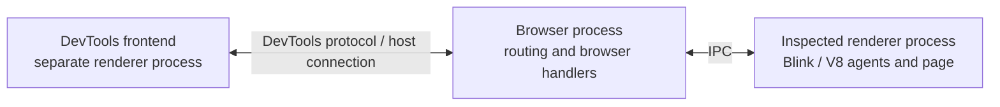
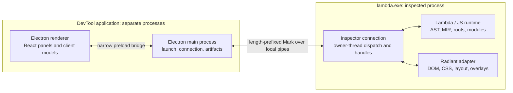

# Lambda DevTools: live runtime and document inspection

**Status:** working design. M0 and the first live-document slice of M1 are
implemented and focused/UI checks pass; aggregate failures are recorded in the
implementation report. Later milestones remain proposed.

**Date:** 2026-10-26.

**Source review:** checkout `90e315ca3`.

**Scope:** Chrome-like development tools for Lambda scripts, LambdaJS, and
Radiant documents, with a frontend outside the inspected process.

**Authority:** existing formal rulings remain unchanged. New tooling choices
below are recommendations for review, not additions to the formal specs.

**User constraints (2026-10-26):** keep the design and protocol as simple as
possible; use Lambda's data model as the protocol data model.

**Implementation:** [Lambda_Impl_Devtools.md](impl/Lambda_Impl_Devtools.md).
The current frontend launches with `make devtool` → **Live**. A headless client
is available as `node utils/devtool/inspect.mjs <document> [request.mark]`.
Implemented operations are `hello`, `tree`, `node`, `style`, `set_style`, `pick`,
`highlight`, `screenshot`, `source` and `release`. Source stepping, runtime-value
expansion, structured console events, profiling and memory analysis remain later
work. Native-window picking, matched-rule explanations and fragment overlays
are also outside this first slice.

## 1. Recommendation

Build a live inspector backend inside `lambda.exe` and extend the existing
Electron/React application in `utils/devtool/` as its first frontend. Connect
them with Lambda maps encoded in Mark: requests, replies and events over a
dedicated local pipe. One connection identifies one target. Keep the frontend,
target runtime, and protocol independently usable so a native Lambda frontend, browser
client, editor extension, or command-line client can follow later.

The first useful release should let a developer launch a Radiant page, select a
visible element, inspect its DOM, CSS and geometry, change an inline declaration,
and see the result. Include live diagnostics and reliable connection teardown.
Then add source debugging, resource inspection, performance recording, and
memory analysis in finite milestones.

This combines two existing development workflows: the DevTool's browser versus
Lambda comparisons and the engine's live document/runtime state. Preserve the
comparison workspace; add a **Live** workspace using the same application shell.
The old [layout DevTool plan](radiant/Radiant_Layout_Devtool.md) supplies historical
context, while current source determines which infrastructure can be reused.

### Formal-spec linkage

| Ruling | Constraint on this proposal |
|---|---|
| [D1.1, D1.3v3](../doc/Lambda_Formal_Design.md#d1-architecture-principles) | Keep one Lambda host architecture and reuse its runtime substrate. A frontend process is a client, not another execution engine inside the target. |
| [D2.2, D5.2](../doc/Lambda_Formal_Design.md#d2-data-representation) | Preserve numeric kinds and scalar ownership when serializing or retaining inspected values. |
| [D2.9.1–D2.9.2](../doc/Lambda_Formal_Design.md#d29-mark-file-conventions) | Use Mark Notation for wire values and `.mark` for saved message examples; the data decoder does not execute Lambda source. |
| [D5.1.1v3, D5.3.1–D5.3.4](../doc/Lambda_Formal_Design.md#d5-execution-state-stacks-and-rooting) | Inspect precise roots and registered activations; never scan native stacks or infer roots from register contents. |
| [D5.4.1–D5.4.4](../doc/Lambda_Formal_Design.md#d54-runtime-globals-and-evalcontext) | Run target operations on their owning context; use a lazy capsule without changing the frozen JIT-visible prefix. Add no locks, atomic RMWs or coherence operations to repeated execution paths. |
| [D8.1.1v18, D8.1.3v42](../doc/Lambda_Formal_Design.md#d81-structure) | Support the retained AST interpreters and current MIR engines. Do not assume a bytecode VM, V8 inspector, or general MIR-to-interpreter deoptimization exists. |
| [S1.8](../doc/Lambda_Formal_Semantics.md#s1-core-principles), D8.1.1's REPL clause | Lambda console input is host-submitted source through the existing REPL pipeline; do not introduce a script-visible string-evaluation API. |
| [S1.4, S9.1](../doc/Lambda_Formal_Semantics.md#s9-mutability-mutable-value-semantics) | Inspection cannot bypass immutable bindings, value semantics, or normal mutation rules. |

## 2. Does Chrome run DevTools in a separate process?

**Yes, the frontend does.** Chromium explicitly places the DevTools frontend in
a renderer process separate from renderers hosting web origins. The frontend is
a web application; its visible docking position does not imply that it shares
the inspected page's renderer.
[Chromium's DevTools process boundary](https://chromium.googlesource.com/chromium/src/+/main/docs/security/compromised-renderers.md#renderer-processes-hosting-devtools-frontend).

The inspection backend is distributed: protocol domains have agents in Blink
or V8 and handlers in the browser process. Therefore, a separate frontend does
not move the inspected engine or every debugger operation into a separate
process. [Chrome DevTools protocol architecture](https://github.com/ChromeDevTools/devtools-frontend/blob/main/docs/devtools-protocol.md).



For Lambda, adopt the same separation of responsibilities: independent UI and
transport, with small agents next to the state they inspect. A paused or crashed
target should leave the tools window responsive. This does not make an agent
capable of inspecting a corrupt native process; native crashes still require
native crash reports and tools such as LLDB.

## 3. Developer experience

Use familiar panel names, keyboard navigation, a target selector, and a persistent
Console drawer. Every panel shows its target and connection state. Inspection
controls use capabilities reported by that target rather than assuming all
Lambda processes host a DOM or support source stepping.

| Panel | Main questions it answers |
|---|---|
| Elements | Which node is this? Which CSS declarations won? What are its computed values, used dimensions, and layout fragments? |
| Console | What did the program report? Where did it fail? What can I inspect or explicitly execute in this context? |
| Sources | Which source is loaded? Where is execution paused? What are the call frames and visible bindings? |
| Network / Resources | What loaded, from where, how long did it take, and why did it fail? |
| Performance | Where did a frame or operation spend time: parsing, execution, compilation, layout, paint, GC, or loading? |
| Memory | Which managed and native ownership categories grew? Which retained objects and owners explain that growth? |
| Compiler | Which tier ran this function, and what AST/MIR or compilation diagnostic explains it? |

The Compiler panel can begin as a Sources subpanel. Browser-specific Application,
Service Worker, device emulation and extension tooling are outside the initial
scope. Expose only features Lambda actually implements.

### Primary workflows

1. **Fix a layout problem.** Launch a document from the Live workspace, activate
   the picker, click an element in the native Radiant window, inspect its style
   and box model, edit a declaration, and observe the resulting geometry/pixels.
2. **Explain a runtime failure.** Open a Console diagnostic at its exact source
   revision, rerun with interpreter debugging, break at the failing statement,
   and expand the relevant local values.
3. **Explain a slow interaction.** Record one interaction, correlate its script,
   layout and paint work, and export a trace with executable/source provenance.
4. **Investigate a regression.** Open the existing comparison workspace, run a
   fixture against browser references, then launch the same fixture for live
   inspection. Live and archived results remain visibly distinguished.

Initially the application launches its targets. A later workflow for attaching
to an independently started target requires a local endpoint enabled at that
target's startup; there is no injection into arbitrary running processes.

## 4. Process and ownership architecture



### 4.1 Frontend

Reuse the current Electron main/preload/renderer split and React workspace.
The renderer handles presentation and protocol models. The main process owns
target launch, transport and explicit artifact/file access. The preload exposes
specific connection operations, not unrestricted Node or shell execution.

Keep the protocol client independent of Electron. Use one Mark codec at the
frontend connection boundary, preserving Lambda symbols, elements and exact
numerics in its value representation. Panels must not convert these through
JSON or reparse rendered value strings. The existing JSX/JavaScript stack can
remain. A CLI client can use the same protocol without starting the UI.

### 4.2 Target backend

Create a small shared inspector module with a connection, command dispatcher,
and handle table. Language adapters expose their own frame,
binding and value semantics. A Radiant adapter supplies document-specific data.
Reuse `dom_*` and CSSOM APIs rather than the JavaScript adapter as the inspector's
core interface.

Every command touching `Item`, an AST activation, a DOM tree or styles runs on
that state owner's thread. Transport never traverses target state. Responses
are copied, bounded records or encoded bytes with explicit ownership; pointers
and borrowed target buffers never cross the process boundary.

The initial document connection is a shell-owned `UiContext` service with no
retained managed values. A document resource invalidates weak handles before
its storage retires. When runtime-value inspection is added, its retained GC
handles belong in an opaque per-context capsule under D5.4.2.
Ordinary execution with inspection disabled has no event construction,
debugger statement hooks, new repeated-path locks/atomics, or background heap
walking. Existing coarse lifecycle boundaries can publish records when enabled.

### 4.3 Transport and scheduling

Start with dedicated local pipes opened by the launcher: POSIX inherited handles
or Windows named/inherited pipes through a platform adapter. Keep script stdout,
stderr and stdin separate. Each frame is a four-byte unsigned big-endian byte
length followed by that many UTF-8 bytes containing one Mark map. Enforce fixed
backend frame/queue limits before allocation. Mark strings and binary values
need no special line-delimiting rules. A WebSocket server is unnecessary for
the first milestone.

The context's normal event-loop boundaries service inspection while it is idle
or running a document. Explicit interpreter-debug sessions add nonblocking
control polling at known statement/call/loop checkpoints. These checkpoints
establish the required precise-root state before inspecting or allocating.
They use the owner thread's local state and dedicated channel, without a shared
atomic flag or lock on the execution path (D5.4.4).

When paused, the owner thread enters a restricted debugger control loop that
services inspect/resume commands. It does not run page event handlers, timers,
microtasks, layout commits, or arbitrary nested application event loops.
Background resource workers may finish I/O, but state publication waits for
resume. The native page window may stop updating; the separate frontend remains
interactive and can display its last captured frame.

Pause is cooperative, so a long native helper or an uninstrumented MIR loop
cannot promise an immediate stop. Report `pauseRequested` separately from
`paused`; offer process termination as a distinct user action.

If browser or remote clients become useful, add an external broker translating
WebSocket connections to this same local protocol. This avoids coupling the
runtime to HTTP hosting, browser discovery or remote authentication in the MVP.

## 5. Protocol and consistency model

Use Lambda's existing data model throughout: maps for messages and records,
arrays for collections, elements for document snapshots, symbols for operation
names, and native scalar values. Use Mark Notation as the first wire encoding.
No JSON type-tag layer, CDP domains, generic RPC object system, schema generator,
or additional protocol value classes are needed.

### 5.1 Three message forms

A **request** has an integer `id`, a symbol `op`, and operation-specific fields:

```mark
{id: 1, op: 'style', node: 42}
```

A **reply** repeats `id` and contains either `value` or `error`. The value is
ordinary Lambda data; an error is a small map with a symbol code and message:

```mark
{id: 1, value: {computed: {display: "flex", color: "red"}, inline: "", box: {x: 0.0, y: 0.0, width: 320.0, height: 80.0}}, rev: 7}
```

```mark
{id: 1, error: {code: 'stale', message: "node is no longer live"}}
```

An **event** has a symbol `event`, its payload fields, and no request ID:

```mark
{event: 'changed', rev: 8}
```

This is the entire common envelope. Fields such as `rev`, `node` and `frame`
belong to operations that need them, not every message. A successful operation
with no returned data uses `value: null`. These envelopes are implemented;
`hello` reports the commands available on the connected target.

One connection identifies one target and one controlling client. Changing the
target opens another connection. Requests are dispatched in order on the
owning thread; `id` matches replies when requests overlap. Each request gets
one reply while the connection remains live; closing fails outstanding requests
locally. There is no session/target routing field or global event sequence.

Start with one handshake, `hello`, taking integer `version: 1`. It returns the
version and a list of supported operation symbols. An incompatible version is
rejected; an unknown operation returns `code: 'unsupported'`. Keep validation
as a small command table plus normal MarkReader field checks.

### 5.2 Small command set

| Operations | Purpose |
|---|---|
| `hello` | Check the protocol version and report supported operations. |
| `tree`, `node` | Read a shallow branch or node snapshot; optional `offset` / `limit` bound large child lists. |
| `style`, `set_style` | Read computed/inline styles and used geometry; edit one inline declaration. |
| `pick`, `highlight` | Enable/disable the picker and highlight a node. |
| `source` | Read exact retained source bytes and source location information. |
| `release` | Release weak node handles with a `refs` array. |
| `screenshot` | Return native PNG bytes as a Lambda binary value plus viewport dimensions. |

`inspect` for runtime-value handles follows in M2. The current `source` result
is explicitly an `attach_snapshot` of the local source file, not proof of the
exact bytes admitted by the loader or imported scripts.

Add `breakpoint`, `pause`, `resume`, `step`, `stack` and `locals` when source
debugging is implemented. Profiling commands follow their milestones. Extend
this same command table rather than adding a service/domain layer.

For example, a style edit and a document snapshot use ordinary Lambda values:

```mark
{id: 2, op: 'set_style', node: 42, name: "color", value: "red", rev: 7}
```

```mark
{id: 2, value: {name: "color", value: "", priority: ""}, rev: 8}
```

```mark
{node: 42, value: <div class: "card">, count: 1}
```

The edit reply supplies the previous inline value/priority for undo. The last
example is a node-record fragment: `tree`/`node` return a shallow record plus
paged child records, geometry and metadata. Its element is a copied document
value; `node` identifies the live node. An HTML `id` attribute is ordinary data.

### 5.3 Lambda values and live handles

Transmit small, serializable data directly, preserving symbols versus strings,
maps versus elements, numeric kinds, binary values and datetimes. The parser
reads data; receiving Mark never evaluates source (S1.8). Native `Item` words
and pointers stay inside the process.

Large values, cycles, functions and other live runtime entities use an integer
handle in a defined inspector record. For example, a locals row can contain
`{name: "items", type: 'array', ref: 57, count: 100000}`; `inspect` pages that
handle's contents. Actual user data stays in a `value` field and is never
recognized as a handle merely because its shape resembles such a record.

Allocate handles monotonically for the connection and never reuse them.
Invalidate document handles on navigation, frame/local handles on resume, and
all handles on disconnect. Source handles retain exact loaded bytes. DOM
handles validate live nodes and do not keep detached trees alive. Retained GC
values use precise roots; retain Input/source/numeric owners explicitly where
needed (D5.2, D5.3.3). A stale handle returns a normal error. No extra generation
or pause token is needed on the wire.

Use the shared Mark reader/writer, with lossless round-trip qualification before
claiming full type coverage. The initial implementation fixes float-kind/signed
zero, integer/decimal suffix and root-string escaping through the shared printer;
CLI Mark conversion now uses that serializer too. Sized-number suffixes, ranges
and other runtime-only forms still need qualification before M2 exposes arbitrary
values. Unsupported live values will use handles and type information. This is
shared codec work, not a second protocol data model.

### 5.4 One revision and simple change events

Use one integer `rev` for committed document state. Tree/style/geometry reads
return coherent snapshots at that revision. A style edit includes the revision
the user saw; reject a stale edit with `code: 'conflict'`. Reply after ordinary
mutation, invalidation and the required layout commit. Undo uses the same path.

The initial connection emits `changed` and `selected`; structured `log` events
and debugger `paused`/`resumed` events follow later. A `changed` event invalidates cached document data;
the frontend refetches visible branches/panels. Initially there are no tree
patches, subtree subscriptions, event replay or separate DOM/CSS/layout revision
systems. Coalesce repeated changes to the latest revision.

Keep backend limits for message size, queue bytes, handles, preview depth and
trace storage. Under pressure drop/count log or profiling records and coalesce
`changed` events; never discard replies silently. If the connection cannot make
progress, close it and perform normal disconnect cleanup. Fixed limits need no
budget-negotiation protocol.

## 6. Elements, CSS and layout

Show the DOM and layout information as related but distinct views. A DOM node
may have no box, several text/fragment boxes, or associated anonymous layout
boxes. A single rectangle per element cannot explain inline wrapping, paged
fragments or generated content.

For a selected node, show attributes/text, inline declarations, matched rules,
inherited declarations, computed values, and used geometry. Add cascade
provenance in the engine where it is resolved: origin, importance, layer,
specificity, source order, declaration/source location and winner status where
available. Do not reconstruct the cascade by guessing from final computed
values. Missing provenance is reported as unavailable until implemented.

The first implementation shows attributes/text, inline CSS, computed properties
and visual bounds. Matched rules, inherited-rule explanations and per-fragment
box geometry remain extensions rather than claimed support.

Use the actual selector, computed-style and CSSOM mutation helpers. Begin edits
with inline declarations and preserve value/priority for undo. Rule-level edits
and saving source files are later features with separate persistence behavior;
an experimental live edit is not silently written to disk.

The initial picker sends preview coordinates through Radiant's existing hit-test
path; the frontend draws its highlight from the returned visual bounds. Native
page click capture and renderer-owned overlays are later work. Their intended
design uses Radiant's hit-testing path, suppresses the inspected page's
activation click, and returns the same node identity used by Elements. Overlays
use the renderer's transform/clip/scroll geometry, support fractional CSS-pixel
coordinates, and paint in an inspector-owned layer excluded from normal page
layout. Screenshots explicitly choose whether to include overlays.

Accept the core milestone using a block with margins, wrapped inline text,
nested scrolling, a transformed element, and a flex/grid container. Validate
the selected node, overlay alignment and a causal style edit at more than one
device scale. Cross-document picking and all paged/generated-content cases can
remain capability-labeled extensions after the core path works.

## 7. Console and source debugging

### 7.1 Console and value inspection

The first frontend exposes connection status and captured process output. The
structured console and runtime-value features below are M2 work.

Capture structured diagnostics at their producer, including level, time,
target/language, source span and available stack data. Preserve existing CLI
output behavior. Reuse the shared JS console emission point and native logging
infrastructure; tailing the global `log.txt` is an optional log viewer, not the
live console's data model.

Expanding a value must not call its getters, proxy traps, custom printers or
`toString`. Show descriptors/accessors as such; explicit invocation is a
separate operation that may execute code. Where effect-free inspection is not
available, show an opaque preview. Truncate large values with an explicit count
or continuation instead of recursively formatting an unbounded graph.

For **JavaScript**, console evaluation can use the existing dynamic-source AST
path in the selected realm at an admitted owner-thread boundary (D8.1.3v42).
Executing submitted source is explicit and distinct from passive inspection.
Do not add paused-frame evaluation until the debugger can expose the correct
live lexical environment and handle reentrancy.

For **Lambda**, initially offer a clearly labeled scratch REPL target using the
existing persistent host REPL pipeline. It has its own process/session and does
not pretend to inherit the inspected program's locals. Passive local watches
use bound names and structured field/index paths, without invoking functions.
General paused-scope source evaluation needs a separate reviewed scope/effect
design; this proposal does not settle that language boundary (S1.8, S9.1).

### 7.2 Debug the retained AST first

Offer **Inspect** and **Interpreter debug** launch profiles. Inspect preserves
the selected AUTO/MIR execution policy and exposes observations; interpreter
debug explicitly launches Lambda with `LAMBDA_EXEC_BACKEND=interp` and JavaScript
with `JS_EXEC_BACKEND=ast`. Show this choice in the UI. Unsupported interpreter
constructs retain the normal fail-closed diagnostic.

This is a launch choice, not an implicit tier switch when DevTools connects.
An existing native frame cannot be turned into an interpreter frame by changing
a selector. Debugging an already compiled target initially requires a restart
in the debug profile. Attaching for observations must not silently disable
promotion or invalidate compiled code.

Add debugger checkpoints and explicit frame registration to the existing
walkers. Lambda already has `InterpFrame::caller`, `cur`, its frame plan and
rooted slots. JS has `JsInterpFrame` and traced `JsInterpEnv` records, but needs
an explicit debugger-visible activation/frame chain and current-node tracking.
Neither requires a replacement interpreter or native-stack scanning.

Implement source breakpoints, pause/resume, step into/over/out, call frames,
scope browsing and read-only locals. Bind breakpoints to executable AST sites,
not every syntax node sharing a line. Preserve pending breakpoints for modules
that have not loaded; return resolved locations and rebind against source
revisions on reload. Store canonical half-open UTF-8 byte spans and translate
editor line/column conventions explicitly, including Unicode.

Step state records activation, call depth, executable site and pause epoch so
several expressions on one line do not repeatedly stop at the same location.
Pause the owning isolate's application execution consistently. Initial stepping
covers synchronous interpreted code; stepping across task/await/generator
suspension and async ancestry are later capabilities using the existing
activation owners (D5.1.1v3). Parked activations remain precisely rooted.

Distinguish a JavaScript throw, an uncaught throw, a Lambda error value, and an
unhandled/fault diagnostic. Returning an ordinary Lambda error value is not
automatically equivalent to throwing a JS exception. Define each stop policy
explicitly when that capability is added; do not make every error allocation a
breakpoint.

While paused, allow reads, handle release, breakpoint changes and resume.
Queue or reject page mutations and source execution until their pause semantics
are implemented. On connection loss automatically release the pause and its
handles; abort an inspector-only wait before program entry cleanly. A live
controller can intentionally remain paused without a fixed execution timeout.

### 7.3 MIR debugging follows as a separate capability

First expose source-to-function/IR links, tier/promotion events, retained MIR
artifacts where available, and compilation diagnostics. A native source
debugger additionally needs instrumented Lambda-side lowering, source-site
tables, live binding materialization, frame registration and precise rooting
at its debug stops. Inspectable locals need explicit availability states such
as `optimizedOut`; native registers are not a substitute for this metadata.

Keep emission/rooting policy in `MirEmitter` under D5.3.4. Instrument an explicit
debug code image before entry, starting with unoptimized MIR bodies; existing
active frames finish under their admitted policy. General deoptimization,
arbitrary-PC OSR and full optimized stepping are outside the first design.
Do not patch vendored MIR or promise native stepping before these contracts
exist. The production JS path is `lambda/js/mvp-lmd/`, not the retired LJS MIR
backend (D8.1.3v42).

## 8. Resources, performance and memory

### 8.1 Resource activity

Trace resource acquisition at Lambda-owned request/scheduler boundaries.
Include URL/path, kind, initiator, request/attempt identity, status/failure,
available timings, byte counts, cache provenance and redirect relationships.
URL alone is not an identity: duplicate/coalesced consumers, retries and
redirects need explicit relationships. Distinguish local files/package loads
from actual HTTP traffic.

Reuse the network resource manager, HTTP client and Radiant processing hooks.
Track which loaders are instrumented and expose that coverage; observing
Radiant resources alone does not establish coverage of every `fetch` or module
load. Unavailable DNS/TLS/header details stay absent. Response bodies are
bounded, explicitly requested data with retention limits, not an unconditional
copy of all loaded content.

### 8.2 Performance

Record bounded, monotonic-timestamped events for source parse/build, AST
execution, MIR compile/publication, task activity, style/layout, paint and GC.
Reuse existing render and JS execution counters, adapting their records rather
than reparsing log text. Keep target timings separate from frontend rendering
and transport time; correlate by target, thread/activation and operation IDs.

Start with duration events and counters. CPU sampling requires a separate
review of unwind support and perturbation; a timeline is not a sampling
profiler. Export recordings with source revisions, build configuration,
executable hash, recording settings and drop counts. Keep all captures under
`temp/devtools/` unless the user explicitly exports elsewhere.

Measure inspector overhead on release executables with inspection disabled,
connected/idle, and actively recording. Use matched workloads and retain the
uninstrumented control, binary/source provenance and output checks. Debug
stepping runs do not qualify performance. Set numeric overhead budgets from
those measurements before broadening instrumentation; none are measured here.

### 8.3 Memory

Begin with ownership/category counters: GC-managed live bytes, Input/arena and
document owners, root/number-stack commitments, retained code, resource caches,
inspector handles, and process RSS as separate measurements. RSS is not a
managed live-heap size, and native allocations are not GC objects.

Later add allocation attribution and retained-object snapshots through the
collector's actual precise root and edge enumeration. Snapshotting must occur
at a valid GC/snapshot boundary with all activation roots accounted for; do not
scan arbitrary C stacks. Bound pause time and snapshot storage, and distinguish
inspector-retained objects in results. Repeated attach/expand/detach and
document teardown must return inspector-owned retention to its expected floor.

## 9. Connection safety and failure behavior

Inspection is opt-in at startup; the first transport is available only through
the launcher-provided local handles. There is no default public TCP port.
Treat console execution and target control as privileged operations.

Keep untrusted inspected HTML and diagnostic strings out of the privileged
frontend execution context: render text as text, keep browser comparison
content isolated, and preserve the current `nodeIntegration: false` /
`contextIsolation: true` frontend boundary. Validate protocol payloads and
restrict source reads to admitted target sources rather than exposing arbitrary
filesystem access.

On target crash/exit, fail outstanding requests, mark the target disconnected,
and retain only copied observations/artifacts. If its renderer dies, Electron
main closes the target connection so the runtime can observe the loss. On
frontend crash/detach, the target drops event capture, pauses and retained
handles through owner-thread cleanup. Losing an inherited-pipe connection
requires relaunch to inspect that target again; later named-pipe endpoints can
support reconnection with a fresh connection and handle table. Backpressure cannot indefinitely
block script output or application execution. Reload invalidates affected
node/value/frame handles, advances the document revision and sends `changed`
before new state is shown.

A future WebSocket broker needs loopback-by-default binding, session secrets,
Host/Origin checks and authenticated upgrades. Remote access should be a
separately enabled transport. These are endpoint requirements, not a reason to
build remote hosting into the initial runtime agent.

## 10. Alternatives and review points

| Option | Assessment |
|---|---|
| Extend the existing Electron DevTool | Recommended first: existing shell, comparisons, source/tree viewers, process launch and platform packaging. Shipping Electron remains a separate development-tool cost. |
| Load a web frontend in an external browser | Good later client; needs a local serving/authentication broker. The protocol/client split preserves this option. |
| Build a native Lambda/Radiant frontend now | Useful eventual dogfooding option. A separate `lambda.exe` process preserves isolation, but building the inspector UI and runtime instrumentation together expands the first milestone. |
| Embed a panel in the inspected Radiant process | Convenient docking, but it shares target hangs, pauses and crashes. Keep it out of the first architecture. |
| Run the stock Chrome DevTools frontend | An integration project of its own: domain names are insufficient; model, event and lifecycle compatibility must be implemented and tested. |

Chrome's frontend is maintained as a separate TypeScript/CSS web application
with its own protocol integration. Reusing it is possible as a future adapter
experiment, not evidence that Lambda already satisfies its backend contract.
[Chrome DevTools frontend repository](https://chromium.googlesource.com/devtools/devtools-frontend/).

The implemented first-slice defaults are an external frontend, existing Electron UI reuse,
dedicated local pipes, an independent protocol, and AST debugging before native
stepping in a later milestone. Broader Lambda paused-frame
evaluation, optimized MIR debugging, multi-controller arbitration and remote
access remain separate design questions; they do not block a useful Elements
and diagnostics release. No existing formal ruling is revised by this document.

## Appendix A. Delivery outline and acceptance gates

Detailed execution tracking belongs in a subsequent `vibe/impl/` plan. This
outline defines useful, finite delivery boundaries rather than claiming full
Chrome parity.

| Milestone | Deliverable | Acceptance |
|---|---|---|
| M0: connection foundation | Lambda/Mark codec, command table, launch/pipe adapter, `hello`, owner-thread dispatch, headless client and bounded queues | Qualify codec round trips; launch two independent targets; reject incompatible versions and malformed/oversized frames; terminate either side without hanging the other; reject stale handles. |
| M1: live document inspector | Live workspace, lazy DOM, computed styles, source links, box geometry, picker, highlight, inline edit and undo, diagnostic stream | Pick and edit the named block/inline/scroll/transform/flex/grid cases; verify native pixels and geometry; reject stale edits; survive reload and detach. This is the first useful release. |
| M2: console and runtime values | Structured previews, property pages, explicit handle release, JS realm console, separate Lambda scratch REPL | Preserve exact numeric values; inspect cyclic/large data within limits; avoid getters/proxies; verify selected execution context and unchanged CLI output; force GC during inspection and release handles. |
| M3: interpreted source debugger | Loaded-source model, AST breakpoints, synchronous stepping, frames/locals and pause policy | Debug recursion, closures, imports, several sites on one line and Unicode source in both languages; pause a tight interpreted loop; resume after disconnect; show unsupported native/async operations explicitly. |
| M4: resource and performance tools | Instrumented-loader coverage, waterfall, counters, finite timeline and export | Show cache/failure/redirect cases; correlate one interaction's script/layout/paint events; report drops; qualify release overhead against a matched control. |
| M5: memory and compiler inspection | Ownership counters and diffs, tier/MIR views, followed by bounded precise retention snapshots | Explain repeated document lifecycle growth; distinguish inspector retention; survive forced GC and teardown; map IR/tier events to the exact source revision. |
| M6: optional extensions | Instrumented MIR stepping, richer overlays, native/browser clients or a CDP adapter | Each has its own declared compatibility surface and behavior gate; none is required to close M1–M5. |

During implementation, use focused protocol/lifetime tests and a few native UI
fixtures in the edit loop. At each affected milestone boundary follow the
[test map](../test/README.md): Lambda/runtime changes require
`make test-lambda-baseline`; JS changes also require `make test262-baseline`;
Radiant/DOM changes require `make test-radiant-baseline` with the applicable
Lambda gate. Do not modify Test262 harnesses to suppress failures. Add golden
results for new Lambda fixture scripts.

Include forced-GC handle retention, pause/unwind, Input/source-owner release,
partial pipe writes, queue overflow and frontend/target death as focused
failure cases. Verify overlays and live edits visually, not only through parser
or protocol tests. Run broad gates once the related change is stable, then
repeat only for relevant changes or unresolved failures.

Current build, focused tests, UI captures and aggregate qualification are
recorded in the implementation document, with remaining limits kept explicit.

## Appendix B. Implementation seams verified in this checkout

Paths below identify infrastructure and the current inspector implementation.
Reuse/promote existing helpers rather than copying static implementations.

| Area | Existing seam and proposed use |
|---|---|
| Frontend shell | [`utils/devtool/main.js`](../utils/devtool/main.js), [`preload.js`](../utils/devtool/preload.js), [`src/App.jsx`](../utils/devtool/src/App.jsx): launch/IPC/workspace foundation; add an inspector connection service and a Live workspace. |
| Archived views | [`ViewTreeViewer.jsx`](../utils/devtool/src/components/ViewTreeViewer.jsx), [`HtmlTreeViewer.jsx`](../utils/devtool/src/components/HtmlTreeViewer.jsx): current file/dump viewers; retain for archived results, add live protocol models separately. |
| Inspector core | [`lambda/devtools/protocol.cpp`](../lambda/devtools/protocol.cpp): connection, command table and language-neutral dispatch, using [`input-mark.cpp`](../lambda/input/input-mark.cpp), [`format.cpp`](../lambda/format/format.cpp) and [`MarkReader`](../lambda/core/mark_reader.hpp). [`utils/devtool/src/inspector/`](../utils/devtool/src/inspector/): shared Mark codec and client. |
| Lambda interpreter | [`lambda/runtime/interp.hpp`](../lambda/runtime/interp.hpp), [`interp.cpp`](../lambda/runtime/interp.cpp): `InterpFrame`, `FnFramePlan`, rooted slot windows, `caller` and `cur`; introduce opt-in checkpoint/stack adapters. |
| JS interpreter | [`lambda/js/js_interp.cpp`](../lambda/js/js_interp.cpp), [`js_interp_env.h`](../lambda/js/js_interp_env.h), [`js_interp.hpp`](../lambda/js/js_interp.hpp): `JsInterpFrame`, `JsInterpEnv`, dynamic-source entry points; add explicit debug frame/site registration. |
| Source coordinates | [`lambda/runtime/source_span.h`](../lambda/runtime/source_span.h): parser-neutral half-open UTF-8 `SourceSpan`; [`radiant/source_pos_bridge.cpp`](../radiant/source_pos_bridge.cpp): document-source bridge. |
| DOM/CSS | [`lambda/dom/dom_core.cpp`](../lambda/dom/dom_core.cpp), [`dom_cssom.cpp`](../lambda/dom/dom_cssom.cpp), [`dom.cpp`](../lambda/dom/dom.cpp): realm-neutral DOM/CSSOM operations, `dom_get_computed_style`, `dom_computed_style_get_property` and style mutation. |
| Document identity / geometry | [`lambda/input/css/dom_element.hpp`](../lambda/input/css/dom_element.hpp): `dom_document_alloc_node_id`; [`radiant/view.hpp`](../radiant/view.hpp): `view_tree_find_live_id`; [`event.hpp`](../radiant/event.hpp): `dom_hit_test_to_boundary`; [`layout.hpp`](../radiant/layout.hpp): `print_view_tree_json` / `stream_view_tree_json`. Dump serializers are a starting inventory, not a live protocol. |
| Radiant adapter | [`radiant/devtools_adapter.cpp`](../radiant/devtools_adapter.cpp): weak handles, DOM/style snapshots, CSS edits, coordinate picking, screenshots and source snapshot. [`resolve_css_style.cpp`](../radiant/resolve_css_style.cpp) and [`lambda/input/css/css_engine.hpp`](../lambda/input/css/css_engine.hpp) remain the seams for cascade provenance. |
| Diagnostics / counters | [`lambda/js/js_globals.cpp`](../lambda/js/js_globals.cpp): `js_console_emit`; [`radiant/render_profiler.cpp`](../radiant/render_profiler.cpp); [`lambda/js/js_exec_profile.h`](../lambda/js/js_exec_profile.h): existing producer/counter seams, not a unified tracing API. |
| Resource loading | [`lambda/network/network_resource_manager.h`](../lambda/network/network_resource_manager.h), [`http_client.h`](../lambda/network/http_client.h), [`radiant/network_integration.h`](../radiant/network_integration.h), [`resource_loaders.h`](../radiant/resource_loaders.h): acquisition and owner-thread processing boundaries. |
| MIR / memory | [`lambda/runtime/transpile-mir.cpp`](../lambda/runtime/transpile-mir.cpp), [`lambda/js/mvp-lmd/`](../lambda/js/mvp-lmd/), [`lambda/runtime/lambda-mem.cpp`](../lambda/runtime/lambda-mem.cpp): current lowering and lifetime owners; add observations without changing semantic decisions or vendor code. |

`make devtool` opens the frontend; choose **Live** to launch an inspector target.
`lambda devtools <document> --pipe <inherited-fd> [--headless]` is the native
launcher entry. Native additions follow C++17/C+ and `lib` collection
conventions; build integration goes through `build_lambda_config.json`. Keep
layout geometry as `float`, captures under `temp/devtools/`, and vendored
dependencies unchanged.
