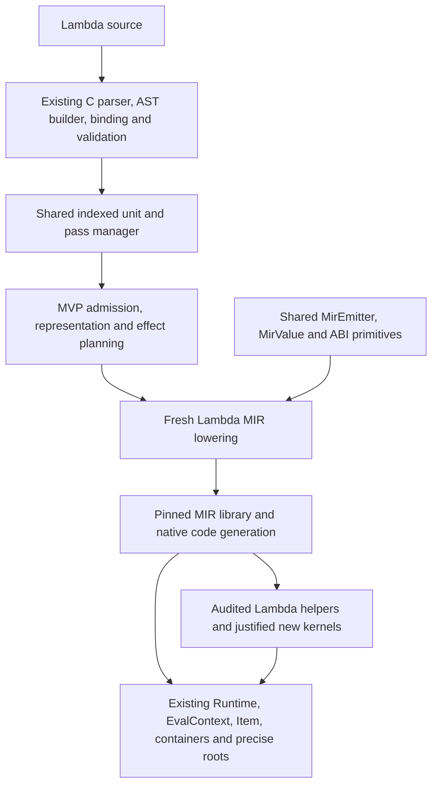

# Lambda MIR MVP — typed execution on the existing runtime

**Date:** 2026-11-03

**Status:** experimental typed compiler behind an explicit selector, with
native scalar/array kernels, typed records, checked mutation and precise `var`
write-back (**S9.1.3v2, D5.3, D8.4.1v2**). Coverage now extends to **48 rows**:
the original 28 plus 20 additional recursion, record, allocation, text and
numerical workloads. Runtime types and data layouts remain unchanged.

The current-source pass restores deferred outcomes and typed constructor
destinations, then keeps proved float outcomes in separate native registers
(**S7.7.2v2/S7.7.4v2, D2.4.3, D5.3, D8.2.6v2**). Spectralnorm improves
**7.4905 → 0.2625 ms**, faster than Full MIR at 2.9155 ms and C2MIR at
0.360107 ms. AWFY Nbody improves **76.5265 → 1.7445 ms**. Runtime data models
and ownership remain shared.

The final 30-sample primary qualifies **40/48 against Full MIR and 19/48 against
both targets**, versus **37/48 and 17/48** for the paired phase-one MVP control
on these same workloads. The original 28 have **27 Full wins and 14 combined
wins**, with no regression flags, including matched batched Sumfp. Full MIR's
FFT/Fasta crashes and wrong Navier–Stokes checksum leave three comparisons
unqualified. A Binarytrees regression flag and near-target Nbody rows receive
independent confirmations; primary observations remain intact.

The required baseline passes **8,714/8,714**. All 48 MVP benchmark goldens and
selected forced-GC checks pass. The broader experimental gate retains **58
failing subtests across 17 of 53 groups**, including deferred fixture migrations,
changed expectations, missing emission optimizations and a Full MIR fault.
Timings use matched execution windows, excluding startup and compilation, with
one-sided 95% confidence gates. The historical 40/25 campaign predates shared
semantic/source migrations and cannot supply current counts.
**The performance milestone remains open.** See the
[current-source measurements](impl/Lambda_Impl_MIR_MVP.md#2026-11-03-current-source-outcomes-and-constructor-admission).

**Destination:** `lambda/runtime/mvp/`

**Initial proposal source inspected:** `d8c604ec5611ee7cac4a4bc6dd4b5e15228149a8`.

**Scope:** a fresh implementation of Lambda's MIR planning and lowering, initially
for a small typed subset, with selective runtime-helper reimplementation where
measurements establish a need. Lambda's language semantics, runtime types, data
layouts, and ownership model remain unchanged.

This is a working design proposal under [Doc Convention](../doc/Doc_Convention.md).
It proposes implementation choices and acceptance gates, without changing a
formal ruling or the shipped execution policy. The authority map is in §3;
implementation details are confined to Appendix A.

## 1. Objective

Build a small Lambda-to-MIR compiler from scratch that keeps typed computations
in native lanes through expressions, loops, calls, and returns. The performance
goal is execution as fast as equivalent C compiled by C2MIR, with every remaining
gap explained by emitted code or work required by Lambda semantics.

The new implementation must compile the selected programs itself. It must not
wrap the existing `transpile-mir.cpp` lowering, copy that implementation into a
new directory, or replace whole benchmark functions with C helpers. Reuse the
existing frontend, shared physical emitter, MIR library, runtime objects, and
audited semantic primitives. The fresh work is the compiler's decisions about
what to emit and the admitted Lambda operations that implement those decisions.

C2MIR means the independent C benchmark ports compiled through the pinned MIR
C frontend. The retired Lambda C-text backend remains removed (**D1.6**).
C2MIR is a performance reference, not a Lambda semantic oracle: C ports can do
different allocation, copying, integer arithmetic, and output work.

Success has three parts:

1. Correct Lambda results and lifetime behavior for the admitted subset.
2. Compact MIR with native hot loops and direct typed calls, backed by
   structural checks and release measurements.
3. The same performance through the shared Lambda runtime entry used by the
   experiment. Integration must preserve the compiler's useful facts.

## 2. What to take from JS MVP

The closest precedent is [JS MVP-Lmd](jube/JS_MVP_Lmd.md), especially §§1–7:
new admission and MIR lowering over the existing Lambda substrate. The earlier
[private-value JS MVP](jube/JS_MVP_Runtime.md) is useful history, but its private
value ABI and heap do not fit this project's fixed-data-model requirement.

| JS MVP lesson | Application to Lambda MVP |
|---|---|
| Start with an explicit, executable subset | Admit the eight programs in §7 and their semantic edge tests; diagnose other capabilities before execution. |
| Retain analysis before emission | Decide representations, call entries, effects, and ownership once; lowering consumes those decisions. |
| Keep the MIR and helper surface small | Native arithmetic and addressing first; helper calls have a stated semantic purpose and cost. |
| Freeze workloads and validate results | Keep source hashes, output contracts, raw samples, and separate correctness/performance status. |
| Extend in finite milestones | Close scalar execution, then typed arrays, before expanding into objects, closures, or general libraries. |
| Preserve speed during integration | Use the canonical runtime owner from the beginning; sharing ownership must not imply generic dispatch everywhere. |

The last point follows the [JS MVP integration record](jube/JS_MVP_Integration.md):
its historical public adapter weakened optimization facts when a shared runtime
was present. The lesson is to separate ownership from actual operation effects,
not to create another standalone runtime (**D5.4.1–D5.4.4**, **D8.4.1v2**).

Existing Lambda tuning also changes the starting point. The older
[typed/C2MIR analysis](<impl/Lambda_Tune_Typed_Vs_C2MIR (done).md>) identified
boxing round trips, generic iteration, repeated type checks, and call ceremony;
many fixes have since landed. [Result49's analysis](impl/Lambda_Benchmark_Result49_Typed_Analysis.md)
and [Result54](../test/benchmark/Overall_Result54.md) already show competitive
scalar rows. This proposal does not assume those historical defects still occur.
Fresh MIR comparisons establish the current causes before implementation.

## 3. Fixed contracts and formal authority

The [formal semantics](../doc/Lambda_Formal_Semantics.md) and
[formal design](../doc/Lambda_Formal_Design.md) govern all fast and slow paths.

| Contract | Authority |
|---|---|
| MIR Direct remains the execution backend; AUTO/interpreter policy is separate from MIR implementation selection | **D1.6**, **D8.1.1v18** |
| Existing `Item` boundary, scalar encodings, arrays, maps, shapes, and layout descriptors | **D1.2v2**, **D2.1–D2.6** |
| Semantic type, planned representation, emitted value, and machine register class are distinct | **D2.4.1–D2.4.3** |
| Int53 saturation/poison, machine-integer wrapping, numeric promotion, division, and remainder | **S4.1.1–S4.1.5**, **S4.2**, **S4.4–S4.5** |
| Declared types are enforced contracts; admission can normalize a value | **S11.4.1v3–S11.4.5**, **D8.3.5** |
| Missing reads, nullable lanes, checked writes, COW snapshots, and `var` borrows | **S7.1–S7.2**, **D2.5**, **S9.1–S9.2** |
| Canonical runtime owner, precise GC, scalar homes, and returned failures | **D1.4v4–D1.5v2**, **D5.1–D5.4** |
| One indexed AST and pass manager; demand-driven lowering | **D8.2.4v2–D8.2.6v2** |
| Proven direct native entries, checked boxed boundaries, immutable specialization | **D8.3.1v2–D8.3.5**, **D8.4.1v2–D8.4.2v2** |
| Emission budgets, release MIR artifacts, and dynamic GC oracles | **D8.6.1–D8.6.3** |

There is no new `Item` encoding, array representation, heap, collector, root
stack, function-object layout, or calling convention. Existing representations
may be selected more effectively; changing their semantics or layout is outside
this proposal. MIR and other vendored dependencies remain untouched.

## 4. Architecture



### 4.1 Planning before emission

Use the existing compiler pass manager and indexed compilation unit. Register
the MVP stages in that schedule, declaring their inputs, outputs, and timings;
do not introduce a second AST, pass scheduler, binding resolver, or private
recursive core-node walker (**D8.2.4v2–D8.2.5v3**).

Planning establishes:

- The admitted operations and complete reachable call boundary.
- Each function's native/boxed entries, parameter and return representations,
  and whether a boundary must check or normalize a value.
- Transitive call effects: allocation/GC, error completion, reentry, mutation,
  backing-store invalidation, and number-stack use. `fn` purity alone does not
  establish `NO_GC` or the other effects (**D6.1.3v2**, **D5.3.2**).
- Range and array-layout proofs sufficient for the selected lowering, with
  explicit invalidation on a write, rebind, or call that can break them.
- Result demand and the lifetime events supplied to the shared emitter.

`AstNode.type` remains the effective-type authority; source annotations stay on
their declaring nodes. Reuse function analysis and ABI-plan records. Retained
type-only optimization facts follow the existing `Type` side-record rule;
transient lowering state holds local control-flow proofs. Do not add an
ID-keyed per-node fact database (**D8.2.5v3**).

Analyze recursive call groups conservatively to a fixed point before choosing
their ABI. Unknown facts select a correct checked path, never an optimistic
native entry. Start with one useful native shape per eligible function;
bounded multi-variant specialization is a later extension of **D8.3.1v2**.

### 4.2 Scalar expressions and calls

Expression lowering returns the shared `MirValue`, including its full contract,
representation, and ownership provenance. Consumers request a native value,
boxed value, destination, branch, or discard. Branches avoid materializing
boxed booleans; discard avoids building a result while preserving effects and
required failures (**D2.4**, **D8.2.6v2**).

Typed scalar parameters, locals, intermediates, and returns stay native end to
end. A proven direct call passes native operands directly; an open or unproven
edge uses the existing checked boxed entry. Generate only the entries required
by visibility and the call plan (**D8.3.2–D8.3.4v4**).

An `int` annotation does not prove finite arithmetic: Lambda's int lane includes
poison and saturates outside the int53 band. Use native arithmetic without a
guard only when a valid range proof covers that operation; otherwise retain
the necessary checks and a complete saturation/poison path. Float operations
preserve NaN, signed zero, and evaluation order. Fast-math reassociation is not
a route to parity (**S4.1–S4.5**).

Proven admission is not necessarily an identity operation: `int` entering a
`float` contract still needs normalization. Keep semantic conversion separate
from `em_require_rep()`, and reuse the existing boundary-redundancy analysis
(**S11.4.5**, **D2.4.3**, **D8.3.5**).

Use the existing native success/error and boxed wide-scalar companion lanes.
Pending scalar returns resolve before storage, rooting, or escape. Scalar-only
functions can have zero roots and no number homes when proven; this does not
remove stack-exhaustion handling or required failure propagation. Shared emitter
finalization owns all root-store insertion and frame decisions
(**D5.1.2**, **D5.2.1v3**, **D5.3.1–D5.3.4**).

### 4.3 Loops and typed arrays

Finite integer-range loops use native induction variables when endpoint and
overflow semantics are proven. Preserve range emptiness, inclusive endpoints,
evaluation order, and break/continue. Elide comprehension construction only
under actual discard demand; a statement's syntactic position alone is not a
proof that its result is unused (**D8.2.6v2**, **S16.6**).

Typed arrays retain their existing `Array`, native-array, or `ArrayNum` layout.
An annotation establishes a contract, not an eternal backing-pointer guarantee.
Resolve storage through the shared `LaneStorageDesc` and array-contract helpers;
retain a rooted owner plus the exact representation witness. In particular,
`bool[]` must use its real descriptor rather than assuming numeric-array storage
(**D2.6.1v3**, **S11.4.1v3**).

A proved in-bounds read becomes an indexed native load. Otherwise preserve the
nullable read and its downstream contract behavior; never manufacture zero or
erase absence. A write checks the new value before commit and observes COW.
Fresh exclusive arrays can avoid repeated detach work; an aliased array still
detaches as required. Plain parameters preserve snapshots, and `var` parameters
carry the existing borrow home and publish replacements through it
(**D2.5.3**, **S9.1.2–S9.1.3**, **S9.2.2**, **D8.3.4v4**).

Hoist length, layout, bounds, or exclusivity checks only across operations proven
to preserve them. After an allocating, alias-writing, reentrant, or otherwise
invalidating operation, reload backing storage from the rooted owner and renew
the necessary proof. A miss performs the pending operation through its correct
Lambda path once; it cannot restart a partially executed loop or function.

## 5. Initial admission boundary

The first MVP is deliberately useful and incomplete. It compiles whole selected
scripts, including their ordinary timing and verification code, without invoking
the production compiler or interpreter to execute unsupported source functions.

| Area | Initial support |
|---|---|
| Scalars | `null`, `bool`, `int`, `float`; string literals and the string operations needed by the existing output/formatting code through shared helpers. |
| Bindings | Module constants, local `let`/`var`, declared scalar/array contracts, assignment, and the currently validated parameter-binding behavior. |
| Computation | Numeric arithmetic/conversions/comparisons, Boolean short circuiting, and selected existing bitwise/math intrinsics. |
| Control | Blocks, conditionals, `while`, finite integer-range `for`, break/continue, explicit and implicit returns. |
| Functions | Top-level fixed-arity `fn`/`pn`, direct calls and recursion, native returns, required boxed boundaries, typed-array plain and `var` parameters. |
| Arrays | Rank-one `bool[]`, `int[]`, `float[]`; literals, `fill`, length, indexed reads/writes, COW and borrow semantics. Dynamic local sequence writes use the existing COW setter and can change element kind (**S12.2.1**, **S9.1.2**). |
| Runtime boundary | Existing clock, print, formatting, `len`, `abs`, `floor`, `math.sqrt`, `math.sin`, `bor`, `bxor`, shifts, `ord` and `chr`. Existing failure carriers and cleanup apply throughout. |

General maps/objects/elements, closures and callbacks, imports, tasks/suspension,
general iterators, comprehensions that construct results, arbitrary nullable or
union containers, decimal/BigInt computation, and broad library coverage come
later. Nullable values produced by admitted reads still require complete handling.
Output code's open/`any` values may stay boxed; typing every line is not required
to keep a typed kernel native.

Admission checks the entire unit, including unexecuted definitions, before any
user side effect. A capability diagnostic names the construct and location and
is distinct from a Lambda language error. A runtime-dependent guard miss must
have a complete admitted path; otherwise admission rejects that capability.
Neither a capability failure nor a silent backend fallback counts as a passing
benchmark. Language errors from admitted operations propagate normally
(**D1.4v4**, **S7.4**, **S11.4**).

## 6. Runtime-helper policy

The user explicitly permits helper reimplementation where necessary. Start with
the existing runtime/lib operations and shared MIR primitives; add or replace
a helper only after locating a semantic or measured implementation bottleneck.
There is no requirement to preserve an inefficient helper merely because it
already exists, and no requirement to rewrite one merely to call this a fresh MVP.

Each helper change records its callers, preconditions, result representation,
completion behavior, transitive GC/reentry/mutation effects, and scalar-owner
contract. Document the cost removed and validate the generic boundary and fast
path. Unknown effects remain conservative (**D5.3.2**, **D8.4.3v2**).

Likely candidates are a narrow checked-array preparation operation or a cheaper
semantic leaf behind an existing API, if profiling identifies them. Ordinary
numeric operations, known calls, and in-bounds loads should become MIR rather
than a new layer of helper calls. Public builtin ABIs remain compatible
(**D6.4.1**).

Promote a reusable existing `static` helper into its owning module's header
instead of copying it. Put broadly reusable fixes in the shared runtime; reserve
`mvp_runtime.cpp` for genuinely MVP-specific adapters or experimentally separate
implementations. Count that code and its transitive dependencies in the audit.
All allocating C/C++ paths use precise `RootFrame`/`Rooted` ownership; no
conservative stack scanning or private heap is introduced (**D1.5v2**, **D5.3.3**).

## 7. Focused benchmark population

Start with these eight existing typed scripts. The ratios below are historical
context, calculated from [Result54 JSON](../test/benchmark/benchmark_results_v54.json)
on 2026-10-24, not measurements of this checkout or of the proposed MVP.
Every corresponding C source is `test/benchmark/<suite>/c2mir/<name>.c`.

| Stage | Typed source under `test/benchmark/` | Purpose | Existing typed / C2MIR |
|---|---|---|---:|
| Scalar | `r7rs/fib2.ls` | Recursive native parameters and returns; per-call overhead | 1.17× |
| Scalar | `r7rs/sum2.ls` | Int loop, accumulator, and finite-range proofs | 0.98× |
| Scalar | `r7rs/sumfp2.ls` | Float loop and float return; protect an already fast row | 0.85× |
| Scalar | `awfy/mandelbrot2.ls` | Nested scalar loops, branches, float arithmetic and bitwise leaves | 1.23× |
| Array | `awfy/sieve2.ls` | Boolean storage, counted range, `var` borrow and repeated writes | 1.87× |
| Array | `larceny/array12.ls` | Native int loads/stores and repeated reduction | 2.75× |
| Array | `beng/spectralnorm2.ls` | Float arrays, nested calls, temporary allocation and math | 2.26× |
| Array | `awfy/nbody2.ls` | Multiple borrowed float arrays and repeated updates | 1.79× |

These distinguish call, scalar, and storage costs while including fast controls.
They are a first compiler milestone, not representative coverage of all Lambda
workloads. The next five rows are now admitted (2026-11-02):

| Typed source under `test/benchmark/` | Purpose |
|---|---|
| `r7rs/tak2.ls` | Multiple recursive native arguments and returns |
| `r7rs/ack2.ls` | Deep nested scalar recursion |
| `larceny/quicksort2.ls` | Recursive borrowed arrays, swaps and nullable comparisons |
| `kostya/matmul2.ls` | Dense float-array multiplication with audited deterministic inputs |
| `kostya/collatz2.ls` | Integer remainder, arithmetic shift and repeated scalar calls |

**Reference audit is a prerequisite.** Matmul originally differed: Lambda's
golden was `sum=-29562`, while the C runner expected `sum=7090614`. Its C
generator overflowed a 32-bit product before the modulus; quicksort had the
same input defect despite printing PASS. Both now use the shared
[`bench_lcg.h`](../test/benchmark/c2mir/bench_lcg.h) with 64-bit intermediate
arithmetic. All 80,000 matrix generator outputs are checked against exact
integer arithmetic; the first 5,000 are quicksort's inputs. Matmul now uses
`floor` before conversion and matches the unchanged Lambda golden. Lambda
int53 semantics remain unchanged (**S4.1.2**, **S4.5.4**). Older C timings for
those rows are different workloads and cannot serve as performance controls.

The next **15 rows** are covered by the `extended` subset (2026-11-02):

| Suite | Additional typed benchmarks | Coverage exercised |
|---|---|---|
| r7rs | `fibfp`, `fft`, `nqueens` | Float recursion, sine, inferred nullable locals, recursive allocation |
| awfy | `bounce`, `queens` | Parallel arrays, bool borrows, backtracking and validation |
| beng | `fannkuch`, `mandelbrot` | Permutation mutation, packed bit output and bitwise OR |
| kostya | `primes`, `levenshtein`, `json_gen`, `brainfuck` | Large bool arrays, row swapping, strings, Unicode helpers and dynamic array writes |
| larceny | `divrec`, `paraffins`, `pnpoly`, `ray` | Recursive division, combinatorics, polygon tests and ray/sphere intersections |

Each name selects its unchanged `<name>2.ls` and `.txt`. The corresponding
C references now have matched clock boundaries. JSON generation reuses the
audited wide-intermediate generator and floors negative coordinates; Queens
validates each solved board; Levenshtein swaps rows and reports all four computed
distances. These fix reference-workload differences, not Lambda semantics.
The FFT regression also checks a nonzero transform and a retained snapshot,
because the timed benchmark's zero input alone cannot validate its butterflies.

Records, closures and imported modules remain outside this expansion.

The same audit checks all admitted pairs: algorithm, iteration count,
input, arithmetic domain, float evaluation order, storage, copying, timer
boundary, and full output. C stack arrays and Lambda heap arrays have different
ownership costs. Preserve those end-to-end costs in one scorecard; use a second,
explicitly labeled kernel comparison under matched setup to isolate emitted
code quality. Never substitute the kernel result for whole-workload performance.

## 8. Measurement and acceptance

### 8.1 Three execution lanes

Measure the current production MIR implementation, MVP MIR, and C2MIR on the
same machine, with pinned release artifacts, source/input hashes, MIR revision,
optimization policy, and environment. Use the current production compiler as a
fresh control; historical Result54 values are not that control.

Pin Lambda to `LAMBDA_EXEC_BACKEND=jit`, keeping AUTO promotion and compilation
outside the principal workload timing. Record frontend/JIT time, process wall
time, allocation/GC costs, and code size separately. For operations that allocate
inside the workload, that allocation and GC time remains inside the measurement.

Use three paired rounds as an implementation screen and fifteen interleaved
rounds for milestone qualification. Do not run other builds or suites during
timing. Retain every sample and a paired 95% interval. Very short rows such as
`sieve` need a separately recorded repeated-call harness with a fixed batch size,
identical reset/work per invocation, and an observable checksum; preserve their
canonical one-run timings as separate evidence. Additional rounds address
identified noise, not a search for a favorable result.

Warmup and timer placement must match in each comparison. The current C timer
wraps the port's entire body, including output, whereas some Lambda timers stop
before output. Normalize this in the diagnostic harness and label the historical
timing difference. Reuse the benchmark runner's provenance and port-selection
utilities rather than inventing an unrelated measurement framework.

Correctness compares full non-timing output with the checked-in golden or an
independently specified oracle, plus numeric results where a PASS string is too
weak. Require successful exit and absence of failures as well. The existing
runner's `ok` status alone is insufficient: [Developer Guide §7.4](../doc/dev/Developer_Guide.md#74-test-gotchas)
states that it does not compare output with goldens.

### 8.2 Performance gates

The user revised the current target on 2026-11-03 to **every one of the 28
covered rows within 20% of C2MIR or faster**. Qualification uses each row's
one-sided 95% paired-bootstrap upper ratio bound, at most **1.20×**. The runner
records `c2mir_allowance_percent` and `within_c2mir_allowance`; it also retains
the 10% diagnostic and the Full MIR comparison. Historical reports keep their
original gates. Zero-resolution observations require a separate, matched batch
before qualification. This changes the requested performance target, not a
language or runtime ruling.

- **Per-row milestone:** all 48 audited workloads (the original 28 and 20
  additions) meet the C2MIR bound above with matched execution windows,
  including allocation and GC. Each must also beat Full MIR: its one-sided
  95% upper ratio bound must be below 1.00. A geometric mean cannot compensate
  for a failing row.
- **Per-row parity claim:** reserve “as fast as C2MIR” for a row whose measured
  uncertainty establishes no more than 10% overhead; overlapping error bars
  alone do not establish equivalence. The optimization target remains 1.00×.
- **Preservation:** the original 28 must show no statistically established
  regression against the committed starting MVP; a two-sided 95% lower ratio
  bound above 1.00 flags a regression. Keep a frozen Full MIR reference when
  shared helpers change. A noisy result is inconclusive. Preserve gains when
  entering through the shared runtime and when later features are added.
- **Honest completion:** wrong results, unsupported cases, timeouts, missing
  measurements, or incomparable C ports keep the milestone incomplete. Do not
  silently remove them from the denominator or relax the target after tuning.

If unavoidable Lambda work prevents a target, retain the measured miss and
attribute it with the matched-setup experiment. A performance limitation is
preferable to weakened contracts or a benchmark-specific shortcut.

### 8.3 MIR and correctness gates

For each kernel retain finalized MVP, production, and C2MIR MIR. Compare hot-path
instructions, helper calls, branches, loads/stores, root writes, frame sizes,
entry variants, and generated native-code size. MIR register counts are useful
diagnostics but do not directly establish machine-register pressure or spills.
Use native-code inspection/profiling when the MIR shapes are already similar.

Structural acceptance includes native recursive calls/returns for `fib`, no
generic iterator calls in proved counted loops, no boxed arithmetic in proved
numeric inner loops, and direct array addressing when all required proofs hold.
Required saturation, bounds, ownership, and error paths remain visible. Use
the existing `.mir-check` and emission-budget conventions (**D8.6.1–D8.6.2**);
do not assert literal register numbering or demand identical instruction counts
from independent C and Lambda programs.

Semantic probes cover int53 edges/poison, computed zero divisors, float NaN and
signed zero, native/boxed entry equivalence, rejected type boundaries, missing
array reads, failed writes without mutation, COW aliases, plain/`var` parameters,
branch joins, early exits, and allocation during argument evaluation. Forced-GC
and poison runs cover retained arrays and wide returns and byte-match unstressed
results (**D8.6.3**). An admitted construct must be correct beyond the particular
benchmark inputs; specializations depend on proofs, never file or function names.

Run focused tests during implementation and `make test-lambda-baseline` at each
engine milestone. A shared-emitter/helper change also qualifies its JS users
with the relevant MIR/MVP tests and the unchanged Test262 gate. Before production
replacement, qualify the full supported Lambda corpus through explicit JIT as
well as AUTO; the ordinary baseline's AUTO coverage alone is insufficient.

## 9. Delivery boundaries

| Milestone | Deliverable | Exit condition |
|---|---|---|
| M0: evidence and contract | Frozen eight-row manifest; reference/output/timer audit; fresh production/C2MIR captures; current MIR comparison | Every comparison is understood and reproducible; unresolved rows remain visible. |
| M1: scalar MVP | Fresh admission, planning, calls/returns, scalar control flow, and ordinary script entry | Four scalar rows execute fully through MVP; semantic/GC and MIR gates pass; scalar subset meets §8 targets. |
| M2: typed-array MVP | Real storage descriptors, precise owners, checked indexed operations, COW and `var` write-back | All eight rows pass the complete correctness, MIR, and performance gates. This is the first useful MVP release. |
| M3: bounded expansion | Additional recursion/array rows, audited `matmul`, then one record/allocation case | Each extension has explicit acceptance cases and preserves the original eight rows. |
| M4: production integration | Full required source coverage, modules/closures and tier/cache ownership compatibility | Existing behavior and explicit-JIT/AUTO gates pass; fast MVP performance survives integration before replacing the old lowering. |

M1–M2 are the proposed first implementation scope. M3–M4 describe subsequent
direction and are not prerequisites for demonstrating a useful typed MVP.
Detailed implementation progress and measurements belong in a later
`vibe/impl/Lambda_Impl_MIR_MVP.md`, not in an expanding design history here.

## Appendix A. Proposed implementation seams

The compiler interface, plans, scalar/array lowering and selector are implemented
in the existing four MVP files. Separate array/runtime-helper files remain optional
seams; justified helper changes currently reuse the shared runtime. Current
behavior and limits are recorded in the
[implementation note](impl/Lambda_Impl_MIR_MVP.md).

```text
lambda/runtime/mvp/
    mvp.hpp           admission/compile interface and artifact ownership
    mvp_internal.hpp  small compiler records using existing Type/MirValue/ABI types
    mvp_plan.cpp      admission, function/effect/representation planning
    mvp_mir.cpp       scalar/control/call lowering through MirEmitter
    mvp_array.cpp     array lowering as M2 needs it
    mvp_runtime.cpp   only justified adapters/kernels; omit until needed
```

Keep files cohesive; this is not a requirement to create empty modules. Common
code stays common, and a third similar lowering case requires extracting the
shared operation rather than adding another copy.

The initial execution hook can use a development-only selector such as
`LAMBDA_MIR_COMPILER=production|mvp` under explicit `LAMBDA_EXEC_BACKEND=jit`.
This selects a compiler implementation within MIR, not a new tier. Default
execution retains the production compiler. Reject an incompatible selector
combination explicitly; MVP never silently falls back. Set the selector before
process startup; switching it within an existing `Runtime` is unsupported.

Use the ordinary script/source owner and `Runtime`/`EvalContext` to create,
execute, and destroy the MIR artifact. Extract a narrow reusable lifecycle hook
where the current code combines lifecycle and lowering; never call old lowering
as an adapter. Code and metadata remain alive for all users, and cache identity
distinguishes the compiler implementation/build. Initially an MVP artifact may
remain uncached rather than masquerading as a production artifact
(**D5.4**, **D8.5.1v7**).

Existing reuse points to inspect before adding code:

| File | Relevant responsibility |
|---|---|
| `lambda/runtime/compiler_pass.cpp`, `ast.hpp`, `transpiler.hpp` | Shared pass manager, indexed unit and function analysis. |
| `lambda/runtime/type_contract.hpp`, `type_contract.cpp` | Boundary relations, full array contracts and representation certificates. |
| `lambda/runtime/mir_emitter_shared.hpp` | `MirValue`, representation conversion, ABI/companion returns, roots and physical emission. |
| `lambda/runtime/mir_loop_invariants.hpp` | Existing effect-checked scalar loop-invariant operations. |
| `lambda/runtime/sys_func_registry.h`, `sys_func_registry.c` | Audited builtin/import contracts and effects. |
| `lambda/runtime/mir.c`, `mir_policy.hpp`, `mir_dump.cpp` | MIR lifecycle, optimization/link policy and artifacts. |
| `lambda/runtime/runtime-state.h`, `lambda-root-frame.hpp` | Context ownership and precise native-helper roots. |
| `lambda/js/mvp-lmd/mvp_lmd_mir.cpp` | Precedent for admission and retained plans; JS coercion/mutation semantics are not Lambda implementations. |

Add sources/test targets through `build_lambda_config.json`; never edit generated
Lua build files. Keep the new MIR files excluded from no-MIR builds. A focused
`test_lambda_mvp_gtest` can exercise compiler admission, ABI, and lifecycle;
reuse existing golden, emission, and GC harnesses for script coverage. Every new
`.ls` fixture has a `.txt` golden, and MIR fixtures also have `.mir-check` files.

Put experiment artifacts under `temp/lambda_mir_mvp/` and accepted result reports
under `test/benchmark/lambda_mvp/`. Record executed compiler identity and the
helper/import inventory so accidental calls into production lowering are
detectable. Shared helper changes retain tests for both compiler implementations.

Performance uses release builds only. Follow
[Developer Guide §7](../doc/dev/Developer_Guide.md#7-worktrees-and-agent-gotchas):
`make release` is for the main checkout; use `make build-release-compile` in a
worktree. Pin the measured executable because baseline testing leaves a debug
`lambda.exe`. Implementation changes require the focused MVP checks and the
Lambda baseline; documentation-only edits require document checks.
