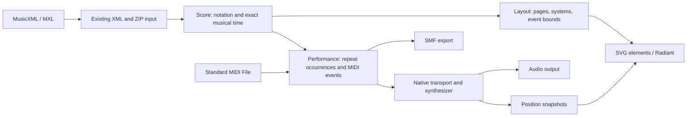

# Lambda Music Package — Design

**Status:** Native Lambda implementation selected by the user on 2026-10-13.
The user-defined scope is **Phase 1: display MusicXML sheet music** and
**Phase 2: MIDI playback**. The detailed support manifest, rather than this
broader target, defines the implemented notation and playback profile.

**Implementation update (2026-10-13):** The native Phase 1 pipeline now exists,
including XML/MXL loading, exact timing, Bravura engraving, SVG pages, and
the public entry module. The current bounded profile is documented in
[Lambda_Music.md](../doc/Lambda_Music.md); validation and remaining engraving
work are tracked in [the implementation record](impl/Lambda_Impl_Pkg_Music.md).
Phase 2 now adds the shared performance model, SMF import/export, a native
TinySoundFont/miniaudio transport and the player view. Live output has been
verified on macOS; Linux/Windows device verification remains outstanding.
Phase 3 extends MusicXML import and adds verse-aware lyric engraving and playback
highlighting, as detailed in §2.3.
The broader design below remains the target where the manifest marks limits.

**Scope:** `lambda.music`, a shipped source package for reading, engraving,
displaying, and playing musical scores. OpenSheetMusicDisplay
(OSMD) is the architectural and engraving reference; Lambda owns the native
implementation. Editing, optical music recognition, and a digital audio
workstation are outside these phases.

**Specification linkage:** This design applies the following existing rulings
without revising the formal specifications:

| Topic | Governing rulings | Application here |
|---|---|---|
| Source packages and namespace | [D7.2.1–D7.2.4v2, D7.2.6](../doc/Lambda_Formal_Design.md#d72-script-packages), S16.9.8 | Explicit `lambda.music` entry module; source distribution and ordinary imports |
| Pure computation and effects | [S12.1.1v2, S12.1.3](../doc/Lambda_Formal_Semantics.md#s121-the-one-bit-effect-system) | Score/layout transformations are `fn`; transport commands are `pn` |
| Input snapshots and errors | S12.4.1v2, S14.3.1v2, [S7.4.2–S7.4.4](../doc/Lambda_Formal_Semantics.md#s74-the-three-failure-channels) | Reuse input/ZIP ownership; public fallible operations declare raised errors |
| Host boundaries and IO | D7.1.1–D7.1.2v2, D7.4.6, D7.5.2–D7.5.3 | Central resource acquisition; fonts, UI, and audio through the Radiant host interface |
| Retained ownership | D4.1.3, D4.5.2–D4.5.3v2, D5.3.3 | Input-owned documents, copied UI data, precisely rooted runtime values |
| Build profiles | D7.1.4v2–D7.1.7v6 | Distinguish data processing, headless engraving, and live playback capabilities |

See [Formal Design](../doc/Lambda_Formal_Design.md),
[Formal Semantics](../doc/Lambda_Formal_Semantics.md), and
[Documentation Convention](../doc/Doc_Convention.md). Package-specific choices
remain working design; implementation progress belongs in `vibe/impl/`.

## 1. Direction and relationship to OSMD

Build a Lambda score model and engraving pipeline that produce ordinary SVG
elements for Radiant. Follow the package pattern used by
[charts](Lambda_Pkg_Chart.md) and
[math typesetting](Lambda_Pkg_Math.md): Lambda expresses domain policy and
layout; existing host facilities supply font geometry, painting, and events.
Native helpers are justified for reusable mechanisms or measured bottlenecks,
not a second implementation of the score model.

OSMD connects MusicXML to VexFlow through a semantic score model and a separate
graphical representation. Its reader organizes parts, staves, measures, and
fractional musical positions before graphical processing. Adopt that
separation, with immutable Lambda values replacing its mutable TypeScript
objects. [OSMD processing overview](https://github.com/opensheetmusicdisplay/opensheetmusicdisplay/wiki/How-OSMD-processes-Sheet-Music),
[MusicSheetReader](https://github.com/opensheetmusicdisplay/opensheetmusicdisplay/blob/develop/src/MusicalScore/ScoreIO/MusicSheetReader.ts)

| OSMD concept | Lambda counterpart |
|---|---|
| MusicXML reader / semantic `MusicSheet` | XML adapter and normalized `Score` |
| Source measures, staff entries, voices, fractions | Ordered measures, exact onsets/durations, explicit part/staff/voice identities |
| Graphical score, engraving rules | Derived `Layout` and a small validated engraving-options map |
| VexFlow layout and SVG backend | Lambda engraving algorithms, music glyph assets, ordinary SVG output |
| Cursor and score iterator | Stable event IDs, location index, and Phase 2 performance occurrences |

VexFlow supplies significant engraving behavior; translating OSMD's reader
alone does not supply beams, accidentals, spacing, or collision avoidance.
This is a scoped native adaptation, not a claim of OSMD feature or pixel
parity. Compare representative scores against a pinned OSMD build while using
MusicXML's definitions as the interchange authority.

The upstream package inspected on 2026-10-13 declares version `2.2.0`, VexFlow
`1.2.93`, and a VexFlow patch step. These describe the inspected `develop`
manifest, not a selected Lambda dependency or verified latest release. Pin an
exact upstream commit when establishing reference captures; keep its patched
reference build isolated from Lambda's runtime.
[OSMD package manifest](https://github.com/opensheetmusicdisplay/opensheetmusicdisplay/blob/develop/package.json)

Running OSMD inside LambdaJS, embedding its browser UI in a webview, and
invoking Node to render each score were considered. They would require a JS
and DOM compatibility/deployment contract in addition to the music package.
The selected native approach instead gives normal Lambda data and SVG output,
at the cost of implementing the bounded engraving set below. No OSMD/VexFlow
JavaScript execution is required in production.

## 2. Phase contracts

### 2.1 Phase 1 — MusicXML display

The useful result is a readable score loaded from a local MusicXML document,
embedded in a Lambda document, and displayed by `lambda view`. A caller can
also obtain standalone SVG pages for ordinary serialization and rendering.
The first supported profile targets common Western staff notation: solo
instrument, voice with lyrics, piano, and small ensembles.

| Area | Phase 1 target | Explicit boundary |
|---|---|---|
| Input | `.musicxml` / `.xml`, XML strings, parsed XML trees, compressed `.mxl` | MusicXML 3.1/4.0 common subset; unsupported versions produce a diagnostic |
| Document structure | `score-partwise`, part lists/groups, ordered measures, pickup measures | `score-timewise` and multi-score `opus` initially rejected with a located error |
| Pitch and rhythm | Pitched notes/rests, chords, multiple voices/staves, dots, tuplets, grace-note notation | No microtonal or unpitched/percussion profile in the first release |
| Staff context | G/F/C clefs and octave indications, conventional key signatures, simple/compound/additive meters, changes | No tablature, custom staff definitions, or independent polymetric layout |
| Engraving | Noteheads, stems, flags, ledger lines, accidentals, beams, ties, slurs, tuplets, barlines | Cross-staff beaming, nested tuplets, and uncommon noteheads deferred |
| Directions | Title/composer, part labels, lyrics, tempo text, common dynamics/articulations, hairpins | Arbitrary ornaments, figured bass, tablature effects, and embedded images deferred |
| Navigation notation | Repeat barlines, numbered endings, segno/coda and jump text | Display only in Phase 1; execution belongs to Phase 2 |
| Presentation | Width/scale, part filtering, scroll or paged layout, optional source system/page breaks | Reflowed engraving, not exact reproduction of the author's page positions |
| Output | SVG page elements and a document wrapper; Radiant display | PDF/PNG use existing export paths, with fixture verification before advertising support |

The bounded profile must be explicit in a support manifest when implemented.
A partially supported score is not silently represented as fully faithful:
unsupported decoration can yield a warning; unsupported structures affecting
pitch, timing, staff assignment, or legibility fail. A strict option promotes
warnings to errors. In particular, deferred cross-staff beams cannot simply
be dropped from a piano score without a diagnostic.

### 2.2 Phase 2 — MIDI playback

The primary workflow plays the MusicXML score already displayed in Phase 1,
using MIDI events derived from its semantic data and a local synthesizer.
Phase 2 also targets playback of standalone Standard MIDI Files (`.mid` /
`.midi`, Type 0 and Type 1 with metrical timing) through the same transport.
This interprets “playback music in MIDI” to include both score playback and
MIDI-file playback; MIDI-to-notation reconstruction is excluded.

Required controls are play, pause/resume, stop, seek, tempo multiplier,
part mute/solo, and master volume. Score playback includes a synchronized
cursor. Export to SMF is useful and shares the event model, but **export alone
does not complete playback**. External MIDI hardware, recording, MIDI 2.0,
MPE, and audio-file export are later extensions.

OSMD's public README currently lists its audio player as an early-access
sponsor feature. The native plan must therefore budget for its own MIDI
conversion, transport, synthesis, and audio output; an OSMD cursor is not an
audio engine. [OSMD README](https://github.com/opensheetmusicdisplay/opensheetmusicdisplay#readme)

### 2.3 Phase 3 — MusicXML and lyric underlay (2026-10-13)

Phase 3 adds `score-timewise` through the same part/measure reader, composite
meters with different denominators, and inference of omitted graphical note
types using exact duration, dots and tuplet ratios. Existing strict XML and
namespace rules remain in force. These are package policies (D7.2.5), with
ordinary immutable score values (D7.2.4v2) and raised validation errors (S7.4.2).

Lyrics preserve ordered text/elision fragments, verse identity, placement,
visibility and extension endpoints. Verse lanes stay consistent across notes;
hyphens and melisma lines continue across systems and pages. Stable lyric
groups join the written-event highlight bindings. During playback, the audio
clock selects the active syllable, including melismas and tied continuations;
repeat-specific `time-only` verses use the performed pass. Color selection,
pause, seeking, stop and score following share the existing player handlers
(S12.1.1v2/D7.4.6). Text is visual underlay, without synthesized singing.

MusicXML requests the shared XML parser's `preserve_whitespace:true` option.
Otherwise, trimming each text-only fragment independently would concatenate
adjacent words. This generic parse option exposes the parser's existing
whitespace mechanism; its default remains unchanged. `from_xml` consumes the
supplied tree without reconstructing text that its caller already discarded
(D7.2.4v2/S8.1.2v2).

Lyric groups retain stable written IDs and member note IDs, while layout
assigns verse lanes per staff/placement and measures text with the existing
font service. Text, hyphens and extension segments have separate SVG groups
and shared highlight bindings. The event bounds index includes local lyric
geometry so score following also keeps underlay visible. Graphical text/font
styling and exact source placement remain outside the bounded layout profile.

Reference semantics: W3C MusicXML 4.0
[timewise scores](https://www.w3.org/2021/06/musicxml40/musicxml-reference/elements/score-timewise/),
[time signatures](https://www.w3.org/2021/06/musicxml40/musicxml-reference/elements/time/),
[lyrics](https://www.w3.org/2021/06/musicxml40/musicxml-reference/elements/lyric/),
and [extensions](https://www.w3.org/2021/06/musicxml40/musicxml-reference/elements/extend/).

## 3. Package boundary and public API

`import music: lambda.music` resolves to the explicit public entry module
`lmd/package/music.ls`, with implementation modules under
`lmd/package/music/`. There is no implicit directory index, following
D7.2.4v2/D7.2.6 and the [package import conventions](../doc/Lambda_Packages.md#21-how-paths-resolve).
The package introduces neither a language keyword nor a new core `TypeId`.

The listed public APIs exist for the bounded profile. `Score`, `Layout`, and `Performance` are
validated ordinary Lambda data, not opaque native pointers. Errors use the
existing raised-error contract (`T^`, S7.4.2); examples engage them with `^`.
Successful values carry diagnostics for recoverable omissions.

| API | Result and purpose |
|---|---|
| `fn music.load(source, options = {})` | `Score^`; load a path/URL or archive member through central input services |
| `fn music.parse(xml_text, options = {})` | `Score^`; parse in-memory XML, never interpret the string as a filename |
| `fn music.from_xml(document, options = {})` | `Score^`; normalize an existing XML document/root element |
| `fn music.layout(score, options = {})` | `Layout^`; derive page geometry, glyph placements, and event bounds |
| `fn music.render(score, options = {})` | `element^`; HTML wrapper containing one or more SVG pages |
| `fn music.svg(layout, page = 0)` | `element^`; emit one standalone SVG, with zero-based checked page index |
| `fn music.performance(score, options = {})` | Phase 2 `Performance^`; expand the score into a playback timeline |
| `fn music.read_midi(bytes, options = {})` | Phase 2 `Performance^`; read immutable SMF bytes |
| `fn music.midi(performance, options = {})` | Phase 2 `binary^`; encode SMF bytes, without writing a file |
| `fn music.player(source, options = {})` | Phase 2 `element^`; accept a `Score` or `Performance`, construct a reactive player, initially stopped |

`music.load` follows `input()`'s snapshot behavior (S12.4.1v2), including its
use in `fn`; it does not retain an open stream. Acquiring an audio device,
starting playback, and writing exported bytes are procedural effects
(S12.1.1v2). Player construction does not start sound. Its template handlers
issue transport commands through the host boundary (S12.1.3/D7.4.6). Whether
a document may start sound at all follows the audible-output gate D7.5.4
(USER, 2026-10-19): local documents may, and network documents need
activation; the player's Play button satisfies both.

Display example:

```lambda
import music: lambda.music

let score = music.load("test/music/study.musicxml")^
music.render(score, {width: 900.0, mode: 'scroll', scale: 1.0})^
```

The script is intended for `./lambda.exe view score.ls`. For a standalone SVG,
use `music.svg(music.layout(score, options)^, 0)^` and the existing procedural
output API. `render` consistently returns a wrapper even for a single page;
callers never infer its type from score length.

Layout options initially comprise `width`, `mode` (`scroll` / `pages`),
`page_height`, `scale`, `parts`, `show_title`, `show_lyrics`, and
`respect_breaks`, plus the shared `strict` diagnostic policy. Dimensions use
CSS pixels; engraving internally uses staff spaces. `parts` contains MusicXML
part IDs, not array positions. Invalid defined options fail at the package
boundary; values must be finite and positive where required. Unknown package
options yield warnings and are ignored unless `strict` is enabled. Calls to
system functions retain S17.8.1's literal-error/value-warning convention.
Explicit options override supported source defaults,
which override the bundled engraving profile. Defaults and units are
versioned with the package rather than copied wholesale from OSMD's options.

## 4. Data model: written score, layout, performance

Three separate values prevent presentation settings from changing musical
meaning and prevent repeat playback from duplicating the written score:



| Value | Essential content |
|---|---|
| `Score` | Model version, metadata, ordered parts/measure slots, contexts, events, spanners, playback directions, diagnostics |
| Part | Stable part ID/name, staves, instrument declarations, transposition and MIDI hints |
| Measure | Internal ordinal plus original printed number, implicit/pickup flag, exact start/span, ordered source events |
| Note/rest | Stable ID, part/staff/voice, exact onset/duration, chord group, written pitch, notated duration/dots/tuplets, stem/beam hints |
| Context change | Position-scoped clef, key, meter, divisions, staff and instrument information |
| Spanner | Kind, endpoints, source number, placement; ties and slurs remain different relations |
| `Layout` | Score identity, options/font identity, page/system/staff geometry, placements, event-to-bounds index, diagnostics |
| `Performance` | Source identity, occurrence map, tempo map, ordered events/tracks, duration, diagnostics |

IDs are deterministic for a given imported document. Prefer validated source
IDs; synthesize missing IDs from structural positions, never from pitch or
screen coordinates. Printed measure numbers may repeat or be nonnumeric and
are labels, not identifiers. Reflow, zoom, part filtering, and coloring retain
score event IDs. A reimport after editing the source need not retain generated
IDs; caches and player sessions include the score revision.

**Exact time.** Store musical positions as reduced rational pairs
`{num, den}` in quarter-note units, with positive denominator and checked
arithmetic. This is package data, not a new numeric type. Parse decimal
division values exactly; do not round them through binary floating point.
Convert to floating geometry or audio sample positions only at those
boundaries. MusicXML specifies durations in divisions per quarter note,
including tuplet timing. [MusicXML divisions](https://www.w3.org/2021/06/musicxml40/musicxml-reference/elements/divisions/)

**Written versus sounding.** Keep pitch spelling (`step`, `alter`, `octave`)
separate from sounding MIDI pitch, and keep performed duration separate from
note type/dots/tuplet appearance. A slur is not a tie. `<transpose>` specifies
the shift from written to sounding pitch; preserve it in Phase 1 even though
sound is deferred. [MusicXML notation](https://www.w3.org/2021/06/musicxml40/tutorial/notation-basics/),
[transpose](https://www.w3.org/2021/06/musicxml40/musicxml-reference/elements/transpose/)

## 5. MusicXML ingestion

Reuse the existing XML reader; the music adapter supplies musical meaning,
not another XML tokenizer. `score-partwise` contains ordered parts and their
measures. Validate root/version and part references before normalization.
Accept conventional unnamespaced MusicXML and handle namespaced extensions
explicitly; an unrelated namespace must not masquerade as a musical element.
[MusicXML score-partwise](https://www.w3.org/2021/06/musicxml40/musicxml-reference/elements/score-partwise/)

Walk each measure in source order with a cursor and inherited context:

1. Apply attributes at their musical position, retaining changes across
   measures and distinguishing staff-scoped from part-scoped settings.
2. A normal note/rest starts at the cursor and advances it by duration.
   A `<chord>` tone shares the preceding chord anchor and does not advance it;
   retain its own duration. A grace note has an anchor and ordering without
   an ordinary duration advance.
3. `<backup>` and `<forward>` move the cursor, enabling multiple voices and
   staves. Validate bounds and division-context transitions. Do not sum all
   voice durations to obtain a measure's length.
4. Record each voice's event extents and align corresponding measure slots
   across parts. Use declared meter for ordinary measured bars; pickups and
   explicit implicit bars use their actual span. Report unexplained overflow,
   missing alignment, or inconsistent part spans instead of silently shifting
   subsequent notes.
5. Resolve tie/slur/beam/tuplet endpoints and directions against stable IDs.
   Keep direction offsets and playback hints even when they have no visible
   glyph. Unmatched or ambiguous relationships produce located diagnostics.

These cursor rules are essential to polyphonic scores.
[MusicXML chord](https://www.w3.org/2021/06/musicxml40/musicxml-reference/elements/chord/),
[backup](https://www.w3.org/2021/06/musicxml40/musicxml-reference/elements/backup/),
[duration](https://www.w3.org/2021/06/musicxml40/musicxml-reference/elements/duration/)

For `.mxl`, use the existing archive snapshot and lazy member reader
(S12.4.1v2/S14.3.1v2). Resolve the score from `META-INF/container.xml` and its
declared rootfile; do not choose the first `.xml` entry. Archive member names
remain inside the archive, with existing CRC, compression, expansion, and
path validation. Multiple score roots require an explicit selection or an
ambiguity error. No extraction to temporary files is required.
[MusicXML compressed containers](https://www.w3.org/2021/06/musicxml40/tutorial/compressed-mxl-files/)

Use strict well-formed XML validation. A legacy external DOCTYPE may be
recognized as inert metadata, but external DTD/entity resolution is disabled;
unsupported entity declarations fail explicitly. Score labels remain text,
never executable markup (S1.8). Apply source-byte, XML-depth, event-count,
archive-expansion, and rational-arithmetic budgets at their owning layer.
Any missing script-visible strict-XML controls should expose the existing
reader's mechanism instead of introducing a music-specific parser.

Diagnostics carry severity, category, message, source/member path, and
part/measure/event context; retain byte/line locations where the input reader
provides them. Import warnings become part of `Score.diagnostics`; layout and
performance add their own diagnostics without mutating the score.

## 6. Engraving and display

### 6.1 Layout stages

The proposed layout has six shared passes:

1. **Resolve notation:** effective clef/key/meter, pitch-to-staff position,
   accidental state, chord notehead displacement, voice stem conventions,
   and explicit beam/tuplet groups. Preserve explicit accidentals; infer
   omitted ordinary accidentals consistently, resetting at the right barline
   and handling tied continuations.
2. **Measure symbols and labels:** music glyph bounds/anchors and shaped text
   metrics. Use real geometry, not text-character counts or approximate
   Unicode musical symbols.
3. **Space each measure:** simultaneous onsets across all visible staves
   share columns. Minimum gaps satisfy glyph, accidental, dot, lyric, and
   direction bounds; rhythmic weights distribute remaining space.
4. **Break systems/pages:** choose breaks using measured widths, add repeated
   system-start clefs/key/time context, then justify. Recompute widths when
   system-start context changes. Respect requested source breaks when valid.
5. **Resolve vertical geometry:** allocate lyric/direction lanes, beams,
   slurs/ties/hairpins, staff gaps, and continuation segments across systems.
   Bounded refinement reports unresolved collisions rather than looping.
6. **Emit SVG and indices:** page bounds, stable event groups, glyphs/text,
   staff lines, and an event hit/location index all derive from one layout.

Notation constraints can exceed the requested engraving width. Preserve
minimum spacing in `Layout` and diagnose oversized systems/pages. The embedded
document wrapper fits each page to its container width while preserving its
aspect ratio, per the user's 2026-10-13 viewport-fit request. This presentation
scale leaves exact score timing and layout geometry unchanged; standalone SVG
keeps its requested physical dimensions. The wrapper handles vertical scrolling
and page spacing.

### 6.2 Fonts and output

Use SMuFL glyph names, metrics, and attachment metadata. **Bravura is the
proposed bundled music face**, with a pinned version and license; labels and
lyrics use an explicit bundled text-font profile. Bravura is a SMuFL reference
font, not an engraving engine. [Bravura](https://github.com/steinbergmedia/bravura),
[SMuFL specification](https://smufl.formats.music/latest/)

Music glyphs should emit SVG paths from immutable font geometry, avoiding a
dependence on the viewer's installed music font. Measure and render text with
the same selected face; standalone export must embed permitted font data or
outline the text for reproducibility. Preserve accessible score/part/measure
descriptions even when visible glyphs are paths. Reuse the existing font
measurement/outline mechanisms through the host API (D7.5.3), exposing a
generic missing primitive if necessary. Do not couple music to math's private
layout structures or copy its font loader.

`Layout` contains reusable geometry, not live DOM nodes. `music.svg` is a pure
projection; page SVGs have explicit dimensions and `viewBox`. Instance-local
SVG IDs prevent collisions when the same score is embedded twice. SVG metadata
maps visible groups to score IDs; the separate bounds index supports a later
playhead without scraping the SVG or rerunning engraving on every audio tick.

A width, visible-part, scale, or font change can invalidate layout. A playhead
or selection change only updates an overlay. Cache keys include score
revision, resolved options, font identity, and engraving-profile version;
caches belong to the caller/view instance, respecting D7.2.1's module-state
rules. Separate parse, layout, and paint costs when evaluating performance.

## 7. Phase 2: performance and MIDI

### 7.1 One performance timeline

`music.performance` derives a linear sequence of **occurrences** from the
written score. Each occurrence records the score event ID, repeat pass,
performed onset/duration, and track/channel data. A repeated measure has one
written layout and several performance occurrences. Standalone MIDI files
produce the same timeline without score-location mappings.

The initial score-playback profile includes chords/polyphony, rests, tuplets,
ties, transposing instruments, tempo changes, MIDI instrument assignments,
basic velocity/dynamics, and sustain. It executes ordinary forward/backward
repeats and numbered endings. Da capo, dal segno, coda/fine, grace-note timing,
ornament realization, and expressive tempo curves require explicit supported
rules before playback; unsupported timing/navigation must fail performance
construction rather than silently play a different piece. Written symbols can
still display in Phase 1.

Repeat expansion uses bounded traversal and detects unresolved destinations
and cycles. Merge sounding tie chains before emitting note events; slurs do
not merge notes. Keep the pitch spelling in `Score`, applying chromatic and
octave transposition only to sounding events. Never apply a tuplet ratio a
second time when MusicXML duration already includes it.

Tempo-map segments convert exact quarter-note positions into elapsed time:
`seconds = quarter_notes * 60 / bpm` within each constant-tempo segment.
Honor explicit `<sound tempo>` and position offsets; otherwise interpret a
supported metronome marking, converting its beat unit to quarter-note BPM.
With neither, use a documented 120-quarter-note-BPM default and report it.
Nonpositive or conflicting simultaneous tempo instructions require an
explicit override. Interpret numeric MusicXML dynamics according to its
percentage convention, rather than treating them as raw MIDI velocity.
[MusicXML sound](https://www.w3.org/2021/06/musicxml40/musicxml-reference/elements/sound/)

Resolve `<midi-instrument>` assignments by instrument ID. Convert MusicXML
channels 1–16 and programs 1–128 to internal channels 0–15 and programs 0–127
at one boundary, with range checks. Notes remain MIDI keys 0–127; the General
MIDI percussion reservation is internal channel 9. Channel allocation
must preserve incompatible programs/controllers and percussion reservations;
too many independent parts produce an explicit capacity error rather than
colliding channels. Same-pitch overlaps on one channel need an explicit voice
policy or reassignment, so one note-off does not truncate another voice.
[MusicXML MIDI instruments](https://www.w3.org/2021/06/musicxml40/musicxml-reference/elements/midi-instrument/),
[channel numbering](https://www.w3.org/2021/06/musicxml40/musicxml-reference/elements/midi-channel/),
[program numbering](https://www.w3.org/2021/06/musicxml40/musicxml-reference/elements/midi-program/)

### 7.2 MIDI files

SMF represents timestamped MIDI streams, tempo, and track metadata, not
engraved notation. A MIDI file can play without a score; a MusicXML score can
display without a performance. An arbitrary MIDI file is not automatically
aligned with an independently loaded score.
[MIDI Association: Standard MIDI Files](https://midi.org/standard-midi-files)

The same player accepts a standalone performance, showing transport and track
controls without inventing a notation view:

```lambda
import music: lambda.music

let performance = music.read_midi(input("test/music/pulse.mid", 'binary')^)^
music.player(performance)^
```

The reader targets Type 0/1, PPQN timing, tempo and time-signature meta events,
program/control changes, pitch bend, note events, running status, and end of
track. Validate chunk lengths, variable-length quantities, event ranges, and
track ends. Type 2 and SMPTE timing are explicit unsupported cases initially.
Preserve or report unhandled meta events; do not send arbitrary SysEx to a
device. Unsupported sound-changing messages produce a diagnostic.

The writer targets Type 1, with a tempo/meta track and part tracks. Choose
PPQN from the rational event denominators when representable within SMF's
metrical division field. Otherwise fail or use an explicitly requested
quantization policy with an error bound; never accumulate rounding through
delta times. Quantize absolute positions first, derive deltas afterward, and
require a positive duration for every sounding event. This conversion is
separate from the exact in-memory performance model.

For generated events at one timestamp, use deterministic ordering: ending
notes before new onsets of the same key, and required program/controller
setup before new notes. Preserve meaningful source ordering for imported
tracks. A single normalization path serves file playback, score playback,
export, and cursor timing.

### 7.3 Transport, synthesis, and lifecycle

MIDI events require a synthesizer and audio output to become audible. The
selected default is **TinySoundFont** behind a small native interface, fed by
an immutable performance buffer, with **miniaudio 0.11.23** supplying streaming
PCM/device timing. Both are pinned, unmodified dependencies. Since speech M2
(2026-10-19) the window audio bus owns the one miniaudio device. Each MIDI
session is a voice of its document's sub-mix, and transport commands exclude
the audio thread with the voice lock instead of stopping a per-session device
([Radiant_Design_Speech §3.2](radiant/Radiant_Design_Speech.md)). The bundled
**TimGM6mb** sound bank is separately licensed GPL-2.0; callers may supply a
compatible SF2. Provenance and checksums are recorded beside each asset.
[TinySoundFont](https://github.com/schellingb/TinySoundFont),
[miniaudio](https://github.com/mackron/miniaudio),
[SoundFont provenance](../lmd/package/music/soundfonts/SOURCES.md)

Use the existing document-owned audio service as the lifecycle integration
point, extending its native platform layer for streaming PCM, a sample clock,
and transport control. The current `RdtAudio` API opens encoded bytes and
offers play/pause/state; it does not expose a MIDI scheduler or streaming
sample interface. Reuse ownership and platform seams, not an assumption that
the current decoder accepts MIDI. See [Appendix A](#appendix-a-existing-code-and-proposed-module-boundaries).

| Command/state | Required behavior |
|---|---|
| Start/resume | Start from the current performed position; no implicit autoplay on load |
| Pause | Freeze musical position and silence active voices, retaining resumable state |
| Stop | Silence voices, clear scheduled work, reset position to zero |
| Seek | Cancel old events; restore program/controllers/sustain at the target and reconstruct notes spanning it |
| Tempo multiplier | Rebase the sample/time mapping at the current position; no discontinuous musical jump |
| Mute/solo | Update audible tracks and terminate affected active voices |
| End/error/close | End silences while retaining a restartable session; error/close releases it through the view/document owner |

Use audio sample position as the transport clock. The audio callback consumes
preallocated buffers and native events; it performs no Lambda evaluation, GC,
resource loading, blocking work, or document access. UI snapshots travel back
through the established host/event boundary, tagged with session generation.
Late messages from a closed/replaced score cannot restart sound or move the
new score's cursor. Device loss transitions to an error state with cleanup.

The player view owns the session through its document lifecycle. Navigation,
view removal, explicit close, failure, and process teardown all stop playback.
Retained native state owns its buffers; crossing Lambda values are copied or
precisely rooted under D4.5.2/D5.3.3. There are no naked GC pointers in audio
threads and no module-global player. Exposed host command signatures are `pn`
(D7.4.6); pure template evaluation only constructs the player presentation.

The cursor reads performed position and the occurrence map, then uses the
current layout index. Pauses, repeats, seeking, and tempo changes therefore
share the audible clock. UI refresh rate never schedules note onsets.

The bounded implementation highlights stable SVG event groups and caches
those group handles in the view. Seeking/resuming replays the controller
prefix on the control thread and reconstructs held keys; note envelopes
restart, and repeated sustained strikes of one key restore the latest strike.
No waveform checkpointing or constant-time seek claim is made. Full GM
program coverage, sustain, transport and the sample clock have offline tests;
the native hardware test rejects miniaudio's silent null backend.

The player places part mute/solo controls beside the transport buttons, with
position, speed and volume on a separate row. Highlighting defaults to red;
red, blue and yellow swatch buttons have rounded corners matching the other controls,
accessible names and pressed state. A border with a compact inset marks the current
selection. The toolbar wraps on narrow screens.
The status reserves text space and always renders seconds with one decimal,
keeping the seek, speed and volume controls stationary as time advances.
The player is a bounded column with a non-scrolling control panel and a separate
sheet scrollport. Its container supplies the height; the standalone sample uses
the viewport height. Following scales the engraving event bounds through the
displayed page rectangles and scrolls only when the sounding group leaves the
visible area. Seeking and resizing use the same path. If a short scrollport
cannot show all simultaneous parts, the leading note takes priority. This is
presentation state and does not change the audio clock (S12.1.1v2/D7.4.6).
Highlighting sets glyph fill and inherited stroke color for the whole note,
including stems/flags and shared chord stems/beams. Shared symbols remain
highlighted while any connected note sounds. Changing the color updates the
current highlight without changing transport state (S12.1.1v2/D7.4.6).

## 8. Platform and dependency boundaries

| Host profile | Target capability |
|---|---|
| Full `lambda.exe` | MusicXML data, font-backed engraving, SVG, live viewer; MIDI playback where a real audio backend is implemented |
| Full headless Radiant profile | Same engraving and SVG/export checks, no required window or audio device |
| `lambda-cli` | XML/MXL normalization and pure performance/SMF operations; no Radiant font or live-player dependency |
| `lambda-wasm` | Outside the initial delivery; do not imply filesystem, ZIP, font, or audio capabilities excluded by D7.1.7v6 |

Keep data modules independent of the rendering/player modules so importing
them in the runtime-only profile does not eagerly import Radiant. The main
`lambda.music` facade is for the full host; document explicit data submodules
for reduced profiles. A missing font or audio capability returns an explicit
unsupported-capability error. It never silently falls back to a webview,
network service, installed command-line player, or empty successful output.

All score/font/SoundFont bytes use central IO policy (D7.1.2v2/D7.5.2).
Embedded score references do not fetch resources implicitly. Loading a URL is
an explicit caller action; local scores must display offline using bundled
assets. Native adapters remain above the runtime boundary (D7.5.3), with no
`lambda-rt` link to Radiant.

OSMD uses BSD-3-Clause; retain upstream attribution and applicable notices
for adapted code. Bravura uses SIL OFL 1.1, including reserved-name conditions;
TinySoundFont uses MIT. Record exact versions, checksums, notices, and the
provenance of every adapted algorithm and distributed asset. Fonts,
SoundFonts, and score fixtures each need their own license record. Any
VexFlow-derived code also retains that dependency's own applicable notices. Keep
vendored sources unchanged; Lambda-side adapters own integration, and any
approved upstream change is recorded as a patch under repository policy.
[OSMD license](https://github.com/opensheetmusicdisplay/opensheetmusicdisplay/blob/develop/LICENSE),
[Bravura license](https://github.com/steinbergmedia/bravura/blob/master/LICENSE.txt),
[TinySoundFont license](https://github.com/schellingb/TinySoundFont/blob/master/LICENSE)

## 9. Acceptance criteria and unresolved choices

**Phase 1 is complete** when the declared subset reads plain and compressed
MusicXML, displays representative solo/voice/piano/ensemble scores, survives
reflow and part filtering, produces standalone SVG, and diagnoses every
unsupported fixture according to the published policy. Tests must cover
polyphonic timing, cross-system spanners, real font geometry, and lifecycle
ownership, not just single-note screenshots. Headless and GUI output use the
same engraving pipeline.

**Phase 2 is complete** when both a supported MusicXML score and a Type 0/1
MIDI fixture play audibly on each declared supported platform, with correct
tempo/ties/repeats, working transport controls, synchronized score position,
and silence/cleanup on stop, removal, failure, and device loss. MIDI files
exported from the shared timeline must load in an independent reader. Audio
output and synthesis are release requirements, not optional demos.

The principal risk is engraving breadth: small notation exceptions interact
with horizontal spacing, vertical collisions, and system breaks. Keep the
first profile honest rather than extending a “mostly works” claim to all
MusicXML. Phase 2 adds separate real-time, asset, and platform risks; preserve
timing/identity in Phase 1 without making its release depend on audio.

Remaining verification and profile expansion:

- Exact OSMD/VexFlow reference revision and attributable comparison corpus.
- Broader notation and expressive playback beyond the published manifest,
  particularly grace/ornament realization and cross-staff engraving.
- Linux and Windows builds/device verification, and manual device hot-unplug
  checks; macOS output and offline synthesis do not establish platform parity.
- Explicit budgets and performance targets measured on named release-build
  hardware, with parsing, engraving, SVG size, and audio latency reported
  separately. No performance claim is made by this proposal.

These choices refine the package proposal. A future change to an existing
language/host ruling requires the paired formal-spec and working-design
revision prescribed by [Documentation Convention](../doc/Doc_Convention.md).

## Appendix A. Integration and module boundaries

The following are integration points in the 2026-10-13 implementation:

| Existing source | Reuse / extension |
|---|---|
| [`input-xml.cpp`](../lambda/input/input-xml.cpp), `parse_xml_with_options` | XML parsing and strict/namespace validation; expose missing general options if needed |
| [`input-zip.cpp`](../lambda/input/input-zip.cpp), [`Lambda_IO_Zip.md`](Lambda_IO_Zip.md) | Archive snapshot, member navigation, limits, and CRC checks for MXL |
| [`chart/text.ls`](../lmd/package/chart/text.ls), `radiant.measure_text` | Batched shaping/measurement precedent; share generic primitives |
| [`math/font.ls`](../lmd/package/doc/math/font.ls), `radiant.math_metrics` | Font snapshot/geometry precedent; avoid copying math-specific policy |
| [`RAD_14_SVG_Vector_Graph.md`](../doc/dev/radiant/RAD_14_SVG_Vector_Graph.md) | Existing SVG/vector rendering pipeline |
| [`audio.cpp`](../radiant/audio.cpp), [`midi_player.cpp`](../radiant/midi_player.cpp) | Shared document-owned slots; encoded-audio service plus copied MIDI buffers and streaming PCM |
| [`dom_api.def`](../lambda/dom/dom_api.def), `audio_*` / `midi_*` operations | Shared host surface and effect declarations |
| [`timeline/native_media.ls`](../lmd/package/chart/timeline/native_media.ls) | Existing generation-checked media lifecycle; share mechanisms without importing chart policy |

Core source organization (engraving helpers are omitted here):

```text
lmd/package/music.ls              public full-host facade
lmd/package/music/
    common.ls                     shared XML axes, diagnostics and validation
    musicxml.ls                   load/parse/normalize adapter, including MXL
    time.ls                       exact time arithmetic shared by both phases
    fonts.ls                      bundled face/profile and glyph requests
    notation.ls                   pitch/context/accidental and grouping rules
    layout.ls                     shared engraving passes and bounds index
    svg.ls                        page emission and document composition
    performance.ls                repeat expansion, tempo and event model (P2)
    timeline.ls                   exact positions, tempo segments, note checks
    midi.ls                       SMF reader/writer over that event model (P2)
    player.ls                     reactive controls and host transport (P2)
```

This is a boundary sketch, not a requirement to split every helper into a
file. Search for existing helpers before adding arithmetic, SVG, XML, or
resource utilities; extract shared mechanisms rather than cloning variants.
Native additions follow C++17/C+ and `lib` containers, precise rooting, and
float layout dimensions. Build changes go through `build_lambda_config.json`.

## Appendix B. Delivery and verification outline

| Increment | Reviewable result |
|---|---|
| P1 foundation | Common fixture corpus; XML/MXL normalization with exact timing and diagnostics |
| P1 engraving | Solo and piano SVG, actual music glyphs, polyphony, beams/spanners, spacing |
| P1 display gate | Full declared subset, multi-page/scroll display, part filtering, export and headless regressions |
| P2 timeline | Score-to-performance and SMF read/write, deterministic fake-clock tests |
| P2 audio | Selected synth, streaming output, transport controls, lifecycle and device failures |
| P2 integration gate | Audible platform fixtures, cursor synchronization, repeats/seek/mute, cleanup |

The detailed task plan and measured progress are in
`vibe/impl/Lambda_Impl_Pkg_Music.md`. Test locations are
`test/lambda/music/` for data/API cases, `test/music/` for licensed score/MIDI
fixtures and references, and dedicated native audio tests where necessary.
Every golden-driven `.ls` test receives its corresponding `.txt` result and
registration in the existing test harness.

Verification should cover:

- **Input/model:** malformed XML, invalid part IDs, MXL rootfile selection,
  archive traversal/budget/CRC failures, divisions changes, backup/forward,
  unequal chord durations, pickups, tuplets, ties versus slurs, namespace and
  entity handling, and location-rich unsupported-feature errors.
- **Geometry/display:** aligned simultaneous onsets, accidentals, multi-voice
  piano, lyrics, long slurs, page/system continuations, narrow widths, missing
  fonts, duplicate embedding, and stable IDs across reflow. Compare both
  semantic geometry and curated images; OSMD is a reference, not the sole
  oracle or a required pixel-identical target.
- **Performance/MIDI:** tempo offsets and changes, repeats/endings, tie chains,
  transposition, channel conflicts, running status, malformed chunks, tick
  quantization, event ordering, sustained notes across seeks, pause/resume,
  and unsupported navigation/message diagnostics.
- **Audio/lifecycle:** deterministic rendered sample/event checks plus audible
  smoke tests; stop/remove/error silence, repeated open/close, device failure,
  stale callbacks, GC pressure, and independent simultaneous player views.
- **Regression gates:** Lambda baseline for engine changes and Radiant
  baseline for rendering/host changes; use release builds for performance
  measurements and follow the worktree rules in the Developer Guide.

Initial fixtures should be synthetic or have documented redistribution
rights. Pin browser/reference versions and fonts; store temporary captures
under `./temp/`. Tests of negative cases assert the actual diagnostic or
failure state, never weaken a harness to conceal unsupported behavior.
