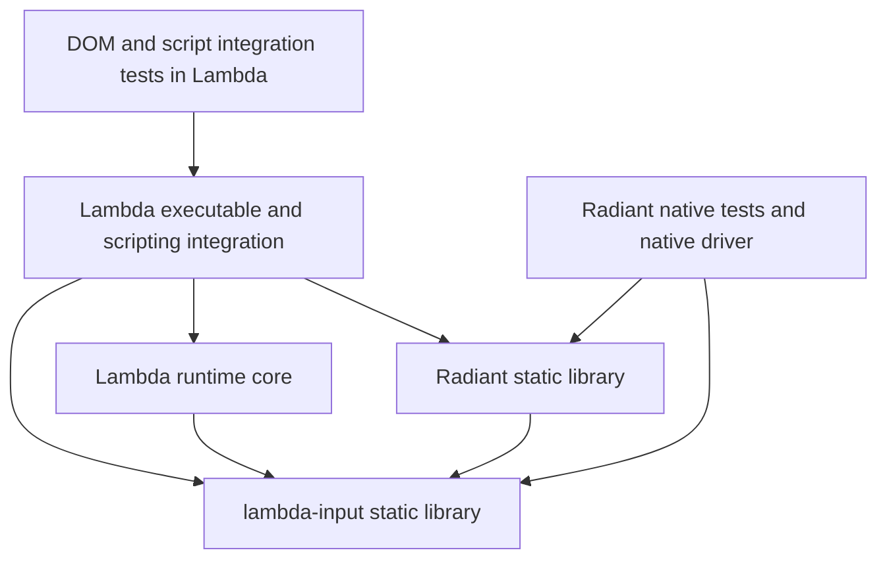

# Radiant and lambda-input Sibling Projects — Design Proposal

**Status:** architecture ratified on 2026-11-05; implementation in progress.
**Date:** 2026-11-05.
**Scope:** extract the shared input/data foundation into `lambda-input`, extract the native Radiant engine into a sibling project, and keep language execution and integration in Lambda.
**Authority:** [D9.1.1v4–D9.1.5, D9.2.1v2 and D9.5.6v2](../doc/Lambda_Formal_Design.md) ratify the project boundaries and build pipeline. The implementation plan tracks remaining conformance; the current build does not yet satisfy them.
**Related record:** [Lambda Static Module Split](Lambda_Design_Static_Modules.md). This extends that build-boundary work; it does not introduce a competing ruling-ID series.

### Specification linkage

| Rulings | Relationship to this proposal |
|---|---|
| D9.1.1v4, D9.2.1v2, D9.5.6v2 | Replace the Radiant-over-runtime direction and embedding contract; keep event handling and script writers in Lambda. |
| D9.1.2v2, D11.1.2 | Preserve centralized resource acquisition and policy; relocate the standalone portion into `lambda-input`. |
| D9.1.3v2–D9.1.4v2 | Preserve provider ownership, checked boundaries, and the Mark reader/builder/editor layering. |
| D9.1.5 | Use Make as the project build entry point and executor; use Premake with owner JSON configuration to generate Makefiles where needed. Do not introduce another build system for dependencies. |
| D2.1.1, D5.1.1–D5.1.3 | Preserve the shared value representation and separation of Input-owned data from runtime GC. |
| D5.2.1, D5.2.3, D5.2.5 | Preserve allocator contexts, retained ownership, and ordered cleanup. |
| D5.5.1–D5.5.3, D6.3.3 | Preserve the Radiant ownership seam, copied presentation data, and precise runtime roots. |
| D9.2.2–D9.2.3, D9.4.3–D9.4.4 | Preserve runtime-only profiles and the separate Jube module boundary. |

## 1. Outcome and agreed scope

Create three sibling projects with distinct responsibilities:

1. **`lambda-input`:** the shared native foundation, including the current `lib/` modules, input parsers, formatters, Mark construction, and the runtime-independent data model they require.
2. **Radiant:** the native engine for layout, rendering, presentation, platform event capture, and the state store. It builds a static library using `lambda-input`, independently of Lambda.
3. **Lambda:** the language runtimes, compiler/JIT, GC, end-to-end event handling, scripting adapters, DOM language integration, packages, and executable that integrates the two libraries.

**Event ownership decision, 2026-11-09 (D9.1.1v4).** Lambda owns event dispatch, default actions, and editing and navigation behavior. Radiant passes native events through a host interface and exposes hit testing, layout, rendering, and state-store APIs for Lambda to use. This replaces the earlier division that put native dispatch order and default actions in Radiant. A native client without an event controller can use those native services; it does not acquire a separate full event controller.

Native Radiant tests that require no scripting move with the engine. **DOM tests and end-to-end script integration tests remain in Lambda**, including DOM tests written in C++ that do not execute a script. Radiant-specific `doc/` and `vibe/` material moves with its subsystem. Mixed documents are divided by responsibility.

The user also confirmed that `lambda-input` is a separate sibling project, and that Radiant must not require a Lambda runtime to build or test. Native code implementing a scripting adapter belongs to Lambda; its implementation language does not make it part of the standalone engine.

The user confirmed that script-based output writers remain in Lambda. Standalone `lambda-input` provides the existing native formatters and reports script-only formats as unavailable; Lambda's integrated formatting continues to use the script packages (D9.3.4 and [Wiki design §5](input/Input_Wiki.md#5-phase-ii-wiki-writers)).

This is an architectural extraction, not a change to Lambda language semantics or rendering behavior. Existing partial support and known failures remain visible. Migration must not silently weaken tests, refresh rendering references, or change value ownership to make the new build link.

## 2. Dependency architecture

Arrows below mean **depends on**. System libraries and pinned third-party dependencies are omitted.



The Lambda integration layer supplies Radiant's optional host callbacks. Runtime-facing adapter code may call the public Radiant interface; the reusable evaluation core does not acquire a mandatory Radiant dependency. This preserves the runtime-only build profiles in D9.2.2–D9.2.3 while allowing the full Lambda executable to link both libraries.

The essential constraints are:

- `lambda-input` includes and links neither Radiant nor Lambda runtime implementation.
- Radiant includes and links `lambda-input`, its own engine, and declared platform/vendor dependencies. It does not include Lambda runtime, JS, MIR, or scripting-adapter headers.
- Lambda links a single compatible instance of each shared library. It does not compile another copy of their source files into the executable or a module.
- Optional callbacks permit runtime cooperation without a reverse link dependency. Their absence must leave a complete native engine, with script execution explicitly unavailable.
- A clean Radiant checkout plus its declared `lambda-input` dependency can build and run native tests with no Lambda checkout, `lambda.exe`, or runtime archive present.

These are three ownership and dependency units. Internal archive subdivisions are allowed for build profiles and optional codecs; they must not recreate a dependency on the runtime.

## 3. Project and source ownership

Proposed workspace shape:

```text
Projects/
  Lambda/                       # runtime, scripting integration, DOM/E2E tests
  lambda-input/                 # agreed sibling project name
    lib/                        # shared native support modules
    include/                    # standalone public data and input headers
    src/                        # data, input, format, Mark APIs, resource services
    test/
    doc/
    vibe/
  radiant/                      # illustrative sibling directory spelling
    include/                    # public native engine and host contracts
    src/                        # native engine, including platform sources
    test/
    doc/
    vibe/
```

Directory names under each project are provisional. Dependency locations are configurable; no production include or build command assumes a developer's absolute checkout path. Local sibling checkouts are a development convenience, not the distribution format.

| Current source area | Destination | Boundary condition |
|---|---|---|
| First-party `lib/` modules, including memory, collections, strings, fonts, images, and reusable math/physics helpers | `lambda-input` | Split any runtime-dependent policy from the shared mechanism. Optional backend dependencies remain explicit. |
| `lambda/input/`, including CSS parsing/cascade and HTML parsing | `lambda-input` | Parse and construct documents without initializing a runtime or evaluating source. |
| Native `lambda/format/` providers | `lambda-input` | Serialize admitted data without executing user code. Rendering/export machinery stays in Radiant; script-package writers and their runtime dispatch stay in Lambda. |
| `lambda/core/mark_reader.*`, `lambda/io/mark_builder.*`, `lambda/io/mark_editor.*` | `lambda-input` | Preserve reader/data versus Input-owned construction/editing responsibilities (D9.1.4v2). |
| Shared `Item`, scalar/container layouts, names, shapes, Input ownership, and pure data helpers currently spread through `lambda/core/` and aggregate headers | `lambda-input` | Extract the shared definitions; retain runtime execution and GC operations in Lambda. |
| Input resource acquisition, byte caches, image/archive IO, and reusable policy interfaces in `lambda/io/` and `lambda/network/` | `lambda-input` | Move by provider responsibility, not by copying these directories wholesale. |
| Native layout, paint, Scene3D, GPU services, state store, media, windowing, platform event capture, and hit testing | Radiant | Include required Objective-C/Objective-C++ sources and assets. Expose native services through host interfaces. |
| Event dispatch, default actions, editing and navigation behavior, and script event integration | Lambda | Use Radiant's event host and native state-store APIs. Keep GC roots in Lambda. |
| Native rendering/geometry providers currently placed in `lambda/dom/` or `lambda/module/radiant/` | Radiant, where required by the engine | Move the provider and its native declarations together; keep language wrapping in Lambda. |
| `lambda/runtime/`, `lambda/js/`, `lambda/ts/`, compiler/JIT, GC, validator execution, Jube host, and script packages | Lambda | Consume shared data and engine APIs without importing their private source trees. |
| DOM web-platform behavior and language adapters in `lambda/dom/`; Jube/script exports in `lambda/module/radiant/` | Lambda | Separate native engine services they currently contain or call; do not move language-facing behavior merely because it is C++. |
| CLI dispatch, live DevTools protocol/session integration, and script-aware document commands | Lambda | Native inspection/layout/render services remain callable from the standalone engine. |

Third-party sources retain their licenses, pinned provenance, and existing patch records. Their placement is a dependency-packaging task, not permission to modify vendor code. Shared dependencies have one selected build per final executable; Radiant-specific dependencies may be owned by Radiant's dependency manifest.

### 3.1 What the input library must contain

The requested input library cannot consist only of parser translation units. Parsers and formatters use `Input`, `Item`, `Element`, name/shape machinery, allocation contexts, and Mark APIs. Those runtime-independent definitions and providers must be included in its closure.

Keep one canonical representation shared with Lambda (D2.1.1). Do not fork `Item` or add a JSON serialization boundary between the projects. Public input headers must be usable without transitively exposing `Runtime`, `EvalContext`, AST implementation, GC roots, or MIR. `lambda-input` owns `lambda/lambda.h` for its shared value declarations; Lambda owns runtime declarations in `lambda/lambda.hpp` and runtime-owned C interfaces. Native consumers must preserve the shared layout and linkage when the mixed header is split (D9.1.1v4, D9.1.3v2). The removed C2MIR backend parsed an embedded header; direct MIR emission does not (D1.6).

The standalone formatting API admits the native formats without a runtime. Wiki, math, and other targets implemented by shipped Lambda Script packages remain Lambda integration features; requesting them through standalone input reports that a script writer is required. Keep their successful integrated behavior and tests in Lambda. Do not introduce a second native writer or count those targets as standalone formatter coverage.

Separate operations by ownership: building an Input-owned value is an input-library operation; allocating a GC value, invoking a function, interpreting a type predicate, or materializing runtime state is a Lambda operation. The existing `InputAllocationContext` is a useful boundary to preserve. GC allocation must never acquire a malloc/weak-symbol fallback to satisfy a standalone link (D9.1.1, D5.1.3).

`lib/` remains part of `lambda-input` ownership even when a consumer needs only a subset. Parser-only tests must not need a display, a JS runtime, or a full renderer. Optional font/image/platform backends should be selected through target dependencies, rather than initialized by every parser client.

### 3.2 Native document storage versus DOM integration

There are three separate concerns:

1. **Document storage and parsing:** Input-owned nodes, attributes, text, CSS data, and structural operations needed by parsers/builders belong in `lambda-input`.
2. **Presentation:** layout state, view properties, paint, native hit testing, and engine-specific document attachments belong in Radiant.
3. **Web-platform and scripting integration:** realms, wrappers, observers, script event delivery, browser APIs, and Lambda/JS DOM adapters remain in Lambda.

Current `DomNode`/`DomElement` storage already spans these concerns. Preserve node identity and the existing single-tree presentation model; do not introduce a second DOM or require a full document copy on every layout. Extract shared storage definitions and isolate engine attachments behind forward declarations or a narrow extension/lifecycle contract. The input library must not include `radiant/view.hpp` to allocate or destroy an ordinary parsed document.

Pure geometry helpers currently exposed through `lambda/dom/` must become engine-owned services when Radiant needs them. Lambda's DOM layer calls those services. Conversely, `MutationObserver`, JS wrapper identity, and realm lifecycle do not become input-library responsibilities just because they are reachable from a native node operation.

**Test ownership is an explicit exception to source ownership:** DOM conformance, DOM API, range/selection, and DOM lifecycle tests stay in Lambda even where their native implementation moves into an extracted library. Input parser tests and native layout assertions may still inspect document nodes as their fixtures.

## 4. Radiant's host interface

Radiant exposes a native API for document creation/loading, layout, render/export, native events, frame advancement, resource completion, and teardown. Headers are organized by coherent subsystem, retaining the intent of `view.hpp`, `layout.hpp`, `render.hpp`, `event.hpp`, and `radiant.hpp` without their runtime transitive includes.

Use a narrow, explicit host service interface for optional integration. Start from existing hooks and factor their shared shapes; avoid another parallel callback system.

| Service | Radiant responsibility | Lambda adapter responsibility |
|---|---|---|
| Page scripts and script-produced documents | Report admitted source/work requests and consume native document results | Select the language, initialize the runtime, evaluate scripts/packages, and publish owned results |
| Events | Capture native input, provide hit testing and state-store APIs, and publish events to the registered host | Own end-to-end dispatch, control and editing behavior, default actions, cancellation, and state-store use |
| Frames and asynchronous work | Native animation/media clocks, frame scheduling, and redraw requests | Pump the script scheduler, microtasks, timers, and runtime callbacks at defined checkpoints |
| Custom layout and reactive templates | Invoke an optional host operation using native document/data contracts | Execute package functions and translate owned results back to the engine |
| Resource loading | Request resources through the input service and consume completion data | Supply host policy and any runtime scheduling bridge |
| Document/session lifecycle | Own native document attachments and revoke callbacks before release | Own realms, persistent roots, wrappers, and runtime cleanup |
| Diagnostics and inspection | Expose native engine state and rendering information | Own CLI/DevTools transport, script evaluation, and session orchestration |

Contracts specify version/size negotiation, callback context ownership, thread affinity, reentrancy, cancellation, and teardown order. Unsupported capabilities return an explicit result. Do not provide fake runtime symbols or successful no-op evaluators.

A native-only client can load ordinary HTML/CSS/assets, lay out and render, use native state-store APIs and animations, and use native Scene3D without Lambda. Event handling requires a registered controller. If it is asked to execute a script or load a document requiring a Lambda package, it reports that execution is unavailable. In the full Lambda application, the registered adapter preserves current integrated behavior.

Declarative content may itself be parsed from a data file, but evaluating a `.ls` procedure, running a JS harness, or invoking a package layout is scripting. File extension alone is not the capability boundary.

### 4.1 Resource acquisition

Preserve the resource service principle in D9.1.2v2 and D11.1.2. Radiant requests bytes through `lambda-input`; it does not grow an independent network stack or bypass host policy. The standalone input service owns source identities, caches, acquisition mechanisms, and explicit policy inputs. Lambda supplies execution-context grants and scheduling adapters when embedded.

Runtime-independent acquisition must operate without a Lambda scheduler. Async mechanisms already suitable for the input service can remain there; runtime-coupled continuations stay in Lambda. An absent policy/capability is handled explicitly. Script/MIR artifacts remain runtime-owned, and font/media/render artifacts remain engine-owned, even if a source cache retains an opaque cleanup handle.

## 5. Values, ownership, and lifetime

Extraction preserves these existing contracts:

- **D5.1.1–D5.1.3:** parsed/formatted data uses its Input arena or pool. A standalone input operation does not need GC rooting or a live evaluator.
- **D5.5.1:** Radiant uses the common allocation substrate with native region/pool policies. Its document is not a second tracing heap.
- **D5.5.2:** borrow GC values only for the active read; copy retained content into document-owned storage, or keep the approved rooted lifetime in the Lambda adapter. An opaque pointer does not make an unrooted GC reference safe.
- **D5.5.3:** construction preserves native parent/sibling ownership and source mapping; incremental presentation retains valid structures.
- **D6.3.3:** Lambda adapters keep precise `RootFrame`/`Rooted`/persistent-root ownership across allocating callbacks and handoffs. Conservative native-stack scanning remains retired.
- **D5.2.1, D5.2.3, D5.2.5:** contexts coordinate allocator ownership and cleanup. Published data cannot outlive its owner or be rewound while shared.

One final process must have one selected implementation of shared allocators, registries, names, and value definitions. Static linking must not duplicate them in the executable and Jube modules. Link metadata and an ABI/configuration fingerprint must catch incompatible headers, layouts, compiler modes, or dependency revisions.

Document teardown must stop new work, cancel or drain pending callbacks, detach script-visible wrappers and roots in the Lambda adapter, release engine attachments, and finally release the shared document backing in dependency order. Test stale handles, retained nodes, nested document navigation, and callback reentrancy at this seam.

## 6. Builds, distribution, and compatibility

Ship `lambda-input` and Radiant as static libraries with public headers and machine-readable dependency metadata. Illustrative Unix archive names are `liblambda-input.a` and `libradiant.a`; platform suffixes follow the toolchain. Do not promise a stable cross-version C++ binary ABI. Rebuild consumers when the shared data/API configuration changes.

Each project owns its source manifest, dependency pins, generated code, tests, and developer entry points. **D9.1.5 build decision (2026-11-10):** GNU Make is the only project build entry point and executor for Lambda, `lambda-input` and Radiant. Premake reads each owner's JSON build configuration and generates Makefiles where needed. Project and dependency builds use no other build system, including CMake, Meson, Ninja or Autotools (Autoconf/Automake). A helper may fetch pinned sources or generate headers and metadata, but it does not delegate compilation to another build system. Edit JSON configuration and generators, then regenerate build outputs; never hand-edit generated Premake Lua.

On 2026-11-10, platform setup was split by owner: Lambda prepares host and
runtime development tools and calls input and Radiant setup; input prepares
its libraries and Radiant prepares its graphics packages. Each sibling also
has a standalone setup entry point. Linux input setup builds pinned mbedTLS
and mpdecimal locally with Premake and Make. This follows D9.1.1v4, D9.1.3v2
and D9.1.5. The macOS host build and all three setup dry runs were checked;
Linux and Windows still require native setup and build verification.

The input and Radiant packages must export the transitive system/vendor link requirements. A static archive does not automatically bundle all libraries it references. The Lambda build must consume the exported targets/metadata and compile each provider once, rather than rebuilding libraries from cross-repository source globs.

For reproducibility:

- Lambda pins compatible Radiant and `lambda-input` revisions; Radiant pins or constrains its compatible input revision.
- Resolve one `lambda-input` version for the whole executable. Reject incompatible selections early.
- Record architecture, compiler/C++17 mode, build profile, sanitizer settings, public layout options, dependency revisions, and generated-schema versions with artifacts.
- Allow explicit local source overrides for sibling development. CI and release builds use immutable revisions and record overrides in provenance.
- Run an installed-package smoke build outside both source trees. It must not succeed only because a private header is reachable through a broad workspace include path.

Preserve Lambda's runtime-only and WASM profiles (D9.2.2–D9.2.3). Preserve the full engine's headless and windowed capabilities while removing the assumption in D9.2.1 that Radiant embeds rt. Window-system dependencies remain explicit; a headless capability exclusion reports a diagnostic instead of silently reducing behavior.

The Jube `radiant-dom` adapter remains a Lambda integration surface. Splitting repositories does not authorize arbitrary modules to link engine internals or create a second copy of the engine (D9.4.3–D9.4.4). The native static-link contract and the script/module-facing contract are distinct.

## 7. Test and fixture ownership

Apply this precedence when classifying each test:

1. **DOM behavior/API/conformance test:** Lambda, even if entirely native.
2. **Executes Lambda/JS, invokes packages, uses script-driven browser behavior, or tests executable integration:** Lambda.
3. **Tests native layout/render/input/control/animation/Scene3D behavior using only Radiant and `lambda-input`:** Radiant.
4. **Tests shared `lib/`, parsing, formatting, or Mark data construction independently of the engine:** `lambda-input`.

The implementation language of a harness does not decide its owner. Python/Node orchestration of a native renderer may move; a C++ harness that starts `lambda.exe` or executes JS remains integrated. HTML fixtures must be checked for inline scripts, external scripts, handlers, and generated/package prerequisites.

| Existing test family | Proposed treatment |
|---|---|
| Native layout geometry, paint/export, CSS animation, font integration, image composition, and native control tests | Move engine-only cases and their helpers to Radiant. |
| `test_scene3d_unit_gtest.cpp` | Split native math/traversal/render/lifecycle cases from runtime-value, JS, and package integration cases. The current file imports runtime and JS headers. |
| `test_radiant_document_gtest.cpp` and the text-query/document runners | Classify individual cases. The shared source currently imports DOM and runtime interfaces. |
| `test_dom_range_gtest.cpp`, `test_lambda_domnode_gtest.cpp`, `test/wpt/test_wpt_dom_*`, and DOM/CSSOM API cases | Retain in Lambda under the explicit DOM rule. |
| Radiant View, UI automation, page-load, and layout corpus runners | Split native-only coverage from CLI/script/DOM coverage; do not move an entire suite by its name. |
| JS/Three.js/WebGL API and Lambda package tests | Retain in Lambda. Native Scene3D/GPU-provider tests can move to Radiant. |
| Parser/formatter/Mark/lib tests | Move independent cases to `lambda-input`; keep runtime ownership/GC integration coverage in Lambda. |
| Script-package writer cases, including Wiki and math output | Keep successful end-to-end writer coverage in Lambda; standalone input tests verify the explicit unavailable result. Preserve cases and expectations when splitting mixed suites. |

Radiant needs a small native test/fixture driver that loads through `lambda-input` and calls the real engine. It must not invoke `lambda.exe` or use runtime stubs. Reuse existing native fixture construction, geometry/pixel comparators, and event simulation where their dependencies permit; separate scripting-aware portions instead of duplicating the harness.

Preserve stable test IDs, expected results, skips/partial classifications, fixture provenance, fonts/assets, timeouts, and diagnostic artifacts. Produce an old-to-new inventory at case level for mixed suites. No case may disappear simply because its previous executable no longer exists.

The sibling `lambda-test` corpus is an existing fixture dependency, not a fourth code layer. Keep a single authoritative fixture source with pinned revisions and per-project subset manifests. Update setup scripts to provision only the required corpora, WPT assets, fonts, and references. Native Radiant CI must not need the Lambda code checkout to find its fixtures.

Lambda may retain an aggregate compatibility command that invokes the extracted native suites plus its own integration suites. Native test source ownership still moves; the aggregate command must report per-project results and must not execute a duplicate copy of every migrated case.

## 8. Documentation ownership

Move documentation with the subsystem it explains, preserving useful history and references:

| Material | Owner after extraction |
|---|---|
| `radiant/README.md` | Radiant |
| Native layout/render/media/Scene3D/interaction designs and implementation records in `vibe/radiant/`, plus Radiant-specific files elsewhere in `vibe/` and `vibe/impl/` | Radiant |
| `doc/HTML_CSS_SVG_Support.md` | Radiant owns the engine support matrix; links identify parser capabilities owned by `lambda-input` and script/DOM capabilities owned by Lambda |
| Input/formatter/Mark/shared-lib design and developer docs, including applicable `vibe/input/` material | `lambda-input` |
| `doc/JS_DOM_Support.md`, DOM language API designs, scripting packages, Jube adapters, CLI integration, and end-to-end test guides | Lambda |
| Formal Lambda semantics/design specs and this cross-project extraction proposal | Lambda, with explicit cross-project references |

Mixed documents require section-level ownership. For example, the JS scripting integration design must separate the engine's host contract from the Lambda implementation of page execution. Native selection/rendering material moves; DOM API semantics and script editing policy remain with Lambda. A `Radiant_*` filename alone is not sufficient evidence to move an entire document.

Provide a migration map from old paths/anchors to their new owners. Update diagrams, support-inventory generators, source references, test documentation, repository guides, and CI checks. Use links to canonical documents rather than maintaining independent copies. The new repositories need their own `AGENTS.md` and local development/test instructions that work without Lambda.

Formal S#/D# identifiers keep their identity. Engine-side documents may cite Lambda's shared-contract rulings through versioned links; do not duplicate normative text and let it drift. New standalone-engine rulings need an explicit documentation authority decision when adopted, not accidental authority inferred from a moved implementation guide.

## 9. Formal-spec transition

The user approved the new direction during proposal preparation and authorized implementation on 2026-11-05. Formal design version 63.0.0 ratified the initial boundary. Version 64.0.0 clarifies the user's decision to keep script-based writers in Lambda. Implementation marks remain open until the associated project boundaries are proven.

| Ruling | Proposed revision |
|---|---|
| D9.1.1v4 | Standalone `lambda-input` owns native formatters; Lambda owns script-based writers. Radiant depends on input, and Lambda integrates both. Keep static linking, explicit host services, and the prohibition on fake GC allocation fallbacks. |
| D9.1.2v2 | Assign standalone input/resource services to `lambda-input`; retain runtime scheduling and execution artifacts in Lambda and rendering artifacts in Radiant. |
| D9.1.3v2 | Enforce provider ownership and strict closure at the new project boundaries. Replace obsolete Class-F exceptions with explicit adapter ownership, not a broader undefined-symbol allowance. |
| D9.1.4v2 | Place Mark APIs in the input project while retaining their internal data-versus-Input-owner distinction. |
| D9.2.1v2 | Radiant does not embed rt. Preserve explicit headless profiles and the same engine behavior where capabilities are present. |
| D9.5.6v2 | Lambda hosts standalone Radiant through native engine and optional host-service contracts. Retain the script-facing `radiant-dom` contract and package layout behavior. |

The prior embedding direction is preserved as superseded history in the Static Modules record. The new rulings and generated formal index change together under [Doc Convention §3](../doc/Doc_Convention.md#3-the-formal-specs-root-adrs). Existing Jube/DOM behavior contracts remain in force while their providers migrate.

D5.5 ownership and D6.3 rooting rules need no semantic relaxation. This proposal does not adopt a new memory model or change language-visible DOM/package behavior.

## 10. Migration strategy and completion gates

The stages below define delivery boundaries. A detailed implementation schedule and live checkpoint belong in a subsequent `vibe/impl/` plan.

| Stage | Deliverable | Exit evidence |
|---|---|---|
| 0. Record contracts and inventory | Coordinated spec revisions; source/provider, test-case, documentation, and dependency manifests | Every mixed area has an owner; existing baseline results and known failures are captured |
| 1. Close the input boundary | Standalone data headers, providers, allocation/resource services, and `lambda-input` package | Clean build and parser/formatter/Mark/lib checks without Radiant or Lambda runtime; installed-header client links |
| 2. Close the native engine boundary | Native APIs and host hooks; scripting adapters relocated logically into Lambda | Radiant native driver links only Radiant/input/platform dependencies; archive-wide audit finds no runtime provider dependency |
| 3. Extract repositories | History-preserving source/doc moves, dependency pins, build metadata, and native test migrations | Fresh sibling checkouts build without source duplication or private cross-project includes; old-to-new inventories reconcile |
| 4. Integrate Lambda | Full CLI/runtime/DOM/Jube adapters consume the extracted libraries | Existing user commands and DOM/script behaviors pass focused integration and ownership gates |
| 5. Qualify and remove transition paths | Independent CI, compatibility checks, documentation links, and removal of obsolete paths/globs | Required native and integrated gates pass, with no lost tests or hidden runtime dependency |

Prove logical separation before mechanical moves where practical. Keep each stage buildable, and use pinned revisions to make cross-repository changes reviewable and reversible. Do not leave two production source copies as a migration mechanism.

### 10.1 Verification matrix

| Gate | What it must establish |
|---|---|
| Input standalone build | Input + its declared dependencies work with Lambda and Radiant absent, including memory initialization and cleanup |
| Radiant standalone build | Native HTML/CSS layout, rendering, controls, animation, and selected Scene3D cases work without Lambda or scripts |
| Header and provider checks | Installed public headers compile independently; every declared provider has one owner; forbidden includes/imports fail |
| Whole-archive boundary checks | All enabled archive members resolve against allowed dependencies; a tiny executable that dead-strips offending objects is insufficient |
| Native artifact comparison | Representative geometry, PNG/SVG/PDF output, hit testing, and native event outcomes match established fixtures |
| Lambda integration | DOM APIs, JS and Lambda callbacks, scripted page readiness, custom layouts, package views, and CLI outputs retain behavior |
| Ownership stress | Input retention/release, wrapper/root lifetime, document navigation/teardown, forced GC, and stale native handles remain valid |
| Build/profile matrix | Supported macOS/Linux/Windows configurations, windowed/headless modes, runtime-only profiles, and appropriate sanitizer configurations remain buildable and honestly qualified |
| Inventory/document checks | All old tests map to owners; fixtures/goldens/assets are available; migrated links and generated inventories resolve |

For implementation, use focused checks while separating each seam, then run the relevant aggregate gates at milestones. Current Lambda entry points include `make test-input-baseline`, `make test-input`, `make test-lambda-baseline`, `make test262-baseline`, and `make test-radiant-baseline`; their eventual ownership/aggregation must follow §7. A passing input baseline is not the complete input suite. Node-specific qualification is added when affected, not assumed to be part of this extraction by default.

Functional qualification and performance qualification are separate. Any performance comparison uses release artifacts, fixed fixtures/worker settings, and recorded source/binary identities. Preserve visual qualification for renderer changes and distinguish platform-environment failures from source regressions. No performance gain is claimed merely from moving code into a static archive.

Implementation progress and verification are recorded in [the implementation plan](impl/Lambda_Impl_Radiant_Split.md).

## 11. Alternatives and remaining implementation choices

The following alternatives do not meet the agreed direction:

- **Keep input inside Lambda:** a published package could avoid a source checkout, but the user chose an independently owned sibling named `lambda-input`.
- **Move `radiant/` wholesale and link `lambda-rt`:** this preserves the dependency that the split is intended to remove.
- **Ship a stripped runtime or runtime stubs for native tests:** this conceals the dependency instead of producing a standalone engine.
- **Duplicate shared data structures or exchange every document through serialization:** this creates representation/lifetime drift and breaks the existing shared native document path.
- **Move all native-written tests:** this violates the explicit requirement to keep DOM and script integration tests in Lambda.
- **Switch to shared libraries or replace the build system during extraction:** neither is necessary for the requested static-library boundary.

The approved decisions are three sibling projects, the exact `lambda-input` name, a standalone static Radiant engine, and Lambda-owned scripting adapters, script-based writers, and DOM/integration tests.

Implementation still needs concrete repository URLs, the final Radiant directory/package spelling, public header/install layout, dependency pin format, and a reviewed case-level migration inventory. Those choices must implement the boundaries above; they must not reopen the runtime dependency through convenience paths.

## Appendix A — Current extraction evidence

The following table records the pre-extraction evidence checked on 2026-11-05. Its historical source and archive assignments are not the current build manifest; the checkpoint below and the implementation plan record later progress. Neither is a completed symbol-closure audit.

| Evidence | Why a directory move is insufficient | Required separation |
|---|---|---|
| Before extraction, `build_lambda_config.json` included `lambda/module/radiant/*.cpp` in the runtime-linked `radiant` build | Engine and scripting bridge shared a build unit | Separate native and Lambda adapter archives, then close Radiant's remaining runtime dependencies |
| Before extraction, `lambda-data` included `radiant/view_prop_defaults.cpp`, `radiant/view_prop_ensure.cpp`, and `lambda/devtools/*.cpp` | The data archive owned engine providers and integration code | Assign providers by responsibility and remove upward dependencies |
| Before extraction, `lambda/lambda-data.hpp` and `lambda/core/lambda-data.cpp` imported AST headers and the data header owned the evaluator context | Input-facing data and execution state shared a transitive header | `lambda/core/value.hpp` and `lambda/core/data.hpp` now own the shared model; `lambda/runtime/eval_context.hpp` owns execution state. Selected input and Radiant headers no longer import runtime headers; `lambda.h` declarations and numeric providers still need separation |
| Before extraction, `lambda/input/css/dom_element.hpp` included the aggregate `lambda.hpp`; builders/editors manage native DOM storage | Input construction and presentation are structurally connected | Keep shared document storage below both consumers; isolate presentation and host attachments |
| Page-script execution imports JS, transpiler, GC, scheduler, and template state headers | It belongs to Lambda rather than the standalone engine | Keep `script_runner.cpp` and its timeout policy in the Lambda adapter archive and close its host interfaces |
| Before extraction, `radiant/window.cpp`, `ui_context.cpp`, `document_clock.cpp`, `event_sim.cpp`, and layout/event paths referenced runtime/DOM APIs | Removing the script-runner file alone does not close the dependency graph | Extract lifecycle, scheduling, event, and geometry seams across their real callers |
| Before extraction, `radiant/gl_core.cpp` included `lambda/module/radiant/radiant_webgl_bridge.hpp` | Native GPU declarations and language/module placement were mixed | The shared command schema now lives in `lib/webgl.h`, and `radiant/gl_core.hpp` owns native provider declarations; WebGL wrapping remains in Lambda |
| `utils/check_module_boundary.py` retains a Class-F runtime-to-Radiant import baseline | The old accepted direction/exceptions do not prove the new standalone contracts | Classify remaining imports, move adapter calls, and enforce the new forbidden edges |
| Native-looking test sources import runtime/JS/DOM interfaces | Moving whole executables can carry the runtime back into Radiant | Split suites by behavior and verify the actual link/runtime closure |

The transitional module-boundary check distinguishes the old runtime Class-F ratchet from the approved Lambda DOM adapter dependency on Radiant (D9.1.1v4, D9.1.3v2). A newly classified adapter call must have exactly one Radiant archive provider; its callers must be Lambda DOM sources or the Jube registry exposing a native DOM catalog entry. Other callers, unlisted registry exports and missing or duplicate providers fail. This check does not establish independent Radiant linkage.

As of 2026-11-06, sibling `lambda-input` and `radiant` projects owned the moved source trees and native target manifests. A macOS split build links Lambda's static executable to archives built in the siblings; temporary source links, Lambda runtime dependencies in Radiant, and the existing vendor setup remain. Input archive dependency records exclude Lambda runtime sources and headers, and the complete input archives link into a native client. Radiant builds its native archives and a focused host-test subset directly, but its complete archive does not yet have standalone runtime closure. The detailed checkpoint and exact validation scope are in [`impl/Lambda_Impl_Radiant_Split.md`](impl/Lambda_Impl_Radiant_Split.md) (D6.3.3, D9.1.1v4, D9.1.3v2, D10.2.1).

The controlling rule is provider ownership (D9.1.3v2). A changed include path, opaque cast, runtime stub, or permissive linker option does not resolve a misplaced provider.

On 2026-11-09, Radiant removed its whole-directory input migration links. Native sources resolve `lib/` and `lambda/` header prefixes through the configured input root, and the native archive links without Lambda runtime or DOM code. A build guard rejects directory links and input source files in a header facade. The remaining vendor artifacts still require separate packaging (D9.1.1v4, D9.1.3v2).

Lambda no longer has top-level `lib` or `radiant` source links. Its build resolves logical paths from the selected sibling roots; input has no remaining source-tree symlinks into Lambda. The normal build links the sibling archives. Lambda's default Premake workspace does not generate sibling provider projects or the old monolithic host; owner metadata supplies the link closure. Specialized variants and white-box tests still compile selected sibling sources. Vendor provisioning and cross-platform archive integration remain open (D9.1.1v4, D9.1.3v2).

On 2026-11-10, the build-toolchain audit found that input's dependency builds used CMake, Meson/Ninja and curl's Autotools `configure` workflow. Input now owns the pre-split JSON recipes and shared Premake/Make builder, with compiler probes for curl; the dependency targets build on macOS with those other tools blocked. The remaining cross-platform qualification is tracked as LI-011 in the [input issue ledger](../../lambda-input/vibe/Lib_Input_Issue_Ledger.md). D9.1.5 remains partial: Lambda's standalone libpq recipe still invokes upstream `configure`, and the full cross-project pipeline requires further audit.
