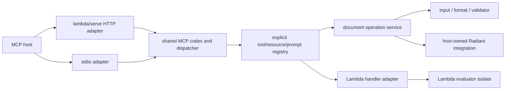

# Lambda I/O: Model Context Protocol Support

> **Status:** implementation proposal, unratified (2026-10-18).
> **Version:** 0.1.0.
> **Scope:** (1) call external MCP services from Lambda; (2) host MCP services
> using `lambda/serve`, including Lambda document-processing operations exposed
> through the CLI. All new commands, APIs, and schemas below are proposed.
> **Spec linkage:** existing rulings constrain this design as mapped in §2.
> This draft does not change a formal ruling or allocate new ruling IDs.
>
> **Implementation started (2026-10-18):** a bounded shared dispatcher,
> `lambda mcp` stdio serving, `lambda serve --mcp` loopback HTTP serving,
> `lambda.convert`/`lambda.capabilities`, and request-owned procedural HTTP
> client calls are implemented. The current client is
> `mcp.request(endpoint, method, params)^` / `mcp.call_tool(endpoint, name, args)^`;
> persistent scoped clients and the remaining server tools are still proposed.
> See [implementation record](impl/Lambda_Impl_IO_MCP.md) for coverage and checks.

## 1. Intended outcome

Lambda should act as both an MCP client and an MCP server. A script should be
able to discover and invoke an external tool, read a resource, obtain a prompt,
or use an extension without a service-specific native binding. Conversely, an
MCP host should be able to submit a document to Lambda, convert, validate,
transform, or render it, and receive the resulting document and diagnostics.

The server has two complementary surfaces:

- **Application server:** register Lambda functions/procedures as MCP tools,
  resources, and prompts; mount the MCP endpoint on the existing HTTP server.
- **Built-in document server:** start `lambda mcp` and expose the document
  operations already available through Lambda's executable. Reuse operation
  implementations behind the CLI rather than invoking command strings.

Both surfaces share one protocol engine and operation registry. Support stdio
for local MCP hosts and Streamable HTTP for independently running servers.
The HTTP implementation extends `lambda/serve`; stdio is another transport for
the same dispatcher, without an HTTP loopback hop.

“Any MCP API” means a generic request path, ordinary JSON arguments/results,
and no hard-coded catalogue of external services. It does not mean pretending
to support every protocol revision, authorization scheme, or optional extension.
Publish the supported matrix and report unsupported requirements explicitly.
An LLM, agent loop, and MCP gateway are not prerequisites.

## 2. Existing constraints and reusable foundations

### 2.1 Formal-spec constraints

| Formal ruling | Consequence for MCP |
|---|---|
| **S12.1.1v3**, **D6.1.1v2** | External calls, discovery, listening, and resource acquisition are `pn` operations. A tool's `readOnlyHint` cannot make network access pure. Pure transformation of already received data stays `fn`. |
| **S12.4.1v3–S12.4.3** | Acquire clients/listeners through scoped `open()` resources. Block exit closes them; cancellation/error cleanup follows the same ownership rules. GC finalizers are only a backstop. These rules are partly unimplemented and are an implementation dependency. |
| **S13.1.1v2–S13.1.3v2**, **S13.3.1–S13.3.2** | Calls may suspend without new `async`/`await` syntax. Explicit concurrency uses `start`/`wait`; waiter timeouts do not imply cancellation of underlying work. |
| **S7.4.1–S7.4.4** | Preserve the distinction between Lambda errors, raised failures, and system faults; define the separate MCP protocol/tool-error mapping (§4.4). |
| **D5.3.3**, **D5.4.1–D5.4.4** | Precisely root retained values and callbacks. An isolate owns its evaluator and event loop; generic HTTP pool threads cannot share an evaluator or its `Item` pointers. |
| **D7.1.1**, **D7.1.2v2**, **D7.1.3**, **D7.5.2** | Resource acquisition belongs to the I/O layer and central policy door. Protocol code cannot introduce a dependency from I/O/runtime to Radiant. |
| **D7.1.4v2**, **D7.1.6**, **D7.1.7v6** | Initially target full `lambda.exe` and `lambda-headless`. `lambda-cli` excludes `serve` and Radiant; `lambda-wasm` excludes network/process I/O. Do not silently add these dependencies to reduced profiles. |
| **D7.2.4v3** | Propose the built-in module `lambda.mcp`, with `import mcp` as its ordinary alias. No grammar extension is needed. |
| **D7.5.1**, **S13.1.5** | Process separation alone is not a sandbox. A confined execution profile requires an OS sandbox and capability broker; native faults in a thread can terminate its host. |

The proposed API spellings, document envelopes, and deployment defaults are
recommendations for review, not additional language rulings. Ratification
should add any necessary formal entries and update this record in the same
change, following [Doc_Convention.md](../doc/Doc_Convention.md).

### 2.2 Tree assessment, 2026-10-18

The following are source observations, not claims that the entire server is
already qualified for MCP production use.

| Existing component | Reuse and remaining work |
|---|---|
| `lambda/serve/server.hpp`: `server_create_with_loop`, `server_post`, `server_use`, `server_start_tls` | HTTP lifecycle, routing, middleware, TLS, and event-loop integration. Add an MCP route adapter, not another listener implementation. |
| `lambda/serve/http_response.hpp`: `http_response_start_sse`, `http_response_send_event` | SSE primitives exist. `server.cpp::on_request_complete` destroys request/response objects when a worker finishes; retained streams need an explicit lifetime/completion contract. |
| `lambda/serve/worker_pool.hpp` | Dispatch infrastructure exists. Lambda evaluation still needs isolate ownership, bounded admission, cancellation, and completion delivery on its owning loop. |
| `lambda/main.cpp`: `serve` branch; `lambda/serve/backend_lambda.cpp::lambda_backend_execute` | The CLI reports that serving is not fully implemented; the Lambda backend is stubbed. Wiring and qualifying these paths is prerequisite work, not an assumed capability. |
| `lambda/serve/schema_validator.hpp::schema_validate` | A JSON Schema 2020-12 **subset**, not complete MCP schema support. Reuse after separating it from REST-specific dependencies and closing required gaps. |
| `lambda/input/input.hpp::input_from_source_n`; `lambda/format/format.h::format_data` | Existing document parse/format services can consume captured bytes. Keep input owners alive through serialization. |
| `lambda/runtime/transpiler.hpp::run_lambda_document_transform_with_options` | Existing file-backed package transforms and typed options. Extend the operation boundary for captured document input; avoid synthesizing bridge source from request strings. |
| `lambda/main.cpp::exec_convert`, validation and render branches | Working operation paths are mixed with argument parsing, printing, and file-oriented outputs. Extract reusable operations before exposing them. |
| `lambda/network/curl_multi_backend.h` | Curl machinery exists but is coupled to `NetworkResource`. Reuse/extract a neutral transfer mechanism where appropriate; do not force MCP POST/SSE traffic through a document-download abstraction. |
| `lambda/io/resource_policy.h` | Existing local-only resource admission is useful, but is not a complete process/network/capability policy for MCP. |

Related working records:
[Module_Web_Server.md](Module_Web_Server.md),
[Module_Web_Server2.md](Module_Web_Server2.md), and
[Lambda_Design_Concurrency.md](Lambda_Design_Concurrency.md). Older proposed
module names in those records do not override **D7.2.4v3**.

## 3. Protocol coverage and compatibility

### 3.1 Pin protocol revisions

As checked on 2026-10-18, the published current revision is **2026-07-28**.
Use its versioned specification and schema as the implementation baseline,
with a separate **2025-11-25** compatibility profile. Do not implement against
the moving `draft` specification.
[MCP specification](https://modelcontextprotocol.io/specification/latest)

| Concern | 2026-07-28 profile | 2025-11-25 compatibility profile |
|---|---|---|
| Establishing protocol context | Per-request version/capability metadata; implement `server/discover`. | `initialize`, version/capability agreement, then `notifications/initialized`. |
| Protocol state | Requests are self-contained; application state uses explicit identifiers. | Connection/session state follows the older lifecycle. |
| Additional client input | `input_required` results and multi round-trip requests. | Negotiated server-to-client requests. |
| Results | Preserve `resultType`; distinguish completion from additional input. | Normalize a missing `resultType` to completion locally. |

Keep these profiles explicit in the codec and dispatcher. Use the specified
transport-dependent detection/fallback; never discover compatibility by
replaying a side-effecting tool call. Support for 2025-06-18, 2025-03-26, and
the older HTTP+SSE transport can follow measured interoperability demand.
[Versioning and compatibility](https://modelcontextprotocol.io/specification/2026-07-28/basic/versioning),
[legacy lifecycle](https://modelcontextprotocol.io/specification/2025-11-25/basic/lifecycle)

### 3.2 Transport obligations

- **stdio:** newline-delimited UTF-8 JSON-RPC, bounded framing, correlated
  responses, and concurrent draining of child stdout/stderr. Reserve server
  stdout for MCP messages; application output uses a separate sink. EOF
  initiates graceful shutdown, followed by bounded child termination/reaping.
  [stdio binding](https://modelcontextprotocol.io/specification/2026-07-28/basic/transports/stdio)
- **Streamable HTTP:** one MCP endpoint; accept JSON and request-scoped SSE
  responses. Implement the version/method/name headers, body/header agreement,
  and required tool-parameter header mirroring with safe encoding. Modern
  subscriptions use `subscriptions/listen`; closing a response stream cancels
  its request. Modern MCP has no GET notification stream, protocol session,
  or SSE event replay. Keep older behavior inside its compatibility profile.
  [HTTP binding](https://modelcontextprotocol.io/specification/2026-07-28/basic/transports/streamable-http)

HTTP errors, notifications, and unknown methods must receive the status and
JSON-RPC treatment required by the selected revision. Do not apply REST's
generic error-page or HTTP 422 response wrappers to MCP messages.

### 3.3 Feature scope

| Feature | Client target | Server target |
|---|---|---|
| Generic request/notification | Any valid negotiated method, including explicitly enabled extensions. | Revision-aware dispatch; unknown methods produce protocol errors. |
| Tools | List with pagination; invoke; preserve content and structured results. | Discover/invoke built-ins and explicitly registered handlers. |
| Resources/templates | List/read/template discovery. | Built-in capabilities/reference documents and result artifacts. |
| Prompts/completions | List/get prompts and request completions. | Registration hooks; optional document-workflow prompts. |
| Progress/logging/cancellation | Request-correlated events and cancellation. | Report operation progress; propagate cancellation into execution. |
| Roots, sampling, elicitation | Explicit host callbacks, disabled when absent. | Request only capabilities actually provided by the client. Document tools initially need none. |
| Change subscriptions | Consume and invalidate cached discovery. | Advertise only after streaming ownership is implemented. |
| Tasks and other extensions | Generic wire access first; typed support separately qualified. | Optional later extension, never a prerequisite for basic document processing. |

A generic request function is an escape hatch for method coverage, not a
bypass for transport metadata, policy, schema checks, or revision constraints.
The first release may omit optional features, but must report its actual
capabilities. The “any API” milestone requires supported callbacks and
extensions to work through the same engine rather than service-specific code.

## 4. Calling MCP from Lambda

### 4.1 Proposed module surface

| Surface | Effect | Contract |
|---|---|---|
| `mcp.endpoint(config)` | `fn` | Validate/build a connection descriptor without spawning, connecting, or reading credentials. |
| `open(descriptor)^` | `pn` | New MCP descriptor overload of scoped acquisition; return an opaque `McpClient` resource after protocol setup/discovery. |
| `mcp.request(client, method, params, options?)^` | `pn` | Send a generic request; return the full result payload, retaining unknown fields. Own IDs, metadata, deadlines, and correlation internally. |
| `mcp.notify(client, method, params)^` | `pn` | Send a revision-valid notification. No fabricated response. |
| `mcp.list_tools(client, options?)^` | `pn` | One page of tools and its opaque continuation cursor. |
| `mcp.call_tool(client, name, arguments, options?)^` | `pn` | `tools/call`, preserving content, `structuredContent`, `isError`, and metadata. |
| `mcp.list_resources`, `mcp.list_resource_templates`, `mcp.read_resource` | `pn` | Thin named wrappers around the corresponding methods. |
| `mcp.list_prompts`, `mcp.get_prompt`, `mcp.complete` | `pn` | Thin prompt/completion wrappers; no implicit LLM call. |

Every wrapper delegates to the same request path. Options include a request
deadline and progress handler; connection configuration supplies protocol
preferences, transport, authentication provider, policy, and host callbacks.
Finish resource acquisition/cleanup support under **S12.4** before treating
the scoped examples as deliverable. Do not substitute undocumented GC cleanup.

```lambda no-run
// no-run: proposed lambda.mcp module and MCP open overload are not implemented.
import mcp

pn main() {
    let client = open(mcp.endpoint({
        transport: "stdio",
        command: "example-mcp-server",
        args: ["--workspace", "./documents"]
    }))^
    let result = mcp.call_tool(client, "search", {query: "quarterly revenue"})^
    return result
}
```

For HTTP, the descriptor uses `transport: "http"`, a complete endpoint URL,
and an authentication-provider reference. A token is resolved at acquisition
or request time; it is not interpolated into source code or a URL. Stdio uses
an executable plus an argument array, never an implicit shell command.

### 4.2 Discovery, callbacks, and concurrency

Tool names remain strings scoped to a client; discovery does not inject
dynamic functions into the language namespace. Consume pagination explicitly,
with an optional bounded iterator/helper later. Scope cached discovery by
endpoint, protocol profile, authorization identity/scopes, and advertised
expiry; invalidate on relevant notifications or schema mismatch.

Callbacks are ordinary `pn` values under **S12.1.1v3**. Their signatures and
capabilities are configured before acquisition. For modern MCP, expose
`input_required` to the caller or run registered input handlers and continue
with a fresh request ID and the returned opaque state. Bound continuation
rounds and retain the original deadline. For legacy MCP, dispatch negotiated
server requests while the original call is pending; do not deadlock by waiting
for it before reading the transport. Both flows enter the same callback layer.

Sampling requires a caller-supplied model provider; elicitation requires a
caller-supplied interaction handler. Roots are explicitly supplied locators,
not permission grants. An advertised capability must have a working handler.

Multiple requests can share a transport with separate IDs and bounded queues.
Explicit parallel scripts use `start`/`wait` (**S13.1**); no new concurrency
syntax is introduced. A request timeout cancels that request where supported,
without closing unrelated calls. Connection failure completes every affected
request exactly once. Reconnection does not automatically repeat tool calls:
a lost reply may follow a successfully committed remote side effect.

### 4.3 Value and schema boundary

Use Lambda values for JSON null/bool/string/number/array/object. Missing object
members stay distinct from present JSON null. Preserve unknown `_meta` and
content-block fields. Binary content stays base64 in the raw result; an
explicit decoder can produce a Lambda binary value.

Reject non-JSON arguments, non-finite numbers, cyclic structures, and numeric
values that cannot cross the declared JSON contract exactly. Require explicit
string/tagged encodings for wider integers, decimals, datetimes, elements,
paths, and executable/resource handles; never stringify arbitrary Lambda
objects or round them silently (**S4.4.1**). Preserve JSON-RPC string/integer
IDs without a floating-point conversion; internally generated string IDs
avoid numeric-ID ambiguity.

Share schema infrastructure between the client and server. Complete the
required 2020-12 behavior, including references and composition, before claiming
general schema interoperability; do not treat the existing REST subset as
complete validation. Unsupported dialects and unresolved references produce
explicit errors. Network reference resolution stays disabled by default.
[MCP schema requirements](https://modelcontextprotocol.io/specification/2026-07-28/basic#json-schema-usage)

### 4.4 Error boundary

| Condition | Proposed Lambda client behavior | Lambda server behavior |
|---|---|---|
| Bad framing/JSON, invalid envelope, unknown method | Raise an MCP protocol error, retaining peer code/data where available. | Emit the selected revision's protocol error. |
| HTTP authentication, connection, timeout, cancellation | Raise a classified local failure; distinguish it from a peer JSON-RPC error. | Apply transport authorization/cancellation rules; do not invent a tool result after disconnection. |
| Tool completes with `isError: true` | Return the complete tool result unchanged. The caller decides how to handle it. | Report an operation/handler failure as an MCP tool error with actionable diagnostics. |
| Document is well parsed but fails its requested schema | Ordinary completed validation result with `valid: false`. | Return findings, not a transport failure. |
| Modern result requires input | Return the typed interim result or run the configured bounded continuation. | Return the protocol's input-required shape when that interaction is supported. |
| Hard native fault | Host fault, not a catchable ordinary tool error in a thread. | Fault containment is available only through an appropriately isolated worker profile. |

The raw client does not collapse MCP tool errors into raised transport errors.
An optional checked helper may convert `isError` explicitly, preserving the
original result as error detail. This keeps the channels legible under
**S7.4.1–S7.4.4**.

## 5. Hosting MCP with `lambda/serve`

### 5.1 Shared server model



Propose a native mounting API, `server_mount_mcp(server, path, registry,
options)`, which uses existing routing/middleware. MCP is a protocol adapter,
not a `LanguageBackend` pretending every request is an HTTP script request.
The Lambda handler adapter can be shared with the repaired serving backend.
An MCP endpoint may coexist with ordinary REST/static routes.

The registry contains explicit names, descriptions, input/output JSON Schemas,
annotations, required capabilities, execution policy, and callbacks. Serve
discovery and invocation from the same entries. Never publish every exported
function, filesystem path, or CLI flag automatically. Reject duplicate names
at startup. Capability advertisements describe installed, authorized handlers.

### 5.2 Lambda-defined services

Propose pure descriptor builders `mcp.server(config)`, `mcp.tool(metadata,
handler)`, `mcp.resource(metadata, handler)`, and `mcp.prompt(metadata,
handler)`. Acquisition through `open()` starts the configured stdio/HTTP
service; `mcp.run(server)^` runs it until cancellation/shutdown. The precise
listener resource API needs agreement with the general serving API before
implementation; this is a candidate shape, not a separate cleanup model.

```lambda no-run
// no-run: proposed MCP registration/listener APIs are not implemented.
import mcp

fn summarize(args) => {count: len(args.items)}

pn main() {
    let server = open(mcp.server({
        transport: "http",
        host: "127.0.0.1",
        port: 8080,
        path: "/mcp",
        tools: [mcp.tool({
            name: "summarize",
            description: "Count supplied items",
            inputSchema: {
                type: "object",
                properties: {items: {type: "array"}},
                required: ["items"],
                additionalProperties: false
            },
            outputSchema: {
                type: "object",
                properties: {count: {type: "integer"}},
                required: ["count"]
            }
        }, summarize)]
    }))^
    mcp.run(server)^
}
```

Handlers receive validated argument values, rather than an HTTP object. The
adapter wraps an ordinary JSON return as `structuredContent` plus a textual
fallback; a distinct explicit result builder supports content blocks and
resources without guessing from arbitrary map fields. An `fn` handler stays
pure, but invoking it across the MCP boundary is still I/O. A `pn` handler may
perform permitted effects. Failures use §4.4's mapping.

### 5.3 Execution and streaming lifetime

The libuv thread owns connections and all socket writes. Workers receive
captured bytes/operation descriptors; results return through bounded completion
queues. Each Lambda evaluator belongs to one execution owner for its lifetime
(**D5.4.1**). Do not enter a shared evaluator from arbitrary `uv_queue_work`
callbacks. Start with serialized evaluation per isolate; scale with a bounded
pool of independent evaluator workers. Rendering may need additional
serialization until its host state is qualified for concurrent jobs.

Before enabling SSE, add explicit retained-response ownership: worker return
does not imply stream completion; cancellation/disconnect reaches the worker;
pending writes retain their buffers; final completion releases request,
response, and connection references exactly once. Use the same mechanism for
ordinary serving streams rather than an MCP-only lifetime patch. Qualify TLS
stream writes through the existing TLS transport as well.

Bound request admission, pending bytes, event queues, execution time, and
artifact storage. Backpressure pauses producers or fails admission; it never
grows an unbounded queue. Long operations can use request-scoped progress and
cooperative cancellation. Add task-extension support separately when durable
jobs are needed; do not invent an incompatible replacement for MCP tasks.

## 6. Exposing Lambda's document CLI as MCP tools

### 6.1 Commands and operation registry

Proposed launch forms:

```sh
# local MCP host launches this process and owns stdin/stdout
./lambda.exe mcp --transport stdio

# HTTP MCP service built on lambda/serve
./lambda.exe serve --mcp --host 127.0.0.1 --port 8080

# custom Lambda registrations, sharing the same engine
./lambda.exe mcp --transport stdio --module ./document_tools.ls
```

The `mcp` command defaults to stdio; `serve --mcp` mounts `/mcp` and may compose
with other routes. Both use the same registry, policy, and built-in operations.
The proposed `--module` contract loads explicitly exported descriptors during
startup, validates them, then freezes the registry; it does not execute an
unrestricted command supplied by an MCP caller.

| MCP tool | Main inputs | Result | Shared existing path |
|---|---|---|---|
| `lambda.convert` | `document`, `from?`, `to`, conversion/loss options | Converted document and warnings | `convert`, input parsers, formatters, package transforms |
| `lambda.validate` | `document`, schema document or installed schema ID, validation options | `valid`, structured findings and optional report document | `validate`, existing validator |
| `lambda.transform` | `document`, installed transform ID or explicitly permitted source, parameters, output format | Transformed document and diagnostics | Existing runtime/package transform entry points; this is a new tool contract, not a claim that a `transform` CLI command exists |
| `lambda.render` | `document`, assets, output format, viewport/paging/scale options | SVG/PDF/PNG/JPEG document and render diagnostics | `render`, host-owned Radiant integration |
| `lambda.capabilities` | Optional operation/format filter | Supported formats, operations, build profile, schema dialects, limits | Shared capability registry; a new inspection operation |

Expose optional `lambda.layout` and trusted `lambda.run` only after the core
document workflow is complete. `view`, REPL, GUI interaction, arbitrary shell
execution, and a generic “run any CLI arguments” tool are outside the default
document profile. Omit unsupported tools from discovery and reject stale
invocations explicitly. Reduced build profiles retain **D7.1.6/D7.1.7v6**.

Extract typed request/result operations from `main.cpp`; make both CLI argument
handlers and MCP tool handlers call them. A CLI formatter prints diagnostics;
an MCP formatter returns them. The operation body does neither. Preserve
existing CLI behavior and conversion loss policy. Use explicit lengths for
binary output. A temporary-file adapter for an inherently file-based provider
is acceptable; shelling out to `lambda.exe` and scraping its output is not the
operation interface.

### 6.2 Document input contract

Use one versioned application envelope across document tools. A `document` is
exactly one of these shapes; `format` is an optional Lambda parser identifier
when MIME type/filename is insufficient:

```json
{
  "kind": "text",
  "mimeType": "application/json",
  "name": "records.json",
  "text": "{\"amount\": 42}"
}
```

```json
{
  "kind": "blob",
  "mimeType": "application/octet-stream",
  "name": "sample.bin",
  "blob": "AAECAw=="
}
```

```json
{
  "kind": "resource",
  "uri": "lambda-mcp://artifacts/opaque-artifact-id"
}
```

Text means UTF-8 document source; blob means validated base64 bytes. Resource
means an artifact owned by this server and authorized for this principal. An
arbitrary external MCP resource URI is not automatically readable by Lambda:
the caller reads it from its source server and submits bytes. Explicit local
file/HTTPS locators may be added under configured policy; a supplied `name`
never grants filesystem access.

Schemas use the same document envelope or an installed schema ID. Assets are
a list of named text/blob documents under a normalized virtual root; reject
absolute paths, `..`, duplicate normalized names, and escaping links. Resolve
HTML/CSS/font/image dependencies against this root. Do not use the server's
working directory as the implicit base or silently fetch dependencies.

Capture bytes and dependency policy before parsing. Preserve the source name
and positions for diagnostics. Calls into file-oriented transforms/renderers
may materialize a private workspace under `./temp/mcp/`, with cleanup on
success, failure, and cancellation. Source bytes remain owned through parsing,
evaluation, and output capture; temporary filenames are not result documents.

### 6.3 Result documents and artifacts

Return application metadata in `structuredContent`, including
`schemaVersion: "1"`, `documents`, `diagnostics`, and operation-specific fields.
A result document uses the same text/blob/resource envelope, plus `byteLength`
and optional digest/expiry. Multi-file output returns multiple named documents.

For interoperability, provide a brief text content block; inline text documents
may also use an embedded resource. Small images can use an MCP image block.
PDFs and other binary documents use an embedded blob resource or a resource
link, never an image block with a mismatched MIME type. Keep large bytes out
of redundant textual fallbacks.
[Tool result formats](https://modelcontextprotocol.io/specification/2026-07-28/server/tools)

An artifact link must resolve through `resources/read` on this server; returning
a local output path is insufficient. Store captured bytes outside the request's
arena/runtime owner and return an opaque URI, MIME type, size, and expiry.
Advertise the artifact URI template; individual tool-created artifacts need
not enter `resources/list`. Authorize every read independently of the connection
and return protocol errors for unknown, expired, or unauthorized locators.
[MCP resources](https://modelcontextprotocol.io/specification/2026-07-28/server/resources)

Set separate limits for incoming JSON, decoded bytes, inline results, resource
reads, and total retained artifacts. A link alone does not make a huge document
transferable: if it exceeds the bounded `resources/read` envelope, require an
explicitly enabled authenticated HTTPS download route or return a size error.
Large uploads/chunking are a later application API, not an assumed MCP feature.
Artifacts survive individual requests until expiry or explicit release; stdio
process exit retires its artifact store unless durable storage was configured.

### 6.4 End-to-end conversion example

The actual modern request includes protocol metadata; HTTP additionally carries
the matching required headers. Example body for `lambda.convert`:

```json
{
  "jsonrpc": "2.0",
  "id": "convert-1",
  "method": "tools/call",
  "params": {
    "name": "lambda.convert",
    "arguments": {
      "document": {
        "kind": "text",
        "mimeType": "application/json",
        "name": "records.json",
        "text": "{\"amount\": 42}"
      },
      "to": "yaml"
    },
    "_meta": {
      "io.modelcontextprotocol/protocolVersion": "2026-07-28",
      "io.modelcontextprotocol/clientInfo": {
        "name": "document-workflow",
        "version": "1.0"
      },
      "io.modelcontextprotocol/clientCapabilities": {}
    }
  }
}
```

```json
{
  "jsonrpc": "2.0",
  "id": "convert-1",
  "result": {
    "resultType": "complete",
    "isError": false,
    "content": [{"type": "text", "text": "Converted records.json to YAML."}],
    "structuredContent": {
      "schemaVersion": "1",
      "documents": [{
        "kind": "text",
        "mimeType": "application/yaml",
        "name": "records.yaml",
        "text": "amount: 42\n",
        "byteLength": 11
      }],
      "diagnostics": []
    }
  }
}
```

The YAML spelling illustrates the envelope; actual bytes follow the existing
formatter. Validation returns findings, transformation returns a new document,
and rendering returns bytes or a retrievable artifact through the same contract.
Clients can pass an artifact URI into the next operation without downloading
and uploading the document again.

## 7. Policy and deployment

These are proposed deployment controls implementing **D7.5.2**, not additional
permissions granted by MCP discovery or tool annotations.

- **Local stdio:** run with the host's explicitly configured executable,
  argument array, environment allowlist, working directory, and resource
  limits. Drain logs separately; keep secrets out of diagnostics and MCP
  stdout. Use `log_debug/info/error` without modifying `log.conf`.
- **HTTP:** MCP mode defaults to loopback, overrides the server's broad bind
  default, validates supplied Origin values, and requires explicit public
  deployment configuration. CORS is not authentication.
- **Protected HTTP:** implement MCP's OAuth resource/client roles with a
  maintained authorization provider. Discover protected-resource and issuer
  metadata, use PKCE/resource binding where applicable, validate token
  audience/scopes, and separate credentials for outbound MCP calls. A caller's
  bearer token is never forwarded to another service. Preconfigured credentials
  are an initial deployment option, not full OAuth-client interoperability.
  [MCP authorization](https://modelcontextprotocol.io/specification/2026-07-28/basic/authorization)
- **Documents and transforms:** default to captured documents/assets and
  installed transforms. Arbitrary Lambda source, executable document formats,
  JavaScript in rendered input, package imports, external entities, and network
  dependencies are execution/acquisition paths requiring explicit policy.
  A pure `fn` annotation alone does not enforce CPU or memory limits.
- **Resource access:** central admission checks cover explicit sources and
  transitive dependencies, schema references, redirects, imported modules,
  and render assets. Canonicalize local paths and recheck redirects/network
  destinations. The existing `INPUT_RESOURCE_LOCAL_ONLY` switch alone cannot
  express all these permissions.
- **Isolation and artifacts:** trusted handlers may run in-process. Confined
  untrusted jobs require the full process/sandbox/broker boundary of
  **D7.5.1**. Namespace retained artifacts by authorized principal and explicit
  opaque ID, not by MCP connection identity. Apply expiry and byte/count quotas.

Audit operation name, request ID, principal, elapsed time, admitted sizes, and
outcome. Log document bodies and secrets only under a separately authorized
diagnostic setting. Cancellation is cooperative for ordinary runtime work;
enforce hard resource/time limits with the isolated execution profile where
required, and never claim that cancelling a thread can safely stop arbitrary
native code.

## 8. Delivery milestones and acceptance

This is a finite delivery outline; detailed implementation tracking belongs
in a later `vibe/impl/` plan. Each milestone closes behavior and integration
gaps before advertising its capabilities.

| Milestone | Scope | Acceptance cases |
|---|---|---|
| **A — shared engine and local vertical slice** | Revision-aware codec; stdio client/server; scoped client ownership; discovery, tools, generic requests; shared conversion operation. | Lambda calls an independently implemented MCP server with an arbitrary tool name. An independent host launches Lambda, submits JSON, receives YAML bytes, and observes clean EOF shutdown. Qualify modern and 2025-11-25 lifecycle separately. |
| **B — HTTP on existing serve** | Wire `serve`; add mount adapter, client POST/JSON/SSE handling, retained-response ownership, deadlines/cancellation, policy, and credential hooks. | Both roles interoperate over HTTP. Mismatched metadata/headers fail correctly; disconnect cancels one job; concurrent requests and slow readers preserve lifetime/bounds. Test TLS and loopback/Origin behavior. |
| **C — document workflow** | Extract validation/transform/render operations; shared document envelope, assets, diagnostics, artifact resources; complete required schema validation. | Validate a failing document; transform through an installed package; render HTML with submitted CSS/image assets to SVG and PNG/PDF; retrieve binary output and reuse its URI in another call. Denied dependencies and expired artifacts fail explicitly. |
| **D — application-defined MCP and broad interoperability** | Repair/share the Lambda handler adapter; register tools/resources/prompts; callbacks, completions, pagination, discovery changes, supported OAuth flows. | Register and call both `fn` and `pn` handlers; exercise a prompt/resource and multi-round-trip interaction; test legacy callbacks without deadlock. Public HTTP uses the qualified authorization profile. |
| **E — optional breadth** | Additional revisions/transports and extensions; durable task support; large transfer facilities; trusted execution tools. | Add only with a named interoperability use case and extension-specific acceptance cases. Does not hold up the document milestone. |

**Verification budget:** during implementation, run focused codec/transport,
operation, and lifetime tests for the changed area. At each milestone boundary,
run the relevant gates from [test/README.md](../test/README.md):
`make test-lambda-baseline` for runtime/module changes, validator/input gates
for their providers, and `make test-radiant-baseline` for rendering changes.
Qualify real transports with at least one independent MCP client and server;
self-to-self tests cannot establish interoperability. Pin SDK/Inspector
versions and protocol profiles in the test record.

Include failure cases for split/coalesced stdio messages, escaped newlines,
malformed UTF-8/JSON, out-of-order and late replies, child exit, partial SSE
events, authorization failures, unsupported schema dialects, invalid base64,
quota exhaustion, cancellation during output, and repeated cleanup. Force GC
across queued callbacks and response construction to verify **D5.3.3**.
New golden-driven `.ls` fixtures must have corresponding `.txt` expectations.

Measure startup/discovery cost, warmed call latency, document throughput, peak
memory, and cancellation cleanup on release builds only. Set numeric budgets
after the first measured vertical slice; this proposal does not invent targets.
Documentation-only work needs document checks, not engine builds.

## 9. Questions to settle before implementation

1. Confirm the proposed `lambda.mcp` names and descriptor/`open()` overload with
   the general resource and serving APIs; complete their missing ownership
   support rather than introducing a competing connection-handle model.
2. Confirm initial protocol coverage: recommend 2026-07-28 plus 2025-11-25;
   record actual target-host requirements before adding older HTTP+SSE.
3. Select how to complete JSON Schema 2020-12 support and OAuth integration
   within the project's C+ and dependency constraints. Do not silently ignore
   unsupported schema keywords or build an ad hoc token-validation scheme.
4. Confirm the initial execution profile: installed transforms and inert
   document processing by default; arbitrary source and active rendering need
   explicit capabilities and an appropriate isolation boundary.
5. Choose configurable default limits and artifact retention after measuring
   representative documents; decide whether the first remote deployment needs
   authenticated large-document download support.

## Appendix A. Suggested implementation boundaries

File names are tentative; these are ownership boundaries rather than a demand
for one file per protocol method.

| Location | Responsibility |
|---|---|
| `lambda/io/mcp/` | Transport-neutral codec, revision profiles, JSON/schema handling, captured message ownership, and I/O acquisition adapters. No evaluator or Radiant dependency. |
| `lambda/runtime/` MCP adapter | Built-in module registration, scoped runtime resources, scheduler integration, callbacks, precise roots, and Lambda-error translation. Item/event-loop-coupled glue is explicitly classified under **D7.1.2v2**. |
| `lambda/serve/` MCP adapter | Mount the shared dispatcher, HTTP header/Origin handling, existing TLS integration, streaming and disconnect lifecycle. Keep protocol logic reusable by stdio. |
| Executable/host operation layer | CLI argument mapping and document-operation orchestration. Own optional Radiant integration above runtime; install operation callbacks without lower layers linking upward (**D7.1.1/D7.5.3v2**). |
| `test/` | Native protocol/transport tests, independent interoperability harnesses, document fixtures/goldens, and lifecycle/GC stress cases. |

Before adding a helper, locate and reuse existing JSON, base64, process,
transfer, URI, and schema facilities; promote shared helpers to their owning
module rather than copying statics. Keep native buffers in project `lib` types.
Use `MarkBuilder`/`MarkReader` for captured values and `RootFrame`/`Rooted` or
persistent roots for runtime retention. Cross-isolate transfers use owned
serialized data, not raw `Item` pointers; serialized replies must outlive
asynchronous writes. Registrations retaining closures also retain their owning
runtime/module until the server drains and shuts down.

Register build changes in `build_lambda_config.json`; regenerate through the
normal build. No parser changes, vendor edits, or new C-text compilation path
are required. Existing interpreted/tiered execution and MIR Direct remain the
runtime path under **D8.1.1v18**.
