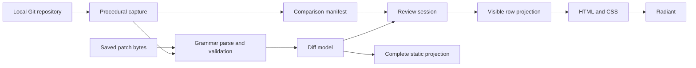

# Lambda Document Diff Package — Proposal

> **Status:** implementation authorized by the user, 2026-10-15. The initial
> unified package is implemented as `lambda.doc.diff`; verification and limits
> are tracked in [Lambda_Impl_Diff.md](impl/Lambda_Impl_Diff.md).
> **Scope:** a Git diff viewer and reusable patch-document package, written
> primarily in Lambda Script and presented through Radiant. The first release
> is read-only and uses a unified diff surface.
> **Spec linkage:** D7.2.1/D7.2.3/D7.2.4/D7.2.6 (source packages and resolution),
> S12.1.1v3/S12.1.3 and D6.1.1v2 (effects and reactive presentation), S2.5.8
> (text positions), S11.1.2v4 (lexical string patterns),
> D7.5.2/D7.5.3 (IO and Radiant boundaries),
> D4.5.1v4/D4.5.2/D5.3.3 (ownership and precise roots), D6.3.1 and
> S13.1.1v2–S13.1.4 (scheduling and task capture).
> **Authority:** package behavior and additive host mechanisms below are
> proposals. They do not revise formal semantics or establish new language
> rulings. Source inventory in Appendix A records observations, not authority.
> **Grammar investigation:** 2026-10-15; prefer Lambda's existing `grammar`
> engine for syntax, followed by pure semantic validation. Grammar-specific
> facilities follow GM1–GM4, GM10, GM11v2, GM12, and GM14 in
> [Grammar Module Design](Lambda_Design_Grammar_Parser.md); no formal ruling
> covers those facilities yet. Evidence and remaining gates are in Appendix C.

## 1. Purpose and scope

Provide `lambda.doc.diff` for reviewing changes in a local Git repository and
displaying saved patch documents. A user opens a repository, chooses staged or
unstaged changes, selects a file, and navigates its changes without leaving the
Lambda viewer. The same diff model supports a saved `.diff` or `.patch` file,
static HTML presentation, and later side-by-side review.

Git computes repository differences. Lambda owns command planning, parsing,
the diff model, review state, row construction, and presentation. Radiant owns
ordinary DOM, layout, text, painting, input, and clipboard transport. This keeps
the application reusable without introducing a native Git widget or a second
renderer; the Lambda/Radiant boundary remains D7.5.3.

### 1.1 First release

- Local repository discovery, including linked worktrees and nested launch
  directories; no assumption that `.git` is a directory.
- Explicit unstaged, staged, HEAD-to-working-tree, and two-commit comparisons.
- A searchable changed-file list with status, rename information, and change
  counts when available; unknown counts remain unknown until loaded.
- A separate untracked-files group, displayed as additions after reading the
  selected file. Unmerged paths receive an explicit conflict summary.
- A unified surface with old/new line numbers, added/deleted/context styling,
  hunk headers, metadata, next/previous change, selection, copy, and search.
- Lazy file loading, a virtual viewport, bounded caching, cancellation, and
  refresh that preserves the selected file and review position when possible.
- Saved Git two-way patches and conventional unified patches, with a pure
  parser and static rendering independent of an installed Git executable.
- Text, binary-change summaries, symlink and mode changes, rename/copy metadata,
  and submodule-pointer summaries. These retain their distinct meanings.

### 1.2 Follow-on review features

Side-by-side layout, character-level highlights, context expansion from the
compared snapshots, merge-base comparisons, automatic refresh, and integration
with the document viewer's repository browser follow the first release. The
model preserves enough provenance to add them without reparsing screen text.

Stage/unstage, discard, editing, three-way conflict resolution, commit creation,
history browsing, remotes, and Git hosting services are separate scope. They
introduce write or synchronization contracts beyond a read-only viewer.

## 2. Namespace and public surface

The public import is exactly **`lambda.doc.diff`**, backed by the explicit
facade `lmd/package/doc/diff.ls`. Internal modules live beneath
`lmd/package/doc/diff/`. This follows D7.2.4 and D7.2.6; it needs neither an
implicit directory index nor an import-resolver exception.

The API separates snapshot operations from repository effects:

| Export | Color | Contract |
|---|---|---|
| `parse(source, options = null)` | `fn` | Parse captured patch bytes or text into a checked diff document. |
| `read(path, options = null)` | `pn` | Capture a local patch file, then call `parse`. |
| `to_html(document, options = null)` | `fn` | Produce a complete static HTML element tree for a loaded document. |
| `viewer(document, options = null)` | `fn` | Construct an interactive review surface over captured diff data. |
| `repository(path, options = null)` | `fn` | Construct a repository viewer; its mount handler performs discovery and loading. |
| `open_repo(path, options = null)` | `pn` | Discover and return a repository descriptor for programmatic use. |
| `compare(repo, comparison, options = null)` | `pn` | Capture a comparison manifest and its provenance without loading every file body. |
| `load_file(repo, comparison, file_id, options = null)` | `pn` | Capture one file's patch/content and return its checked diff model. |

These exports are implemented by the initial package. Options are
validated; unsupported options produce a diagnostic rather than being ignored.
Git availability is checked when a repository operation runs, never on package
import. Patch parsing and static rendering remain usable without Git.

For example, the repository entry can be used from an ordinary viewer
script without procedural calls at script top level:

```lambda no-run
import diff: lambda.doc.diff

diff.repository(".", {mode: 'unstaged'})^
```

The initial launch path is `lambda view review.ls`. Document-transform
registration lets `lambda view change.patch` and `lambda view change.diff`
select this package, with `layout`/`render` selecting its static projection.
Only recognized patch data enters that route. A dedicated `lambda diff`
subcommand is optional convenience, not a prerequisite or a separate engine.

`parse` never executes embedded text. Repository discovery and reads occur in
procedures or `on` handlers, never in a template body or inside an element
constructor, as required by S12.1.1v3 and S12.1.3.

## 3. Architecture and reuse



There are four boundaries:

1. **Capture:** repository discovery, Git invocation, and local file reads
   produce immutable byte snapshots plus provenance and diagnostics.
2. **Model:** a declared Lambda grammar recognizes patch syntax; pure Lambda
   normalization and validation produce file changes and hunks. These have no
   DOM, filesystem, or process dependency.
3. **Session:** instance state owns the comparison, selected file, outstanding
   requests, cache, viewport, search, and model selection.
4. **Presentation:** pure functions project the visible rows and controls to
   ordinary HTML/CSS; procedural handlers update session state.

Reuse the source editor's chunked buffer, position conversions, viewport
geometry, and selection machinery where their contracts fit. Its current
surface assumes editable source lines, whereas a diff contains hunk headers,
two line-number domains, gaps, and metadata. Extract the actual shared shape
before using it in both surfaces; do not copy `source.ls` into the diff package
or make the viewer pretend its patch rows are an editable source file.

CED12/CED13/CED19v2/CED21 in the
[source-editor design](radiant/Radiant_Design_Source_Editor.md) describe the
existing buffer, viewport, selection bridge, and column conversion mechanisms.
S2.5.8 remains the authority for text-position units. Syntax highlighting can
reuse `source_highlight.ls` for its supported Markdown/HTML profiles; broad
programming-language highlighting is not an existing capability to assume.

Use `lambda.ui` components for the shell where suitable, while keeping row
projection and review state independent of a particular UI style family.
Module bindings remain immutable and document sessions own live state
(D7.2.1). Multiple viewers must not share a mutable selected repository.

## 4. Repository capture

### 4.1 Explicit comparisons

| Mode | Before | After | Git operation shape |
|---|---|---|---|
| Unstaged | Index | Working tree | `git diff` |
| Staged | HEAD, or empty on an unborn branch | Index | `git diff --cached` |
| Working changes | HEAD | Working tree | `git diff HEAD` |
| Commits | Resolved tree A | Resolved tree B | `git diff A B` |

These meanings follow the [Git diff reference](https://git-scm.com/docs/git-diff).
A file changed in both index and worktree appears independently in the staged
and unstaged comparisons. Untracked files are separate additions; they are not
ordinary `git diff` output. HEAD-dependent modes on an unborn branch return a
specific diagnostic unless an empty endpoint was explicitly selected. Never
hard code an empty-tree object ID or assume a particular Git hash length.

Resolve commit inputs to object IDs before loading their files, so a moving
branch cannot silently change the selected comparison. Merge-base comparison
is a separately named follow-on mode; it must not substitute for two-tree
comparison. Unmerged index stages are not a conventional two-way diff.

### 4.2 Machine-readable metadata and controlled patches

Use `status --porcelain=v2 -z` for working-tree status, preserving both index
and worktree state. Use NUL-delimited raw/name-status metadata for the selected
comparison; retain old and new paths separately. Human-oriented status output
is not a machine interface. See [Git status](https://git-scm.com/docs/git-status).

Load patch bodies only for the selected file, passing both paths for a rename
when needed. Centralize command construction and explicitly control output:
disable pager, color, external diff and text-conversion helpers; pin prefixes,
line indicators, context size, and other parser-relevant formatting. Treat
paths as literal pathspecs and pass arguments directly, including `--` before
paths. Validate revision arguments independently; `--` for paths does not make
an arbitrary revision argument safe to interpret.

The read-only profile disables optional index refresh writes, including through
`GIT_OPTIONAL_LOCKS=0`, and does not fetch, initialize submodules, or execute
repository conversion helpers. See the [Git environment reference](https://git-scm.com/docs/git)
and [diff options](https://git-scm.com/docs/git-diff).

NUL-delimited path records are byte data. Keep raw path identity separate from
escaped display labels, including on POSIX filesystems with non-UTF-8 names.
The process/path interface must round-trip that identity or report the specific
unsupported path; replacement characters must never identify another file.
Windows native path conversion requires its own coverage.

### 4.3 Structured process contract

The repository adapter needs a general process facility with:

- Executable and argument array, explicit working directory, environment
  overrides, and noninteractive stdin.
- Exact stdout/stderr bytes and lengths, exit status, launch failure, timeout,
  cancellation, and output-limit indicators. No newline trimming or decoding
  before the caller selects a text interpretation.
- Concurrent draining of both output streams, bounded capture, background
  execution, and cleanup that reaps the child and closes its pipes.
- Completion delivery through the host scheduler; no blocking wait in a UI
  handler and no process-polling loop embedded in the package.

Reuse `lib/shell` and the existing runtime async substrate rather than creating
a Git-specific subprocess implementation. The exported process API and its
resource representation need a focused host-contract decision before coding.
Keep IO behind D7.5.2 and scheduler ownership behind D6.3.1; if exposed through
Jube, D7.4.2v2 also governs completion delivery. `start` alone does not turn a
blocking native call into nonblocking work, and isolated-worker modes must not
be assumed implemented merely because S13.1.3v2 specifies them.

The adapter interprets exit status for each operation. A comparison command
using `--exit-code` or `--no-index` may report differences with status 1; this
must not be collapsed into a generic failure. Truncated output is incomplete
data, never a successfully parsed complete diff.

### 4.4 Refresh and consistency

Each session has a generation counter. File requests carry repository,
comparison, file identity, generation, and parsing options. Switching any of
these cancels obsolete work; a completion applies only while its request is
still current. Cancellation is complemented by a stale-result check.

Commit endpoints are immutable. Index and worktree reads are not atomic across
Git invocations: a refreshed manifest is an observation, not a frozen
repository snapshot. Revalidate relevant status/index identity and worktree
file metadata around file loading, retry or report changes, and label loaded
data as captured content. Do not promise atomic consistency from timestamps.
Caching and context expansion must use the captured content identity or
invalidate when the live endpoint changes.

## 5. Diff model and parser

### 5.1 Canonical model

The canonical model represents source changes rather than screen rows:

| Value | Required information |
|---|---|
| Comparison | Origin, explicit endpoints, options, capture generation, and consistency diagnostics. |
| File summary | Stable identity within a comparison, raw/display old and new paths, change kind, modes/object IDs when available, and body loading state. |
| File body | Text hunks or a typed binary/submodule/conflict summary, captured byte provenance, and diagnostics. |
| Hunk | Old/new start and count, optional header text, and ordered change lines. |
| Change line | Context/add/remove kind, applicable old/new line numbers, payload range, and final-newline information for each side. |
| Review position | File, hunk/source-line anchor, side, and code-point column; independent of viewport slots. |

Object IDs are opaque Git identities. Paths are not labels, line numbers are
not array positions, and a row-slot index is not a persistent review identity.
Unloaded counts/bodies are distinct from empty ones.

### 5.2 Grammar recognition and semantic validation

Use Lambda's existing `grammar` declaration and
`lambda.sys.parse(text, patch_grammar, {spans: true})`. The grammar is declared
in a package module, compiled through the existing engine, and produces an
element tree. A pure Lambda function lowers that tree into the canonical model
and validates the relationships between records. This replaces the earlier
proposal for hand-written recognition of every patch record.

GM1/GM2 provide PEG ordered choice and repetition; GM3 permits significant
whitespace by omitting `space`; GM4/GM10 provide typed rule nodes and labeled
fields; GM11v2 provides `start`/`end` byte spans. Lexical rules use the existing
string-pattern islands under S11.1.2v4. No new parser generator, native diff
parser, or expression-precedence machinery is required.

The hunk grammar has this tested shape; supporting token definitions make all
separators explicit and preserve whitespace:

```lambda no-run
// excerpt from the exploratory grammar; the file-level rules are separate
grammar diff_hunk {
    Hunk = HunkHeader, (Context | Added | Removed | NoNewline)*
    HunkHeader = _open, old: Range, _new, new: Range, _close, _tail?, _lf
    Range = line: number, (_comma, count: number)?
    Context = _context, _payload, _lf
    Added = _added, _payload, _lf
    Removed = _removed, _payload, _lf
    NoNewline = _no_newline, _lf

    number := "\d"+
    _tail := !"\n"+
    _payload := !"\n"*
    _open := "@@ -"
    _new := " +"
    _close := " @@"
    _comma := ","
    _context := " "
    _added := "+"
    _removed := "-"
    _no_newline := "\\ No newline at end of file"
    _lf := "\n"
}
```

Payload tokens are hidden: line nodes retain their spans without allocating a
second payload string. Read the payload from the captured bytes using those
spans. Use repeated child nodes for lines and hunks, and labels for scalar
header fields; do not place a repeated label on every line. The current
grammar converter scans sibling labels when constructing attributes, so that
shape would introduce unnecessary quadratic work. Iterate `content(node)`
when walking syntax children; ordinary element iteration also visits attribute
values under S8.3.1v3. Keep field names distinct from span attributes `start`
and `end`.

The grammar handles record syntax, not data-dependent repetition. Validation
checks declared old/new counts against context/removal/addition records,
assigns both line-number domains, validates zero/omitted counts and integer
bounds, and associates missing-final-newline markers with the applicable side
of a preceding source line. A syntactically valid hunk can still fail this
pass. Paths and metadata are decoded according to the
[Git diff formats](https://git-scm.com/docs/diff-format), with raw spans retained.

### 5.3 Git and conventional unified profiles

Git's `diff --git` record provides an unambiguous file boundary. The Git profile
can produce a hierarchical `Patch → File → Hunk → Line` tree: file headers and
metadata precede the text/binary body; hunk bodies admit only their line kinds.
An added payload beginning `++` remains an `Added` node, even when the complete
patch line resembles a `+++` file header.

Conventional multi-file unified patches lack that boundary. Their `---`/`+++`
headers overlap valid removal/addition payloads. A naive `File*` grammar whose
hunk body greedily repeats change lines consumes the next file's path headers
as hunk lines; this was reproduced in the probe. Lookahead for a header pair
alone is also insufficient because a valid hunk may contain the same pair.

For this profile, use a grammar entry producing typed line records with raw
spans and candidate header fields. A count-aware semantic assembler determines
their role: while a hunk still needs source lines, a candidate `---` or `+++`
record is payload; after its counts are complete, it may introduce the next
file. This reuses grammar recognition without pretending a fixed repetition
can consume a count parsed from an earlier field. Keep the profile explicit.

### 5.4 Exact input and diagnostics

Preserve raw bytes and line-ending information. Presentation may show decoded
text and visible whitespace, but parsing must not silently normalize CRLF,
mixed line endings, or missing final newlines. Invalid text encoding receives
an explicit byte-oriented fallback. Binary patch payloads are retained as
opaque data or summarized; the first release does not reconstruct their files.
Combined merge patches return an unsupported-format diagnostic rather than
being parsed as ordinary two-way hunks.

Grammar failures reuse the existing parse-error channel and furthest-failure
message (GM5.2/GM12); semantic errors add file/hunk context and offsets from the
tree's spans. The current grammar API does not expose its numeric failure
offset separately, so structured syntax-error offsets require a general
diagnostic extension, not parsing the human-readable error message.
Never invent the remainder of a malformed hunk. A tolerant
inspection mode, if added later, must distinguish recovered fragments from a
complete document.

### 5.5 Grammar support gates

The implementation resolves the three integration boundaries identified in the
initial investigation (GM14; ownership follows D4.2.6/D5.3.3):

- **Input domain:** grammar `parse` accepts binary input. Byte token matchers
  lower the original pattern AST into the byte alphabet and use Latin-1 RE2
  matching; lexical captures remain binary. Text input retains Unicode token
  behavior and string captures. The diff package keeps its original bytes and
  converts only requested display spans.
- **Result lifetime:** public grammar calls use a private parse region and
  produce precisely rooted GC-owned result graphs. Releasing a result allows
  collection without resetting unrelated inputs. Native document parsers can
  still explicitly request Input-owned results.
- **Span bounds:** the generic parser rejects sources beyond its 32-bit span
  domain before narrowing. The package additionally bounds source bytes and
  record count; the record limit is checked after grammar recognition.

Recognition remains in the grammar engine. Count-aware file/hunk grouping,
path decoding and validation remain pure package code. Durable binary grammar,
parser and repository fixtures replace the exploratory probes; current gate
results are recorded in [the implementation record](impl/Lambda_Impl_Diff.md).

## 6. Review surface

### 6.1 Unified presentation

The shell has repository/comparison controls, a changed-file sidebar, and the
selected file's review surface. Each text row has old/new gutters, an explicit
change marker, and text. Color reinforces the marker; it is not the only way
to distinguish additions and removals. File metadata and errors remain
readable when there are no text hunks.

Use fixed-height monospace rows and no wrapping initially. Hunk headers and
collapsed gaps are typed rows. Build a compact row index once per loaded body;
materialize DOM and token spans only for the visible window plus overscan.
Virtualize large file lists as well as file bodies. CED13 supplies the existing
scrolling pattern, not a license to copy its implementation.

Search runs on loaded model text, not just mounted DOM. Distinguish current
file search from a future whole-comparison search that would require loading
other bodies. Hunk navigation, keyboard scrolling, and search results update
the same review position. Refresh preserves a valid source anchor where it
can; a removed file or hunk receives an explicit fallback selection.

### 6.2 Selection and clipboard

Model selection remains authoritative as rows leave the viewport. Selection
can cross a virtual-window boundary without losing its offscreen endpoints.
DOM selection is its current projection. Text columns are code points under
S2.5.8; convert at the existing UTF-8 DOM boundary using shared helpers.

Plain-text copy excludes gutters and hunk labels. Provide explicit before/after
side copy where mixed unified rows would be ambiguous. A separate Copy Patch
action preserves patch syntax and available original bytes. Gap rows cannot
silently supply absent source text. Preserve final-newline semantics rather
than adding a newline as a side effect of copying.

The surface is read-only: package handlers reject editing actions and do not
use `contenteditable` merely to obtain a selection bridge. Verify that the
existing bridge can bind a read-only surface; extend a generic binding
mechanism if necessary. User-agent editing policy stays in its existing
package under D7.2.5.

### 6.3 Scale and follow-on projections

Limit concurrent capture jobs, cached bodies, token caches, and captured bytes
through documented options. Evict inactive bodies with their byte snapshots
and spans. Very large bodies and lines get an explicit resource-limit state
or an identified bounded preview; a shortened view never claims complete
content. Repeated refresh/scroll must not accumulate retired presentation.

Highlight after plain text is visible. Highlight each side using the source
state for that side, not the patch as if it were a program; sparse hunks alone
cannot establish a multiline language state. If full source is unavailable,
use plain text rather than incorrect parser restart assumptions.

Side-by-side review derives aligned rows from the same model, with blank cells
for unmatched lines and one shared vertical row space. Pairing a deletion with
an addition for display does not establish semantic equivalence. Character
highlights use a bounded comparison of candidate line pairs; over-budget pairs
retain line-level coloring. Context expansion requires captured source bytes
from the correct side; standalone patches cannot invent omitted context.

Static `to_html` renders the full supplied loaded document, not just virtual
viewport slots. It diagnoses unloaded/incomplete bodies. Its output contains
no live Lambda handlers; serialized HTML is a static artifact.

## 7. Ownership and lifecycle

Script values follow ordinary Lambda ownership and precise rooting. A native
job copies the arguments and bytes it needs or retains script values under
registered roots; it never relies on a caller's C stack surviving a suspension
(D5.3.3). Background process work must not access the DOM or a foreign runtime
context. Completion installs values on the owning runtime's scheduler.

Radiant's retained presentation copies data into document-owned storage or
uses a registered root with the required lifetime (D4.5.1v4/D4.5.2). It must
not retain unrooted pointers into a parsed diff's GC heap. Closing the document
cancels jobs, prevents later completion delivery into the destroyed session,
releases roots, and reaps processes before dependent native resources vanish.
Task communication respects S13.1.4's no-by-reference mutable capture rule.
Parse-tree arena lifetime must also satisfy §5.5; precise rooting alone does
not reclaim an `InputManager`-owned region when a cached model is evicted.

## 8. Validation and completion criteria

Testing has four independent layers:

| Layer | Required coverage |
|---|---|
| Pure model/parser | Add/delete/context, multiple files/hunks, zero counts, omitted counts, EOF markers, CRLF/mixed endings, header-like payload, quoted paths, modes, binary summaries, and malformed/truncated/combined patches. |
| Git capture | Disposable repositories covering staged plus unstaged edits to one file, additions/deletions, untracked files, renames, unborn/detached HEAD, linked worktrees, unusual path bytes, submodules, and unmerged stages. |
| Native process/lifecycle | Exact output bytes, simultaneous stdout/stderr beyond pipe capacity, launch/exit failures, limits/timeouts, cancellation, rapid selection changes, and document close during capture. |
| UI/scale | Gutters, hunk navigation, file filtering, keyboard focus, cross-window selection/copy, search, refresh anchors, stale completions, static full output, and bounded DOM/cache growth. |

Use Git-produced fixtures as the repository-format oracle and hand-authored
malformed fixtures for rejection behavior. Test real subprocess behavior rather
than only mocked completions. Capture tests must also verify that read-only
review leaves index and worktree contents unchanged. Run package goldens on
interpreter, AUTO, and MIR paths; add every new `.ls` test's `.txt` golden and
register new fixture directories with the existing harness.

Proposed stress workloads include a 10,000-path manifest, a 100,000-line file
with both sparse and dense changes, very long lines, and repeated switching
and refresh. Record first-visible-content time, handler/scroll latency, peak
memory, retained memory after eviction, and mounted node count. Performance
measurements use release builds only, following
[Developer Guide §7](../doc/dev/Developer_Guide.md#7-worktrees-and-agent-gotchas).
Numeric budgets are set from the initial release measurements; this proposal
does not claim unmeasured latency or memory results.

The first release is complete when its supported comparisons and patch
profiles pass these gates, limitations are explicit, and loading/scrolling
remain responsive within the declared resource limits. Fix general runtime or
Radiant failures at their cause; do not add diff-specific layout workarounds.

## 9. Decisions to settle before implementation

- **Process exposure:** the generic exported interface, lossless path carrier,
  cancellation ownership, and host-scheduler integration. A blocking `cmd`
  wrapper is insufficient; choose the smallest extension to existing IO.
- **Shared source surface:** the exact viewport/selection extraction and the
  read-only binding contract. Require a working non-editable selection fixture
  before depending on the editor's current native seam.
- **Grammar integration:** raw-byte framing/decoding, parse-result lifetime,
  numeric syntax-error offsets, span bounds, and count-aware assembly for the
  conventional unified profile (§5.2–§5.5).
- **Input profile:** parser limits and diagnostics for mail envelopes,
  combined diffs, and binary data.
- **Resource defaults:** capture bytes, body-cache bytes, concurrent jobs, and
  long-line presentation, justified by the stress workloads.
- **Viewer integration:** document-transform registration for patch files and
  repository-browser entry points. Keep package APIs usable independently.

These are bounded package/host design questions, not implicit changes to the
formal specs. Any actual change to an S#/D# ruling requires the paired updates
specified by [Doc Convention](../doc/Doc_Convention.md).

## Appendix A. Existing foundations and concrete gaps

Source inspection on 2026-10-15 found the following; no new performance or
conformance run was performed for this proposal.

| Foundation | Observation | Needed work |
|---|---|---|
| [`lib/shell.h`](../lib/shell.h) | Argument-array execution, cwd/env options, raw output lengths, background handles, limits, and status exist natively. Line callbacks are documented as running after completion. | Validate pipe/cancellation behavior and expose structured scheduler-integrated capture; do not assume streaming UI delivery. |
| [`lambda-proc.cpp`](../lambda/runtime/lambda-proc.cpp), `pn_cmd2` | `cmd` builds a shell command, waits synchronously, trims trailing CR/LF, and maps nonzero exit to a generic error. | Do not use it as the lossless repository transport. Avoid changing its established behavior merely for this package. |
| [`grammar_parse.cpp`](../lambda/runtime/grammar/grammar_parse.cpp) and [`Grammar Module Design`](Lambda_Design_Grammar_Parser.md) | PEG recognition, significant whitespace, hidden tokens, typed nodes, and byte spans exist; the prototype exercises them. | Declare package grammars and perform pure normalization/count validation; resolve §5.5's integration gates. |
| [`lambda-eval.cpp`](../lambda/runtime/lambda-eval.cpp), `fn_parse_grammar`, and [`input.cpp`](../lambda/input/input.cpp), `InputManager` | Grammar entry accepts strings, returns an Input-owned tree, and reports syntax errors through a message. | Exact-byte admission, result-region reclamation, and structured error offsets need generic contracts. |
| [`source.ls`](../lmd/package/edit/source.ls) | Source surface has a virtual viewport, geometry, scrolling, and model selection; public exports are editor-oriented. | Extract shared helpers and establish read-only selection support. |
| [`source_buffer.ls`](../lmd/package/edit/source_buffer.ls) and [`source_units.ls`](../lmd/package/edit/source_units.ls) | Chunked text and line-ending preservation; code-point/byte conversions. | Reuse appropriate helpers without making a text buffer the raw-byte authority. |
| [`source_highlight.ls`](../lmd/package/edit/source_highlight.ls) | Windowed Markdown/HTML highlighting. | Correct side-specific source context; other languages remain future profiles. |
| [`doc/ebook.ls`](../lmd/package/doc/ebook.ls) | Explicit `lambda.doc` facade with pure parse/render and procedural read operations. | Follow the packaging pattern for `lambda.doc.diff`. |
| [`doc_viewer.ls`](../lmd/package/doc/doc_viewer.ls) and Radiant loaders | Existing document browsing and per-format presentation. | Add patch/repository integration after the standalone package works. |

Suggested internal modules are `grammar.ls`, `model.ls`, `parse.ls`, `git.ls`,
`session.ls`, `rows.ls`, `surface.ls`, and `style.ls`. `grammar.ls` declares the
syntax profiles; `parse.ls` orchestrates grammar parsing and semantic lowering.
Separate parser, IO, and UI dependencies;
introduce further helpers only when actual reuse calls for them. Native code
adds generic IO/selection mechanisms, not a second Git model or patch parser.

## Appendix B. Delivery sequence

| Milestone | Deliverable | Acceptance |
|---|---|---|
| M0 — contracts | Finalize the process boundary, grammar input/result ownership and diagnostics, patch profiles, shared viewport extraction, and read-only selection prototype. | Exact-byte capture, nonblocking completion, count-aware unified assembly, bounded repeated parsing, and read-only selection demonstrated with fixtures. |
| M1 — patch documents | Facade, declared grammars, pure semantic validation/model, static HTML, and saved-patch unified viewer. | Parser goldens, complete static output, and virtual selection/copy tests pass without Git installed. |
| M2 — repository review | Discovery, explicit comparisons, changed-file manifest, lazy capture, metadata summaries, refresh, and cancellation. | Disposable-repository and stale-result/lifecycle tests pass; staged/unstaged semantics remain separate. |
| M3 — first-release gate | File search/filtering, hunk navigation, model search, scale limits, documentation, and viewer routes. | Full first-release scope, required baseline checks, and recorded release stress results. |
| M4 — richer review | Side-by-side alignment, bounded character highlights, source-backed context expansion, and optional automatic refresh. | Both projections preserve line mapping, selection, and captured-source identity. |
| Later — write workflows | Separately designed stage/unstage, discard, editing, and merge operations. | Stale-content preconditions, patch validation, error/recovery behavior, and dedicated write-operation tests. |

During implementation, keep detailed progress and verification in a separate
`vibe/impl/` plan. Add the shipped API to `doc/Lambda_Packages.md` and a public
reference when it exists; this proposal is not evidence of available exports.

## Appendix C. Grammar feasibility evidence — 2026-10-15

The initial investigation used `temp/_diff_grammar_probe.ls` and a sibling
expected result. Those temporary probes were not shipped modules. The following
findings describe the engine before implementation; §5.5 and the implementation
record describe the delivered byte support, ownership and durable fixtures.

All **18 assertions passed on interpreter, MIR, and AUTO paths** using the
investigation checkout's `lambda.exe`. They cover basic hunks, header-like payloads,
UTF-8 byte spans, retained CR payload bytes, missing-newline records, zero and
omitted counts, multiple hunks/files, mode-only and rename-only changes,
rejection of malformed/trailing text, and semantic rejection of bad counts.
Additional assertions reproduce the conventional unified grouping ambiguity,
verify a record-oriented grammar retains its boundaries, and confirm the
then-current rejection of binary grammar input.

This establishes feasibility of grammar recognition plus semantic validation;
it does not establish complete path decoding, newline-marker validation,
non-UTF-8 parsing, structured syntax-error offsets, or bounded parse-result
memory. No performance measurements were made. The lifetime and span-width
findings in §5.5 are source-audit observations.
