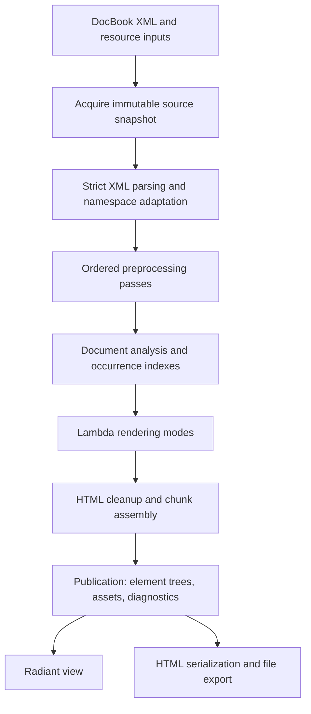

# Lambda DocBook Package Proposal

> **Status:** Initial core HTML profile implemented (2026-10-15); the broader
> port remains a proposal. No formal ruling changes.
> **Package:** `lambda.doc.docbook`, implemented in Lambda Script at
> `lmd/package/doc/docbook.ls`, with helpers under `lmd/package/doc/docbook/`.
> **Scope:** Port the official DocBook xslTNG HTML/CSS transformation into
> Lambda, including its document processing, generated text, styles, and
> publication structure. XSLT **3.0** is the source language version, not a
> requirement to target an xslTNG release numbered 3.0.

**Formal linkage.** D7.2.1–D7.2.4 govern source packages and the reserved
`lambda.doc.*` namespace. S12.1.1v3, S12.4.1v2, and D7.1.2v2 govern the
separation of pure transformation from resource acquisition and output.
S2.6.1v2–S2.6.5 govern ordered, normalized element content; S5.4.3 and
S8.2.2v6 govern namespace-sensitive names. S10.4.3v2 governs contextual
lineage without parent pointers in values. S1.8 governs the code/data
boundary. S7.4.2 and S7.4.4 govern raised errors and error information.
The choices below are recommendations for this package, not new language
rulings; the formal specifications remain authoritative.

**Implementation status:** The initial `lambda.doc.docbook` package now
provides pure conversion, procedural acquisition/export, a bounded
article/book HTML profile, upstream CSS, captured media, and chunked output.
The verified baseline is xslTNG 2.8.5 at commit
`b26a7c42445b5aae1e3e6cda866513427b2b061c`. Broad vocabulary, preprocessing,
localization and publication coverage remain incomplete. See the
[implementation record](impl/Lambda_Impl_Docbook.md) and the package's
[support/provenance record](../lmd/package/doc/docbook/UPSTREAM.md) for the
current subset and intentional differences, including external font imports.

## 1. Purpose

Add a shipped document package that converts DocBook XML into HTML element
trees and the CSS/resources needed to publish them. Its principal work is a
native Lambda port of **DocBook xslTNG**, retaining a traceable relationship
between upstream behavior and the corresponding Lambda implementation.

The package should make a DocBook article or book usable in Lambda's
document workflows: import it as data, transform it, display the resulting
HTML in Radiant, or export a browser publication. Users should not need a
Java installation or an XSLT processor to run the package.

The compatibility target is xslTNG's observable HTML/CSS behavior for a
declared feature and parameter profile. A small element-to-tag converter
would miss numbering, localized titles, cross-references, CALS tables, and
publication navigation. Those behaviors belong to the port itself.

## 2. Upstream basis and port boundary

The [official xslTNG site](https://xsltng.docbook.org/) describes an XSLT 3.0
implementation producing HTML styled with CSS. Its
[usage guide](https://xsltng.docbook.org/guide/2.5.0/ch-using.html) identifies
`docbook.xsl` as the HTML entry point and explains the associated resource
files. The port therefore includes transformation logic **and** the HTML/CSS
contract; emitting HTML without its resources is incomplete.

The upstream [GitHub README](https://github.com/docbook/xslTNG) announces the
move to [Codeberg](https://codeberg.org/DocBook/xslTNG). Use Codeberg as the
source home when establishing the implementation baseline. The
[official CDN index](https://cdn.docbook.org/release/xsltng/current/) and
[published test report](https://xsltng.docbook.org/report/index.html) identify
2.8.5. Implementation has verified that release's source commit and pinned
the source archive, distribution, processor and resource hashes in
[`upstream.json`](../lmd/package/doc/docbook/upstream.json).
Published guides and explorer pages may describe different revisions; the
pinned source must settle exact file names, defaults, and pipeline order.

**Recommended approach:** translate the relevant XSLT templates, functions,
parameters, and preprocessing passes into ordinary Lambda modules. Port the
behavior, using shared traversal and rendering helpers where the source has
repeated shapes. Retain upstream module/template identities in a port map so
future changes can be reviewed against their origin.

Saxon and the official stylesheets serve as a development-time reference
implementation. They are not a runtime dependency. This project does not
require a general XSLT 3.0 processor, a general XPath evaluator, or automatic
translation of arbitrary user stylesheets.

## 3. Scope and compatibility milestones

Target DocBook 5.x documents using `http://docbook.org/ns/docbook`, beginning
with articles and books. The supported schema/version profile must be named
in the package documentation; a familiar local tag name alone is insufficient
to identify a DocBook element.

| Area | First usable milestone | Intended HTML port coverage |
|---|---|---|
| Structure | `article`, `book`, chapters, sections, appendices, titles, metadata | Parts, front/back matter, reference entries, title-page variants, supported Publishers vocabulary |
| Prose and inline content | Paragraphs, emphasis, quotations, code, common semantic inlines | Upstream inline families, roles, language/direction, supported attribute propagation |
| Lists and blocks | Ordered, itemized, variable lists; examples, figures, admonitions | Procedures, task/Q&A structures, formal groups, supported block variants |
| Navigation | Stable anchors, internal/external links, generated labels, table of contents | Lists of titles, cross-reference styles, chunk navigation and cross-file links |
| Tables | HTML-style tables and basic CALS tables | CALS column/span resolution, row spans, widths, alignment, separators, table notes |
| Code and notes | Whitespace-preserving verbatim blocks and footnotes | Line numbering, callouts, annotations, supported syntax-highlighting integration |
| Media | Images, captions, alternative text, relative resource paths | Media alternatives, dimensions, audio/video markup, namespace-preserving SVG/MathML output |
| Generated material | English labels and basic numbering | Locale data and selection, bibliography/citations, glossaries, indexes and grouping |
| Preprocessing | Namespace handling, normalization, source/base URI tracking | Declared profiling, inclusion/transclusion, annotation and link preprocessing profiles |
| Publication | One complete HTML document with bundled CSS | Multiple HTML files, deterministic paths, complete resource manifest |
| Styling | Upstream base/screen CSS | Relevant print CSS, parameter-controlled resources, customization overlays |

This is a staged port toward broad HTML support. The first milestone must
be labelled a subset, rather than described as full xslTNG compatibility.
Coverage includes behavior and parameter combinations, not merely whether
each source element reaches a handler.

**Outside the initial port:** EPUB packaging, XSL-FO, DocBook authoring or
round-trip XML editing, a general Relax NG validator, and reproducing a
commercial formatter's page breaks. Preserve print-oriented HTML/CSS where
covered, but treat PDF production through Radiant as a separate downstream
capability. DocBook 4 conversion is a later preprocessing profile; it must
not be approximated by assigning a DocBook namespace to arbitrary XML.

Executable processing instructions, arbitrary XPath/XSLT customization
strings, and dynamic stylesheet loading are excluded under S1.8. Ordinary
publication processing instructions can be supported as parsed data with
explicit handlers. Unknown visible constructs and requested unavailable
features must produce diagnostics.

## 4. Transformation architecture



Acquisition and file export are procedures. Parsing captured content,
analysis, rendering, and publication assembly are pure transformations
(S12.1.1v3). A conversion call receives all inputs it needs and never resolves
a missing resource through hidden I/O. Eager input closes its acquisition
within the call (S12.4.1v2); resource mechanisms belong to `lambda-io`
(D7.1.2v2).

### 4.1 XML adaptation and source fidelity

Reuse `lambda/input/input-xml.cpp` and the existing strict, whitespace-
preserving XML options. `parse(text, {type:'xml', flavor:'strict',
preserve_whitespace:true})` is the starting input path. The package must
accept a document wrapper or document element and validate the actual
DocBook root. It must not use generic XML defaults that trim meaningful text.

Build a package-private view of XML occurrences with expanded names,
attributes, ordered children, source URI, effective base URI, inherited
`xml:lang`, `xml:space`, and available source locations. Resolve namespaces
through the ancestor scope; default namespaces apply to element names, not
unprefixed attribute names. Prefix aliases and namespace rebinding must work.
Do not strip prefixes and dispatch only on the remaining local name
(S5.4.3, S8.2.2v6).

Preserve mixed content such as text–emphasis–text, whitespace-only children,
verbatim indentation, and relevant processing instructions. CDATA can become
ordinary text: its lexical boundary is not an HTML publishing distinction.
Honor Lambda content normalization, including adjacent-string merging
(S2.6.1v2–S2.6.5); retain any necessary source boundaries in explicit records,
not by assuming adjacent strings remain distinct.

The existing `lmd/package/doc/docx/common.ls` contains namespace adaptation,
but also OOXML-specific URI aliases and filtering of processing instructions.
Extract a neutral shared helper if it is suitable for reuse; importing that
adapter unchanged would lose DocBook information. Audit existing XML, URI,
and document helpers before adding another implementation.

### 4.2 Ordered preprocessing

The [upstream implementation guide](https://xsltng.docbook.org/guide/2.5.0/ch-implementation.html)
and [source explorer](https://xsltng.docbook.org/explorer/) show a staged
transformation with preprocessing, rendering, and chunk cleanup/output.
Preserve that separation in Lambda. Source inspection at the chosen pin
determines the pass order and conditional activation.

Give normalization, profiling, inclusion/transclusion, annotations, and
link/base-URI processing explicit pass boundaries and fixture tests. Disabled
or deferred passes must be recorded in the compatibility profile. Omitting
a pass that changes a requested document is a diagnosed gap.

For the first milestone, require self-contained DocBook XML and captured
media. Later inclusion support should resolve against an acquired resource
snapshot, preserve each included document's base URI, and diagnose missing
resources and cycles. Do not fetch external entities, DTDs, or includes during
pure conversion. A well-formedness check is not schema validation.

### 4.3 Analysis and occurrence identity

Construct document-wide indexes once after structure-changing preprocessing:
source IDs, generated IDs, parent/ancestor context, document order, numbering,
titles, reference targets, notes, generated-material entries, and eventual
chunk ownership. Keep derived caches local to one conversion, rather than
in mutable package globals (D7.2.1).

Use occurrence keys based on document identity and traversal paths. Two
equal-looking sections are still distinct source occurrences. Carry parent
and ancestor relationships in analysis/traversal state, not as pointers added
to Lambda containers (S10.4.3v2). Preserve provenance across rewrites.

Retain explicit `xml:id` values and reject duplicates. Generate repeatable
fallback IDs from document occurrences with collision handling; do not use
heap addresses. If these differ from upstream `generate-id()` output,
document the difference and compare reference graphs through a consistent
ID mapping. Never normalize away a broken reference.

### 4.4 Rendering modes and shared services

Translate the upstream modes into explicit rendering operations over a node
and context. Keep document rendering, title pages, labels/generated text,
cross-references, tables, and output assembly distinct. The
[customization guide](https://xsltng.docbook.org/guide/2.5.0/ch-customizing.html)
identifies `m:docbook` as the main element-processing mode and describes
separate title-page customization.

The rendering context carries validated parameters, indexes, language,
numbering scope, output target, current chunk, and customization handlers.
It is explicit data, including pure function values where needed. Share
common attribute handling, child traversal, labels, links, and formal-object
rendering before adding repeated per-element variants.

## 5. Translating XSLT behavior into Lambda

A port must translate semantic differences deliberately. Textual substitution
of XPath expressions with Lambda expressions is insufficient.

| XSLT/XPath concept | Proposed Lambda treatment |
|---|---|
| Template match and mode | Explicit mode dispatch with namespace-aware predicates and documented precedence |
| Import precedence and `next-match` | An ordered handler chain with an explicit continuation to the next handler |
| Tunnel parameters | Fields in the rendering context, inherited or overridden explicitly |
| Ancestor/sibling axes and document order | Occurrence indexes and traversal cursors; no dependence on map iteration order |
| `xsl:key` and ID lookup | Per-conversion indexes built before rendering |
| XPath positions | Translate one-based positions deliberately at Lambda's zero-based access boundary |
| XPath sequences, missing values, and boolean tests | Explicit cardinality and emptiness checks; do not substitute Lambda truthiness for XPath effective boolean value |
| Grouping, sorting, numbering | Shared algorithms with the source grouping keys, scopes, and tie ordering preserved |
| Temporary trees and result documents | Lambda element trees and publication page records |
| Extension functions | Existing neutral host capabilities or pure replacements over captured data; otherwise a diagnosed unsupported feature |
| Bundled XPath selectors in locale/title data | Port known predicates into Lambda functions or build-time translated data with provenance |

The final row is substantial work: bundled localization and title-page rules
can contain selectors, not just translated strings. Do not solve this by
evaluating runtime strings as Lambda code (S1.8). A maintained build-time
conversion may translate a declared, finite upstream selector set; it must
reject unrecognized forms and preserve the input-to-output mapping.

Use one port map covering upstream files, template/function QNames and modes,
Lambda destinations, supported parameters, fixture IDs, and status. The
statuses should distinguish **ported**, **partial**, **deferred**, and
**intentionally different**. Record each deliberate difference with its
reason and test. An upstream module can map to several Lambda helpers, or
several source templates to one shared renderer, without losing traceability.

## 6. HTML, CSS, resources, and publication output

### 6.1 HTML contract

Return native Lambda HTML element trees. Preserve the upstream structural
markup, classes, IDs, meaningful attributes, heading hierarchy, and anchor
relationships for the declared profile. These are the interface between
the transformation, its stylesheets, and browser behavior.

Reuse the generic HTML formatter in `lambda/format/format-html.cpp` for
serialization. Test escaping, void elements, raw-text handling, and foreign
SVG/MathML namespaces before relying on it for parity. A demonstrated
formatter or XML-parser gap should be fixed at its neutral Lambda boundary;
DocBook-specific templates and publishing policy remain in this package.

Single-document output is the first milestone. Chunked output should first
compute every page path and target's owning page, then render navigation
and references. Rewrite relative links for the current output file, including
media, notes, indexes, and table-of-contents entries. Return all pages as data;
an XSLT `result-document` becomes a publication entry rather than a write
performed by a rendering function.

### 6.2 Styles and assets

Bundle the pinned upstream CSS/resources used by supported output profiles.
Keep upstream resources unmodified and place Lambda-specific changes in
separate overlays. Preserve CSS load order and resource paths. Recursively
inventory referenced CSS imports, fonts, icons, images, and scripts so export
does not leave missing dependencies.

Browser output is the primary HTML/CSS parity target. A Radiant target may
add a separate, documented overlay for supported layout behavior. Compare
the same emitted HTML in a browser first; a Radiant layout gap must not
silently become a change to DocBook transformation semantics.

Treat CSS and optional JavaScript as separate assets. Static reading and
navigation must work without scripts. Features that need browser scripts,
such as enhanced navigation or annotations, require an explicit capability
profile and tests; they are not implied by the presence of a stylesheet.

Every asset record needs an output path, media type, content or captured
source, and provenance. Rewrite source-relative media URLs and CSS URLs
against their actual base URIs. Embedded SVG/MathML fidelity in browser
output and Radiant rendering support are separate coverage claims.

### 6.3 Upstream maintenance

Preserve xslTNG's upstream license and attribution with derived code and
copied resources; its [published repository](https://github.com/docbook/xslTNG)
identifies an MIT license.
Verify the pinned distribution's notices and inventory independently licensed
assets before redistribution. Keep a provenance record with release,
commit, hashes, source paths, conversion scripts, and Lambda differences.
Do not modify a vendored upstream snapshot to make tests pass.

For an upstream update, compare changed source modules, parameters, locale
data, and assets through the port map; regenerate references and review
behavioral differences before changing the package's advertised baseline.

## 7. Proposed public API

The package import is `lambda.doc.docbook`; its source location follows
D7.2.4 without a special runtime module or new language syntax.

| Function | Effect and contract |
|---|---|
| `convert(source, options = null)` | Pure. Convert a parsed XML document/element or prepared source snapshot into a publication; raises on invalid input or requested strict failure. |
| `to_html(source, options = null)` | Pure. Use the same conversion and serializer to return one complete HTML document; reject chunked output rather than discard secondary pages. |
| `read(path, options = null)` | Procedure. Acquire and parse a local source plus the explicitly supported resource closure; return an immutable source snapshot. |
| `write(publication, destination)` | Procedure. Serialize all pages and emit their assets under the chosen destination. |

Raw XML strings are parsed explicitly with `parse`; path strings are passed
to `read`. `convert` must not guess whether a string is a path, XML, or a URL.
A prepared snapshot contains the document, source/base URI, and a resource
lookup with captured XML, text, media bytes, and available media properties.

The proposed publication contains:

| Field | Meaning |
|---|---|
| `document` | Entry page's HTML element tree; aliases the entry in `pages` |
| `entry` | Entry page path, normally `index.html` |
| `pages` | Ordered records `{path, document}` for every HTML output |
| `assets` | Ordered manifest of CSS, media, fonts, and optional script outputs |
| `toc` | Navigation data with titles and resolved publication links |
| `metadata` | Available title, authors, language, and document metadata |
| `diagnostics` | Ordered conversion diagnostics |
| `compatibility` | Upstream baseline, package support profile, and active deviations |

Initial options should remain small: `output` (`single` or `chunked`),
`target` (`browser` or `radiant`), `parameters`, `customization`, and
`unsupported` (`warn` or `error`). Introduce each option only with its
implemented profile. Unknown names, invalid types, and requested unsupported
parameter values must fail validation.

Use original xslTNG parameter names as keys inside `parameters`, with native
Lambda values and a documented type/default table. Track each parameter as
ported, partially supported, or unavailable. Preserve upstream defaults for
ported parameters; any changed default belongs in the deviation record.

For example, the intended pure workflow is:

```lambda
import docbook: lambda.doc.docbook

let xml = "<article xmlns='http://docbook.org/ns/docbook' version='5.2'><info><title>Hello</title></info><para>DocBook in Lambda.</para></article>"
let source = parse(xml, {type:'xml', flavor:'strict', preserve_whitespace:true})^
let publication = docbook.convert(source)^
publication.document
```

Customizations should be ordinary imported Lambda source: pure handlers,
parameter maps, title-page constructors, locale overrides, and additional
CSS assets. Provide a continuation for invoking the next/default renderer
instead of copying its implementation. Do not accept executable XSLT or
XPath strings as a substitute for this API (S1.8).

## 8. Diagnostics and compatibility verification

### 8.1 Failure contract

Use raised errors for malformed required XML, a non-DocBook root, duplicate
source IDs, invalid options, or conditions that prevent a valid publication
(S7.4.2). Return recoverable diagnostics with stable fields such as
`{severity, code, message, source_uri, node_path, line, column}`; source
locations can be absent when the input tree has none. Raised errors use the
standard error information contract (S7.4.4), with a package-owned code
allocation established during implementation.

Unresolved references, missing optional media, unsupported visible elements,
and unavailable requested publishing features need explicit diagnostics.
In warning mode preserve readable content or a visible fallback where
possible; strict mode promotes unsupported features to a failure. Diagnostic
order follows source document order and then publication/resource order.
Never describe omitted content as successful compatibility.

### 8.2 Differential and regression tests

Use upstream fixtures and XSpec expectations as the reference corpus. The
[upstream build guide](https://xsltng.docbook.org/guide/2.1.0/ch-building.html)
documents its source fixtures and expected-output workflow. Record fixture
licenses and the corresponding upstream test environment. Run the pinned
official distribution with a pinned compatible Saxon version and the same
parameters, locale, and media properties as the Lambda test.

Compare in layers:

1. **XML and preprocessing:** namespaces, prefix rebinding, mixed content,
   whitespace, inherited properties, source provenance, filtering, and
   inclusion behavior.
2. **Semantic HTML:** document shape, text, classes, attributes, generated
   labels, table geometry, notes, links, and navigation. Compare body-level
   fixtures where upstream does, and test head/resource assembly separately.
3. **Publication integrity:** unique output paths and IDs; every generated
   local link and asset reference resolves, including across chunks.
4. **Presentation:** browser captures with pinned assets/fonts, followed by
   separate Radiant layout/render comparisons.

Normalize only declared serialization differences such as attribute order.
For generated IDs, use a consistent mapping across all references and output
files. Do not erase whitespace inside prose/verbatim content, remove classes,
drop unmatched nodes, or ignore diagnostics to obtain a passing comparison.

Add adversarial fixtures for repeated equal-looking nodes, deep sections,
forward references, CALS overlaps/spans, identical media basenames in different
directories, language fallback, non-ASCII text, invalid options, and missing
resources. The upstream test report itself identifies coverage gaps; a
passing inherited corpus is not proof of complete DocBook support.

Package regression scripts belong in a registered test directory and every
new `.ls` case needs its `.txt` golden. Register a new directory with the
existing harness rather than assuming recursive discovery. Run the Lambda
baseline; also run the Radiant baseline if its integration changes. Native
parser/formatter changes need targeted tests at their own boundaries.

Measure conversion time, peak memory, and output size on small articles,
large books, reference-heavy documents, and large tables. Use release builds
for performance measurements in the canonical checkout, never a debug build
or a worktree release build. Avoid numerical performance promises before
these measurements exist.

## 9. Risks and decisions to resolve before implementation

The largest effort is reproducing behavior shared across templates: generated
text, context-dependent numbering, title pages, CALS tables, and chunked
cross-references. Implement and test those services early; a long list of
simple tag mappings would give a misleading impression of progress.

The initial audit pinned the upstream release and processor, examined the
XML/HTML boundary and extension dependencies, and translated finite locale
and inline-template data. Remaining XPath-dependent selectors and advanced
preprocessing belong to the broader port; they remain outside the current
declared profile.

The recommended release sequence is a useful single-document subset followed
by the broader HTML/CSS port. The precise first-release element/parameter
matrix, English locale and static browser head are now recorded in the
package's support manifest. Preserve a separate distinction between
upstream parity, unsupported upstream features, intentional Lambda
differences, and Radiant rendering gaps.

## Appendix A. Suggested source organization

This is an implementation sketch; implementation tracking should move to
`vibe/impl/` when work begins, following `doc/Doc_Convention.md`.

```text
lmd/package/doc/docbook.ls              public entry points
lmd/package/doc/docbook/
  source.ls                            acquisition and source snapshots
  xml.ls                               package adapter over shared XML helpers
  preprocess.ls                        ordered source transforms
  analyze.ls                           occurrence indexes and numbering
  render.ls                            mode dispatch and shared rendering
  structure.ls / blocks.ls / inlines.ls content families
  tables.ls / media.ls / verbatim.ls    specialized lowering
  titles.ls / gentext.ls / xref.ls      generated content and references
  generated.ls                         bibliography, glossary, index services
  publication.ls                       page assembly and resource manifest
  options.ls / diagnostics.ls          validated contracts
  locales/                             attributed, translated locale data
  resources/xsltng/                     pinned, unmodified upstream assets
  resources/radiant.css                 optional Lambda-owned overlay
  UPSTREAM.md / port-map.json           provenance and compatibility inventory
test/input/docbook/                    source XML, media, reference manifests
test/lambda/docbook/                   registered scripts and paired goldens
```

An indicative map from the published source explorer is:

| Upstream entry/module family | Lambda destination |
|---|---|
| `docbook.xsl`, `main.xsl` | Public entry, preprocessing orchestration, rendering and publication assembly |
| `titles.xsl`, `numbers.xsl`, `gentext.xsl`, `l10n.xsl` | Title/label services, numbering analysis, generated text and locale data |
| `tablecals.xsl`, `tablehtml.xsl` | Shared table model and HTML lowering |
| `objects.xsl`, `verbatim.xsl` | Media and verbatim rendering |
| `links.xsl`, `xref.xsl`, `xlink.xsl` | Target analysis and link/reference services |
| `chunk.xsl`, `chunk-cleanup.xsl`, `chunk-output.xsl` | Chunk planning, cleanup and publication outputs |

Confirm the exact inventory against the pinned source; these names identify
port responsibilities, not a requirement to reproduce upstream file layout.

Split helpers when their responsibilities justify it; this directory sketch
does not require one file per upstream module. Reuse `lambda.doc.math` and
existing media capabilities where appropriate without changing the source
HTML/CSS contract. Any necessary C/C++ work remains neutral, uses the
project's library types, and follows precise ownership/rooting rules
(D4.1.3, D4.1.4v5); it must not add an xslTNG-specific native runtime.

## Appendix B. Proposed implementation milestones

| Milestone | Deliverable | Exit evidence |
|---|---|---|
| 0 — Baseline and feasibility | Pinned upstream source/distribution, license inventory, port map, reference runner, XML/HTML capability audit | Reproducible official outputs for representative article/book/table fixtures; gaps assigned to the correct boundary |
| 1 — Shared foundation | Source snapshots, namespace adaptation, occurrence indexes, options, numbering, generated text, dispatch | Prefix/whitespace/provenance tests and forward-reference/identity tests pass |
| 2 — Useful single-page subset | Common prose/structure, lists, notes, basic tables/media, TOC, HTML export and upstream CSS | Declared subset passes semantic/reference tests and browser captures without Java at package runtime |
| 3 — Broad HTML behavior | CALS completion, reference pages, generated material, locale/template translation, profiling and supported preprocessing | Expanded element/parameter matrix and differential tests; unsupported cases remain visible |
| 4 — Publications and integration | Chunking, cross-file links, resource closure, customization API, optional viewer route | Multi-page integrity checks; browser parity evidence; separate Radiant regression results |
| 5 — Release and upkeep | Public API docs, support matrix, reproducible update procedure, release measurements | Every claimed feature maps to tests and upstream provenance; remaining deviations are explicit |

The completed HTML port should ship as Lambda source, publish self-contained
single- and multi-page outputs for its advertised profile, and retain a
repeatable upstream comparison process. Neither upstream XSLT execution nor
a partial collection of tag handlers substitutes for that deliverable.
