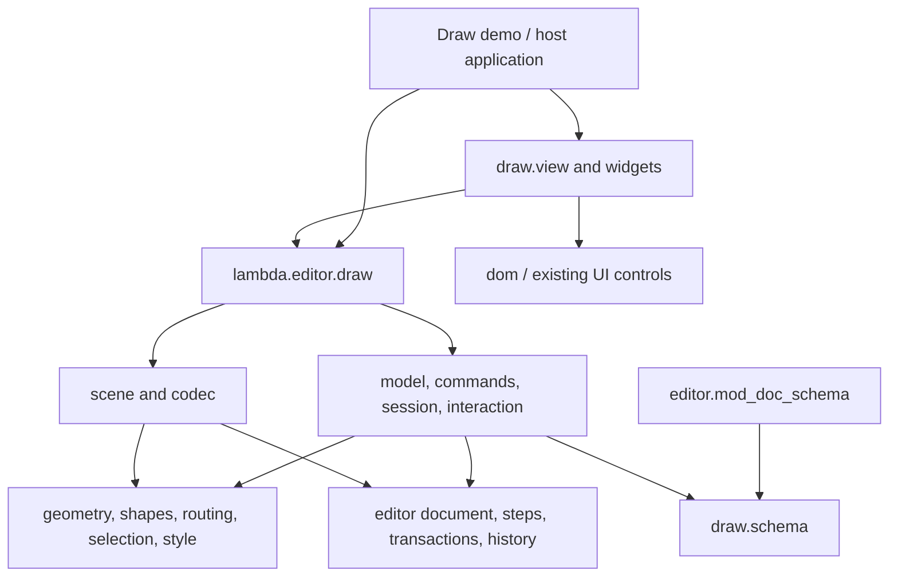

# Lambda Drawing Package — `lambda.editor.draw`

**Status:** initial native implementation delivered; this document retains the
proposed broader design. See the [implementation record](impl/Lambda_Impl_Draw.md)
and [package API](../lmd/package/editor/draw/README.md) for the implemented
contracts, qualification, and remaining extensions. No language ruling changed.

**Date:** 2026-10-16.

**Scope:** strengthen the vertex–edge core of Lambda's native drawing editor,
extract reusable code from `test/demo/draw`, and consolidate drawing-specific
`lambda.editor` modules where necessary. The first release should provide an
embeddable diagram editor and a useful pure drawing API.

**Spec linkage:** package naming and source distribution follow **D7.2.1–D7.2.4v3,
D7.2.6**; values and effects follow **S1.4, S12.1.1v3, S12.1.3**; native
presentation ownership follows **D4.5.1v4–D4.5.3v2**; execution-tier qualification
follows **D8.1.1v18**. This proposal changes no formal ruling. Package APIs and
data conventions below are proposed contracts, not additions to the language
specification.

## 1. Purpose: a stronger vertex–edge core

`lambda.editor.draw` should manage two first-class concepts:

- **Vertices:** identified diagram objects displayed as built-in or custom
  shapes, with geometry, labels, styles, and connection ports.
- **Edges:** identified connections with explicit source and target endpoints,
  lines or custom paths, arrowheads, labels, and editable routing.

This is the useful organizing idea in
[maxGraph](https://github.com/maxGraph/maxGraph). The proposal adopts that
conceptual separation while implementing it with Lambda values, the existing
editor transaction protocol, and Radiant's retained SVG presentation.

The main development objective is to make vertices and edges programmable and
consistent across creation, editing, queries, painting, picking, persistence,
and undo. Moving demo files into a package is the first migration step; it
does not by itself deliver that objective.

The current demo already provides twelve shapes, attached and free connector
ends, straight/orthogonal/rounded routing, arrowheads, live style editing,
rotation/flips, multi-selection, alignment/distribution, duplication, history,
JSON persistence, and SVG export. Preserve those behaviors while replacing
demo-specific assumptions with explicit package contracts.

| Area | Current implementation | Proposed improvement |
|---|---|---|
| Vertex kinds | Fixed `mod_shapes.catalog`; most variants are stored with primitive `kind: 'rect'` | A shape descriptor registry with built-in descriptors and application-supplied custom geometry |
| Vertex geometry | Contours are shared by several demo operations; model-aware geometry also exists in `mod_geom` | One resolved geometry contract for bounds, paint, picking, transforms, handles, and boundary attachment |
| Ports | Demo cardinal-side strings; shared router also understands named normalized ports | Explicit boundary, named-port, and free-point endpoint forms with defined coordinate spaces |
| Edges | Connector attributes and demo state helpers | A public edge model and commands, including topology queries and connection validation |
| Routing | Endpoint-box router plus one demo bend | An explicit route result, multiple waypoints, custom path geometry, and deterministic handling of loops and parallel edges |
| Integrity | Demo file validation and scattered operation checks | Shared document/connection validation used by constructors, commands, imports, and adapters |
| Reuse | App shell, model, rendering, and gestures depend on one another | Pure model/command/render modules plus an optional retained UI adapter |

## 2. First-release scope

The first release should support the existing flat flowchart editor, plus the
following improvements to its core:

1. Stable vertex/edge identities and queries for incident edges, incoming and
   outgoing edges, neighbors, and endpoint resolution.
2. Built-in shapes and at least one application-defined vertex shape using the
   same geometry contract as the built-ins.
3. Named ports and boundary attachments that follow movement, resizing,
   rotation, and flips; either edge end may also be a free point.
4. Multi-waypoint edges and an extension point for structured custom paths,
   with consistent drawing, picking, bounds, handles, and label placement.
5. Configurable self-loop and connection policies, with a working loop route;
   parallel edges must have distinguishable routes rather than all overlapping.
6. Existing style/selection/gesture behavior and one transaction per completed
   user edit, reusable without importing a demo module.
7. A package canvas that can appear twice in one document without cross-talk,
   and a demo that consumes the same package API as another application.

Retain one page and one editable layer for this release. Existing shared-schema
groups, text frames, images, and additional geometric primitives need an
explicit compatibility path, but their complete editing tools are later work.
Persistent groups, swimlanes, nested navigation, obstacle avoidance, automatic
layout, collaboration, freehand tools, and draw.io/mxGraph XML interchange do
not gate this release. Each subsequent feature needs its own finite milestone.

## 3. Architecture and package ownership

### 3.1 Namespace and entry points

Under **D7.2.4v3**, `lambda.editor.draw` maps to
`lmd/package/editor/draw.ls`; submodules map to the sibling `draw/` directory.
`lmd` is the source-tree location, not an import root. New applications should
use `lambda.editor.draw`, not a new `lmd.editor` namespace.

Proposed source layout:

```text
lmd/package/editor/
  draw.ls                    public pure facade
  draw/
    schema.ls                drawing profiles and validation declarations
    model.ls                 document access, identities, topology, lookup
    commands.ls              vertex/edge edits producing shared Transactions
    geometry.ls              vectors, bounds, transforms, path geometry
    shapes.ls                built-in descriptors and registry resolution
    routing.ls               endpoints, routes, waypoints, loop/parallel routes
    style.ls                 defaults, appearance validation, style transfer
    selection.ls             selection queries, picking, marquee, handles
    session.ls               standalone state, command application, history
    interaction.ls           pure gesture and property-preview transitions
    paint.ls                 SVG primitives, patterns, markers, text
    scene.ls                 drawing projection and optional editor overlays
    viewport.ls              pure camera/coordinate calculations
    codec.ls                 archive validation, migration, serialization
    view.ls                  optional templates and procedural DOM adapter
    widgets.ls               reusable palette/inspector controls
```

These are responsibility boundaries, not a requirement to create empty files
or fragment every helper. Extract an existing helper before adding a competing
implementation; combine small modules where their dependencies permit it.

### 3.2 Dependency direction



The pure facade must be usable without mounting a DOM or reading files. It
must not import `draw.view`, demo resources, CSS, application dialogs, or
`mod_editor`. In particular, `draw.schema` must not import `mod_doc_schema`:
the latter composes flow and drawing schemas, so the reverse dependency would
create a cycle.

Keep the generic `mod_doc`, `mod_step`, `mod_transaction`, `mod_history`, and
position-mapping modules shared. Drawing operations compile to their existing
attribute and child-replacement Steps. There should be one transaction/history
implementation for text and drawing, with drawing-specific policy above it.

## 4. Document model: vertices and edges over the existing editor tree

### 4.1 Storage and identity

Preserve the editor's current plain-map node representation
`{tag, attrs, content}`. This is an editor data structure, not a second native
DOM or an additional graph database. A `shape` node represents a vertex; a
`connector` node represents an edge. Public APIs may use the clearer vertex
and edge terminology without requiring every existing document to change tags.

The document retains its `drawing → layer → objects` structure. Vertex and
edge IDs are unique within a drawing, remain stable under movement and style
changes, and are allocated from explicit input/session state. IDs must not
come from a mutable module-global counter. Duplication allocates new IDs and
remaps connections between copied vertices in the same transaction.

Model queries return values. ID-to-path and adjacency indexes, if needed, are
derived from a document revision and are never saved as another source of
truth. Commands resolve an ID against their current transaction document;
they must not reuse stale paths after deletion or reordering.

Commands also need a `drawing_path` context so an embedded drawing can be
edited inside a larger document. Standalone use supplies `[]`; an embedding
editor supplies its drawing's path and applies the returned transaction to
its own history.

### 4.2 Vertex contract

A vertex contains its ID, shape descriptor ID, authored geometry, orientation,
label/content, appearance, and optional application data. The descriptor ID
identifies a visual type such as rectangle, decision, database, or an
application-defined service icon. It is distinct from the low-level SVG
primitive used to paint it.

Authored geometry uses floating coordinates in drawing space. Descriptor
geometry and named-port positions use vertex-local coordinates and pass
through one local-to-drawing transform. Bounds must distinguish the authored
box, transformed outline, and painted bounds where strokes or decorations
extend beyond that outline.

The initial label contract can retain the demo's plain multiline text. Rich
text is an extension through the existing editor model, not a second text
editor inside the drawing package.

### 4.3 Edge contract

An edge has its own ID, source and target endpoint specifications, route kind,
optional waypoints or custom path data, label position, appearance, and
independent start/end markers. An edge is selectable and editable even when
neither end is attached to a vertex.

Proposed public endpoint values:

```lambda
{kind: 'boundary', vertex: "task-1", side: 'auto'}
{kind: 'port', vertex: "task-1", port: "output"}
{kind: 'point', x: 420.0, y: 180.0}
```

The command/codec boundary lowers these values to the editor attributes; it
does not keep a competing mutable endpoint object alongside those attributes.
Named ports resolve through the vertex descriptor and any document-authored
port overrides. Cardinal boundary sides are reserved attachment names and
must not be confused with arbitrary named-port IDs.

Connection validation checks endpoint existence, port validity, supported
directions, and application policies such as allowing loops or multiple
connections. Rejected edits return an error without partially changing the
document or history. Detaching preserves the currently resolved endpoint as
a free point. Deleting vertices follows an explicit policy: the initial
default removes incident edges, matching the demo; an optional detach policy
can retain edges at their resolved endpoints.

Queries should include `vertices`, `edges`, `lookup`, `incident_edges`,
`incoming_edges`, `outgoing_edges`, `neighbors`, and `resolve_endpoint`.
Their direction and multiplicity rules must be documented: an undirected
neighbor query may deduplicate vertices, while an edge query retains parallel
edges and includes a loop only once.

### 4.4 Schema differences and compatibility

The demo and shared drawing schema are not interchangeable today:

| Concern | Shared editor modules | Draw demo | Migration requirement |
|---|---|---|---|
| Orientation | `rotate` | `rotation`, `flip-x`, `flip-y` | One accessor/normalization boundary; do not silently ignore either spelling |
| Shape representation | Primitive `kind`, including line/path/image kinds | Mostly `rect`/`ellipse` plus twelve `variant` values | Preserve primitive kinds; introduce descriptor identity without collapsing custom shapes to rectangles |
| Ports | Named normalized entries in `ports` | `auto/north/east/south/west` strings | Separate named ports from boundary-side attachments |
| Route edits | `waypoints` array | `bend-x/bend-y`, with `-1` meaning automatic | Convert legacy bend edits explicitly; never discard existing waypoints |
| Labels | Connector `label` children | String `label` attribute | Preserve both profiles until a lossless adapter is established |
| Page geometry | Optional drawing dimensions in shared schema | Global 1120 × 760 constants | Make dimensions document/options data and version their persistence |
| Shape/style validation | Drawing schema plus generic editor validation | Demo-specific attribute allowlists and numeric limits | Share validation logic while keeping profile-specific constraints explicit |

The extraction milestone must retain the existing shared schema and the demo's
version-3 profile separately under one package owner. Existing
`mod_drawing_schema.drawing_schema` consumers keep their contract through a
forwarding module. Do not claim schema unification just because the files moved.

Before stabilizing the strengthened API, define a normalized package profile.
Recommended conventions are `rotate` for orientation, explicit descriptor IDs,
explicit endpoint forms, waypoint arrays, and declared label representation.
Legacy `rotation` and bend fields convert at the boundary; conflicting
orientation spellings must be rejected or resolved by an explicit import
profile. The final normalized profile needs fixtures for every row above.

## 5. Shared geometry, shapes, and routes

### 5.1 Shape descriptors

Replace hard-coded catalog dispatch with an explicit registry value supplied
to the package. Built-ins reproduce the current twelve shapes. A descriptor
supplies defaults, supported properties, local geometry, ports, and label area;
painting consumes that resolved geometry. Application descriptors are pure
functions or declarative values, resolved by ID rather than executable text.

One resolved vertex geometry should supply:

- Paths/outlines used for SVG painting and boundary intersection.
- Fill/stroke picking geometry and transformed bounds.
- Port locations and outward directions.
- Label bounds and resize/rotation handle anchors.

Reuse `mod_shapes.outline`, `anchor`, and `graphic`, and the existing
`mod_geom` vector/transform/intersection helpers. Remove overlapping
model-aware picking paths only after both legacy and new behavior use the
shared implementation. Descriptor defaults may differ, but geometry must not
be separately approximated by each command or UI control.

The extension acceptance case is a custom non-rectangular vertex with a named
input and output port. It must paint, pick, resize, rotate, connect, duplicate,
save/reload, and export correctly without editing the package's catalog code.

### 5.2 Route results and custom paths

Separate authored route intent from computed route geometry. Endpoint specs,
routing kind, and pinned waypoints are document data; resolved anchors,
intermediate bends, path bounds, and sampled geometry are derived values.

All routers should produce a common route result with drawable path geometry,
bounds, endpoint tangents, label sampling, and handle locations. The initial
strategies reuse the existing straight, orthogonal, and rounded-corner helpers.
Curved routes must use the same geometry for painting and picking, rather
than testing an unrelated control polygon.

For programmable custom paths, accept structured line and curve segments
with finite coordinates. Derive SVG path data and a shared flattened geometry
from those segments; use a declared tolerance for curved picking and label
distance. A raw SVG `d` string alone is insufficient for an editable edge
because it supplies neither attachment behavior nor handles. Arbitrary SVG
path syntax can remain a source-editor concern until its parser and editing
contract are explicitly supported.

An application router receives resolved endpoints, port directions, waypoints,
and options and returns a route value. It performs no DOM mutation or I/O
(**S12.1.1v3**). Saved documents contain the router ID and serializable input
data, never closures. Unknown shape/router IDs produce a located diagnostic;
they must not be silently rendered as a different kind.

### 5.3 Loops, parallel edges, and obstacles

The demo rejects same-vertex connections. The package should make this policy
configurable and supply a loop route with distinct departure/arrival anchors,
visible extent outside the vertex, and usable handles/labels. Parallel-edge
routes need deterministic lane separation based on stable document ordering
or explicit authored lanes. Repeated renders of an unchanged document must
not swap their paths.

Keep the existing endpoint-box router as a named strategy with its actual
limitation: it does not avoid unrelated vertices. Obstacle avoidance and
automatic graph layout are later strategies, potentially using
`lambda.graph.layout`. They should consume the common geometry contract
rather than introduce another renderer or duplicate a routing engine.

## 6. Commands, sessions, and history

Low-level commands return the existing `Transaction | null` convention; `null`
means the command is inapplicable or has no change. A facade may raise an error
for invalid input. All vertices and edges affected by one operation belong to
one transaction, including connection remapping and selection changes.

The proposed facade is small and value-oriented. Names below are API sketches,
not claims that these functions already exist:

| API | Contract |
|---|---|
| `new_document(options)` | Construct an empty drawing with explicit page/default settings |
| `vertex(id, descriptor, geometry, properties)` | Construct a vertex node; caller supplies its ID |
| `edge(id, source, target, properties)` | Construct an edge node with explicit endpoint values |
| `open_session(document, options)` | Create a standalone session with empty shared history |
| `exec(session, command)` | Validate and apply one named command, returning the next session |
| `transaction(document, context, command)` | Produce a transaction for an embedding editor to apply |
| `update(session, input, viewport)` | Pure interaction transition returning session plus DOM/action requests |
| `validate(document, options)` | Return diagnostics with object IDs and paths |
| `to_svg(document, options)` | Produce standalone SVG elements, excluding editor overlays |
| `encode(document, options)` / `decode(value, options)` | Validate and convert persisted drawing values |

Example of the intended pure construction and command surface:

```lambda
import draw: lambda.editor.draw

let a = draw.vertex("a", "rect",
    {x: 80.0, y: 120.0, width: 160.0, height: 80.0}, {label: "Input"})
let b = draw.vertex("b", "diamond",
    {x: 360.0, y: 120.0, width: 160.0, height: 100.0}, {label: "Ready?"})
let e = draw.edge("ab",
    {kind: 'boundary', vertex: "a", side: 'east'},
    {kind: 'boundary', vertex: "b", side: 'west'},
    {routing: 'orthogonal', 'end-arrow': 'triangle'})
let session = draw.open_session(draw.new_document({width: 800.0, height: 600.0}), null)
let next = draw.exec(session, {kind: 'insert', objects: [a, b, e]})^
draw.to_svg(next.doc, null)
```

Public commands cover insert/delete/duplicate, vertex geometry/orientation,
edge reconnect/detach/reverse, waypoints, labels, appearance, stacking,
alignment/distribution, and undo/redo. Route and topology updates must be
consequences of these model edits, not imperative repairs to an SVG subtree.

A session holds document, selection IDs/primary ID, tool, viewport, preview,
history, saved-document checkpoint, and optional style clipboard. File-dialog
state, example loading, application status copy, and default paths belong to
the host. When used inside another editor, that editor owns history; drawing
commands must not push a second private history stack.

Gesture/property editing follows one protocol:

1. Begin from a stable document and selection snapshot.
2. Preview from that snapshot as pointer/input values change; do not push
   history on every event.
3. Commit one transaction if the final document differs from the snapshot.
4. Cancel restores the snapshot and releases capture; it adds no history.

Valid inspector previews must survive incomplete native field drafts. Blur,
Enter, or a committed select choice closes the group once. Selection, pan,
zoom, scrolling, and hover never dirty the document. Transaction creation and
state transitions remain pure under **S1.4, S12.1.3**.

## 7. Rendering and reusable UI

`scene` projects vertex/edge values into SVG using the resolved geometry and
paint helpers. Editor overlays—selection, handles, marquee, ports, hover,
and draft connections—are a separate input to that projection and never
enter saved content. Export uses the same base projection with overlays off.

`draw.view` provides an optional canvas with package-owned event handlers.
The demo supplies its surrounding application shell and configuration;
reusable palette/inspector widgets consume property descriptors and commands.
Reuse existing `lambda.ui.core` controls and interaction helpers where their
contracts fit instead of cloning keyboard/focus behavior.

The retained DOM adapter owns host reads, focus, pointer capture, scrolling,
and publishing. Read native geometry in procedural handlers and pass numeric
viewport snapshots to pure calculations; a helper is not pure merely because
it only reads a DOM handle (**S12.1.1v3**). Pure templates construct the view;
handlers perform effects (**S12.1.3**).

Keep the canvas owner, scrollport, and active native text controls stable
through edits. Replacing inner SVG paint is acceptable initially, matching
the demo; replacing the capture/focus owner during a gesture is not. Native
ownership and retained presentation follow **D4.5.1v4–D4.5.3v2**, using the
existing DOM bridge rather than a new drawing-specific native lifetime model.

Every instance needs a distinct supplied/generated presentation prefix for
control IDs, markers, patterns, and accessibility references. All DOM lookup
starts from its owner. Document IDs remain stable data IDs and do not acquire
view-specific prefixes. Two canvases showing identical document IDs must not
share markers, selection, shortcuts, history, or pointer capture.

Use one client-to-drawing transform for picking, dragging, marquee, endpoint
editing, and pointer-anchored zoom. Observe settled native scroll geometry
before converting a new press, preserving the current scrolling fixes.
Keep mouse/touch paths shared and leave native input controls' shortcuts alone.

## 8. Persistence and adjacent packages

### 8.1 Archive compatibility

The demo writes `{version: 3, drawing: ...}` and reads versions 1–3. Extraction
must preserve that behavior and its exact legacy defaults. The package owns
the validator/migrator; the host owns procedural reads, atomic writes, dialogs,
and the saved checkpoint. Failed import/save leaves the current document and
checkpoint intact. SVG export does not mark a JSON document saved.

The strengthened normalized profile requires an explicitly versioned archive
for page geometry, descriptor/router IDs, structured endpoints/path data, and
application metadata. Introduce version 4 at that milestone, with documented
v1–v3 conversion fixtures. Keep an explicit legacy-v3 encoder for representable
documents; unsupported new data must fail that export rather than disappear.
Keep the demo on its v3 compatibility adapter during extraction, and switch
its default only when v4 migration tests and UI file replays are updated.
The connector-editing implementation now completes that switch: the demo writes
v4 waypoints, retains v1–v3 reads, and validates its fixed page/object profile
before opening. Package archives continue to support custom pages and objects
independently of the demo inspector (**S1.4, D7.2.4v3**).

Validate before publishing: container shape, supported version/profile,
unique IDs, finite geometry, attribute types, endpoint references, ports,
path segments, and serializable extension data. Demo object/text limits become
explicit configurable policies; retain the 200-object default for the demo.
Custom page dimensions must round-trip, not revert to the global demo size.

### 8.2 SVG source editing

`lambda.edit.drawing` edits a source-preserving SVG tree, while the Draw demo
edits semantic shapes/connectors and generates SVG. `lambda.edit.svg` retains
namespaces, definitions/references, transforms, unedited nodes, and the text
around the root. Replacing this with a flowchart conversion would lose data.

Keep SVG import/export and its round-trip contract in `lambda.edit.svg`.
Where useful, move reusable drawing geometry, handle placement, coordinate
conversion, and gesture grouping behind an adapter to `draw`. Source-specific
commands must still produce Steps against the SVG source tree, including its
ID/reference remapping. Share a helper only after identifying the common
contract; do not force SVG source objects to become semantic vertices.

Likewise, rich-document drawing blocks reuse `draw.schema`, commands, geometry,
and rendering while retaining the surrounding editor's document and history.
The package does not take over `lambda.dom` user-agent editing policy, whose
ownership remains governed by **D7.2.5**.

### 8.3 Graph layout

`lambda.graph` represents semantic graph inputs and computes layout; `draw`
owns authored editing state, vertex/edge commands, and interactive geometry.
A future adapter can translate measured vertex boxes and relationships into
`lambda.graph.layout`, then apply returned positions/routes as one transaction.
Keep IDs, metadata, ports, and authored route intent across that boundary.
Do not replace the graph package's rich HTML measurement/render pipeline with
the drawing package's fixed-box SVG projection.

## 9. maxGraph reference: adopt the separations

The external references were reviewed on 2026-10-16. Their relevance is
architectural; Lambda APIs remain value-based and use the shared editor core.

| Reference | Useful separation | Lambda application |
|---|---|---|
| [maxGraph repository](https://github.com/maxGraph/maxGraph) | Vertices, edges, extensible shapes, editing, and layouts | Make vertex/edge contracts the core; treat tools and layout as consumers |
| [GraphDataModel](https://maxgraph.github.io/maxGraph/api-docs/classes/GraphDataModel.html) | Identity, hierarchy, connections, and batched model changes | Drawing tree plus ID/topology queries and one shared transaction per operation |
| [GraphView](https://maxgraph.github.io/maxGraph/api-docs/classes/GraphView.html) | Derived presentation state, geometry, scale, and translation | Resolved geometry and viewport state outside the persisted model |
| [UndoManager](https://maxgraph.github.io/maxGraph/api-docs/classes/UndoManager.html) | Atomic edits grouped into undoable changes | Reuse Lambda editor history and explicit begin/preview/commit/cancel grouping |
| [GraphPlugin](https://maxgraph.github.io/maxGraph/api-docs/interfaces/GraphPlugin.html) | Interaction extensions with teardown | Optional tools bound to a canvas owner, with capture/listener cleanup |

This is a native Lambda implementation, with no maxGraph runtime dependency.
The existing pinned maxGraph SVG compatibility probe remains a separate test
of Radiant's general DOM/SVG interfaces; it is not evidence that the proposed
Lambda package already supports the same features. Keep upstream dependencies
unchanged. Any future source reuse needs its own attribution/license review.

## Appendix A. Concrete extraction and refactoring map

| Current source | Reusable responsibility | Proposed destination / retained host code |
|---|---|---|
| `test/demo/draw/mod_model.ls` | Accessors, edits, validation, transforms, routing, selection, persistence | Split into `draw.model`, `commands`, `style`, `selection`, `routing`, `session`, and `codec`; keep starter/showcase content and app messages in the demo |
| `test/demo/draw/mod_shapes.ls` | Catalog, outlines, graphics, boundary anchors | `draw.shapes` using shared `draw.geometry`; retain existing descriptors as built-ins |
| `test/demo/draw/mod_paint.ls` | Strokes, patterns, arrowheads, text | `draw.paint`; parameterize presentation IDs and style defaults |
| `test/demo/draw/mod_scene.ls` | Base SVG, edge labels, selection/handle layers, arrow previews | `draw.scene` and `widgets`; keep branded shell, app header, example buttons, file dialog, and status copy in the demo |
| `test/demo/draw/mod_present.ls` | Camera conversion, canvas publication, retained property controls | `draw.viewport` math plus `draw.view`/widget procedures; retain host status and file-dialog synchronization |
| `test/demo/draw/draw.ls` | Gesture lifecycle, property previews, connection tools, shortcuts, capture | `draw.interaction` and `draw.view`; retain demo resource loading and file/example actions |
| `test/demo/draw/draw.css` | Canvas/handle/widget presentation mixed with app styling | Extract scoped package styles; keep demo layout and branding local |
| `lmd/package/editor/mod_geom.ls` | Vector/rect/path helpers plus drawing lookup/picking | Promote shared geometry to `draw.geometry`; model queries to `draw.model`; preserve old public functions through explicit forwarding |
| `lmd/package/editor/mod_router.ls` | Endpoint resolution, orthogonal/curved paths, route picking | `draw.routing`; preserve legacy endpoint behavior through profile-aware forwarding |
| `lmd/package/editor/mod_drawing_commands.ls` | Primitive constructors and transaction commands | `draw.commands`; old module forwards every public export |
| `lmd/package/editor/mod_drawing_schema.ls` | Drawing schema entries | `draw.schema`; old module retains the exported legacy schema value |
| `lmd/package/editor/mod_doc_schema.ls` | Flow/drawing schema composition | Import the drawing schema from its new owner; retain the composed schema contract |
| `lmd/package/editor/mod_editor.ls` | General editor session/facade | Retain ownership; expose drawing integration only through existing schema/transaction seams |
| `lmd/package/edit/drawing.ls` | SVG source tools and canvas presentation | Adapt common helpers when justified; keep source-tree operations and faithful SVG projection |
| `lmd/package/edit/svg.ls` | SVG format adapter and round-trip checking | Retain; promote serializer helpers only when another real caller needs the same contract |

Migration is move-and-forward, not copy-and-diverge. Update package and demo
imports after promoting helpers. Compatibility modules are thin explicit
exports, with no second geometry/router/command implementation. The current
drawing tests directly import the old module paths, so keep those paths until
a separately documented deprecation removes them.

The demo's target structure is an entry point, app shell/theme, example data,
and file actions. No package module may import `test/demo/draw`, and the demo
should retain no alternate vertex/edge engine.

## Appendix B. Finite delivery milestones

Detailed execution tracking belongs in a later `vibe/impl` plan. These are
proposal acceptance boundaries, with focused verification during development
and one aggregate qualification at each completed milestone.

| Milestone | Deliverable | Acceptance boundary |
|---|---|---|
| A — Extract without behavior drift | Package ownership, pure facade skeleton, promoted helpers, forwarding modules, demo imports | Existing drawing goldens and native Draw replays preserve behavior; v1–v3 files and legacy imports still work; no package-to-demo dependency |
| B — Strengthen vertices and edges | Normalized model/profile, descriptors, ports, topology queries, route results, custom paths, loops/parallel routes, v4 codec | Custom vertex and custom edge route pass creation/edit/pick/undo/save/export cases; reconnect/delete/duplicate preserve graph integrity; configurable page geometry round-trips |
| C — Reusable canvas and editor integration | Owner-scoped UI, property/gesture protocol, package controls, justified SVG/shared-editor adapters | Two independent canvases work; embedded edits use host transactions/history; focused SVG-source and rich-editor regressions pass |

Milestone B is the substantive core improvement requested here. Stop expanding
it when these cases pass; put persistent grouping, advanced layout/routing,
large-diagram optimization, and interchange in subsequent milestones with
explicit feature boundaries. Record remaining support as partial where
appropriate rather than implying maxGraph parity.

## Appendix C. Verification and completion evidence

### C.1 Behavioral acceptance cases

| Area | Required evidence |
|---|---|
| Vertex extension | A custom contour and named ports are consumed by paint, picking, transformed bounds, attachment, duplication, archive, and SVG export |
| Edge extension | Straight, orthogonal, curved, waypoint, and structured custom-path edges share route geometry for rendering, hit tests, labels, and handles |
| Connectivity | Incoming/outgoing/incident/neighbor queries agree after reconnect, detach, delete, duplicate, undo, and redo; invalid ports/IDs do not partially apply |
| Loop/parallel routes | Enabled loops are visible and editable; disabled loops fail cleanly; parallel routes are distinguishable and deterministic |
| Preview/history | Many pointer/input previews commit once; no-op commits add nothing; Escape/cancel restores document and selection; redo reproduces topology and geometry |
| Persistence | Existing v1–v3 fixtures migrate; v4 round-trips custom dimensions and extension data; legacy export rejects unrepresentable content; unknown descriptors fail clearly |
| Picking/transforms | Rotation/flips, curved paths, thin edges, zoom, and native scrolling use consistent coordinates and existing selection precedence |
| Instance/lifetime | Identical object IDs in two canvases do not cross-reference paint servers or state; close/reopen during capture cleans up correctly |
| Adjacent editors | Shared schemas/commands remain usable; SVG source save preserves definitions, references, transforms, namespaces, and unedited content |
| Export | Same document geometry/styles as the editor, with no grid, selection, draft paths, handles, or host-dependent paint IDs |

Move reusable contract tests into `test/lambda/editor/draw_*.ls` with matching
`.txt` goldens; that directory is already discovered. Keep a small set of demo
integration goldens and the existing `test/ui/draw/` replays. Add focused native
fixtures for custom vertex/edge behavior and two canvases. Use legacy-import
tests to verify the forwarding modules rather than duplicating whole suites.

Existing focused entry points include:

```sh
./test/test_lambda_gtest.exe --gtest_filter='*tests_draw_*:*editing_drawing_*'
./test/test_ui_automation_gtest.exe --suite draw --jobs 1
./test/test_ui_automation_gtest.exe --suite edit --test 'edit_edit_svg_*' --jobs 1
```

The UI suite names above are registered in `test/ui/ui_test_manifest.json`.
Confirm newly added discovered names before extending filters. Run package
cases under interpreter, automatic tiering, and
MIR JIT (**D8.1.1v18**), using the existing `LAMBDA_EXEC_BACKEND` mechanism.
At implementation milestone boundaries, run `make test-lambda-baseline` for
package changes and `make test-radiant-baseline` for UI/Radiant changes per
`test/README.md`. Run `make test-drawing` when shared native SVG/DOM behavior
changes; its upstream compatibility probes supplement the Lambda package
tests rather than replacing them.

Qualification must report failures honestly and distinguish existing failures
from changes introduced by this work. Read `radiant/README.md` before native
Radiant development, and `doc/dev/Developer_Guide.md` §7 before worktree builds
or environmental diagnosis. Performance measurement, if later needed, uses a
release build in the main checkout, never a debug build or worktree release.
All scratch files, screenshots, archives, and exports go under `./temp/`.

For this proposal-only change, check Markdown structure, references, formal
ruling IDs, and the diff; engine builds and regression runs are unnecessary.
