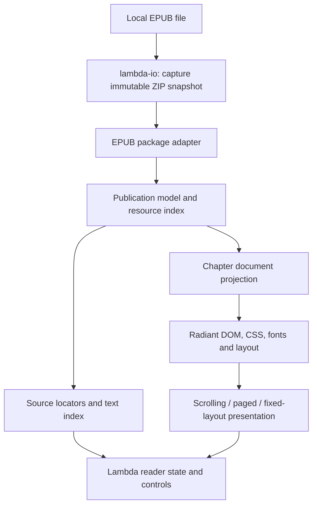

# Lambda EPUB Reader Package Proposal

> **Status:** initial EPUB reader implemented, 2026-10-15; broader acceptance incomplete.
> **Recommended package:** `lambda.doc.ebook`, with the public entry module at
> `lmd/package/doc/ebook.ls` and supporting modules under
> `lmd/package/doc/ebook/`.
> **Scope:** Load EPUB 2/3 publications and present them in Radiant with
> ordinary eReader behavior. Other ebook formats are outside this scope.
> **Formal linkage:** D7.2.1–D7.2.4 govern source packages and the document
> namespace; S12.1.1v3 and S12.1.3 govern pure transformations and procedural
> reader interaction; S12.4.1v2 and S14.3.1v2 govern captured ZIP input and
> deferred member access; D7.1.2v2 governs resource acquisition;
> S7.4.2/S7.4.4 govern failures and diagnostics; D4.1.3, D4.1.4v5, and
> D4.5.1v4 govern input, resource, and retained-view ownership; D5.3.3 governs
> precise native roots. S2.6.1v2/S5.4.3 govern ordered, namespace-aware
> document content, and D7.2.8 governs document-math projection.
> These are proposed package contracts, not new language rulings. No formal
> specification change is proposed.

## 1. Recommendation and package name

Keep the package name **`ebook`**, imported as **`lambda.doc.ebook`**. It
names the reader and publication APIs and fits the document package grouping
in D7.2.4. Its implemented format scope is EPUB only. Provide the public
entry file explicitly; package imports do not imply a directory index.

| Candidate | Assessment |
|---|---|
| `lambda.doc.ebook` | Retained package name for EPUB loading and the eReader interface. |
| `lambda.doc.epub` | A suitable format-specific name; the existing public facade remains `lambda.doc.ebook`. |
| `lambda.doc.reader` | Describes presentation but does not clearly identify the publication-data APIs. |

Use `ebook.epub` for EPUB package parsing and `ebook.reader` for presentation.
Keep this proposal at the requested `Lambda_Pkg_EPUB.md` path. The implementation
reuses Lambda's existing ZIP, XML, XHTML, CSS, and Radiant facilities.

The intended user experience is simple:

```text
lambda view novel.epub
```

The CLI entry opens an EPUB in the reader. The completed reader should retain
reading order, contents, resources, and reading state. A text
extraction or a single concatenated HTML document does not satisfy the scope.

## 2. Supported formats and boundaries

Target EPUB 2.0.1 and the EPUB 3.3 publication model. EPUB 2 packages define
metadata, a manifest,
reading order, and NCX navigation; the newer specification adds its own
navigation and rendition contracts. These provide the input structure for
the shared model. See [OPF 2.0.1](https://idpf.org/epub/20/spec/OPF_2.0.1_draft.htm)
and [EPUB 3.3](https://www.w3.org/TR/epub-33/).

| File family | Proposed support | Qualification |
|---|---|---|
| `.epub`, EPUB 2.0.1 | Reflowable books, NCX navigation, cover metadata, packaged styles and media | Initial reflowable reader profile. |
| `.epub`, EPUB 3.x | Reflowable XHTML, navigation, landmarks/page lists; single-page fixed-layout XHTML/SVG fit/zoom | Initial horizontal LTR profile; broader reading-system features remain milestones. |
| Protected EPUB | Detect and report that the required content cannot be decoded | No DRM removal, key management, account login, or store authorization in this proposal. |

MOBI and Kindle AZW/AZW3 (KF8) support have been removed from the scope.
No libmobi dependency or Kindle binary decoder is part of this package.

**Outside scope:** writing ebooks, converting between ebook formats,
round-trip editing, a library/catalog manager, cloud synchronization,
commercial-store integration, dictionary lookup, text-to-speech, and
read-aloud/media-overlay playback. Highlights and annotation authoring can
follow the reader baseline. Static audio/video and scripted books require
explicit fallback handling; their playback and script execution are deferred.

Support claims must separate **container decoding**, **content rendering**,
and **reader interaction**. Successfully reading an archive does not establish
that its chapters render correctly. Encrypted required text must fail clearly;
an unavailable optional resource may produce a visible fallback and diagnostic.

## 3. What “display like an eReader” means

The completed baseline should offer the following behavior for supported
reflowable EPUB publications, with a separate fixed-layout profile:

| Capability | Required behavior |
|---|---|
| Opening | Show title/author and available cover; open at the saved location or the start of the reading order. |
| Navigation | Nested contents panel, chapter changes, internal anchors, landmarks where present, and back/forward history. |
| Reading modes | Paginated mode with previous/next controls, and continuous scrolling across chapter boundaries. |
| Typography | Font family and size, line spacing, reading margins, text alignment, publisher-style toggle, and light/sepia/dark themes. |
| Resources | Resolve publication-local CSS, images, SVG and fonts with their original document-relative bases. |
| Notes | Follow footnote/endnote references, show their content, and return to the calling passage; a popup is optional. |
| Reading position | Preserve the same source passage across resize, typography changes, chapter reload, and reopening. |
| Progress | Show chapter position and book progress; distinguish generated screen pages from publisher page labels. |
| Search | Whole-book text search, snippets, next/previous result, and navigation to the matching source range. |
| Selection | Select and copy text; image alternative text and document semantics remain available. |
| Bookmarks | Add/remove named locations and persist them locally with the last-read location and preferences. |
| Input/accessibility | Keyboard and pointer navigation, platform touch gestures where available, focusable controls, labelled contents, and adequate contrast. |
| Fixed layout | Fit/zoom, pan, single-page/two-page display, and source-defined page order without reflowing the authored page. |

Paged navigation must cross chapter boundaries without losing or repeating
content. Mouse-wheel scrolling, selection, links, and focus navigation must
continue to work; a page-turn shortcut should not consume input intended for
an active text field or reader control.

Reading direction and page progression are separate properties. Preserve
language, bidi direction, and writing-mode metadata rather than treating every
book as horizontal English. Horizontal LTR prose is the first acceptance
profile. RTL/mixed-bidi and vertical writing need separate evidence before
being advertised as supported. Fixed-layout pages retain their authored
colors and geometry by default; reading-theme overrides must not destroy
illustrations or apply prose font resizing to a positioned page.

The [EPUB Reading Systems specification](https://www.w3.org/TR/epub-rs-33/)
is the reference for navigation, rendition processing, and fallback behavior.
This proposal targets a documented reading subset, not an immediate claim of
complete EPUB reading-system conformance.

## 4. Architecture and existing foundations

Use one EPUB publication pipeline and one reader:



Lambda Script should own publication semantics, navigation, preferences,
reader controls, and chapter projection. Native code supplies existing bounded
ZIP decoding, resource transport, and Radiant's layout mechanisms.

Relevant foundations already exist:

| Existing facility | Reuse and required extension |
|---|---|
| `lambda/io/zip_archive.hpp`, `lambda/input/input-zip.cpp` | Validated ZIP snapshots, indexed members, CRC checks and expansion limits. Reuse for EPUB; avoid a second unzip implementation. |
| XML/HTML input and `MarkBuilder` | Package/navigation parsing and ordered chapter trees. Preserve namespace, source identity, and mixed content. |
| `lmd/package/io/path.ls`, `lib/url.h` | Existing path/URL mechanisms. Publication URLs additionally require decoding and containment checks; ordinary filesystem folding alone is insufficient. |
| `lambda/runtime/transpile-mir.cpp`: `lambda_document_transforms` | Shared document entry contract; the slides presenter already demonstrates a retained-runtime route. The ebook reader also needs per-document state. |
| `radiant/cmd_layout.cpp`: `layout_format_routes`, `lambda/main.cpp`, `radiant/window.cpp` | Direct opening and document-view routing. Recognize ebooks before generic archive browsing claims an EPUB file. |
| `lmd/package/doc/doc_viewer.ls` | Add ebook preview/open actions that reuse the reader and loading pipeline. |
| Radiant DOM, resource resolver, CSS, fonts, Selection/Range and events | Shared chapter rendering and interaction, with publication-local resource resolution. |
| `radiant/layout_paged.hpp`, `radiant/layout_paged.cpp` | Existing fragment/page composition; extend its declared profile where ebook fixtures demonstrate a gap. |

The existing [HTML/CSS support matrix](../doc/HTML_CSS_SVG_Support.md)
documents partial multi-column fragmentation and a restricted paged profile.
Ordinary side floats, positioned content, flex/grid and some independent
formatting contexts are not generally supported by that paged path. Vertical
writing currently has box-axis support but horizontal glyph painting.
These are concrete delivery constraints: a package alone cannot provide
complete ebook fidelity on top of unsupported layout.

Use scrolling for the initial usable milestone. Add real paginated flow
through the existing compositor for the accepted prose profile. If a chapter
cannot paginate, offer scrolling with a diagnostic, or fail paged-only mode
explicitly. Never simulate pagination by slicing screenshots, clipping a long
document at viewport-height intervals, or cutting serialized HTML strings.

## 5. Publication model and API

Represent a book as immutable Lambda data plus owned source/resource
snapshots. Do not add a new language-level ebook type. The proposed public
shape is:

```text
Publication {
  version, format, source_identity,
  metadata: {titles, creators, identifiers, languages, description, cover},
  reading_order: [{id, href, media_type, linear, layout, progression, viewport}],
  resources: {canonical_publication_path: Resource},
  navigation: {toc, landmarks, page_list},
  rendition_defaults,
  diagnostics, capabilities
}

Chapter {
  href, document, styles, resource_base, source_map, diagnostics
}

Locator {
  version, publication_fingerprint, rendition, spine_occurrence, href,
  fragment, source_text_position, quote_context,
  format_location
}
```

The schema is illustrative. Before implementation, fix its versioning,
offset units, and nullable/optional fields. `reading_order` controls sequence;
the resource map and contents labels do not. Preserve repeated spine entries
as distinct reading-order occurrences, and track the selected package/rendition
when a container offers more than one. `linear: false` content remains
reachable through navigation without joining ordinary next-page traversal.

The API should distinguish acquiring a source from transforming captured
data, following S12.1.1v3 and D7.1.2v2:

| Proposed export | Effect and contract |
|---|---|
| `read(path, options = null)` | `pn`, returns `Publication^`; capture local bytes and build the publication. Initial sources are local files. |
| `parse(snapshot, options = null)` | `fn`, returns `Publication^`; decode immutable captured bytes or an owned ZIP snapshot, with no source acquisition. |
| `chapter(book, target, options = null)` | `fn`, returns `Chapter^`; resolve a reading-order occurrence/target and derive its document and styles from retained data. |
| `reader(book, options = null)` | `fn`, returns the retained reader source/model for application as a view, with per-instance state and procedural event handlers. |
| `locate(book, locator)` | `fn`, resolves a source location or returns a diagnostic-bearing failure; never silently jumps to a different passage. |
| `search(book, query, options = null)` | `fn`, returns ordered source ranges/snippets; may force deferred chapter decoding and report those failures. |

The implementation exposes these contracts through `lambda.doc.ebook`; the
completed behavior remains subject to the acceptance checks below. The CLI
controller performs acquisition, applies the reader, and connects procedural
state persistence.
Do not call `read()` inside a pure template or element constructor.
S12.1.3 places state changes in `on` handlers. Pure snapshot decoding needs
an explicit value-backed accessor if the existing member interface is only
available through a procedural reader; do not hide filesystem reads in `fn`.

Keep load options separate from reader preferences. Load options cover rendition selection,
unsupported-feature policy and resource budgets. Preferences cover
reading mode, typography, theme and spread display. Reject unknown options.
Return content warnings in `diagnostics`; use the raised channel for unusable
required structure, corruption, or exceeded limits (S7.4.2/S7.4.4).

## 6. EPUB package processing

Discover the package through `META-INF/container.xml`; do not assume an OPF
filename or directory. Read metadata, manifest, ordered spine references and
rendition properties. Use EPUB 3 navigation where declared and NCX for EPUB 2;
retain available cover, landmarks and page-list information. Validate missing
references, duplicates and fallback cycles. Keep chapter documents separate
so their CSS and identifiers cannot collide. The package/container rules are
defined in [EPUB 3.3](https://www.w3.org/TR/epub-33/).

Handle font obfuscation separately from protected text. The presence of
`encryption.xml` alone is not a DRM verdict: the EPUB specification also uses
it to identify obfuscated fonts. Recognize the standard IDPF font algorithm;
report other algorithms explicitly and use a font fallback when safe.
See [EPUB font obfuscation](https://www.w3.org/TR/epub-33/#sec-font-obfuscation).

Preserve the chapter's original source tree and a mapping into its rendered
DOM. Parse XHTML as XML-aware content, retaining SVG/MathML namespace identity
and ordered mixed content (S2.6.1v2/S5.4.3). Route supported MathML through the
document-math package under D7.2.8. Do not reparse everything as forgiving HTML
and lose source positions or semantics. Unsupported required content uses a
declared fallback or fails visibly, rather than disappearing.

## 7. Resource resolution and chapter isolation

Keep the captured publication as a virtual resource root. Each chapter needs
its own document/style scope and source base; reader chrome belongs to a
separate scope. Two chapters may both define `id="chapter1"`, `body` rules, or
the same font-family spelling without affecting each other or the toolbar.

Resolve document links against the referring document, CSS `url()` and
`@import` against the stylesheet that contains them, and SVG references
against their source resource. Split fragments from resource lookup, decode
URL escapes consistently, reject invalid encoding and paths that escape the
publication, and preserve ZIP member case. Do not flatten resources into one
directory or rewrite paths with textual search-and-replace.

Extend the existing IO/resource-provider seam to serve fonts, CSS, images and
SVG from retained publication bytes. Radiant receives resources through that
seam; it does not fetch or unzip them itself (D7.1.2v2). Support resource
leases through layout/paint and release them on chapter eviction or reader
close under D4.1.3/D4.1.4v5/D4.5.1v4. GC-visible cached values require precise
root ownership under D5.3.3; native stack scanning is not an ownership
mechanism.

The first profile is offline. Block publication-driven network requests,
external file access, XML external entities, executable scripts, event
attributes and active embedded documents. Scripted content should use its
static fallback and report the limitation. Reader controls are trusted
package behavior; imported book content remains data, consistent with S1.8.
An external hyperlink is a user action handled by the host's link policy,
not permission for background fetching.

Reuse ZIP limits and add bounded member counts, decoded bytes, XML depth,
CSS imports, image dimensions, text-index size and layout work. Preserve
member CRC and quota failures at the deferred access boundary rather than
converting them to a missing-resource warning (S14.3.1v2). Temporary test
captures, if needed, belong under `./temp/`; normal reading should not require
extracting a book to disk.

## 8. Pagination, fixed layout, and stable locations

### 8.1 Reflowable presentation

Lay out the active chapter plus a bounded neighbor window. A reader page is a
real fragment of the chapter flow at the current viewport and preferences.
Use the same document and source mapping for paged and scrolling modes.
Preserve author styles by default with a readable reader stylesheet; user
typography overrides should target prose without destroying tables, code,
images, or formulas.

Before a resize, font change or mode switch, capture a source locator for the
visible passage. Recompose, resolve it, and reveal the corresponding range.
Key layout caches by chapter/rendition, viewport, preferences, font/resource
readiness and layout generation. A late font load must invalidate affected
pagination and restore the anchor. Resource and view generations follow
D4.5.1v4; stale layout callbacks cannot act on retired chapter state.

Compute book progress from a deterministic source-text measure or completed
chapter measures, and label estimates while the index is incomplete. Screen
page counts change with typography. Publisher page labels come from source
navigation and must not be presented as those generated page numbers.

### 8.2 Fixed-layout presentation

Treat each supported fixed-layout spine document as an authored page with a
source viewport. Scale the complete page uniformly to fit, preserve aspect
ratio, and add zoom/pan. Respect page progression and available spread hints;
allow single-page display even when a two-page spread is suggested. Keep
fixed-layout and reflowable items distinguishable in mixed books. Missing
required viewport information produces a diagnostic rather than an invented
source size. See [EPUB fixed-layout processing](https://www.w3.org/TR/epub-rs-33/).

This work can reuse ordinary positioned/SVG rendering; it must not force a
fixed-layout page through the restricted prose paginator. Qualify unsupported
EPUB fixed-layout and interactive features explicitly.

### 8.3 Locations and persistence

Persist **source locations**, not page indices, pixel offsets, DOM pointers,
or layout-generated IDs. A locator should identify the publication snapshot,
reading-order occurrence, canonical chapter href, and source text position,
with an ID/quote context for validation. Keep source-node identity stable
before applying reading themes or DOM projection. Never point a bookmark at
a generated page wrapper.

For EPUB, preserve enough source structure to support a declared point/range
subset of [EPUB CFI 1.1](https://idpf.org/epub/linking/cfi/epub-cfi-20170105.html).
CFI text offsets count UTF-16 code units; they cannot be equated with UTF-8
byte offsets. Specify conversions and test supplementary characters and
combining text. Package locators and CFI serialization are separate contracts;
do not claim CFI interoperability until those conversions are verified.

Local persistence belongs to procedural reader/session handling. Store a
versioned sidecar in the host's application-state directory, keyed by content
fingerprint with the publication identifier as descriptive metadata. Moving
an unchanged file should retain its state. A changed edition must trigger
locator validation; unresolved bookmarks remain visible as unresolved.
Write atomically, preserve state through chapter eviction, and keep separate
reader instances independent (D7.2.1, S12.1.3).

## 9. Delivery milestones and acceptance

The scope is complete only when the required format and reader milestones
pass; the first EPUB preview is an intermediate delivery.

| Milestone | Deliverable | Acceptance evidence |
|---|---|---|
| 1. Publication foundation | Shared model, EPUB 2/3 import, virtual resources, scrolling reader, direct CLI opening | Real multi-chapter fixtures show reading order, contents, covers, links, CSS, images and fonts without extraction or network access. |
| 2. Reader baseline | Prose pagination, typography/themes, stable locations, search, bookmarks and local resume | Resize/theme/font/mode changes preserve the passage; page turns cross chapters; reopen restores state; search reaches the correct source range. |
| 3. Fixed layout and direction profiles | EPUB XHTML/SVG pages, fit/zoom/spreads, qualified RTL/mixed-bidi coverage | Authored geometry and page order match independent references; remaining vertical-writing profiles have explicit exclusions. |
| 4. Integration and hardening | File-browser integration, bounded chapter caches, lifecycle and malformed-input coverage, support docs | Direct opening and browser selection use the same contracts; stress, resource-retirement and platform checks pass. |

Vertical glyph painting and broad paged CSS fidelity are engine extensions
that need their own fixtures and estimates. Record them as explicit follow-up
profiles if they are not included in the first release; do not imply that
every valid EPUB publication is supported. No schedule estimate is credible
until the representative EPUB and pagination corpus has been measured.

Recommended acceptance corpus:

- EPUB 2 and 3 novels; a package with a relocated OPF; nested/non-ASCII/escaped
  paths; multiple package renditions; non-linear and repeated spine entries;
  duplicate chapter IDs; cross-chapter notes; local CSS imports and fonts;
  IDPF-obfuscated fonts; tables, wide images, SVG and MathML fallbacks.
- Narrow/wide viewports, one/two-page display, page breaks around headings,
  lists and images, chapter-boundary turns, font-readiness changes, selection,
  search, keyboard focus, reopening, and independent concurrent reader views.
- Corrupt archives/members, excessive expansion, malformed XML/CSS, resource
  cycles, path escapes, blocked network/script attempts, repeated chapter
  eviction, cancellation and reader close while layout is pending.

Compare EPUB structure against [EPUBCheck](https://github.com/w3c/epubcheck)
and use applicable [W3C EPUB tests](https://w3c.github.io/epub-tests/) as
development fixtures. Validate visual behavior against independent reader
captures and source geometry; byte-for-byte agreement with a converter is
insufficient. Keep fixture provenance and redistribution rights recorded;
use authored/public-domain fixtures for checked-in books.

When implementation changes the runtime or Radiant, run the corresponding
Lambda/Radiant baseline gates from `test/README.md`, plus focused package,
resource and reader tests. New golden-driven `.ls` tests need matching `.txt`
results. Use release builds for startup, page-turn and memory measurements;
report those measurements before choosing performance thresholds. This
scope revision requires a build without the removed decoder, EPUB package
regressions, and confirmation that the Kindle extensions no longer route to
the reader.

## 10. Current implementation profile

The initial implementation is `lambda.doc.ebook`. Direct CLI opening and
file-browser selection load captured EPUB 2/3 packages, with XHTML/SVG spine
fallbacks, nested contents, landmarks, publisher page links, cover/author,
local CSS/images/unprotected fonts, and protected-content errors. The reader
provides chapter scrolling, column pagination, internal links/history, search,
bookmarks, typography/themes, source locators, atomic local resume, and
single-page fixed-layout fit/zoom. Reader mutation remains procedural
(S12.1.3); source parsing remains pure (S12.1.1v3).

The initial acceptance profile is horizontal LTR. The broader targets above
remain targets: continuous cross-chapter scrolling, two-page spreads for fixed-layout pages,
RTL/vertical pagination, CFI interchange, font deobfuscation, media overlays,
and full EPUB Reading Systems conformance are not implemented. Saved positions
currently restore a source text node rather than an exact character within a
rendered line. Complex paged CSS and independent-reader visual parity require
additional fixtures. Detailed test evidence and open items belong in
[the implementation record](impl/Lambda_Impl_EPUB.md).

## 11. Remaining EPUB delivery decisions

1. Keep `lambda.doc.ebook` and the initial horizontal prose support profile.
2. Fix the public publication/locator schemas and the pure captured ZIP-member
   API; preserve the acquisition/transformation boundary (S12.1.1v3,
   S12.4.1v2, S14.3.1v2).
3. Choose the supported pagination corpus and identify the Radiant gaps its
   acceptance requires.
4. Fix the platform application-state location and source-change policy for
   last-read locations and bookmarks.

## Appendix A. Proposed source organization

The initial source organization is:

```text
lmd/package/doc/ebook.ls              public loading/model facade
lmd/package/doc/ebook/epub.ls         package and navigation adapter
lmd/package/doc/ebook/common.ls       shared terms, validation and diagnostics
lmd/package/doc/ebook/chapter.ls      sanitized chapters and source text maps
lmd/package/doc/ebook/resources.ls    publication URLs and resource descriptors
lmd/package/doc/ebook/location.ls     source locators and mappings
lmd/package/doc/ebook/state.ls        preferences and procedural local persistence
lmd/package/doc/ebook/reader.ls       retained reader model, views and handlers
lmd/package/doc/ebook/view.ls         shared CLI/file-browser entry
```

Keep ZIP/resource mechanisms in the existing IO boundary and layout work in
Radiant. Reuse or promote shared helpers before adding package-local variants.
No new third-party ebook decoder is required. Follow the project's C+
conventions and library types; generated build files remain generator-owned.
Detailed implementation sequencing and measured progress belong in a
`vibe/impl/` record.
