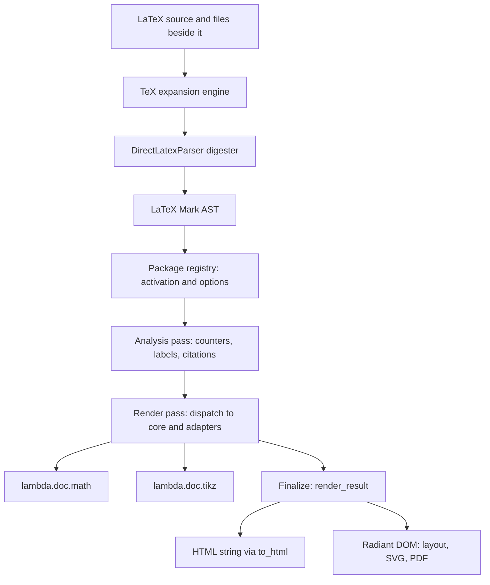

# Lambda LaTeX Package Design

**Status:** Active design. Consolidated on 2026-10-12 from `Lambda_Pkg_Latex.md` (original proposal), `Lambda_Pkg_Latex2.md` (Phase 2) and `Lambda_Pkg_Latex3.md` (package compatibility, Phases I–IV), plus the retired notes under `vibe/latex/`, and checked against HEAD `1df04d4e4`. Implemented behavior and the bounded profiles are current; §11 lists the decisions and work still open. No formal ruling is changed by this document.

**Scope:** The `lambda.latex` package: turning a LaTeX document into semantic HTML elements, package support, and the HTML, SVG and PDF outputs reached through Radiant. Math typesetting is out of scope here and has its own design.

**Formal linkage:** **D7.2.7** rules the TeX expansion front end: expansion without typesetting, the S1.8 reading, the file gate, package resolution and the single front end. **D7.2.1–D7.2.4** place shipped packages in source modules with immutable bindings under the `lambda.*` namespace and make package selection a static registry. **S16.9.8** governs imports. **S1.8** forbids executing a runtime string as Lambda code. **S12.1.1v2** and **S12.4.1** make rendering a pure transform over eagerly acquired input. **D7.1.2v2** and **D7.5.2** govern resource acquisition. **S7.4.1–S7.4.4** govern diagnostics. **S2.6.3–S2.6.5** and **D2.6.5v4** govern the command-argument content contract recorded in [Input_Latex.md](input/Input_Latex.md).

**Detailed designs:**

| Topic | Document |
|---|---|
| Math typesetting (`lambda.doc.math`) | [Lambda_Pkg_Math.md](Lambda_Pkg_Math.md) |
| TeX expansion engine, kernel, bundled packages, local `.sty`/`.cls` | [latex/Lambda_Design_TeX_Engine.md](latex/Lambda_Design_TeX_Engine.md) |
| Bibliographies: biblatex/natbib profile and CSL citeproc | [latex/Lambda_Design_BibTeX_CSL.md](latex/Lambda_Design_BibTeX_CSL.md) |
| TikZ, PGF and PGFPlots drawing (`lambda.doc.tikz`) | [Lambda_Pkg_Tikz.md](Lambda_Pkg_Tikz.md) |
| PDF reading for `\includegraphics` | [Lambda_Pkg_PDF.md](Lambda_Pkg_PDF.md) |
| LaTeX parser and AST contract | [input/Input_Latex.md](input/Input_Latex.md) |

Implementation records: [Lambda_Impl_Latex_Phase4.md](impl/Lambda_Impl_Latex_Phase4.md), [Lambda_Impl_BibTeX_CSL.md](impl/Lambda_Impl_BibTeX_CSL.md), [Lambda_Impl_Tikz_Phase4.md](impl/Lambda_Impl_Tikz_Phase4.md).

## 1. Purpose and scope

`lambda.latex` converts LaTeX documents into semantic HTML element trees that Radiant lays out and paints, and that serialize to HTML strings. It aims at comprehensive support for real documents, including their packages, without becoming a second TeX typesetter.

**What support means.** A package or command is *supported* when its documented bounded profile works after the corresponding `\usepackage` and has a checked output path. *Partial* means the behavior is available with a stated limit or substitution. Anything else is *unsupported* and produces a located diagnostic or a visible unsupported element. Recognizing a command, or being able to render its arguments, is never counted as support. Support never means byte-identical TeX output.

**Out of scope:** TeX's paragraph and page builders and TeX-exact typography; running Lua, Biber, BibTeX `.bst` programs, PGF sources or the shell; loading anything from a TeX installation or the network; MathML and speech output; interactive editing of LaTeX source.

## 2. Design decisions

**Parse natively, transform in Lambda script.** Syntax is recovered by Lambda-owned native code at the input boundary. Every decision about what a construct means lives in editable, user-extensible Lambda script modules. This keeps the edit-test cycle fast, lets users import and override handlers, and follows **D7.2.1–D7.2.4**. Native code changes are limited to neutral syntax preservation and neutral host capabilities; package policy never moves into C/C++.

**Expand like TeX, never typeset like TeX.** Real package code runs on a Lambda-owned TeX expansion engine, so document-local classes and packages and the programming packages they need work as written. Typesetting stops there: Radiant owns line breaking, pagination and painting, and emitting semantic elements is the point of the package. The [engine design](latex/Lambda_Design_TeX_Engine.md) gives the full argument and the LaTeXML lineage.

**One reading of the source.** The direct parser is the only producer of the LaTeX Mark AST, and every LaTeX parse expands before it runs (**D7.2.7**). The engine feeds the parser a reconstructed source rather than a second token-stream front end, so one file yields one AST whatever the entry point (§4.3).

**Semantic adapters in a static registry.** Each supported CTAN package has a script adapter selected by name from a static catalogue. Package names are data, never import paths, and no document text becomes Lambda code (**S1.8**).

**Explicit diagnostics over approximation.** An unknown package, an unsupported option, command or target feature, a missing resource and an unresolved reference each produce a located diagnostic with a stable code. A command is never approximated merely because its arguments can be rendered.

**Pure, two-pass transform.** Resources (images, `.bib` files, CSL styles, local packages) are acquired at the input boundary, relative to the document. Rendering is a pure function of the AST and options. Numbering, labels and citations are computed in an analysis pass before rendering, so forward references resolve without mutation.

**Delegate math and drawing.** Math goes through the math package and drawing through the TikZ package. The LaTeX package owns their document context (numbering, labels, figure placement), never their layout.

## 3. Architecture and ownership

| Owner | Responsibility |
|---|---|
| TeX engine (`lambda/input/input-tex-*.cpp`) | Catcodes, expansion and TeX state; the LaTeX2e programming kernel; bundled programming packages; local `.sty`/`.cls` files; reconstructed source with an offset map |
| Digester (`DirectLatexParser`, `lambda/input/input-latex-c.cpp`) | The AST: commands and environments with stars, raw argument groups, offsets, raw islands, pre-parsed math |
| Script package (`lmd/package/latex/`) | Package activation, analysis, rendering, bibliography, diagnostics, stylesheet assembly |
| Math and TikZ packages | Math boxes and SVG; drawing scenes and SVG |
| Radiant | DOM, CSS cascade, layout, painting, SVG and PDF export, links, outlines and metadata |

The package source lives under `lmd/package/latex/` and is imported as `lambda.latex.*`. Its parts:

- `latex.ls`: public API, activation, result assembly.
- `analyze.ls`: the analysis pass.
- `render.ls`: the render dispatcher.
- `macros.ls`: user-macro substitution, to be retired (§5.4).
- `to_html.ls`: escaping serializer.
- `util.ls`, `symbols.ls`, `css.ls`, `math_bridge.ls`, `tikz_bridge.ls`: shared helpers, symbol tables, the core stylesheet and the two bridges.
- `docclass/`: per-class numbering.
- `elements/`: boxes, color, font declarations, picture, spacing.
- `packages/`: the registry and the adapters.
- `citeproc/`: the CSL processor.
- `tex/`: the bundled vendored TeX files.
- `fonts/`: CMU web fonts.

## 4. Front end

### 4.1 The AST contract

The digester produces a `<latex_document>` root. Elements are named after their command or environment, and block content sits in `<paragraph>` elements. Each command keeps `source_offset`, `starred` and an ordered `argument_groups` list of required, optional and parenthesized groups with their raw text and offsets. Consecutive string arguments become a non-spreading array child under **S2.6.3–S2.6.5, D2.6.5v4**, read through `util.command_args`. Raw-text environments (`verbatim`, `comment`, `lstlisting`, `filecontents`, `luacode*`) and `tikzpicture` keep their exact source. Math elements carry both `source` and a pre-parsed math `ast`. The details are in [Input_Latex.md](input/Input_Latex.md).

The parser grows only where a source distinction is otherwise unrecoverable, and only with neutral preservation. It never encodes package semantics.

### 4.2 Expansion before digestion

The engine always runs first (**D7.2.7**). Definitions, local packages and bundled programming packages execute as TeX. Document constructs pass through as constructors, arguments of passed-through commands expand in argument mode, and registry-declared raw commands (bussproofs, `semantic`) keep their arguments token for token. Definition commands are executed and also echoed, so adapters that read definitions as data still see them. Engine diagnostics reach the script on the AST root and are reported under the `tex` package. See the [engine design](latex/Lambda_Design_TeX_Engine.md) §2.

### 4.3 Entry points

Every LaTeX parse expands; there is no unexpanded front end (**D7.2.7**). What differs between entry points is only whether the engine receives the adapter registry:

- `latex.parse_source(src, base)` and `latex.parse_file(path)` pass the registry's adapter names and raw commands. Every `render_file*` and `render_string*` entry uses them, and so do the native document transform behind `lambda convert` and Radiant's LaTeX loader (`render_document_file`, a path-source transform) and the doc viewer.
- A bare `input(path, "latex")` or `parse(src, "latex")` also expands, but without the registry. A local file that shares an adapter's name then runs, and adapter commands such as bussproofs' inference rules receive argument-mode rather than raw arguments. The input layer cannot consult the script registry without calling upward (**D7.1.1**), so callers that render with `lambda.latex` parse through it.

## 5. Document pipeline

### 5.1 Stages

`render_result(ast, options)` runs these stages:

1. **Activation.** `registry.collect` reads `\documentclass` and the ordered `\usepackage` declarations. It validates names and options, applies implications (`subcaption` loads `caption`), and records conflicts (`natbib` with `biblatex`), duplicate loads and late declarations as diagnostics.
2. **Analysis.** One recursive walk threads an immutable state through the document. It records the document class, title data, headings and their numbers, labels, footnotes, figure, table, listing, subfloat and equation numbers, theorem definitions and counters, `\bibitem` entries, enumerate starts, `secnumdepth`, custom colors and the page color.
3. **Bibliography preparation.** CSL processing when `citeproc` is requested; otherwise the `biblatex` or `natbib` preparation (§8.2).
4. **Render.** The dispatcher walks the AST with an info record: the analysis result plus macros, active packages, language, TikZ declarations, caption, listing and hyperref settings, math operators and font settings. Declarations that change state for following siblings, such as `\definecolor`, `\captionsetup`, `\selectlanguage`, `\fontsize`, `\lstset`, `\boldmath` and `\begingroup`, thread the info record left to right.
5. **Finalize.** Append the footnote section, wrap the body, assemble the stylesheet, metadata, asset list and diagnostics, and optionally wrap a standalone HTML document.

`render_result` returns `{body, elements, stylesheet, metadata, packages, diagnostics, assets}`. The options it reads are `standalone`, `base_uri` (or `source_path` when `base_uri` is absent), `target` (`html`, `svg` or `pdf`, which selects target-specific diagnostics), `paged`, `citeproc` and `language`. `render`, `render_document`, `render_to_html` and the file and string variants are projections of this result.

### 5.2 Numbering, labels and references

Counters are an immutable map stepped functionally with LaTeX's reset chain: a new chapter resets the section counter, and so on. Section numbers come from the document class's `format_section_number`. `\numberwithin` is applied by comparing the identity of the enclosing heading. `secnumdepth` and `\appendix` change numbering, and `\newtheorem` supports shared and section-scoped counters plus starred, unnumbered forms. A `\label` binds to the enclosing numbered context's type and number, including subfloat letters.

At render time `\label` becomes an anchor, and `\ref`, `\autoref`, `\nameref` and `\cref` become links whose text comes from the analysis. An unresolved reference renders `??` with class `latex-unresolved` and is reported. Analysis results are stored as entry lists in which the last write wins. Figures, equations, listings and subfloats are keyed by source offset. Headings are keyed by title slug and footnotes by content slug, which causes the collisions listed in §11.2.

### 5.3 Dispatch and fallback

The dispatcher tries, in order:

1. A citation handler, when a bibliography context is active.
2. Package handlers. A command that an active package owns (its `CATALOG` `commands`, §6.1) goes to that package's entry in `PACKAGE_RENDER`. These run before the core handlers, so a package can redefine a core command, and a later-loaded package wins. An owned command without a handler falls through. Analysis dispatches the same way through `PACKAGE_WALK`.
3. Core handlers for structure, text, lists, tables, floats and math.
4. Extended handlers: skipped declarations, `\includegraphics`, amsmath environments, margin notes, `\listof…` lists and extended symbols.
5. A user macro, then a `\newtheorem` environment.
6. The fallback.

The fallback emits `` and attributes the command to its owning package when that package is active. Finalization turns every such element into an `unsupported-output` diagnostic. Lua constructs (`\directlua`, `luacode`) always take this path.

### 5.4 User macros

The engine expands every document macro before the parser runs, with real TeX semantics: `\def`, delimited parameters, grouping, `\let` and redefinition all behave as in LaTeX. The script no longer substitutes macros itself; the old render-time substitution, which spliced raw arguments into a definition and re-parsed it, retired with the unexpanded front end. An element that reaches the renderer is therefore a command the engine passed through on purpose: a theorem environment, an adapter command, or an unsupported command that the fallback reports.

The engine echoes `\newcommand`-family definitions into its output, so `macros.get_defs` still collects them as data for three readers: TikZ islands, until the engine's island expansion lands; bussproofs labels; and the `\familydefault` font selection.

### 5.5 Diagnostics

Each diagnostic carries a stable code, a message, a package, a source offset and a severity. They are gathered from the engine, the registry, bibliography preparation, font selection, hyperref, microtype, reference resolution and target checks, the unmapped-math scan, and from `data-latex-error` elements in the output. About forty codes exist, such as `unknown-package`, `unsupported-option`, `conflicting-package-options`, `unsupported-output`, `unsupported-math-command`, `unresolved-reference`, `font-substitution`, `unsupported-lua` and `tex-no-base`.

The unmapped-math scan exists because the math typesetter paints a command it cannot map as its name, which looks like success. `math_bridge.issues` therefore reports each such command, located at the formula. It reads amsmath rows as rendering does, and skips math that bussproofs or semantic typesets itself, declared operators, and `\directlua`. A preview may show unsupported output inline, while a strict consumer can treat any error as failure (**S7.4.1–S7.4.4**).

## 6. Package model

### 6.1 The registry

`packages/registry.ls` holds the static `CATALOG` of script adapters, the built-in class profiles (`article`, `report`, `book`, `amsart`, `standalone`) and three aliases (`pgf` to `tikz`, `amsfonts` to `amssymb`, `color` to `xcolor`). The registry also tells the engine which names are adapters (`adapter_names`), so it remains the single list (**D7.2.4**).

Each entry records:

- **`options`**, its option schema. A package without declared options reports any option as `unsupported-option`, and value checks are package-specific (geometry, microtype, biblatex, caption, TikZ libraries).
- **`commands`**, the commands and environments it owns. They dispatch to its handlers (§5.3) and are attributed to it when unsupported, but only while it is active.
- **`conflicts`**, packages that cannot be loaded with it.
- **`font`**, a face Lambda does not ship. It records the family role the face replaces, the substitute CSS stack and the `font-substitution` message.

`RAW_ARGUMENT_COMMANDS` names the commands whose arguments the engine must pass token for token. A `\documentclass` without a profile or a beside-document `.cls` reports the located `unknown-package` diagnostic, as **D7.2.7** rules, and renders with the `article` profile.

### 6.2 Resolution

A declared name resolves to one of four things:

- **A bundled programming package.** It runs on the engine. If it is also an adapter, its declaration passes through to the adapter as well.
- **A script adapter.** The registry activates it and validates its options.
- **A `.sty` or `.cls` beside the document.** It runs on the engine, but only when the name is not an adapter.
- **Nothing.** The registry reports `unknown-package` at the declaration.

This order is ruled in **D7.2.7**; the engine design §5 gives the details. A local file never replaces an adapter, because the adapter owns HTML semantics that TeX typesetting code cannot supply.

### 6.3 Four kinds of package support

The right mechanism depends on what a package does.

- **Programming packages** emit no typeset output: `etoolbox`, `xkeyval`, `kvoptions`, `calc`, `ifthen`, expl3 and the like. The original, unmodified source runs on the engine. Widening this set is vendor and test work, not design work.
- **Semantic packages** define what document constructs mean: theorems, tables, citations, graphics, references, languages. They get script adapters, because their meaning must become HTML elements. Most of the catalogue is of this kind.
- **Thin bindings** suit packages whose user commands are mostly option handling and argument parsing over a few output points. Such a package can be bound by a small Lambda-owned `.sty` on the engine, with the script adapter keeping the semantics, rather than by reimplementing its macro layer in script. This is the direction for growth and has not been applied to a package yet.
- **Native and script subsystems** cover what Lambda owns outright: math rendering (`lambda.doc.math`), PGF/TikZ drawing (`lambda.doc.tikz`), document-class semantics (sectioning, title blocks, floats and numbering in script), and everything that touches fonts, microtype or page layout (Radiant). Their upstream TeX implementations (`amsmath`, `pgf`, `microtype`, the standard classes and so on) are never run: those names are script adapters or built-in class profiles, so a bundled or local file with the same name is skipped, and their commands reach the owning subsystem as constructors. Running them would make the engine a second typesetter (§2) and give drawing or math two owners.

Real-world classes also redefine document commands through LaTeX kernel internals such as `\@startsection`, `\@maketitle`, `\@float` and `\@makecaption`. Exposing those internals as constructors in the engine's kernel lets such classes still produce semantic headings and floats (engine design §10).

## 7. Output model

### 7.1 HTML conventions

Output is semantic HTML5 with a single `latex-` class prefix. It follows neither latex.js's short classes nor LaTeXML's `ltx_` classes.

- **Root and title.** The root is `<article class="latex-document latex-<class>" lang=...>`, and the title block is `<header class="latex-title">`.
- **Headings.** `\part` and `\chapter` become `<h1>`, `\section` becomes `<h2>`, and so on. Headings are flat siblings, not wrapped in `<section>`. The number sits in ``. The `id` is a slug of the title text, deduplicated with `-N` suffixes in analysis.
- **Text.** `\textbf`, `\textit`, `\emph` and `\underline` become `<strong>`, `<em>`, `<em>` and `<u>`. `\texttt` becomes `<code>`. Quotations become `<blockquote>`. `---` and `--` become U+2014 and U+2013 at render time, `\,` becomes U+2009 and `\enspace` U+2002. The `\TeX` and `\LaTeX` logos are built from ``/``.
- **Structure.** Lists are `ul.latex-itemize`, `ol.latex-enumerate` and `dl.latex-description`. Tables are `table.latex-tabular` with `thead`/`tbody`/`tfoot`. Floats are `figure.latex-figure`, and theorems use `.latex-theorem`. The table of contents is `nav.latex-toc`, footnote references are `sup.latex-footnote-ref`, and footnotes collect in `section.latex-footnotes`.
- **Declarations and boxes.** Font and alignment declarations, size switches and boxes (`\mbox`, `\fbox`, `\makebox`, `\parbox`, `\raisebox`, `\llap`, `\rlap`, `\smash`, phantoms) carry their geometry as inline style, so the output does not depend on a companion stylesheet for them.
- **References and links.** These are real `<a href="#id">` links, which Radiant turns into PDF link annotations and destinations.
- **PDF hints.** `data-pdf-outline-title` and `data-pdf-outline-level` attributes, and `string-set` styles for running heads, carry outline and page-style information to the PDF writer.

### 7.2 Stylesheet and fonts

The stylesheet is the core `css.ls` stylesheet plus package stylesheets: CSL, geometry, fullpage, microtype, hyperref, running headers and cellspace. Body text uses the bundled CMU (Computer Modern Unicode) web fonts under the SIL Open Font License, linked through `fonts/cmu-combined.css`. Math fonts belong to the math package. Font requests for faces Lambda does not ship (Helvetica, Computer Modern Bright, GFS Porson, Euler) are mapped to available substitutes with a `font-substitution` diagnostic.

### 7.3 Targets and host capabilities

HTML is the primary target. SVG and PDF are produced by Radiant from the same element tree; the package's `target` option only selects target-specific diagnostics. Several neutral host capabilities exist for LaTeX features, while their option policy stays in script:

- **Document-relative resources.** `base_uri` or `source_path` resolve images, PDFs, `.bib` files and local packages.
- **PDF links and metadata.** Anchors become link annotations and destinations, head metadata becomes the PDF Info dictionary, and non-ASCII strings are written as UTF-16BE.
- **PDF outlines.** Heading and explicit bookmarks become hierarchical outlines with Unicode titles.
- **Vector clipping.** Supported CSS `clip-path` shapes clip SVG and PDF output, which `graphicx` trim and clip use.
- **Fixed print geometry.** PDF export honors the active `@page` paper size and margins on one fixed page.
- **Paged export.** A bounded paged PDF path supports running text, marks and page counters.

The host capabilities still missing are in §11.3.

## 8. Subsystems

### 8.1 Math

`math_bridge.ls` hands inline and display math, which arrives pre-parsed in the AST, to `lambda.doc.math` and wraps the resulting SVG. The LaTeX package owns equation numbering, `\tag`, `\label` and alignment-row numbering for the amsmath environments. It also owns operator declarations (`\DeclareMathOperator`) and the document-level font requests passed to the math package. Everything about math layout is in [Lambda_Pkg_Math.md](Lambda_Pkg_Math.md).

### 8.2 Bibliography

The package offers four bibliography paths, in order of preference:

- **CSL processing** through the Lambda-script citeproc, when `citeproc` is requested.
- **The built-in biblatex profile** with six styles.
- **natbib and BibTeX** with named-style approximations.
- **In-document `thebibliography`.**

All four share resource loading, citation collection, scopes and links. The design and the built-in profile are in [Lambda_Design_BibTeX_CSL.md](latex/Lambda_Design_BibTeX_CSL.md). Biblatex style files are never executed. A document that names a guide-level biblatex style, such as `apa`, `ieee` or the biblatex-chicago styles, is formatted by the matching CSL style with a diagnostic naming it ([Lambda_Design_BibTeX_CSL.md](latex/Lambda_Design_BibTeX_CSL.md#74-biblatex-style-names-mapped-to-csl) §7.4). The mapping was implemented on 2026-10-12, and its aliases are admitted against pinned biblatex output, with the differences recorded in `test/latex/reference/csl_alias/`.

### 8.3 Graphics and drawing

All vector graphics become inline SVG.

- **`picture`.** The environment is rendered in script: Y is flipped, `\unitlength` sets the scale, and `\line`, `\vector`, `\circle`, `\oval`, `\qbezier`, `\multiput` and line thickness are supported.
- **TikZ and PGFPlots.** The `tikz`, `pgfplots` and `tikzpeople` adapters hand `tikzpicture` and `axis` islands to `lambda.doc.tikz` and expand the document's TikZ styles and macros first. The LaTeX package owns the figure context; the TikZ package owns drawing and its bounded profile ([Lambda_Pkg_Tikz.md](Lambda_Pkg_Tikz.md)).
- **`graphicx`.** Document-relative raster images and PDF pages are supported. A `.pdf` is read through `lambda.pdf.pdf`, and the selected page is embedded with its CropBox and rotation. Width, height, scale, angle, `keepaspectratio`, and `trim` with `clip` map to CSS.
- **EPS.** It is diagnosed (§11.4).

### 8.4 Tables

One shared table model serves `tabular`, the `array` column types, `multirow`, `makecell`, the diagonal headers of `slashbox` and `diagbox`, `tabularx` `X` widths, `booktabs` rules, `cellspace`, `siunitx` `S` columns, and `longtable`/`xltabular` heads and feet. Column spans, cell labels and references survive. Continuous output selects the first head and last foot of long tables; repeated headers on real pages need shared pagination (§11.3).

### 8.5 Languages and fonts

`babel` selects English, German, French, Spanish, Russian or Greek. Local language spans set the HTML `lang`, choose localized strings, and convert polytonic LGR input. `polyglossia` and font-selection declarations cover the used Thai profile through CSS. `vietnam` covers UTF-8 Vietnamese. Unicode text in PDF output uses the selected font's glyph outlines. Thai renders with correct glyphs but without complex-script shaping or dictionary line breaking, and both limits are diagnosed.

### 8.6 Page styles

`geometry` and `fullpage` become CSS page size and margins. `fancyhdr` and `lastpage` provide left, center and right running slots, chapter and section marks, page counts and page references on the paged PDF path. Continuous output shows `?` for page-dependent values and reports why.

## 9. Compatibility matrix

The matrix was checked on 2026-10-07; the engine, bibliography, natbib and corpus tests were rerun and pass on 2026-10-12. The adapter catalogue has 63 entries. The rows below cover the packages with active behavior. The remaining catalogue entries are declarations with defined effects, each accepted under the contract of its row or listed in the last row.

| Package | Supported in HTML | PDF/SVG | Explicitly unsupported |
|---|---|---|---|
| `amsmath`, `amssymb` | `equation`, `align`, `gather`, `multline` and starred forms; row labels, `\tag`, `\tag*`, `\notag`, `\nonumber`; unstarred `\DeclareMathOperator`; AMS symbols | Partial: math boxes; TeX alignment spacing unclaimed | Complex alignment and `\intertext`, starred operators, malformed row annotations |
| `graphicx` | `\includegraphics` with `width`, `height`, `scale`, `angle` (counterclockwise), `keepaspectratio`, `page`, `trim` with `clip`; raster files and PDF pages. `\resizebox`, `\scalebox`, `\rotatebox[origin]`, `\reflectbox`: a lone image is sized through its keys, other content is CSS-transformed | CSS trim clipping in vector export | EPS, invalid dimensions or pages, missing files, unresolved embedded PDF image handles; a transformed non-image box keeps its untransformed layout size (`transform-approximation`) |
| `hyperref` | `\href`, `\url`, `\ref`, `\autoref`, `\nameref`, label anchors, `\hypertarget`, `\hyperlink`, `\phantomsection`, `\texorpdfstring` (PDF branch in outlines), `\hypersetup` colors and metadata, `pdfusetitle`, heading and `\pdfbookmark` outlines | Links, destinations, Info metadata, Unicode outlines; `ocgcolorlinks` as diagnosed CSS colors | Unknown setup keys, TeX bookmark-title syntax, `\bookmark`, optional-content groups |
| `geometry`, `fullpage` | A4, A5, Letter and Legal; orientation; physical margins and paper dimensions | Active `@page` size and insets on one fixed page | `\newgeometry`/`\restoregeometry`, relative page dimensions, automatic page breaks in fixed export |
| `xcolor` | Named colors; validated `HTML`, `rgb`, `RGB`, `gray` and `named` definitions; `A!p!B` mixes; scoped `\color`; color boxes; `\pagecolor` | Partial: CSS color | Other models, color series, mid-document page-color changes |
| `booktabs` | `\toprule`, `\midrule`, `\bottomrule`, `\cmidrule(lr){m-n}`, `\addlinespace` | Partial: CSS borders | Invalid ranges or trims; TeX rule spacing |
| `biblatex`, `natbib`, BibTeX | See [Lambda_Design_BibTeX_CSL.md](latex/Lambda_Design_BibTeX_CSL.md) §2.1 | Links and anchors become PDF links; backrefs name source locations, not page numbers | Biber, `.bst`, arbitrary style files, exact Biber/CLDR collation |
| `enumitem` | Per-list `label`, `start`, `resume` per depth, `leftmargin`, `topsep`, `itemsep`, `parsep`, `nosep`, `\item[label]` | Partial: CSS layout | `\setlist`, label geometry, other options |
| `microtype` | `kerning`, `tracking`, `spacing` as CSS | Partial: renderer-dependent | Protrusion and expansion (§11.4) |
| `siunitx` | `\num`, `\si`/`\unit`, `\SI`/`\qty`, common units and prefixes, uncertainty, scientific notation, measured decimal `S[table-format=n.m]` | Partial: decimal grid in CSS | Other options, advanced `S` models, malformed numbers |
| `tikz`, `pgf`, `pgfplots` | The bounded profile of [Lambda_Pkg_Tikz.md](Lambda_Pkg_Tikz.md); allowed libraries `patterns`, `decorations.pathmorphing`, `lindenmayersystems`, `backgrounds`, `positioning`, `calc`, `shapes.geometric`, `arrows.meta`, `math` | Vector geometry in SVG/PDF; labels through the math bridge | Full PGF/PGFPlots, other libraries, unbounded programs |
| `tikzpeople` | 29 named shapes, pins, colors, accessories, mirroring, demo commands | Simplified silhouettes, diagnosed as approximations | Exact artwork, unknown shapes |
| `amsthm`, `bussproofs`, `semantic`, `IEEEtrantools`; `amsart`, `standalone` | Theorem styles, shared and section counters, proofs and QED; proof trees; inference diagrams; used `IEEEeqnarray*` forms; bounded class profiles | CSS and math approximation | TeX alignment, arbitrary theorem macros; `mathabx` and `amsxtra` are unknown packages |
| `amscd`, `cancel`, `latexsym`, `stmaryrd` (subset), `esint` (subset), `upgreek`, `bbm`, `dsfont`, `gensymb` | CD diagrams; `\cancel` family; package symbols and upright Greek in `lambda.doc.math`; `\mathbbm`/`\mathds` as double-struck; gensymb symbols in text and math | Math SVG | CD dimensions uncertified; `\cancelto` (M8); double-struck digits render plain (no bundled glyphs); symbols outside the tables are reported as `unsupported-math-command` |
| `pifont`, `marvosym` | `\ding{n}` by the Unicode ZapfDingbats mapping, `dinglist`, `dingautolist`; a bounded marvosym table | Unicode glyphs through font fallback | `\dingline`, `\dingfill`, codes and names outside the tables |
| `placeins`, `indentfirst`, `bookmark` | `\FloatBarrier` (floats never move); indented first paragraphs; `\bookmark[level=…]{title}` at its own position (loads `hyperref`) | PDF outlines | `\bookmark` `dest` and other keys |
| `array`, `multirow`, `makecell`, `slashbox`, `diagbox`, `tabularx`, `cellspace` | Shared table model (§8.4) | Continuous tables | Arbitrary column programs, TeX cell geometry |
| `longtable`, `xltabular` | First and continued heads and feet preserved | HTML/SVG `continuous-table-approximation`; PDF `unsupported-pagination` | Paged rows and repeated headers |
| `babel`, `polyglossia`, `vietnam` | §8.5 | Unicode glyph outlines; Thai `complex-script-layout-approximation` | Shaping and dictionary breaking; other languages; searchable PDF text needs ToUnicode |
| `fancyhdr`, `lastpage` | §8.6 | Paged PDF counters and marks; continuous output diagnosed | Per-page style changes, full fancyhdr geometry, mixed fonts in PDF margins |
| `caption`, `subcaption` | Caption options, `\captionof`, starred captions, subfigures and subtables, numbering, `\subref` | Linked references in all targets | TeX float placement, unknown keys |
| `cleveref` | `\cref`/`\Cref` with typed English names, lists and ranges | Shared link semantics | Other languages, name-format customization |
| `listings` | `lstlisting`, `\lstinline`, captions, labels, line numbers, bounded frames and styles | Literal code, unhighlighted | Syntax highlighting, arbitrary keys |
| `tcolorbox`, `todonotes`, `multicol`, `csquotes` | Bounded boxes, notes and list of todos, CSS columns, quotes | Continuous layout; paged blocks diagnosed | Box libraries, paged columns |
| Declarations with defined effects | `url`, `doi`, `fontenc`, `inputenc` (UTF-8), `lmodern`, `cmbright`, `helvet`, `gfsporson`, `eucal`, `mathrsfs`, `cmap`, `enumerate`, `psfrag`, `ifthen`, `cite`, `preview`, `filecontents`, `comment`, `verbatim`, `upquote`, `xparse` (the kernel's native `\NewDocumentCommand`), `textcomp`, `nameref`, `epstopdf` (EPS stays diagnosed) | Font requests report substitutions | Options outside each declared schema |

## 10. Verification

- **Script tests.** `test/lambda/latex/` holds 58 scripts, each with its `.txt` golden, run by `test_lambda_gtest` and therefore by `make test-lambda-baseline`. They cover the core, the adapters (12 Phase III tests, natbib among them), bibliography (4 biblatex and 6 citeproc), TikZ (10), the engine (4 Phase IV tests plus the conformance corpus) and the 31-document corpus. The fixtures are in `test/lambda/latex/fixtures/`.
- **Engine conformance.** 151 trace records are compared against pdfTeX (engine design §9).
- **Bibliography reference.** Six styles are pinned to BibLaTeX 3.20 with Biber 2.20.
- **Sample corpus.** The 31 Overleaf samples in `test/latex/samples/`, one of them LuaLaTeX, produce 93 of 93 successful parse and serialization records across HTML, SVG and PDF. They yield no unsupported-output elements and 62 of 62 native SVG/PDF exports. Per-sample status is in [COMPATIBILITY.md](../test/latex/samples/COMPATIBILITY.md): in HTML, 16 supported, 14 partial and the Lua sample unsupported. Pinned TeX Live 2025 references for selected samples are recorded under `test/latex/reference/phase3/`.
- **Rules for new work.** Every new test script has its golden. A claim of support needs passing and failing fixtures and a checked output path for each claimed target. A successful parse or zero diagnostics is never sufficient, and §9 is updated only from checked results.

## 11. Outstanding work

### 11.1 Decisions

- **Chicago author–date edition.** The `chicago-authordate` alias formats with the bundled Chicago 18th-edition CSL style, while biblatex-chicago 3.18b implements the 17th edition; the two differ on *et al.* for three authors and on the place of publication. Keep the 18th edition, or bundle the 17th-edition CSL style for this alias.

### 11.2 Correctness gaps in the script package

These were reproduced on 2026-10-12.

- **Duplicate heading titles.** They share one `id` and the first heading's number. Analysis deduplicates slugs, but rendering looks them up by the raw title slug.
- **Length commands.** `\newlength` and `\setlength` change nothing in the script except `\unitlength`. The float-label leak, book and report appendix lettering, and the counter commands were fixed on 2026-10-13 ([Phase V M0.2](impl/Lambda_Impl_Latex_Packages.md#m02-float-kinds-counters-and-list-of)), and identical footnote texts in Phase V M1.
- **Declarations outside groups.** Font and alignment declarations, NFSS ones included, take effect only as the leading declaration of a group or paragraph. A declaration in the middle of running text changes nothing.
- **Fixed English strings.** The contents heading and theorem names are fixed English strings, and chapters have no "Chapter N" label.
- **Doc viewer.** It renders without the package stylesheet, and the CLI's `font_option` is passed but never read.

### 11.3 Host capabilities

- **Paged tables and complex blocks.** These need table-row fragmentation with retained column geometry, repeated heads and feet, and cell links and counters carried across pages. Columns, display math and replaced SVG also need admission to paged composition.
- **Complex scripts.** Thai and other complex scripts need consistent cluster shaping across layout, paint and export, plus language-aware dictionary line breaking.
- **Searchable Unicode PDF.** This needs font embedding with ToUnicode maps.
- **Locale-exact bibliography collation.** This would need a general Unicode collation service, to be added only if fixtures show that script ordering cannot meet a stated profile.

### 11.4 Deferred features

- **Full `microtype`.** Character protrusion places selected glyph edges, especially punctuation, beyond the text block at each final line edge. Font expansion slightly widens or narrows glyphs, and the line breaker must account for that. Both need per-glyph tables plus shaping, line-breaking and painting controls in Radiant. Paragraph-level CSS spacing cannot reproduce either. Until then, `microtype` stays a CSS approximation, and explicit protrusion or expansion requests are diagnosed.
- **EPS graphics.** These would need a neutral EPS import capability that reuses the `graphicx` sizing and clipping logic. Until then, an EPS source receives an unsupported-format diagnostic.

## Appendix A. Brief implementation history

| Period | Step |
|---|---|
| Until 2026-03 | A C++ pipeline under `lambda/tex/` (about 20,600 lines) parsed with tree-sitter and produced HTML from a document model, plus a DVI/PDF typesetter. It was removed on 2026-03-04. |
| 2026-02 (Phase 1) | HTML output moved to this script package: document structure, lists, tables, floats, theorems, references, footnotes, `\newcommand` and three document classes. |
| 2026-02 (Phase 2) | Phase 2 reached LaTeX.js parity on its showcase document: extended symbols, boxes, spacing, font declarations, `\appendix` and counters, color, enhanced lists, the `picture` environment as SVG, `\includegraphics` options, `\newtheorem`, booktabs, `\newcommand` defaults, `\autoref` and `\nameref`. |
| 2026-08-31 | The direct C++ parser replaced the tree-sitter LaTeX parser. The tree-sitter LaTeX and LaTeX-math grammars were removed on 2026-10-12; the `lambda-cst` verifier never used them. |
| 2026-10-06 (Phase I) | The package registry, `render_result`, preserved argument groups and offsets, and the first adapters: amsmath, graphicx with PDF pages, hyperref, geometry, xcolor, booktabs, enumitem, microtype, siunitx and the TikZ adapter. The PDF links, clipping and fixed-geometry host capabilities landed. |
| 2026-10-06 (Phase 2 biblatex) | The bounded biblatex profile, pinned to BibLaTeX 3.20 with Biber 2.20. |
| 2026-10-07 (Phase III) | Thirty-one Overleaf samples drove the shared table and theorem models, natbib, caption, cleveref, listings, language and page-style profiles, PDF outlines, raw-body parser preservation and the no-Lua rule. All samples parse and export. |
| 2026-10-07 (Phase IV) | The TeX expansion engine, pdfTeX conformance, bundled programming packages and expl3, and six native PGF/PGFPlots slices. |
| 2026-10-10 | The Lambda-script CSL citeproc, opt-in. |
| 2026-10-12 (ruling) | The user dropped M4, running biblatex style files on the TeX engine, and chose to map guide-level biblatex styles to CSL styles instead. |
| 2026-10-12 (CSL aliases) | `style=apa`, `style=ieee` and `biblatex-chicago` documents are formatted by the bundled CSL styles through the alias table, with diagnostics, and admitted against pinned biblatex 3.21/biber 2.21 output. A note-style `\autocite` now places its mark after the following punctuation. |
| 2026-10-12 (D7.2.7) | Expansion became the only front end: the raw parse branch, the `expand` option, the `LAMBDA_TEX_EXPAND` knob and the script macro substitution were removed, and the native document transform and doc viewer parse through the package. The engine boundary and its resolution order were ratified as **D7.2.7**. |
| 2026-10-12 | This consolidation. The retired documents, all recoverable from git, are listed below. |
| 2026-10-12 cleanup | Removed the unused LaTeX.js-era `css/` stylesheets and `js/base.js`, the unused document-class exports and dead macro helpers. The appendix-letter helper moved to `util.upper_alph`. |
| 2026-10-13 (Phase V M0) | Groundwork for the missing packages ([Lambda_Impl_Latex_Packages.md](impl/Lambda_Impl_Latex_Packages.md)). Command ownership, conflicts and font requests became `CATALOG` data, and package handlers moved into dispatch tables. Unknown classes are reported. The new `floats.ls` holds float kinds; `\listoffigures` and `\listoftables` render; counters are general (`\newcounter`, `\setcounter`, `\addtocounter`, `\stepcounter`, `\refstepcounter`). Environments scope their label context, and book and report appendices letter their chapters. Unmapped math commands are reported as `unsupported-math-command`. `xparse` is accepted. |
| 2026-10-13 (Phase V M1) | Kernel, hyperref and graphicx completion ([Lambda_Impl_Latex_Packages.md](impl/Lambda_Impl_Latex_Packages.md) §5). **Kernel commands:** `\textup`/`\textmd`/`\textnormal`, super- and subscripts, `\ensuremath`, NFSS declarations and `\linespread`, `\mathversion`, `\rule` and working fills, page hints, `\pagenumbering`, marks, two-column documents, `\thanks` and `\and`, `titlepage`, footnote marks and texts, `\addcontentsline`. **Environments:** `tabbing` (with a neutral parser change), `eqnarray`, `list`/`trivlist`. **hyperref:** `\hypertarget`, `\hyperlink`, `\texorpdfstring`. **graphicx:** the box transforms, and the `angle` key now turns counterclockwise. `alltt` is deferred. |
| 2026-10-13 (Phase V M2) | Declarations and symbol tables (§6 of the plan). **Rows:** textcomp, gensymb, nameref, epstopdf, amscd, cancel and the math symbol and alphabet packages (latexsym, stmaryrd, esint, upgreek, bbm, dsfont). **Small adapters:** placeins, indentfirst, bookmark, pifont, marvosym. **Math:** six core symbols that were painted as words, `\cal` as a math font switch, and an unmapped scan that also covers parser symbol names. **Registry:** package implications became data. `amsxtra` is deferred. |

The retired documents are:

- `Lambda_Pkg_Latex2.md` and `Lambda_Pkg_Latex3.md`.
- In `vibe/latex/`: `LaTeX_Ref.md`, `Latex_Command_Tracking.md` and `latex-feature-tracking.json`, `Latex_Design.md`, `Latex_Html_Enhancement_Proposal.md`, `Latex_Html_Mapping.md`, `Latex_Pipeline_Analysis.md`, `Latex_Pipeline_Design.md`, `Latex_TeX_Primitives_Impl.md`, `Latex_Typeset_Design1.md` to `Latex_Typeset_Design5_Graphics.md`, `Latexml.md` and the `latex-grammar/` notes.
- The `vibe/latex/` math notes, retired into [Lambda_Pkg_Math.md](Lambda_Pkg_Math.md).

The original proposals also logged Lambda language issues met while building the package, such as `is`/`and` precedence, map spread, `name()` returning a symbol, and JIT branch typing. Those were fixed in the language or worked around at the time; the notes remain in git history.

## Appendix B. Superseded rulings

- ~~Callers may parse without expansion; the script substitutes `\newcommand` macros at render time.~~ Replaced 2026-10-12 by **D7.2.7**: every LaTeX parse expands, and the engine owns macro expansion (§4.3, §5.4).
- ~~The tree-sitter LaTeX parser is retained unchanged as the conversion layer, and no parser changes are needed.~~ Replaced by the Lambda-owned direct parser with neutral argument and raw-body preservation (§4.1).
- ~~The C++ typesetter is retained for DVI and PDF output.~~ Removed; PDF and SVG come from Radiant (§7.3).
- ~~Full TeX macro expansion, `\catcode` changes, TikZ and BibTeX are out of scope.~~ Expansion runs on the TeX engine (§4.2); TikZ and bibliographies have adapters (§8).
- ~~`\usepackage` never executes `.sty` content; packages are script adapters only (**S1.8**).~~ Replaced 2026-10-07: bundled and beside-document packages run on the engine. Adapters stay static, and no text becomes Lambda code (§6).
- ~~Math produces MathLive/KaTeX-compatible HTML spans.~~ Math produces measured SVG ([Lambda_Pkg_Math.md](Lambda_Pkg_Math.md)).
- ~~Headings are wrapped in `<section>` elements with `sec-N` identifiers, and references are resolved by a post-processing pass over the HTML.~~ Headings are flat with title-slug identifiers, and references are resolved from the analysis pass (§5.2, §7.1).

## Appendix C. Prior art

- **LaTeX.js** is a single-pass PEG parser and generator with about a dozen reimplemented packages. Two ideas carried over: argument-type signatures, and group-stack inheritance of font state, which maps onto the functional info record. Its showcase document set the Phase 2 parity target.
- **LaTeXML** emulates TeX's expansion faithfully and binds about 450 packages declaratively. Its stages map onto this design: Mouth and Gullet are the TeX engine, the Stomach is the single digester, and `DefConstructor` bindings are script adapters chosen from a static registry. LaTeXML produces archival XML and MathML. Lambda instead targets semantic HTML laid out by its own engine.
