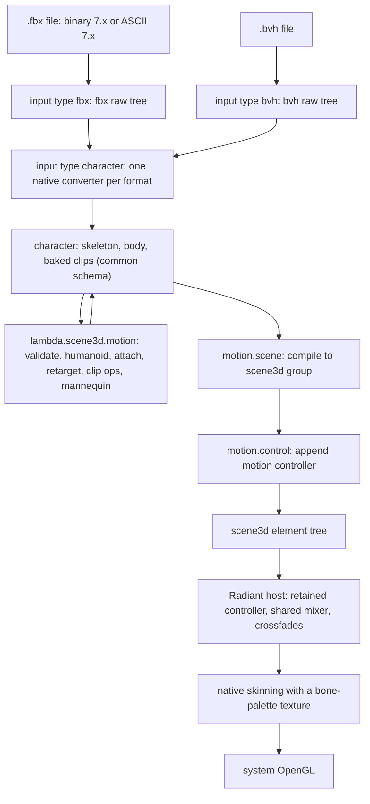

# Lambda Motion — FBX/BVH Character Animation for Scene3D

**Status:** proposal, 2026-10-21; on 2026-10-21 the user selected every recommended option in §13 and asked for M0–M5 to be implemented on the `motion` branch. All six milestones landed there the same day; acceptance status, deviations and open items are in the implementation record, [Lambda_Impl_Motion.md](impl/Lambda_Impl_Motion.md). The user asked for (1) FBX and BVH parsing into Lambda element trees and (2) rendering and animating the loaded characters in `<scene3d>`, packaged as `lambda.scene3d.motion`. On 2026-10-21 the user selected a **common, renderer-independent `<character>` schema** that both formats map into (§6); the earlier draft converted each format straight into the scene vocabulary (Appendix C). The choices collected in §13 were selected as recommended.

**Scope:** two new `input()` formats (`fbx`, `bvh`) with faithful raw mappings; the `<character>` schema with Lambda type definitions; one native converter per format into that schema; a source package that validates, edits, retargets and compiles characters into `<scene3d>` content; and the Radiant host changes that need (a larger skinning palette and retained controller playback). Root motion, blend spaces, IK, VRM and FBX blend shapes are later stages (§12).

**Builds on:** [Radiant 3D and WebGL design](radiant/Radiant_Design_WebGL.md) — §8 Phase III (shared SVG/3D animation engine, Three.js-style clip/action/mixer), §14 (raw textual model inputs), §15 (asset loading into native scenes) — and the [asset implementation record](impl/Radiant_Scene3d_Assets.md). This proposal extends those designs; it does not restate them.

**Authority and spec linkage:** applies existing rulings only; it changes no formal ruling and introduces no new ledger ID series (the scene3d area has none — see the WebGL design §2).

| Ruling | Applied here |
|---|---|
| **D7.2.4v3**, **S16.9.6**, **S16.9.8** | `lambda.scene3d.motion` is a shipped source package under the reserved root, mapped to `<lambda-home>/package/scene3d/motion.ls`; ordinary dotted import. |
| **S12.1.1v3** | Loading, validation, editing, retargeting and scene compilation are pure `fn` data transforms; playback is a host effect. |
| **S12.4.1v3** | `input()` returns an acquired value; dependency acquisition (FBX external textures) uses the existing input/URL path. |
| **D7.1.2v2** | All resource IO stays in `lambda-io`; Radiant never fetches. |
| **D4.1.3** | Raw and converted values, including decoded FBX arrays, belong to the destination Input pool/arena. |
| **S2.5.1v2**, **S2.6.4** | Arrays stay single content items; adjacent strings would merge, so ordered FBX properties travel in one array (§4). |
| **S9.3.2**, **D2.6.1v3** | Typed FBX arrays map to `ArrayNum` with the exact element kind; an `ArrayNum` is observably an ordinary array. |
| **S2.2.2v2** | Empty FBX binary properties map to `null`, as the A3D `Extra` mapping already does. |
| **S8.2.4v3** | BVH frames and character streams are read with positional subscripts (`data[f, c]`). |
| **S12.1.5v2** | The template owns the requested motion state; the host owns playback time, fades and automatic transitions (§9.2). |
| **D7.5.3v2**, **D7.4.2v2** | Lambda reaches the live scene only through `radiant-dom`; motion events use existing host scheduling. |
| **D4.5.1v4**, **D4.5.2**, **D5.3.3** | Controller and palette state are document-owned, generation-checked, and retain no GC pointers. |
| **D7.3.5** | Each stage names its conformance gate (§12). |

## 0. Summary

- **Three layers.** Raw format trees (`<fbx>`, `<bvh>`) are faithful to their files. Both convert into one **common `<character>` schema**: a skeleton of named joints with rest poses, an optional skinned body, and baked clips whose channels address joints by name. The package compiles a character into ordinary `<scene3d>` content.
- **The schema is the contract.** It is defined as Lambda types (`Character`, `Joint`, `Clip`, `Channel`, `Body`) plus invariants checked by `motion.validate`. Every converter must produce it, and every package operation consumes and returns it.
- **Format differences end at the converter.** Units, axes, Euler orders, FBX pivots and pre-rotations, curve interpolation, and cluster binds are normalized once, natively. A BVH file and an FBX file of the same motion yield characters that agree within tolerance (an acceptance test, §12).
- **Portable motion.** Clips name joints, not generated IDs, so a clip from one file drives any character with the same rig, and retargets onto a different rig through humanoid tags. IDs and track paths exist only after `motion.scene` compiles a character.
- **No new renderer concepts for the first milestones.** The compiled scene uses existing skeletons, skinning, tracks and the shared mixer. Two native limits stand in the way: the 16-bone skinning palette rejects real rigs (a Mixamo rig has about 65 bones), and a template cannot switch clips without restarting every timeline.
- **Declarative state, host-owned playback.** A `<motion-controller>` lists named states (walk, dance, jump) and the requested state. When a regenerated template requests a different state, the host crossfades with the existing mixer instead of rebuilding playback (S12.1.5v2).
- **Own parsers, reference oracles.** ufbx and the pinned Three.js `FBXLoader`/`BVHLoader` serve as test oracles, not dependencies (*recommended*, §10).

## 1. Starting point

### 1.1 What scene3d already provides

| Capability | Where | Reused for |
|---|---|---|
| Raw model inputs (`obj`, `mtl`, `gltf`, `a3d`) with MIME/extension detection | `lambda/input/input-model.cpp`, WebGL design §14 | Pattern for `<fbx>` and `<bvh>` raw mappings. |
| `SceneAsset` builder: Input-owned element/attribute/array construction, dependency resolution | `lambda/input/input-scene3d.hpp` | The character converters build with the same helpers. |
| Polygon triangulation | `asset_triangulate` | FBX polygons. |
| Skeletons, bones, `inverse-bind-matrix`, skinned buffer geometry | `radiant/scene3d.cpp`, `lmd/package/scene3d/model.ls` | Target of `motion.scene`. |
| ID-prefixing rewrite of loaded resources | `rewrite` in `lmd/package/scene3d/asset.ls` | Compiling a character's body (promoted, not copied; Appendix A). |
| Shared clip/action/mixer engine: linear/SLERP/Hermite sampling, fades, crossfades, warps, loop modes, additive blending | `radiant/animation_mixer.*`, `radiant/scene3d_animation.cpp` | Playback and controller transitions (§9.2). |
| Fixed-time seek, automatic scheduling, context-loss pose restoration | same | Deterministic captures of motion. |

### 1.2 Gaps this proposal closes

| Gap | Effect today |
|---|---|
| No FBX or BVH input | Mixamo (FBX) and mocap libraries (BVH) cannot be loaded. |
| No format-neutral description of a character | Each importer emits render vocabulary directly; motion facts (rest pose, joint names, humanoid roles) have no defined home and no validation. |
| Skinning palette of 16 bones (`uniform mat4 bones[16]`, validator `len(bones) > 16`, A3D quota) | Any production humanoid rig is rejected. |
| Clips bind to generated node IDs of their own file | A clip from `samba.fbx` cannot drive the character from `hero.fbx`, even with identical bone names. |
| No retargeting | CMU BVH motion cannot drive a Mixamo character. |
| Script playback control is `autoplay` plus one host operation for play/seek/automatic (`lambda/module/radiant/radiant_animation.cpp`) | No declared crossfade, loop-once-then-return, or state switching, although the mixer implements all three. |
| Any change to the animation source (`scene3d_animation_source_hash`) rebuilds the mixer | Switching the active clip from a regenerated template restarts every timeline. |

## 2. Architecture



| Layer | Responsibility | Effects |
|---|---|---|
| Raw input (`lambda-io`) | Decode bytes into a faithful element tree; no interpretation. | Reads the supplied document only. |
| Character conversion (`lambda-io`) | Interpret a bounded profile of each format into the `<character>` schema: units/axes, transforms, geometry, materials, skin, binds, curve baking. | Acquires declared dependencies (FBX external textures) through the existing input path. |
| `lambda.scene3d.motion` (source package) | Validate, edit, retarget and compile characters; construct controllers. | None (`fn`). |
| Radiant host | Skinning palette upload, controller reconciliation, transitions, events. | Graphics and playback. |

The conversion and compile steps are each the *only* place their work happens: no other path interprets FBX or BVH, and no other path assigns scene IDs or track paths to a character. `lambda.scene3d.load` keeps its current formats; characters enter scenes through `motion.load` and `motion.scene` (§13 decision 12).

## 3. Format detection

| Format | Extension | Content signature | Raw root |
|---|---|---|---|
| FBX binary | `.fbx` | `Kaydara FBX Binary` followed by two spaces, `NUL`, `0x1A 0x00`, then a `uint32` version | `<fbx binary: true, version: 7400, …>` |
| FBX ASCII | `.fbx` | Leading `; FBX 7.x.x project file` comment, or first node `FBXHeaderExtension:` | `<fbx binary: false, version: 7400, …>` |
| BVH | `.bvh` | First keyword `HIERARCHY` (case-insensitive, optional UTF-8 BOM) | `<bvh …>` |

Neither format has an IANA-registered media type, so HTTP inputs rely on the URL extension or an explicit `type`. The binary FBX signature is unambiguous and is sniffed even without an extension, like GLB's `glTF` magic today. FBX 6.x and older (a different object and take model) are rejected with a version diagnostic. The same detection selects the converter for `input(src, {type: 'character'})`.

## 4. FBX raw mapping (`<fbx>`)

### 4.1 The record model

Every FBX file, binary or ASCII, is a tree of *node records*. Each record has a name, an ordered list of typed properties, and nested child records. The mapping is 1:1 and uninterpreted:

- the record name becomes the element tag;
- the ordered properties become one array in the `props` attribute;
- nested records become child elements in file order.

Keeping properties in an attribute leaves the element content as pure child records, so `for (c in content(node))` walks the tree without skipping a property array. Properties cannot be positional content because adjacent string properties would merge (S2.6.4) — `P` records routinely hold four adjacent strings.

```lambda
<fbx binary: true, version: 7400,
  <GlobalSettings
    <Version props: [1000]>
    <Properties70
      <P props: ["UpAxis", "int", "Integer", "", 1]>
      <P props: ["UnitScaleFactor", "double", "Number", "", 1.0]>>>
  <Objects
    <Model props: [2205381344, "Model::mixamorig:Hips", "LimbNode"],
      <Properties70
        <P props: ["Lcl Translation", "Lcl Translation", "", "A", 0.0, 104.2, 1.3]>>>
    <Geometry props: [1922712512, "Geometry::Body", "Mesh"],
      <Vertices props: [[0.0, 0.0, 0.0, 10.0, 0.0, 0.0, 0.0, 10.0, 0.0]]>  // float ArrayNum
      <PolygonVertexIndex props: [[0, 1, -3]]>>  // i32 ArrayNum; -3 (= -2-1) ends the polygon at 2
    <AnimationCurve props: [3114059376, "AnimCurve::", ""],
      <KeyTime props: [[0, 1539538600]]>  // i64 ArrayNum; 1539538600 ticks = 1/30 s
      <KeyValueFloat props: [[0.0, 12.5]]>>>  // f32 ArrayNum
  <Connections
    <C props: ["OO", 2205381344, 0]>
    <C props: ["OP", 3114059376, 1500000000, "d|X"]>>
>
```

### 4.2 Property kinds

Binary FBX tags every property with a one-byte type code; the mapping preserves each kind exactly (S9.3.2).

| FBX code | Meaning | Lambda value |
|---|---|---|
| `C` | 1-byte boolean | `bool` |
| `Y` | int16 | `i16` |
| `I` | int32 | `i32` |
| `L` | int64 (object IDs, KTime) | `i64` |
| `F` / `D` | float32 / float64 | `f32` / `float` |
| `S` | length-prefixed string | `string`; empty → `null`; invalid UTF-8 → `binary` with a warning |
| `R` | raw bytes (embedded textures) | `binary`; empty → `null` (S2.2.2v2) |
| `f` `d` `i` `l` `b` | typed arrays, raw or zlib-compressed | 1-D `ArrayNum` of `f32`, `float`, `i32`, `i64`, `bool` |

Binary object names use the separator `\x00\x01` between name and class (`mixamorig:Hips\x00\x01Model`). The mapping rewrites them to the ASCII spelling `Class::Name` (`Model::mixamorig:Hips`), so a binary file and its ASCII export produce the same names. ASCII files carry no type codes: their numbers become `int` or `float`, their `*N { a: … }` arrays become `ArrayNum` of `int` or `float`, and bare-word tokens (such as `T` or `Y`) become symbols. Consumers must therefore treat numeric kinds uniformly; the converter does.

### 4.3 Binary decoding and limits

- Versions 7100–7700. From 7500 the three record-header fields widen from 32 to 64 bits, and the null sentinel record grows from 13 to 25 bytes.
- Every record end offset must lie inside its parent and advance monotonically; nesting depth is capped (64, matching the scene hierarchy cap).
- Compressed arrays declare their decoded element count; the decoder inflates exactly `count × element size` bytes and rejects short, long or trailing output. That bounded inflate already exists inline in the PSD decoder (`lib/image_psd.cpp`); promote it to a shared `lib` helper and call it from both (rule 13).
- Per-file quotas reuse the scene-asset limits: 64 MiB of source, and a total decoded-array budget (proposed 256 MiB) that bounds compression amplification. Per-array element counts reuse the 8,388,608-component accessor cap.
- The footer is not validated beyond structural bounds; writers vary.

### 4.4 What the raw mapping does not do

It does not resolve connections, evaluate `Properties70`, apply units or axes, triangulate, decompress embedded images, or validate object semantics. Those belong to the character converter (§7). The raw tree remains available for inspection and for Lambda-side tooling, such as listing a file's takes or bone names.

## 5. BVH raw mapping (`<bvh>`)

A BVH file has a `HIERARCHY` section (a joint tree with offsets and channel lists) and a `MOTION` section (a frame count, a frame time, and one row of channel values per frame).

```lambda
<bvh
  <hierarchy
    <root name: "Hips", offset: [0.0, 0.0, 0.0], column: 0,
        channels: ['Xposition', 'Yposition', 'Zposition', 'Zrotation', 'Xrotation', 'Yrotation'],
      <joint name: "Spine", offset: [0.0, 10.0, 0.0], column: 6,
          channels: ['Zrotation', 'Xrotation', 'Yrotation'],
        <end offset: [0.0, 15.0, 0.0]>>>>
  // data is a 2-D float ArrayNum of shape [2, 9]; it prints as nested rows
  <motion frames: 2, frame_time: 0.04, data: [
      [0.0, 90.0, 0.0, 0.0, 0.0, 0.0, 0.0, 0.0, 0.0],
      [0.0, 90.5, 1.0, 0.0, 0.0, 0.0, 0.0, 60.0, 0.0]]>
>
```

- Tags follow the source keywords: `root`, `joint`, and `end` for `End Site`. Several `ROOT` hierarchies are allowed.
- `channels` are symbols in canonical capitalization; keyword and channel matching is case-insensitive on input.
- `column` is the joint's first column in the motion data, so a script can read joint `j`'s channels in frame `f` as `data[f, j.column + k]` without recounting the depth-first order.
- `data` is one 2-D `float` `ArrayNum` of shape `[frames, channel count]`, rather than one element per frame. Mocap files have tens of thousands of frames; a row is still `data[f]` (S8.2.4v3).
- Attribute spelling follows the existing raw model mappings (`frame_time`, like A3D's `time_ms`).
- Errors: a `MOTION` row with the wrong value count, a row count that differs from `Frames:`, a non-positive frame time, non-numeric values, a missing section, an unknown channel name, a channel count that differs from the names given, or an `End Site` with children. Limits: 1,024 joints, and at most 8,388,608 motion values.

## 6. The common `<character>` schema

### 6.1 Why a separate layer

The scene vocabulary is the wrong meeting point for formats. It addresses everything by generated IDs (`samba-asset-bone-3.quaternion`), so motion is welded to the file it came from. It mixes playback flags (`autoplay`) with data, and it has no place for joint roles or rest poses as facts about the character. A dedicated layer gives:

- **one contract** that FBX, BVH and later formats must meet, checked by one validator;
- **portable motion**: channels address joints by name, so clips move between characters, and retargeting has the rest poses and humanoid roles it needs;
- **one compile point** into the scene, where IDs, paths and renderer limits are applied;
- **headless use**: a script can analyze joint trajectories, chart them, or edit clips without Radiant.

### 6.2 Types

These are the package's exported types (`lmd/package/scene3d/motion/schema.ls`, re-exported by `motion.ls`), in the element-type style of `lmd/package/doc/doc_schema.ls`.

```lambda
type Vec3 = float[3]
type Quat = float[4]                // [x, y, z, w], unit length
type Mat4 = float[16]               // column-major affine

type Joint = <joint
    name: string,                   // source name, unique in the skeleton
    humanoid: symbol?,              // VRM 1.0 role, e.g. 'leftUpperArm' (§8.2)
    position: Vec3,                 // rest pose, parent-local
    quaternion: Quat,
    scale: Vec3?,                   // omitted when [1, 1, 1]
    tip: Vec3?,                     // leaf extent: BVH End Site, FBX leaf bone length
    inverse_bind: Mat4?,            // character space; absent = derived from the rest pose
    Joint*
>

type Channel = <channel
    joint: string,                  // Joint.name
    position: float[]?,             // 3 per key, the joint's full local translation
    quaternion: float[]?,           // 4 per key, unit quaternions
    scale: float[]?                 // 3 per key
>

type Clip = <clip
    name: string,                   // unique in the character
    duration: float,                // seconds, >= the last key
    rate: float?,                   // source sample rate, informative
    times: float[],                 // seconds from 0, strictly increasing, shared by every channel
    Channel*
>

// scene3d mesh/geometry/material/texture vocabulary with body-local resource IDs;
// geometry is in character space and skin-indices address joints in skeleton preorder
type Body = <body <resources>?, <mesh>+>

type Character = <character
    name: string?,
    source: symbol,                 // 'fbx' | 'bvh'; later 'gltf' | 'vrm' | 'a3d'
    units: symbol,                  // 'm', or 'unknown' when the source declares no unit (BVH)
    rig: symbol?,                   // humanoid profile used for tagging (§8.2)
    <skeleton Joint+>,
    Body?,
    Clip*
>
```

Attribute names use underscores (`inverse_bind`, like the raw mappings' `frame_time`) so they read as plain fields in Lambda code. The scene vocabulary keeps its own hyphenated names; `motion.scene` translates.

**Recursive element types (fixed 2026-10-21).** `Joint` names itself, which the type system did not support until this proposal surfaced it. A `type` alias is bound to a placeholder before its body resolves; `direct_adopt_pending_alias_map` (`lambda/runtime/build_ast.cpp`) published the completed type through that placeholder for maps and unions only, so `type S = <s S*>` matched its children against an empty map and `<s <s>> is S` was `false`. Element aliases are now published the same way. `test/lambda/element_type_recursive.ls` covers content, attribute and union recursion, a parameter contract and a match arm, on every tier. With the fix, the §6.4 example matches `Character`, and a joint with a two-component `position` two levels down does not. Mutual recursion and forward references between aliases are ruled by S11.4.12 (TE-23, 2026-10-21): top-level type names bind for the whole module, cycles must pass through a structural position, and an unresolved name is E204. It was implemented the same day; the `<character>` types may be declared in any order.

### 6.3 Invariants

The types fix the shape; `motion.validate(character)` checks the rest and is run by every converter test and by `motion.scene`.

**Coordinates.** Right-handed, Y-up. Forward is +Z where the source declares a front axis (glTF's convention). Distances are metres when `units: 'm'`. Rotations are quaternions only: Euler angles, rotation orders, FBX pre/post rotation and pivots are resolved at conversion.

**Skeleton.** Joint names are unique; humanoid roles are unique. Several roots are allowed. At most 1,024 joints in the schema; the compiled scene applies the renderer's palette cap (§9.1).

**Rest and bind.** `position`/`quaternion`/`scale` are the rest pose: what an unanimated character shows, and what clips and retargeting are relative to. `inverse_bind` is the pose the body was skinned in. The two may differ (FBX allows it); a joint without `inverse_bind` is bound at rest.

**Clips are baked.** Every channel in a clip has exactly one value per key of the clip's `times`. Interpolation between keys is linear (SLERP for quaternions), so no consumer ever needs a curve evaluator. Channel lengths are `3 × len(times)` or `4 × len(times)`; quaternions are normalized and sign-continuous between consecutive keys. A channel names an existing joint, at most one channel per joint, and a channel is omitted when it equals the rest value at every key.

**Body.** Mesh geometry is stored in character space at bind time, so one inverse bind per joint serves every mesh. `skin-indices` address joints in skeleton preorder; each vertex has at most four influences, with weights summing to 1. Meshes without skin are static in character space. Resource IDs inside `<body>` are local; `motion.scene` prefixes them.

**Numeric streams** (`times`, channel arrays, geometry arrays, `inverse_bind`) are `float` `ArrayNum` values. By D2.6.1v3 this is a representation choice with no observable difference from boxed arrays.

### 6.4 Example

A two-joint BVH file (§5) at `scale: 0.01` becomes:

```lambda
<character source: 'bvh', units: 'm',
  <skeleton
    <joint name: "Hips", position: [0.0, 0.0, 0.0], quaternion: [0.0, 0.0, 0.0, 1.0],
      <joint name: "Spine", position: [0.0, 0.1, 0.0], quaternion: [0.0, 0.0, 0.0, 1.0],
          tip: [0.0, 0.15, 0.0]>>>
  <clip name: "walk", duration: 0.04, rate: 25.0, times: [0.0, 0.04],
    <channel joint: "Hips", position: [0.0, 0.9, 0.0, 0.0, 0.905, 0.01]>
    <channel joint: "Spine", quaternion: [0.0, 0.0, 0.0, 1.0, 0.5, 0.0, 0.0, 0.866025]>>
>
```

The Hips quaternion channel is omitted because it equals the rest value at both keys. The Spine's second key is its `Xrotation` of 60° (column 7), the quaternion `[sin 30°, 0, 0, cos 30°]`.

### 6.5 What the schema leaves out

- **IDs, track paths and playback flags.** These belong to the compiled scene and the controller.
- **Cameras and lights.** The scene supplies its own.
- **Unbaked curves.** Cubic and Euler-space interpolation are resolved by sampling at conversion. A later need for authored tangents would add an optional per-channel interpolation, not a second representation.
- **Morph targets.** Deferred with FBX blend shapes (§12).

## 7. Conversion into `<character>`

### 7.1 Entry point

`input(source, {type: 'character', flavor: 'auto' | 'fbx' | 'bvh'})` returns a `<character>`. Each format has exactly one native converter, built with the `SceneAsset` helpers (format-neutral Input-owned construction) and following the existing dependency and ownership rules (D4.1.3, S12.4.1v3). The package's `motion.load` wraps this call and applies caller options (§8.2).

Numeric streams are built as `float` `ArrayNum`. The cheapest way is to change `SceneAsset::array` once, so every existing scene-asset format benefits as well; by D2.6.1v3 this changes no observable value or golden.

### 7.2 FBX profile

The target is files written by Mixamo and by Blender's FBX exporter, plus Maya/Max files that stay within the same feature set. Anything outside the profile is an error or an explicit warning, never a silent approximation.

| Area | Profile 1 behavior → schema |
|---|---|
| Object graph | `OO` child→parent object links and `OP` links to a named property; parent `0` is the scene root. Cycles and dangling IDs are errors. |
| Units and axes | `GlobalSettings` `UnitScaleFactor` and the up/front/coord axis triples become one basis-and-scale conversion into character coordinates. Output is metres (Mixamo centimetres × 0.01) and `units: 'm'`. |
| Joints | `Model` nodes of type `LimbNode`, plus `Null`/`Root` nodes that are skin-cluster links or ancestors of one, in hierarchy order. `name` is the model name without its class (`mixamorig:Hips`). |
| Rest pose | The node's static local transform: FBX's full chain `T · Roff · Rp · Rpre · R · Rpost⁻¹ · Rp⁻¹ · Soff · Sp · S · Sp⁻¹` with its `RotationOrder`, decomposed to `position`/`quaternion`/`scale`. A decomposition with shear beyond tolerance is an error. `InheritType` values other than the common default are rejected (for example Maya segment-scale compensation). |
| Body geometry | `Vertices` plus `PolygonVertexIndex` (a negative index ends a polygon, `-i-1`). Normal, UV0 and color layers with `ByPolygonVertex`/`ByControlPoint` mapping and `Direct`/`IndexToDirect` references. Vertices are unwelded per unique (control point, normal, UV, color) and triangulated with `asset_triangulate`. The mesh's `GeometricTranslation/Rotation/Scaling` and its bind-time world transform (the cluster `Transform`, else its rest world transform) are baked in, placing the geometry in character space. Per-polygon material layers split a mesh into one `<mesh>` per material. |
| Materials | Lambert/Phong `DiffuseColor`, `DiffuseFactor` and opacity map to `lambert`. A `DiffuseColor` texture uses its `Video` `Content` bytes when embedded (via a data URI on the existing image path, as glTF buffer-view images do), else `RelativeFilename`, then `FileName`, resolved against the FBX URL. Specular, emissive, normal and other maps are warned and omitted, matching the MTL and glTF profiles. Shared materials become body-local `<resources>`. |
| Skin | A `Deformer` `Skin` on the geometry with `SubDeformer` `Cluster` children (`Indexes`, `Weights`, a joint link). Influences per control point are sorted, the four largest kept and renormalized; dropped weight produces a warning. Each linked joint gets `inverse_bind = inverse(TransformLink)` in character space. Two clusters that give one joint different `TransformLink`s (inconsistent bind poses across meshes) are an error in profile 1. A `BindPose` is the fallback when cluster matrices are missing. |
| Rigid parts | An unskinned mesh parented under a joint (a prop in a hand) becomes rigidly skinned: weight 1 to that joint. |
| Clips | Each `AnimationStack` becomes one `<clip>`, named by the stack (Mixamo writes `mixamo.com`; duplicates get a numeric suffix). Only the base `AnimationLayer` is used; extra layers produce a warning. `AnimationCurveNode`s on `Lcl Translation/Rotation/Scaling` gather `d|X/Y/Z` curves; channels without a curve use the curve node's default or the static property. |
| Baking | Key times are KTime ticks (46,186,158,000 per second), offset so the stack's `LocalStart` is 0. The clip's `times` are the union of all key times in the stack. Segments with cubic key flags are also sampled at the file's frame rate (`TimeMode`/`CustomFrameRate`, recorded as `rate`). A segment whose Euler change exceeds 180° on any axis is subdivided, so SLERP does not take the short arc where the source turned the long way. Each joint's full local transform is evaluated at every key and stored as its channel. |
| Omitted with warnings | Cameras and lights, blend shapes (§12), constraints, NURBS/patches, extra layers and user properties. |

### 7.3 BVH profile

- **Skeleton:** each `root`/`joint` becomes a `<joint>` with `position` = `offset` and an identity `quaternion`. An `End Site` becomes the parent joint's `tip`, which gives the mannequin a bone length without adding a joint.
- **Clip:** one `<clip>` named by the file stem, with `times` = `i × frame_time`, `rate` = `1 / frame_time`, and duration `(frames − 1) × frame_time` (the shared engine's inferred last-key duration).
- **Rotation channels** compose in the listed order, the first listed outermost (`Zrotation Xrotation Yrotation` → `Rz · Rx · Ry`), into a `quaternion` channel.
- **Position channels** give the joint's full local translation, replacing `OFFSET`. Writers disagree on this for non-root joints; the pinned Three.js `BVHLoader` is the oracle (§13 decision 8).
- **Units:** BVH declares none, so the converter emits source units with `units: 'unknown'`. `motion.load`'s `scale` option converts to metres and sets `units: 'm'`. Axes are taken as Y-up; the `up: 'z'` option of `motion.load` rotates Z-up files.
- **No body.** `motion.mannequin` (§8.6) makes a visible figure, or the clip is attached to a character with a body (§8.3).

### 7.4 Cross-format equivalence

Because both converters target one schema, the same motion written as BVH, binary FBX and ASCII FBX must yield characters whose world joint positions agree at every key within tolerance (after BVH scaling). The fixture generator (§11) writes all three from one source description; this test is the schema's main acceptance check.

### 7.5 Limits

Existing scene-asset limits apply to body geometry unchanged (vertices, indices, draw splits, 64 MiB buffers, hierarchy depth 64). Schema limits: 1,024 joints, 1,024 clips per character, and 8,388,608 values per channel array. Renderer limits apply when compiling (§8.7, §9.1).

## 8. The `lambda.scene3d.motion` package

`lmd/package/scene3d/motion.ls`, with helpers under `lmd/package/scene3d/motion/` (`schema.ls`, `humanoid.ls`, `retarget.ls`, `clips.ls`, `compile.ls`). Quaternion helpers (multiply, inverse, from-Euler, normalize) join `lmd/package/scene3d/transform.ls` beside the existing matrix helpers. Every export is a pure `fn` (S12.1.1v3), and everything except `scene`, `control` and `state` takes and returns `<character>` values.

### 8.1 Exports

| Export | Returns | Purpose |
|---|---|---|
| `Character`, `Joint`, `Clip`, `Channel`, `Body` | types | The schema (§6.2). |
| `validate(character)` | `bool^` | Type check plus §6.3 invariants, with a specific error. |
| `load(source, options)` | `character^` | `input(…, {type: 'character'})` plus `scale`, `up`, `rig` and `clip` options. |
| `humanoid(character, rig)` | `character^` | Set joint `humanoid` roles from a profile or a name map. |
| `attach(character, sources)` | `character^` | Add clips from other characters, by name or retargeted. |
| `retarget(clip, from, to, options)` | `clip^` | Map one clip from one skeleton onto another. |
| `in_place(character, axes)` / `mirror(character)` / `trim(character, from, to)` | `character^` | Operations on every clip of a character. |
| `pose(character, clip, key)` | `map^` | World transforms of every joint at one key. |
| `mannequin(character, options)` | `character^` | Add a capsule-figure body to a bodiless skeleton. |
| `scene(character, options)` | `group^` | Compile to `<scene3d>` content (§8.7). |
| `control(group, states, options)` / `motion_state(name, clip, options)` | `group^` / `element` | Append a `<motion-controller>` to a compiled group (§9.2). `state` is a reserved word in Lambda, so the state constructor is named after its element. |

### 8.2 Loading and humanoid roles

`load(source, options)` options: `scale` (multiply every length: joint positions, tips, position channels, body geometry, inverse-bind translations), `up` (`'y'` or `'z'`), `rig` (apply `humanoid` after loading), and `clip` (keep only the named clip).

The canonical roles are the VRM 1.0 humanoid bone names (`hips`, `spine`, `chest`, `upperChest`, `neck`, `head`, `leftShoulder`, `leftUpperArm`, `leftLowerArm`, `leftHand`, `leftUpperLeg`, `leftLowerLeg`, `leftFoot`, `leftToes`, the finger bones, and their right-side counterparts). Adopting an open standard costs nothing and makes a later VRM importer a pure profile addition (*recommended*, §13 decision 4). Rig profiles ship as data in `humanoid.ls`:

| Profile | Source naming | Example |
|---|---|---|
| `'mixamo'` | Mixamo rig, any namespace prefix | `LeftArm` → `leftUpperArm`, `Spine2` → `upperChest`, `LeftToeBase` → `leftToes` |
| `'cmu'` | CMU mocap as distributed in BVH | `LeftUpLeg` → `leftUpperLeg`, `LowerBack` → `spine` |
| `'vrm'` | names already canonical | identity |
| map | caller-supplied `{joint_name: role}` | custom rigs |

### 8.3 Attaching clips

`attach(character, sources)` takes a map from a new clip name to a source character, which contributes its first clip (select another with `load`'s `clip` option). The added clip is renamed to the map key, which keeps controller references readable. For each source clip:

1. Match source joints to target joints: by `humanoid` role where both joints are tagged, otherwise by `name` after stripping a namespace prefix (`mixamorig:`, `mixamorig1:`). Roles come first because names collide across rigs: a CMU `Spine` is a Mixamo `Spine1` (Appendix C).
2. If every matched pair has the same rest rotation (within tolerance), copy the channels with renamed joints: the cheap path for Mixamo character + Mixamo clips.
3. Otherwise `retarget` (§8.4).
4. Root translation is scaled by the ratio of target to source rest hip height. Position and scale channels on non-root joints are dropped by default (`keep_translation: false`): carried across characters they distort proportions.

### 8.4 Retargeting

`retarget(clip, from, to, options)` transfers each mapped joint's world-space rotation *change from rest*. It needs the 15 bones that VRM 1.0 requires (hips, spine, head, and the upper/lower limb chains with hands and feet) on both sides; other roles are optional.

1. For every key `t` of the clip, compose the source world rotations `Wₛ(t)` down the source skeleton (`pose`).
2. For each mapped target joint `b` with source `s`: `W_b(t) = Wₛ(t) · Wₛ⁰⁻¹ · W_b⁰`, where `⁰` is the rest pose.
3. Convert back to local: `L_b(t) = W_parent(b)(t)⁻¹ · W_b(t)`. Unmapped target joints keep their rest local rotation and get no channel.
4. Root translation is scaled by the hip-height ratio and re-expressed in the target's root frame.
5. Emit channels on the clip's existing `times`. Baked clips make this key-by-key arithmetic with no interpolation in Lambda.

This assumes comparable rest poses (both T-pose, as Mixamo and the common CMU BVH conversions are). A `rest_frame` option lets one source key stand in for the source rest pose when they differ. Automatic T/A-pose alignment is a later decision (§13 decision 7). The cost is a few quaternion products per joint per key, about 0.1 M for a 65-joint, 10-second, 30 fps clip, which the JIT tier handles easily. A native system function is warranted only if measurement says otherwise.

### 8.5 Clip operations

They take a whole character because only its skeleton says which joint is the root and which joints are left or right.

- `in_place(character, axes = ['x', 'z'])` holds the root's horizontal translation at its first-key value, the equivalent of Mixamo's "In Place".
- `mirror(character)` swaps left/right humanoid joints, reflects rotations across the YZ plane (`[x, y, z, w]` → `[x, −y, −z, w]`) and negates root X translation. It requires humanoid roles.
- `trim(character, from, to)` cuts `times` at existing keys and rebases them to 0.

Resampling a clip onto new times would need interpolation. Rather than re-implementing the sampler in Lambda, that waits for the shared sampler to be exposed as a system function (§12).

### 8.6 Pose and mannequin

`pose(character, clip, key)` returns a map from joint name to its world matrix at one key; with `clip: null` it returns the rest pose. Retargeting, the mannequin and analysis scripts (charting a hand's trajectory, say) share it.

`mannequin(character, options)` adds a `<body>`: one buffer geometry with a capsule per joint, from the joint origin to each child (or its `tip`), every vertex weighted 1.0 to its joint. A BVH character then renders and animates with no new renderer vocabulary. Options: `radius`, `color`, `segments`.

### 8.7 Compiling to the scene

`scene(character, options)` validates the character, then emits a scene3d `<group id>`:

| Character | Scene3d |
|---|---|
| `<skeleton>` | `<skeleton id: "<id>-skeleton">` |
| `<joint>` (preorder index `k`) | `<bone id: "<id>-bone-<k>", name, position, quaternion, scale, inverse-bind-matrix>` |
| `<body>` meshes and resources | The same elements with prefixed IDs (the promoted `asset.ls` rewrite); skinned meshes gain `skeleton: "<id>-skeleton"`. |
| `<clip>` (index `n`) | `<animation-clip id: "<id>-clip-<n>", label: name, duration>` |
| `<channel>` | `<keyframe-track path: "<id>-bone-<k>.position" \| ".quaternion" \| ".scale", type: 'vector' \| 'quaternion', interpolation: 'linear', times, values>` |

Options: `id` (required, the same rules as `lambda.scene3d.load`), `transform` (attributes for the group) and `autoplay` (a clip name). The renderer's limits are checked here with a specific error: the palette cap (§9.1) and the clip track cap.

Compile once and keep the group. `control(group, states, options)` only appends a controller, resolving each state's clip name to the clip ID through `label`, so regenerating a template on every state change does not recompile the clips.

### 8.8 Example

```lambda
import s: lambda.scene3d
import motion: lambda.scene3d.motion

// Mixamo downloads: the character "With Skin", the clips "Without Skin"
let hero = motion.load("assets/hero.fbx", {rig: 'mixamo'})^
let dance = motion.load("assets/samba.fbx", {rig: 'mixamo'})^
let jump = motion.load("assets/jump.fbx", {rig: 'mixamo'})^
// CMU mocap in centimetres, retargeted onto the Mixamo rig by attach
let walk = motion.load("mocap/walk.bvh", {rig: 'cmu', scale: 0.01})^

let rigged = motion.attach(hero, {dance: dance, jump: jump, walk: motion.in_place(walk)^})^
let compiled = motion.scene(rigged, {id: "hero"})^

fn stage(state, cue) element^ => s.normalize(s.scene([
    s.camera({id: "cam", position: [0.0, 1.4, 4.0], target: [0.0, 1.0, 0.0]}),
    s.light('ambient', {intensity: 0.4}),
    s.light('directional', {position: [3.0, 5.0, 4.0]}),
    motion.control(compiled, [
        motion.motion_state('walk', "walk"),
        motion.motion_state('dance', "dance"),
        motion.motion_state('jump', "jump", {loop: 'once', next: 'walk', fade: 0.1})
    ], {state: state, cue: cue, fade: 0.3})^
], {camera: "cam", width: 640, height: 480}))^
```

A reactive UI template regenerates `stage(state, cue)` when the user picks an action. Changing `state` crossfades; incrementing `cue` re-triggers the same state (another jump).

## 9. Radiant host changes

### 9.1 Skinning palette: 16 → 256 bones

`radiant/scene3d.cpp` holds fixed `bones[16]` arrays and declares `uniform mat4 bones[16]`. The OpenGL 4.1 core profile guarantees only 1,024 vertex uniform components (64 `mat4`), shared with every other uniform, so simply enlarging the array is not portable. *Recommended:* one bone-palette path through a float texture (`RGBA32F`, four texels per bone, `texelFetch` in the vertex shader), which is the approach Three.js uses. Per-mesh native arrays become sized to the skeleton, and the 512 MiB graphics budget accounts for the texture. The cap is 256 bones per skeleton, with a diagnostic beyond it. A uniform buffer object is the alternative; the WebGL design lists UBOs as further coverage of the shared GL core (§13 decision 3).

The validators (`model.ls` skeleton and skin-index checks), the A3D quota and §15's documented limit move to the new cap together. The clip track cap in `model.ls` (256) rises to 1,024: a 65-joint rig with three channels per joint already approaches the old cap.

### 9.2 Motion controller

`motion.control` emits this vocabulary into the compiled group; it can also be written by hand.

```lambda
<'motion-controller' id: "hero-motion", state: 'jump', cue: 3, fade: 0.3,
    <'motion-state' name: 'walk', clip: "hero-clip-2">
    <'motion-state' name: 'dance', clip: "hero-clip-0">
    <'motion-state' name: 'jump', clip: "hero-clip-1", loop: 'once', next: 'walk', fade: 0.1>
>
```

- **Placement and validation:** the controller is a child of the character's `<group>`. Every `clip` must name an `<animation-clip>` whose tracks target nodes inside that group. A clip belongs to at most one controller and cannot also be `autoplay`. State names are unique, and `next` names a state.
- **State attributes:** `loop` is `'repeat'` (default), `'once'` (clamped on the last pose unless `next` is set) or `'pingpong'`. `fade` on a state overrides the controller's default for transitions *into* that state. `time-scale` is per state.
- **Ownership (S12.1.5v2):** the template owns the *requested* state: `state` plus the re-trigger counter `cue`. The host owns the *playing* state: action time, fade progress and `next` transitions. The tiers never write each other's state, and a changed request from the template always wins.
- **Reconciliation:** `state` and `cue` are excluded from `scene3d_animation_source_hash`; everything else about the controller, its states and its clips stays in the hash. When a regenerated scene keeps the hash but changes `(state, cue)`, the host resets and plays the new state's action and calls the existing `animation_action_crossfade(from, to, fade, false)`. Other mutations that keep the hash leave playback untouched, which is the rule the current code already applies to sibling UI mutations.
- **Automatic transitions:** when a `once` state with `next` finishes, the host crossfades to `next` using the mixer's existing `finished` event. The template's `state` attribute is not rewritten. Requesting the same state again needs a new `cue`.
- **Deterministic seek:** exact-time sampling (render captures, tests) replays the requested state from time 0, including its `next` chain, so `lambda render … -o frame.png` at time `t` is reproducible.
- **Events:** state changes and finishes reach the document as events on the `<scene3d>` element through the existing host path (D7.5.3v2, D7.4.2v2), so a template can react (for example, re-enable a "Jump" button). The event names and payload follow the mixer's existing `finished`/`loop` events plus one `statechange {controller, from, to, time}`. Lambda template handlers receive them (`on statechange(evt)`; §13 decision 10, confirmed by `test/scene3d/motion-control.ls`).

### 9.3 What stays the same

Sampling, mixing, additive blending, context-loss restoration and the native draw path are unchanged. Controllers are a thin reconciliation layer over the existing actions, not a second animation engine.

## 10. Implementation choice: own parsers, reference oracles

| Option | For | Against |
|---|---|---|
| **Own FBX parser and converter** (*recommended*) | The node-record format is small (§4.3), and its 1:1 element mapping *is* requirement 1. The converter is bounded to a profile with explicit errors and targets our own schema. No vendor code to keep unpatched (rule 16). Consistent with the scene3d precedent of ANGLE and Rapier as references. | The converter is the real work (transform chain, layers, skin, curves). FBX is not publicly specified, so correctness rests on reverse-engineered documentation and oracles. |
| Vendor ufbx (MIT, single C file) | Complete and battle-tested semantics. | It parses bytes itself, so the `<fbx>` raw tree would be a second, parallel path. It adds a large vendored dependency to `lambda-io`, and any defect becomes an upstream patch question (rule 16). |
| Autodesk FBX SDK | Authoritative. | Proprietary license, closed binary; unacceptable. |

Oracles, used only in tests and capture tooling:

- **ufbx**, built in a test-only tool under `temp/`, never linked into `lambda.exe`: world joint matrices and skinned vertex positions at fixed times.
- **The pinned Three.js 0.186.1** `FBXLoader`, `BVHLoader` and `SkeletonUtils`, added unmodified with hashes to `test/demo/scene3d/vendor/three/addons/` like the existing addons: sampled poses for both formats and retarget comparisons.

## 11. Test assets and licensing

- **Generated fixtures** (committed): a Python standard-library generator writes each test motion three ways — BVH, binary FBX 7.4/7.5 (raw and compressed arrays) and ASCII FBX — from one source description, for the cross-format check (§7.4). It follows the existing glTF fixture generator. FBX-only fixtures cover pivots and pre-rotation, rotation orders, geometric transforms, unit/axis variants, rest ≠ bind, more than four influences, rigid props, multi-material meshes, cubic keys and Euler wrap-around.
- **CC0 characters** (committed if small, otherwise pinned online fixtures with hashes, like CellScope's remote GLBs): a rigged, animated humanoid in FBX from a CC0 publisher such as Quaternius or Kenney. The exact files are chosen and hashed at M3.
- **CMU motion capture** clips are free to use but not to resell as data; commit at most a few short trimmed clips with attribution, or fetch them as pinned online fixtures.
- **Mixamo files are never committed.** Adobe's terms allow use in projects, not redistribution of the raw assets. A local-only acceptance check runs against a character and clips the developer downloads into `temp/`.
- **Negative fixtures:** truncated records, offsets outside the parent, compressed-array size mismatch and expansion bombs, connection cycles, dangling IDs, unsupported versions, inconsistent per-mesh binds, BVH row/channel mismatches, and characters that break each §6.3 invariant.

## 12. Staged delivery and acceptance

Each milestone ends at its named gate (D7.3.5). Required aggregate gates (`make test-lambda-baseline`, `make test-radiant-baseline`) run at milestone boundaries, per the Radiant workflow.

| Milestone | Delivers | Acceptance |
|---|---|---|
| **M0 Palette** | Bone-palette texture, 256-bone cap, validators and A3D quota updated, clip track cap raised. | Procedural 65- and 256-bone skinned fixtures render with correct deformation at fixed times; 257 bones gives a diagnostic; existing `Scene3dTest.*` and the scene3d unit tests pass; GPU accounting covers the texture. |
| **M1 Schema + BVH** | Schema types and `validate`; `<bvh>` raw mapping; `character` input with the BVH converter; `load`, `pose`, `scene`, `mannequin`. | `.ls` + `.txt` goldens for the raw mapping, the converted character and the compiled scene across interp/auto/JIT tiers; every invariant has a failing fixture; world joint positions match Three.js `BVHLoader` at fixed times within tolerance; mannequin pixels change between frames. |
| **M2 FBX raw** | Binary 7.1–7.7 and ASCII 7.x → `<fbx>`, shared bounded inflate. | Binary/ASCII twins produce equal trees modulo numeric kinds; every negative fixture fails with a specific diagnostic; PSD tests still pass after the inflate promotion. |
| **M3 FBX → character** | The FBX converter: units/axes, transform chain, body geometry in character space, materials and embedded textures, skin and binds, curve baking. | Output validates; world joint matrices and skinned positions match ufbx at fixed times; the cross-format check passes for BVH, binary FBX and ASCII FBX of one motion; a textured CC0 character renders and animates through `scene`; the local-only Mixamo character + clips load and play. |
| **M4 Motion operations** | Humanoid profiles, `attach`, `retarget`, `in_place`, `mirror`, `trim`, quaternion helpers in `transform.ls`. | Goldens across tiers; a Mixamo clip on a second Mixamo character keeps feet on the ground (hip-height scaling); CMU walk retargeted onto the CC0 character matches the Three.js `SkeletonUtils` result within tolerance; every operation's output validates. |
| **M5 Controller** | `<motion-controller>`/`<motion-state>`, `control`/`state`, reconciliation, `next`, events. | Native fixed-time captures for walk → jump → walk; unrelated sibling regeneration does not restart playback; `cue` re-triggers; GPU allocations unchanged across transitions; deterministic seek reproduces a capture. |

**Later stages** (each needs its own scope): converters from skinned glTF, VRM (glTF with the `VRMC_vrm` humanoid map, so roles come for free) and A3D into `<character>` — the existing glTF scene importer should then route its skinned content through the character path rather than keep a second skin interpretation; root motion applied to the character's presented transform (with the physics package's authored/simulated/presented split); 1-D blend spaces (walk ↔ run by a parameter); two-bone foot IK and look-at; FBX blend shapes, which need schema morph targets and more than the native renderer's two; additive upper-body layers; crowds through skinned instancing; generated motion (text-to-motion and music-to-dance models typically export BVH, so they enter through M1); a system function exposing the shared sampler for resampling.

## 13. Decisions

**Selected 2026-10-21 (USER: "all recommended").** Each item below takes its recommended or proposed option; decision 8 remains to be confirmed against the pinned `BVHLoader`, and decision 10 is settled by what the implementation finds.

1. **FBX implementation:** own parser and converter with ufbx/Three.js as oracles (*recommended*), or vendored ufbx (§10).
2. **Raw FBX shape:** properties in a `props` attribute with child records as content (*recommended*), or another layout.
3. **Skinning palette:** float texture (*recommended*) or UBO; cap 256 per skeleton.
4. **Canonical humanoid roles:** VRM 1.0 names verbatim (*recommended*), or Lambda-style names (`left_upper_arm`).
5. **Controller vocabulary:** the element names `<motion-controller>`/`<motion-state>`, and `cue` as the re-trigger counter (alternative: `state` as a map `{name, serial}`).
6. **Character coordinates:** metres, Y-up, right-handed, +Z forward (*recommended*), or keep authored units and axes in the schema.
7. **Rest-pose alignment for retargeting:** comparable rest poses plus `rest_frame` initially (*recommended*), or automatic T/A-pose alignment now.
8. **BVH position channels on non-root joints:** replace `OFFSET` (proposed), to be confirmed against the pinned `BVHLoader`.
9. **Clip track cap:** raise from 256 to 1,024 alongside the palette.
10. **Event delivery to Lambda templates:** confirm the existing DOM event path covers `<scene3d>` events for Lambda handlers, or scope the gap. *Confirmed at M5:* the timing-event path delivers `statechange` and `finished` to `on …` handlers in a Lambda view.
11. **Skin binding in the schema:** body geometry in character space with one `inverse_bind` per joint and skin indices in skeleton preorder (*recommended*; matches the native bone-level binds), or a per-mesh palette of joint names with per-mesh inverse binds (handles inconsistent per-mesh bind poses, at the cost of a remap and duplicated skeletons in the scene).
12. **`lambda.scene3d.load` routing:** keep it to its current formats, with characters through `motion.load` + `motion.scene` (*recommended*), or route FBX/BVH through the character path inside `load`.

## Appendix A. Implementation seams

| Area | Files |
|---|---|
| Raw FBX | new `lambda/input/input-fbx.cpp`; registration and detection in `lambda/input/input.cpp`. |
| Raw BVH | `lambda/input/input-model.cpp`, beside the other textual model parsers. |
| Shared inflate | extract from `lib/image_psd.cpp` into a `lib` helper; PSD calls it. |
| Character conversion | new `lambda/input/input-character.cpp` (dispatch and BVH) and `lambda/input/input-character-fbx.cpp`; declarations next to the `SceneAsset` helpers in `input-scene3d.hpp`. |
| Typed streams | `SceneAsset::array` in `input-scene3d.hpp`. |
| Palette | `radiant/scene3d.cpp` (mesh bone arrays, vertex shader, upload); `radiant/gl_core.cpp` if a texture helper is missing. |
| Controller | `radiant/scene3d_animation.cpp` (parse, source-hash exclusion, transitions, `next`); `lmd/package/scene3d/model.ls` (new tags and attributes, caps). |
| Package | `lmd/package/scene3d/motion.ls`, `lmd/package/scene3d/motion/*.ls`; quaternion helpers in `lmd/package/scene3d/transform.ls`; the ID-prefixing `rewrite` promoted from `asset.ls` to a shared helper that both `load` and `motion.scene` call. |
| Tests | `test/test_input_model_gtest.cpp`, `test/input/model/`, `test/lambda/` goldens (`.ls` + `.txt`), `test/scene3d/`, `test/demo/scene3d/assets/motion/` with its generator. |
| Docs at delivery | WebGL design §14 rows for the raw formats and §15 limits; `doc/Lambda_Packages.md`; an implementation record `vibe/impl/Lambda_Impl_Motion.md`. |

## Appendix B. Format notes

**FBX binary record (v7.x):** `EndOffset`, `NumProperties`, `PropertyListLen` (each `uint32` before 7500, `uint64` from 7500), `NameLen` (`uint8`), `Name`, then the properties, then nested records ending with a null record. Array properties carry `ArrayLength`, `Encoding` (0 raw, 1 zlib) and `CompressedLength` before the payload. `S` and `R` carry a `uint32` length. Public descriptions: the Blender developer notes on the FBX binary format and the ufbx documentation; Autodesk does not publish a specification.

**FBX time:** one second is 46,186,158,000 KTime ticks.

**BVH:** `HIERARCHY`, then `ROOT name { OFFSET x y z  CHANNELS n …  JOINT … { … }  End Site { OFFSET x y z } }`, then `MOTION`, `Frames: n`, `Frame Time: t`, and `n` rows of whitespace-separated values in depth-first channel order. Rotations are in degrees, and the channel order gives the rotation order.

## Appendix C. Decision history

- **2026-10-21, first draft:** FBX and BVH converted straight into the scene3d vocabulary as new `scene3d-asset` flavors, with clip binding done by rewriting generated track paths.
- **2026-10-21, user selection:** a common `<character>` schema that both formats map into. The draft's direct conversion is superseded: motion no longer passes through generated IDs, and `motion.scene` is the single compile point into the scene.
- **2026-10-21, schema detail:** the first chat sketch of the schema gave each mesh a palette of joint names with per-mesh inverse binds. The proposal instead stores body geometry in character space with one `inverse_bind` per joint, because the native renderer stores binds on bones; the alternative remains §13 decision 11.
- **2026-10-21, decisions selected:** the user took every recommended option in §13 and asked for M0–M5 in a worktree branch.
- **2026-10-21, implementation (M4):** §8.3 step 1 matched joints by name before roles. Tested against a CMU-named source and a Mixamo-named target, that paired CMU `Spine` (chest) with Mixamo `Spine` (spine) and shifted the whole spine. Roles now take precedence wherever both joints are tagged, and names remain the fallback for untagged joints.
- **2026-10-21, implementation (M5):** a Lambda view's re-render rebuilds its DOM subtree rather than patching it, so §9.2's reconciliation could not see a `<scene3d>` survive regeneration. Radiant now carries a scene's entry, GL context and playback to the structurally corresponding viewport (`scene3d_follow_rebuild`, beside the other `*_follow_rebuild` hooks), and the animation source hash covers content rather than node identity; bindings still require their bone and mesh nodes to stay connected. `state` is a reserved word in Lambda, so the state constructor is `motion.motion_state`.
