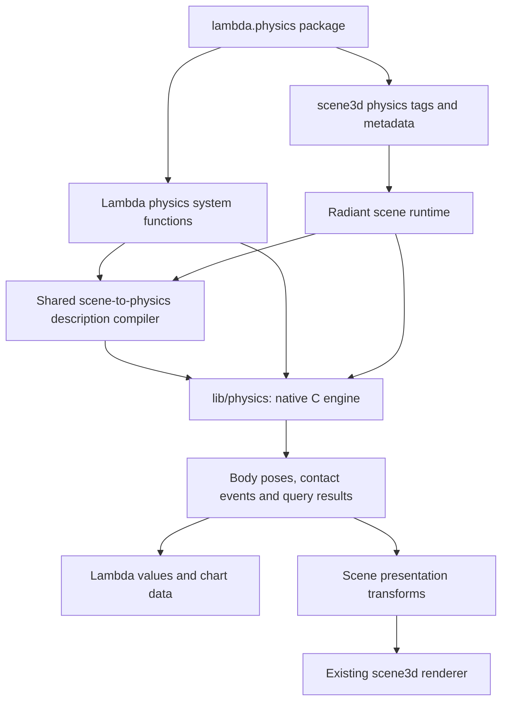

# Lambda Physics — Scene3D Integration and Native C Core

**Status:** initial 3D profile implemented, 2026-10-13; later stages remain open. The user selected a new C implementation
under `lib`, direct integration through Lambda system functions and Radiant
`scene3d` tags/attributes, and a higher-level `lambda.physics` package.
Rapier is a design and validation reference, not the implementation dependency.
The complete design below includes later stages. Delivered features, current
API spellings and remaining work are tracked in the
[implementation record](impl/Lambda_Impl_Physics.md) and
[user guide](../doc/Lambda_Physics.md); proposal text is not a claim that all
stages have shipped.

**Scope:** a reusable CPU rigid-body engine, first integrated with 3D scenes,
with the same engine usable for headless Lambda simulations. Genuine 2D
dynamics, additional constraints and deformable bodies are later extensions.

**Authority and spec linkage:** applies **D7.1.1–D7.1.3** (layering),
**D7.2.4 / S17.2.1** (namespaces), **D6.4.1–D6.4.2** (system-function ABI),
**S12.1.1v2 / S12.1.5v2** (effects and presentation ownership),
**S12.4.1v2–S12.4.3** (resources), **D4.5.1v4 / D4.5.2 / D5.3.3**
(native lifetime and rooting), and **D7.5.3** (Radiant host boundary).
These are in [Formal Design](../doc/Lambda_Formal_Design.md) and
[Formal Semantics](../doc/Lambda_Formal_Semantics.md). This proposal changes
no formal ruling. Detailed choices remain proposals until ratified; any
subsequent change to a covered ruling must update both documents under the
[documentation convention](../doc/Doc_Convention.md).

## 1. Selected architecture

Physics extends the existing scene description. A scene contains its visual
objects together with body, collider, joint and world configuration data.
Radiant instantiates and advances the native world, then projects its poses
into the existing renderer. A Lambda script can evaluate the same scene
headlessly and obtain ordinary data for charts, analysis or recorded playback.

The three layers have separate responsibilities:

| Layer | Responsibility |
|---|---|
| `lib/physics/` | Context-free C engine: bodies, collision geometry, spatial indexes, contacts, constraints, integration, queries and bounded native results. |
| Lambda / Radiant integration | System-function registration and value conversion; scene tag interpretation; scoped/document ownership; scheduling; pose publication; events. |
| `lambda.physics` | Scene constructors, presets, convenient commands, trajectories, diagnostics, chart adapters and recorded scene playback. |



The core is a source module in the existing static-library layering, not a
Jube DSO. Its public header exposes no `Item`, DOM, renderer, GL, interpreter
or scheduler types. Both upper integrations call downward into it
(**D7.1.1 / D7.1.3**). It performs no filesystem, network, window or clock I/O
(**D7.1.2v2**). Lambda operations on a *live Radiant scene* still use the
existing `radiant-dom` host boundary; the new system functions do not reach
into Radiant (**D7.5.3**).

## 2. Relationship to Rapier

Rapier provides useful reference concepts: separate bodies and colliders,
world-owned simulation state, joints, sensors, scene queries, sleeping and a
pipeline that maintains collision and solver state between ticks.
[Rapier simulation structures](https://rapier.rs/docs/user_guides/c/simulation_structures/)
and [colliders](https://rapier.rs/docs/user_guides/c/colliders/) explain these
boundaries. Lambda's numerical implementation and public API remain its own.

The core will be written in C with a C-compatible header usable from the
project's C++17 adapters. Rapier's Rust engine and C bindings are not linked,
loaded or required to build Lambda. A separately pinned Rapier executable
may be used in development as a comparison tool; agreement with it is useful
evidence, not the definition of physical correctness.

The current Rapier documentation also covers soft bodies and optional FEM.
Those are references for later scope, not features obtained automatically by
this project. [Rapier soft bodies](https://rapier.rs/docs/user_guides/c/soft_bodies/)

## 3. Scene vocabulary

### 3.1 Tags and their ownership

Use ordinary Lambda elements inside `<scene3d>`; no new language syntax is
required. Extend the existing
[Scene3D design](radiant/Radiant_Design_WebGL.md#4-lambda-package-and-scene-elements)
and `lambda.scene3d` normalization to recognize the following vocabulary.

| Tag | Placement and meaning | Principal attributes |
|---|---|---|
| `<physics>` | One direct child of a physics-bearing `<scene3d>`; nonvisual world configuration. | `gravity`, `timestep`, `state`, `solver-iterations`, `length-scale`, `max-substeps`, `limits` |
| `<rigid-body>` | A transform-bearing scene node, containing visuals and direct collider children. | `id`, `type`, `position`, `rotation` or `quaternion`, `linear-velocity`, `angular-velocity`, `linear-damping`, `angular-damping`, `gravity-scale`, `ccd`, `metadata` |
| `<collider>` | A direct child of one body; collision geometry and its local rigid transform. | `id`, `shape`, shape dimensions or `geometry`, `position`, `rotation` or `quaternion`, `density`, `friction`, `restitution`, `sensor`, `groups`, `metadata` |
| `<joint>` | A direct child of `<scene3d>`, referring to two bodies by ID. | `id`, `type`, `body-a`, `body-b`, anchors, axes, limits, motor/spring settings |

`state` is `'paused'` or `'playing'`, initially `'paused'`. Rendering the
initial scene therefore gives a stable authored pose. Playing begins only
when requested by the authored configuration or a host command. Static export
ignores live wall-clock playback and uses an explicitly sampled state (§8).

Physics-bearing scenes require the configuration tag; ordinary scenes without
physics keep their existing behavior. Physics objects require explicit IDs,
unique across the scene's existing ID namespace. Each scene owns one world;
references cannot cross scene roots. Body types are `'fixed'`, `'dynamic'`,
`'kinematic-position'` and `'kinematic-velocity'`. A fixed body can contain
multiple colliders, so floors and environment geometry use the same ownership
model as moving bodies.

`<physics>` and `<joint>` are nonvisual. A body behaves as a scene group for
its visual descendants. Colliders appear only in an explicitly enabled debug
overlay. Camera, light, material and texture changes have no physical effect.

### 3.2 Example: physics in an ordinary scene

This example uses existing box geometry for the visuals. The proposed physics
tags describe the matching colliders; they do not require importing a package
just to be recognized by Radiant.

```lambda no-run
// no-run: proposed physics tags are not implemented yet.
<scene3d width: 720, height: 420, camera: "camera", background: "#20242b",
    <physics gravity: [0.0, -9.81, 0.0], timestep: 0.008333333333333333,
        state: 'playing'>
    <camera id: "camera", position: [5.0, 3.0, 7.0], target: [0.0, 1.0, 0.0]>
    <light type: 'ambient', intensity: 0.4>
    <light type: 'directional', position: [3.0, 5.0, 4.0], intensity: 0.8>
    <'rigid-body' id: "floor", type: 'fixed', position: [0.0, -0.1, 0.0],
        <collider id: "floor-shape", shape: 'box', size: [8.0, 0.2, 8.0],
            friction: 0.6>
        <mesh,
            <geometry type: 'box', size: [8.0, 0.2, 8.0]>
            <material type: 'lambert', color: "#657080">
        >
    >
    <'rigid-body' id: "crate", type: 'dynamic', position: [0.0, 3.0, 0.0],
        metadata: {label: "Falling crate"},
        <collider id: "crate-shape", shape: 'box', size: [1.0, 1.0, 1.0],
            density: 1.0, friction: 0.5, restitution: 0.2>
        <mesh,
            <geometry type: 'box', size: [1.0, 1.0, 1.0]>
            <material type: 'lambert', color: "#4c8bf5">
        >
    >
>
```

### 3.3 Physics attributes on existing objects

Also admit a `physics` metadata map on `<mesh>` or `<group>`. It is an
authoring shorthand for the same normalized body/collider description:

```lambda no-run
// no-run: proposed physics metadata is not implemented yet.
<mesh id: "crate-visual", position: [0.0, 3.0, 0.0],
    physics: {id: "crate", type: 'dynamic', colliders: [
        {id: "crate-shape", shape: 'box', size: [1.0, 1.0, 1.0], density: 1.0}
    ]},
    <geometry type: 'box', size: [1.0, 1.0, 1.0]>
    <material type: 'lambert', color: "#4c8bf5">
>
```

The metadata body ID is distinct from the visual node ID. Normalization binds
the logical body to that node without rewriting its DOM identity. The node's
transform initializes the body exactly as `<rigid-body>` would. Both forms
use one description compiler, validator and engine path; the shorthand does
not introduce separate physics behavior. Explicit body tags and body metadata
cannot assign two bodies to the same transform owner.

`metadata` holds application data for inspection and events. It is preserved
by the integration layer and never interpreted by the solver. Events carry
IDs; the package can associate them with metadata without copying arbitrary
Lambda maps into native contacts.

### 3.4 Geometry, units and mass

Scene coordinates remain right-handed, Y up, with rotation angles in radians.
Physics uses binary64 internally, quaternions in `[x, y, z, w]` order, and
metres/kilograms/seconds by default. Convert to render precision only when
publishing scene transforms. CSS pixels, viewport density and camera zoom do
not change physical sizes.

`size` means full extents, matching `<geometry type:'box'>`. Sphere radius,
capsule radius and capsule segment length are explicit. Shared collision
geometry may refer to a scene resource by ID. A render mesh becomes a collider
only when explicitly requested; picking bounds never substitute for collision
geometry.

For the initial profile, dynamic mass, centre of mass and inertia are derived
from positive collider densities and actual shapes, including offsets through
the parallel-axis theorem. Sensors default to zero density in this proposal.
An advanced body-level mass-properties record may later override the complete
mass/inertia calculation; reject competing mass sources rather than guessing.
Require finite positive dynamic mass and valid inertia on unlocked axes.

Initially physics bodies and their ancestor transforms must be rigid:
translation plus rotation, with unit scale and no shear/reflection. A package
helper may bake a static supported scale into geometry before compilation.
Visual-only children may be scaled. Nested rigid bodies are rejected; joints
express physical connections. These restrictions prevent ambiguous inherited
scale, compound-body membership and world/local transform conversions.

`length-scale` is a positive characteristic size for numerical tolerances,
not an automatic unit converter. Package unit helpers must convert positions,
velocities, acceleration, density and inertia consistently. Rapier's
[integration parameters](https://rapier.rs/docs/user_guides/c/integration_parameters/)
are a useful reference for explicit scale and timestep controls.

## 4. Core physics design

### 4.1 World and step pipeline

The world owns generational body/collider/joint storage, immutable shape data,
spatial indexes, persistent contacts, constraints and scratch buffers. There
is no process-global current world. A world has one caller at a time; separate
worlds can run independently. It neither reads a clock nor starts threads.

Each fixed tick processes these stages:

1. Accept validated commands and kinematic targets for the tick.
2. Accumulate gravity, forces and torques; predict motion and update broad-phase proxies.
3. Generate candidate pairs, then contact manifolds or sensor overlaps.
4. Build active islands and constraint rows, retaining stable contact features for warm starting.
5. Solve contact/joint velocities, integrate poses, and perform bounded penetration correction and admitted CCD work.
6. Update sleeping, query structures, events and the published tick/state.

The exact internal ordering of CCD and discrete integration is a numerical
implementation decision to validate with time-of-impact fixtures. Each
completed tick must account for exactly the configured timestep once; a
substep must not apply a full tick's force or impulse again.

### 4.2 Initial numerical approach

| Subsystem | Proposed implementation |
|---|---|
| Broad phase | Dynamic AABB tree with conservative motion bounds, persistent proxies and collision-group filtering. Static triangle geometry gets its own BVH. |
| Primitive contacts | Analytic sphere contacts; sphere/box closest-point tests; oriented box SAT plus clipped contact manifolds. Capsule support follows with its own tested distance/contact cases. |
| General convex contacts | Later support mapping and GJK distance/intersection, EPA penetration recovery, and stable manifold generation. Degenerate/nonconvergent cases report diagnostics. |
| Contact persistence | Feature IDs and local anchors; invalidate cached impulses when shape, mass, topology or relevant material changes. |
| Solver | Iterative sequential impulses, warm starting, unilateral normal constraints, Coulomb friction, restitution above a velocity threshold; separate positional correction to limit artificial energy injection. |
| Integration | Semi-implicit velocity/position integration; quaternion angular integration with normalization. Preserve a declared inertia frame and gyroscopic treatment. |
| Sleeping | Island-aware motion thresholds and dwell time; forces, impulses, kinematic contact and topology changes wake affected islands. |
| CCD | Staged swept-shape/time-of-impact implementation with explicit admitted shape pairs and relative-motion coverage. |

These algorithms are proposed for Lambda; they are not a claim to reproduce
Rapier's current solver. Reuse shared constraint-row mechanics for contacts
and joints. Keep shared vector/quaternion/distance primitives in one lower
module, promoting applicable existing helpers instead of copying renderer code.

Collision tolerances derive from scale, numerical magnitude and the operation
being tested. Avoid one universal epsilon for contact distance, angular
normalization and matrix validity. Invalid geometry, nonfinite values and
numerical failure need located diagnostics. Numerical failure must not turn a
potential collision into an unexplained successful miss.

### 4.3 Explicit feature progression

| Profile | Delivered capabilities |
|---|---|
| First usable 3D slice | Fixed/dynamic bodies, sphere/box collision, compound colliders, density-based mass/inertia, friction/restitution, gravity/impulses, sensors, sleeping, ray/overlap queries. |
| Rigid-body completion | Kinematic bodies, capsules/convex shapes, fixed-environment triangle meshes/heightfields, fixed/revolute/prismatic/spring constraints, motors/limits, bounded CCD and shape casts. |
| Further extensions | Genuine 2D worlds, richer articulation/controllers, soft bodies and specialized solvers. |

An unsupported shape pair, joint or CCD mode is an error during preparation.
In particular, a `ccd:true` request cannot be accepted before its required
pair coverage exists. Static mesh collision and dynamic convex collision are
separate admission profiles; a concave render mesh is not silently treated as
its convex hull. The package may explicitly prepare compound convex geometry.

Rapier's [sleeping](https://rapier.rs/docs/user_guides/rust/rigid_body_sleeping/)
and [CCD](https://rapier.rs/docs/user_guides/rust/rigid_body_ccd/) guides are
references for workload and edge-case coverage. Their behavior is not an
unearned guarantee for the new C engine.

## 5. Minimal native and system APIs

### 5.1 Six C operations

Keep the initial native API to six operation families. Descriptors and command
records are typed C structs/tagged unions with pointer/count spans. They are
not arbitrary JSON packets, string evaluation or a public mirror of every
internal solver type.

| C operation | Contract |
|---|---|
| `physics_create(desc, out_world, error)` | Validate and create one world from complete configuration and initial objects. |
| `physics_destroy(world)` | Release the world and all owned allocations. |
| `physics_apply(world, commands, error)` | Apply an ordered, validated batch of object/configuration commands at a tick boundary. |
| `physics_step(world, tick_count, out_result, error)` | Advance a bounded number of fixed ticks; return state changes and events. |
| `physics_read(world, selection, out_state, error)` | Read selected poses/velocities, mass properties and deterministic counters without advancing. |
| `physics_query(world, queries, out_results, error)` | Run a batch of admitted ray/shape/overlap queries against current world state. |

Construction copies input spans. Native result views are world-owned and
valid only until the next mutating call or destruction; upper adapters copy
what they retain. Query scratch results additionally expire at the next query.
No native view is retained as borrowed storage in a Lambda value or published
render snapshot.

Commands initially cover creation/removal, force/torque/impulse, teleport,
kinematic target, material/configuration changes and wake/sleep. Use stable
caller IDs plus checked generations, never addresses. Forces explicitly state
whether they apply to the next tick or persist until cleared. Impulses apply
once. Force, impulse and point vectors are in world coordinates by default;
an explicit local-space option transforms them using the body's physical pose.
An omitted application point means the centre of mass. Removal invalidates
handles, dependent constraints and cached contacts.

Validate a command batch before modification. A validation failure leaves the
world unchanged. An allocation or numerical failure after execution starts
marks the world faulted and reports the last completed tick; only inspection
and destruction remain legal. Do not claim full transactional rollback of a
solver tick. Result/event overflow is an explicit failure, never silent loss.

Queries after an insertion, removal or teleport must see those changes.
Synchronize dirty query proxies before querying, without advancing simulation
time or emitting a second copy of step events.

Checkpoint encoding/restoration can add a separately versioned extension when
replay requires it; it is not part of the first six-operation contract.

### 5.2 Lambda system functions

Register a small system-function family under `lambda.sys.*` (**S17.2.1**).
Reserve `lambda.physics` for the script package (**D7.2.4**), so the same path
never denotes both a built-in module and a package.

| Proposed system function | Colour and successful result |
|---|---|
| `physics_simulate(scene, options)` | `fn`; immutable trace containing sampled states and events. |
| `physics_open(scene, options)` | `pn`; scoped, branded physics-world resource. |
| `physics_close(world)` | `pn`; close early, with idempotent resource cleanup. |
| `physics_apply(world, commands)` | `pn`; command count and current tick. |
| `physics_step(world, ticks)` | `pn`; completed tick, selected body states and ordered events. |
| `physics_read(world, selection)` | `pn`; immutable snapshot of selected live state. |
| `physics_query(world, queries)` | `pn`; one result per query, in request order. |

The simulation function accepts the scene's physics-bearing subtree and
explicit options such as `steps`, `sample_every`, selected IDs and scheduled
commands. Visual data is not rendered or acquired. It owns a private C world
for the duration of the call and destroys it before returning. It is a native
pure computation, not a Lambda `fn` calling `pn` helpers (**S12.1.1v2**).
It uses deterministic inputs and bounded work, without ambient timing.
The explicit tick schedule governs this path; the scene's playback `state`
and display-frame pacing options do not alter a batch run.

The other operations observe or mutate a retained world and are procedures.
Register signatures, error handling and GC/allocation effects identically for
the interpreter and MIR Direct, with boxed results (**D6.4.1–D6.4.2**).
Empty selections/queries return typed empty collections; an ordinary query
miss is an explicit absent result, while invalid geometry is an error.

No new general-purpose pointer value or physics-specific language syntax is
needed. Native worlds use checked resource identity and the existing host
projection protocol (**D7.4.1v2 / D7.4.4**). The resource's declared type must
participate in block cleanup and legal return transfer (**S12.4.2**). Verify
or complete that lifecycle integration before exposing `physics_open`;
a GC finalizer alone does not satisfy **S12.4.3**.

## 6. Radiant integration and state ownership

### 6.1 Authored, simulated and presented transforms

Maintain three distinct states: authored scene values; authoritative physics
poses/velocities; interpolated presentation poses. This applies
**S12.1.5v2**'s one-owner-per-state rule.

| Body mode | Transform authority |
|---|---|
| Fixed | Authored pose; an explicit scene edit/teleport updates collision geometry at the next boundary. |
| Dynamic | Solver owns position/orientation after initialization. Direct keyframe tracks on the same channels are rejected. Visual descendants may still animate. |
| Kinematic-position | Shared scene animation or a command provides the next target; the solver derives motion over the fixed tick. |
| Kinematic-velocity | Commanded velocities drive the body through the physics integration step. |

The physics layer returns world poses. Radiant applies the appropriate inverse
ancestor rigid transform when a local presentation transform is needed.
Interpolation uses linear position interpolation and quaternion spherical
interpolation. Interpolated poses never feed back into the solver.

Existing scene animation continues to own nonphysical material/light/camera
channels. Sample admitted kinematic animation at simulation tick times, not
at whichever frame happened to render. A paused world can still have a moving
camera without moving colliders.

### 6.2 Scene lifetime and edits

Store the native world in document-owned scene state, independently of the
disposable GPU projection. Resize, repaint, screenshot, camera orbit and GL
context recovery preserve it. Removing/replacing the owning scene destroys
its world. References check document/scene/world generations
(**D4.5.1v4**).

Classify authored changes rather than rebuilding the world for every DOM
mutation: appearance-only changes preserve physics; an authored body pose
change becomes a teleport that overrides its simulated pose and invalidates
affected contacts; physical configuration changes update affected objects;
structural edits add/remove bodies and invalidate dependent contacts/joints.
A template re-render that rebuilds the scene's DOM carries the world to the
structurally corresponding nodes, as form controls keep their native edits, and
classifies its authored changes as above: the template, the higher tier of
**S12.1.5v2**, overrides only the state it changed. Replacing a template-owned
scene with a different one starts from its new authored state. Runtime motion does not rewrite
authored `position` attributes every tick.

Native state contains copied scalars, geometry and stable IDs, not borrowed
GC pointers. Any retained script metadata/callback uses registered precise
roots (**D4.5.2 / D5.3.3**). A headless world belongs to its Lambda resource
scope; a scene world belongs to its document. These owners are never silently
shared. Transfer between them uses immutable descriptions or explicit recorded
state, not a raw pointer.

### 6.3 Commands and events

Expose a small Radiant host adapter for scene physics commands, reads and
queries through `radiant-dom` (**D7.5.3**). It resolves a scene node to its
owned world and adds presentation commands such as play, pause, reset and
single-step. These controls live above the clock-free C API. System functions
continue to operate only on their own headless world resources.

Events contain scene/body/collider IDs, tick, type and relevant contact data.
Collect them during native stepping; dispatch after the tick on the existing
page scheduler. Handlers cannot re-enter the solver mid-step. Their commands
are assigned to the next tick. Expose contact start/end and sensor entry/exit
first; admit force events when force/impulse units and aggregation are defined.
Event ordering is stable by tick, collider-pair IDs and event kind, and event
records remain valid if a handler removes an object before later delivery.

## 7. Time, determinism and performance

The core accepts an integer tick count and a positive fixed timestep stored
in the world. Default candidate: `1/120` second. Derive time from tick count;
do not accumulate a floating timestamp as the authority. Radiant uses its
existing frame scheduler and a wall-time accumulator to decide how many ticks
to request. `max-substeps` bounds work per display frame, separately from CCD
substeps inside one simulation tick.

The default overload policy preserves unprocessed tick debt and reports lag.
When a configured debt limit is exceeded, pause with a diagnostic. A background
pause does not accumulate an unbounded catch-up interval. Alternative pacing
policies must be explicit and recorded; do not silently enlarge `timestep`.

Promise reproducibility first for a pinned Lambda engine build/profile with
the same initial values, object/command ordering and tick sequence. Cross-CPU
bitwise replay is a separate tested profile, not a consequence of using
`double`. It requires controlled floating-point contraction, transcendental
operations, ordering and any future parallel reductions. Rapier's
[determinism guide](https://rapier.rs/docs/user_guides/c/determinism/)
illustrates why these conditions matter.

Keep broad-phase proxies, contacts, solver rows and geometry alive across
ticks. Sleeping islands and changed-body spans reduce work. Batch commands
and results across the native boundary. The renderer updates transforms
without rebuilding static mesh buffers. `physics_simulate` constructs one
world per run, not one per sampled frame, and sample selection controls trace
memory. A release benchmark must separate preparation, stepping, transfer,
presentation and rendering; no debug timing is performance evidence.

## 8. Recording, charts and export

Use three explicit data products:

| Product | Contents and purpose |
|---|---|
| Scene description | Authored elements, physical configuration, IDs and metadata; portable source of a new simulation. |
| Trace | Sampled transforms, velocities and events with ticks, units and build/configuration metadata; analysis and visual playback. |
| Checkpoint | Future complete solver state: contacts/warm starts, sleeping, generations, constraints and application command state; exact continuation within a declared compatible build. |

A trace is not a resumable solver checkpoint. Seeking an interactive simulation
requires replay from the initial description or a compatible checkpoint.
Recorded visual playback can seek its sampled poses directly. A versioned
checkpoint format needs size limits, validation and compatibility checks;
Rapier likewise distinguishes snapshots from stable interchange formats.
[Rapier serialization](https://rapier.rs/docs/user_guides/c/serialization/)

`lambda.physics` can convert a trace to chart records such as
`{tick, time, body, position, velocity, angular_velocity, energy}` and to
`lambda.scene3d` animation tracks. Energy diagnostics state which terms are
included and account for dissipation, applied work and solver approximation;
contact dynamics does not imply exact energy conservation.

For SVG/PDF/PNG export, first select a state by explicit tick or recorded
frame, materialize visual transforms, then use the existing scene export path.
Exporting the same state twice must not advance it. A pure package helper can
produce a visual-only scene from a trace frame, preventing a second live
simulation from starting during recorded playback.

## 9. The `lambda.physics` package

Provide an explicit `lmd/package/physics.ls` entry and helper modules under
`lmd/package/physics/`, following **D7.2.1–D7.2.4**. Package construction is
pure; it creates ordinary scene elements and data.

| Surface | Purpose |
|---|---|
| `physics.world`, `body`, `collider`, `joint` | Constructors for the canonical scene tags and their options. |
| `physics.attach` | Add physics metadata to a mesh/group using the same normalization rules. |
| `physics.simulate` | Thin wrapper over `lambda.sys.physics_simulate`, with declared presets and sampling defaults. |
| `physics.open`, `apply`, `step`, `state`, `query` | Convenient procedures over headless resources. |
| `physics.play`, `pause`, `reset`, `scene_step`, `scene_state` | Scene controls through the Radiant host adapter; load that adapter only in the presentation submodule. |
| `physics.trajectory`, `energy`, `chart_data`, `frame`, `tracks` | Pure analysis and recorded-presentation helpers. |

Keep the base import usable in the CLI profile without Radiant. Presentation
helpers live in an explicitly imported submodule such as
`lambda.physics.scene`; ordinary simulation does not eagerly import a host
module. Constructors may wrap spheres, boxes, capsules, ground, pendulums and
spring systems as those engine capabilities are admitted.

Batch simulation and chart preparation look like this:

```lambda no-run
// no-run: proposed lambda.physics package and system functions do not exist yet.
import physics: lambda.physics

fn analyze(scene) {
    let trace = physics.simulate(scene, {
        steps: 1200, sample_every: 4, bodies: ["crate"]
    })^
    physics.chart_data(trace, {body: "crate", fields: ["height", "speed"]})
}
```

Constructors and recipes do not reimplement collision detection, integration
or constraints in Lambda. New package features compose the core engine and
existing math/chart/scene facilities.

## 10. Acceptance and staged delivery

The first acceptance scene is a falling box with a fixed floor, synchronized
3D playback and height/velocity plots from the same tick sequence. It must
work both as literal scene tags and through package constructors.

| Stage | Reviewable outcome |
|---|---|
| A: C foundation | Six-operation API; isolated world lifetime; first primitive contacts; mass/inertia; deterministic fixed ticks; independent C tests. |
| B: Scene integration | Tags, metadata shorthand, shared description compiler, document ownership, dynamic presentation transforms, pause/reset/step and events. |
| C: Lambda and package | System-function contracts, pure batch simulation, scoped worlds, package constructors, chart records and frozen-frame export. |
| D: Rigid-body completion | Kinematics, joints, mesh environments, additional shapes and CCD, each admitted by focused fixtures. |
| E: Production evidence | Release performance/memory baselines, lifecycle stress, headless builds and cross-platform verification; checkpoint/replay extension only with complete state coverage. |

The conformance gates must include:

- Analytic free fall and impulse response, timestep-convergence measurements,
  elastic/inelastic impact, friction thresholds, inclined planes and resting
  stacks. Use tolerances appropriate to the chosen integrator.
- Rotated/offset compound bodies, parallel-axis inertia, centre-of-mass
  mapping, quaternion normalization, near-touching shapes, degenerate input,
  and large/small admitted scene scales.
- Broad-phase comparison with a brute-force oracle on small generated scenes;
  stale-proxy queries after commands; contact persistence; sleep/wake chains;
  joint drift and tunneling cases for each advertised CCD pair.
- Forced GC, stale handles, scope failure/cancellation, document removal,
  repeated play/reset, two independent scenes, resize and GL context recovery.
- Pure batch/live-core results at matching ticks, auto/interpreter/JIT parity,
  repeated-run event/state equality and recorded-frame export stability.
- Existing Lambda and Radiant baselines for their affected areas, source-layer
  checks, and scene animation/picking regressions. Every new golden-driven
  Lambda test script has its expected `.txt` result.

Measure release builds on named hardware with sparse scenes, dense stacks,
joint chains, sleeping worlds and moving objects against static meshes at
increasing body counts. Record candidate/contact counts, allocations, bytes,
tick time and pose-publication cost. Publish measured limits rather than
assuming a target body count will meet a frame budget. A Rapier comparison
uses the same geometry, precision, timestep and comparable solver settings;
do not require identical trajectories from different numerical methods.

## Appendix A. Integration map and implementation notes

This appendix locates the work; a detailed implementation tracker belongs in
`vibe/impl/` once implementation begins.

| Location | Expected work |
|---|---|
| `lib/physics/physics.h`, `physics.c` | Public six-operation API, world ownership and pipeline orchestration. |
| `lib/physics/` private C sources | Shape storage, broad/narrow phase, manifolds, constraints, integration and queries; keep the public header small. |
| Shared code below runtime/Radiant | One scene-description compiler over a read-only scene-source adapter; Item and DOM sources feed the same validation and body/geometry resolution. Promote applicable existing source-reader/transform helpers rather than copying them. |
| `lambda/runtime/lambda-physics.cpp` and builtin registry | Boxed system-function wrappers, pure-run allocation boundary, resource lifecycle, error conversion and precise rooting. |
| `lmd/package/scene3d/model.ls` | Extend structural tag/attribute validation and preserve physics metadata through normalization. |
| `radiant/scene3d.cpp`, scene source/animation helpers | Document-owned physics state, pose override, edit invalidation, tick scheduling and event delivery. |
| `lambda/module/radiant/` | Existing host boundary for live scene commands/reads/queries. |
| `lmd/package/physics.ls`, `lmd/package/physics/` | Constructors, analysis, recipes and optional presentation adapter. |
| `build_lambda_config.json` | Register native sources and supported profiles; regenerate build files through `make`. |

Use the project's C memory, array, hash and logging facilities. Scratch memory
is world-owned and reused. Native errors use status plus a caller-supplied
diagnostic record; no process exit, uncaught exception or cross-ABI jump.
Add no `std::` containers and no changes to third-party code. The engine's
math layer must be independent of Radiant's float rendering types.

The full host, runtime-only CLI and native headless profile can share the CPU
engine through the existing lower library (**D7.1.4v2 / D7.1.6**). Availability
must be explicit in reduced builds. Browser/WASM enablement requires its own
profile admission and tests under **D7.1.7v6**; a C implementation alone is
not evidence that a shipping WASM build includes physics.

## Appendix B. Decision history

The initial discussion recommended a Rapier-backed Jube module. On 2026-10-13
the user selected direct `lib` / system-function / Radiant integration and
explicitly selected a **new C implementation with Rapier as a reference**.
Those selections replace the earlier backend and packaging suggestion.
The public package remains a wrapper over native functionality, now with
`scene3d` tags and metadata as its common scene model.
