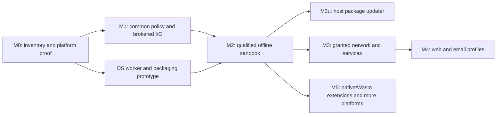

# Lambda App Safety: Implementation Plan

**Status:** implementation in progress. Policy, anchored filesystem mechanisms,
a host grant store and file broker, bound-client runtime output and Lambda
source/import/cache/prebuild, ordinary input/parser-resource and path/task clients,
exclusive publication, host ad-hoc admission/source manifests and grant
restoration, context-owned transactions, unsupported-adapter refusals,
bounded broker IPC and an experimental signed macOS T0
worker, a verified macOS supervisor, once-only terminal consent and resource
monitoring, guarded response publication, protected package-update controls,
host console management and a bounded anonymous HTTPS pull component returning
unverified bytes, plus broker-owned data/cache and per-admission
temporary files with lease-based recovery, are implemented. A private-Darwin native process policy is an experimental
qualification candidate, approved by the user on 2026-11-03 with default rollout gated on qualification. Default production admission, remaining I/O and
non-Lambda loading adapters, persistent permission UI and full M2 remain pending.
**Date / source survey:** 2026-11-02, base checkout at `c5e40c521` with the
approved safety documentation and ongoing implementation in the working tree.

**Design:** [Lambda App Safety](../Lambda_Design_App_Safety.md).
**Authority:** [formal design](../../doc/Lambda_Formal_Design.md)
**D11.1.1–D11.1.2, D11.2.1–D11.2.4** and
[formal semantics](../../doc/Lambda_Formal_Semantics.md) **S2.4.4, S16.9.8**.
This is an informative delivery plan. Proposed API names, file locations,
test targets, and implementation choices below are not shipped interfaces or
new rulings. Existing unresolved choices remain in the design's §14 / **DO19**.

## 1. What can be implemented

The next useful delivery is **offline script execution on one qualified desktop
OS**: select a project, load its dependencies, read its data, create outputs,
approve replacement of existing files, and retain grants across launches.
The worker must be unable to read unrelated user files, change
`~/.lambda/setting`, or open a network connection by bypassing Lambda APIs.

Much of the policy and file work can start with the current runtime. The
platform isolation proof must start alongside it: API permission checks alone
cannot deliver the promised protection from native code or runtime exploits.
Package auto-update is a separate, bounded service that can follow the offline
sandbox without first implementing general app networking.

| Deliverable | Feasibility from today's source | Delivery boundary |
|---|---|---|
| Shared principal, policy evaluation, structured denials, revocation | Implement now; reuse context capsules and existing permission adapters. | M1; policy checks are useful before containment, but are not a complete sandbox. |
| Admitted root, transitive imports, source-cache authorization | Implement now; integrate existing resolver and source cache. | M1; authorization must precede acquisition and initialization. |
| Create-only root writes and overwrite challenges | Implement now; extend existing file mechanisms and output adapters. | M1; all project mutations must ultimately run in the broker. |
| Persisted per-app/per-script grants | Implement the store now; qualify tamper resistance with the OS worker. | M1 + M2; owner-only file modes alone cannot satisfy **D11.2.3**. |
| Offline confined worker, trusted prompts and resource limits | Feasible target, with an early platform/packaging proof required. | M2; first release gate, not an optional hardening task. |
| Host package polling, verification, staging, pause/disable/restore | Implement after the protected policy service; reuse transport and scheduling mechanisms selectively. | M3u; no app network grant and no package-supplied request execution. |
| Granted app networking and selected account/device services | Incremental adapters after the broker exists. | M3; unsupported services remain denied. |
| Web/email isolation and full native extension tiers | Larger integration work; ship only individually qualified profiles. | M4 / M5; do not make these prerequisites for the offline scripting release. |

The first reduced worker can reuse the `lambda-cli` build boundary
(**D9.2.2**), which excludes Radiant, JS/TS, DOM, and Jube host modules.
That reduces the initial integration surface; it does not itself isolate the
runtime, its native dependencies, or its remaining I/O. Use the supported
T0/MIR policy under **D8.3.2**; an interpreter-only platform profile must
advertise its limits and reject unsupported workloads explicitly.

## 2. Existing code to reuse and gaps to close

This is a source survey, not a completed security audit. M0 expands it into
an entrypoint inventory. Paths here exist; filenames introduced in later
sections are proposals.

| Existing owner / mechanism | Reuse | Required change |
|---|---|---|
| [Context capsules](../../lambda/runtime/context_capsule.h) | Context-owned state and lifecycle, **D6.4.2–D6.4.4**. | Attach the broker session/principal reference; propagate it through tasks, callbacks, imports, and document execution. |
| [Node permission adapter](../../lambda/jube/jube_node_permission.cpp) | Existing filesystem/network query and denial entrypoints. | Replace its independent authority calculation with an adapter to the common policy. Current opt-in `--permission` behavior is not the new default sandbox. |
| [Node filesystem module](../../lambda/module/node_fs/node_fs_module.cpp) | Host permission callbacks and per-session module state. | Route descriptor, sync, and async operations through the same resource ownership and mutation rules. |
| [Target API](../../lambda/io/target.h), [input dispatcher](../../lambda/input/input.cpp), [module resolver](../../lambda/runtime/build_ast.cpp) | Target parsing, input dispatch, import resolution. | Separate lexical resolution from authorized acquisition; cover metadata probes and transitive loads as well as explicit reads. |
| [Source cache](../../lambda/input/input-script-cache.h) | Exact source snapshots, leases, concurrent build coordination. | Authorize every request, including a cache hit; keep initialized state scoped to its execution principal. |
| [File mechanisms](../../lib/file.c) | Exclusive create, regular-file validation, revision metadata, atomic writes. | Add safe root-relative acquisition and no-replace publication. `write_binary_file_atomic()` currently ends with replacement-capable rename; it is not a create-only operation. |
| [Procedural I/O](../../lambda/runtime/lambda-proc.cpp), [file search](../../lambda/runtime/io_file_search.cpp), [grep](../../lambda/runtime/io_grep.cpp) | Existing language-level operations and error adapters. | Broker output, append, copy/move/delete/rename, directory creation, search, command execution, and download publication. |
| [Process mechanism](../../lib/shell.c) | Spawn, timeout, cancellation and bounded captured output. | Add/compose a hardened worker launch path. Existing process spawning, inherited environment, or a timeout is not an OS sandbox. |
| [HTTP client](../../lambda/network/http_client.h), [downloader](../../lambda/network/network_downloader.cpp), [scheduler](../../lambda/network/network_scheduler.cpp) | Transport, cancellation, bounded scheduling and cache mechanisms where suitable. | Central egress authorization. Updater requests need a separate public-artifact profile without browser navigation headers, cookies, credentials or referrers. |
| [Document resource policy](../../lambda/io/resource_policy.h), [DOM fetch](../../lambda/dom/dom_fetch.cpp), [Radiant loaders](../../radiant/resource_loaders.cpp) | Existing document policy propagation and local-only checks. | Intersect content policy with broker grants. Local-only scheme filtering is not filesystem confinement; current allow-network defaults are not sandbox defaults. |
| [Jube registry](../../lambda/jube/jube_registry.cpp) | Manifest, ABI and integrity validation hooks. | Enforce admission before native loading and constructors; implement actual T2/T3 execution separately. |
| [Secrets](../../lambda/runtime/io_secret.cpp), [mail](../../lambda/runtime/io_mail.cpp) | OS secret-store and account transport adapters. | Add broker-enforced app/account scope and operation grants. |

Keep raw, context-free file/process mechanisms in `lib`; resource acquisition
and policy contracts belong in `lambda-io`; runtime and Radiant supply adapters
above it (**D9.1.1–D9.1.3, D11.1.2**). Do not place execution-context or DOM types
inside the neutral acquisition/cache layer. Use lower-owned hooks for host
services. Existing `safety_analyzer.*` concerns compiler optimization safety;
it should not become the app-security subsystem.

## 3. Delivery order and release gates

The milestone names match the design's Appendix C. Each implementation step
below has a bounded outcome. No whole milestone is complete yet; component
evidence and outstanding work are tracked in §6.

M1 can be exercised in a development harness with fake consent and isolated
settings. Its release notes must say that OS containment remains pending.
The sandboxed user workflow becomes releasable only at M2. An unsupported
platform/profile returns an explicit launch error; it cannot silently run with
host authority. Migration of existing trusted CLI workflows remains an explicit
product decision, not a missing-policy default-allow branch.

### M0 — Inventory, contracts, and first-platform proof

**Outcome:** a finite supported surface and a demonstrated route to OS
confinement before broad adapter work.

1. Inventory resource effects reachable from launch, parse, import, execution,
   rendering, background work, and native loading. Include file metadata,
   directory walks, implicit parser resources, caches, environment, process
   launch, inherited descriptors, logging, DNS, local IPC, and secret services.
   Record each owner, broker operation, supported profile, and explicit denial.
2. Agree the smallest worker feature set: local Lambda source/imports, selected
   files, ordinary data parsing, and file export. Classify complex parsers and
   their native dependencies; disabling Jube does not remove those libraries.
3. Prototype launch and IPC on the first desktop OS. The macOS candidate is a
   signed, confined helper with a separate trusted broker. Prove denial of raw
   home/settings access, networking, process/debug attachment, inherited
   resources, and another worker's storage before selecting the packaging model.
4. Check JIT entitlements and executable-memory behavior for the chosen worker;
   otherwise qualify an explicitly narrower interpreter profile. Also prove
   that prompt/render work cannot force code execution in the broker.
5. Specify principal admission, operation/resource vocabulary, revocation,
   error translation, IPC authentication, and host-only permission management.
   Record remaining choices from design §14 rather than inventing a new policy.

**Platform caution:** one signed helper used by every app must not give each
worker access to every app's container, selected files, keychain items or
entitlements. The supported helper/container arrangement needs evidence.
USER 2026-11-03 permits the private-Darwin process backend as an experiment,
with qualification required before any default rollout. API availability or
an ordinary child process cannot substitute for the isolation proof. Apple's entitlements describe the target's sandbox and optional access,
not Lambda's per-principal delegation model.
[Apple App Sandbox entitlements](https://developer.apple.com/library/archive/documentation/Miscellaneous/Reference/EntitlementKeyReference/Chapters/EnablingAppSandbox.html).

**Done:** publish the inventory and platform probe results, including exact
OS/build/signing configuration and unsupported features. A failed platform
proof blocks M2 on that platform, while portable M1 work can continue. Keep
the macOS decision separate from later Linux/Windows adapter qualification.

### M1.1 — Shared policy, identities, and protected grant-store service

**Outcome:** one authority calculation that all language and document adapters
can call (**D11.1.2, D11.2.1, D11.2.3**).

Proposed code: neutral `lambda/io/security_policy.{h,cpp}` and host-service
interfaces, plus a runtime context-capsule adapter. Put the trusted store and
management implementation in the host target; do not link policy mutation
entrypoints into an untrusted worker merely for convenience. Final file names
follow the M0 ownership review.

Implement these contracts first:

| Contract | Required behavior |
|---|---|
| Principal admission | Host-assigned identity for each installed app and each ad-hoc script, bound to its admitted entry/root and code identity. Caller-supplied names cannot claim stored grants. Changed code, roots or publishers require revalidation. |
| Policy evaluation | Intersect platform/profile/manifest ceilings, current grants, content rules, protected-resource exclusions and quotas. Missing security state denies operations; it does not identify a trusted caller. |
| Capability/resource ownership | Opaque principal-bound identifiers, operation set, lifetime and generation. Keep OS handles and ownership in the broker; copying an integer grants no authority (**D9.5.1**). |
| Denial and approval challenge | Internal distinction between denied, approval required, revoked, unsupported and resource-limit failures. Adapt to existing Lambda error values, Node errors and web exceptions without adding language syntax. |
| Revocation | Check at dispatch and before exposing sensitive async completion; cancel pending work and invalidate handles/delegations. Terminate workers if leaked raw access cannot otherwise be revoked. |
| Audit | Bounded local records of principal, operation, decision and reason. Avoid recording source data, secrets or full sensitive request payloads. |

Use the exact production directory **`~/.lambda/setting`**. Resolve it from
trusted host account state, not script environment or `LAMBDA_HOME`. Store
versioned records with strict parsing, identity binding, approval scope,
expiry, policy generation, revocations and updater preferences. Serialize
concurrent changes and publish crash-safely. Backup recovery must not resurrect
revoked grants; malformed or missing records yield minimal defaults.

Reject aliases, replaced ancestors, unexpected links and ownership changes
when opening the policy store. Use restrictive permissions, but label
same-user malicious-process resistance as pending M2. Management commands are
authenticated host/UI operations; a worker cannot grant itself access by
calling the same command name or protocol method.

Tests use a trusted test-only store location under `./temp/`; no test edits the
developer's real settings. Do not introduce a production environment override
that scripts could use to substitute a permissive store.

**Done:** table-driven authority tests, separate-script identity and changed-code
tests, malformed/unknown-schema tests, cross-principal and stale-rid denial,
revocation during queued completion, and store crash/concurrency recovery.
UI and OS tamper-resistance gates remain M2.

### M1.2 — File broker and create-versus-overwrite semantics

**Outcome:** one file service enforces **D11.2.2** for every output route.

Extend `lib/file.*` rather than introducing parallel file utilities. Existing
exclusive creation and `FileRevision` are useful primitives. Final-component
no-follow checks and a path-prefix comparison do not establish safe traversal
of a mutable directory tree.

1. Acquire files relative to broker-owned directory capabilities. Validate
   each traversed component and the final object, including protected roots,
   links, mount/reparse behavior, special files and hard-link aliases. Do not
   accept a worker-supplied absolute path as proof of containment.
2. Authorize reads, enumeration and metadata before acquisition. Brokers can
   return bounded bytes or resource handles; a selected file grants neither
   parent enumeration nor its siblings.
3. Create new root files atomically with exclusive-create semantics. Authorize
   necessary subdirectories before making them. Hold a creation resource for
   the stream; after close, reopening the now-existing file requires overwrite
   authority. Enforce byte/file-count/storage limits during writes.
4. Add a no-replace publication mechanism for staged output. Do not emulate it
   with `exists()` followed by rename. A concurrent winner must remain intact.
   Clean only broker-owned staging objects on failure.
5. For existing files, return a target/version/operation-bound challenge to the
   trusted shell before truncation, append, in-place update or replacement.
   Resume only with broker-issued approval and a current target validation.
   No locks are held across the user's decision.
6. Gate rename, move, delete, copy destinations, archive/export destinations,
   symlink creation, permissions and download publication independently.
   Delete/recreate and rename-over cannot evade approval. Private mutable app
   storage has a separate grant; it does not authorize root-file replacement.

**Race qualification:** device/inode/timestamps are useful change detectors,
not universal atomic compare-and-replace primitives. Define and test each
platform's approved-write transaction, retaining object handles where useful
and detecting namespace substitution. If an operation cannot preserve the
approved target binding, deny/retry it; never fall back to check-then-truncate
or promise isolation from arbitrary external writers. Already completed writes
cannot be undone by later revocation. Partial-write/crash behavior must be
documented alongside any atomic-save guarantee.

**Done:** new output succeeds without prompting; existing output remains
byte-identical on denial/headless failure; append and rename-over challenge;
concurrent creation preserves the winner; destination/link substitution during
consent is rejected; later reopens need approval; protected stores remain denied
even with an ordinary overwrite grant. Exercise real filesystem operations,
not only mocked policy results.

### M1.3 — Close the loading and runtime I/O paths

**Outcome:** the M0-supported worker has no privileged bootstrap or alternate
I/O route (**D11.2.1, D9.1.2, D11.1.2**).

- Establish the principal before reading/parsing the entry file. A loose file
  starts with that file and approved shipped libraries; sibling imports require
  the trusted root-selection workflow. A selected project grants root-local
  read/import/create, with protected descendants still excluded.
- Preserve import resolution under **S16.9.8** and pure resolution under
  **S2.4.4**. Pass the neutral acquisition authority into the loader, including
  prebuild workers and dynamic/transitive imports. A denied candidate does not
  trigger a more permissive search path.
- Authorize cache hits as well as misses. Reuse immutable bytes/artifacts only
  with valid acquisition authority and compatible execution ownership; never
  share initialized module state or heap references across principals.
  Initialization denial must retain **D9.3.2** transaction behavior.
- Route `input`, output/append, search, metadata, filesystem mutation and
  implicit parser resources through the common service. Include formatters
  that open destinations internally. Preserve the restricted TeX resource
  contract under **D10.2.2**.
- Deny network, shell/process launch, devices, account/secret operations and
  unsupported native loading in the initial profile. Deny at the adapter and
  OS layer; removing an import name is insufficient.
- When expanding to JS/Node, adapt existing permission queries and host
  callbacks to the shared service. Preserve API result/error semantics while
  applying the sandbox's default policy. Do not retain a second grant store.

Use **D6.4.2–D6.4.4** context ownership and **D6.3.3** precise rooting for any
async values. Task handoff must retain the caller's principal and generation,
not whichever process/thread context happens to run its callback.
Observe **D9.5.2** when adapting native async calls; do not park a Lambda task
through an unsupported native callback stack.

**Done:** selected-root diamond imports and initializer reads work; outside-root
imports, symlink escapes, cached denied inputs and cross-context callbacks
fail; app fetch remains denied. Add a maintained raw-I/O callsite inventory
or checker with explicit trusted mechanism owners. Static scans supplement
behavioral and OS tests; they do not prove containment.

### M2 — Trusted launcher, approval UI, and first complete offline sandbox

**Outcome:** ship the offline workflow with real containment on the first
qualified platform. Depends on M0's platform proof and M1.1–M1.3.

Implement the trusted supervisor and worker protocol. The supervisor owns
principal admission, settings, file selection, permission prompts and broker
resource tables. The worker owns untrusted script execution and parsing.
No project-wide writable directory handle or mapping is passed to it.
Even reads must preserve protected descendants and per-principal scope.

The launch path uses a known executable, controlled environment and working
directory, an allowlist of inherited handles, authenticated local IPC, and
verified confinement before any untrusted initializer or native constructor.
Use OS-supported process identity/handle mechanisms rather than a claimed
principal in a message. Version and bound the IPC schema; reject wrong-owner,
replayed, oversized, unknown and out-of-order requests. Do not serialize raw
`Item` pointers across processes (**D9.5.1**).

Add trusted root/file selection, concrete overwrite prompts, grant inspection
and revocation. Once/session/persistent scopes must be explicit. A worker
cannot submit an approval response, automate the trusted UI, or use synthetic
events as consent. Headless callers get structured errors unless the trusted
operator has already granted the operation. Keep prompt throttling and
background behavior in the host.

Enforce memory, CPU/wall-clock, process/thread, file/storage, IPC and output
budgets. A watchdog must kill a spinning or compromised worker; cooperative
task cancellation at park points (**S13.3**) is not a hard execution deadline.
Clean resources and pending approvals on crash, cancellation and broker exit.
App-private storage and temporary directories must be disjoint per principal.

**Release gate:** demonstrate both a real script workflow and a malicious native
test worker. The latter attempts raw syscalls against settings/home/other-app
files, direct network access, process creation, debug access, inherited handles,
forged IPC, writable mappings and namespace attacks. It must fail without
depending on language wrappers. Include restart persistence, changed identity,
revocation in flight, crash recovery and resource exhaustion. A test skipped
for signing/OS permissions leaves that platform unqualified.

The usable demo selects a project, imports a helper, reads data, creates a new
report, asks before replacing it, preserves it on denial, and shows/revokes its
remembered permissions after restart. This is the first sandbox release gate;
policy-only M1 results cannot substitute for it.

### M3u — Host package updater, independently of app networking

**Outcome:** implement the approved updater exception and its controls
(**D11.2.3–D11.2.4**) without a general fetch capability for apps. Depends on M2
for the protected host boundary; protocol/state-machine tests can start in M1.

Deliver in three reviewable steps:

1. **Admission and controls.** Store package identity, admitted endpoint/CDN
   origins, channel, publisher/trust roots and update state in the protected
   store. Implement global/per-package enabled, paused and disabled states,
   restore/resume, explicit pause expiry, and global offline precedence.
   Only trusted management changes these records. Polling cadence/backoff and
   download budgets are host settings, not app-controlled signals.
2. **Fetch, verify and stage.** The scheduler constructs HTTPS GET/HEAD requests
   from admitted public metadata. Share low-level transport where appropriate,
   not the browser's navigation/cookie profile. Reject app URLs, query/header
   injection, upload bodies, user-data inputs, ambient credentials, persistent
   tracking tokens and redirects/artifacts outside the admitted origin set.
   Do not expose a per-app request-now timing channel. Download into bounded
   staging; verify authentic metadata, hashes/lengths, version/freshness and
   key rotation. The user selected a Lambda Script implementation of the TUF
   verification workflow on 2026-11-03, with native cryptographic primitives
   and trusted host IO/storage mechanisms; no Python/Rust client runtime.
3. **Activation and recovery.** Extract in a confined staging worker; reject
   traversal, links to outside objects, special files and archive bombs.
   The installer publishes only an admitted managed package image, with
   crash-safe version selection and recovery. Recheck update state, trust and
   grants immediately before publication/activation. Keep live native versions
   pinned until process exit; no hot unload (**D9.4.2**). Additional capability
   requests remain denied pending consent. Project-vendored file replacement
   still follows **D11.2.2**. No privileged package install hooks.

TUF supplies the selected metadata/workflow model for signed roles, freshness
and rollback resistance. The initial Lambda profile and unsupported extensions
are explicit; full conformance remains a qualification gate.
[TUF client workflow](https://theupdateframework.github.io/specification/latest/).
Existing Jube digest tooling proves artifact consistency, not a complete
publisher-authenticated update channel. Local recovery to an older image must
also respect the admitted anti-rollback/revocation policy.

Pause/disable stops new checks, safely cancels active downloads, and prevents
automatic activation; persist it across restart and package changes. Restore
re-enables the retained admitted update configuration without resetting other
permissions. A trusted manual check is one operation, not schedule re-enablement.
Capture the network trace: it may reveal IP, timing and public artifact choice,
but must contain no user documents, paths, installed-package inventory,
credentials, unique installation IDs or telemetry. This is data minimization,
not an anonymity guarantee.

**Done:** a local fixture update server delivers signed valid/tampered/stale
releases, key rotation, redirects, oversized/truncated responses and malicious
archives. Verify pause/disable/offline races at poll, download, staging and
activation; restart persistence; no app fetch privilege; no overwrite of user
projects or settings. Successful download alone does not close this milestone.

### M3 — Selectively granted network, accounts, and devices

**Outcome:** support named user workflows without widening the default policy.

Start with brokered HTTP(S) acquisition and the account services needed by a
chosen app. Enforce parsed destination grants before DNS/connect and at every
redirect/retry; cover proxies, alternate address forms, loopback/LAN/metadata
destinations, certificate checks, cookies, authentication and cache reuse.
Bind approved resolution to the actual connection; prevent redirects and DNS
changes from crossing scope. Keep credential and cache partitions per principal.

Adapt `io_secret` and `io_mail` to app/account/operation grants. Add individual
device services only with lifecycle, visible indicator, revocation and resource
limits. Include audible output's existing origin/activation rule **D11.3.1**.
Subprocess/shell and arbitrary device access remain separate capabilities;
they are not necessary to close a brokered HTTP milestone.

**Done:** allowed requests succeed while redirect/rebinding/account-crossing
and cache-leak cases fail; revocation closes streams and prevents reconnect.
Publish the supported service list and leave every unimplemented family denied.

### M4 — Web and email profiles

**Outcome:** apply existing web/content controls inside the app boundary.
Depends on M2 and the network services actually used by the selected profile.

First close the existing document-resource path: propagate principal, origin,
document generation and resource policy through input, CSS/fonts/images/media,
script loading, DOM fetch, frames, caches and rendered exports. Local-only
content must also be confined to admitted local resources. Restrictive policy
cannot be lost through a new default-initialized document or async task.

Preserve email's script prohibition (**ML5v2** in
[Mail design](../Lambda_Demo_Mail.md)); finish engine-level remote-resource
enforcement tracked by **MQ14**. Test tracking pixels, CSS URLs, nested SVG,
frames, attachments, redirects and cached resources. A sanitizer alone cannot
close the gate. Interactive scripted email remains separate design work.

For web pages, qualify origin/storage isolation, CSP, CORS, frame sandboxing,
navigation, mixed content, workers and privileged bridges in the selected
engine/embedding. A system webview is usable only if supported APIs mediate
all requests required by the profile. A navigation callback alone is
insufficient. If that proof fails, keep the embedding unavailable for the
restricted profile or use an explicit external-browser handoff.

**Done:** focused security WPT slices plus host-integration attacks, per-origin
storage/cache tests, no app/account capability borrowing, and no email script
or remote load before the permitted user action. Publish profile limits;
do not claim comprehensive browser conformance from one green DOM suite.

### M5 — Third-party extensions and additional platforms

**Outcome:** qualify one real extension use case at a time under **D11.1.1**.

- Keep T1 as the explicitly trusted system set. Gate manifests, exact immutable
  images and native dependencies before `dlopen`/`LoadLibrary`; constructors
  execute during loading. Ordinary signing does not promote a module to T1.
- For T2, design a marshaled service interface with process/OS confinement,
  broker-delegated capabilities, typed resources, cancellation and bounded
  streams. The current in-process pointer ABI cannot simply cross IPC.
- For T3, select and qualify a Wasm engine and host imports for one bounded
  workload. Enforce memory/execution quotas and safe resource handles; do not
  treat the engine's existence as proof that its host functions are confined.
- Port the proven broker contracts to Linux and Windows, then qualify each OS
  independently. Mobile profiles need separate process/JIT/extension scope;
  they do not inherit desktop guarantees.

**Done:** actual malicious extension fixtures exercise constructors, raw I/O,
dependency search, malformed messages, crash/cancel and quota failures. Publish
the supported OS/version/profile matrix. Unsupported third-party native loads
continue to fail until their tier is implemented and qualified.

## 4. Verification and implementation discipline

The gates below are for future code changes. Writing this plan requires only
document/link checks and the formal-index consistency check.

| Change area | Focused checks to add or reuse | Required milestone checks |
|---|---|---|
| Policy/store/IPC | Proposed `test_safety_policy_gtest`, `test_safety_store_gtest`, `test_safety_broker_gtest`; real cross-principal, recovery and revocation cases. | M1 adversarial matrix; M2 malicious-worker gate on the actual packaged target. |
| File broker | Extend [file tests](../../test/lib/test_file_module_gtest.cpp); deterministic create/consent races plus real alias/namespace attacks. | Library correctness suite and `make test-lambda-baseline` when their owners change; exclude performance runners from debug qualification as described below. |
| Imports/context/async | Extend [source-cache tests](../../test/test_input_script_cache_gtest.cpp), import/init and task ownership fixtures. | `make test-lambda-baseline`; `make test262-baseline` when JS/Node integration changes. |
| Jube/Node adapters | Existing permission fixtures and loader-negative/integrity tests. Rebuild matching host and external modules. | Applicable `make test-jube-node-fs-dynamic`, `make test-jube-node-fs-negative`, `make test-jube-node-fs-async-work`, `make test-jube-module-integrity`, `make test-jube-module-loader-negative`; add net gates when that adapter changes. |
| Updater/network | Extend [HTTP tests](../../test/test_http_gtest.cpp) and [scheduler tests](../../test/test_network_scheduler_gtest.cpp); proposed isolated updater fixture server and request recorder. | M3u verification/activation/state matrix; M3 egress/revocation matrix. No public-server dependency for deterministic tests. |
| Radiant/web/mail | Document resource/profile tests, selected WPT slices, email remote-content and scripting cases. | `make test-radiant-baseline`, `make test262-baseline`, and `make test-mail` as applicable, plus real embedding/manual platform qualification. |

Register new executables through `build_lambda_config.json`; regenerate build
files through `make`. Add each golden-driven `.ls` fixture with its expected
`.txt`. Use `./temp/` for fixtures, staging and artifacts. Existing Makefile
permission matrices are authoritative; do not guess their launch flags.
Do not run `make node-baseline` unless requested.

The library suite currently also lists an AVL performance runner. For debug
correctness qualification, build the projects selected by
`node test/test_run.js --target=library --category=baseline --exclude-test=test_avl_tree_perf --list-build-targets`
and run the same selection without `--list-build-targets`. Qualify performance
separately in a release configuration, following AGENTS.md rule 10.

During an implementation step, run focused owner tests and the new adversarial
cases. At its boundary, run the applicable aggregate gates once; repeat them
only for relevant new edits, failures or unresolved concerns. Before building
in a worktree, follow [Developer Guide §7](../../doc/dev/Developer_Guide.md#7-worktrees-and-agent-gotchas).
Performance comparisons use release builds, follow that guide's worktree
restrictions, and measure launch/import and bounded broker-I/O overhead against
a pinned control. Do not weaken checks to recover a throughput target.

Record completion by behavior, with the source revision, platform/signing
configuration, commands, artifact locations, failures/skips and supported
profile. Policy mocks, static scans and regression counts are supporting
evidence; they do not replace raw-syscall containment tests. Keep formal
implementation footnotes honest; only remove an unimplemented mark when its
whole stated contract has evidence.

## 5. First implementation batch and deferred scope

Begin with **M0 + M1.1**, then **M1.2** and **M1.3**, while the OS proof resolves
M2 feasibility. This yields small reviewable changes: authority contracts and
store, file transactions, loading/adapters, then launcher/UI/containment.
The immediate acceptance scenario is the offline report workflow in M2.
Follow with **M3u** so auto-updates work while app networking stays denied.

Keep full browser parity, interactive email, unrestricted native modules,
all device classes, every platform, advanced information-flow tracking, and
automated migration of arbitrary trusted scripts outside the first release.
These are explicit later milestones or unresolved design work; none is a
reason to ship the core sandbox with a bypass. Exact schemas, identity-change
UX, quota presets and platform support choices should be settled in their
own concrete implementation reviews without widening **D11.2.1–D11.2.4**.

## 6. Implementation progress

### 2026-11-02 — Policy and publication foundations

Implemented [security_policy](../../lambda/io/security_policy.h) in the neutral
I/O archive, with no dependency on runtime contexts or DOM types. It uses
host-admitted resource identities, per-session ownership, operation ceilings,
project read/create defaults, explicit source admission, separate replacement
and append challenges, protected-resource exclusions, endpoint/service denial
by default, expiring grants, revocation generations and bounded resource/grant
tables. Its management API is host-only by contract; caller authentication and
safe resource acquisition still belong to the future broker.

Extended the existing `lib/file` atomic writer through a shared implementation
with `write_binary_file_atomic_new()`. Publication cannot replace an existing
destination; POSIX uses an exclusive hard-link publication and Windows uses a
move without replacement. The old replacement writer retains its behavior.
The new primitive requires an authorized, trusted parent; it does not replace
the planned root-relative broker or target-bound overwrite transaction.

Added a [macOS raw-syscall probe](../../test/safety/README.md#macos-platform-probe)
with an unsandboxed control and an App Sandbox signed worker. On macOS 26.5.2
arm64, all control operations succeeded and worker read/write/create/connect
operations returned `EPERM`. Per-principal container separation, JIT, process
and debug access, inherited resources and actual worker integration are still
unqualified. The probe does not complete M0 or M2.

Focused evidence: `make build-lambda-data` and the two focused runner builds
passed; `test_security_policy_gtest` passed 16/16 and
`test_file_module_gtest` passed 116/116. Raw results are under
`temp/app-safety-{policy,files}-results.json`; platform details and retained
signed artifacts are under `temp/app_safety_macos_probe/`.

Aggregate qualification:

- The library correctness selection passed **1,957/1,957**, excluding the
  performance runner from this debug gate. Its summary is retained at
  `temp/app-safety-library-summary.json`.
- `make test-lambda-baseline` completed **8,500/8,502**. The DOCX business-plan
  case hit its 60-second aggregate timeout, then matched its golden when run
  alone with both the candidate and the saved pre-change executable. The
  `proc_mir_mvp_roots` cold-float mismatch reproduces on the saved pre-change
  executable and is already recorded in
  [MIR MVP progress](Lambda_Impl_MIR_MVP.md). A focused real-harness rerun passes
  DOCX and retains that one known mismatch. The aggregate is **not green**;
  no golden or harness was changed.
- `make test262-baseline` exited zero with **0 regressions**, **40,258 fully
  passing / 40,261 selected** and **3 retry-only partials**. All three recovered
  on the runner's isolated retry, but its non-fully-passing classification is
  retained. This is not a claim of 40,261 fully passing cases.
- Document links, Python syntax, whitespace and formal-index consistency
  checks passed. The pre-existing duplicate `DO25` warning remains.

Logs, source hashes, final release-executable hashes and control comparisons
are recorded under `temp/app-safety-*`; the combined record is
`temp/app-safety-qualification.json`. The final executable was rebuilt in
release mode by Test262; its hash is not a digest of the earlier debug baseline.

The next batch implemented the grant-store and anchored filesystem components,
as recorded below. Runtime launches do not yet use the new policy by default;
no end-to-end sandbox protection is claimed.

### 2026-11-02 — Anchored filesystem and versioned grant-store components

Added raw `FileAnchor` mechanisms to `lib/file.*`: held directory descriptors,
component-wise no-follow traversal, private/trusted-parent checks, hard-link
and special-file rejection, root-identity revalidation, bounded reads,
exclusive creation, revision-bound replacement, and guarded publication.
Child anchors keep guard paths in the original admission scope. A guard is
checked again before read delivery or publication; production per-request
generation/clock binding is still the future file broker's responsibility.
Metadata checks do not promise CAS against arbitrary external writers.

Promoted the existing UUID entropy helper into `lib/digest.*` for shared use
by UUIDs and staging names. No weak random fallback was added. No-replace
publication uses native exclusive rename on macOS/Linux, avoiding a crash
window where a published file retained a second staging hard link. Unsupported
anchored platforms/filesystems fail explicitly.

Added [host grant store](../../lambda/host/safety/grant_store.h), compiled only
by its dedicated test target so far. It resolves the OS account home and uses
the exact `.lambda/setting` hierarchy without environment redirects. Strict
bounded V1 records bind host-assigned principal, code/root identity, explicit
persistent grants and expiry. Unknown or damaged records return no grants.
Independent instances serialize through a private, identity-checked lock file;
generation compare-and-swap prevents stale writers from undoing revocations.
Re-admission clears old authority; empty tombstones preserve revocation
generations. It never auto-restores older backups or staging records.

Focused checks pass: **126/126** file tests (including ten anchored cases),
**12/12** store tests, **16/16** policy tests and **9/9** digest tests. The
library correctness aggregate passes **1,979/1,979**, excluding debug
performance measurement. Evidence is under `temp/app-safety-store-*`.
The store tests include a killed writer and concurrent independent instances;
these do not substitute for OS confinement from hostile native code.

`make test-lambda-baseline` completed **8,501/8,502**: all 2,112 input cases
and 6,389/6,390 runtime cases passed. Its sole failure is the previously recorded
`proc_mir_mvp_roots` cold-float issue, reproduced identically by this candidate
and the saved pre-batch executable. The earlier DOCX timeout did not recur.
The aggregate remains **not green**. `make test262-baseline` passed
**40,261/40,261**, with **0 partials and 0 regressions**. Source hashes, raw
results and control comparisons are recorded in
`temp/app-safety-store-qualification.json`; the final executable is the release
build produced by Test262, rather than the earlier debug baseline image.

Generated source ownership was checked: only
`test_security_store_gtest.make` includes the host store source. The fixture
constructor is absent from ordinary runtime/worker builds. Document/link,
whitespace and formal-index checks passed; the existing duplicate `DO25`
warning remains.

Next: finish the supported-profile entrypoint inventory, connect this store
to principal admission, add the policy-owning file broker and runtime/loading
clients, and qualify the actual offline worker. No whole milestone is complete.

### 2026-11-02 — File broker, overwrite transactions and runtime output client

Added the host-only [file broker](../../lambda/host/safety/file_broker.h) and
[component contracts](../../lambda/host/safety/README.md), implementing the
file portion of **D11.1.2, D11.2.1–D11.2.3**. Each broker owns its policy and
admitted root anchors. Namespace authority precedes filesystem discovery and
parent creation. Bounded read/source byte requests retain dispatch generation
and refresh the host clock at sensitive checks. Selected files pin one leaf
and revision; private storage requires private owner permissions. Directory
protections follow actual object identities on absolute ancestors and relative
traversal, including case aliases. Catalog/root substitution fails closed.

Project output distinguishes native exclusive creation from existing-file
replacement and append. An overwrite challenge retains an immutable payload
copy and digest, exact observed target revision, principal/session, root,
operation, generation and deadline. Host-only description/approval/cancellation
functions expose no worker management opcode. Approval is single-use; stale
targets, revoked authority, wrong sessions and expired challenges cannot commit.
No broker lock is held while consent is pending. Byte, mutation-attempt and
pending-memory budgets include empty files and failed/partial writes.

Extended existing `FileAnchor` mechanisms with an ancestor-object callback and
held-object in-place/append writer. Errors distinguish an unchanged destination
from mutation/publication with possible partial or non-durable bytes; callers
must not blindly retry the latter. These revision checks remain **not CAS against
arbitrary external writers**. Platform transaction/race qualification belongs
to M2. Protected catalogs still require the production host provider; no store
or platform-directory path list is inferred from worker input.

Reserved staging names are denied on every client path component, including
reads. A local APFS experiment showed both ASCII case aliases and long-s
(`.lambda-ſtage-…`) resolve to the actual stage prefix. The shared classifier
therefore uses the existing Unicode normalizer with a new NFKC case-fold form
that removes ignorable characters. This reserves a conservative superset;
it never canonicalizes filesystem authority or rewrites a requested path.
Invalid UTF-8 fails closed. Existing language normalization forms are unchanged.

Added a neutral byte client and a context-lifetime runtime binding using the
capsule extension mechanism (**D6.4.2–D6.4.4**), preserving `EvalContext` layout.
`output()` consults it for string, binary, structured, lazy-file and ZIP writes.
Brokered output no longer creates parent directories through the ambient helper
before authorization. The store and broker sources remain outside ordinary
worker images; dedicated test targets own them. Current CLI launches do not
install a client, and other I/O/loading paths are still pending.

The policy now recycles closed resource/grant slots while retaining never-reused
serials. Closing a lease revokes that lease without invalidating unrelated work;
explicit permission revocation still advances the policy generation. Tests
exercise more requests than the live-slot limit and reject stale IDs after reuse.

Focused checks pass: **18/18** policy, **17/17** real-filesystem broker,
**10/10** runtime output (interpreter and MIR JIT), **126/126** raw file, and
**12/12** grant-store cases. The runtime checks include independent principals
using the same source/cache identity: the second execution calls its own
restricted client. The library aggregate passes **1,998/1,998**, excluding debug
performance measurement. An initial outer-sandbox run lacked fixture sockets
and trust-store access; the authorized run passed. One intermediate rerun hit
the runner's strict timestamp-order assertion; the unchanged final rerun passed
without concurrent compilation. Both failed summaries are retained under
`temp/app-safety-broker-*`.

`make test-lambda-baseline` completed **8,511/8,512**: all **2,112/2,112**
input cases and **6,399/6,400** runtime cases passed. The sole failure remains
`proc_mir_mvp_roots`; candidate and saved pre-batch executable reproduce the
same cold-float output (`temp/app-safety-broker-roots-control.json`). No golden
was changed. The aggregate remains **not green**. `make test262-baseline`
passed **40,261/40,261**, with **0 partials and 0 regressions**. A final review
made the approval digest explicitly hash the retained payload copy; all
**17 broker and 10 runtime checks** passed again after that change. No ordinary
runtime-image source changed after its aggregate qualification.

Final source hashes, executable provenance, counts and control comparison are
recorded in `temp/app-safety-broker-qualification.json`. The final `lambda.exe`
is the release image built by Test262; focused broker test relinks do not
replace it. Document links, whitespace and formal-index consistency checks
pass; the existing duplicate `DO25` warning remains.

Remaining delivery work: principal/code-root admission and store
restoration, input/import/cache adapters, other mutation/process/network APIs,
task propagation, authenticated IPC, trusted UI and the real confined worker.
The updater and M3–M5 remain open. No whole milestone is complete.

### 2026-11-02 — Lambda source, import, cache and prebuild acquisition

Connected file-backed `load_script` to the bound source client before parsing
or any Runtime/process-cache hit (**D11.2.1**, **D8.3.5**). Pure module path
construction remains under **S2.4.4 / S16.9.8**. Source identity is acquired
by the broker under `LOAD_SOURCE`, using a held regular-file descriptor and
rechecking the named revision, root binding and policy before return. Exact
bytes are separately authorized and captured through the same client. Data
read permission alone does not authorize source identity or source bytes.

The neutral source cache now accepts a per-request client for acquisition,
copy and freshness operations; it never retains that client in an artifact or
cache key. A failed/invalid client cannot fall back to native file access.
Permission denial does not invalidate another principal's immutable cache
records. Both same-Runtime hits and retained AST/MIR graph cloning re-read and
compare dependency bytes through the current client. Changed source retires
its importer cone; denied source rejects the load before initialization.
Existing execution-state cloning remains context-owned (**D6.4.2–D6.4.4**).

Added context-owned prebuild scopes. They copy the client, qualify futures by
authority scope, use explicit authorized resolution/build callbacks, and join
their own jobs before releasing the borrowed transport. Scope-less profiles
retain the legacy host path; scoped jobs never use that fallback or another
scope's language profile. The bounded pool remains process-wide. Source-only
workers release their new client capsules without borrowing the caller's TLS.

Bound loaders no longer call native `realpath`, `stat` or existence probes.
Canonical source names come from broker descriptors. An APFS experiment
confirmed that the existing C `realpath` collapses case aliases, and the new
descriptor path preserves the same module identity. A root and selected loose
leaf accept their original and canonical spellings while retaining the
object/version binding. Source failure does not try an ambient JavaScript
loader in this initial Lambda-only profile. Production JS/Node/Jube profiles
still require their own acquisition adapters.

The cache-off lane exposed a private-image bug in the new validation path:
Runtime-owned scripts have no immutable template to inspect. The validator
now follows an immutable owner when present and otherwise compares the
Runtime's retained source directly, preserving alias deduplication and refresh
without requiring a process-cache entry. Disabled caches also skip artifact
publication/dependency recording. No golden was changed. A denied-acquisition
diagnostic was corrected to log its canonical name before releasing it.

Added the maintained [loading I/O inventory](../../test/safety/Loading_IO_Inventory.md).
Focused checks pass **30/30** runtime cases on interpreter/MIR JIT, **20/20**
source-cache cases, **17/17** broker cases and **126/126** raw-file cases.
The cache-disabled lane passes **12/12** focused loading cases. Behavioral
coverage includes diamonds and parent imports, outside/symlink/sibling denial,
revoked dependencies on same-Runtime and retained AST/MIR hits, changed bytes,
canonical aliases, isolated futures and transport lifetime. The cross-principal
test explicitly verifies an artifact hit before rejecting a foreign dependency.

The library aggregate passes **1,998/1,998**, excluding debug performance
measurement. `make test-lambda-baseline` completes **8,534/8,535**: all
**2,112/2,112** input and **6,422/6,423** runtime cases pass. Its sole failure
is the existing `proc_mir_mvp_roots` cold-float issue; candidate debug and saved
pre-batch release produce identical output. The aggregate remains **not green**.
`make test262-baseline` passes **40,261/40,261**, with **0 partials and
0 regressions**. A final test-helper ownership-order correction is followed
by the focused cache gate; ordinary image source is unchanged after aggregate
qualification. Evidence and final release-image provenance are retained under
`temp/app-safety-loading-*` and the combined qualification JSON.

Next: initializer `input()`/forced-path and implicit parser resources, other
I/O/services and task propagation, production admission/grant restoration,
and the actual confined worker. Current CLI launches still do not install the
client. No whole M1/M2 milestone or end-to-end protection is claimed; updater
and M3–M5 remain open.

### 2026-11-02 — Ordinary input, directories and implicit parser resources

Implemented another **M1.3 component** under **D11.1.2 / D11.2.1**, preserving
the parser-specific restrictions of **D10.2.2**. The context's client reaches
ordinary `input()` (including module initializers and file forcing) and inline
`parse()` without adding runtime ownership to the neutral parser layer.

`input_from_target_with_io` branches before ambient directory, database,
system-information or HTTP dispatch. A regular-file classification requires
READ; a directory requires ENUMERATE. Classification conveys only kind, so
a selected READ-only file does not acquire general metadata permission.
The actual byte read checks again, with the existing input/archive size limit.
Non-file services have no adapter in this bound profile and cannot fall back
to their legacy dispatcher. Trusted NULL-client host calls keep their explicit
ambient path.

Added a held-anchor directory visitor in `lib/file` and a bounded broker
enumeration result. The visitor uses no-follow entry checks, excludes special
and hardlinked files, applies protection/staging guards, and revalidates the
directory before delivery. Overflow or observed mutation returns no partial
listing. The broker caps visited entries at 4,096 and returned bytes at its
I/O ceiling. Names/kinds and optional per-entry metadata have separate
authorization. `input-dir.cpp` shares Path construction across host and scoped
acquisition without issuing raw stat/list operations for a bound client.

TeX local/bundled probes and reads now carry the same synchronous borrowed
client. Both `tex` expansion and `latex` digestion inherit the input document's
location; the former previously omitted it. Scoped relative `.` bases use the
default root without weakening the narrower beside-document check. Existing
local file/byte budgets remain. Scoped expl3 engines build a private format
with their own resource reads instead of treating an ambient format-cache hit
as authority. This has a rebuild cost; a reauthorizable dependency manifest
is needed before sharing these scoped images.

Structurizr keeps its document-root, depth, file and aggregate-byte limits.
Scoped includes normalize addresses lexically before the narrower root check,
then classify/read/enumerate through the broker. Its byte budget is enforced
during acquisition rather than by a separate size-probe/read sequence.

Captured archive members parse their immutable bytes with an explicitly
closed external-resource client. Their lazy parse caches retain no live
Runtime transport or resources admitted by an earlier caller. Archive-relative
external-resource resolution is not implemented. The focused test supplies a
real external TeX package: ambient parsing reads its sentinel, while captured
member parsing and repeated cache use cannot read it.

The maintained [acquisition inventory](../../test/safety/Loading_IO_Inventory.md)
lists these exact owners and the remaining routes. Production admission,
wildcard traversal, filesystem/services, task propagation, JS/Node/Jube and
the actual confined worker remain open. Current CLI launches still do not
install this client; no whole M1/M2 milestone or end-to-end sandbox is claimed.

Focused checks pass **48/48** runtime cases across interpreter/JIT,
**16/16** input/parser cases with the script cache off, **20/20** broker
cases, and **127/127** anchored/general file cases. The library aggregate
passes **2,002/2,002** (excluding debug performance measurement). The final
Lambda baseline is **8,552/8,553**: **2,112/2,112** input and
**6,440/6,441** runtime cases. The sole failure remains
`proc_mir_mvp_roots`; current debug and saved pre-batch release executables
produce identical output, retained in
`temp/app-safety-input-roots-control.json`. The aggregate is **not green**.
The final source includes the relative TeX-base containment correction and
the ambient-control archive test; no golden or failure expectation changed.

The pinned final release passes the full Test262 baseline **40,261/40,261**,
with **0 partials / 0 regressions** and 2,652 existing skips. The initial
`make test262-baseline` invocation had four RegExp timing partials and zero
functional failures; isolated retries passed. A full pre-batch control run
passes, and three alternating four-case control/candidate pairs show no
reproduced slowdown. The full candidate rerun then passes without source,
harness, threshold or baseline changes. Initial results, paired timings,
executable hashes and final qualification are retained under
`temp/app-safety-input-*`.

### Path providers and task delivery component — 2026-11-03

**D11.1.2, D11.2.1** now cover the bound-client metadata, `exists`, directory
iteration, wildcard and task-read adapters. These are component changes;
production CLI admission and M2 confinement remain pending.

Runtime acquisition moved from `core/path.c` into `runtime/path_runtime.c`.
METADATA is independent of READ/ENUMERATE, including authorized absence.
Document-prefix probes use READ/ENUMERATE classification, and a force checks
that authority before reusing a captured head. SYS external-provider forces
are denied in this profile. `temp` document iteration remains in memory
(**S2.4.4, S2.4.6–S2.4.7**). Total `exists`/`len` keep their existing false/zero
refusal behavior; explicit force and metadata getters retain structured errors
(**S7.6**).

One sorted directory facade serves input lists, iteration and wildcard walks.
Scoped recursive walks share a 4,096-entry budget across sibling subtrees and
a 64-level bound, avoid symlink recursion and discard partial results on
refusal/overflow. Result arrays have precise root frames (**D6.3.3**).
Snapshots live in an EvalContext capsule with semantic path keys and stable
registered root slots, rather than writing heap values on shared Path spines.
Broker session/namespace epochs invalidate them on admission, restriction,
revocation and observed expiry; acquisition and publication stamps must agree.
These stamps are cache invalidators, not object capabilities.

Root selection now considers every operation-eligible admission. A selected
sibling is not hidden by a loose entry in the same parent, and a narrower READ
root does not shadow an ancestor's METADATA grant. Relative names expand
lexically from the default root before selection. A side-effect-free shared
policy preflight chooses a candidate without consuming IDs or issuing resource
authority. Actual acquisitions still require leases, anchored identity and
protection checks. A monotonically clamped broker clock prevents rollback from
reviving expired roots.

Scoped `io.read` copies the client and owned path into the existing offload
pool. The worker touches neither Runtime TLS nor GC values; owner-stack
delivery rechecks READ. Cancellation and teardown join active work before the
borrowed transport is released. Scoped `io.exec` denies before constructing a
process request. Other process/service routes still need their own adapters.

The in-memory checks also found two ownership defects. `path_get_root` retained
roots from an earlier evaluator's destroyed pool; it now shares the existing
pool-owned `path_new` constructor. Document heads/node identities were global;
they now live in a realm capsule with owner-bound precise roots. Another
context can neither reuse nor clear those heads. Realm capsule heap-release
callbacks, including dynamically registered ones, run before heap destruction
(**D6.4.2–D6.4.4, D6.3.3**).

The [acquisition inventory](../../test/safety/Loading_IO_Inventory.md) records
remaining filesystem mutation/search and write-set ownership, named-host
identity, process/network/account/device and JS/Node/Jube work. Production
CWD/shipped-resource mapping, complete protected-root admission, authenticated
IPC, real Lambda OS workers, approval UI and the updater are still open.

Qualification for this component: runtime safety **78/78**, path representation
**21/21**, policy **19/19**, broker **24/24**, and library baseline
**2,007/2,007** pass. The 30 path/task cases also pass with forced collection
and poisoned frees, and with the source cache disabled. The final Lambda
baseline is **8,582/8,583**: input **2,112/2,112**, runtime **6,470/6,471**.
Its sole failure is `proc_mir_mvp_roots`; candidate debug and the saved
pre-batch release have identical stdout, recorded with executable hashes in
`temp/app-safety-path-roots-control.json`. No golden or expected failure changed.
The aggregate is not green.

Additional concurrency checks pass the isolated task fixture **21/21** and
activation fixture **13/13**. Isolated realm/cache checks pass **9/10**; the
remaining `AutoFallbackCachesMirImportConeAndViews` failure concerns the MIR
artifact/cache-hit expectation, while all three evaluated results are 42.
The optional full 57-case executable first fails Jube ordinal/name parity
(including a fatal alias-ordinal assertion), then reports refused context
switches and crashes in the AUTO-cache case. It does not produce a complete
JSON report. These additional aggregate failures remain unqualified; they are
not reported as pre-batch failures without a matching native control. The
harness and assertions were not changed. Logs and isolated JSON results are
retained under `temp/app-safety-path-concurrency*` and
`temp/app-safety-path-activation*`.

The final `make test262-baseline` passes **40,261/40,261**, with **0 partials,
0 failures and 0 regressions** (2,652 existing skips), on the first completed
run for this component. The pinned release executable is unchanged across the
run; its SHA-256 is
`d37cf0cc94aeeef2816a803cc3bdd21a2ed5e2397c55eaa02f2a6bfb77b1d3cd`.
No timing thresholds, JS harnesses or baselines changed. Build configuration,
local documentation links, ruling-index generation and whitespace checks pass;
the ruling-index tool retains the existing duplicate-DO25 warning.
Implementation hashes, focused/aggregate counts, control outputs and the exact
remaining gates are collected in `temp/app-safety-path-qualification.json`.
The goal remains active; no complete M1/M2 milestone is claimed.

### Private IPC and a real confined T0 worker — 2026-11-03

Implemented the next **D11.1.2 / D11.2.1** component: an experimental dedicated
Lambda worker, a bounded private broker channel and actual signed-process
qualification. This does not complete M1 or M2, and ordinary CLI execution
still lacks production sandbox admission.

`lib/ipc_stream.*` owns connected local-stream acquisition and raw transfer,
preserving **D9.1.1–D9.1.3**. `lambda/io/security_channel.*` owns the explicit
little-endian framing and the seven existing acquisition callbacks. Neither
`Item` nor native pointers/struct layouts/descriptors cross the wire. Payload,
request, cumulative-byte and absolute monotonic deadline bounds are finite.
Replay, wrong sessions/sequences, unknown operations/flags, truncation,
malformed replies and ancillary data close the connection; received file
descriptors are closed. Missing or failed channels never select ambient I/O.
The host reserves response space before invoking a mutation. Client calls
serialize through complete reply validation, including concurrent task reads.

The admitted private endpoint is the capability; a session number or same-UID
peer credential is not proof of admission. No permission/store/approval/native
management operation exists in the schema. Host admission, process identity,
publication/revocation coordination and hard resource supervision still belong
to the unfinished production launcher. Existing broker object/lease checks
remain in force; IPC does not replace them.

A complete write request can commit before its reply is lost. The client
returns `outcome_unknown` separately from confirmed `committed`, closes the
connection and never retries. `output()` now carries this call's owned error
through text, binary, structured and ZIP paths (**S7.4.5, D6.4.2**). Logging a
diagnostic alone was not an error carrier; the new failure case exposed and
fixed that boundary, including forced-GC/poison coverage (**D6.3.3**).

`make build-safety-worker` produces the experimental bootstrap. It derives
from **D9.2.2**, installs its client before entry canonicalization/read/parse/
initialization and joins task/prebuild users before closing transport. Its
profile excludes MIR/JIT, networking, DevTools, JS/TS, DOM, Radiant, Jube and
policy management. The target does not install containment itself. It must
run in a fresh process whose trusted launcher has already verified confinement
and admitted the private connection. Current limits are 1 MiB frames, 64 MiB
cumulative bytes, 8,192 requests and a 10-second transaction/idle bound.

The CLI profile had omitted required image/font, MVP compiler and scratch
protocol dependencies. The shared profile now retains the font/vector
mechanisms and their matching header/libraries (CoreGraphics on macOS), the
MVP source group and the scratch protocol. This follows D9.2.2's required
third-party-mechanism boundary without adding Radiant/JS/Jube hosts. The
worker explicitly excludes scratch/DevTools; the IME keeps its previous
font/DevTools source exclusions. No vendor code was changed.

`test/safety/test_macos_worker.py` builds/signs separate bootstrap and native-
probe entrypoints, launches them with a sanitized environment and explicit
stdio/private-channel inheritance, and runs a separate trusted broker fixture.
The fixture uses only isolated project/settings sentinels under `./temp/`.
Eight cases pass on macOS 26.5.2 arm64 with ad-hoc hardened-runtime signatures
and only the App Sandbox entitlement: unsandboxed control; confined create;
denied/approved replacement; outside/protected input refusal; recursive path,
metadata and async-task reads; and the plain worker bootstrap. The control's
four native operations succeed; every confined native read/write/create/TCP
attempt returns `EPERM`, with zero unexpected inherited descriptors. Workers
contain no broker/store/policy-management symbols. Approval is a trusted
parent's **test fixture**, not implemented production consent UI.

The original native-only probe also passes after sharing its signing helper.
The bounded channel tests pass **15/15**, and the new write-failure cases pass
in both tiers with forced collection and poisoned frees. The normal CLI builds
and its expression fixture matches its existing golden in auto/interpreter/
JIT modes; excluded JS/layout/serve commands and missing worker authority
retain explicit failure. Detailed protocol and profile limits are in the
[component contract](../../lambda/host/safety/README.md); machine-local
signatures, executable hashes, requests and case results remain under
`temp/app_safety_macos_worker/` and `temp/app-safety-channel-*`.

No first-platform release is claimed. Production admission/catalog/grant
restoration, the trusted approval UI, all unsupported adapters, per-app
container separation, other egress/process/debug access, publication/revocation
races, watchdogs/quotas/exhaustion and restart/crash gates remain open. Package
updates and the later network/content/extension milestones also remain active.

Final qualification for this component: channel **15/15**, runtime safety
**80/80**, forced-GC/poisoned write-outcome cases **2/2**, library
**2,022/2,022**, CLI/bootstrap checks **10/10**, and Test262
**40,261/40,261** with 2,652 existing skips and zero regressions. The combined
Lambda/input gate is **8,584/8,585**; only `proc_mir_mvp_roots` fails, with
byte-for-byte identical output from the retained pre-component executable.
No golden, baseline or test harness was changed to accept it. The optional
extended concurrency/cache aggregate remains unqualified as recorded in the
preceding component; it was not rerun for this channel change. Generator and
formal-index checks pass (the existing duplicate DO25 warning remains).
Source hashes, pinned release/control identities and artifact hashes are in
`temp/app-safety-channel-qualification.json`. The goal remains active.

### Unsupported adapters and transaction ownership — 2026-11-03

Closed additional initial-profile routes under **D11.1.2, D11.2.1–D11.2.4**.
Copy/move/delete/mkdir/touch/symlink/chmod/rename, `cmd`, fetch, grep/text
search, mail, secrets and loopback APIs now share a refusal before legacy
native acquisition, option-driven jobs or offload creation. `io.exec` uses
the same check. A present acquisition client never selects an unbrokered
implementation, including when dry-run fabrication is enabled. These services
return owned access-denied errors (**S7.4.4–S7.4.5**); implementing them in
the confined profile still requires broker operations and qualification.
Database host authorization also refuses a bound owner before driver open;
future offloaded database adapters still require explicit authority handoff.

A new two-evaluator case reproduced shared transaction state in both tiers:
the peer observed the owner's open transaction and its reset cleared the
owner's state. Write-set edits, transaction flags and confinement now live in
an evaluation-context capsule under **D6.4.2–D6.4.4**, with explicit-owner
precise roots for retained edit values (**D6.3.3**). Foreign document anchors
are refused. Reset and heap teardown affect their own owner; runtime cleanup
does not reset an active peer before selecting its cleanup context. Allocation
and root-registration failures cannot silently open an autocommit transaction.
Document updates remain in-memory; filesystem publication still uses the
brokered `output()` path.

Focused checks cover both tiers, dry-run and ordinary calls, unchanged files,
zero broker acquisition for refused services, database refusal before file
creation, peer execution/reset/heap release, pending-value rooting and commit
after peer cleanup. The signed macOS fixture additionally binds eleven
unsupported operation failures and publishes their access-denied codes through
the real channel. Its original handler-based check exposed the known pending
**S7.6.1v5 / S7.6.7v5** implementation gap: procedure-handler values were erased.
A diagnostic direct-error-binding variant passed nine workflow/control cases,
but did not qualify the original handler path. The original check is restored;
the handler result/type/block-classification paths now preserve their selected
values under those existing rulings. Interpreter/JIT, final-handler/null and
suspending-read checks pass, including forced collection with poisoned frees.

Final evidence: runtime safety **92/92**, forced-GC/poison **8/8**, and all
**nine** original signed-worker workflow/control cases pass. The Lambda/input
aggregate is **8,596/8,597** (runtime 6,484/6,485; input 2,112/2,112). Its only
failure remains `proc_mir_mvp_roots`, with byte-for-byte identical output from
the retained pre-change release control. No golden or baseline was changed.

The first final-source Test262 run had **40,260** fully passing tests and one
RegExp timing partial; it passed the runner's isolated retry. The same case
passes isolated on both pinned candidate and pre-change control. One unchanged
full-suite repeat passes **40,261/40,261**, with 2,652 existing skips and zero
regressions. The first partial, isolated diagnostics and full repeat are all
retained; no timing threshold, allowlist or harness was changed. The initial
diagnostic candidate copy lacked execute permission; restoring that artifact's
mode left its bytes unchanged. The library/channel evidence from the preceding
component is carried forward for unchanged mechanisms, rather than presented
as a fresh aggregate run. The earlier optional concurrency/cache aggregate
also remains unqualified.

The combined record is `temp/app-safety-handler-qualification.json`, with source
hashes, pinned release/control identities and the signed worker artifacts. The
final release hash is `1e037ace18c58d85ff42d49eb8c510384546755cc0bcd807d32355ec6572d5aa`.
Formal-index, local documentation links and whitespace checks pass; the existing
duplicate DO25 warning remains. Ordinary CLI launches still use the legacy
unbound model; no production default sandbox is enabled.

Production admission/catalog restoration, host-only grant management and trusted
consent UI remain the next launcher work. These changes do not complete M1/M2
or the later updater/network/content/extension milestones.

### Host ad-hoc admission, catalog and grant restoration — 2026-11-03

Implemented the next **D11.2.1–D11.2.3** host component in
[`admission.*`](../../lambda/host/safety/admission.h). A trusted entry/project
selection now becomes a profile-bound script principal, a bounded source
manifest, protected catalog and restored broker grant set before its client is
published. The host reads/hashes code but never parses or executes it. Source
capture gets canonical name, bytes and revision from one held file; every source
dispatch verifies the admitted revision/digest. Changed or unlisted code closes
that admission. Explicit revalidation changes the store binding and clears old
grants. Source manifests include the exact entry and root-local `.ls` imports,
plus approved shipped code; ordinary data/output changes do not change the root
object binding. The profile/store directory and its object identity prevent a
copied record in another profile from claiming the same entry.

The base catalog protects anchored settings, host `.lambda` mutations, runtime/shipped images, OS
directories and account credential/configuration namespaces, with installer
extras for further private directories. A parent-identity/name guard closes
the absent-directory gap: broad ancestor access cannot create a protected name
later, including observed Unicode/case aliases. The raw mechanism stays in
`lib/file`; policy stays in the broker (**D11.1.2, D9.1.1–D9.1.3**). Traversal,
root admission and enumeration consult it before child acquisition. Existing
object guards and anchor revalidation remain independent. Managed shipped code
is mutation-protected even when a project or remembered parent overlaps it.

Supported selections are existing files or recursive directories. Persistent
grants are reacquired and fingerprinted; changed, expired, protected or unsupported
records do not restore rights. Session selections do not become persistent.
Directory replacement/append grants at the same root are selected before the
default project challenge (**D11.2.2**). Once-write challenges remain target,
version and payload bound. A store-generation lease serializes host saves and
revocation with preceding bounded operations/commits; no lease crosses a consent
wait. A stale live admission closes rather than using or restoring old grants.
Inspection/revalidation management APIs are absent from worker IPC.

`test_security_admission_gtest` passes **17/17**, store **14/14**, broker
**26/26**, and the complete selected library suite **2,043/2,043**. The signed
macOS fixture passes **17** scenarios: the earlier nine plus eight using this
host admission path. The new cases include settings reads/forged creation through
a selected ancestor, once-only denial/approval, remembered file access after
separate host-process restart, persisted revocation after another restart and
changed transitive code stopping launch before any worker starts. Real account
settings are never opened. Binary checks now use the actual grant-store and
admission management prefixes, with a positive host control and their absence
from both workers.

This is still a host component and trusted test launcher, not the production
default sandbox. Production supervisor/signature verification and UI, default
root bookmarks and worker package/resource-path mapping, complete installed-app/
global catalog coordination, file identity/inode-reuse/mount qualification,
revocation before final IPC delivery, hard watchdogs/quotas, per-app OS separation
and the remaining M2 race/crash gates stay open. Corrupt/unavailable stores stop
this prototype path until trusted repair/default-recovery UI exists. The updater
and later network/content/extension milestones remain part of the active goal.

Final regression qualification for this component: library **2,043/2,043**,
host admission **17/17**, store **14/14**, broker **26/26**, bounded IPC **15/15**
and signed worker/control scenarios **17/17**. Runtime safety remains **92/92**
in the fresh Lambda aggregate. The combined Lambda/input result is
**8,596/8,597**, with only the existing `proc_mir_mvp_roots` failure; its output
matches the retained pre-component release byte for byte. Test262 passes
**40,261/40,261**, with 2,652 existing skips, zero timing partials and zero
regressions. No golden, allowlist or test harness was changed to accept a failure.
The earlier optional concurrency/cache aggregate remains unqualified and was
not rerun for this component. Source/executable hashes and retained case
artifacts are in `temp/app-safety-admission-qualification.json`; the final
release is `c5a9d4cdb7def71e4fa0c5a1099ef48194d3d8449efc9420ed6ee98eb9e9149a`.
Formal-index, local links and whitespace checks pass; the existing duplicate
DO25 warning remains. The goal stays active.

### Verified offline supervisor and host terminal consent — 2026-11-03

Implemented an actual dedicated host executable, `lambda-safety-host.exe`, in
[`supervisor.*`](../../lambda/host/safety/supervisor.h) and
[`host_main.cpp`](../../lambda/host/safety/host_main.cpp), following
**D11.1.1–D11.1.2, D11.2.1–D11.2.3**. The host validates its Apple-issued publisher
signature and hardened-runtime/no-entitlement profile, locates a fixed companion
worker bundle, checks its same publisher, identifier, sealed resources and exact
sandbox-only entitlements, then starts it suspended. The kernel-selected child's
code hash must match the validated image before resume. The worker gets a new
session, clean launch environment, controlled cwd, stdin `/dev/null`, captured
stdout/stderr and one private broker endpoint. No project-directory handle or
management API is inherited. The existing admission/store/catalog runs before
source parsing, and source bytes still travel through the bounded broker.

Raw OS work belongs to `lib/confined_process.*`; policy and consent stay in the
host (**D11.1.2, D9.1.1–D9.1.3**). The channel now supports dispatch on a
preconstructed endpoint, preserving existing `serve` ownership semantics. The
supervisor uses an independent watchdog and bounded output capture, sampled
CPU/physical-footprint gates, hard worker bootstrap CPU/file/descriptor/process/
core caps, private-process-group cleanup and cancellation on malformed IPC.
Consent uses `/dev/tty`, never worker stdin or a protocol reply. The prompt shows
the actual held target/version and payload digest; filenames and terminal output
are escaped. Output remains withheld until all prompt/teardown work ends.
One-time approval is bound to the retained challenge, and worker termination
invalidates later consent. Headless/no-prompt runs deny existing-file mutations.

The production executable refuses unsigned/ad-hoc deployment. The separate
`lambda-safety-host-fixture.exe` permits an isolated test home, exact worker
image pin and shorter budgets only at compile time. Real account grants are not
opened by qualification. `test_macos_supervisor.py` covers the real import/read/
create/overwrite flow, leaf-only scope and settings denial, wrong identifier/
entitlements/image/resources, native inherited-fd/environment/tty/read/network/
process probes, malformed IPC, CPU/memory/wall/output limits and terminal
acceptance, denial, target change, headless operation and late consent.

Release status remains **M2 incomplete**. macOS supplies a container `HOME`
after exec; the launch environment is clean but the helper's OS container is
still shared by its identifier. Per-principal container/storage separation,
complete installed-app/global catalogs, persistent scope UI/bookmarks, package
resource paths, revocation at final IPC delivery, hard memory/thread/storage
ceilings and remaining race/crash/debug/mapping cases are open. Publisher-backed
packaging must be qualified on the installed distribution. The ordinary CLI is
still legacy/unbound. The updater and later network/content/extension milestones
remain in the active goal.

Qualification is in progress. The new host uses a 60-second frame deadline so
a human consent wait can exceed ten seconds; the independent whole-process
watchdog still applies throughout the wait. Darwin `/dev/tty` waits use
`pselect`: `poll` returned `POLLNVAL` despite a usable terminal, causing premature
nonblocking-read denial. CPU sampling converts the observed Mach timebase, and
target-race checks distinguish an accepted consent from an actual commit.
The isolated signed supervisor matrix passes **26/26** scenarios (25 signed
worker cases plus production-host refusal checks), including consent after an
11-second wait, target change during consent and consent arriving after worker
termination. The earlier signed-worker/control/admission matrix also passes
**17/17** with the updated bootstrap. Library correctness passes
**2,043/2,043** in an unchanged isolated repeat; safety subsets are policy
**19**, store **14**, broker **26**, IPC **15**, admission **17** and file
mechanisms **127**. The first overlapping aggregate passed **2,042/2,043**,
with one scheduler-order assertion in `test_test_run`; that failure is retained.
The overlapping short expiry probe also enforced its two-second deadline during
initialization, before reaching consent. The subsequent unchanged isolated
platform run reaches consent and passes. No timing thresholds were widened.

The required Lambda/input baseline passes **8,596/8,597**: runtime
**6,484/6,485**, input **2,112/2,112**, runtime safety **92/92**. Only the existing
`proc_mir_mvp_roots` golden mismatch remains; direct candidate output matches
retained pre-component release `c5a9d4cd...` byte for byte. No golden, skip list
or acceptance harness was changed to accept a failure. Test262 passes
**40,261/40,261**, with **2,652** existing skips, zero partials and zero
regressions, in the first run for this component. The default release image
remains byte-identical to the retained pre-component release
`c5a9d4cdb7def71e4fa0c5a1099ef48194d3d8449efc9420ed6ee98eb9e9149a`;
the new supervisor/worker are separate binaries. Their exact hashes, sources,
passing reports, initial overlap failures and retained controls are recorded in
`temp/app-safety-supervisor-qualification.json`. The shared default CLI is not
yet admitted by this supervisor. Formal-index, local links, new-source syntax
and whitespace checks pass; the pre-existing duplicate `DO25` warning remains.
No engine or platform completion claim is inferred from these component gates.

### Protected package-update controls and host console — 2026-11-03

Implemented the **D11.2.3–D11.2.4** updater control component in
[`update_controls.*`](../../lambda/host/safety/update_controls.h), using a
host-only fixed state slot in the existing anchored grant store. Account-home
resolution, trusted/private ancestors, cross-process locking, revision checks,
atomic publication and committed-but-nondurable quarantine are shared with
grants rather than reimplemented. The v1 catalog is profile/object-bound,
checksummed, strictly parsed and bounded to 128 packages/eight origins each.
Copying another profile's bytes does not admit its packages. Missing/corrupt
records do not silently enable a service or restore an older backup.

Trusted installer configuration binds public package identity, HTTPS endpoint,
channel, origins, publisher/root fingerprints and host-owned limits. Identity
changes require explicit host revalidation and preserve user disable/pause
choices. URL checks reject credentials, queries, fragments, percent aliases,
dot segments, IP literals, known local names and noncanonical spellings. This
is an admission contract for already-authenticated configuration; it does not
validate TUF metadata or establish publisher authenticity by hashing bytes.
The pending transport must still validate DNS addresses, redirects and every
request. No worker management/request-now operation or app network grant was added.

Global/per-package pause, disable and restore persist across host processes;
restore changes only its selected scope. Timed/indefinite pauses, offline
precedence and trusted one-shot manual checks are implemented. Cadence and
bounded exponential failure backoff survive restart. Separate policy epochs
and scheduling generations let independent package jobs coexist while a control
change revokes old jobs. Random persisted reservations prevent duplicate jobs
across host instances; UTC and monotonic deadlines bound reservations and live
jobs. Invalid/expired tickets remain invalid after clock rollback or recovery.
Live high-water marks reject observed catalog rollback, with restart-proof
anti-rollback/trust persistence still part of the verification/recovery work.

A bounded publication lease serializes acknowledged controls with earlier
publication across host instances. No lease may cross a network, extraction or
UI wait. The future downloader/installer must recheck at dispatch, completion
and activation; a control ticket alone neither fetches nor installs anything.
Controller/ticket ownership supports cancellation before store destruction.

The dedicated host console now offers `updates init/status`, per-package or
explicit `--all` pause/disable/restore, and global offline on/off. Publisher
verification precedes production settings access. A package named `all` is not
confused with global scope. There is no console admission of arbitrary endpoints
and no fetching command; status explicitly reports delivery as unavailable.
The separate fixture host provides isolated account storage for qualification.

Focused qualification passes updater **21/21**, existing store **14/14**,
admission **17/17** and host console **28** checks. Cases include independent
host restart, policy/config retention, manual/offline precedence, endpoint
rejection, reservation races, lease-versus-disable ordering, profile-copy and
live-rollback rejection, clock rollback, malformed checksum-valid schemas,
bounded tables/backoff, and unchanged user-file grants. Final library
qualification passes **2,064/2,064** with no failures/partials. The signed
supervisor matrix passes **26/26** and existing signed-worker/control/admission
matrix **17/17** with the updated host/store. Binary symbol checks have a
positive host control and confirm updater/state management is absent from both
workers and the ordinary CLI.

This component changes host targets; runtime/compiler and `lib/` sources are
unchanged. The
default release remains `c5a9d4cdb7def71e4fa0c5a1099ef48194d3d8449efc9420ed6ee98eb9e9149a`.
The preceding Lambda/input **8,596/8,597** (existing `proc_mir_mvp_roots` mismatch)
and Test262 **40,261/40,261** are retained controls, not fresh runs for this
host-only component. Source coverage and the unchanged executable are recorded
in `temp/app-safety-update-controls-engine-control.json`. Final component source,
binary and result hashes are in `temp/app-safety-update-controls-qualification.json`.
Formal-index, local link, syntax and whitespace checks pass; the pre-existing
duplicate `DO25` warning remains.

This implements updater controls, not full **M3u**. Authenticated installed
package admission/root storage, an established metadata-verification client,
privacy-qualified HTTPS transport, scheduling integration, confined extraction,
managed-image publication, activation/recovery and associated cancellation races
remain required. The existing M2/default CLI/per-principal OS isolation gates
and later network/content/extension milestones remain in the active goal.

### 2026-11-03 — Authorization through IPC response publication

The supervisor and admission fixture now select a host-only delivery guard
(**D11.1.2 / D11.2.1–D11.2.3**). Full request decoding precedes authority capture;
the operation runs after capture, and publication compares that original
session/epoch under the admission mutex and protected-store generation lease.
Sampling only the latest generation would miss local revocation of buffered
bytes. Local revocation, another host's saved-grant change and observed expiry
now suppress those replies. Worker callbacks and the LSAF v1 schema are unchanged.

The publication lease spans a 250 ms send budget, independently of the request
or human-consent timeout. Polls are capped at 25 ms, sends at 64 KiB, with fresh
expiry checks and release on every exit. No publication lease crosses callback
work, consent or request receipt. Denial clears approval references while
retaining committed/unknown write outcomes (**S7.4.4–S7.4.5**). Invalid capture
prevents mutation dispatch. Scheduling/lock acquisition are not hard real-time
guarantees. Revocation acknowledges after preceding publication leases; bytes
already queued in the kernel or received by the worker cannot be recalled.

Focused native qualification passes **75/75**: admission/delivery **25/25**,
channel **15/15**, store **14/14**, updater controls **21/21**. The rebuilt signed
macOS supervisor matrix passes **26/26**, including long human-consent waits.
Eight new delivery
cases cover all six buffered reply shapes, saved/session revocation, expiry
before/during delivery, committed writes, bad capture, malformed input and
concurrent saved revocation with an unread peer. Shared test helpers replace
duplicated thread/revocation/header fixture code. Logs, executable/source hashes
and signed-supervisor results are recorded in
`temp/app-safety-delivery-qualification.json`.

This qualification is scoped to the host/channel/raw-stream change. The full
Lambda/Test262 and library aggregates were not rerun for this wrap-up; the
preceding recorded engine results above remain historical controls. The
ordinary CLI is still unbound. **M2 remains incomplete**, particularly per-app
OS container separation, deployed publisher qualification, complete catalogs,
persistent permission UI and remaining quota/race coverage. Updater delivery,
network/content/native-extension services and other platforms remain open.

### 2026-11-03 — Private persistent data and experimental native process policy

Under **D11.1.1–D11.1.2 / D11.2.1–D11.2.3**, admission now binds a broker-owned
`/.lambda/app-data` virtual mount to the existing private channel. No worker ID
selects a physical root. Each profile/principal has private anchored storage;
an owner record checks principal and namespace/owner/data object identities.
The physical namespace is protected against broad project/selected-directory
grants, including aliases and absent names. Reads/stat/enumeration and ordinary
create/replace/append use a PRIVATE-scope broker; source loading is denied.
Private writes need no project-overwrite prompt. Admission/store generation
leases also cover private callbacks and response publication. Revalidation can
retain data while clearing obsolete file grants.

Write accounting rescans bounded held directories under an identity-checked
cross-instance lock. It charges bytes and new parent directories/files before
mutation. Lock contention fails without waiting under a grant lease. Current
admission quotas are 64 MiB and 1,024 files/directories, alongside existing
request/session limits. Cache/temp mounts, cleanup/recovery, quota UI and the
complete multiprocess/crash matrix remain open. Incomplete/corrupt owner state
fails closed; it is not silently adopted or repaired.

A per-principal ad-hoc worker-signing prototype was rejected. A copy with the
same bundle ID and a launch constraint allowing its **actual** parent could read
another container's fixture file (`read_errno = 0`). Earlier passing denial
results were caused by an incorrect parent constraint and are invalidated.
Retired source, the corrected control and failure evidence are preserved in
`temp/app-safety-rejected-container-design/`. Claimed bundle IDs are not principal
authentication; no local signing/key mechanism remains in the host.

The new **experimental** process policy applies before runtime initialization.
It denies direct user-file/disk mutation, network, fork/exec, process inspection,
preferences and named Mach services; explicit Darwin restrictions also close
operations omitted by `default`. Native fresh/pre-held IOKit probes additionally
exposed that the legacy `iokit*` group omits `iokit-get-properties`; the explicit
operation now denies both model/unique-ID reads and native device-client opens.
No identifier value is serialized by the probe. Read/map access is limited to immutable OS
runtime resources, random bytes and the root directory alone. The root-directory
open is needed by libuv's EVFILT_USER placeholder, as confirmed by the native
reproducer and [libuv 1.52.1 async implementation](https://github.com/libuv/libuv/blob/v1.52.1/src/unix/async.c#L258-L280).
Inherited IPC/stdio remain usable. Signed image/child verification precedes
resume; the host refuses callback dispatch before kernel label readback. A label
is not policy authentication on its own. No App Sandbox/JIT/network/file/debug
entitlement is accepted, and no unrestricted bootstrap fallback exists.

This prototype uses private Darwin `sandbox_init_with_parameters` and
`sandbox_check` interfaces. The user approved keeping this backend experimental
on 2026-11-03, with qualification required before any default rollout. The M0/M2
platform gates remain open. Native evidence currently covers
macOS 26.5.2 arm64 only. The old App Sandbox syscall runner is historical evidence.
Default CLI admission remains pending. Inherited Mach rights, task-port/debug,
code mappings, hardware, full quotas/crash recovery, deployed publisher
qualification, persistent UI/bookmarks and complete catalogs remain open.

A fresh no-MIR build also exposed an AST escape-analysis dependency on MIR's
import-audit table. T0-only builds now keep the conservative escape proof when
that table is absent; the sandbox does not link a compiler merely to obtain an
optional optimization proof (**D8.3.1, D6.4.2–D6.4.4**).

The fixed process policy also denied native `getcwd`, exposing a relative-path
runtime gap. The trusted bootstrap now captures the launch directory before
confinement and supplies an immutable copied directory capsule to the bound
evaluation context (**D6.4.2–D6.4.4, D11.1.2, D11.2.1**). Runner and T0 execution
boundaries recreate their owned CWD URLs from that metadata; file acquisition
still goes through the broker. The task-path helper now uses the active lexical
CWD in both target-conversion steps, matching ordinary input/output. Both-tier
runtime tests cover relative data, async reads and output without changing
process CWD; the signed supervisor also covers a relative-path workflow.

Supervisor qualification exposed a clean-exit/output-drain bug in
`confined_process_wait`: it called `waitpid` again after reaping the leader while
captured pipes still contained data. A native fixture uses non-reaping
`waitid(WNOWAIT)` to establish that state. Before the fix it returned `ECHILD`
and captured only 4 KiB from each stream; afterward the same signed child exits
successfully with all 12 KiB from each stream. Reaping happens once; owned
process-group cleanup precedes reaping while the PID is pinned, and cleanup
never signals a reaped/reused PID. Read failures retain their errno. The consent
expiry fixture starts observation at the concrete prompt and waits past the
configured wall deadline, preserving the output/quota/approval assertions.

Current focused qualification:

| Gate | Result |
|---|---|
| Release library baseline | **2,079/2,079**, no failures, partials or skips |
| Both-tier safety runtime | **94/94**, also green in the full Lambda baseline |
| Host/filesystem components | **238/238**: admission/delivery 31, store 15, channel 15, file broker 26, updater controls 21, anchored filesystem 130 |
| Native process-policy controls | **4/4** fresh/pre-held-rights control/confined combinations |
| Signed Lambda worker | **17/17**, management symbols absent from the full symbol table |
| Signed supervisor | **30/30**, including private data, relative paths, complete output draining and early-bootstrap refusal |
| Host update console | **28/28**; delivery remains unavailable |
| Full Lambda/input baseline | **8,638/8,638**: runtime 6,526 and input 2,112 |
| Test262 baseline | **40,261/40,261**, zero regressions; 2,652 preparation skips |

Worker fixture hosts are pinned per run, so concurrent relinking cannot change
the executable behind recorded hashes. All native evidence is macOS 26.5.2
arm64 with ad-hoc fixture signing; it does not qualify a deployed publisher.
The final host/fixture rebuild and signed matrices include the portability
correction from `EDQUOT` to `EFBIG` for quota rejection (MinGW does not declare
`EDQUOT`). The release library gate covers that source revision. A worker
refresh correctly refused stripped release admission fixtures; the required
unstripped debug fixtures were rebuilt, preserving the symbol checks. This
control is retained in `temp/app-safety-private-worker-stripped-fixture-control.log`.

The final Lambda/input and Test262 gates are green. Earlier
aggregate controls remain explicitly incomplete: **8,631/8,636** under the tool
sandbox (four denied loopback binds and one stack diagnostic under load), then
**8,635/8,636** unrestricted (a chart JIT subprocess timeout). The server suite
passes **152/152**, and the stack/chart cases pass in isolation. Original failure
reports remain in `temp/app-safety-private-initial-aggregate/`. A subsequent
build stopped before tests because release/debug targets share a runtime archive;
its release contents lacked a required debug profiling symbol. Regenerating the
debug archives corrects that artifact mismatch. The baseline build list also
omitted the safety-runtime suite selected by the runner; it now derives all
build targets from that same runner selection, preventing stale executables
after module relinking. These controls are retained separately from the green
final Lambda/input gate in `temp/app-safety-private-stale-runtime-control/`.

Source snapshots, binary/result/log hashes, final gate counts and explicit
qualification limits are recorded in `temp/app-safety-private-qualification.json`.
Debug/release engine executables and the debug Node module dependencies are
preserved separately. Documentation links, Python syntax, whitespace and formal
index checks pass; the existing duplicate `DO25` warning remains.

The goal remains active. M2/default launch, deployed signing, inherited Mach
rights/task-port/debug/mapping and remaining hardware coverage, cache/temp and
crash recovery, permission UI/bookmarks, complete catalogs, updater delivery,
network/content/native-extension services and other platforms remain open.

### 2026-11-03 — Private cache/temp lifecycle and host-death recovery

Under **D11.1.1–D11.1.2 / D11.2.1–D11.2.3**, the private-storage service now shares
one mount implementation for data, cache and temporary files. The admitted
channel selects their principal; no worker ID or directory handle was added.
Source/canonical-source requests at virtual mounts refuse before physical source
lookup. Data/cache persist per principal; each admission gets an unpredictable
128-bit temp session and private files. Another live admission cannot address it.

Current class quotas are data 64 MiB/1,024 entries, cache 32 MiB/1,024 entries
and temp 16 MiB/512 entries across all live sessions, capped at 16 sessions per
principal. Internal session directories/leases count toward temp entries. All
mutations use the identity-checked owner lock and bounded strict usage scans;
a busy lock refuses without mutation. Cache eviction is a trusted host API and
is absent from the seven-operation worker protocol. Existing-file project
approval is unchanged; private replacement/append remain prompt-free.

Each temp session holds a kernel file lock until teardown. Recovery holds the
owner lock, preserves busy leases and reclaims acquirable abandoned sessions
before creating a new random session. It covers host death and interruption
before lease/files initialization without relying on PID existence or age.
Unpublished cache/temp mounts without an owner record are discarded rather
than adopted; mismatched records fail closed. Persistent-data owner format and
retention are preserved. Corrupt/incomplete persistent data still needs trusted
repair; process-death recovery does not prove every power-loss scenario.

Joined admission finish revokes session IO before bounded temp removal.
The supervisor exposes `cleanup_error` and refuses a success result when
cleanup fails. Strict anchor traversal detects forbidden entries instead of
silently hiding them; unlink checks a distinct REMOVE guard and syncs the
parent directory. A shared bounded child fixture qualifies real host-process
termination and replaces unbounded store-test observation/reaping.

The initial lifecycle test failed because cache acquisition was absent. Current
focused native suites pass **224/224**: admission/delivery **37/37**, store
**15/15**, anchored filesystem **131/131**, file broker **26/26**, channel
**15/15**. Tests cover class/principal/session separation, shared temp quota,
source denial, persisted revocation, cache eviction, busy/alias cleanup failure,
a killed host with acknowledged data/cache/temp writes, live-session preservation,
unpublished-session recovery, initialization corruption and the session cap.
The initial signed supervisor matrix passes **33/33**, including real private
data/cache/temp IO, native worker faults, watchdog cleanup and injected alias
failure. The final release library baseline passes **2,086/2,086**, with no
failures, partials or skips. Full Lambda/input, Test262 and final signed-artifact
qualification are being refreshed sequentially. The worker policy remains experimental; default CLI rollout remains gated. The full M2,
private-data repair/power-loss/reset/uninstall policies, quota UI, persistent
permission management, updater delivery and later profiles remain in the goal.

The first refreshed Lambda/input aggregate passed **8,636/8,638**. Its two
failures were the DOCX business-plan fixture's 60-second timeout and the
previously observed mutual-recursion diagnostic reporting E0 instead of E308.
The DOCX fixture passes in isolation, and the diagnostic passes 30 isolated
functional repetitions. Logs/results are retained in
`temp/app-safety-cache-temp-initial-aggregate/`, with focused evidence in
`temp/app-safety-cache-temp-docx-focused.*` and
`temp/app-safety-cache-temp-stack-repeat.*`. The diagnostic's intermittent
failure remains unresolved. No timeout, exclusion or expected-result change
was used. The later MIR-carrier fix is recorded below; final aggregates remain
under qualification.

The unchanged retry overlapped a verified CPU-heavy UI test runner in the
separate `Lambda-opus` checkout. Process names/parents and its CWD identified
that job; it was left untouched and later exited. The retry again reported
E0 in `MutualRecursionOverflowIsE308`, and also in the auto-tier lane of
`UnusedRecursionExhaustionFaultsOnEveryTier`. The overlap establishes resource
contention, not the cause of the E0 diagnostic. No diagnostic fallback, timeout
increase, exclusion or expected-result change has been introduced.

The loaded retry finished **8,635/8,638**, adding a chart transform-control
mismatch. Unlike the diagnostic flakes, that mismatch reproduced in isolation.
The prior qualified executable passes it in auto mode but also fails when MIR
is forced; a smaller recursive reproducer fails in both MIR executables and
passes in T0. The current full negative-runtime suite passes **301/301** in
isolation. Both aggregate failures remain archived separately.

MIR inspection found the concrete carrier loss under **S7.7.3 / S11.4.3**:
a tail-call argument guard filled its local error join, but successful TCO had
marked the entire call terminal. Its enclosing `if` therefore substituted zero
for the join's actual boxed error. `transpile_call` now restores incoming block
reachability when that argument-error join exists. The generated failure edge
changes from `mov result, 0` to `mov result, parameter_error`; successful TCO
still jumps to its loop. No optimization was disabled and no error expectation
was softened. The new regression runs on T0/MIR/auto, also with forced/poisoned
GC (**D6.3.3**); it and the forced-MIR chart fixture now pass. Before/after MIR
and paired controls remain in `temp/app-safety-cache-temp-tco-*` and
`temp/app-safety-cache-temp-chart-*`. Fresh aggregates are required after this
compiler fix; the earlier library **2,086/2,086** remains a retained control.

The first post-MIR library refresh passed every native suite but failed one
runner-contract assertion (**2,085/2,086**). That fixture inferred pool overlap
from child timestamp order, which process launch order does not guarantee. A
control that delays native-child startup reproduces the reversed timestamps.
The fixture now waits for native readiness, checks that peer's live PID, and
only then publishes the workspace that lets the native child exit. This proves
causal overlap while retaining the slot/count assertions. The delayed-start
control passes with the handshake. The production scheduler is unchanged;
original failure and red/fixed controls remain in
`temp/app-safety-cache-temp-library-contract-failure/` and
`temp/app-safety-cache-temp-runner-start-order-*`.

The post-fix aggregate finished **8,637/8,639**: all execution cases passed,
including the chart and both recursion diagnostics, while two MIR shape/size
checks failed. A pinned pre-fix/fixed emission comparison identifies the growth
in `render_parts_at` (+38) and `render_doc` (+42), restoring typed destination
return/error epilogues previously suppressed by the wrong terminal flag.
Prettier's actual module count changes **21,441 → 21,521** (prior ceiling
21,495), with `print_node` unchanged. Each affected function reserves three
additional precise roots; successful self-tail jumps and map-allocation
exclusions remain intact. The renderer emits a third concatenation behind the
restored boxed-error return guard. Its structural check now requires that
ordered error guard, and the exact default Prettier ceiling pins the reviewed
21,521 instructions. No other profile ceiling changes and no performance claim
is made. Paired hashes, full/normalized MIR and counts are retained in
`temp/app-safety-cache-temp-emission-review/`.

The added `tco_argument_error_destination.ls` regression demonstrates why that
cold path matters: pre-fix MIR replaces an argument's E201 with an unrelated
"expected Result, got null" return failure; fixed MIR preserves the argument's
original error like T0. Both tail-error regressions pass on T0/MIR/auto, including
forced/poisoned GC, and both reviewed emission checks pass in isolation. The
pre-review aggregate remains archived in
`temp/app-safety-cache-temp-post-fix-aggregate/`. The final aggregate is being
refreshed with these test expectations; no execution oracle was weakened.

The reviewed default-concurrency aggregate finished **8,638/8,639**. All
MIR emission/ratchet checks and error regressions passed; its sole failed case
was the DOCX business-plan script's existing 60-second timeout. The batch also
reported a segmentation fault after timing that script out; this ordinary-CLI
cancellation/teardown issue remains unresolved and is not counted as fixed by
the app sandbox. The case passes on the same executable in isolation in
**52 seconds**. A read-only process observation verifies concurrent CPU-heavy
UI/WPT/layout jobs in the separate `Lambda-opus` checkout; those jobs were left
untouched. Contention is observed, not a proven explanation for every failure.
The complete inventory is being rerun with the existing
`AST_TUNE_BATCH_WORKERS=1` setting. No test, timeout, expected result or batch
implementation has changed. Default-concurrency failure artifacts remain in
`temp/app-safety-cache-temp-reviewed-aggregate/`; the focused DOCX result and
process observation have distinct files under `temp/app-safety-cache-temp-*`.

The complete one-worker rerun also finished **8,638/8,639**, with a different
residual: **all 1,999/1,999 Lambda script cases passed**, including DOCX
business plans in **47 seconds**, while
`Tiers/HotwireHttpTest.ClientAndServer/1` hit its 30-second process timeout.
The same HTTP MIR case passes in isolation in **8.6 seconds**, and passed in
prior aggregates on this source. Its timeout remains unresolved; focused
success does not turn the aggregate green. No further broad Lambda rerun is
being substituted for this result. The complete one-worker report is retained
in `temp/app-safety-cache-temp-one-worker-aggregate/`, and the focused HTTP
result in `temp/app-safety-cache-temp-http-focused.*`. Test262 and the independent
signed/native component matrices are being refreshed next. Default rollout and
full M2 remain gated.

Final component qualification passes: release library **2,086/2,086**;
Test262 **40,261/40,261**, zero regressions and 2,652 existing preparation skips;
signed macOS worker **17/17**; supervisor **33/33**; native policy combinations
**4/4**; updater-console controls **28/28**. The worker refresh rebuilt
unstripped debug host fixtures and checked complete management-symbol separation.
The supervisor's passing report is published only after all cases and signature
checks finish; a failed refresh replaces any earlier success with an unqualified
checkpoint. Default production CLI behavior is unchanged.

The full Lambda/input aggregate remains **8,638/8,639**, with the one-worker
setting and HTTP timeout described above. All **1,999/1,999** script cases,
**302/302** error cases, **94/94** safety-runtime cases and both MIR emission
suites pass in that run. The passing focused HTTP retry does not substitute for
a green aggregate. Earlier E0 diagnostics, the default-concurrency DOCX timeout
and its post-timeout batch crash remain unresolved. These limits are retained
alongside the successful component evidence.

Fresh source snapshots, binary/result/log hashes, gate counts and remaining
scope are recorded in `temp/app-safety-cache-temp-qualification.json`; snapshots
live in `temp/app-safety-cache-temp-sources/`. Release library fixtures, debug
and release engines, and debug Node dependencies are preserved separately.
Documentation links, Python syntax, whitespace/unmerged-entry and formal-index
checks pass (the existing duplicate `DO25` warning remains). No native runtime
source changed after the final component builds.

The goal remains active. Next are the remaining M2 isolation/debug/Mach-rights,
mapping/hardware/resource-exhaustion and deployed-signing gates; persistent-data
repair/power-loss/reset/uninstall and quota management; permission UI/bookmarks
and complete catalogs. Authenticated privacy-qualified updater delivery,
network/content/device profiles, extensions and other OS backends remain later
work. The user's private-Darwin backend approval is experimental; this milestone
does not qualify a default sandbox rollout or complete M2.

### 2026-11-03 — Mach capability inheritance and ptrace qualification

Under **D11.1.1–D11.1.2 / D11.2.1–D11.2.3**, a new actual-launch probe found an
OS boundary gap: fd `CLOEXEC` did not remove registered Mach rights or inherited
task exception/bootstrap ports. The original signed confined launch retained
three registered send rights and sent three messages to its parent after
sandbox installation. A writable-memory-entry control additionally shows that
the worker policy alone does not revoke such a capability: both unfiltered and
sandboxed unfiltered children modify the parent's fixture page.

The launcher now installs empty registered-port, exception-port and bootstrap
spawn actions before any child instruction. It uses the SDK's register limit
rather than an empty action count, which would preserve inheritance. The
registered-port setter is a private Darwin SPI, resolved at runtime; missing
support fails with `ENOTSUP`. This remains within the approved experimental
backend. The fixed launch exposes no user ports before bootstrap, sends no
fixture message and cannot modify the parent page.

The native syscall probe also reproduced successful `PT_TRACE_ME` inside the
worker. [XNU](https://github.com/apple-oss-distributions/xnu/blob/main/bsd/kern/mach_process.c)
checks the parent's MAC credentials on that path. Hardened parent/child signing
and a parent-side task-port denial did not close it. The worker profile now
rejects `SYS_ptrace` with a `syscall-unix` filter, following syntax in the installed
Apple system profiles. All four basic native combinations pass with a successful
unconfined tracing control. Failed speculative profile operations were removed;
no unsupported operation or parent-policy prototype remains in production code.

The full Mach gate remains **unqualified**: `TASK_ACCESS_PORT` is present before
and after policy installation. A minimal spawn-clear control returns `EINVAL`,
and the tested special-port denial did not block its retrieval. The test keeps
this failure, with independently passing user-capability and ptrace results in
its JSON. Parent task-name acquisition succeeds in the unfiltered control and
fails under the policy; parent task-control acquisition fails in both, so no
successful debugger positive control is claimed. Full special-port/debug,
remaining mapping/hardware/exhaustion and deployed-signing qualification remain
in M2. No default CLI rollout is made.

Sources: [XNU inheritance](https://github.com/apple-oss-distributions/xnu/blob/main/osfmk/kern/ipc_tt.c),
[spawn port actions](https://github.com/apple-oss-distributions/xnu/blob/main/libsyscall/wrappers/spawn/posix_spawn.c),
and [exec port dispatch](https://github.com/apple-oss-distributions/xnu/blob/main/bsd/kern/kern_exec.c).
Red controls are retained under `temp/app-safety-mach-red/`,
`temp/app-safety-mach-ptrace-red/`, and `temp/app-safety-parent-trace-controls-*`.

Final refreshed gates pass: release library **2,086/2,086** (no failures, partials
or skips), signed worker **17/17**, supervisor **33/33**, updater-console
controls **28/28**, and native syscall combinations **4/4**. Both `ptrace()` and
`syscall(SYS_ptrace, ...)` have successful unconfined controls and fail under
the worker profile. The complete actual-launch inheritance test retains exit
**1 / unqualified** at its task-access assertion; all three preceding cases
establish user-port/memory-entry isolation and tracing denial. Its task-control
positive-control availability is explicitly false, not counted as a denial proof.

Evidence and current source/binary hashes are recorded in
`temp/app-safety-mach-qualification.json`; original storage-stage qualification
remains separately in `temp/app-safety-cache-temp-qualification.json`.
The Lambda runtime/compiler sources have not changed in this follow-up. Earlier
Test262 **40,261/40,261** and the incomplete Lambda/input **8,638/8,639** remain
prior engine-stage evidence, not newly refreshed engine gates. No full M2 or
default rollout qualification is claimed. The goal remains active.

### 2026-11-03 — Qualification checks survive Python optimization

Under **D11.1.1–D11.1.2 / D11.2.1–D11.2.3**, a qualification runner must retain
its controls and refusal checks regardless of Python optimization. Running the
original inheritance runner with `python3 -O` reproduced a false passing result:
all three cases were counted despite a live task-access port and no successful
task-control positive control. Python removed the `assert` statements; some
other safety runners also put fixture operations inside assertions.

The four assertion-based native-inheritance, process-policy, supervisor and
updater-console runners now share `require_qualification()`, whose explicit
failure branch survives `-O`. Conditions, side effects and evidence are retained.
The normal and optimized inheritance executions both retain exit 1 and an
unqualified report, independently recording successful user-capability and
ptrace denials. The false passing control and original scripts are preserved
under `temp/app-safety-qualification-optimized-red/`.

The updater runner also invalidates its prior passing report before build or
fixture work and checkpoints each command before checking its result. An
injected fixture-launch failure now records zero passes and an unqualified
status. Actual isolated-profile updater controls pass **28/28** in normal and
optimized modes; optimized supervisor **33/33** and native-policy **4/4** also
pass. AST comparison against the retained original runners confirms that the
assertion migration preserves their predicates and fixture operations.
Source hashes and reports are recorded in
`temp/app-safety-qualification-checks-qualification.json`. The earlier production
and engine gates remain separately archived; no runtime/compiler change or
full M2 qualification is claimed here.

The task-access audit also confirms that
[XNU refuses overwrite of an already populated task-access port](https://github.com/apple-oss-distributions/xnu/blob/main/osfmk/kern/ipc_tt.c).
Its presence is an unresolved OS endpoint qualification question; the failed
clear attempt alone does not establish access to another task. The debugger
positive-control gate remains mandatory. No normative ruling or default CLI
behavior changes in this follow-up.

### 2026-11-03 — Refuse leaked bootstrap handles before source IO

Under **D11.1.1–D11.1.2 / D11.2.1–D11.2.3**, owned native controls demonstrate
that installing the process policy does not revoke a pre-held writable file
descriptor: reads, shared writable mapping and a synchronized fixture-page
modification all succeed afterward. The native policy runner now records the
read/map capability separately from fresh-resource denials; its expected
pre-held success is not counted as containment. The standalone write control
is retained in `temp/app-safety-held-file-results.json`.

A real signed-worker red control then passed an extra temporary-file descriptor
to the existing production bootstrap. It still sent a 121-byte broker request,
just as its valid-handles control did. The worker therefore had no independent
validation of descriptors retained or opened during native startup. The launcher
already closes inherited descriptors, but that is a different boundary.

`confined_process_worker_handles()` now runs before runtime initialization,
limits/policy setup and source acquisition. It requires exactly the actual
`/dev/null` input device, two anonymous output pipes and a connected local stream
broker endpoint, with no extra descriptor at any number. Public kernel process
information also requires one bootstrap thread before the descriptor snapshot;
untrusted/runtime work has not begun. Wrong roles, extra descriptors, concurrent
startup threads or unsupported inspection refuse startup with no broker request.
The fixed profile permits metadata only for `/dev/null` so policy-first native
fixtures can revalidate its device identity; no new user-resource access is added.

`test_macos_bootstrap.py` exercises the real signed production entry with a
valid-handles control, low/high file leaks, file-backed stdin/stdout/stderr and a
named output FIFO. A signed native fixture uses the same production worker entry
with a proven-live joined `SafetyAsync` thread and no extra fd. The old production
image, source and failing result are retained in `temp/app-safety-bootstrap-red/`.
The self-target `task_for_pid` control is also now recorded in the Mach fixture:
it succeeds unfiltered and is denied under the existing profile. This is an
entry-point result, not a substitute for the still-unavailable foreign-task
control or the outstanding kernel task-access endpoint audit.

Final qualification passes: release library **2,086/2,086**, signed worker
**17/17**, supervisor **33/33**, updater-console **28/28**, native policy
**4/4**, and bootstrap **9/9** in both normal and optimized Python modes.
The eight invalid bootstrap cases exit 2 with zero broker-request bytes. The
valid-handles control is deliberately terminated by the fixture after observing
its first request; this measures bootstrap handoff, not script execution. The
separate worker/supervisor matrices prove the actual script workflows.

The transport validator was promoted to `ipc_stream_is_connected_local()` and
is shared with adoption. The existing invalid-channel unit now verifies stream,
datagram and unconnected cases, unchanged flags/ownership, and subsequent byte
transfer. Bootstrap additionally checks output direction and distinguishes
anonymous pipes from named FIFOs; the FIFO fixture uses a write-only handle so
that the object-kind gate is actually exercised.

The full Mach gate retains exit **1 / unqualified**, with inherited user rights,
ptrace and the self task-control entry independently verified. Foreign-task
control remains unavailable and the task-access endpoint is still present.
Current source/binary hashes and retained evidence are recorded in
`temp/app-safety-bootstrap-qualification.json`. Core runtime/compiler sources
are unchanged from the earlier engine stage; Test262 **40,261/40,261** and the
incomplete Lambda/input **8,638/8,639** are earlier evidence, not refreshed here.
The private backend remains experimental and M2/default rollout remain
unqualified; no normative ruling changes here. The goal remains active.

### 2026-11-03 — Sandbox before runtime constructors

Under **D11.1.1–D11.1.2 / D11.2.1–D11.2.3**, the new full-worker constructor
gate exposes a remaining boundary gap in the direct-linked worker. Real native
initializers acquire shared or private file mappings and close their descriptors
before `main`. Both cases retain readable contents after policy installation,
show zero unexpected descriptors and issue a broker request. The dirty private
mapping reports `external_pager == 0` on this OS; pager-bit filtering cannot prove
that no user data was acquired. The failing gate remains nonzero/unqualified;
original image/source/results are retained in `temp/app-safety-constructors-red/`.

The opt-in `build-safety-early-worker` target implements a minimal C bootstrap
and separately loaded T0 runtime module. Bootstrap handle/limit mechanisms and
local-endpoint inspection are factored into small libSystem-only C units.
The build generator now supports a module main target and a target-local implicit
framework whitelist: it previously added every configured framework to all
library/executable targets. The bootstrap's explicit empty whitelist is verified
with `otool`; its only direct dependency is libSystem. No Lambda or document-runtime initializer is linked into that image before
policy installation.

The bootstrap captures cwd, rejects image-path redirection, validates handles,
sets limits and installs the fixed profile before `dlopen`. Only the canonical
sealed runtime image gains literal read/map authority; process exec stays denied.
Its versioned module entry uses the already-established policy and binds the same
broker/context machinery. Host bundle checks now include nested code. No
library-validation exception, retry with weaker authority or ordinary CLI change
is introduced. This follows
[Chromium's delayed-framework architecture](https://chromium.googlesource.com/chromium/src/+/main/sandbox/mac/seatbelt_sandbox_design.md).

Local controls demonstrate constructor denial under the early profile and real
T0 source/import/data/output through the module. Hardened ad-hoc loading refuses
because it lacks a matching publisher identity; unhardened controls are explicitly
separate and are never admitted by the production supervisor. USER requested
skipping signing-identity setup, so certificate-backed publisher/deployment
qualification remains open without changing the hardened-runtime requirement.

Initial library qualification found a startup race in the descriptor-passing
fixture: the peer could close before the server thread adopted its socket.
Darwin `getpeername` then returns `EINVAL` (owned minimal control retained as
`temp/app-safety-peer-close.c`). The fixture now adopts the channel synchronously
before starting dispatch, matching production's construct-before-resume order.
All rejection and received-descriptor closure assertions remain. The full
15-case channel suite passes 20 repetitions; the refreshed release library gate
passes **2,086/2,086**, with no skips or partials. The earlier failure is retained
in `temp/app-safety-early-library-red/`.

Final native refresh passes: ordinary signed worker **17/17**, supervisor
**33/33**, updater-console **28/28**, process-policy combinations **4/4** and
bootstrap handles/threads **9/9**. The early-loader runner records **14 passing
component checks**: two constructor-denial controls, two hardened ad-hoc loading
refusals, seven brokered runtime composition workflows, a real supervisor's
hardened handoff refusal, tampered nested-runtime rejection and unhardened-image
admission refusal. Its status remains **unqualified**, with publisher and full
M2 gates open. The component controls do not replace a successful hardened
same-publisher runtime workflow.

The direct-linked constructor gate still exits **1 / unqualified** for both
shared and dirty private mappings; the complete Mach gate also retains exit
**1 / unqualified**. These failures are not weakened or counted as passes.
Source/binary hashes and retained controls are recorded in
`temp/app-safety-early-qualification.json`. Core parser/compiler/evaluator sources
are unchanged from the earlier engine-stage qualification; earlier Test262
**40,261/40,261** and incomplete Lambda/input **8,638/8,639** are not refreshed
engine gates here. The goal remains active and default rollout stays disabled.

### 2026-11-03 — Trusted storage inspection and resumable persistent-data reset

Under **D11.1.2, D11.2.1–D11.2.3**, private-storage management now shares the
same anchored owner acquisition, namespace/owner locks, marker checks, bounded
usage traversal and removal helpers as ordinary admissions. Inspection creates
no admission and performs no abandoned-temp recovery. It reports bytes/entries,
quota excess, live/abandoned sessions and pending reset state, publishing no
partial result on failure. Its traversal remains capped at 4,096 entries per
class even when a configured write quota is smaller.

An explicit trusted data reset refuses live sessions and validates all retained
trees before durably publishing a random 128-bit intent bound to the principal
and namespace/owner/data object identities. New admissions refuse while that
intent exists. Cleanup removes a caller-bounded number of entries per step,
checks the same intent ID, syncs each unlink's parent and removes the intent
only after the data tree is empty. It preserves the data directory/owner record,
cache, grants, updater settings and other principals. Interrupted cleanup is
resumed only through trusted management; ordinary script launch never resumes
deletion. Stale or cross-principal IDs and corrupt records refuse. No new worker
opcode, script builtin, native directory handle or network grant was added.

The verified host CLI now exposes `storage status`, `storage reset-data` and
`storage resume-reset`, addressed by principal kind/digest. Each deletion command
requires `--confirm-data-loss`; resumption also requires the current reset ID.
Remembered grant records identify only the management target; they do not
restore script authority. Default quota constants are shared with admission.
Commands remain behind the existing publisher-signature gate. Signing-identity
setup is skipped per user instruction; no hardening entitlement was weakened.

The user selected retention on uninstall: **D11.2.5** now requires persistent
app data to survive uninstall by default, with deletion as a separate explicit
action. Formal design advances to 59.1.0 and the working design records the same
rule. Installed-app uninstall/catalog integration remains pending; this step
implements trusted management of valid private stores, not an installer or
automatic repair/adoption of corrupt owner records.

Qualification: admission/delivery **44/44**, including a real killed host after
one acknowledged partial reset and successful trusted resumption; actual storage
console **17/17**; updater console **28/28**; signed supervisor **33/33**; final
library baseline **2,088/2,088**, with no failures, partials or skips. The initial
restricted library run was **2,082/2,088**, with five loopback-tunnel failures and
one platform trust-root failure; the worker also refused inherited policy
before its first request. Those reports are retained separately from the
unrestricted passing controls. The first console seed lacked the broker's
mandatory clock and was fixed using the existing fixture clock; the kind-mismatch
expectation now follows the store's identity refusal rather than assuming a
missing record. No runtime denial assertion was weakened.

Evidence, source/binary hashes and remaining gates:
`temp/app-safety-storage-qualification.json`. Core compiler/evaluator sources and
worker runtime are unchanged from the prior stage; full Lambda/input and
Test262 are not rerun for this host-storage step. The earlier Lambda/input
**8,638/8,639** residual remains open. Full M2, default rollout, publisher loading,
Mach/debug qualification, corrupt-data repair, physical power-loss testing,
installed-app lifecycle, quota editing/UI, permission UI/bookmarks, full catalogs,
updater delivery, remaining network/content/extension services and other OS
backends remain outstanding. The goal stays active.

### 2026-11-03 — Ordered namespace publication and strict storage barriers

Under **D11.1.2, D11.2.3**, a storage durability audit found that a later synced
record did not make its newly created ancestor names durable. Anchored directory
creation previously called `mkdirat`/`openat` without syncing the child and
parent; new lock/lease files were exposed without syncing their empty inode or
name. An instrumented atomic-write control passed, while seven new creation-
sync cases failed against that implementation. The retained red report is
`temp/app-safety-durability-red.json`.

Directory creation now syncs child before parent, and create-mode retries sync
retained edges before proceeding deeper. Read-only acquisition does not sync.
A new regular-file stream is returned only after its empty inode and parent
have synced. A failed barrier returns failure without implying the created
object is absent; exclusive retry still refuses replacement. The tests inject
failures at both stages and verify that deeper descendants are not created.

Protected settings/profile directories and PRIVATE-scope file brokers now share
`FILE_ANCHOR_STRICT_STORAGE`: owner/private checks, trusted parents, one device
and full-sync requirements. One shared anchored sync helper handles creation,
atomic/in-place writes and unlink publication. On macOS it requires
`F_FULLFSYNC` after `fsync`; an error has no weaker fallback. Child derivation
cannot drop the requirement. The native mounted-filesystem control accepts the
operation for regular files and directories. A separate test first reproduced
incorrect durable success after publication, then proved that a full-sync error
returns the existing committed-but-not-durable result. The protected state store
continues to quarantine such an unavailable instance.

The test executable alone interposes `fsync`, normally forwarding to the real
kernel. Injection is thread-local and absent from production. The full-sync
error case closes only the operation's temporary parent descriptor after a
successful `fsync`, making the actual later `F_FULLFSYNC` fail while the held
root stays usable. Native symbol inspection confirms the host imports the
system `fsync`; the interposing definition belongs to the filesystem test
object. No vendor source or worker protocol changed.

References: [Apple fsync](https://developer.apple.com/library/archive/documentation/System/Conceptual/ManPages_iPhoneOS/man2/fsync.2.html),
[Apple F_FULLFSYNC](https://developer.apple.com/library/archive/documentation/System/Conceptual/ManPages_iPhoneOS/man2/fcntl.2.html),
[Linux directory syncing](https://man7.org/linux/man-pages/man2/fsync.2.html).
These barriers and fault controls do not simulate physical power loss or prove
that every storage device/filesystem honors its advertised guarantees.

Focused checks pass: filesystem **141/141**, admission/delivery **44/44**,
storage console **17/17**, updater console **28/28**, and the signed supervisor
matrix **33/33** against the preserved prior worker/runtime images. Library
correctness passes **2,098/2,098**, with no failures, partials or skips. A fresh
`make test-lambda-baseline` passes **8,639/8,639** (Lambda **6,527/6,527** plus
input **2,112/2,112**), with runner concurrency capped at four. The previously
timed-out DOCX business-plan case passes in this run; no timeout or golden was
changed. `make test262-baseline` passes **40,261/40,261** baseline cases with
zero regressions; 2,652 cases outside that baseline remain skipped by the
existing selection.

Evidence and source/binary hashes are recorded in
`temp/app-safety-durability-qualification.json`. Signing-identity setup remains
skipped. The native backend stays experimental; M2/default rollout, publisher
loading, complete Mach/debug/kernel-endpoint and hardware qualification,
corrupt-data repair, physical power-loss tests, installer/catalog integration,
quota and permission UI, updater delivery, later service profiles and other OS
backends remain in the active goal.

### 2026-11-03 — Protected per-principal storage quotas and host console

Under **D11.1.2, D11.2.3**, the trusted storage service now persists quota policy
in `~/.lambda/setting/storage-{a|s}-<principal>.quota`. A new typed principal-
keyed state slot constructs that fixed name; it cannot select a grant, updater
record or caller pathname. It reuses the protected store's locking, revision-
checked atomic publication, strict storage barriers and unavailable-instance
handling. The 160-byte record binds principal kind/digest, profile identity,
monotonic generation, custom/default mode and all three class limits, with an
integrity checksum. It grants no source, file-selection or network authority.

Missing policy uses trusted fallback limits. Saved custom policy survives host
restart and source revalidation; default-mode records use the current host
fallback and retain their generation. Corrupt or cross-principal/profile
records refuse inspection/admission and cannot be overwritten by default
restoration. The counter cannot wrap. Admission reads policy under the owner
lock before creating its live session; protected-state transactions end before
traversal/cleanup. Edits require no live session or pending reset and an exact
inspected generation. Finished clients already refuse IO and cannot keep old
limits in use after an edit.

The verified host CLI exposes `storage quota KIND PRINCIPAL GENERATION CLASS
BYTES ENTRIES` and `storage quota-defaults KIND PRINCIPAL GENERATION`; `status`
reports effective limits, generation and custom/default state. Quota reduction
preserves files and reports over-limit state. Class measurement is independent
of the current write cap, allowing a replacement that shrinks total bytes into
quota; retained-byte/entry guards prevent unsigned subtraction from bypassing
the cap. Other request/session budgets and private source denial remain in force.
The public entry maximum is 4,096, with at least three temp entries for internal
session/files/lease bookkeeping. Quota edits/default restoration do not clear
file grants, updater preferences or data; explicit data reset preserves quotas.

A maximum-entry crash-state test exposed a recovery defect: 4,096 retained
entries plus a staging file from an interrupted atomic write made the original
4,096-entry management scan fail. The retained red test is
`temp/app-safety-quota-stage-red.json`. Inspection and cleanup now have a shared
4,097-entry structural bound, while all retained stages still count against the
4,096-entry user quota. CLI reset derives its finite step count from that same
bound. The API and actual console both inspect and reset the full class plus
stage, with the intent remaining resumable between bounded steps. This fixture
constructs a reachable interrupted namespace; it does not simulate power loss.

Qualification passes: admission/delivery **54/54**; actual storage console
**37/37**; updater console **28/28**; signed supervisor **35/35**; final library
correctness **2,108/2,108**, with no failures, partials or skips. Tests cover all
three saved mounts, real host restart, live/stale/competing edits, code
revalidation, generation exhaustion, corruption/profile isolation, shrinking
over-quota data and reset preservation. The console also holds a separate live
host, verifies edit refusal, kills it and verifies a permitted edit without
silently recovering its abandoned temp tree. The signed matrix reuses one real
admitted script/image: a reduced quota refuses its private write and preserves
bytes, then default restoration lets the same script finish. The initial library
gate was **2,107/2,107** before adding the reproduced staging-boundary case.

Evidence, exact code and source/binary snapshots:
`temp/app-safety-quota-qualification.json`. Core compiler/evaluator and shared
file primitives are unchanged from the preceding durability stage; fresh
Lambda/input **8,639/8,639** and Test262 **40,261/40,261** from that stage are
retained as prior engine evidence, not repeated or relabeled as new quota tests.
Worker protocol/ABI and the pinned worker/runtime images are unchanged. Signing-identity
setup remains skipped per user instruction.

Graphical quota UI, installed-app/catalog and persistent permission management,
corrupt-state repair, physical power-loss qualification, full Mach/debug/OS and
publisher containment/deployment gates, default launch integration, updater
delivery, later network/content/extension profiles and other OS backends remain
outstanding. M2 remains incomplete, default rollout stays disabled and the goal
remains active.

### 2026-11-03 — Host-only updater HTTPS pull component

Under **D11.1.2, D11.2.3–D11.2.4**, `lib/https_pull` implements one bounded,
anonymous HTTPS GET. `host/safety/update_download` supplies the protected live
job's endpoint and a public repository-relative role/artifact name, handles at
most three admitted redirects and performs one bounded final handoff under
the existing publication lease. Neither a worker opcode nor a fetch CLI was
added. Update delivery remains unavailable; bytes are explicitly unverified.

The host reuses the catalog's canonical endpoint/origin admission and a shared
pre-parse reference validator. It rejects credentials, query/fragment data,
percent escapes, dot segments and local/noncanonical hostnames on each hop.
The raw mechanism checks actual resolved IPv4/IPv6 socket peers before connect,
including each new redirected connection, against a conservative public-unicast
profile. No connection pool is reused. This is a numeric-peer check, rather
than trusting a prior DNS lookup. The implementation uses the curl
[open-socket callback](https://curl.se/libcurl/c/CURLOPT_OPENSOCKETFUNCTION.html).

Fresh handles carry fixed public headers and no cookie/cache, proxy, netrc,
credential, persistent TLS session, referrer, client identifier or request
body. Compression is refused. Hostname/chain verification uses the OS root
chain independently of ordinary TLS CA-file overrides. The current transport
requires libcurl 8.10.1+, mbedTLS and asynchronous DNS; other adapters refuse.
The bundled curl compiles proxy/netrc support out: their absent disable options
are recognized specifically, while all other failed security options refuse.
An ambient `SSLKEYLOGFILE`, or its retained curl initialization history, also
refuses the service. All Lambda curl entrypoints now use the same thread-safe
once initializer; the normal environment-aware TLS profile is retained.

URLs fit a 4,096-byte buffer. Headers have a 16 KiB aggregate limit per hop;
body bytes share the package ceiling across redirects, at most 256 MiB for a
download. Redirect/error bodies consume this budget too. One monotonic
deadline spans the hops, and the live ticket retains its original deadline.
Progress, headers, body chunks, socket creation and final delivery recheck
policy. There is no protected-state lease during a network wait. An error,
policy change, incomplete response or limit discards partial payload bytes;
already transmitted traffic cannot be recalled.

The native test checks IPv4/IPv6 boundaries, canonical origin/URL admission and
preflight refusal. The owned TLS fixture records fixed headers and empty bodies,
tests admitted and denied redirects, actual loopback-peer refusal, certificate
chain/hostname failures, response/redirect budgets, truncation, compression,
stall deadlines and cross-process pause/disable/offline while a transfer waits.
It pins its executable copies and uses ephemeral CA/server files under `temp/`,
without installing roots, changing signing identities, using real settings or
contacting a remote endpoint. Its **35/35** checks also pass under Python `-O`;
the production entrypoint's peer-denial control uses OS roots and no fixture
overrides. The fixture-only resolution/root/loopback entrypoints are absent
from production targets.

The current library baseline is **2,119/2,119** with platform trust/owned-local
socket access; its sandboxed first run refused those six controls. Updater
console controls remain **28/28**, scheduler tests **10/10**. Three of six
ordinary local HTTP tests fail on cookie forwarding/Brotli in the installed
curl build (`CURL_DISABLE_COOKIES`, no Brotli decoder). Paired binaries with
pre-change/current `input_http` initialization and otherwise shared objects and
libraries reproduce the identical three failures. Those tests and vendored
curl were not altered. Engine and module-boundary refresh evidence is recorded
in `temp/app-safety-pull-qualification.json`; initial failures are retained. The
new libcurl dependency closure now declares nghttp2 and the strict library DSO
links. The boundary checker still reports six Radiant/DOM Class-F imports
outside these transport changes, so that aggregate gate remains open.

The refreshed Lambda/input gate passes **8,639/8,639**. Its initial run was
8,637/8,639 (Hotwire MIR timeout and mutual-recursion diagnostic); isolated
repeats passed, followed by a full green rerun with the supported concurrency
cap of two. No timeout, test expectation or baseline was changed. The fresh
release Test262 gate passes **40,261/40,261**, with no regressions and 2,652
outside-baseline skips. Source/binary hashes and retained initial/final gate
artifacts accompany `temp/app-safety-pull-qualification.json`.

This is the transport portion of **M3u**, not authenticated update delivery.
Trusted-root persistence/rotation, signed freshness/anti-rollback verification,
safe artifact staging/extraction, activation and crash recovery, complete
installed-package/catalog coordination and service/deployment qualification
remain open. M2/default rollout remain disabled. The goal remains active.

### 2026-11-03 — Lambda Script update-verification component

Under **D11.2.3–D11.2.4**, and the user's direction to implement verification in
Lambda Script, added `lmd/package/security/tuf.ls` and its `json`, `metadata`,
`delegation` and `update` modules. Metadata decisions and sequencing run in
Lambda; native code supplies signature math, admitted transport and opaque
protected storage. No Rust build toolchain or Python client runtime is added.

The strict reader preserves arbitrary-size integer lexemes and unknown signed
fields, rejects duplicate decoded keys/invalid UTF-8/invalid Unicode escapes,
and produces OLPC canonical signing bytes. The verifier handles root bootstrap
fingerprints, recomputed key IDs, unique-key thresholds, old/new root continuity, exact sequential
root rotation, final-root expiry, timestamp/snapshot rollback and freshness,
metadata lengths/hashes, target hashes/lengths and consistent-snapshot names.
Delegated lookup uses ordered depth-first search, every edge's path/hash-prefix
restriction, terminating roles, ancestry-cycle refusal and bounded role visits.

The pure refresh machine emits a fetch or a durable-checkpoint action. The host
must acknowledge atomic publication before it can obtain the next fetch. Each
accepted root is checkpointed; changes to timestamp/snapshot keys discard both
cached roles atomically. Each accepted metadata role is checkpointed before
subsequent fetches. An equal timestamp ends the cycle as unchanged. Only actual
404/410 for the next root ends rotation; malformed metadata and other failures
abort. Verified artifact output still requires live-policy recheck and the
separate confined staging/installer pipeline.

`lib/signature` and the pure `verify_signature` builtin use OpenSSL 3 for raw
Ed25519, RSA-PSS/SHA-256 and ECDSA P-256/SHA-256 public-key verification. A private
context loads the built-in default provider, without ambient configuration or
key files. No command helper or private signing key is used by the runtime.
Dependency configuration/setup and system-function documentation are updated.
The local Homebrew libcrypto targets a newer macOS than the configured link
minimum; deployment must rebuild it for the advertised minimum OS. Passing on
this machine does not qualify older macOS or Linux/Windows deployment.

`host/safety/update_metadata` adds a bounded opaque per-package checkpoint
under the existing protected settings lock. Records bind profile, public
package/update authority, generation and observed clock. Explicit create-only
initialization checks the admitted bootstrap SHA-256. Full-role replacement
supports atomic rotation/cache deletion, generation comparison and live ticket
revalidation. Cached versions remain opaque signed bytes, so native integers
do not constrain Lambda's version checks. Missing/corrupt/mismatched state or
clock rollback refuses the captured job. Live-controller watermarks also refuse
observed generation rollback and changed bytes at an unchanged generation.
A regression fixture reproduced history-reset detection occurring after
publication; that check now runs before touching disk. Native store tests use
opaque inert bytes and do not claim to authenticate signatures.

The initial profile supports strict integer JSON, fixed UTC expiry text, the
three signature schemes, ASCII public repository paths, `*`/`?` delegation
patterns and hash prefixes. Bracket classes, succinct roles and other optional
TUF extensions fail closed. Limits are 32 root advances, 64 role visits/cache
entries, 1 MiB total checkpoint, 64 KiB root, 256 KiB other metadata and 64 MiB
artifact requests before smaller host limits. This is not a claim of complete
TUF conformance or hardware-backed anti-rollback protection.

Focused qualification: five golden-driven scripts pass in interpreter, JIT and
automatic modes; independent OpenSSL signing fixtures cover all three schemes,
thresholds, authentic rollback/removal attempts, expiry, root continuity,
artifact tampering, checkpoint order, terminating delegation, cycles and path
restrictions. The protected update control/store suite passes **32/32**. The
fresh owned TLS fixture passes **35/35** under Python optimization. Final engine,
library, artifact hashes and document checks are recorded in
`temp/app-safety-tuf-qualification.json`.

This closes the verifier/storage component, not M3u delivery. The next adapter
must run immutable trusted Lambda verifier code with bounded resources and no
ambient app IO, bind its state/actions to one live update job, execute admitted
fetches and expected-generation checkpoints, and refuse policy changes at every
handoff. Conformance/fuzz testing and the VM/native dependency review must
qualify this security-critical path. Production bridge composition, confined
extraction, activation/recovery and installed catalog coordination remain open.
M2/default rollout and delivery stay disabled. The user's choice to skip signing
identity setup remains respected. The full safety goal remains active.

Final aggregate qualification passes **8,644/8,644** Lambda/input cases and
**2,135/2,135** library cases. The release Test262 baseline passes
**40,261/40,261**, with zero regressions and 2,652 outside-baseline skips.
The updater console fixture passes **28/28**. Focused scripts pass again after
the key-ID and shared scheme-table changes. Strict lib/core/io/radiant boundary
images link; the overall checker retains the same six Radiant/DOM Class-F
imports recorded in the preceding transport milestone. No boundary baseline,
engine expectation or timeout was changed. Formal-index regeneration succeeds
with the pre-existing duplicate DO25 warning. These residuals and minimum-OS,
conformance, bridge, deployment and staging gates remain explicit in the report.

### 2026-11-03 — Bounded offline verifier and trusted refresh coordinator

Under **D11.1.2, D11.2.3–D11.2.4**, `update_refresh` now runs the Lambda Script
verification machine in a dedicated process and executes its bounded actions.
`make build-update-verifier` embeds the exact seven-file trusted source closure
into `LambdaUpdateRuntime.dylib`; the existing libSystem-only bootstrap applies
the experimental native policy before loading the runtime. Its T0 source client
reads only that embedded manifest. Other filesystem/data IO is denied. No grant,
update-control/store or host-management implementation is linked into the image.
The production entry requires the sealed hardened Apple-issued publisher image,
actual sandbox readiness and CPU/memory/wall/output budgets. The app worker
protocol has no updater opcode.

A separate versioned IPC codec validates the session, directional sequence,
operation shape and bounded lengths before processing cache/action messages.
The host observes trusted time before parsing or network work, executes
expected-generation full-cache checkpoints and rechecks the live job throughout
transfer and handoff. A shared opaque role codec preserves the existing disk
format and avoids a second row serializer for IPC. Response ceilings include
zero-length artifacts; one aggregate budget charges all roles, artifacts and
redirect bodies. No settings lock spans network work or Lambda execution.
The host retains the final fetched artifact and requires the verifier's digest
to match it. Returned artifacts bind the persisted random reservation, rather
than a reusable job pointer. Every view rechecks that binding and live policy;
a future installer must still acquire a publication lease at commit.

Three reproduced defects were fixed rather than weakening the gates:

- A saved timestamp followed by a failed artifact caused later refreshes to
  stop as unchanged forever. The default now resumes using the trusted old
  envelope, checking its expiry without accepting same-version replacement
  references. Explicit timestamp-only polls may opt into `stop_on_unchanged`.
- A terminating cyclic delegation could fall through to a lower-priority root
  sibling. Signed fixtures reproduce the acceptance; the cycle branch now
  preserves termination before skipping the already visited ancestor.
- Early confinement denied uncached Darwin page-size queries. A guessed 4 KiB
  page on this 16 KiB machine caused invalid commits, runaway pool growth and
  an AST startup crash. `mem_vm_page_size` now uses libSystem's initialized
  process ABI value under **D5.1.4**, without broadening the sandbox. The actual
  offline worker then completed verification with sysconf/getpagesize denied.

A fourth timing regression proved a one-second persisted job could expire on
the next UTC tick and be stolen by a second host. Persisted seconds now round
up; the exact monotonic budget starts before publication and is unchanged.
The protected controls/metadata/protocol suite passes **40/40**. The owned TLS
and real early-confined interpreter composition passes **52/52** under Python
optimization: valid/repeated refresh, saved-cache retry, malformed/expired/
tampered data, aggregate exhaustion, pause-after-handoff, finish/rebegin binding,
and cross-process pause/disable/offline while artifact verification is stalled.
Build-generator checks enforce the verifier's separation from host/app authority.
Strict JSON result emission preserves large integer lexemes and escapes controls;
six script goldens include that separate host-document encoding.

The composition fixture is explicitly unhardened and ad-hoc signed; production
admission never accepts it. Successful hardened publisher loading remains
unqualified, respecting skipped identity setup. Full conformance/fuzzing,
VM/native dependency review, confined extraction, activation/recovery and
installed-catalog coordination remain open. Older minimum-OS and Linux/Windows
qualification are also pending. M2/default rollout and M3u delivery stay disabled;
this is a qualified component, not completion of the full safety goal.

Final aggregate gates, pinned artifacts and source provenance for this component
are recorded in `temp/app-safety-update-adapter-qualification.json`.

Final qualification passes **8,645/8,645** combined Lambda/input cases,
**2,135/2,135** release library cases, and all six focused goldens on interpreter,
automatic and JIT tiers. The trusted console passes **28/28**. Test262 passes
**40,261/40,261** at four workers with unchanged timing thresholds and zero
regressions; 2,652 outside-baseline cases remain skipped. The default eight-worker
run recorded four RegExp timing-only partial results, all passing individual
retry, with zero semantic regressions. Both logs are retained. A first library
run overlapped replacement of the shared executable and failed five view-runner
contracts; the stable-executable rerun passes all 75 runner contracts and the
complete library gate. Existing regression baselines and timing thresholds are unchanged.
Formal-index regeneration retains the pre-existing duplicate DO25 warning;
155 local document links and whitespace checks pass. Prior strict-module evidence
and its six outstanding Class-F imports remain separate, without a new claim of
whole-boundary qualification.

### 2026-11-03 — Independent TUF conformance and parser adversarial qualification

Under **D11.2.4** and **S12.1.2v3**, added a test-only CLI adapter driving the
production Lambda Script state machine through the official upstream conformance
suite. The suite and real libfaketime source are unmodified, pinned checkouts
under `temp/`; test dependencies are isolated in a local virtual environment.
The checked-in runner pins the native executable, source closure and relay,
requires a successful UTC interposition control and the complete 119-case
inventory, keeps failures visible and returns nonzero while conformance is
incomplete. Python supplies fixture transport/files/processes only; no Python
TUF verifier decides acceptance. Native protected-host/deployment qualification
remains a separate gate. See [the conformance contract](../../test/safety/tuf/Conformance.md).

The first independent run passed 98/119; missing clock-tool setup accounted for
five failures. A real locally built clock tool then qualified expiry tests
without changing system time. The suite reproduced and drove fixes for:

- Same-version timestamp polling now checks the expiry of the old trusted
  envelope; a fresh same-version response cannot revive it. A standalone
  reproducer returned `unchanged` before the fix and the permanent golden now
  requires denial.
- Snapshot, targets and delegated cache bytes now pass the same current
  reference/hash/signature/version/expiry checks as downloaded bytes. A cached
  diamond role is authenticated on each current delegation edge. Reuse avoids
  duplicate requests but retains acknowledged checkpoints and rollback history.
- A signed root with an impossible child threshold is retained; the child
  authentication fails independently. Threshold numerals stay exact instead of
  being converted to machine integers. An invalid extra signature contributes
  nothing while independent valid keys can meet the threshold.

The reusable machine now supports metadata-only refresh and repeated target
selection against one fixed time/snapshot. The production native bridge still
requires its admitted nonempty target. The test adapter preserves existing
artifact modification times when verified cached bytes are reused.

The independent suite exposed stack exhaustion on long flat JSON strings.
The strict reader now uses local loops for whitespace, integers, strings and
flat containers, while actual nesting remains bounded to 64. A 5,000-character
string reproducer failed before and passes after; a seventh golden covers long
strings/whitespace/numbers/arrays/objects and malformed late escapes. The hex
wire decoder also preserves zero-byte input explicitly: S2.2.2v2 intentionally
makes `binary([])` null. A 688-input deterministic differential/mutation corpus
passes on interpreter and JIT against an independent canonical encoder, covering
UTF-8, decoded duplicate/NUL keys, surrogates, arbitrary integers and malformed
input. All seven goldens pass on interpreter/JIT/automatic tiers and with forced
collections plus freed-memory poisoning. The rebuilt early-confined verifier
retains **52/52** owned TLS/host composition checks.

The current full official result is **108/119**, with all 11 failures retained:
six optional schemes outside the selected crypto profile; four opaque role
names rejected by the current path profile; one historical repository declaring
non-SemVer `1.0`. The clock, schema, freshness, rollback, delegation/cached-edge,
root-continuity and supported-key cases pass. No expected-failure list, timeout,
upstream code or signature-math implementation was changed to hide a failure.
Full conformance, encoded role/path support, broader algorithms/interoperability,
confined extraction, activation/recovery and installed catalog coordination
remain open. Signing-identity setup remains skipped. M2/default rollout and
M3u delivery stay disabled. Evidence and source/binary provenance are in
`temp/app-safety-conformance-qualification.json`; the previous native/aggregate
engine gate remains separately pinned in the adapter qualification report.

### 2026-11-03 — Opaque role identity and canonical repository URI policy

Under **D11.1.2, D11.2.3–D11.2.4**, added the pure Lambda `tuf.path` module and
an independent native URI policy. The four official unusual-role cases now
pass, bringing the unmodified pinned suite to **112/119**. All seven remaining
failures are retained: six optional signature schemes and the historical
non-SemVer `1.0` repository. Full conformance remains incomplete/nonzero.

The root cause was treating a role label as both an OS pathname and a URL path.
Role labels now remain printable UTF-8 byte identities, bounded to 128 bytes,
inside the existing opaque cache record. Whole role names are encoded as single
URI components. The cache's v1 layout, per-package physical filename, generation,
authority binding and publication leases are unchanged. Traversal-shaped role
labels cannot select files. A native regression preserves a protected canary
through those names and retains distinct NFC/NFD labels across controller reload;
the Lambda golden separately confirms exact text equality and JSON lookup.

Target references support UTF-8/space and existing canonical escapes exactly
once. Native transport checks uppercase escapes, decoded UTF-8/controls and
literal dot segments before URL parsing. Escaped unreserved aliases and encoded
authorities are refused. Encoded separators stay path data; they are never
reinterpreted as local filesystem separators. Admitted origins and base
directories keep their plain exact profile, and every redirect still rechecks
origin/peer/policy. App worker IPC and default app-network denial are unchanged.
The immutable verifier closure now has eight source files.

The conformance adapter separately encodes metadata filenames and hashes target
cache names. Signed fixture case `encoded` contains `../名#?role`; a generic
URI-to-asset manifest keeps public request names distinct from fixture filesystem
names. The actual early-confined verifier fetches and authenticates that role,
persists its raw label, then reuses it after host restart without re-fetching
metadata. Role-cache identity never grants source or file authority.

Qualification passes **41/41** native control/store/protocol tests and **4/4**
native transport tests. The owned TLS/real verifier matrix passes **74/74**:
Unicode and reserved path bytes, encoded separators, literal percent sequences,
malformed/control/noncanonical UTF-8 requests, exact wire spelling, signed role
reload, privacy, budgets and prior cancellation cases. A deterministic
**728-input** differential corpus agrees with Python's standard-library URI codec
across the native gate, interpreter and JIT. Eight golden scripts pass across
interpreter/automatic/JIT and with forced collections plus freed-memory poisoning.
The trusted updater console passes **28/28**; the release library baseline passes
**2,137/2,137**, with the shared Lambda executable kept stable. Native/URI changes
are host-specific; the unchanged engine image and prior Lambda/input/Test262
qualification remain separately pinned, rather than reported as fresh runs.

Evidence, source snapshots and executable hashes are recorded in
`temp/app-safety-uri-qualification.json`. The signing-identity skip, experimental
Darwin status, minimum-OS/platform gaps, optional crypto/legacy interoperability,
VM/native review, confined staging/extraction, activation/recovery and installed
catalog integration remain open. M2/default rollout and M3u delivery stay off.

### 2026-11-03 — Offline package decoder in Lambda Script

Under **D11.1.2, D11.2.4**, `lambda.security.package_stage` now implements the
initial inactive ZIP image policy. It uses the existing bounded captured-byte
archive reader (**S12.1.1v3, S14.3.1v3**) and validates the complete namespace
before emitting the first member. Entries stream exact binary bytes, directory
type and executable intent; package source/hooks are never evaluated. The
decoder has no filesystem-write, network, settings or installation authority.

The profile caps archive/expanded bytes at 64 MiB each, members at 16 MiB,
index bytes at 8 MiB, entries (including implicit directories) at 4,096, depth
at 32, paths at 1,024 bytes and components at 255. Printable ASCII image names
exclude Windows forbidden/device names, trailing dots/spaces and Lambda
internal storage names. Complete-tree collision checks reject ASCII case
aliases, duplicates and file/directory conflicts. Native decoding rejects
traversal/absolute paths, links/special entries and unsupported/encrypted ZIP
features; the script also rejects privileged mode bits. Member CRC/size checks
precede emission. A later decode failure has no completion record and cannot
authorize activating a partial image. Unicode image-member admission remains
pending filesystem alias qualification; TUF role/target UTF-8 support is retained.

The fixed `lambda-package-stage-v1` entry shares the immutable offline runtime,
whose admission manifest now contains ten embedded files (the existing eight
verifier files plus the decoder and its fixed entry). Dedicated stage operations
reuse the versioned session/directional-sequence framing. Native per-operation
caps reject oversized frames before allocation; a successful, fixed-size empty
`STAGE_ACK` is required between entries. The final count/byte total and archive
SHA-256 bind stream consistency, not publisher or installation authority.
The real worker exposed a bridge defect with a promoted `integer` byte total;
native conversion now accepts bounded u64 and exact integer carriers without
truncation. Ordinary archive virtual views are enumerated through their
supported **D9.5.5** iterator; no engine or virtual-splice implementation changed.

Qualification on macOS arm64 uses an explicitly unhardened ad-hoc composition
control, with no signing identity installation, user settings or remote fetch:

- **53/53** owned archive/IPC cases, including the exact 16 MiB member, 64 MiB
  expansion and 4,096-entry boundaries, malformed namespaces, bombs, corruption,
  inert script bytes, cancellation and denied/nonempty/replayed acknowledgements.
  Initial agent-sandbox startup failure and reproduced bridge failures remain
  separate from the final native-platform run.
- **46/46** native update-control/cache/wire checks and **4/4** native transport
  checks. The stage acknowledgement cannot allocate a payload.
- **74/74** existing owned TLS/real Lambda verifier composition checks against
  the final runtime/channel build.
- **9/9** safety goldens on interpreter, MIR JIT and auto; the same nine pass
  forced-GC/poison on interpreter and JIT. The new `.ls` has its paired golden.
- Premake-generator self-test, release runtime/host/test links and formal-index
  regeneration pass. The existing duplicate `DO25` warning and local newer-OS
  dependency warnings remain recorded; no vendor or build workaround was added.
- **2,137/2,137** library correctness checks pass in a final serialized
  native-platform run (63 selected executables/scripts; the performance runner
  is excluded). The preceding platform run recovered all six local-socket/root
  failures but retained one one-second runner-fixture timeout under load; that
  runner passed **75/75** in isolation before the complete serialized pass.
  Both earlier aggregate reports remain intact, with no excluded failing test.

The ordinary release engine executable is unchanged, so the earlier same-binary
Lambda/input **8,645/8,645** and Test262 **40,261/40,261** evidence is inherited,
not reported as freshly rerun. The TUF verification sources are unchanged and
the independent **112/119** conformance result remains a limitation, not a pass.
The library correctness gate and immutable source/artifact provenance are
recorded in `temp/app-safety-stage-qualification.json`; its initial restricted
run retains the six local-socket/platform-root failures separately.

This is the confined decoder component. The production trusted adapter from a
live reservation-bound `SecurityVerifiedUpdate` to independently validated,
anchored protected staging, durable publication and cleanup is still required.
Activation/recovery, installed-catalog integration, full interoperability,
VM/native review, minimum-OS/platform qualification and hardened publisher
launch remain open. M2/default rollout and M3u delivery remain disabled; the
broader goal stays active. Contract: [package staging](../../lmd/package/security/Stage.md).

### 2026-11-03 — Verified-artifact handoff to protected inactive staging

Under **D11.1.2, D11.2.4**, `update_stage` now accepts only the opaque verified
artifact bound to the live reservation. The host independently checks decoder
paths, case/duplicate collisions, parent types, member/entry/aggregate ceilings
and completion digest/counts. It creates private, inactive files through strict
same-device anchors, create-only atomic writes and full-sync barriers. A fixed
OS-account profile namespace admits one pending stage, named by a random ID;
neither app code nor the decoder selects a destination or receives a writable
descriptor. Archive executable bits remain receipt intent, never permission.

The checksummed intent binds reservation, authority, artifact/description hashes
and held directory identities. The host receipt records exact paths, flags,
sizes and file hashes in bounded canonical binary form. Per-entry publication
holds a live policy lease; no settings lock spans decoding, IPC or network waits.
The extracted `update_process` runner shares the existing strict publisher and
resource monitor with refresh. Ready publication follows clean process exit and
a final policy check. Failed/uncertain writes leave inactive data; receipt views
recheck the reservation, image, intent revision and receipt hash. The zero-byte
IPC/file-API carrier mismatch was reproduced and corrected at the adapter.

Closing a handle retains the inactive image and releases its exclusive claim.
Trusted inspection refuses live claims. Cleanup works offline/paused, requires
the inspected random ID, persists a discard intent and removes at most 64
objects per call. Stale IDs cannot select newer stages. Interrupted empty
initialization is recoverable; unknown orphan payload, corrupt intent and
substituted image identity are refused. App data and user projects are preserved.
Shared strict tree enumeration/removal was extracted from `private_storage`
into `storage_tree`; its existing policy is unchanged.

Qualification:

- **14/14** native staging checks, covering successful private output/receipts,
  hostile decoder paths and parents, completion mismatch, pause/finished-ticket
  invalidation, single-stage admission, claims and stale IDs, receipt/intent
  tampering, interrupted initialization and substituted/unknown objects.
- **13/13** actual early-confined Lambda decoder/host composition checks.
  Ten use an explicit test-only opaque-artifact factory. Three use fresh signed
  ZIP repositories over owned TLS and the actual Lambda TUF verifier: valid
  artifacts stage, tampering creates no stage, and signed traversal archives
  remain inactive. Receipts are decoded independently; cleanup crosses separate
  host processes while preserving user-file and retained app-data canaries.
- **74/74** existing owned TLS/verifier composition checks still pass after
  the shared process/record-lease refactor. Native update/cache/wire **46/46**
  and transport **4/4** regression checks pass.
- **2,151/2,151** library correctness checks pass in the serialized native-
  platform gate; the performance runner is excluded. Premake generation,
  host/test links, worker/host partition self-test, production fixture-symbol
  absence, document checks and formal-index regeneration pass. The pre-existing
  duplicate `DO25` and newer-minimum-OS dependency warnings remain recorded.

The ordinary release engine executable and verifier/decoder Lambda sources are
unchanged. Earlier same-binary engine/Test262, nine-golden/forced-GC and independent
**112/119** conformance evidence is inherited, not reported as freshly rerun.
No Rust/Python verification runtime, app updater API, user signing identity,
installation hook, grant expansion or default rollout was added. Python remains
fixture/build tooling; the optional fixture-generator payload does not change
the existing public corpus.

Evidence and immutable source/binary provenance are in
`temp/app-safety-staging-qualification.json`. The receipt is not an independent
publisher signature over the extracted table: managed-image/code/publisher and
capability admission, active publication, activation/catalog integration and
active-version recovery remain pending. Full conformance, hardened publisher,
VM/native, minimum-OS/platform and power-loss qualification also remain open.
Delivery and default sandbox rollout stay disabled. The user requested wrap-up;
the broader goal is being paused with these outstanding items preserved.
