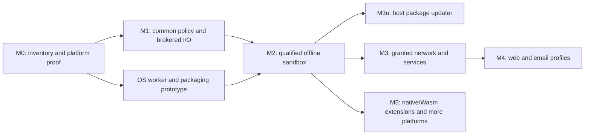

# Lambda App Safety: Implementation Plan

**Status:** implementation in progress. Policy, anchored filesystem mechanisms,
a host grant store and file broker, bound-client runtime output and Lambda
source/import/cache/prebuild, ordinary input/parser-resource and path/task clients,
exclusive publication, host ad-hoc admission/source manifests and grant
restoration, context-owned transactions, unsupported-adapter refusals,
bounded broker IPC and an experimental signed macOS T0
worker, a verified macOS supervisor, once-only terminal consent and resource
monitoring, guarded response publication, protected package-update controls
and host console management are
implemented. Default production admission, remaining I/O and
non-Lambda loading adapters, persistent permission UI and full M2 remain pending.
**Date / source survey:** 2026-11-02, base checkout at `c5e40c521` with the
approved safety documentation and ongoing implementation in the working tree.

**Design:** [Lambda App Safety](../Lambda_Design_App_Safety.md).
**Authority:** [formal design](../../doc/Lambda_Formal_Design.md)
**D7.5.1–D7.5.2, D7.5.5–D7.5.8** and
[formal semantics](../../doc/Lambda_Formal_Semantics.md) **S2.4.4, S16.9.8**.
This is an informative delivery plan. Proposed API names, file locations,
test targets, and implementation choices below are not shipped interfaces or
new rulings. Existing unresolved choices remain in the design's §14 / **DO19**.

## 1. What can be implemented

The next useful delivery is **offline script execution on one qualified desktop
OS**: select a project, load its dependencies, read its data, create outputs,
approve replacement of existing files, and retain grants across launches.
The worker must be unable to read unrelated user files, change
`~/.lambda/setting`, or open a network connection by bypassing Lambda APIs.

Much of the policy and file work can start with the current runtime. The
platform isolation proof must start alongside it: API permission checks alone
cannot deliver the promised protection from native code or runtime exploits.
Package auto-update is a separate, bounded service that can follow the offline
sandbox without first implementing general app networking.

| Deliverable | Feasibility from today's source | Delivery boundary |
|---|---|---|
| Shared principal, policy evaluation, structured denials, revocation | Implement now; reuse context capsules and existing permission adapters. | M1; policy checks are useful before containment, but are not a complete sandbox. |
| Admitted root, transitive imports, source-cache authorization | Implement now; integrate existing resolver and source cache. | M1; authorization must precede acquisition and initialization. |
| Create-only root writes and overwrite challenges | Implement now; extend existing file mechanisms and output adapters. | M1; all project mutations must ultimately run in the broker. |
| Persisted per-app/per-script grants | Implement the store now; qualify tamper resistance with the OS worker. | M1 + M2; owner-only file modes alone cannot satisfy **D7.5.7**. |
| Offline confined worker, trusted prompts and resource limits | Feasible target, with an early platform/packaging proof required. | M2; first release gate, not an optional hardening task. |
| Host package polling, verification, staging, pause/disable/restore | Implement after the protected policy service; reuse transport and scheduling mechanisms selectively. | M3u; no app network grant and no package-supplied request execution. |
| Granted app networking and selected account/device services | Incremental adapters after the broker exists. | M3; unsupported services remain denied. |
| Web/email isolation and full native extension tiers | Larger integration work; ship only individually qualified profiles. | M4 / M5; do not make these prerequisites for the offline scripting release. |

The first reduced worker can reuse the `lambda-cli` build boundary
(**D7.1.6**), which excludes Radiant, JS/TS, DOM, and Jube host modules.
That reduces the initial integration surface; it does not itself isolate the
runtime, its native dependencies, or its remaining I/O. Use the supported
T0/MIR policy under **D8.1.1v18**; an interpreter-only platform profile must
advertise its limits and reject unsupported workloads explicitly.

## 2. Existing code to reuse and gaps to close

This is a source survey, not a completed security audit. M0 expands it into
an entrypoint inventory. Paths here exist; filenames introduced in later
sections are proposals.

| Existing owner / mechanism | Reuse | Required change |
|---|---|---|
| [Context capsules](../../lambda/runtime/context_capsule.h) | Context-owned state and lifecycle, **D5.4.2–D5.4.4**. | Attach the broker session/principal reference; propagate it through tasks, callbacks, imports, and document execution. |
| [Node permission adapter](../../lambda/jube/jube_node_permission.cpp) | Existing filesystem/network query and denial entrypoints. | Replace its independent authority calculation with an adapter to the common policy. Current opt-in `--permission` behavior is not the new default sandbox. |
| [Node filesystem module](../../lambda/module/node_fs/node_fs_module.cpp) | Host permission callbacks and per-session module state. | Route descriptor, sync, and async operations through the same resource ownership and mutation rules. |
| [Target API](../../lambda/io/target.h), [input dispatcher](../../lambda/input/input.cpp), [module resolver](../../lambda/runtime/build_ast.cpp) | Target parsing, input dispatch, import resolution. | Separate lexical resolution from authorized acquisition; cover metadata probes and transitive loads as well as explicit reads. |
| [Source cache](../../lambda/input/input-script-cache.h) | Exact source snapshots, leases, concurrent build coordination. | Authorize every request, including a cache hit; keep initialized state scoped to its execution principal. |
| [File mechanisms](../../lib/file.c) | Exclusive create, regular-file validation, revision metadata, atomic writes. | Add safe root-relative acquisition and no-replace publication. `write_binary_file_atomic()` currently ends with replacement-capable rename; it is not a create-only operation. |
| [Procedural I/O](../../lambda/runtime/lambda-proc.cpp), [file search](../../lambda/runtime/io_file_search.cpp), [grep](../../lambda/runtime/io_grep.cpp) | Existing language-level operations and error adapters. | Broker output, append, copy/move/delete/rename, directory creation, search, command execution, and download publication. |
| [Process mechanism](../../lib/shell.c) | Spawn, timeout, cancellation and bounded captured output. | Add/compose a hardened worker launch path. Existing process spawning, inherited environment, or a timeout is not an OS sandbox. |
| [HTTP client](../../lambda/network/http_client.h), [downloader](../../lambda/network/network_downloader.cpp), [scheduler](../../lambda/network/network_scheduler.cpp) | Transport, cancellation, bounded scheduling and cache mechanisms where suitable. | Central egress authorization. Updater requests need a separate public-artifact profile without browser navigation headers, cookies, credentials or referrers. |
| [Document resource policy](../../lambda/io/resource_policy.h), [DOM fetch](../../lambda/dom/dom_fetch.cpp), [Radiant loaders](../../radiant/resource_loaders.cpp) | Existing document policy propagation and local-only checks. | Intersect content policy with broker grants. Local-only scheme filtering is not filesystem confinement; current allow-network defaults are not sandbox defaults. |
| [Jube registry](../../lambda/jube/jube_registry.cpp) | Manifest, ABI and integrity validation hooks. | Enforce admission before native loading and constructors; implement actual T2/T3 execution separately. |
| [Secrets](../../lambda/runtime/io_secret.cpp), [mail](../../lambda/runtime/io_mail.cpp) | OS secret-store and account transport adapters. | Add broker-enforced app/account scope and operation grants. |

Keep raw, context-free file/process mechanisms in `lib`; resource acquisition
and policy contracts belong in `lambda-io`; runtime and Radiant supply adapters
above it (**D7.1.1–D7.1.3, D7.5.2**). Do not place execution-context or DOM types
inside the neutral acquisition/cache layer. Use lower-owned hooks for host
services. Existing `safety_analyzer.*` concerns compiler optimization safety;
it should not become the app-security subsystem.

## 3. Delivery order and release gates

The milestone names match the design's Appendix C. Each implementation step
below has a bounded outcome. No whole milestone is complete yet; component
evidence and outstanding work are tracked in §6.

M1 can be exercised in a development harness with fake consent and isolated
settings. Its release notes must say that OS containment remains pending.
The sandboxed user workflow becomes releasable only at M2. An unsupported
platform/profile returns an explicit launch error; it cannot silently run with
host authority. Migration of existing trusted CLI workflows remains an explicit
product decision, not a missing-policy default-allow branch.

### M0 — Inventory, contracts, and first-platform proof

**Outcome:** a finite supported surface and a demonstrated route to OS
confinement before broad adapter work.

1. Inventory resource effects reachable from launch, parse, import, execution,
   rendering, background work, and native loading. Include file metadata,
   directory walks, implicit parser resources, caches, environment, process
   launch, inherited descriptors, logging, DNS, local IPC, and secret services.
   Record each owner, broker operation, supported profile, and explicit denial.
2. Agree the smallest worker feature set: local Lambda source/imports, selected
   files, ordinary data parsing, and file export. Classify complex parsers and
   their native dependencies; disabling Jube does not remove those libraries.
3. Prototype launch and IPC on the first desktop OS. The macOS candidate is a
   signed, confined helper with a separate trusted broker. Prove denial of raw
   home/settings access, networking, process/debug attachment, inherited
   resources, and another worker's storage before selecting the packaging model.
4. Check JIT entitlements and executable-memory behavior for the chosen worker;
   otherwise qualify an explicitly narrower interpreter profile. Also prove
   that prompt/render work cannot force code execution in the broker.
5. Specify principal admission, operation/resource vocabulary, revocation,
   error translation, IPC authentication, and host-only permission management.
   Record remaining choices from design §14 rather than inventing a new policy.

**Platform caution:** one signed helper used by every app must not give each
worker access to every app's container, selected files, keychain items or
entitlements. The supported helper/container arrangement needs evidence.
Do not substitute a private sandbox API or an ordinary child process for that
proof. Apple's entitlements describe the target's sandbox and optional access,
not Lambda's per-principal delegation model.
[Apple App Sandbox entitlements](https://developer.apple.com/library/archive/documentation/Miscellaneous/Reference/EntitlementKeyReference/Chapters/EnablingAppSandbox.html).

**Done:** publish the inventory and platform probe results, including exact
OS/build/signing configuration and unsupported features. A failed platform
proof blocks M2 on that platform, while portable M1 work can continue. Keep
the macOS decision separate from later Linux/Windows adapter qualification.

### M1.1 — Shared policy, identities, and protected grant-store service

**Outcome:** one authority calculation that all language and document adapters
can call (**D7.5.2, D7.5.5, D7.5.7**).

Proposed code: neutral `lambda/io/security_policy.{h,cpp}` and host-service
interfaces, plus a runtime context-capsule adapter. Put the trusted store and
management implementation in the host target; do not link policy mutation
entrypoints into an untrusted worker merely for convenience. Final file names
follow the M0 ownership review.

Implement these contracts first:

| Contract | Required behavior |
|---|---|
| Principal admission | Host-assigned identity for each installed app and each ad-hoc script, bound to its admitted entry/root and code identity. Caller-supplied names cannot claim stored grants. Changed code, roots or publishers require revalidation. |
| Policy evaluation | Intersect platform/profile/manifest ceilings, current grants, content rules, protected-resource exclusions and quotas. Missing security state denies operations; it does not identify a trusted caller. |
| Capability/resource ownership | Opaque principal-bound identifiers, operation set, lifetime and generation. Keep OS handles and ownership in the broker; copying an integer grants no authority (**D7.4.1v2**). |
| Denial and approval challenge | Internal distinction between denied, approval required, revoked, unsupported and resource-limit failures. Adapt to existing Lambda error values, Node errors and web exceptions without adding language syntax. |
| Revocation | Check at dispatch and before exposing sensitive async completion; cancel pending work and invalidate handles/delegations. Terminate workers if leaked raw access cannot otherwise be revoked. |
| Audit | Bounded local records of principal, operation, decision and reason. Avoid recording source data, secrets or full sensitive request payloads. |

Use the exact production directory **`~/.lambda/setting`**. Resolve it from
trusted host account state, not script environment or `LAMBDA_HOME`. Store
versioned records with strict parsing, identity binding, approval scope,
expiry, policy generation, revocations and updater preferences. Serialize
concurrent changes and publish crash-safely. Backup recovery must not resurrect
revoked grants; malformed or missing records yield minimal defaults.

Reject aliases, replaced ancestors, unexpected links and ownership changes
when opening the policy store. Use restrictive permissions, but label
same-user malicious-process resistance as pending M2. Management commands are
authenticated host/UI operations; a worker cannot grant itself access by
calling the same command name or protocol method.

Tests use a trusted test-only store location under `./temp/`; no test edits the
developer's real settings. Do not introduce a production environment override
that scripts could use to substitute a permissive store.

**Done:** table-driven authority tests, separate-script identity and changed-code
tests, malformed/unknown-schema tests, cross-principal and stale-rid denial,
revocation during queued completion, and store crash/concurrency recovery.
UI and OS tamper-resistance gates remain M2.

### M1.2 — File broker and create-versus-overwrite semantics

**Outcome:** one file service enforces **D7.5.6** for every output route.

Extend `lib/file.*` rather than introducing parallel file utilities. Existing
exclusive creation and `FileRevision` are useful primitives. Final-component
no-follow checks and a path-prefix comparison do not establish safe traversal
of a mutable directory tree.

1. Acquire files relative to broker-owned directory capabilities. Validate
   each traversed component and the final object, including protected roots,
   links, mount/reparse behavior, special files and hard-link aliases. Do not
   accept a worker-supplied absolute path as proof of containment.
2. Authorize reads, enumeration and metadata before acquisition. Brokers can
   return bounded bytes or resource handles; a selected file grants neither
   parent enumeration nor its siblings.
3. Create new root files atomically with exclusive-create semantics. Authorize
   necessary subdirectories before making them. Hold a creation resource for
   the stream; after close, reopening the now-existing file requires overwrite
   authority. Enforce byte/file-count/storage limits during writes.
4. Add a no-replace publication mechanism for staged output. Do not emulate it
   with `exists()` followed by rename. A concurrent winner must remain intact.
   Clean only broker-owned staging objects on failure.
5. For existing files, return a target/version/operation-bound challenge to the
   trusted shell before truncation, append, in-place update or replacement.
   Resume only with broker-issued approval and a current target validation.
   No locks are held across the user's decision.
6. Gate rename, move, delete, copy destinations, archive/export destinations,
   symlink creation, permissions and download publication independently.
   Delete/recreate and rename-over cannot evade approval. Private mutable app
   storage has a separate grant; it does not authorize root-file replacement.

**Race qualification:** device/inode/timestamps are useful change detectors,
not universal atomic compare-and-replace primitives. Define and test each
platform's approved-write transaction, retaining object handles where useful
and detecting namespace substitution. If an operation cannot preserve the
approved target binding, deny/retry it; never fall back to check-then-truncate
or promise isolation from arbitrary external writers. Already completed writes
cannot be undone by later revocation. Partial-write/crash behavior must be
documented alongside any atomic-save guarantee.

**Done:** new output succeeds without prompting; existing output remains
byte-identical on denial/headless failure; append and rename-over challenge;
concurrent creation preserves the winner; destination/link substitution during
consent is rejected; later reopens need approval; protected stores remain denied
even with an ordinary overwrite grant. Exercise real filesystem operations,
not only mocked policy results.

### M1.3 — Close the loading and runtime I/O paths

**Outcome:** the M0-supported worker has no privileged bootstrap or alternate
I/O route (**D7.5.5, D7.1.2v2, D7.5.2**).

- Establish the principal before reading/parsing the entry file. A loose file
  starts with that file and approved shipped libraries; sibling imports require
  the trusted root-selection workflow. A selected project grants root-local
  read/import/create, with protected descendants still excluded.
- Preserve import resolution under **S16.9.8** and pure resolution under
  **S2.4.4**. Pass the neutral acquisition authority into the loader, including
  prebuild workers and dynamic/transitive imports. A denied candidate does not
  trigger a more permissive search path.
- Authorize cache hits as well as misses. Reuse immutable bytes/artifacts only
  with valid acquisition authority and compatible execution ownership; never
  share initialized module state or heap references across principals.
  Initialization denial must retain **D7.2.2** transaction behavior.
- Route `input`, output/append, search, metadata, filesystem mutation and
  implicit parser resources through the common service. Include formatters
  that open destinations internally. Preserve the restricted TeX resource
  contract under **D7.2.7v2**.
- Deny network, shell/process launch, devices, account/secret operations and
  unsupported native loading in the initial profile. Deny at the adapter and
  OS layer; removing an import name is insufficient.
- When expanding to JS/Node, adapt existing permission queries and host
  callbacks to the shared service. Preserve API result/error semantics while
  applying the sandbox's default policy. Do not retain a second grant store.

Use **D5.4.2–D5.4.4** context ownership and **D5.3.3** precise rooting for any
async values. Task handoff must retain the caller's principal and generation,
not whichever process/thread context happens to run its callback.
Observe **D7.4.2v2** when adapting native async calls; do not park a Lambda task
through an unsupported native callback stack.

**Done:** selected-root diamond imports and initializer reads work; outside-root
imports, symlink escapes, cached denied inputs and cross-context callbacks
fail; app fetch remains denied. Add a maintained raw-I/O callsite inventory
or checker with explicit trusted mechanism owners. Static scans supplement
behavioral and OS tests; they do not prove containment.

### M2 — Trusted launcher, approval UI, and first complete offline sandbox

**Outcome:** ship the offline workflow with real containment on the first
qualified platform. Depends on M0's platform proof and M1.1–M1.3.

Implement the trusted supervisor and worker protocol. The supervisor owns
principal admission, settings, file selection, permission prompts and broker
resource tables. The worker owns untrusted script execution and parsing.
No project-wide writable directory handle or mapping is passed to it.
Even reads must preserve protected descendants and per-principal scope.

The launch path uses a known executable, controlled environment and working
directory, an allowlist of inherited handles, authenticated local IPC, and
verified confinement before any untrusted initializer or native constructor.
Use OS-supported process identity/handle mechanisms rather than a claimed
principal in a message. Version and bound the IPC schema; reject wrong-owner,
replayed, oversized, unknown and out-of-order requests. Do not serialize raw
`Item` pointers across processes (**D7.4.1v2**).

Add trusted root/file selection, concrete overwrite prompts, grant inspection
and revocation. Once/session/persistent scopes must be explicit. A worker
cannot submit an approval response, automate the trusted UI, or use synthetic
events as consent. Headless callers get structured errors unless the trusted
operator has already granted the operation. Keep prompt throttling and
background behavior in the host.

Enforce memory, CPU/wall-clock, process/thread, file/storage, IPC and output
budgets. A watchdog must kill a spinning or compromised worker; cooperative
task cancellation at park points (**S13.3**) is not a hard execution deadline.
Clean resources and pending approvals on crash, cancellation and broker exit.
App-private storage and temporary directories must be disjoint per principal.

**Release gate:** demonstrate both a real script workflow and a malicious native
test worker. The latter attempts raw syscalls against settings/home/other-app
files, direct network access, process creation, debug access, inherited handles,
forged IPC, writable mappings and namespace attacks. It must fail without
depending on language wrappers. Include restart persistence, changed identity,
revocation in flight, crash recovery and resource exhaustion. A test skipped
for signing/OS permissions leaves that platform unqualified.

The usable demo selects a project, imports a helper, reads data, creates a new
report, asks before replacing it, preserves it on denial, and shows/revokes its
remembered permissions after restart. This is the first sandbox release gate;
policy-only M1 results cannot substitute for it.

### M3u — Host package updater, independently of app networking

**Outcome:** implement the approved updater exception and its controls
(**D7.5.7–D7.5.8**) without a general fetch capability for apps. Depends on M2
for the protected host boundary; protocol/state-machine tests can start in M1.

Deliver in three reviewable steps:

1. **Admission and controls.** Store package identity, admitted endpoint/CDN
   origins, channel, publisher/trust roots and update state in the protected
   store. Implement global/per-package enabled, paused and disabled states,
   restore/resume, explicit pause expiry, and global offline precedence.
   Only trusted management changes these records. Polling cadence/backoff and
   download budgets are host settings, not app-controlled signals.
2. **Fetch, verify and stage.** The scheduler constructs HTTPS GET/HEAD requests
   from admitted public metadata. Share low-level transport where appropriate,
   not the browser's navigation/cookie profile. Reject app URLs, query/header
   injection, upload bodies, user-data inputs, ambient credentials, persistent
   tracking tokens and redirects/artifacts outside the admitted origin set.
   Do not expose a per-app request-now timing channel. Download into bounded
   staging; verify authentic metadata, hashes/lengths, version/freshness and
   key rotation. Use an established update-verification design/library after
   dependency review, rather than inventing signing cryptography.
3. **Activation and recovery.** Extract in a confined staging worker; reject
   traversal, links to outside objects, special files and archive bombs.
   The installer publishes only an admitted managed package image, with
   crash-safe version selection and recovery. Recheck update state, trust and
   grants immediately before publication/activation. Keep live native versions
   pinned until process exit; no hot unload (**D7.3.2**). Additional capability
   requests remain denied pending consent. Project-vendored file replacement
   still follows **D7.5.6**. No privileged package install hooks.

TUF supplies a reference for signed roles, freshness and rollback resistance;
select the concrete metadata/client format during this phase.
[TUF client workflow](https://theupdateframework.github.io/specification/latest/).
Existing Jube digest tooling proves artifact consistency, not a complete
publisher-authenticated update channel. Local recovery to an older image must
also respect the admitted anti-rollback/revocation policy.

Pause/disable stops new checks, safely cancels active downloads, and prevents
automatic activation; persist it across restart and package changes. Restore
re-enables the retained admitted update configuration without resetting other
permissions. A trusted manual check is one operation, not schedule re-enablement.
Capture the network trace: it may reveal IP, timing and public artifact choice,
but must contain no user documents, paths, installed-package inventory,
credentials, unique installation IDs or telemetry. This is data minimization,
not an anonymity guarantee.

**Done:** a local fixture update server delivers signed valid/tampered/stale
releases, key rotation, redirects, oversized/truncated responses and malicious
archives. Verify pause/disable/offline races at poll, download, staging and
activation; restart persistence; no app fetch privilege; no overwrite of user
projects or settings. Successful download alone does not close this milestone.

### M3 — Selectively granted network, accounts, and devices

**Outcome:** support named user workflows without widening the default policy.

Start with brokered HTTP(S) acquisition and the account services needed by a
chosen app. Enforce parsed destination grants before DNS/connect and at every
redirect/retry; cover proxies, alternate address forms, loopback/LAN/metadata
destinations, certificate checks, cookies, authentication and cache reuse.
Bind approved resolution to the actual connection; prevent redirects and DNS
changes from crossing scope. Keep credential and cache partitions per principal.

Adapt `io_secret` and `io_mail` to app/account/operation grants. Add individual
device services only with lifecycle, visible indicator, revocation and resource
limits. Include audible output's existing origin/activation rule **D7.5.4**.
Subprocess/shell and arbitrary device access remain separate capabilities;
they are not necessary to close a brokered HTTP milestone.

**Done:** allowed requests succeed while redirect/rebinding/account-crossing
and cache-leak cases fail; revocation closes streams and prevents reconnect.
Publish the supported service list and leave every unimplemented family denied.

### M4 — Web and email profiles

**Outcome:** apply existing web/content controls inside the app boundary.
Depends on M2 and the network services actually used by the selected profile.

First close the existing document-resource path: propagate principal, origin,
document generation and resource policy through input, CSS/fonts/images/media,
script loading, DOM fetch, frames, caches and rendered exports. Local-only
content must also be confined to admitted local resources. Restrictive policy
cannot be lost through a new default-initialized document or async task.

Preserve email's script prohibition (**ML5v2** in
[Mail design](../Lambda_Demo_Mail.md)); finish engine-level remote-resource
enforcement tracked by **MQ14**. Test tracking pixels, CSS URLs, nested SVG,
frames, attachments, redirects and cached resources. A sanitizer alone cannot
close the gate. Interactive scripted email remains separate design work.

For web pages, qualify origin/storage isolation, CSP, CORS, frame sandboxing,
navigation, mixed content, workers and privileged bridges in the selected
engine/embedding. A system webview is usable only if supported APIs mediate
all requests required by the profile. A navigation callback alone is
insufficient. If that proof fails, keep the embedding unavailable for the
restricted profile or use an explicit external-browser handoff.

**Done:** focused security WPT slices plus host-integration attacks, per-origin
storage/cache tests, no app/account capability borrowing, and no email script
or remote load before the permitted user action. Publish profile limits;
do not claim comprehensive browser conformance from one green DOM suite.

### M5 — Third-party extensions and additional platforms

**Outcome:** qualify one real extension use case at a time under **D7.5.1**.

- Keep T1 as the explicitly trusted system set. Gate manifests, exact immutable
  images and native dependencies before `dlopen`/`LoadLibrary`; constructors
  execute during loading. Ordinary signing does not promote a module to T1.
- For T2, design a marshaled service interface with process/OS confinement,
  broker-delegated capabilities, typed resources, cancellation and bounded
  streams. The current in-process pointer ABI cannot simply cross IPC.
- For T3, select and qualify a Wasm engine and host imports for one bounded
  workload. Enforce memory/execution quotas and safe resource handles; do not
  treat the engine's existence as proof that its host functions are confined.
- Port the proven broker contracts to Linux and Windows, then qualify each OS
  independently. Mobile profiles need separate process/JIT/extension scope;
  they do not inherit desktop guarantees.

**Done:** actual malicious extension fixtures exercise constructors, raw I/O,
dependency search, malformed messages, crash/cancel and quota failures. Publish
the supported OS/version/profile matrix. Unsupported third-party native loads
continue to fail until their tier is implemented and qualified.

## 4. Verification and implementation discipline

The gates below are for future code changes. Writing this plan requires only
document/link checks and the formal-index consistency check.

| Change area | Focused checks to add or reuse | Required milestone checks |
|---|---|---|
| Policy/store/IPC | Proposed `test_safety_policy_gtest`, `test_safety_store_gtest`, `test_safety_broker_gtest`; real cross-principal, recovery and revocation cases. | M1 adversarial matrix; M2 malicious-worker gate on the actual packaged target. |
| File broker | Extend [file tests](../../test/lib/test_file_module_gtest.cpp); deterministic create/consent races plus real alias/namespace attacks. | Library correctness suite and `make test-lambda-baseline` when their owners change; exclude performance runners from debug qualification as described below. |
| Imports/context/async | Extend [source-cache tests](../../test/test_input_script_cache_gtest.cpp), import/init and task ownership fixtures. | `make test-lambda-baseline`; `make test262-baseline` when JS/Node integration changes. |
| Jube/Node adapters | Existing permission fixtures and loader-negative/integrity tests. Rebuild matching host and external modules. | Applicable `make test-jube-node-fs-dynamic`, `make test-jube-node-fs-negative`, `make test-jube-node-fs-async-work`, `make test-jube-module-integrity`, `make test-jube-module-loader-negative`; add net gates when that adapter changes. |
| Updater/network | Extend [HTTP tests](../../test/test_http_gtest.cpp) and [scheduler tests](../../test/test_network_scheduler_gtest.cpp); proposed isolated updater fixture server and request recorder. | M3u verification/activation/state matrix; M3 egress/revocation matrix. No public-server dependency for deterministic tests. |
| Radiant/web/mail | Document resource/profile tests, selected WPT slices, email remote-content and scripting cases. | `make test-radiant-baseline`, `make test262-baseline`, and `make test-mail` as applicable, plus real embedding/manual platform qualification. |

Register new executables through `build_lambda_config.json`; regenerate build
files through `make`. Add each golden-driven `.ls` fixture with its expected
`.txt`. Use `./temp/` for fixtures, staging and artifacts. Existing Makefile
permission matrices are authoritative; do not guess their launch flags.
Do not run `make node-baseline` unless requested.

The library suite currently also lists an AVL performance runner. For debug
correctness qualification, build the projects selected by
`node test/test_run.js --target=library --category=baseline --exclude-test=test_avl_tree_perf --list-build-targets`
and run the same selection without `--list-build-targets`. Qualify performance
separately in a release configuration, following AGENTS.md rule 10.

During an implementation step, run focused owner tests and the new adversarial
cases. At its boundary, run the applicable aggregate gates once; repeat them
only for relevant new edits, failures or unresolved concerns. Before building
in a worktree, follow [Developer Guide §7](../../doc/dev/Developer_Guide.md#7-worktrees-and-agent-gotchas).
Performance comparisons use release builds, follow that guide's worktree
restrictions, and measure launch/import and bounded broker-I/O overhead against
a pinned control. Do not weaken checks to recover a throughput target.

Record completion by behavior, with the source revision, platform/signing
configuration, commands, artifact locations, failures/skips and supported
profile. Policy mocks, static scans and regression counts are supporting
evidence; they do not replace raw-syscall containment tests. Keep formal
implementation footnotes honest; only remove an unimplemented mark when its
whole stated contract has evidence.

## 5. First implementation batch and deferred scope

Begin with **M0 + M1.1**, then **M1.2** and **M1.3**, while the OS proof resolves
M2 feasibility. This yields small reviewable changes: authority contracts and
store, file transactions, loading/adapters, then launcher/UI/containment.
The immediate acceptance scenario is the offline report workflow in M2.
Follow with **M3u** so auto-updates work while app networking stays denied.

Keep full browser parity, interactive email, unrestricted native modules,
all device classes, every platform, advanced information-flow tracking, and
automated migration of arbitrary trusted scripts outside the first release.
These are explicit later milestones or unresolved design work; none is a
reason to ship the core sandbox with a bypass. Exact schemas, identity-change
UX, quota presets and platform support choices should be settled in their
own concrete implementation reviews without widening **D7.5.5–D7.5.8**.

## 6. Implementation progress

### 2026-11-02 — Policy and publication foundations

Implemented [security_policy](../../lambda/io/security_policy.h) in the neutral
I/O archive, with no dependency on runtime contexts or DOM types. It uses
host-admitted resource identities, per-session ownership, operation ceilings,
project read/create defaults, explicit source admission, separate replacement
and append challenges, protected-resource exclusions, endpoint/service denial
by default, expiring grants, revocation generations and bounded resource/grant
tables. Its management API is host-only by contract; caller authentication and
safe resource acquisition still belong to the future broker.

Extended the existing `lib/file` atomic writer through a shared implementation
with `write_binary_file_atomic_new()`. Publication cannot replace an existing
destination; POSIX uses an exclusive hard-link publication and Windows uses a
move without replacement. The old replacement writer retains its behavior.
The new primitive requires an authorized, trusted parent; it does not replace
the planned root-relative broker or target-bound overwrite transaction.

Added a [macOS raw-syscall probe](../../test/safety/README.md#macos-platform-probe)
with an unsandboxed control and an App Sandbox signed worker. On macOS 26.5.2
arm64, all control operations succeeded and worker read/write/create/connect
operations returned `EPERM`. Per-principal container separation, JIT, process
and debug access, inherited resources and actual worker integration are still
unqualified. The probe does not complete M0 or M2.

Focused evidence: `make build-lambda-data` and the two focused runner builds
passed; `test_security_policy_gtest` passed 16/16 and
`test_file_module_gtest` passed 116/116. Raw results are under
`temp/app-safety-{policy,files}-results.json`; platform details and retained
signed artifacts are under `temp/app_safety_macos_probe/`.

Aggregate qualification:

- The library correctness selection passed **1,957/1,957**, excluding the
  performance runner from this debug gate. Its summary is retained at
  `temp/app-safety-library-summary.json`.
- `make test-lambda-baseline` completed **8,500/8,502**. The DOCX business-plan
  case hit its 60-second aggregate timeout, then matched its golden when run
  alone with both the candidate and the saved pre-change executable. The
  `proc_mir_mvp_roots` cold-float mismatch reproduces on the saved pre-change
  executable and is already recorded in
  [MIR MVP progress](Lambda_Impl_MIR_MVP.md). A focused real-harness rerun passes
  DOCX and retains that one known mismatch. The aggregate is **not green**;
  no golden or harness was changed.
- `make test262-baseline` exited zero with **0 regressions**, **40,258 fully
  passing / 40,261 selected** and **3 retry-only partials**. All three recovered
  on the runner's isolated retry, but its non-fully-passing classification is
  retained. This is not a claim of 40,261 fully passing cases.
- Document links, Python syntax, whitespace and formal-index consistency
  checks passed. The pre-existing duplicate `DO25` warning remains.

Logs, source hashes, final release-executable hashes and control comparisons
are recorded under `temp/app-safety-*`; the combined record is
`temp/app-safety-qualification.json`. The final executable was rebuilt in
release mode by Test262; its hash is not a digest of the earlier debug baseline.

The next batch implemented the grant-store and anchored filesystem components,
as recorded below. Runtime launches do not yet use the new policy by default;
no end-to-end sandbox protection is claimed.

### 2026-11-02 — Anchored filesystem and versioned grant-store components

Added raw `FileAnchor` mechanisms to `lib/file.*`: held directory descriptors,
component-wise no-follow traversal, private/trusted-parent checks, hard-link
and special-file rejection, root-identity revalidation, bounded reads,
exclusive creation, revision-bound replacement, and guarded publication.
Child anchors keep guard paths in the original admission scope. A guard is
checked again before read delivery or publication; production per-request
generation/clock binding is still the future file broker's responsibility.
Metadata checks do not promise CAS against arbitrary external writers.

Promoted the existing UUID entropy helper into `lib/digest.*` for shared use
by UUIDs and staging names. No weak random fallback was added. No-replace
publication uses native exclusive rename on macOS/Linux, avoiding a crash
window where a published file retained a second staging hard link. Unsupported
anchored platforms/filesystems fail explicitly.

Added [host grant store](../../lambda/host/safety/grant_store.h), compiled only
by its dedicated test target so far. It resolves the OS account home and uses
the exact `.lambda/setting` hierarchy without environment redirects. Strict
bounded V1 records bind host-assigned principal, code/root identity, explicit
persistent grants and expiry. Unknown or damaged records return no grants.
Independent instances serialize through a private, identity-checked lock file;
generation compare-and-swap prevents stale writers from undoing revocations.
Re-admission clears old authority; empty tombstones preserve revocation
generations. It never auto-restores older backups or staging records.

Focused checks pass: **126/126** file tests (including ten anchored cases),
**12/12** store tests, **16/16** policy tests and **9/9** digest tests. The
library correctness aggregate passes **1,979/1,979**, excluding debug
performance measurement. Evidence is under `temp/app-safety-store-*`.
The store tests include a killed writer and concurrent independent instances;
these do not substitute for OS confinement from hostile native code.

`make test-lambda-baseline` completed **8,501/8,502**: all 2,112 input cases
and 6,389/6,390 runtime cases passed. Its sole failure is the previously recorded
`proc_mir_mvp_roots` cold-float issue, reproduced identically by this candidate
and the saved pre-batch executable. The earlier DOCX timeout did not recur.
The aggregate remains **not green**. `make test262-baseline` passed
**40,261/40,261**, with **0 partials and 0 regressions**. Source hashes, raw
results and control comparisons are recorded in
`temp/app-safety-store-qualification.json`; the final executable is the release
build produced by Test262, rather than the earlier debug baseline image.

Generated source ownership was checked: only
`test_security_store_gtest.make` includes the host store source. The fixture
constructor is absent from ordinary runtime/worker builds. Document/link,
whitespace and formal-index checks passed; the existing duplicate `DO25`
warning remains.

Next: finish the supported-profile entrypoint inventory, connect this store
to principal admission, add the policy-owning file broker and runtime/loading
clients, and qualify the actual offline worker. No whole milestone is complete.

### 2026-11-02 — File broker, overwrite transactions and runtime output client

Added the host-only [file broker](../../lambda/host/safety/file_broker.h) and
[component contracts](../../lambda/host/safety/README.md), implementing the
file portion of **D7.5.2, D7.5.5–D7.5.7**. Each broker owns its policy and
admitted root anchors. Namespace authority precedes filesystem discovery and
parent creation. Bounded read/source byte requests retain dispatch generation
and refresh the host clock at sensitive checks. Selected files pin one leaf
and revision; private storage requires private owner permissions. Directory
protections follow actual object identities on absolute ancestors and relative
traversal, including case aliases. Catalog/root substitution fails closed.

Project output distinguishes native exclusive creation from existing-file
replacement and append. An overwrite challenge retains an immutable payload
copy and digest, exact observed target revision, principal/session, root,
operation, generation and deadline. Host-only description/approval/cancellation
functions expose no worker management opcode. Approval is single-use; stale
targets, revoked authority, wrong sessions and expired challenges cannot commit.
No broker lock is held while consent is pending. Byte, mutation-attempt and
pending-memory budgets include empty files and failed/partial writes.

Extended existing `FileAnchor` mechanisms with an ancestor-object callback and
held-object in-place/append writer. Errors distinguish an unchanged destination
from mutation/publication with possible partial or non-durable bytes; callers
must not blindly retry the latter. These revision checks remain **not CAS against
arbitrary external writers**. Platform transaction/race qualification belongs
to M2. Protected catalogs still require the production host provider; no store
or platform-directory path list is inferred from worker input.

Reserved staging names are denied on every client path component, including
reads. A local APFS experiment showed both ASCII case aliases and long-s
(`.lambda-ſtage-…`) resolve to the actual stage prefix. The shared classifier
therefore uses the existing Unicode normalizer with a new NFKC case-fold form
that removes ignorable characters. This reserves a conservative superset;
it never canonicalizes filesystem authority or rewrites a requested path.
Invalid UTF-8 fails closed. Existing language normalization forms are unchanged.

Added a neutral byte client and a context-lifetime runtime binding using the
capsule extension mechanism (**D5.4.2–D5.4.4**), preserving `EvalContext` layout.
`output()` consults it for string, binary, structured, lazy-file and ZIP writes.
Brokered output no longer creates parent directories through the ambient helper
before authorization. The store and broker sources remain outside ordinary
worker images; dedicated test targets own them. Current CLI launches do not
install a client, and other I/O/loading paths are still pending.

The policy now recycles closed resource/grant slots while retaining never-reused
serials. Closing a lease revokes that lease without invalidating unrelated work;
explicit permission revocation still advances the policy generation. Tests
exercise more requests than the live-slot limit and reject stale IDs after reuse.

Focused checks pass: **18/18** policy, **17/17** real-filesystem broker,
**10/10** runtime output (interpreter and MIR JIT), **126/126** raw file, and
**12/12** grant-store cases. The runtime checks include independent principals
using the same source/cache identity: the second execution calls its own
restricted client. The library aggregate passes **1,998/1,998**, excluding debug
performance measurement. An initial outer-sandbox run lacked fixture sockets
and trust-store access; the authorized run passed. One intermediate rerun hit
the runner's strict timestamp-order assertion; the unchanged final rerun passed
without concurrent compilation. Both failed summaries are retained under
`temp/app-safety-broker-*`.

`make test-lambda-baseline` completed **8,511/8,512**: all **2,112/2,112**
input cases and **6,399/6,400** runtime cases passed. The sole failure remains
`proc_mir_mvp_roots`; candidate and saved pre-batch executable reproduce the
same cold-float output (`temp/app-safety-broker-roots-control.json`). No golden
was changed. The aggregate remains **not green**. `make test262-baseline`
passed **40,261/40,261**, with **0 partials and 0 regressions**. A final review
made the approval digest explicitly hash the retained payload copy; all
**17 broker and 10 runtime checks** passed again after that change. No ordinary
runtime-image source changed after its aggregate qualification.

Final source hashes, executable provenance, counts and control comparison are
recorded in `temp/app-safety-broker-qualification.json`. The final `lambda.exe`
is the release image built by Test262; focused broker test relinks do not
replace it. Document links, whitespace and formal-index consistency checks
pass; the existing duplicate `DO25` warning remains.

Remaining delivery work: principal/code-root admission and store
restoration, input/import/cache adapters, other mutation/process/network APIs,
task propagation, authenticated IPC, trusted UI and the real confined worker.
The updater and M3–M5 remain open. No whole milestone is complete.

### 2026-11-02 — Lambda source, import, cache and prebuild acquisition

Connected file-backed `load_script` to the bound source client before parsing
or any Runtime/process-cache hit (**D7.5.5**, **D8.5.1v7**). Pure module path
construction remains under **S2.4.4 / S16.9.8**. Source identity is acquired
by the broker under `LOAD_SOURCE`, using a held regular-file descriptor and
rechecking the named revision, root binding and policy before return. Exact
bytes are separately authorized and captured through the same client. Data
read permission alone does not authorize source identity or source bytes.

The neutral source cache now accepts a per-request client for acquisition,
copy and freshness operations; it never retains that client in an artifact or
cache key. A failed/invalid client cannot fall back to native file access.
Permission denial does not invalidate another principal's immutable cache
records. Both same-Runtime hits and retained AST/MIR graph cloning re-read and
compare dependency bytes through the current client. Changed source retires
its importer cone; denied source rejects the load before initialization.
Existing execution-state cloning remains context-owned (**D5.4.2–D5.4.4**).

Added context-owned prebuild scopes. They copy the client, qualify futures by
authority scope, use explicit authorized resolution/build callbacks, and join
their own jobs before releasing the borrowed transport. Scope-less profiles
retain the legacy host path; scoped jobs never use that fallback or another
scope's language profile. The bounded pool remains process-wide. Source-only
workers release their new client capsules without borrowing the caller's TLS.

Bound loaders no longer call native `realpath`, `stat` or existence probes.
Canonical source names come from broker descriptors. An APFS experiment
confirmed that the existing C `realpath` collapses case aliases, and the new
descriptor path preserves the same module identity. A root and selected loose
leaf accept their original and canonical spellings while retaining the
object/version binding. Source failure does not try an ambient JavaScript
loader in this initial Lambda-only profile. Production JS/Node/Jube profiles
still require their own acquisition adapters.

The cache-off lane exposed a private-image bug in the new validation path:
Runtime-owned scripts have no immutable template to inspect. The validator
now follows an immutable owner when present and otherwise compares the
Runtime's retained source directly, preserving alias deduplication and refresh
without requiring a process-cache entry. Disabled caches also skip artifact
publication/dependency recording. No golden was changed. A denied-acquisition
diagnostic was corrected to log its canonical name before releasing it.

Added the maintained [loading I/O inventory](../../test/safety/Loading_IO_Inventory.md).
Focused checks pass **30/30** runtime cases on interpreter/MIR JIT, **20/20**
source-cache cases, **17/17** broker cases and **126/126** raw-file cases.
The cache-disabled lane passes **12/12** focused loading cases. Behavioral
coverage includes diamonds and parent imports, outside/symlink/sibling denial,
revoked dependencies on same-Runtime and retained AST/MIR hits, changed bytes,
canonical aliases, isolated futures and transport lifetime. The cross-principal
test explicitly verifies an artifact hit before rejecting a foreign dependency.

The library aggregate passes **1,998/1,998**, excluding debug performance
measurement. `make test-lambda-baseline` completes **8,534/8,535**: all
**2,112/2,112** input and **6,422/6,423** runtime cases pass. Its sole failure
is the existing `proc_mir_mvp_roots` cold-float issue; candidate debug and saved
pre-batch release produce identical output. The aggregate remains **not green**.
`make test262-baseline` passes **40,261/40,261**, with **0 partials and
0 regressions**. A final test-helper ownership-order correction is followed
by the focused cache gate; ordinary image source is unchanged after aggregate
qualification. Evidence and final release-image provenance are retained under
`temp/app-safety-loading-*` and the combined qualification JSON.

Next: initializer `input()`/forced-path and implicit parser resources, other
I/O/services and task propagation, production admission/grant restoration,
and the actual confined worker. Current CLI launches still do not install the
client. No whole M1/M2 milestone or end-to-end protection is claimed; updater
and M3–M5 remain open.

### 2026-11-02 — Ordinary input, directories and implicit parser resources

Implemented another **M1.3 component** under **D7.5.2 / D7.5.5**, preserving
the parser-specific restrictions of **D7.2.7v2**. The context's client reaches
ordinary `input()` (including module initializers and file forcing) and inline
`parse()` without adding runtime ownership to the neutral parser layer.

`input_from_target_with_io` branches before ambient directory, database,
system-information or HTTP dispatch. A regular-file classification requires
READ; a directory requires ENUMERATE. Classification conveys only kind, so
a selected READ-only file does not acquire general metadata permission.
The actual byte read checks again, with the existing input/archive size limit.
Non-file services have no adapter in this bound profile and cannot fall back
to their legacy dispatcher. Trusted NULL-client host calls keep their explicit
ambient path.

Added a held-anchor directory visitor in `lib/file` and a bounded broker
enumeration result. The visitor uses no-follow entry checks, excludes special
and hardlinked files, applies protection/staging guards, and revalidates the
directory before delivery. Overflow or observed mutation returns no partial
listing. The broker caps visited entries at 4,096 and returned bytes at its
I/O ceiling. Names/kinds and optional per-entry metadata have separate
authorization. `input-dir.cpp` shares Path construction across host and scoped
acquisition without issuing raw stat/list operations for a bound client.

TeX local/bundled probes and reads now carry the same synchronous borrowed
client. Both `tex` expansion and `latex` digestion inherit the input document's
location; the former previously omitted it. Scoped relative `.` bases use the
default root without weakening the narrower beside-document check. Existing
local file/byte budgets remain. Scoped expl3 engines build a private format
with their own resource reads instead of treating an ambient format-cache hit
as authority. This has a rebuild cost; a reauthorizable dependency manifest
is needed before sharing these scoped images.

Structurizr keeps its document-root, depth, file and aggregate-byte limits.
Scoped includes normalize addresses lexically before the narrower root check,
then classify/read/enumerate through the broker. Its byte budget is enforced
during acquisition rather than by a separate size-probe/read sequence.

Captured archive members parse their immutable bytes with an explicitly
closed external-resource client. Their lazy parse caches retain no live
Runtime transport or resources admitted by an earlier caller. Archive-relative
external-resource resolution is not implemented. The focused test supplies a
real external TeX package: ambient parsing reads its sentinel, while captured
member parsing and repeated cache use cannot read it.

The maintained [acquisition inventory](../../test/safety/Loading_IO_Inventory.md)
lists these exact owners and the remaining routes. Production admission,
wildcard traversal, filesystem/services, task propagation, JS/Node/Jube and
the actual confined worker remain open. Current CLI launches still do not
install this client; no whole M1/M2 milestone or end-to-end sandbox is claimed.

Focused checks pass **48/48** runtime cases across interpreter/JIT,
**16/16** input/parser cases with the script cache off, **20/20** broker
cases, and **127/127** anchored/general file cases. The library aggregate
passes **2,002/2,002** (excluding debug performance measurement). The final
Lambda baseline is **8,552/8,553**: **2,112/2,112** input and
**6,440/6,441** runtime cases. The sole failure remains
`proc_mir_mvp_roots`; current debug and saved pre-batch release executables
produce identical output, retained in
`temp/app-safety-input-roots-control.json`. The aggregate is **not green**.
The final source includes the relative TeX-base containment correction and
the ambient-control archive test; no golden or failure expectation changed.

The pinned final release passes the full Test262 baseline **40,261/40,261**,
with **0 partials / 0 regressions** and 2,652 existing skips. The initial
`make test262-baseline` invocation had four RegExp timing partials and zero
functional failures; isolated retries passed. A full pre-batch control run
passes, and three alternating four-case control/candidate pairs show no
reproduced slowdown. The full candidate rerun then passes without source,
harness, threshold or baseline changes. Initial results, paired timings,
executable hashes and final qualification are retained under
`temp/app-safety-input-*`.

### Path providers and task delivery component — 2026-11-03

**D7.5.2, D7.5.5** now cover the bound-client metadata, `exists`, directory
iteration, wildcard and task-read adapters. These are component changes;
production CLI admission and M2 confinement remain pending.

Runtime acquisition moved from `core/path.c` into `runtime/path_runtime.c`.
METADATA is independent of READ/ENUMERATE, including authorized absence.
Document-prefix probes use READ/ENUMERATE classification, and a force checks
that authority before reusing a captured head. SYS external-provider forces
are denied in this profile. `temp` document iteration remains in memory
(**S2.4.4, S2.4.6–S2.4.7**). Total `exists`/`len` keep their existing false/zero
refusal behavior; explicit force and metadata getters retain structured errors
(**S7.6**).

One sorted directory facade serves input lists, iteration and wildcard walks.
Scoped recursive walks share a 4,096-entry budget across sibling subtrees and
a 64-level bound, avoid symlink recursion and discard partial results on
refusal/overflow. Result arrays have precise root frames (**D5.3.3**).
Snapshots live in an EvalContext capsule with semantic path keys and stable
registered root slots, rather than writing heap values on shared Path spines.
Broker session/namespace epochs invalidate them on admission, restriction,
revocation and observed expiry; acquisition and publication stamps must agree.
These stamps are cache invalidators, not object capabilities.

Root selection now considers every operation-eligible admission. A selected
sibling is not hidden by a loose entry in the same parent, and a narrower READ
root does not shadow an ancestor's METADATA grant. Relative names expand
lexically from the default root before selection. A side-effect-free shared
policy preflight chooses a candidate without consuming IDs or issuing resource
authority. Actual acquisitions still require leases, anchored identity and
protection checks. A monotonically clamped broker clock prevents rollback from
reviving expired roots.

Scoped `io.read` copies the client and owned path into the existing offload
pool. The worker touches neither Runtime TLS nor GC values; owner-stack
delivery rechecks READ. Cancellation and teardown join active work before the
borrowed transport is released. Scoped `io.exec` denies before constructing a
process request. Other process/service routes still need their own adapters.

The in-memory checks also found two ownership defects. `path_get_root` retained
roots from an earlier evaluator's destroyed pool; it now shares the existing
pool-owned `path_new` constructor. Document heads/node identities were global;
they now live in a realm capsule with owner-bound precise roots. Another
context can neither reuse nor clear those heads. Realm capsule heap-release
callbacks, including dynamically registered ones, run before heap destruction
(**D5.4.2–D5.4.4, D5.3.3**).

The [acquisition inventory](../../test/safety/Loading_IO_Inventory.md) records
remaining filesystem mutation/search and write-set ownership, named-host
identity, process/network/account/device and JS/Node/Jube work. Production
CWD/shipped-resource mapping, complete protected-root admission, authenticated
IPC, real Lambda OS workers, approval UI and the updater are still open.

Qualification for this component: runtime safety **78/78**, path representation
**21/21**, policy **19/19**, broker **24/24**, and library baseline
**2,007/2,007** pass. The 30 path/task cases also pass with forced collection
and poisoned frees, and with the source cache disabled. The final Lambda
baseline is **8,582/8,583**: input **2,112/2,112**, runtime **6,470/6,471**.
Its sole failure is `proc_mir_mvp_roots`; candidate debug and the saved
pre-batch release have identical stdout, recorded with executable hashes in
`temp/app-safety-path-roots-control.json`. No golden or expected failure changed.
The aggregate is not green.

Additional concurrency checks pass the isolated task fixture **21/21** and
activation fixture **13/13**. Isolated realm/cache checks pass **9/10**; the
remaining `AutoFallbackCachesMirImportConeAndViews` failure concerns the MIR
artifact/cache-hit expectation, while all three evaluated results are 42.
The optional full 57-case executable first fails Jube ordinal/name parity
(including a fatal alias-ordinal assertion), then reports refused context
switches and crashes in the AUTO-cache case. It does not produce a complete
JSON report. These additional aggregate failures remain unqualified; they are
not reported as pre-batch failures without a matching native control. The
harness and assertions were not changed. Logs and isolated JSON results are
retained under `temp/app-safety-path-concurrency*` and
`temp/app-safety-path-activation*`.

The final `make test262-baseline` passes **40,261/40,261**, with **0 partials,
0 failures and 0 regressions** (2,652 existing skips), on the first completed
run for this component. The pinned release executable is unchanged across the
run; its SHA-256 is
`d37cf0cc94aeeef2816a803cc3bdd21a2ed5e2397c55eaa02f2a6bfb77b1d3cd`.
No timing thresholds, JS harnesses or baselines changed. Build configuration,
local documentation links, ruling-index generation and whitespace checks pass;
the ruling-index tool retains the existing duplicate-DO25 warning.
Implementation hashes, focused/aggregate counts, control outputs and the exact
remaining gates are collected in `temp/app-safety-path-qualification.json`.
The goal remains active; no complete M1/M2 milestone is claimed.

### Private IPC and a real confined T0 worker — 2026-11-03

Implemented the next **D7.5.2 / D7.5.5** component: an experimental dedicated
Lambda worker, a bounded private broker channel and actual signed-process
qualification. This does not complete M1 or M2, and ordinary CLI execution
still lacks production sandbox admission.

`lib/ipc_stream.*` owns connected local-stream acquisition and raw transfer,
preserving **D7.1.1–D7.1.3**. `lambda/io/security_channel.*` owns the explicit
little-endian framing and the seven existing acquisition callbacks. Neither
`Item` nor native pointers/struct layouts/descriptors cross the wire. Payload,
request, cumulative-byte and absolute monotonic deadline bounds are finite.
Replay, wrong sessions/sequences, unknown operations/flags, truncation,
malformed replies and ancillary data close the connection; received file
descriptors are closed. Missing or failed channels never select ambient I/O.
The host reserves response space before invoking a mutation. Client calls
serialize through complete reply validation, including concurrent task reads.

The admitted private endpoint is the capability; a session number or same-UID
peer credential is not proof of admission. No permission/store/approval/native
management operation exists in the schema. Host admission, process identity,
publication/revocation coordination and hard resource supervision still belong
to the unfinished production launcher. Existing broker object/lease checks
remain in force; IPC does not replace them.

A complete write request can commit before its reply is lost. The client
returns `outcome_unknown` separately from confirmed `committed`, closes the
connection and never retries. `output()` now carries this call's owned error
through text, binary, structured and ZIP paths (**S7.4.5, D5.4.2**). Logging a
diagnostic alone was not an error carrier; the new failure case exposed and
fixed that boundary, including forced-GC/poison coverage (**D5.3.3**).

`make build-safety-worker` produces the experimental bootstrap. It derives
from **D7.1.6**, installs its client before entry canonicalization/read/parse/
initialization and joins task/prebuild users before closing transport. Its
profile excludes MIR/JIT, networking, DevTools, JS/TS, DOM, Radiant, Jube and
policy management. The target does not install containment itself. It must
run in a fresh process whose trusted launcher has already verified confinement
and admitted the private connection. Current limits are 1 MiB frames, 64 MiB
cumulative bytes, 8,192 requests and a 10-second transaction/idle bound.

The CLI profile had omitted required image/font, MVP compiler and scratch
protocol dependencies. The shared profile now retains the font/vector
mechanisms and their matching header/libraries (CoreGraphics on macOS), the
MVP source group and the scratch protocol. This follows D7.1.6's required
third-party-mechanism boundary without adding Radiant/JS/Jube hosts. The
worker explicitly excludes scratch/DevTools; the IME keeps its previous
font/DevTools source exclusions. No vendor code was changed.

`test/safety/test_macos_worker.py` builds/signs separate bootstrap and native-
probe entrypoints, launches them with a sanitized environment and explicit
stdio/private-channel inheritance, and runs a separate trusted broker fixture.
The fixture uses only isolated project/settings sentinels under `./temp/`.
Eight cases pass on macOS 26.5.2 arm64 with ad-hoc hardened-runtime signatures
and only the App Sandbox entitlement: unsandboxed control; confined create;
denied/approved replacement; outside/protected input refusal; recursive path,
metadata and async-task reads; and the plain worker bootstrap. The control's
four native operations succeed; every confined native read/write/create/TCP
attempt returns `EPERM`, with zero unexpected inherited descriptors. Workers
contain no broker/store/policy-management symbols. Approval is a trusted
parent's **test fixture**, not implemented production consent UI.

The original native-only probe also passes after sharing its signing helper.
The bounded channel tests pass **15/15**, and the new write-failure cases pass
in both tiers with forced collection and poisoned frees. The normal CLI builds
and its expression fixture matches its existing golden in auto/interpreter/
JIT modes; excluded JS/layout/serve commands and missing worker authority
retain explicit failure. Detailed protocol and profile limits are in the
[component contract](../../lambda/host/safety/README.md); machine-local
signatures, executable hashes, requests and case results remain under
`temp/app_safety_macos_worker/` and `temp/app-safety-channel-*`.

No first-platform release is claimed. Production admission/catalog/grant
restoration, the trusted approval UI, all unsupported adapters, per-app
container separation, other egress/process/debug access, publication/revocation
races, watchdogs/quotas/exhaustion and restart/crash gates remain open. Package
updates and the later network/content/extension milestones also remain active.

Final qualification for this component: channel **15/15**, runtime safety
**80/80**, forced-GC/poisoned write-outcome cases **2/2**, library
**2,022/2,022**, CLI/bootstrap checks **10/10**, and Test262
**40,261/40,261** with 2,652 existing skips and zero regressions. The combined
Lambda/input gate is **8,584/8,585**; only `proc_mir_mvp_roots` fails, with
byte-for-byte identical output from the retained pre-component executable.
No golden, baseline or test harness was changed to accept it. The optional
extended concurrency/cache aggregate remains unqualified as recorded in the
preceding component; it was not rerun for this channel change. Generator and
formal-index checks pass (the existing duplicate DO25 warning remains).
Source hashes, pinned release/control identities and artifact hashes are in
`temp/app-safety-channel-qualification.json`. The goal remains active.

### Unsupported adapters and transaction ownership — 2026-11-03

Closed additional initial-profile routes under **D7.5.2, D7.5.5–D7.5.8**.
Copy/move/delete/mkdir/touch/symlink/chmod/rename, `cmd`, fetch, grep/text
search, mail, secrets and loopback APIs now share a refusal before legacy
native acquisition, option-driven jobs or offload creation. `io.exec` uses
the same check. A present acquisition client never selects an unbrokered
implementation, including when dry-run fabrication is enabled. These services
return owned access-denied errors (**S7.4.4–S7.4.5**); implementing them in
the confined profile still requires broker operations and qualification.
Database host authorization also refuses a bound owner before driver open;
future offloaded database adapters still require explicit authority handoff.

A new two-evaluator case reproduced shared transaction state in both tiers:
the peer observed the owner's open transaction and its reset cleared the
owner's state. Write-set edits, transaction flags and confinement now live in
an evaluation-context capsule under **D5.4.2–D5.4.4**, with explicit-owner
precise roots for retained edit values (**D5.3.3**). Foreign document anchors
are refused. Reset and heap teardown affect their own owner; runtime cleanup
does not reset an active peer before selecting its cleanup context. Allocation
and root-registration failures cannot silently open an autocommit transaction.
Document updates remain in-memory; filesystem publication still uses the
brokered `output()` path.

Focused checks cover both tiers, dry-run and ordinary calls, unchanged files,
zero broker acquisition for refused services, database refusal before file
creation, peer execution/reset/heap release, pending-value rooting and commit
after peer cleanup. The signed macOS fixture additionally binds eleven
unsupported operation failures and publishes their access-denied codes through
the real channel. Its original handler-based check exposed the known pending
**S7.6.1v5 / S7.6.7v5** implementation gap: procedure-handler values were erased.
A diagnostic direct-error-binding variant passed nine workflow/control cases,
but did not qualify the original handler path. The original check is restored;
the handler result/type/block-classification paths now preserve their selected
values under those existing rulings. Interpreter/JIT, final-handler/null and
suspending-read checks pass, including forced collection with poisoned frees.

Final evidence: runtime safety **92/92**, forced-GC/poison **8/8**, and all
**nine** original signed-worker workflow/control cases pass. The Lambda/input
aggregate is **8,596/8,597** (runtime 6,484/6,485; input 2,112/2,112). Its only
failure remains `proc_mir_mvp_roots`, with byte-for-byte identical output from
the retained pre-change release control. No golden or baseline was changed.

The first final-source Test262 run had **40,260** fully passing tests and one
RegExp timing partial; it passed the runner's isolated retry. The same case
passes isolated on both pinned candidate and pre-change control. One unchanged
full-suite repeat passes **40,261/40,261**, with 2,652 existing skips and zero
regressions. The first partial, isolated diagnostics and full repeat are all
retained; no timing threshold, allowlist or harness was changed. The initial
diagnostic candidate copy lacked execute permission; restoring that artifact's
mode left its bytes unchanged. The library/channel evidence from the preceding
component is carried forward for unchanged mechanisms, rather than presented
as a fresh aggregate run. The earlier optional concurrency/cache aggregate
also remains unqualified.

The combined record is `temp/app-safety-handler-qualification.json`, with source
hashes, pinned release/control identities and the signed worker artifacts. The
final release hash is `1e037ace18c58d85ff42d49eb8c510384546755cc0bcd807d32355ec6572d5aa`.
Formal-index, local documentation links and whitespace checks pass; the existing
duplicate DO25 warning remains. Ordinary CLI launches still use the legacy
unbound model; no production default sandbox is enabled.

Production admission/catalog restoration, host-only grant management and trusted
consent UI remain the next launcher work. These changes do not complete M1/M2
or the later updater/network/content/extension milestones.

### Host ad-hoc admission, catalog and grant restoration — 2026-11-03

Implemented the next **D7.5.5–D7.5.7** host component in
[`admission.*`](../../lambda/host/safety/admission.h). A trusted entry/project
selection now becomes a profile-bound script principal, a bounded source
manifest, protected catalog and restored broker grant set before its client is
published. The host reads/hashes code but never parses or executes it. Source
capture gets canonical name, bytes and revision from one held file; every source
dispatch verifies the admitted revision/digest. Changed or unlisted code closes
that admission. Explicit revalidation changes the store binding and clears old
grants. Source manifests include the exact entry and root-local `.ls` imports,
plus approved shipped code; ordinary data/output changes do not change the root
object binding. The profile/store directory and its object identity prevent a
copied record in another profile from claiming the same entry.

The base catalog protects anchored settings, host `.lambda` mutations, runtime/shipped images, OS
directories and account credential/configuration namespaces, with installer
extras for further private directories. A parent-identity/name guard closes
the absent-directory gap: broad ancestor access cannot create a protected name
later, including observed Unicode/case aliases. The raw mechanism stays in
`lib/file`; policy stays in the broker (**D7.5.2, D7.1.1–D7.1.3**). Traversal,
root admission and enumeration consult it before child acquisition. Existing
object guards and anchor revalidation remain independent. Managed shipped code
is mutation-protected even when a project or remembered parent overlaps it.

Supported selections are existing files or recursive directories. Persistent
grants are reacquired and fingerprinted; changed, expired, protected or unsupported
records do not restore rights. Session selections do not become persistent.
Directory replacement/append grants at the same root are selected before the
default project challenge (**D7.5.6**). Once-write challenges remain target,
version and payload bound. A store-generation lease serializes host saves and
revocation with preceding bounded operations/commits; no lease crosses a consent
wait. A stale live admission closes rather than using or restoring old grants.
Inspection/revalidation management APIs are absent from worker IPC.

`test_security_admission_gtest` passes **17/17**, store **14/14**, broker
**26/26**, and the complete selected library suite **2,043/2,043**. The signed
macOS fixture passes **17** scenarios: the earlier nine plus eight using this
host admission path. The new cases include settings reads/forged creation through
a selected ancestor, once-only denial/approval, remembered file access after
separate host-process restart, persisted revocation after another restart and
changed transitive code stopping launch before any worker starts. Real account
settings are never opened. Binary checks now use the actual grant-store and
admission management prefixes, with a positive host control and their absence
from both workers.

This is still a host component and trusted test launcher, not the production
default sandbox. Production supervisor/signature verification and UI, default
root bookmarks and worker package/resource-path mapping, complete installed-app/
global catalog coordination, file identity/inode-reuse/mount qualification,
revocation before final IPC delivery, hard watchdogs/quotas, per-app OS separation
and the remaining M2 race/crash gates stay open. Corrupt/unavailable stores stop
this prototype path until trusted repair/default-recovery UI exists. The updater
and later network/content/extension milestones remain part of the active goal.

Final regression qualification for this component: library **2,043/2,043**,
host admission **17/17**, store **14/14**, broker **26/26**, bounded IPC **15/15**
and signed worker/control scenarios **17/17**. Runtime safety remains **92/92**
in the fresh Lambda aggregate. The combined Lambda/input result is
**8,596/8,597**, with only the existing `proc_mir_mvp_roots` failure; its output
matches the retained pre-component release byte for byte. Test262 passes
**40,261/40,261**, with 2,652 existing skips, zero timing partials and zero
regressions. No golden, allowlist or test harness was changed to accept a failure.
The earlier optional concurrency/cache aggregate remains unqualified and was
not rerun for this component. Source/executable hashes and retained case
artifacts are in `temp/app-safety-admission-qualification.json`; the final
release is `c5a9d4cdb7def71e4fa0c5a1099ef48194d3d8449efc9420ed6ee98eb9e9149a`.
Formal-index, local links and whitespace checks pass; the existing duplicate
DO25 warning remains. The goal stays active.

### Verified offline supervisor and host terminal consent — 2026-11-03

Implemented an actual dedicated host executable, `lambda-safety-host.exe`, in
[`supervisor.*`](../../lambda/host/safety/supervisor.h) and
[`host_main.cpp`](../../lambda/host/safety/host_main.cpp), following
**D7.5.1–D7.5.2, D7.5.5–D7.5.7**. The host validates its Apple-issued publisher
signature and hardened-runtime/no-entitlement profile, locates a fixed companion
worker bundle, checks its same publisher, identifier, sealed resources and exact
sandbox-only entitlements, then starts it suspended. The kernel-selected child's
code hash must match the validated image before resume. The worker gets a new
session, clean launch environment, controlled cwd, stdin `/dev/null`, captured
stdout/stderr and one private broker endpoint. No project-directory handle or
management API is inherited. The existing admission/store/catalog runs before
source parsing, and source bytes still travel through the bounded broker.

Raw OS work belongs to `lib/confined_process.*`; policy and consent stay in the
host (**D7.5.2, D7.1.1–D7.1.3**). The channel now supports dispatch on a
preconstructed endpoint, preserving existing `serve` ownership semantics. The
supervisor uses an independent watchdog and bounded output capture, sampled
CPU/physical-footprint gates, hard worker bootstrap CPU/file/descriptor/process/
core caps, private-process-group cleanup and cancellation on malformed IPC.
Consent uses `/dev/tty`, never worker stdin or a protocol reply. The prompt shows
the actual held target/version and payload digest; filenames and terminal output
are escaped. Output remains withheld until all prompt/teardown work ends.
One-time approval is bound to the retained challenge, and worker termination
invalidates later consent. Headless/no-prompt runs deny existing-file mutations.

The production executable refuses unsigned/ad-hoc deployment. The separate
`lambda-safety-host-fixture.exe` permits an isolated test home, exact worker
image pin and shorter budgets only at compile time. Real account grants are not
opened by qualification. `test_macos_supervisor.py` covers the real import/read/
create/overwrite flow, leaf-only scope and settings denial, wrong identifier/
entitlements/image/resources, native inherited-fd/environment/tty/read/network/
process probes, malformed IPC, CPU/memory/wall/output limits and terminal
acceptance, denial, target change, headless operation and late consent.

Release status remains **M2 incomplete**. macOS supplies a container `HOME`
after exec; the launch environment is clean but the helper's OS container is
still shared by its identifier. Per-principal container/storage separation,
complete installed-app/global catalogs, persistent scope UI/bookmarks, package
resource paths, revocation at final IPC delivery, hard memory/thread/storage
ceilings and remaining race/crash/debug/mapping cases are open. Publisher-backed
packaging must be qualified on the installed distribution. The ordinary CLI is
still legacy/unbound. The updater and later network/content/extension milestones
remain in the active goal.

Qualification is in progress. The new host uses a 60-second frame deadline so
a human consent wait can exceed ten seconds; the independent whole-process
watchdog still applies throughout the wait. Darwin `/dev/tty` waits use
`pselect`: `poll` returned `POLLNVAL` despite a usable terminal, causing premature
nonblocking-read denial. CPU sampling converts the observed Mach timebase, and
target-race checks distinguish an accepted consent from an actual commit.
The isolated signed supervisor matrix passes **26/26** scenarios (25 signed
worker cases plus production-host refusal checks), including consent after an
11-second wait, target change during consent and consent arriving after worker
termination. The earlier signed-worker/control/admission matrix also passes
**17/17** with the updated bootstrap. Library correctness passes
**2,043/2,043** in an unchanged isolated repeat; safety subsets are policy
**19**, store **14**, broker **26**, IPC **15**, admission **17** and file
mechanisms **127**. The first overlapping aggregate passed **2,042/2,043**,
with one scheduler-order assertion in `test_test_run`; that failure is retained.
The overlapping short expiry probe also enforced its two-second deadline during
initialization, before reaching consent. The subsequent unchanged isolated
platform run reaches consent and passes. No timing thresholds were widened.

The required Lambda/input baseline passes **8,596/8,597**: runtime
**6,484/6,485**, input **2,112/2,112**, runtime safety **92/92**. Only the existing
`proc_mir_mvp_roots` golden mismatch remains; direct candidate output matches
retained pre-component release `c5a9d4cd...` byte for byte. No golden, skip list
or acceptance harness was changed to accept a failure. Test262 passes
**40,261/40,261**, with **2,652** existing skips, zero partials and zero
regressions, in the first run for this component. The default release image
remains byte-identical to the retained pre-component release
`c5a9d4cdb7def71e4fa0c5a1099ef48194d3d8449efc9420ed6ee98eb9e9149a`;
the new supervisor/worker are separate binaries. Their exact hashes, sources,
passing reports, initial overlap failures and retained controls are recorded in
`temp/app-safety-supervisor-qualification.json`. The shared default CLI is not
yet admitted by this supervisor. Formal-index, local links, new-source syntax
and whitespace checks pass; the pre-existing duplicate `DO25` warning remains.
No engine or platform completion claim is inferred from these component gates.

### Protected package-update controls and host console — 2026-11-03

Implemented the **D7.5.7–D7.5.8** updater control component in
[`update_controls.*`](../../lambda/host/safety/update_controls.h), using a
host-only fixed state slot in the existing anchored grant store. Account-home
resolution, trusted/private ancestors, cross-process locking, revision checks,
atomic publication and committed-but-nondurable quarantine are shared with
grants rather than reimplemented. The v1 catalog is profile/object-bound,
checksummed, strictly parsed and bounded to 128 packages/eight origins each.
Copying another profile's bytes does not admit its packages. Missing/corrupt
records do not silently enable a service or restore an older backup.

Trusted installer configuration binds public package identity, HTTPS endpoint,
channel, origins, publisher/root fingerprints and host-owned limits. Identity
changes require explicit host revalidation and preserve user disable/pause
choices. URL checks reject credentials, queries, fragments, percent aliases,
dot segments, IP literals, known local names and noncanonical spellings. This
is an admission contract for already-authenticated configuration; it does not
validate TUF metadata or establish publisher authenticity by hashing bytes.
The pending transport must still validate DNS addresses, redirects and every
request. No worker management/request-now operation or app network grant was added.

Global/per-package pause, disable and restore persist across host processes;
restore changes only its selected scope. Timed/indefinite pauses, offline
precedence and trusted one-shot manual checks are implemented. Cadence and
bounded exponential failure backoff survive restart. Separate policy epochs
and scheduling generations let independent package jobs coexist while a control
change revokes old jobs. Random persisted reservations prevent duplicate jobs
across host instances; UTC and monotonic deadlines bound reservations and live
jobs. Invalid/expired tickets remain invalid after clock rollback or recovery.
Live high-water marks reject observed catalog rollback, with restart-proof
anti-rollback/trust persistence still part of the verification/recovery work.

A bounded publication lease serializes acknowledged controls with earlier
publication across host instances. No lease may cross a network, extraction or
UI wait. The future downloader/installer must recheck at dispatch, completion
and activation; a control ticket alone neither fetches nor installs anything.
Controller/ticket ownership supports cancellation before store destruction.

The dedicated host console now offers `updates init/status`, per-package or
explicit `--all` pause/disable/restore, and global offline on/off. Publisher
verification precedes production settings access. A package named `all` is not
confused with global scope. There is no console admission of arbitrary endpoints
and no fetching command; status explicitly reports delivery as unavailable.
The separate fixture host provides isolated account storage for qualification.

Focused qualification passes updater **21/21**, existing store **14/14**,
admission **17/17** and host console **28** checks. Cases include independent
host restart, policy/config retention, manual/offline precedence, endpoint
rejection, reservation races, lease-versus-disable ordering, profile-copy and
live-rollback rejection, clock rollback, malformed checksum-valid schemas,
bounded tables/backoff, and unchanged user-file grants. Final library
qualification passes **2,064/2,064** with no failures/partials. The signed
supervisor matrix passes **26/26** and existing signed-worker/control/admission
matrix **17/17** with the updated host/store. Binary symbol checks have a
positive host control and confirm updater/state management is absent from both
workers and the ordinary CLI.

This component changes host targets; runtime/compiler and `lib/` sources are
unchanged. The
default release remains `c5a9d4cdb7def71e4fa0c5a1099ef48194d3d8449efc9420ed6ee98eb9e9149a`.
The preceding Lambda/input **8,596/8,597** (existing `proc_mir_mvp_roots` mismatch)
and Test262 **40,261/40,261** are retained controls, not fresh runs for this
host-only component. Source coverage and the unchanged executable are recorded
in `temp/app-safety-update-controls-engine-control.json`. Final component source,
binary and result hashes are in `temp/app-safety-update-controls-qualification.json`.
Formal-index, local link, syntax and whitespace checks pass; the pre-existing
duplicate `DO25` warning remains.

This implements updater controls, not full **M3u**. Authenticated installed
package admission/root storage, an established metadata-verification client,
privacy-qualified HTTPS transport, scheduling integration, confined extraction,
managed-image publication, activation/recovery and associated cancellation races
remain required. The existing M2/default CLI/per-principal OS isolation gates
and later network/content/extension milestones remain in the active goal.

### 2026-11-03 — Authorization through IPC response publication

The supervisor and admission fixture now select a host-only delivery guard
(**D7.5.2 / D7.5.5–D7.5.7**). Full request decoding precedes authority capture;
the operation runs after capture, and publication compares that original
session/epoch under the admission mutex and protected-store generation lease.
Sampling only the latest generation would miss local revocation of buffered
bytes. Local revocation, another host's saved-grant change and observed expiry
now suppress those replies. Worker callbacks and the LSAF v1 schema are unchanged.

The publication lease spans a 250 ms send budget, independently of the request
or human-consent timeout. Polls are capped at 25 ms, sends at 64 KiB, with fresh
expiry checks and release on every exit. No publication lease crosses callback
work, consent or request receipt. Denial clears approval references while
retaining committed/unknown write outcomes (**S7.4.4–S7.4.5**). Invalid capture
prevents mutation dispatch. Scheduling/lock acquisition are not hard real-time
guarantees. Revocation acknowledges after preceding publication leases; bytes
already queued in the kernel or received by the worker cannot be recalled.

Focused native qualification passes **75/75**: admission/delivery **25/25**,
channel **15/15**, store **14/14**, updater controls **21/21**. The rebuilt signed
macOS supervisor matrix passes **26/26**, including long human-consent waits.
Eight new delivery
cases cover all six buffered reply shapes, saved/session revocation, expiry
before/during delivery, committed writes, bad capture, malformed input and
concurrent saved revocation with an unread peer. Shared test helpers replace
duplicated thread/revocation/header fixture code. Logs, executable/source hashes
and signed-supervisor results are recorded in
`temp/app-safety-delivery-qualification.json`.

This qualification is scoped to the host/channel/raw-stream change. The full
Lambda/Test262 and library aggregates were not rerun for this wrap-up; the
preceding recorded engine results above remain historical controls. The
ordinary CLI is still unbound. **M2 remains incomplete**, particularly per-app
OS container separation, deployed publisher qualification, complete catalogs,
persistent permission UI and remaining quota/race coverage. Updater delivery,
network/content/native-extension services and other platforms remain open.
