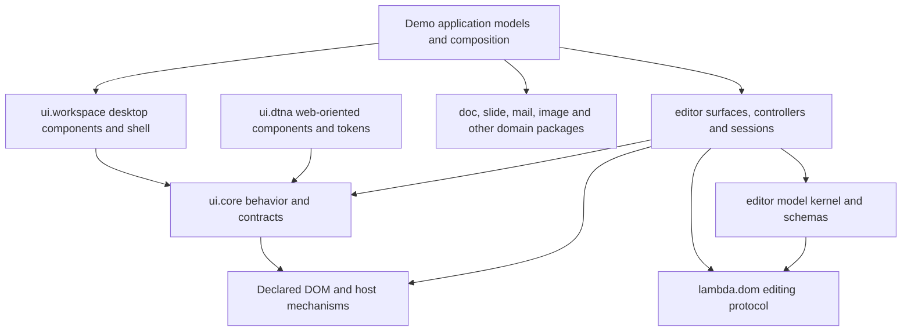

# Lambda Package Structure — Review and Implementation Proposal

**Date:** 2026-11-04.

**Status:** initial M0–M5 implementation complete; follow-up extensions are recorded below.

**Scope:** shared demo UI behavior, application appearance, editor package
organization, shipped-script naming, and package dependency hygiene.

## Review checkpoint

- Goal and deliverables: source-grounded restructuring proposal here;
  durable principles in [Lambda_Package §11](../Lambda_Package.md#11-package-organization-principles).
- Reviewed workspace: `/Users/henryluo/Projects/lambda`, branch `master`,
  base `695c2b887`, 2026-11-04. Unrelated runtime/MIR and benchmark changes
  were present and are outside this review.
- State: dtna-specific descriptors, catalogue and palette adapter now live
  under `ui.dtna`; core menu, splitter and DOM publication are shared by
  demos. Workspace has initial controls, tokens and pane/toolbar surfaces;
  Word/Sheet/Slides share office/ribbon styles, artwork and font picker;
  Photo Album's shell uses workspace tokens. Shared typography, shape choices
  and the equation catalog now have package owners.
  The initial desktop controls and shared behavior are in use; a broader
  widget catalog and adoption across additional demos are follow-up work.
- Editor namespace: moved `edit` and 22 editor implementation scripts into
  `editor/{core,schema,dom,format,surface,app}`, retired four forwarding
  modules in favor of existing draw leaves, and updated repository imports
  and the CLI transform registration. Repository migration and installed-path
  qualification pass; external legacy imports do not have compatibility shims.
- Shared editing: Word and Slides use `editor.surface.projection` with their
  own attribute policies. Collage, Greetings, Dreamhome, Sheet and Slides use
  shared bounded snapshot history while retaining their own stack order and
  snapshots; wider session and drawing migration remains.
- User direction: shipped package filenames should drop `mod_`;
  `lambda.ui.workspace` is a desktop UI family built directly on
  `lambda.ui.core`, with dtna as a reference. UI extraction details and the
  editor consolidation remain proposals under the existing formal contracts.
- Constraints: retain D9.3.4's namespace/source mapping, D9.3.5's file
  resolution, D10.2.1's DOM behavior ownership, and the effect/state contracts
  S12.1.1v3, S12.1.3v2 and S9.1.7v2.
- Evidence: `make build` passed on the uncommitted tree, debug native host;
  124 editor/edit/UI goldens, 56 demo model goldens, and focused controlled
  bindings, note menu, Sheet resize, Slides ribbon/text, Word typing/ribbon,
  Album interactions/collage, and CLI Markdown/HTML/SVG fixtures passed.
  `make check-ui-boundaries` passed. A fresh installed package copy passed
  workspace/editor goldens and Word typing from a different working directory.
- 2026-11-04 package baseline: the initial sandbox run failed nine
  loopback/media tests; all passed unsandboxed, and the subsequent full
  `make test-lambda-baseline` passed 8756/8756 on that day's tree.
- Logs: `temp/package_structure/`; Word and Slides font-picker and three
  Photo Album replays passed after migration. `make test-radiant-baseline`
  passed outside the sandbox: 9181 passed, 303 partial and 2 skipped, per
  the existing baseline classifications; all 755 UI fixtures passed.
  The picker accepts a caller-chosen namespace; the legacy Word IDs remain
  its default. Further desktop controls remain.
- Compatibility: the canonical editor paths are implemented and repository
  consumers migrated. Old `lambda.edit.*` and `lambda.editor.mod_*` imports
  are breaking changes with no aliases; external consumers must migrate.
  Workspace's direct-core dependency direction is settled by the user's
  follow-up on 2026-11-04.
- 2026-11-05: Sheet and Slides share bounded history without changing their
  public stack order; repeated undo/redo and branch-after-undo have paired
  goldens. Instance-namespaced font pickers pass a two-picker replay (13/13),
  Word replay (20/20), and Slides replay (21/21). The focused model suite
  passed 34 tests. Core menu placement respects offset owners and accepts an
  item selector. Shared modal focus traversal reuses the DOM focus policy in
  Word, Sheet, Slides and Note; two-owner, disabled and reverse-Tab cases pass.
  Workspace component CSS is scoped to the workspace root; the two-root and
  outside-content replay passes. A new installed package copy passes workspace
  and history goldens plus the two-picker replay from another working directory.
  Word's file-picker replay passed 53/53; Note's file replay passed 19/19;
  Sheet's file replay passed 12/12 and Slides' file and insertion replays
  passed 38/38 and 77/77. An intermediate package run passed 8756/8757;
  the Hotwire HTTP MIR case timed out under parallel load and passed its
  isolated rerun. Finder now shares `io.path.absolute` with Word's open
  handling; shared table styles, equation rendering and graphic construction
  are in `editor.table`, `editor.math` and `editor.graphics`. Slides no longer
  imports Word modules; Word retains its own transactions and metadata. The
  affected model goldens and Slides' table/insertion replays pass.
  `make check-package-structure` checks shipped
  scripts for `mod_` filenames and resolved imports outside the package tree;
  the package baseline invokes both structure checks. After the graphics
  extractions, their contracts passed on interpreter and JIT, Word's graphics
  replay passed 59/59, and Slides' insertion replays passed 77/77 and 25/25.
  A newly staged package copy passes the graphics, math, path and multi-picker
  checks from another working directory. Word and Finder now share file-list
  state, directory metadata and file-browser icons; Finder retains its column
  and archive policy. Their model goldens and Word's 53-assertion file-picker
  replay pass. Sixteen of 17 Finder UI fixtures pass; `finder_actions` fails
  two hover-color assertions (24/26) identically when the original Finder
  model, I/O and UI from `HEAD` are replayed in an isolated copy against the
  same current binary. The underlying hover behavior is not yet diagnosed.
  Office and ribbon CSS are scoped, with standalone document reset opt-in;
  Word and Sheet supply workspace tokens. Sheet and Note share named modal
  composition and retain their own command and focus lifecycles. Their dialog
  replays, Word ribbon appearance and two-root isolation checks pass. A fresh
  package copy passes workspace, browser, graphics and dialog checks from a
  different working directory. `make test-radiant-baseline` passed before
  the content-boundary and keyboard changes: 9185 passed, 303 partial and 2
  skipped by the existing classifications; all 759 UI fixtures passed.
  `workspace-document` boundaries now protect shared chrome selectors and
  Word's document surfaces; the isolation replay passes 17/17, Word typing
  and ribbon pass 13/13 and 29/29,
  and Sheet/Slides focus, selection and ribbon replays pass. Shared dialog
  and menu key policies are used by Note, Sheet, Word and Slides: the modal
  ownership replay passes 8/8, Note's menu 28/28, Word's context menu 80/80,
  and Slides' sidebar context menu 77/77. A final staged package copy passes
  workspace, browser and graphics goldens and isolation/dialog UI replays.
  The latest `make test-lambda-baseline` passed 8763/8763 before the final
  modal-name validation and modal CSS boundary; focused goldens and UI replays
  pass after both. The latest `make test-radiant-baseline` passed 9185 with
  303 partial and 2 skipped, and all 759 UI fixtures passed, before the final
  two-selector modal CSS boundary. After that change, the isolation replay
  passes 18/18, Sheet's file dialog 12/12, Note's file dialog 19/19 and the
  staged package copy passes the workspace and isolation checks.
- Follow-up: expand the desktop catalog, overlay/shortcut policies and reuse
  where additional consumers establish a shared contract; investigate the
  separately reproduced Finder hover failure.

### Implementation status

| Milestone | State on 2026-11-05 |
|---|---|
| M0 | Source inventory, migration mapping and representative baselines recorded. |
| M1 | Initial theme-independent core, shared DOM publication, menu and modal keys, focus and splitters delivered. Broader overlay and shortcut policies remain follow-up work. |
| M2 | Initial workspace controls, tokens, toolbar/panes/status, named modal composition and shared dialog keys, scoped office/ribbon styles, authored-content boundaries and instance-namespaced font picker implemented; Word, Sheet, Slides, Note and Photo Album use shared pieces. App-specific dismissal and focus restoration remain in the applications. |
| M3 | Editor namespace and shipped filename migration implemented; CLI edit and installed-copy checks pass. Old `lambda.edit.*` and `lambda.editor.mod_*` imports have no compatibility aliases. |
| M4 | Selected apps share Word/Slides text projection, editor sessions and bounded snapshot history; reusable graphics and their bounds are package-owned. Broader drawing and file-session reuse remain follow-up work. |
| M5 | Common ribbon, icons, typography, graphics, equation rendering/catalog, table styles and file-browser state/metadata moved to packages; Word and Slides no longer import sibling demos. Benchmark compatibility wrappers remain under `test/demo`. |

## 1. Recommendations

| Question | Recommendation | Reason |
|---|---|---|
| Unify demo UI handling under `lambda.ui.core`? | Yes: extract common interaction policy and small DOM adapters into existing core leaves. Keep visual composition in a workspace package and app commands in their domain. | The demos already share useful implementations; their location and hidden dependencies prevent clean reuse. |
| New common theme or dtna everywhere? | Build **`lambda.ui.workspace`** as a desktop application UI family directly on `lambda.ui.core`, alongside dtna. | The user selected independent desktop controls, tokens and shell recipes. Shared behavior belongs in core; dtna supplies design references rather than a package dependency. |
| Combine `lambda.edit` and `lambda.editor`? | Yes at the namespace level: make **`lambda.editor.*`** the canonical editing family, with explicit kernel, format, surface and application layers. | Reusable controller, file-session and spelling facilities already serve Word, Note and Slides; `edit` no longer describes only a standalone app. |
| Remove `mod_` from shipped scripts? | Yes: ordinary `snake_case.ls` filenames, with coordinated import migration. | Every `.ls` file is already a compilation unit under D9.3.1. The prefix conveys neither visibility nor ownership. |
| Other structural improvements? | Eliminate demo-to-demo library dependencies; define package contracts and assets; enforce dependency direction; retain narrow imports and shared acceptance fixtures. | Moving files alone would preserve the current coupling. |

This is an implementation proposal under existing semantics. It does not
ratify a new event system, ambient provider context, directory packages,
resource-root syntax or export syntax. The relevant formal rulings remain
unchanged. Package organization principles are recorded in
`vibe/Lambda_Package.md` §11; implementation progress belongs here.

## 2. Findings from the current tree

The review covers Word, Sheet, Slides, Photo Album and Mail, with Note,
Draw, Photos, Photo, Greetings and Dreamhome as cross-checks. It inspects
source boundaries and representative behaviors, not exhaustive behavioral
equivalence of every handler. Counts below are a 2026-11-04 source snapshot,
not a measure of duplication or a promised LOC saving.

| Area | Current evidence | Structural consequence |
|---|---|---|
| Existing UI foundations | `ui/core/{binding,interaction,control,contract,collection,element,presentation,surface,theme,responsive}.ls`; `ui/controls.ls` exposes style-neutral controls. | Extend these facilities rather than introduce another control framework. |
| Theme dependency direction | `ui/core/component.ls` imports `ui/dtna/elements`; `core/theme.ls` imports `dtna/tokens`; `core/catalog.ls` imports the full `lambda.ui.dtna` facade. | Core currently includes dtna-specific construction and derivation. It cannot become an independent foundation through file renaming alone. |
| Shared code below demo root | `test/demo/mod_context_menu.ls` (`fit`, `focus`, `navigate`), `mod_splitter.ls` (`capture`, `release`, `pointer_width`, `key_width`), `mod_publish.ls`, `mod_ribbon.ls`, `mod_ribbon_overflow.ls`, `mod_icons.ls`, `mod_text_format.ls`. | These are existing shared implementations, not seven wholly duplicated implementations. Promote their reusable parts and remove their demo assumptions. |
| Dependencies on a sibling app | `mod_ribbon.ls` imports Word's ribbon icons. Sheet and Slides import those icons directly. Slides imports Word's `mod_font_picker`, `mod_surface`, shapes, chart, SmartArt, WordArt and table-design helpers. Word's file picker imports Finder's model and I/O. | An app currently acts as an undocumented library for other apps. Extract contracts and domain capabilities before relocating them. |
| Existing shared styling | Word loads `test/demo/office.css`; Sheet loads `office.css` and `ribbon.css`; Slides loads `ribbon.css`. Mail and Photo Album have separate global variables and shell rules. | Consolidate the existing office shell as a starting point, then normalize the mail/library shells through semantic tokens. |
| Editor split | `lmd/package/edit/` has 17 scripts; `editor/` has 70 including Draw/Raster, of which 26 use `mod_`. These are all the `mod_*.ls` scripts under `lmd/package/`. | This is a bounded naming migration and an opportunity to clarify the editing family. |
| Reuse across both namespaces | Word and Note import `lambda.edit.controller`, `.session`, `.html` alongside `lambda.editor.mod_*`. Slides' `mod_inline.ls` uses the same controller/HTML model and Word's surface projection; Word/Slides share `.spelling`. | Shared editor integration has already outgrown the standalone edit application. |
| Several history representations | `editor/mod_history.ls` already has `history_snapshot` and typing groups; Raster uses it. `test/demo/mod_document.ls`, Sheet, Slides and Photo Album's `mod_collage.ls` keep separate snapshot stacks with different limits and snapshot contents. | Extend the existing history machinery where appropriate; preserve app-specific snapshot selection, grouping and limits. Do not invent another undo library. |
| Different editing needs | Mail's compose body is a native `textarea`; Sheet edits raw cell drafts; Slides embeds a rich-text session; Photo Album previews sliders/drags and commits on completion. | A shared editing lifecycle is useful; imposing the rich-text document schema on all these apps is not. |
| Non-script migration surfaces | `lambda/runtime/script_run.cpp` registers `"edit" → "lambda.edit.edit", "open_document"`. `test/test_script_discovery.hpp` distinguishes test helpers by `_`, `mod_` and `schema_`. | Update native loader strings, tests and current documentation along with imports. The shipped-script naming change must not break test discovery. |

The main causes are misplaced ownership and dependencies that bypass a
package contract. Large handlers also mix app commands, generic event
routing, DOM publication and file coordination. Splitting a handler by line
count would retain this problem; split it by the authority each part needs.

## 3. Target boundaries and dependency direction

Arrows mean “imports/uses”; existing pure protocol helpers under
`lambda.dom` remain available to model code.



The editor application's shell may opt into `ui.workspace`. The pure model
kernel, format model and value-only Draw/Raster APIs must remain usable
without loading an application shell or querying native fonts. Native
mechanisms remain behind the declared waist (D10.2.1, D9.5.6).

Workspace and dtna are peer UI families. Neither workspace nor its transitive
package dependencies may require dtna components, styles, tag factories,
icons or token derivation. Shared implementations are extracted into core
or an existing neutral package; workspace owns its desktop presentation.

Recommended source layout, with representative files rather than a mandate
to create empty modules:

```text
lmd/package/
  ui/
    controls.ls                 existing neutral control facade
    core/
      binding.ls interaction.ls control.ls ...
      menu.ls overlay.ls splitter.ls gesture.ls publish.ls
    dtna.ls                     existing component facade
    dtna/                       dtna contracts, tag factories, palette policy
    workspace.ls                explicit desktop component/shell facade
    workspace/
      elements.ls contract.ls controls.ls tokens.ls style.ls
      shell.ls ribbon.ls ribbon_overflow.ls
      icons.ls font_picker.ls
  editor/
    core/                       pure document, step, history and command logic
    schema/                     shared schemas and validation
    dom/                        model adapter, projection bridge, registry extensions
    model.ls controller.ls session.ls spelling.ls image.ls
    format/                     adapter model, Markdown, HTML, SVG, kept-content view
    surface/                    rich text, source and SVG editing surfaces
    app.ls                      open_document and format registry for CLI edit
    app/                        application shell, toolbar and file dialogs
    draw.ls draw/               existing vector editor family
    raster.ls raster/           existing raster editor family
```

`lambda.ui.core` and `lambda.editor` here name families of file packages.
They do not become importable directories. A facade such as
`lambda.ui.workspace` has an actual `ui/workspace.ls`; a caller needing only
splitter behavior imports `lambda.ui.core.splitter`. Do not require the open
directory/index-file proposal in `Lambda_Package` §10.3 (D9.3.5).

## 4. What to extract from demo UI code

### 4.1 Extraction map

| Existing source / behavior | Proposed owner | Required adaptation and initial consumers |
|---|---|---|
| `mod_publish.{attr,text,style,show}` | `ui.core.publish` | Accept an explicit owner/target and keep unchanged publication free of redundant writes. Start with Slides and Photo Album. |
| `mod_publish.markup` and app-specific region replacement | Carefully scoped publication adapter | Do not make cached HTML replacement the default renderer. Replacing a live editing subtree can retire selection, state or handles; retained editor projection keeps its own completion protocol. |
| `mod_splitter` capture/release and size calculation | `ui.core.gesture` and `ui.core.splitter` | Extract one capture lifecycle, bounded axis/direction calculation and separator ARIA publication. Sheet row/column resizing and Slides navigation supply their own geometry and commits. |
| `mod_context_menu` placement, focus and navigation | `ui.core.overlay` and `ui.core.menu` | Replace fixed owner IDs, viewport assumptions and `button` selectors with an explicit owner, anchor and focusable-item contract. Word, Note and Slides are initial consumers. |
| Repeated closest/`data-action` handling | Extend `ui.core.interaction` and `ui.core.binding` | Use the existing action envelope and nested-owner checks. Decode app action data once; app handlers still execute commands. Avoid a second event bus or command registry. |
| Shortcut modifier/target checks | Small shared policy under `ui.core.interaction` or a focused `shortcut` leaf | Centralize platform modifier matching, editable-target/composition guards and menu/dialog precedence. Keep app key maps and command eligibility in the app. |
| `mod_ribbon`, shared overflow and `ribbon.css` | `ui.workspace.ribbon` / `.ribbon_overflow` / `.style` | Ribbon markup and measured collapse depend on a shared visual contract. General menu/placement behavior calls core. Word's existing overflow wrapper becomes an app lookup adapter. |
| `mod_icons`, Word ribbon icon catalogue | `ui.workspace.icons` | Preserve artwork/licences and semantic names. Any genuinely shared icon asset belongs in a neutral owner, not behind a dtna import. Theme-neutral mechanisms accept icon slots; core must not choose application artwork. |
| Word's `mod_font_picker` | `ui.workspace.font_picker` | Keep bounded font previews and keyboard behavior; remove Word IDs/events and inject document-owned metadata. Share window calculations through core collection helpers where the shape matches Mail's fixed-row list. |
| `mod_text_format` | Split by responsibility | UI choices/palette labels go to workspace; text case/font-step transforms go to editor helpers; scalar color work reuses `lambda.color`. Document content styles remain domain data. |
| Word/Finder file-picker sharing | UI picker plus explicit data provider | Extract reusable list/navigation UI and a filesystem provider using existing `lambda.io.path`; keep Word's file filtering/opening and Finder's app state outside core. |
| `mod_import`, `mod_export`, `mod_resources` | Domain/application adapters, not `ui.core` | Conversion tasks, document export and entry-script discovery have different authority from UI behavior; see §8. |

These names are extraction destinations, not a request for one module per
function. Extend an existing helper first, and create a new leaf only when
it has a coherent contract and actual consumers.

### 4.2 Common behavior to guarantee

1. **Ownership:** an interaction is scoped to its initiating component and
   document. A nested button/menu cannot activate a parent component's
   delegated action. Every instance supplies an owner/ID namespace; an HTML
   ID is not a template-state identity guarantee.
2. **State:** app models and long-lived sessions are values owned by the
   calling template; view-local state belongs to the component instance.
   No mutable package singleton or hidden cross-window state
   (D9.3.1, S9.1.7v2, S12.1.3v2).
3. **Commands:** toolbar, menu and shortcut requests share the same app
   eligibility/state query. Disabled actions cannot execute through another
   entry point. UI bindings request changes; domain code makes them.
4. **Focus and overlays:** define initial focus, keyboard traversal,
   disabled-item skipping, Escape, outside dismissal, return focus and
   viewport clamping once. Menus, popovers and modal dialogs share useful
   mechanisms but retain their distinct semantics. A toolbar preserves the
   editor's document bookmark while a control owns its private caret.
5. **Gestures:** capture belongs to one pointer; release, cancellation and
   teardown clean up preview state. Drag/slider previews produce one history
   commit, cancellation none; stray compatibility clicks cannot commit twice.
6. **Input:** respect existing dispatch cancellation and IME/composition.
   Standard native controls and contenteditable continue through the DOM
   behavior protocol, not a UI-level text-edit implementation (D10.2.1).
7. **Rendering:** keep pure presentation separate from procedural DOM writes
   and I/O (S12.1.1v3, S12.1.3v2). Retain hot surfaces during small updates;
   redundant publication must not trigger broad restyle/rebuild work.

These are proposed package contracts. Where the existing reactive/event
records leave behavior open, implementation must resolve it through the
design process; extraction does not authorize new runtime semantics.

### 4.3 Make core independent before widening adoption

- Split `core.component.node`'s dtna descriptor construction from generic
  prop/attribute utilities. Keep static dtna tags in `dtna.elements`; reuse
  the existing `core.element.create(tags, ...)` with caller-supplied factories.
- Move the dtna-backed constructor catalogue out of `core.catalog`, or
  inject its constructor table. Shared traversal/slot lowering can stay in
  core without importing the full dtna facade.
- Keep generic token validation/serialization in `core.theme`. Ant-specific
  palette/heading policy remains under dtna; a skin deliberately using that
  derivation imports a dtna adapter explicitly or supplies the derivation
  function. Reuse `lambda.color` for general color math. Do not copy the
  palette algorithm into a second package.
- Build workspace constructors, controls and tokens directly on these core
  contracts. Extract common behavior from an existing dtna implementation
  into core when both families need it; do not wrap or copy the dtna widget.
- Tests must prove that importing neutral controls/core behavior loads no
  visual-family facade, and importing workspace loads no dtna source or
  assets transitively. Check cycles and template-registration fan-out.

## 5. A common Lambda application appearance

### 5.1 Theme decision

| Approach | Benefit | Cost / fit |
|---|---|---|
| Adopt unmodified dtna across every demo | Immediate shared widgets and token defaults. | The current workspaces use denser ribbons, document stages and pane layouts. Replacing all of them with the default dtna presentation would be a product redesign, not just restructuring. |
| Workspace preset composed from dtna | Quick reuse of existing styled widgets. | The earlier proposal couples desktop controls, token design and package loading to dtna's Ant-inspired presentation. Superseded by the user's direct-core direction. |
| **Desktop workspace family directly on core** | Independent desktop appearance and component composition, sharing core behavior with dtna. | Own a focused set of desktop recipes and tokens; extract shared mechanisms into core rather than duplicate them. Selected by the user on 2026-11-04. |

`lambda.ui.workspace` is a desktop application UI family and a peer of
`lambda.ui.dtna`. Dtna is useful as a reference for component coverage,
interaction cases and token organization. Workspace's dependency and design
authority are its own desktop contracts plus `lambda.ui.core`.

Desktop composition drives the design: compact toolbars and ribbons,
resizable panes, inspector/sidebar controls, menus/context menus, dialogs,
status bars and document/canvas work areas. Keyboard navigation, platform
shortcut labels, active/inactive selection and editor focus preservation
are first-class requirements. Desktop describes the app experience; output
still uses ordinary HTML/SVG and the existing Radiant DOM mechanisms
(D10.2.1, D9.5.6).

The first delivery needs the controls used by the named pilots: buttons and
icon buttons, text/select/check controls, menus, dialogs, toolbars/ribbons,
pane separators and status presentation. Reuse core control behavior and
promote working demo recipes. Expanding to dtna's full component catalogue
is outside this milestone.

### 5.2 Visual contract

Define semantic roles for application background, pane, toolbar, border,
text, muted text, accent, selection, focus, destructive action, spacing,
control height, radius, typography and overlay layers. The initial family
should use the existing desktop-app density as the visual baseline, with
one default scale and explicit per-component compact variants where needed.
Do not bake ribbon dimensions or color values into interaction algorithms.

Workspace owns token names, defaults, validation, derivation and scoped
`--lambda-app-*` variables for both controls and shell. Reuse generic token
validation/serialization in core and color operations in `lambda.color`.
Desktop density, toolbar/control sizes, pane surfaces, focus and selection
colors derive from workspace's contract, without mapping through dtna tokens.
Light/dark and density variants are explicit supported workspace options
only when implemented and verified.

Use a `.lambda-app` root and scoped component classes, replacing global
`:root`, `.toolbar`, `button` and universal-reset rules as consumers migrate.
Map existing `--ink`, `--muted`, `--line` and `--accent` uses temporarily at
the app root, then remove those adapters. State cascade order explicitly:
workspace components → shell/variant → app accent → instance parts.
Overlays inherit their originating app configuration; no global theme state
or assumed ambient provider API.

Application styling must not alter authored document data: Word page text,
Sheet cell formats, slide theme/content, photo pixels and exported results.
Rich-text surfaces get their own scoped content styles rather than relying
on a page-wide reset. Photo Album's dark viewer is a local workspace surface
variant with explicit tokens, independent of other UI families' theme support.

### 5.3 Adoption order

1. **Word, Sheet and Slides:** promote the existing `office.css`/`ribbon.css`
   common structure first. Normalize title actions, ribbons, dialogs,
   status bars and focus rings; retain app accent colors and domain surfaces.
2. **Mail, Photo Album and Note:** reuse pane, toolbar, search, selection,
   dialog and status recipes. Mail keeps its mailbox/message semantics;
   Photo Album keeps its media grid, viewer, film and book experiences.
3. **Finder, Draw and Photos:** use shared chrome where it fits; retain their
   specialized canvas/tool workspaces. Games and theme showcases retain
   their own visual identity while using common behavior where useful.

The first theme milestone closes with Word/Sheet/Slides shell consistency
plus one Mail or Photo Album shell pilot. It does not require restyling
every demo or replacing all specialist controls.

## 6. Consolidating editing under `lambda.editor`

### 6.1 Consolidate the family, preserve its layers

The current split had a clear origin: `editor` was the source-model kernel,
and `edit` was the CLI application. That remains a useful layering boundary.
However, `edit.controller`, `.spelling`, `.session` and format/rendering
helpers are now libraries for several applications. Keep the boundary in
the structure rather than in two near-synonymous top-level families.

| Current source | Proposed canonical source / responsibility |
|---|---|
| `editor/mod_{doc,step,transaction,history,source_pos,commands,query,decorations,collab,inline_format,paste,html_paste,input_intent}.ls` | `editor/core/<same-stem-without-mod_>.ls`: pure value transformations and model queries. Audit transitive imports; pure shared DOM text/request policy is allowed. |
| `editor/mod_edit_schema`, `mod_md_schema`, `mod_doc_schema` | `editor/schema/{core,markdown,document}.ls`; keep the drawing-aware document schema above the basic kernel. |
| `editor/mod_dom_adapter`, `mod_dom_bridge`, `mod_edit_registry` | `editor/dom/{adapter,bridge,registry}.ls`: model backend and model-specific registry extensions. The shared registry stays in `lambda.dom.edit_registry`. |
| `editor/mod_editor.ls` | `editor/model.ls`: public model-session facade, including DOM-aware operations; it is not the headless kernel facade. |
| `editor/mod_image.ls` | `editor/image.ls`: current helper includes DOM clipboard/selection operations, so do not label it a pure core module. |
| `editor/mod_alignment.ls` | `editor/core/alignment.ls`; reuse from Draw and application adapters. |
| `editor/mod_{geom,router,drawing_schema,drawing_commands}.ls` | Existing `editor/draw/{geometry,routing,schema,commands}.ls` are already canonical implementations. Retire these old forwarding paths after caller migration; do not introduce new duplicate leaves. |
| `edit/controller`, `edit/session`, `edit/spelling` | `editor/{controller,session,spelling}.ls`: reusable surface lifecycle, file session, spelling integration. |
| `edit/model`, `markdown`, `html`, `svg`, `view` | `editor/format/{model,markdown,html,svg,view}.ls`: adapter contracts, source envelope, round-trip guarantees and kept-content rendering. This also avoids a collision with the model-session facade. |
| `edit/rich_text`, `drawing`, `source`, `source_buffer`, `source_highlight` | `editor/surface/<same-stem>.ls`; keep pure source-buffer/highlight helpers independently importable from their DOM surface. |
| `edit/edit`, `shell`, `toolbar`, `files` | `editor/app.ls` and `editor/app/{shell,toolbar,files}.ls`: CLI format registry/opening, app composition, presentation and file dialogs. |

The command remains `lambda edit`. Update its explicit transform registration
from `lambda.edit.edit` to `lambda.editor.app`, retaining `open_document` and
the existing source-path argument contract. No resolver alias or native
format dispatch is needed (D9.3.4, D9.3.5).

Before implementing this change, reconcile the namespace table in
`vibe/radiant/Radiant_Design_Edit_Mode.md` §3–§4 and current package/reference
docs. That earlier working proposal describes the existing split; this
review proposes its successor, not a silently ratified replacement. The
formal DOM/mechanism boundary in D10.2.1 is unchanged.

### 6.2 More demo editing code that can become shared

- **Rich-text projection:** Slides' `mod_inline` imports Word's
  `mod_surface.project`. Extract common node/mark projection into the editor
  rich-text surface, with explicit child renderer, attribute policy and
  class options. Keep Word pagination, stories, columns, print and object
  positioning in Word/domain extensions. Compare with existing
  `edit.rich_text` and `edit.model.surface_children` before adding a helper.
- **Embedded editor lifecycle:** reuse the current controller's
  `mount`, `adopt`, `replace`, `restore`, `handle` and `request`. Share
  begin/commit/cancel integration for Slides text and other embedded
  rich-text hosts, preserving the single EditRequest/EditResult route.
- **Formatting and toolbar state:** reuse `core.inline_format`, model
  queries, schema command eligibility and registry extensions. Extract text
  transforms from demo formatting helpers; keep ribbon visuals in workspace
  and Word-specific document features in Word.
- **History:** extend existing `history_snapshot`/transaction grouping for
  generic snapshots. Caller adapters choose document plus relevant selection
  state, history limit and grouping policy. Sheet keeps cell/range semantics;
  Slides keeps its selected slide/object context; collage controls record the
  drag start once. Preserve nested text-session undo versus outer document
  commit behavior. Do not migrate every app to Steps just to share stacks.
- **Dirty/save lifecycle:** parameterize the current session adapter's title
  and format callbacks where already required by Word/Note. Preserve saved
  checkpoints, round-trip checks, overwrite/conflict handling and error
  results. A mail draft is not automatically a filesystem document session.
- **Spelling:** keep lexical/incremental analysis in existing
  `lambda.doc.spelling.*`; share editor selection/decorations integration
  under `editor.spelling`. Word's review UI remains app composition.
- **Drawing:** reuse existing `editor.draw` geometry, interaction and
  alignment where coordinate/model contracts fit. Extract generic pieces
  from Word/Slides transforms only after separating page/slide anchoring.

Mail's plain compose body should continue to use native text-control
behavior. Rich composition would be a separate feature using the shared
rich-text surface, not a prerequisite for this restructuring. Sheet formulas,
book pagination, slide compilation and raster image operations likewise
remain with their domains.

## 7. Filenames, imports and compatibility

Canonical shipped filenames use **`snake_case.ls` without `mod_`**. Directory
paths supply context: `editor/core/history.ls`, not
`editor/core/mod_editor_history.ls`. Public declarations remain explicit
`pub` declarations (S16.9.1); a filename never implies export.

Perform a coordinated move/import update, covering internal relative imports,
demo/test imports, native loader strings, resource references, current docs
and packaging/install inputs. Verify the actual installed `LAMBDA_HOME` tree
and run a checked-in consumer from another working directory. Do not add
special lookup rules or implicit index files (D9.3.4, D9.3.5).

Use a checked migration map: old canonical path, new canonical path, exported
names/types/templates, known consumers and compatibility disposition. Prefer
one repository cutover. For documented paths that must remain externally
compatible, retain forwarding-only files for one explicitly recorded
migration window. They import the canonical declaration; they must not copy
types, templates, mutable state or implementations. Imported type identity
must remain the canonical type's identity (S2.1.4, D9.3.3). Use ordinary
explicit forwarding declarations; the proposed re-export syntax in
`Lambda_Package` §10.2 is not assumed to exist.

Update all repository callers immediately; do not let forwarding files become
permanent alternative APIs. Record the removal milestone and affected
external consumers before shipping such a bridge. The final shipped tree
has no `mod_*.ls` files. Existing Draw forwarding modules illustrate how to
preserve a boundary temporarily, not a reason to multiply wrappers.

The naming rule applies to **shipped packages**. Golden-driven test
directories keep their `_helper.ls` / `mod_helper.ls` convention unless
their discovery contract is separately changed. Do not rename those helpers
into accidental tests. Every new unit-test `.ls` gets its expected `.txt`;
do not adjust existing goldens to conceal migration failures.

## 8. Additional structure worth introducing

**Package contracts and dependency checks.** Maintain concise ownership,
public entry points, data/command contracts, permitted dependencies, resource
base and test gates for UI and editor families in their package
documentation/catalogue. Add a small static source check for forbidden
edges: shipped code → `test/demo`, core → visual family, pure editor kernel
→ native UI/application shell, and new legacy imports after cutover. Check
direct and transitive imports, cycles and template-registration dependencies;
test behavior as well as the graph. Do not introduce a runtime package
manifest system to accomplish this.

**Narrow imports and intentional facades.** Existing UI facades register
many templates. Preserve leaf imports for model-only/limited-component
consumers, and keep internal modules from importing their own broad facade.
Facades expose a small documented surface through explicit declarations,
not copies. Assess cold-open time and dependency fan-out when extracting a
shared package; a smaller source file can still load a much larger closure.

**Assets and paths.** `mod_resources.entry_path` infers the entry from argv;
that is demo bootstrap policy, not a package-relative asset API. Keep it in
the demo harness. Pass explicit document/resource bases into reusable APIs,
and reuse `lambda.io.path`, existing document-font/media helpers and URL
resolution. `mod_resources.slide_sources` is a candidate for the slide
family after checking existing resource rebasing. Package-relative resource
roots remain open in `Lambda_Package` §10.7; do not invent a cwd fallback.
Keep application icons/CSS/fonts beside their owner with provenance, and
verify both checkout and installed resource paths.

**Domain services.** `mod_import` resolves a helper relative to the entry
script and runs a conversion task; retain document-specific conversion,
sequence/cancellation and process options in a domain/application adapter.
Extract a common task-result helper only if existing facilities do not
already cover it. `mod_export.pdf` can be reviewed alongside existing
`lambda.slide.export_pdf` and document export APIs; unify genuinely shared
atomic publication there rather than place file I/O in UI core.

**Keep app identity in the app.** Word revisions/citations/equations,
Sheet calculation, Slides transitions, Album layout and Mail sync/auth are
not UI abstractions. Existing package families such as `lambda.mail`,
`lambda.slide`, `lambda.doc`, `lambda.image`, `lambda.color` and
`lambda.io.path` are the first reuse destinations. Do not create a general
`app.utils` dumping ground or move all of Word into a shared package merely
because Slides imports part of it.

Word and Slides now share the shape, chart, diagram, Word Art, equation and
table presentation contracts while keeping document-specific commands and
placement in each application. Graphics validators accept explicit bounds;
the existing office profile preserves the original applications' limits
without making them drawing-engine limits. Word-specific table layout and
object anchoring remain local.

As of 2026-11-05, Word and Slides have no source imports from sibling demos.
`ui.workspace.file_browser` owns reusable list state and accepts entry values;
`io.file_info` supplies a filesystem provider, and Finder keeps archive and
column navigation. Word keeps its document filtering and open flow. The
`test/demo` compatibility wrappers for old benchmark revisions remain until
those revisions no longer need them.

**Tests close to contracts.** Put shared behavior/model fixtures under the
package's test area and retain a few app integration fixtures that prove
composition. Use the existing UI manifest and runners; avoid a separate
harness per extraction. Shared focus, gesture and history contracts need
multiple consumers and two simultaneously mounted instances to expose
owner/state leakage.

## 9. Finite milestones and acceptance

The useful first delivery is M0–M2: independent foundations, actual shared
behavior and a common workspace shell. Editor consolidation is the next
bounded delivery, M3–M4. M5 completes migration hygiene. Each milestone
must leave runnable consumers; do not combine every move and visual change
into one repository-wide rewrite.

| Milestone | Work | Acceptance / stop condition |
|---|---|---|
| **M0 — contracts and baselines** | Inventory imports, exports, templates and native string loads; freeze representative app interactions and screenshots; record old/new paths and public compatibility needs. | Approved boundary/path map, runnable focused checks, and a recorded executable/configuration. No speculative empty packages. |
| **M1 — foundations and first extractions** | Remove dtna dependencies from core; promote publication, menu and splitter behavior; adapt at least two real consumers per extracted contract. | Word/Note/Slides menu ownership and focus agree; Sheet/Slides gestures clamp, cancel and release capture; unchanged publication avoids extra writes. Neutral control imports load no theme facade; existing UI families still pass. |
| **M2 — desktop workspace family** | Build focused desktop controls and shell recipes on core; promote office/ribbon styles and icons; integrate Word/Sheet/Slides plus one Mail/Album shell pilot. | Workspace's transitive import and asset closure contains no dtna dependency. Shared desktop density, keyboard/focus/disabled/selection states, menus/dialogs, pane resizing and narrow-window overflow work; app accents work; two styled roots do not leak CSS; document output stays stable. |
| **M3 — editor namespace and naming** | Move the 26 legacy editor scripts and 17 edit scripts according to §6; update consumers/loader/docs and any bounded forwarders. | CLI edit opens rich/source/SVG documents; Word, Note and Slides load; Draw/Raster leaf APIs stay headless; canonical imports and exported identities agree; naming/import checks pass. |
| **M4 — editing reuse** | Extract common rich projection and embedded lifecycle; reuse history/session/format helpers in the selected apps. | Word/Slides share projection without a sibling-app import; one slider/drag produces one undo; cancelled preview produces none; selection/IME/clipboard and failed-save behavior retain parity. Start with Slides/Sheet/collage history adapters, not every demo. |
| **M5 — close migration** | Remove migrated demo helpers/bridges, finish installed-asset checks and package docs, record specialist residue. | Migrated UI/editor capabilities have no demo dependency; no canonical `mod_` paths; expired compatibility files removed; required gates pass. Remaining feature-specific sibling-app imports are listed with proposed owners and follow-up scope. |

### 9.1 Focused verification budget

During implementation, run only affected model goldens and the following
representative interaction checks after each related batch. Extend an
existing fixture when it already covers the contract; do not create tests
that simply mirror forwarding implementations.

| Contract | Representative acceptance cases |
|---|---|
| Events and overlays | Nested owner activation, disabled action through toolbar/menu/shortcut, keyboard-only open/navigate/Escape/return focus, overlay at viewport edges, two independent app roots. |
| Gestures | Pointer up outside owner, pointer cancellation, row/column and navigation directions/limits, Home/End/arrows, one history commit and no trailing-click edit. |
| Editor integration | Selection survives toolbar/font picker, IME composition, rich paste and image cut/copy, undo/redo selection, embedded editor commit/cancel, source/rich switch, read-only surface. |
| Session persistence | Dirty clears when undo reaches saved content; Save As, overwrite conflict, changed-on-disk conflict, failed export/write and format round-trip refusal retain the prior session. |
| Style and resources | Default and narrow viewport shells, content/canvas style isolation, scoped overlay tokens, installed assets, consumer launched outside repo cwd. |
| Imports | Direct canonical/temporary legacy identity, neutral/headless import closures, workspace without transitive dtna source/assets, CLI transform entry, no demo dependencies, no cycles and no accidental helper discovery. |

Use the existing `test/lambda/{editor,edit}/` paired goldens and
`test/demo/{word,sheet,photo-album,mail}/tests/` model tests. Relevant UI
fixtures live in the apps' existing directories and
`test/ui/{photo_album,note,edit,photos,draw}/`. The `editor` suite draws from
`editor4b`, `editor4c`, `editor4c_phase_c` and root-level `rte_*`, editing and
related fixtures; it is not a `test/ui/editor/` directory. Extend suites
through `test/ui/ui_test_manifest.json`. Representative commands, after
building the appropriate runners:

```sh
./test/test_lambda_gtest.exe --gtest_filter='AutoDiscovered/*editor_*:AutoDiscovered/*edit_*'
./test/test_ui_automation_gtest.exe --suite editor,edit,note,photo_album
make test-ui-dtna
make test-ui-bold
make test-ui-wired
make test-ui-clay
make test-ui-blade
```

These commands are planned gates, not checks executed for this review.
Run affected native interactions on interpreter and MIR JIT; include AUTO
where the existing source-theme gate does. Run the UI-family gates after
M1 changes shared foundations, then repeat only for relevant changes or
unresolved failures. Qualify each delivery boundary with
`make test-lambda-baseline` for packages and
`make test-radiant-baseline` for UI integration, plus affected editor/edit
extended suites that the aggregate baseline does not include. There is no
need to run the whole unrelated extended/online corpus for a file move.

Record failures as failures and fix their cause; do not weaken discovery or
update goldens to make the migration appear clean. Documentation-only work
requires document checks, not these engine suites.

For startup/interaction performance comparisons, use a release host under
the repository's build/worktree rules, fixed fixtures and the same backend,
fonts and viewport. Compare import closure, cold open, retained updates and
font-picker windowing before/after; record the baseline before setting a
numerical regression threshold. This proposal makes no measured speed or
LOC claim. Keep all generated evidence under `temp/package_structure/`.

### 9.2 Deferred work and design dependencies

Do not block the selected delivery on a universal application framework,
full dtna catalogue parity, a theme rewrite for every game, general
directory packages, new re-export syntax, rich Mail composition or a new
package-relative resource facility. Resolve required runtime-contract gaps
through the existing formal/working design process. Cosmetic long-tail
differences and extra app migrations remain visible follow-up work after
the shared contracts and named consumers pass.
