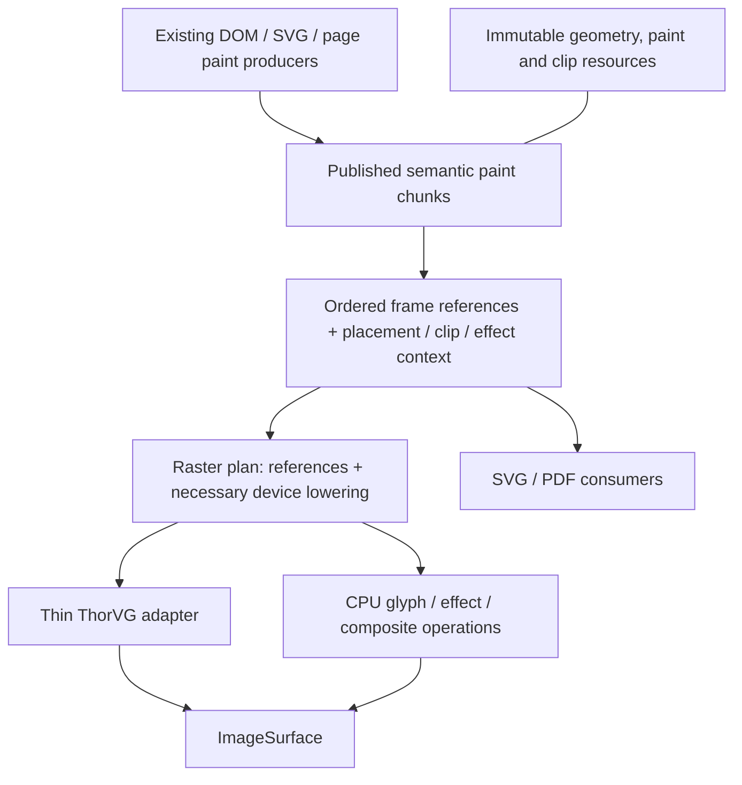

# Radiant Rendering Optimization — Implementation Plan

**Date:** 2026-10-20

**Status:** committed core pass and continuations through §19, 2026-10-20.
The committed checkpoint and its qualification limits are in §7. Subsequent
sections record serial/recording reuse, shared paint buffers, native batching,
chunk references, resource summaries, the SVG producer boundary, validated
replay metadata, compositional chunk validation and frame resource snapshots,
with qualification recorded for each milestone.
The full original M0–M7 acceptance envelope remains open.
The §14 aggregate failure is resolved by the phase-contract coverage in §15.
The §16 implementation and scoped qualification are complete; its Radiant
aggregate is green, with partial/skip results recorded below. The §17 stable-entry
refresh and expired-prefix pruning milestone is complete, with a green aggregate.
The §18 full-frame chunk-sharing milestone is complete, including frame-budget
fallback, with a green final aggregate. The §19 membership-group core is complete
with a green aggregate; shared/unindexed/incomplete graphs keep their fallback.

**Artifact retention:** an external cleanup removed `./temp/` during continuation
qualification. The earlier temporary receipts cited in §7 and the historical
measurements in §8 were observed before that cleanup; their raw files no longer
exist. The recorded summaries remain here. Regenerated qualification and benchmark
receipts are identified separately below; the benchmark driver is now versioned.

**Current design:** [Radiant Rendering Design](../radiant/Radiant_Design_Rendering.md).

**Baseline:** working tree at `de688f2d5` plus local changes on the audit date;
freeze a new source/binary identity before implementation measurements.

## 1. Outcome and boundaries

Reduce repeated geometry parsing, command/payload copying, retained-subtree
duplication and backend-object construction while preserving paint, ownership
and output behavior. Make unchanged vector content inexpensive to redraw and
make memory scale with unique retained content and its placements.

The first delivery comprises M0–M3: measured costs, non-consuming replay,
compact command storage and shared immutable vector resources. M4 delivers
retained chunk composition. M5–M7 consolidate command definitions and address
backend/layer costs using the earlier measurements. Keep one milestone active;
finish its acceptance cases before expanding the scope.

In scope: continuous raster output, inline/external SVG, serial/tiled/strip/dirty
replay, retained fragments, shared paint resources and their SVG/PDF/edition
consumers. Existing parser, text, clip, effect, resource and painter-order
behavior is the compatibility baseline.

Outside this delivery: new SVG/CSS conformance features, a new GPU backend,
replacement of ThorVG, private ThorVG renderer APIs, vendor patches, unrelated
layout work, automatic expansion of glyph-containing parallel replay, and
rewriting PDF generation or the Lottie player. Do not fold the separate
[PDF suite performance work](Radiant_Impl_PDF_Performance.md) into this plan.

### Authority

**D4.5.3v2** permits downstream retention; **D4.5.1v4 / D4.1.4v5** govern its
region/pool ownership. **D4.2.2v2–D4.2.4** govern context attribution, shared
allocator pins and exclusive reset; **D4.2.6** governs external-resource
cleanup. **D4.5.2** forbids retaining unrooted runtime values. Preserve SVG
admission/source-export/frame contracts (**D2.11.1–D2.11.4**) and PDF's completed
file/evaluator boundaries (**S2.6.6v3 / D2.6.12v3 / D5.4.1**).

These references are to the [formal design](../../doc/Lambda_Formal_Design.md)
and [formal semantics](../../doc/Lambda_Formal_Semantics.md). Milestone labels
are scheduling labels, not new ruling IDs. The proposed data structures below
are implementation sketches, not ratified changes to formal semantics.

## 2. Diagnosed costs and hypotheses

| Observed source behavior | Root cause / hypothesis | Measurement needed |
|---|---|---|
| `DisplayItem` is 872 bytes; a rectangle payload is 20 bytes | Embedded `DlClipShapeStack` enlarges every union element and its zero/copy traffic | Command counts, capacity bytes and payload bytes by opcode |
| Every eligible element marker captures a full range | Ancestor fragments physically duplicate descendant commands | Unique versus retained commands/bytes, nesting depth, capture time |
| Reuse calls `dl_copy_range`, followed by recapture | Cache hits avoid paint production but still allocate/copy payloads | Bytes/path clones per reuse and recapture |
| Paths are cloned in recording, retention and native caches | Geometry identity/lifetime is not shared across those boundaries | Clones, bytes, bounds evaluations and content hashes by stage |
| SVG `d` data is parsed on an uncached recording | Parsed DOM retention does not retain normalized geometry | Path parses under unchanged, placement-only and geometry mutations |
| Raster PaintIR emits/lowers/clears a fragment per primitive | Common payload schemas and transient ownership are duplicated | Gateway/lowering time and dash/clip temporary allocations |
| Serial frame arrays/context are created and destroyed | Capacity and target-independent state do not survive frames | Setup/teardown allocations and time, including small offscreen renders |
| Native cache hits duplicate ThorVG shapes under locks | Cached prototypes avoid API reconstruction but still copy geometry | Hit/miss/admission counts, duplicate bytes/time and lock wait |
| SVG layer capture performs two independent recordings/renders | Alpha reconstruction uses black/white passes and replay can consume pictures | Separate record, raster, resolve-alpha time and peak live surfaces |

Source links and ABI details are in the design document's appendices. This table
records the initial audit; release measurements of the implementation are in §7.

## 3. Proposed representation and ownership



Retain the semantic-to-raster boundary. Shared vector primitives should reuse a
common payload representation; bitmap glyphs and pixel effect programs remain
derived raster data. Export must continue to see text runs, groups and semantic
metadata. Do not make today's raster DisplayList the universal export contract.

Proposed concepts, with names subject to existing-helper discovery:

| Concept | Data and owner | Mutation rule |
|---|---|---|
| Immutable path | Commands/points, local bounds, computed hash and resource identity; document/edition/chunk-owned storage | A geometry edit publishes a replacement; fill/stroke/placement changes reuse geometry when valid |
| Paint/clip resource | Gradient stops, dashes, clip geometry and associated transforms; explicit native owner | Immutable payload; a change publishes a new identity/version |
| Paint chunk | Ordered own commands and child references, local bounds, dependency summary and owner leases | Build privately, validate, publish; replace changed chunks |
| Frame reference | Chunk identity plus placement and inherited clip/effect context | Frame-owned; preserves painter order and instance context |
| Raster plan | References to vector payloads plus lowered glyph/effect operations and device bounds | Derived from chunk/dependency generations and target parameters |
| Backend execution state | Canvas, batch, clip stack and temporary/native cache entries | Confined to its worker/context; never authoritative document state |

Use existing `lib` containers, allocator owners and resource handles. Prefer
chunk/arena-level ownership to a new heap allocation and atomic reference count
for every path command. Readers pin the storage owner, not a raw payload address.
Published storage cannot be rewound while borrowed (**D4.2.4**). Frame-local
resources stay frame-local unless an explicit owner or snapshot makes retention
safe. Mutable image/media handles retain their existing live-versus-snapshot
semantics.

Clipping/effects and placement are part of a chunk's composition contract.
References cannot splice a range into an arbitrary clip stack or skip one side
of an effect scope. Begin/end scopes and bounds must remain valid for serial,
dirty, tile, strip and export consumers.

### ThorVG retention policy to resolve before M6

The current public API constructs owning shapes/scenes; bulk path submission
still copies geometry. Zero temporary ThorVG geometry ownership is not an
achievable optimization within that API.

Two viable policies remain:

| Policy | Consequence |
|---|---|
| Strict batch lifetime for native vector paints | Retain canonical Radiant geometry only; release submitted ThorVG shapes after synchronization. Remove persistent vector prototypes, accepting measured reconstruction cost. |
| Bounded derived native cache | Radiant remains authoritative; permit explicitly owned, evictable native representations keyed by resource identity/generation and worker context. Account for their extra memory. |

Implementation selection: batch-scoped native vector shapes, following the
original no-retained-vector-model preference. The persistent vector paint
prototype cache is removed. A frozen release build with the previous prototype
cache is preserved as a comparison control. Raster-image upload caches and
explicit native fallback picture/text resources retain their existing separate
ownership; this is not a claim of zero native resources or zero temporary native
geometry. No vendor modification is involved.

The user has authorized importing ThorVG source under `lambda/` if needed.
This implementation does not require that import: the existing source already
shows that public `appendPath` copies into native shape storage. Relocating it
would not remove that copy. A future borrowed-geometry rasterizer interface would
need its own lifetime, synchronization and measured-cost design before replacing
this batch-scoped adapter; it is not part of the qualified change below.

## 4. Milestones

### M0 — Establish attributable release measurements

**Owner / hypothesis:** `render_output.cpp`, `render_profiler.cpp`, display-list
storage, retention and the vector adapter. Existing record/replay timing omits
retained capture as a distinct stage; cache byte statistics omit payloads.

Work:

- Separate setup, SVG/paint recording, lowering, validation, retained capture,
  replay, encoding and teardown. Attribute nested offscreen work without
  double-counting it as independent frame wall time.
- Count command capacity, unique/copy payload bytes, path parses/clones/hashes,
  fragment capture/reuse, native paint construction/duplication, batch flushes
  by reason and cache admission/eviction. Track live and peak memory separately
  from cumulative bytes copied.
- Distinguish known Lambda-owned/native-cache bytes from unobserved ThorVG
  allocations. Use a supported profiler for the latter; entry-shell counts are
  not total backend memory. Keep instrumentation out of release hot paths when
  disabled, consistent with **D4.2.5v3**.
- Freeze source/binary identity, viewport, density, fonts, input resources,
  thread budget, cache state and readiness. Reuse existing trace infrastructure.

**Done:** the bounded workload matrix in §5 has reproducible receipts under
`temp/`; stage timing explains the complete measured interval, counters expose
the suspected copies, and no visual baseline changes. Record estimates as
estimates and untracked memory as untracked. Set performance budgets from this
baseline rather than promising an unsupported percentage speedup.

### M1 — Make replay non-consuming

**Owner / cause:** `display_list_replay_vector.cpp`, `rdt_picture_draw`, owned
payload cleanup and offscreen callers. Serial replay consumes native picture
handles while tile replay duplicates them.

Work:

- Audit each opcode's ownership and replay mutations. Make the published
  command/payload read-only contract explicit; execution stacks and caches own
  temporary state. Use const-qualified access where it enforces that contract.
- Preserve native picture resources across submissions through supported
  ownership/duplication mechanisms. Do not share one mutable ThorVG paint across
  concurrent canvases. First reuse the existing safe duplication helper rather
  than inventing a parallel wrapper.
- Keep image read scopes, generation checks and snapshot leases valid through
  backend synchronization. Publication must fail atomically if acquisition
  fails; no partial command may escape with an unowned resource.
- Once repeatability is established, let black/white SVG-layer capture record
  once and replay twice while keeping all recording resources alive.

**Acceptance:** the same frozen list, including fallback native text/pictures,
images, clips and effects, can render twice to fresh identical targets with
identical pixels and unchanged payloads. Serial/tile/strip comparisons agree;
two different backgrounds work; source destruction after a properly owned
record does not invalidate it. Live media still updates when its generation
changes. Teardown releases each resource once. ASan covers repeated replay and
owner retirement.

**Done:** repeated replay is an ownership guarantee, and layer capture performs
one recording. Two raster passes remain until M7; no alpha-policy change belongs
in this milestone.

### M2 — Compact commands and reuse bounded frame storage

**Owner / cause:** `render.hpp`, `display_list_storage.cpp`, record/replay
helpers and `RenderFrameScope`. Large inline clip stacks dominate every command;
frame teardown discards reusable array capacity.

Work:

- Move `DlClipShapeStack` to explicit arena/resource payload storage. Store a
  handle or offset in only the commands that need it; use a canonical empty clip
  state and share equal immutable stacks where ownership permits.
- Keep bounds/opcode access cheap. First measure the smaller tagged union
  after this extraction; choose a variable-payload stream only if it improves
  the measured access/copy workload enough to justify its indexing complexity.
- Update allocation, clone, cleanup, validation and bounds behavior through the
  existing descriptor machinery. Empty, polygon and maximum-depth clip cases
  must use the same lifetime policy.
- Reuse command capacity and suitable serial execution context within the
  owning render session. Reset clips, batches, target, offsets and scratch
  between frames. Keep nested/offscreen calls independently owned; preserve
  existing worker-local reuse.
- Right-size transient PaintIR storage. Reuse prior capacity or a small
  emission buffer instead of reserving a whole retained list for one command.
  Return oversized idle capacity through existing context memory-pressure rules.

**Acceptance:** changing clip-stack capacity no longer enlarges every drawable
record; ordinary rectangles carry no embedded full clip stack. Report before/
after type sizes and total workload bytes. Equivalent warmed forced redraws
reuse array/context capacity without cross-frame clip or target leakage.
Document retirement and repeated large/small jobs release excess owned memory.

**Done:** smaller records and reusable storage are qualified across list,
retention, clip and export controls; no new command-format fork remains.

### M3 — Share immutable vector resources and cached SVG geometry

**Owner / cause:** path creation/visitation, paint/list payload storage, SVG
geometry producers and backend lookup. Equal geometry is copied or reparsed
because recording boundaries lack a stable shared owner.

Work:

- Separate mutable path construction from published immutable geometry. Move
  backend-neutral geometry ownership out of the ThorVG-specific implementation
  as needed, promoting existing helpers rather than copying them.
- Cache local bounds and a content hash at publication. Give geometry stable
  owner-scoped identity/generation; consumers use identity, with exact comparison
  where deduplication still needs collision checking.
- Share the same geometry between fill, stroke, clipping and retained commands.
  Reference gradient stops/dashes similarly. Preserve existing path visitors
  used by export, hit testing and geometry queries.
- Start SVG geometry caching with `path d` and basic shapes. Key geometry on
  source identity and actual geometric dependencies: attributes, viewport or
  font-dependent units, sampled animation and reference context. Cache local
  geometry before transform-dependent adjustments; non-scaling strokes and
  placement-dependent hairline paths need their own derived keys.
- Retain broad style/resource invalidation until dependency-specific tests
  prove it can be narrowed. Shared `use` geometry must retain per-instance
  inherited paints, transforms and reference/resource context.
- Borrow resources while recording; transfer or pin their owner for publication.
  Avoid source, DisplayList, fragment and backend-key copies of the same path.

**Acceptance:** fill+stroke of one path share one published geometry; unchanged
and placement-only redraws do not reparse its `d` or clone its Radiant path data.
A geometry change replaces the affected resource; a color change updates paint
without invalidating independent geometry. Test shared references, relative
units, viewport changes, animations, owner retirement and export consumers.
Do not claim zero ThorVG copies: native-object policy is M6.

**Done:** M0–M3's first delivery eliminates measured avoidable Lambda-side
geometry copies and passes the applicable milestone gates before chunk work.

### M4 — Compose retained chunks by reference

**Owner / cause:** `retained_display_list.cpp`, element markers, dirty tracking
and frame assembly. Whole-range capture/reuse duplicates descendants and
recaptures unchanged content.

Work:

- Publish a chunk's own ordered commands and child references. Parent chunks
  do not physically contain copies of every descendant's commands. Preserve
  the exact interleaving of own paint, children, outlines and state scopes.
- Assemble a frame from chunk references and placement/context records.
  Keep chunk-local indices; reference traversal or a lightweight index view
  replaces payload-copying marker remapping. Bound depth/work and reject cycles.
- Store dependency summaries for layout/style, inherited paint, fonts, images,
  animation and referenced SVG resources. Map dirty reasons to producer rebuild,
  placement/bounds refresh or raster-only invalidation.
- Rebuild only affected chunks. Update ancestor visual bounds or dependency
  summaries without cloning unchanged descendant payloads. Unknown dependencies
  conservatively rebuild; detached/recycled nodes cannot reuse stale identities.
- Preserve the distinction between visual overflow and marker bounds. Dirty
  regions include old and new extents. Backdrop-dependent effects must repaint
  when underlying content changes even if their local commands are unchanged.
- Add byte-budgeted reclamation through the existing memory owner. Eviction
  retires cache ownership; active frame/edition readers remain pinned.

**Acceptance:** nested-depth/width fixtures demonstrate storage proportional to
unique commands plus references, without ancestor payload multiplication.
Unchanged forced redraws perform no fragment payload copy or recapture. A local
edit rebuilds affected content and required metadata, while sibling resource
identities remain stable. Translation, clipping, external dirty sources,
overlapping effects, detached nodes and stale media generations retain correct
pixels and lifetime behavior. Broad document invalidation may still rebuild all
chunks when the dependency itself is broad.

**Done:** the continuous-view retained path uses references with qualified
dirty/tile replay; remove the old deep-copy capture/reuse path once its consumers
are migrated. Published-page ownership remains valid throughout.

### M5 — Consolidate common command storage and lowering

**Owner / cause:** `PaintOp` / `DisplayOp`, gateway wrappers, lowerers and
export/page consumers. Mirrored primitive schemas duplicate emission and
ownership code, although raster and semantic operations have different roles.

Work:

- Define each shared vector payload and its validation/ownership facts once.
  Reuse existing opcode descriptor patterns rather than maintaining a third
  handwritten schema.
- Let the producer sink retain semantic commands or feed a raster builder
  without a temporary heap-backed single-command PaintList. Both routes call
  the same primitive construction and validation helpers.
- Let raster plans reference shared primitive payloads and carry only device
  bounds/placement and necessary expansions. Keep glyph-run-to-bitmap and
  effect-group-to-pixel-work lowering explicit.
- Adapt SVG/PDF and edition borrowing without losing text, semantic groups,
  links or ordering. Preserve streaming export and bounded effect fallback;
  a single whole-document retained PaintList is not mandatory for one-shot jobs.
- Remove migrated wrapper/payload copies after all consumers use the shared
  definition. Keep target-specific operations visibly target-specific.

**Acceptance:** vector recording does not allocate duplicate dash/clip/path
payloads just to cross the PaintIR boundary. Primitive facts have one definition;
raster/export tests cover it. Searchable PDF text, SVG text, semantic groups,
fallback effects and published-edition retirement remain correct.

**Done:** common storage is unified while semantic and device lowering remain
explicit. Do not measure success by deleting type names alone.

### M6 — Reduce measured ThorVG preparation cost

**Dependencies:** M0 and M3; use M4's identity/placement model if available.
Resolve the retention policy in §3 before adopting a persistent native cache.

Work:

- Isolate ThorVG-specific state and translation behind the existing vector
  adapter. A direct list-to-ThorVG implementation is acceptable only if it
  absorbs the same responsibilities without duplicating them elsewhere.
- Compare bulk path submission with per-command replay on cache misses. Expand
  primitive rectangles/circles through shared geometry helpers when required;
  preserve contour topology, fill rules and stroke semantics.
- Replace repeated full-path hashing with published identity/generation keys.
  Measure whether native prototypes save work after duplication and locking.
- Under strict batch lifetime, remove persistent vector prototypes and measure
  the result. Under derived-cache policy, use explicit byte limits, context/
  worker confinement and eviction. Never concurrently mutate or submit one
  native paint through independent canvases. Keep exact clip/placement/effect
  dependencies and ownership around canvas push/remove.
- Preserve batching across stable vector runs. Record each flush reason and
  eliminate only demonstrably redundant boundaries. CPU operations, clip
  changes and backdrop reads keep their required synchronization.

**Acceptance:** chosen policy is documented; geometry/paint cache workloads
below and above the old 256-entry limit have reported preparation, duplication,
lock and memory costs. Tile/serial results agree and release end-to-end results
improve the selected workloads without unexplained regressions. If an experiment
does not help, retain the measured better path and record why.

**Done:** backend preparation improves within public ThorVG APIs and the selected
ownership policy. No vendor modification or unsupported internal API is needed.

### M7 — Simplify SVG-layer capture where alpha permits

**Dependencies:** M1; use M3's shared resources and M0's phase measurements.

Work:

- Retain M1's record-once/two-replay implementation as a comparison control.
  Inventory alpha representation at every writer: vector fills, image sampling,
  bitmap glyphs, blur, masking, group opacity and source-over compositing.
- Establish explicit surface alpha modes and conversion boundaries using
  existing pixel helpers. Rendering once to transparent premultiplied storage
  is eligible only when every participating writer obeys that contract.
- Compare single-pass capture with the current black/white reconstruction for
  translucent overlapping content, antialiasing, text, images and effects.
  Keep backdrop-dependent paint out of an independently cached layer unless its
  backdrop is part of the dependency key or composition contract.
- Preserve size budgets, admission behavior, transform eligibility, density
  invalidation and the existing layer-placement policy. Sampling-policy changes
  need separate visual evidence; do not hide them inside this optimization.

**Acceptance:** supported layers use one recording and one raster pass, with
equivalent compositing on multiple opaque and transparent destinations. Peak
surface memory and capture time fall on the selected workloads. If any writer
still requires the existing route, state the eligible subset and retain the
correct fallback; do not claim universal single-pass capture.

**Done:** the qualified subset is documented by behavior and alpha contract,
with unsupported combinations recorded as deferred work.

## 5. Bounded workload and correctness matrix

Select existing fixtures first and add only cases that distinguish the cause.
Use generated size/depth variants for scaling evidence, not fixture-specific
production branches. Suggested workload families:

| Workload | Scenarios | Evidence |
|---|---|---|
| Static vector page | Cold first render; warmed forced redraw; true idle separately | Setup/record/capture/replay/teardown, allocations, native cache state |
| SVG geometry | Long paths, fill+stroke, repeated `use`, gradients and dashes | Parse/clone/hash counts; unique geometry versus placements |
| Deep/wide retained content | Increasing marked depth and sibling count; one local edit | Retained bytes versus unique content, copied bytes, rebuild set |
| Movement and dependencies | Translate, resize, inherited color, external definition/font/image change | Correct invalidation, old/new damage bounds, resource reuse |
| Mixed vector/raster | Text, images, nested clips, opacity, filters and backdrop dependencies | Painter order, batch barriers, serial/dirty/tile/strip parity |
| Cache pressure | More unique paints/images than existing limits; large/small jobs | Admission/eviction, bytes retained, peak memory and teardown |
| SVG layer | Cold/stable/animated; black/white and transparent destinations | Record count, raster passes, alpha equivalence, scale/placement |
| Export and edition | PNG/SVG/PDF; retained pages after source relayout/cache retirement | Native/selectable text, geometry, fallback pixels and owner lifetime |

Run relevant cases at device densities 1 and 2 with fixed resources and settled
animation time. For performance, use the existing layer/cache policies as the
default and explicit diagnostic variants to isolate masked costs. Report
medians and tail samples from a fixed repeat protocol, CPU and wall time, command
and payload bytes, peak live memory and copied bytes. Record cold/warm definitions;
process-warm is not proof that OS caches were cold in the other run.

Do not set a speedup claim from structure sizes. Deterministic acceptance
properties such as no unchanged-fragment copy or no repeated `d` parse can be
tested directly; runtime budgets come from M0 on the named workload/hardware.

## 6. Verification budget and integration

Follow [Radiant's development workflow](../../radiant/README.md), the
[test map](../../test/README.md) and
[Developer Guide §7](../../doc/dev/Developer_Guide.md#7-worktrees-and-agent-gotchas).
Use the project's release build workflow for timing; never time a debug build
or run `make release` in a worktree. Freeze measured binaries before tests that
rebuild a different profile. All scratch artifacts belong under `temp/`.

During each milestone, build the affected native targets and run focused
selectors from these existing harnesses:

| Area | Harness / useful existing coverage |
|---|---|
| Commands and lowering | [test_display_list_gtest.cpp](../../test/test_display_list_gtest.cpp): `DisplayListTest`, `PaintIrParityTest`, ownership/validation cases |
| Retained composition | [test_retained_display_list_gtest.cpp](../../test/test_retained_display_list_gtest.cpp): dirty sources, marker/visual bounds, deep clip copies, stale resources and replaced views |
| Vector/alpha/clips | [test_rdt_vector_gtest.cpp](../../test/test_rdt_vector_gtest.cpp): batch clipping, gradient order, transforms, density and paint ownership |
| Published editions | [test_paged_media_gtest.cpp](../../test/test_paged_media_gtest.cpp): retained paint/font/image lifetime and source relayout |
| SVG/PDF output | [test_pdf_render_visual_gtest.cpp](../../test/test_pdf_render_visual_gtest.cpp), `make test-svg-export`, `make test-svg-paint`: output parity, text, gradients and effects |
| End-to-end mutations | Existing UI/DOM fixtures for edits, media, clipping, animation and resource replacement |

At a stable engine milestone, run `make test-radiant-baseline`. Shared export
changes also require `make test-pdf-render` and the relevant SVG gates; the PDF
suite is separate from the Radiant baseline. PDF package/runtime changes, if
unavoidably required, add their package/core gates through the test map rather
than silently expanding this plan. Run focused ASan ownership checks for M1,
M3 and M4; use the supported sanitizer profile and report its coverage/leak
settings. Run layout integer-cast lint when layout code changes.

Reuse passing evidence until relevant code changes or a failure gives reason to
repeat it. Never weaken goldens, comparator thresholds or lifetime checks for a
performance result. Store failures and unresolved environmental limits with the
milestone receipt; a passing isolated rerun does not erase an aggregate failure.

Migration must keep one implementation of shared geometry and ownership helpers.
Introduce compatible readers/writers at bounded boundaries, migrate their
consumers, then remove the superseded representation. Temporary comparison
switches belong to qualification and should not become permanent parallel paint
algorithms. Do not reset a borrowed arena, drop generation checks or bypass
effects to make a benchmark faster.

## 7. Committed core checkpoint — 2026-10-19 (`689eb13d0`)

The implementation follows **D4.5.1v4 / D4.2.4 / D4.5.3v2**. No formal ruling
has changed. Qualification receipts below distinguish implemented behavior
from the full original acceptance envelope.

| Milestone | Implemented behavior | Remaining scope / qualification |
|---|---|---|
| M0 | Opt-in release metrics: frame stages through teardown, tracked start/end/process peak bytes, capacity, geometry and payload copies, native construction/duplication, batches and layer passes; tile workers inherit the probe. Frozen release controls and paired fixtures live under `temp/rendering-optimization/`. | Native ThorVG bytes remain untracked. Fine-grained lowering/native-lock/flush-reason attribution and the complete workload matrix remain open. |
| M1 | Serial and tile replay duplicate native picture submission; source handles survive repeated rendering. SVG capture records once; source retirement/replay regression passes. Native picture duplication preserves transforms and handles allocation failure. | Qualified by the focused native/ASan and output checks below; the aggregate has the separately identified existing failures. |
| M2 | Optional immutable arena clip payloads; direct-pixel recording fails before publishing an incomplete clip. Empty frame command arrays are reused per ViewTree, nested frames get independent storage, oversized/pressured idle arrays are released. Transient PaintList starts at eight commands. Copied chunks reserve their actual range rather than the frame-sized floor. | Serial canvases still have frame lifetime; worker canvases retain their existing reuse. |
| M3 | Backend-neutral copy-on-write path storage; cached bounds/hash; fill/stroke/clip/retained snapshots share entries. An 8 MiB document cache retains sampled `d` geometry and marker topology, and interns resolved basic shapes. Geometry survives paint/placement/viewBox changes; a changed `d` publishes another resource. | Basic-shape inputs are still resolved and temporarily constructed before interning. Gradient/dash payloads are not globally interned. Standalone offscreen SVG without a persistent document has job-local caching. |
| M4 | Parent chunks own commands and ordered child references. Frame descriptors borrow payloads and pin owners. Reused chunks avoid recapture; stale cache entries retire; high memory pressure drops cache ownership between frames. A 64-level regression captures exactly the source command count and zero new commands on recapture, with frame lifetime beyond cache destruction. | Frame descriptors are still copied into a flat execution list. Reuse still requires selective dirty painting/matching placement; general forced-redraw references, placement-only reflow, fine dependency summaries and per-cache byte/LRU policy remain open. |
| M5 | Common raster primitives flush pending semantic work and call the shared display-list builder directly. This removes transient primitive commands and duplicate dash/clip boundary copies. Rectangle/rounded-rectangle/picture payload types are shared. Semantic text/effect/subscene lowering remains explicit. | Further payload-schema consolidation remains open; semantic/raster representations retain their different ownership fields. Output checks below preserve searchable PDF text and published-page behavior. |
| M6 | Removed persistent native vector prototypes; pure path command runs use public bulk submission. Compact primitive contour handling and batching barriers are preserved. Raster image/picture owners remain separate. | The paired comparison below does not establish a general speedup; fine-grained preparation/locking attribution and the original improvement criterion remain open. |
| M7 | Descriptor-qualified vector fills/strokes/gradients/images/clips/markers render into one premultiplied surface. CPU/effect/native-picture recordings retain record-once/two-replay reconstruction. Native test compares opaque and translucent backdrops within two channel units. | Universal one-pass capture is deferred. The off/eager paint and output checks below qualify the selected subset and preserve the mixed-writer fallback. |

Focused receipts before the last geometry-cache adjustment:
`m6-vector-full.log` (173 passing tests), `m6-display-full.log` (86),
`m6-retained-full.log` (31); earlier focused alpha/cache/ownership tests are
also in `temp/rendering-optimization/`. These are release correctness checks,
not sanitizer evidence. The frozen five-repeat paired release comparison,
final gates and their failures are recorded below. Do not interpret
the table as completion of the remaining acceptance cases.

### Qualification receipts

The three native ASan runners passed: 21 vector/ownership selectors, 32 retained
cases and 86 display-list cases. A final native-picture transform regression
also passed ASan. Configuration: `debug_asan_native`, `ASAN_OPTIONS=detect_leaks=0`;
this is memory-access/lifetime coverage, not a leak-free certification. Logs:
`temp/rendering-optimization/asan-vector.log`, `asan-retained.log`,
`asan-display.log` and `asan-picture-final.log`. The subsequent nested-frame
arena correction requires its separate release regression and aggregate check.

The required Radiant integer-cast lint passes. Local documentation links and
`git diff --check` pass.

Release qualification (`release_native`):

- The Radiant aggregate passed all 174 vector, 86 display-list and 32 retained
  tests, and its completed neighboring text, DOM, animation, paged-media,
  snapshot, input and media checks. Its raw invocation did not pass: sandboxed
  graphics initialization timed out, local HTTP startup was denied, and two UI
  subprocesses aborted. The blocked graphics run was stopped after diagnosis;
  its log remains `radiant-gate.log`.
- The two exclusive checks that had not started before that interruption also
  pass: all 20 native map tests and the render visual baseline (207 strict
  passes, four expected failures and one skipped of 212 inputs; no recorded
  baseline regression). Receipts: `map.log`, `render-baseline-report.json`.
- With native graphics/local HTTP access, all 180 not-yet-passed view selectors
  passed, as did all 28 scene unit tests (`view-native-access-rerun.log`,
  `scene-unit-native-access.log`). The 15 layout suites meet their recorded
  baselines: 3,141 fully passing, 153 partially passing, zero failed
  (`layout-native-access-results.txt`). Partial support remains partial.
- UI automation reported 642/644 passing. `controlled_bindings` and
  `dtna_controlled_controls` aborted intermittently. Both pass isolated reruns;
  repeated `controlled_bindings` also aborts in the frozen original binary.
  The baseline/current crash reports share the allocator invalid-free signature;
  the current release linker map resolves the native frame to `fn_float` in
  `lambda/runtime/lambda-eval-num.cpp`. This is an existing runtime qualification
  limit, not a rendering-test waiver or a repaired runtime bug. Receipts:
  `ui-isolated-reruns.json`, `baseline-controlled-stress.json`,
  `baseline-controlled-crash.json`, `controlled-crash.json`.
- All 406 PDF import/export/output-parity tests pass (`pdf-output.log`), covering
  searchable Unicode text, semantic groups, page borrowing and effect fallback.
  No PDF golden was changed.
- All 12 SVG native paint variants pass (three fixtures, two densities, off/eager
  layers). The portable PNG/SVG/PDF matrix passes 178/180 variants. Its two
  failures are PDF rounded containment in `css_containment_boxes` at 1×/2×.
  The frozen original produces identical complete raster pixels and the same
  failed assertions at both densities (`containment-baseline-results.json`).
  SVG structure, embedded resources and vector text checks pass. Reports:
  `svg-paint/report.json`, `svg-export-report.json`.

The original full acceptance envelope is still incomplete: see each milestone's
remaining column. Passing component reruns do not rewrite the failed raw
aggregate verdict. Test artifacts are under `temp/rendering-optimization/`.

### Release comparison

Five interleaved fresh-process renders per variant/fixture/density, alternating
variant order, fixed 800×600 viewport and `--no-log`. OS caches were uncontrolled.
Three frozen binaries: original review baseline, optimized storage with the old
native prototype cache, and the batch-scoped native-vector implementation.
Binary SHA-256 receipts, raw CPU/wall samples and PNG hashes are in
`temp/rendering-optimization/`; the driver is `compare_release.py` and raw result
is `paired-results.json`.

| Fixture | Density | Original median ms | Optimized median ms |
|---|---:|---:|---:|
| Repeated long paths | 1 | 204.2 | 197.8 |
| Repeated long paths | 2 | 444.9 | 477.5 |
| Deep marked content | 1 | 128.1 | 115.9 |
| Deep marked content | 2 | 236.6 | 243.5 |
| Mixed text/vector | 1 | 130.2 | 141.7 |
| Mixed text/vector | 2 | 393.9 | 408.8 |
| 128 unique paints | 1 | 36.0 | 35.3 |
| 128 unique paints | 2 | 72.9 | 75.5 |
| 512 unique paints | 1 | 75.3 | 73.2 |
| 512 unique paints | 2 | 137.8 | 131.7 |

Every compared PNG matched byte-for-byte across all three variants and repeats.
The preserved native-cache control is close to the batch-scoped variant; the
experiment supports removing duplicate retained geometry with limited measured
cost, rather than claiming a universal rendering speedup. Mixed/high-density
end-to-end regressions remain a performance qualification limit. Earlier
non-interleaved timings taken during development are superseded by this paired
comparison. A serial-versus-eight-worker probe also had density-dependent results,
so scheduling was preserved.

Final storage/counter probe (`final-metrics-stdout.txt`, serial vector fixture):
`DisplayItem=224` bytes versus the original 872 (74.3% smaller before variable
payloads). The 514 recorded commands copy 115,136 descriptor bytes into retained
own-command storage exactly once; path parsing is one cache miss, entry-copy
bytes are zero, and transient PaintList capacity is zero for that primitive-only
recording. In eager-layer mode the corresponding admitted vectors show 63
recordings and 63 raster passes. These counters are fixture-specific, not general
speedup percentages.

The normal release process disables allocation tracking. Enable
`MEMTRACK_MODE=STATS` alongside `RADIANT_RENDER_METRICS=1` for the tracked-byte
fields; zeros with tracking off are not evidence of zero live memory. Process
peak remains a process high-water mark, and ThorVG internals remain untracked.

The nested-frame regression passes without arena ownership diagnostics
(`nested-frames-final.log`). Nested list and scratch arenas are selected before
context initialization. After output qualification, the only engine addition is
the opt-in `retained_command_capacity_bytes` counter plus a regression asserting
that reserved chunk command slots scale within twice the unique commands in the
64-level fixture. This verifies capacity as well as live command count; no extra
capacity-policy change was needed. The final release build and focused rerun are
recorded in `final-metrics-build.log` and `final-retained.log`.
The full vector runner also passes all 174 cases after that metrics-only build
(`final-vector.log`). `qualified-binary.txt` identifies the final release binary;
`output-qualification.json` identifies the earlier, behavior-equivalent build
used for the output gates. ASan predates this counter/assertion addition.

The final probe with `MEMTRACK_MODE=STATS` confirms 115,136 reserved chunk-command
bytes for 514 unique commands, equal to their descriptor bytes on that fixture
(`qualified-metrics-stdout.txt`). The tracked frame scope starts at 3,762,997
bytes and ends at 4,780,738 bytes, with a process peak of 5,179,742 bytes. The
remaining live storage includes retained chunks, document caches and the reusable
frame array; these are known Lambda-tracked bytes, not the total process or
ThorVG footprint. This probe is not a baseline-versus-optimized memory comparison.

## 8. Continuation delivery

The user requested implementation of the remaining work after commit `689eb13d0`.
This delivery continues **D4.5.3v2 / D4.5.1v4 / D4.2.4**; no formal ruling changes.

This delivery covers native cost attribution, clip-segment submission,
serial canvas reuse, unchanged full-frame recording reuse, and basic-shape cache
lookup before contour construction. Required acceptance cases are pixel parity
across nested clip changes and CPU barriers; default SVG layer warm-up; visible
SVG paint mutation; opaque/transparent targets; and independent nested frames.
Reuse must reject unknown/foreign dependencies and incomplete dirty recordings.

Verification budget: focused native ownership/geometry/clip tests during edits;
one interleaved release comparison against the frozen parent implementation;
ownership ASan after stabilization, including the previously uncovered nested
arena correction; then the Radiant baseline and affected SVG/PDF output gates.
Keep earlier independent runtime/PDF failures visible. The same continuation
also implements the shared primitive field declarations, shared gradient/dash
buffers, a managed retained-storage budget, and the extended premultiplied capture
subset described below. Placement-only composition remains a separate milestone.

The initial release timing probe (`continuation-profile.stdout`) attributes the
dense 2× serial vector fixture's work to about 356 ms of native drawing versus
0.073 ms of path submission, with 63 clip-triggered draws. This identifies
clip-triggered canvas submission as a measured target. Phase timers accumulate
worker wall time and may overlap; their sum is not another frame duration.
ThorVG internal allocation bytes remain untracked.

### Implemented continuation behavior

| Area | Change and boundary |
|---|---|
| M0 attribution | Separate lowering, native shape/path/clip/submit/draw/sync/remove/duplicate/canvas time, flush reasons, tile/native lock waits, basic-shape construction, shared-array leases and full-frame reuse. Worker times overlap; native internal bytes remain untracked. |
| M2 serial state | ViewTree owns a reusable serial vector context. A frame rebinds its target and zeroes tile offsets; nested frames use separate contexts and arenas. Pressure/teardown releases ownership. |
| M3 geometry | Resolve basic-shape geometry before a content lookup; construct the path only on a miss. Shared paint buffers use one immutable allocation per distinct value within a list and explicit list-index leases. Copies from owned or borrowed chunks retain buffers after all source owners retire; unrelated lists are not globally interned. |
| M4 unchanged recording | Eligible complete frames retain their document prefix. Matching document/style/state/layout/font/image/SVG/video and target stamps plus current resource handles bypass traversal, descriptor assembly and capture. Pending reflow, selective recordings and producers without complete dependency stamps reject reuse. Default SVG layers warm before publication. Overlays always append/rollback their own commands, array references and arena allocations. Admission is conservatively limited to 8 MiB; unused arena chunks are reclaimed only with exclusive scope ownership and no live/earlier arena data. |
| M4 reclamation | A 32 MiB per-cache managed command-storage ledger follows admitted chunks. Reclamation chooses old roots by last use and retires their old descendants together. Current-frame publications and active reader leases prevent premature reclamation; new admission can fail. Charges include command/span capacity, arenas, shared arrays and conservative per-reference paths; they exclude ThorVG/native-picture internals and separately owned image/font data. |
| M5 schema | Common path-fill, stroke and gradient field declarations complement the existing rectangle/picture payload types. Raster shared-buffer and semantic owned-buffer annotations remain explicit. PaintIR and DisplayList keep their distinct semantic/device roles. |
| M6 submission | Clip changes seal ordered native segments. A single segment uses its own scene; multiple segments share a submission wrapper. CPU access, target changes and batch completion synchronize. No native vector prototype survives a batch. Fewer submissions alone do not establish a speedup. |
| M7 alpha | CPU surface fills, scaled image blits and monochrome coverage glyphs join the qualified premultiplied capture subset. Emoji, effects and native pictures keep black/white reconstruction. The SVG pass declares its destination alpha mode explicitly. |

### Reproducible release comparison

The versioned [benchmark driver](../../utils/benchmark_radiant_rendering.py)
generates bounded vector, deep, mixed and cache-pressure fixtures, pins
Liberation Sans, alternates variant order and checks every PNG and event result.
The final frozen release is SHA-256
`f285b823a4bb2d9b9e1e5776c2607a95a3998a4f263fb94e1c3a832e7bab6a42`.
The clean committed control is `7b857b860`, SHA-256
`ffa8ede1b836a65a71145832eb4fa92f58dc3032257947a12db24c858bf871ce`.
Both include the concurrently committed PDF/font changes. The earlier,
deleted-receipt comparisons used different fixtures/controls and are superseded
by this protocol.

Environment: macOS 26.3 arm64, 800×600 viewport, densities 1 and 2, one renderer
thread, default SVG-layer policy, five alternating-order fresh-process pairs.
Warm sessions use the same binary with `RADIANT_RECORDING_CACHE=off`/enabled:
one live tree and twelve forced PNG render events after initial presentation.
Logging is disabled for wall samples; metrics use separate processes. Times
include startup and PNG encoding. OS caches and scheduling are uncontrolled.
No builds or other test sweeps ran during collection.

| Workload | Density | Cold control → final (ms) | Warm cache off → on (ms) |
|---|---|---|---|
| vector | 1× | 98.31 → 100.16 | 365.52 → 340.65 |
| vector | 2× | 139.88 → 156.20 | 897.02 → 921.89 |
| deep | 1× | 83.75 → 85.81 | 224.38 → 220.45 |
| deep | 2× | 105.64 → 105.39 | 684.00 → 643.84 |
| mixed | 1× | 106.64 → 105.14 | 444.90 → 379.58 |
| mixed | 2× | 171.45 → 171.85 | 1088.95 → 1058.23 |
| pressure-128 | 1× | 55.59 → 54.18 | 204.44 → 207.98 |
| pressure-128 | 2× | 78.82 → 78.13 | 679.75 → 642.32 |
| pressure-512 | 1× | 127.96 → 126.54 | 387.15 → 393.50 |
| pressure-512 | 2× | 178.59 → 176.95 | 974.75 → 999.99 |

All ten cold and ten warm scenarios produce byte-identical PNGs. Medians remain
mixed; these results do not establish a general latency improvement. Individual
cold vector 2× samples overlap: control 133.50–156.15 ms, final 131.78–157.06 ms.
The median difference must not be presented as a stable isolated backend cost.

After discarding the first two profiled frames, all eleven remaining frames in
each warm scenario reuse the recording, copy zero command bytes and create no
serial canvas. Off-mode frames copy 3,584–202,496 descriptor bytes. The cold
vector 2× profile copies 576 paint-array bytes versus 18,432 in the control;
native batches remain 793 versus 794 because analytic-gradient CPU barriers
still require synchronization. These counters prove eliminated work, separately
from the noisy end-to-end timing.

Across the ten scenarios, profiled per-scenario median record/lower time falls
from 0.016–0.219 ms to 0.002–0.003 ms; capture falls from 0.005–0.051 ms to
0.001–0.002 ms. These are logging-enabled stage measurements, not wall samples.

The regenerated pre-trim three-pair peak-RSS probe reports vector 2× medians
52,822,016 → 52,871,168 bytes and pressure-512 2× 46,186,496 → 46,055,424 bytes
(`continuation-peak-rss.json`). This is total process peak, not native-only
allocation or steady retained memory; it establishes no broad memory reduction.

Receipts are below `temp/rendering-optimization/`: `final-binaries.json`,
`final-benchmark-cold/results.json`, `final-benchmark-warm/results.json` and their
logs. To repeat after building/freezing the release binaries:

```sh
python3 utils/benchmark_radiant_rendering.py --mode warm --profile \
  --executable temp/rendering-optimization/lambda-final-qualified.exe \
  --out temp/rendering-optimization/final-benchmark-warm
python3 utils/benchmark_radiant_rendering.py --mode cold --profile \
  --executable temp/rendering-optimization/lambda-final-qualified.exe \
  --control temp/rendering-control/lambda.exe \
  --out temp/rendering-optimization/final-benchmark-cold
```

### Recording admission correction

The regenerated warm probe exposed a real 2× admission miss: a prior capture
left 8,047,632 reserved arena bytes with zero live arena bytes, pushing a small
recording to 8,509,584 bytes against the 8 MiB admission limit. The correction
retires overlay marks, then trims unused chunks only when there is exactly one
arena scope, no earlier arena allocations and no live scratch data or nested
scope. The same recording then reserves 4,096 arena bytes and charges 462,848
bytes on reuse. The admission limit is unchanged (**D4.2.4 / D4.5.1v4**).
`trim-admission/results.json` first reproduced successful admission; the full
final warm matrix above confirms it across all ten scenarios.

### Continuation correctness qualification

The final release focused suites pass 179 vector, 90 display-list, 34 retained
and 25 state-store cases (`trim-*-release.log`). All four full suites also pass
under `debug_asan_native`, `ASAN_OPTIONS=detect_leaks=0` (`trim-*-asan.log`).
Coverage includes nested frames, live/earlier arena-data protection, repeated
recording reuse, buffer/checkpoint retirement, CPU/clip painter order and pinned
budget-ledger teardown. Leak detection was disabled; vendor libraries are not
claimed as instrumented. Changed ASan shared archives were retired before the
release rebuild (`trim-retired-asan-products.json`, `final-release-build.log`).

An older clip assertion read pixels before batch synchronization. Its pixel
assertions now run after synchronization; the dedicated segment test checks
deferred submission and CPU ordering independently. No tolerance was relaxed.
Integer-cast lint, local documentation links and scoped diff checks pass.

The final unchanged `make run-radiant-baseline` invocation on this release
completed in 405,387 ms: 5,913 passed, one failed, 157 partial and one skipped
of 6,072 reported cases. All 644 UI, 208 view, 500 paged-media, 160 DOM, 32 input,
20 map and the focused native cases pass. Layout retains 3,141 fully passing
and 153 partial cases with zero failures. Render visual completes normally:
207 passing comparisons, four expected differences and one skip; all 211
baseline entries pass. The earlier Node 24 shutdown deadlock did not recur.
Receipts: `final-radiant-baseline.log`, `final-radiant-summary.json` and the
copied `final-*_results.json` files.

The sole aggregate failure is the same Bootstrap kitchen-sink page's 15-second
parallel-load timeout observed earlier. Three isolated runs per configuration
all pass with the original deadline: final 3.45–3.52 s; clean committed control
3.41–8.20 s, from its own checkout. See `final-bootstrap-reruns.json` and its
per-run output. This does not turn the failed aggregate into a passing gate.
The final SVG paint gate passes all twelve off/eager 1×/2× scenarios and their
680 assertions (`final-svg-paint/report.json`, `final-svg-paint.log`). The
portable PNG/SVG/PDF export matrix passes 178/180 format scenarios. Its only
failures are `css_containment_boxes` PDF at 1× and 2×. A fresh control run from
its own checkout produces identical nested assertion results and byte-identical
PNG rasterizations for all six containment outputs, including the two failures
(`final-svg-export-report.json`, `final-containment-control-parity.json`).

The complete current PDF inventory also ran on the final binary: 439/440 pass
in 99,478 ms. All 307 output-parity, 34 source-PDF roundtrip, 53 formatting,
25 gradient and four canvas cases pass. The sole failure is
`PdfImportVisual.CompareLambdaPagesAgainstPopplerReference/04_Ghent_PDF_OutputSuite50_ReadMes`.
Its four full page PNGs are byte-identical to the clean committed control's
files, confirming the existing import-baseline discrepancy is independent of
this continuation (`final-pdf-control-parity.json`). No baseline was changed.
Receipts: `final-pdf-output.log`, `final-pdf-results.json`,
`final-pdf-summary.json`. This supersedes the earlier filtered 406-case pass.
The harness used `node --no-concurrent-sparkplug test/test_run.js
--include-test=test_pdf_render_visual_gtest`, four case workers, and the frozen
host via `RADIANT_TEST_EXECUTABLE`; the Node flag avoids the previously observed
external shutdown issue without changing native tests or expectations.

### Remaining original envelope

At the §8 checkpoint, partial/dirty frames still assembled flat descriptors
from immutable chunks. The reference execution in §9 supersedes that limitation;
placement-only reflow, fine inherited/reference dependency summaries and
producer-specific invalidation remain open. The new
whole-frame key is deliberately conservative. Semantic/raster validation and
all cross-target ownership metadata are not yet one universal schema. Native
internal peak allocation profiling and a reliable broad latency improvement
remain open. Universal one-pass capture is not claimed; unsupported writers
retain the existing reconstruction path. The final qualification limits are
the parallel page-load timeout and the control-identical PDF import/containment
failures above; the final UI automation and view inventories pass in full.

## 9. Referenced partial-frame execution

**Milestone:** eliminate descriptor flattening when a selective frame reuses
immutable retained chunks (**D4.5.3v2 / D4.5.1v4 / D4.2.4**). The owning stage was
retained frame assembly: it copied every borrowed command even though the chunk
graph and payload leases already existed.

Represent each reused subtree by one reference command. A bounded read-only
cursor visits fresh commands and the existing ordered chunk spans without
copying descriptors or mutating chunk-local marker indices. Serial/dirty/tile
replay, validation, resource checks and media consumers share that cursor.
Capturing a mixed fresh/reference frame republishes existing chunks directly.
Copying or truncating a reference acquires/releases its own publication lease.

Acceptance: nested and repeated references preserve painter order and marker
validation; a local edit rebuilds its commands while siblings keep their chunk
identities; clipping/effects and serial/tile pixels agree; active frames survive
cache eviction/destruction; malformed/cyclic references fail safely. Frame
assembly stores one descriptor per reused subtree and reports no borrowed
descriptor copies. Placement-only reflow and narrower dependency invalidation
follow this representation change rather than being mixed into its migration.

Verification budget: focused display/retained/native pixel and teardown cases,
full affected suites after stabilization, ownership ASan, then the required
Radiant baseline and affected export gates. Measure release reference assembly
and report stored/expanded commands, copied bytes and capacity. A clean source
control was built at
`e42047f59bb7a0fdac0838d921b5fdb488a04d43`, from its own snapshot checkout.
The older §8 frozen binary includes different layout/runtime changes and is not
an isolated latency control for this milestone. Preserve existing gate debt.

### Implemented representation

`DL_DRAW_FRAGMENT` owns one publication reference. `DisplayListCursor` reads the
existing ordered chunk spans and preserves local marker indices. Shared readers
cover raster replay, dirty/tile culling, validation, resource generations, media
and SVG capture/export. Copy/truncate/clear retain or release the reference
through the opcode ownership descriptor. The former per-command borrowed-owner
field and frame lease array are removed; `DisplayItem` returns from 224 to 216
bytes on arm64. A cross-cache capture rebuilds producer commands under the new
cache's ledger rather than silently charging the old cache.

The 64-level fixture stores two frame commands (one fresh command plus one
reference), visits all original commands, and recaptures no payloads. The
4,096-child fixture stores one reference for 12,290 expanded commands, with zero
command, borrowed-descriptor, path or paint-array copy bytes during assembly;
recapture reuses all 4,097 chunks. It retains the initial frame-array capacity
instead of growing to the expanded stream size. These are deterministic storage
and copy results, not an end-to-end speedup claim.

### Capture-phase regression found during qualification

The first aggregate uncovered four foreign-object UI failures and the known
Bootstrap parallel-load timeout (`radiant-baseline.log`). The clean HEAD control
and reference-only candidate produced byte-identical PNGs and assertion results
for all four foreign-object failures (`foreign-head-comparison.json`, including
both executable hashes). The control ran from its own checkout; the reference
change did not introduce these failures.

Isolated foreign HTML capture inherited a foreground-only host paint phase, so
ordinary HTML background painting was skipped. Resetting that capture to
`RADIANT_PAINT_ALL` restores its local paint order. The native foreground-SVG
pixel regression fails before and passes after this correction
(`foreign-forced-{before,after}.log`). Unchanged UI assertions then fully pass
`svg_foreign_object`, `svg_foreign_object_css` and
`svg_foreign_object_namespaces`; interaction improves from 31/38 to 37/38. Its
remaining stale yellow pixel at (40,45), after moving the foreign object, also
fails with identical RGBA on clean HEAD (`foreign-interaction-{head,after}.log`).
That movement/damage defect remains separate debt; no assertion was weakened.

### Final reference milestone qualification

The final release host is SHA-256
`3b7b68d1cb24ef45aadc6a0bedc8403028628bb3e3256b8b9a6c29530c199d4f`.
All 338 affected native cases pass: 184 vector, 92 display-list, 37 retained and
25 state-store. The final vector suite also passes `debug_asan_native`; the other
three suites passed that profile before the isolated SVG phase correction,
which they do not link. Leak detection was disabled (`ASAN_OPTIONS=detect_leaks=0`);
vendor instrumentation is not claimed. Shared release products were saved,
retired for the sanitizer build and restored with their exact verified hashes
before final release qualification (`restored-final-release-products.json`).

The final unchanged `make run-radiant-baseline` completes in 399,708 ms with
5,960 passed, one failed, 146 partial and one skip of 6,108 cases. The sole failure
is the control-reproduced foreign-object movement assertion above. All 208 view,
111 page-load, 501 paged-media, 160 DOM, 32 input and affected native cases pass.
Layout retains 3,152 fully passing and 142 partial cases with zero failures.
The prior Bootstrap parallel timeout does not recur. Render visual has 207
passing comparisons, four expected differences and one skip; all 211 baseline
entries pass. This is a completed qualification run with recorded debt, not a
passing aggregate. Receipts: `final-radiant-baseline.log`,
`final-test_summary.json`, `final-*_results.json`, `candidate.json`,
`vector-final-asan.log`. Integer-cast lint and scoped diff checks pass.

The reference assembly/replay milestone is complete. The original M4 envelope
still includes the content-versus-placement and fine dependency work below.

The final SVG paint gate passes all twelve off/eager 1×/2× scenarios and 680
assertions (`final-svg-paint/report.json`). The portable PNG/SVG/PDF export matrix
passes 178/180 format scenarios. Only `css_containment_boxes` PDF at 1× and 2×
fails; all six containment rasterizations and complete nested assertion results
are identical to clean HEAD (`final-svg-export-report.json`,
`final-containment-head-parity.json`).

The complete PDF inventory passes 439/440 in 85,304 ms. The sole failure remains
`PdfImportVisual.CompareLambdaPagesAgainstPopplerReference/04_Ghent_PDF_OutputSuite50_ReadMes`.
All four page PNGs are byte-identical to a fresh clean HEAD run from its own
checkout (`final-pdf-head-parity.json`). All output-parity, roundtrip, formatting,
gradient and canvas cases pass. Receipts: `final-pdf-output.log`,
`final-pdf-test_summary.json`, `final-pdf-test_pdf_render_visual_gtest_results.json`.
No baseline, assertion or tolerance was changed. These output failures and the
movement assertion remain debt; the reference ownership/assembly acceptance
cases pass. The executable and production source hashes remain unchanged
throughout final qualification.

### Release comparison

The versioned benchmark driver compares the final host with the clean HEAD
release control: five alternating-order fresh-process pairs for each of ten
scenarios, 800×600, one renderer thread, identical fixtures and absolute font
resources, default SVG layers. Logging is disabled for wall samples; profiles
run separately. No builds or other sweeps compete during collection. Wall time
includes startup and PNG encoding; OS caches and scheduling are uncontrolled.

| Workload | Density | Cold HEAD → final median (ms) |
|---|---|---|
| vector | 1× | 110.54 → 109.98 |
| vector | 2× | 154.93 → 154.85 |
| deep | 1× | 77.69 → 79.60 |
| deep | 2× | 115.65 → 116.53 |
| mixed | 1× | 121.93 → 119.58 |
| mixed | 2× | 175.17 → 168.48 |
| pressure-128 | 1× | 45.10 → 45.36 |
| pressure-128 | 2× | 92.23 → 88.74 |
| pressure-512 | 1× | 110.90 → 115.04 |
| pressure-512 | 2× | 165.18 → 178.85 |

All ten scenarios produce byte-identical PNGs. Medians are mixed: the
pressure-512 2× median rises 8.3%, with overlapping control 154.09–180.18 ms and
candidate 154.41–180.90 ms samples. This does not establish a broad latency
improvement. Cold rendering does not exercise selective frame assembly; its
zero-copy result is established by the retained fixtures above. The benchmark
checks surrounding cold paths, not placement reuse or internal ThorVG memory.
Receipts: `final-benchmark-cold/results.json` and `final-benchmark-cold.log` under
`temp/rendering-references/`. Repeat with
`python3 utils/benchmark_radiant_rendering.py --mode cold --profile --control
 temp/rendering-references/head-control/lambda.exe --executable
 temp/rendering-references/lambda-qualified.exe --out
 temp/rendering-references/final-benchmark-cold` after freezing matching release
products.

### Next dependency boundary

Placement reuse must separate content validity from location, including inherited
paint/resource dependencies and old/new damage bounds. Existing CPU operations
embed resolved clips, including ancestor clips; translating every stored clip
would also move clipping that belongs to the destination context. Qualify local
placement and inherited clipping separately before allowing moved chunks to
reuse these commands. Unsupported/unknown dependency contexts must keep the
conservative rebuild under **D4.5.3v2 / D4.5.1v4**.

## 10. Resource dependency summaries

**Milestone:** resource validity checks use immutable publication summaries
instead of scanning every retained draw command (**D4.5.3v2 / D4.5.1v4 / D4.2.4**).
The owning stage is `retained_display_list.cpp`: both selective reuse and a frame
containing references still expand entire subtrees to discover their resources.

Build summaries while capturing own commands and merging child publications.
Coalesce glyph/video epochs, keep own distinct surface handles and generations,
and follow only child branches containing surfaces. Summaries borrow children
already pinned by the ordered paint spans; they introduce no independent resource
lifetime. Charge their storage to the existing budget and reject publication on
allocation failure. Mutable or foreign publications retain the command-scanning
validator; unknown placement/inherited paint dependencies keep current rebuilds.

Acceptance: a 12,290-command pure vector graph checks one summary and no commands
or resource children; wide glyph/video graphs check their aggregate epochs once;
a single image branch avoids unrelated siblings; changed, destroyed or recycled
surfaces and incompatible epochs still reject reuse. Fresh and referenced lists
must agree on validity. Cache/source retirement and allocation failure preserve
ownership and budget charges. Placement-only reflow and the existing movement/PDF
failures are independent follow-up work.

Verification budget: reproduce the excessive scan with counters, focused retained
cases during development, all affected native suites, ownership ASan, required
Radiant baseline and an affected export smoke check after stable implementation.
Use release for timing; deterministic traversal/copy counters establish eliminated
work separately from noisy end-to-end latency.

### Implemented behavior and qualification

Resource-free chunks keep a null summary pointer. Resource-bearing chunks build
summaries alongside capture, merge glyph/video epochs and retain only their own
distinct surface stamps plus image-bearing child edges. The summary never caches
a live validity result: each query still resolves handles and compares current
generations inside one surface read scope. Contradictory global epochs invalidate
the ancestor while correctly stamped siblings remain independently reusable.

The release regression first measured 12,290 command visits for a resource-free
retained graph (`red-resource-scan.log`). It now performs one summary check and
zero command, epoch, surface or child checks, both through the fragment API and
a referenced frame. The 512-sibling mixed fixture checks two aggregate epochs,
two distinct surfaces and one child edge, with zero command visits. Fresh and
referenced validity decisions agree for current, changed and conflicting stamps.
A stale use of the same surface cannot disappear during stamp coalescing.

Production-recording native cases cover image/blit/webview uses, glyph/video
conflicts, destroyed surfaces after cache retirement, and capture allocation
failure. Summary storage remains charged while a frame pins an evicted chunk,
and releases when that reader retires. All 342 affected cases pass
`debug_asan_native` with `ASAN_OPTIONS=detect_leaks=0`: 188 vector, 37 retained,
92 display-list and 25 state-store (`{vector,retained,display,state}-asan.log`).
Vendor instrumentation and leak detection are not claimed. The matching release
products were restored by verified hash after sanitizer retirement
(`restored-release-products.json`); the final native vector runner was rebuilt
for all four new cases.

The final release host is SHA-256
`9183e18ee957a87a4283032bb3a3ec4836450cb36375bc6411a194e038db6e3a`.
The complete unchanged Radiant baseline finishes in 419,293 ms: 5,962 passed,
three failed, 146 partial and one skipped of 6,112 cases. All 342 affected native
cases, 208 view, 501 paged-media, 160 DOM and 32 input cases pass. Layout remains
3,152 fully passing and 142 partial with zero failures. The raw aggregate is
failed; isolated reruns do not replace that result.

Its failures are:

- `svg_foreign_object_interaction`: the same yellow pixel at (40,45), with
  identical RGBA and all 37/38 assertion results on the pre-change release
  (`foreign-parity.json`).
- Bootstrap kitchen-sink: the recurring 15-second parallel-load timeout. Three
  isolated runs per release pass without changing the deadline: final
  3.50–3.54 s, predecessor 3.44–4.21 s (`isolated-reruns.json`).
- `clay_controls`: a new observed aggregate abort, with no machine result. A
  diagnostic relink has byte-identical executable text and provides a symbol
  map: the invalid free occurs in `fn_float`, through dynamic/JIT calls during
  `radiant_run_behavior_init`, before paint capture. Its cause remains unresolved;
  it is not claimed as a reproduced predecessor failure. Three isolated trials
  per release all pass 17/17 assertions in 4.34–4.43 s. Preserve
  `clay-controls-crash.ips`, `clay-controls-symbolicated.json`, `lambda.map` and
  the isolated receipts for runtime follow-up. No rendering or runtime workaround
  was added.

The final SVG paint gate passes all twelve off/eager 1×/2× scenarios and 680
assertions. Portable PNG/SVG/PDF exports pass 178/180 format scenarios. The two
`css_containment_boxes` PDF failures retain identical nested assertions and all
six PNG rasterizations versus clean HEAD (`containment-parity.json`). The full
PDF corpus result in §9 remains historical; this milestone reruns the portable
export matrix, not the entire PDF inventory. Receipts live under
`temp/rendering-dependencies/`: `candidate.json`, `radiant-baseline.log`,
`test_summary.json`, copied native/UI/page JSON results, `svg-paint/report.json`
and `svg-export-report.json`. Integer-cast lint, local document links and scoped
diff checks pass. The resource-summary acceptance cases are complete, with the
aggregate abort and existing rendering/export debt reported above.

These counters measure resource validation only. Dirty-source searches, retained
index refresh and marker validation may still walk the tree. Placement-only
reuse, inherited/style/reference invalidation and universal metadata remain open;
this milestone changes dependency discovery cost, not which stale resources may
qualify. The current partial-frame references and conservative placement policy
remain as documented in §9.

## 11. Whole-frame resource validation

The next finite milestone applies §10's dependency summaries to the flat,
immutable document recording held by `RenderFrameCache`. A cache hit currently
scans every command even though recording contents are unchanged. Under
**D4.5.3v2 / D4.5.1v4 / D4.2.4**, capture dependency values once at publication,
retain them with the document recording, and retire them when that recording is
invalidated. Transient overlays are outside the snapshot.

Acceptance: unchanged forced frames perform zero command resource checks and
one summary query; repeated glyph/video uses coalesce to their epochs; distinct
surface handles and conflicting stamps preserve existing invalidation; capture
failure or excess metadata prevents admission without failing the render; frame
retirement releases summary storage. Share extraction, compaction and validation
with retained chunks. Snapshot construction must not retain raw resource pointers
or borrowed chunk pointers beyond their owner.

Verification budget: reproduce the command-scan regression in the existing
full-frame test, add native dependency/failure/lifetime cases, run affected native
suites in release and ASan, then the required Radiant baseline once the milestone
is stable. Rendering behavior is unchanged, so targeted SVG/export smoke suffices
unless those checks reveal a shared paint defect. Placement reuse and inherited
paint invalidation remain separate milestones.

### Implemented behavior

`dl_resource_summary_capture/current/destroy/bytes` shares stamp extraction,
epoch consistency, surface compaction and live validation with retained chunks.
Capture copies values through the expanded cursor into a flat summary, without
borrowing chunk pointers. It publishes atomically: allocation failure, invalid
reference graphs or metadata beyond the caller's remaining budget return no
snapshot. A successful resource-free capture allocates nothing. The summary's
array capacities count toward the existing 8 MiB frame admission limit.

`RenderFrameCache` owns the snapshot alongside its recording. Publication happens
after overlay checkpoints are restored; cache hits reuse the snapshot. Every
invalidation/failed render, pressure-driven retirement and cache teardown releases
it. Resource validity is still checked live rather than caching a previous
validation result. Document/style/layout/resource key policy is unchanged.

The existing settled SVG/text regression failed before this change with 14
command checks and zero summary queries. It now asserts zero command checks,
one summary query and zero capture work on a hit. Bumping the SVG layer surface
generation without changing the document key rejects reuse and preserves the
expected pixels. The 512-glyph/video/two-surface fixture validates its flat
snapshot with two epoch checks, two surface checks and no command/child checks.
Conflicting epochs, older surface stamps, source/cache retirement, destroyed
surfaces, exact metadata-budget boundaries and injected allocation failures all
use the same native resource paths as production.

Publication adds one dependency-discovery pass to a newly admitted flat recording;
subsequent hits avoid that pass. These are measured work counts, not a claimed
end-to-end latency improvement. The four affected native suites pass under
`debug_asan_native`: 189 vector, 37 retained, 92 display-list and 25 state cases,
with `ASAN_OPTIONS=detect_leaks=0`. Vendor internals and leak detection are outside
that coverage. Final release and aggregate receipts follow below.

The release `1d5af48b8047473da4b6f9973eadeff1cc73d397d082a0f237070c21bd1a3842`
passes all 343 affected native cases in the required aggregate. The raw gate
finishes in 407,971 ms with 5,965 passed, one failed, 146 partial and one skipped
of 6,113 cases. Its only failure is the recorded foreignObject pixel, now also
reproduced cold; §12 addresses its producer boundary. Bootstrap and Clay controls
pass this run; the earlier runtime abort remains undiagnosed, not declared fixed.
The recording-summary milestone is complete. Receipts, source/binary hashes,
ASan logs, integer-cast lint and the raw aggregate are under
`temp/rendering-frame-resources/`. No general latency claim follows from this gate.

## 12. Keep SVG descendants inside their paint producer

The movement failure recorded in §§9–11 also occurs in a cold render with the
foreign object's initial `x` set to 30: (40,45) is yellow instead of white.
`render_raster_dispatch_block` sends a background-only SVG visit through the
ordinary HTML block walk, which then descends into foreign HTML outside SVG's
transforms and clipping. The export walk likewise returns before its SVG
subscene boundary in a background phase. This is duplicate paint production,
independent of retained damage. SVG content must remain in its producer while
the host pass can still paint the SVG box's own CSS boundary.

Finite acceptance: a native background-only SVG visit paints the SVG's own CSS
background without foreign HTML; foreground visits retain transformed foreign
content; the existing live mutation/scroll/focus/hit-test fixture passes all
assertions, including the old yellow pixel. Keep resource/recording ownership
under **D4.5.3v2 / D4.5.1v4** unchanged. Verify the two phase cases before/after,
run affected native release/ASan checks, SVG paint and a targeted foreign-object
PNG/SVG/PDF export set, then rerun the Radiant milestone gate because both raster
and export traversal change. This does not enable placement reuse.

The raster block child gate now treats SVG as a producer boundary even in a
background-only visit. The export walk reaches that boundary before its partial
phase return. Both still paint the SVG box's CSS background/border. No renderer,
resource generation or dirty-tracker workaround is involved.

`SvgPhasesKeepForeignHtmlInsideItsSubscene` fails before the repair: the background
phase paints foreign yellow at (40,45) over the expected blue SVG CSS background.
Afterward both background and foreground phase checks pass. The original live
fixture now passes 38/38 assertions; the exact §11 predecessor passes 37/38 and
reports the same yellow pixel. Source/cold image, red phase log, and both live
event receipts are under `temp/rendering-svg-boundary/`.

The final release is
`ff4c9271ff4317e54dc03cbf338e6c78842dd01f8f6a20b1f5b81ee67d07ad6c`.
All 344 affected native cases pass under `debug_asan_native` with leak detection
disabled (190 vector, 37 retained, 92 display-list, 25 state). The SVG paint gate
passes twelve off/eager 1×/2× scenarios. The targeted export set passes all thirty
PNG/SVG/PDF format scenarios at both densities: `svg_export_snapshot`,
`svg_foreign_object_resources`, `svg_foreign_object_prefixes`, `svg_text_resources`
and `svg_images`. This is scoped export qualification, not a rerun of the full
portable or PDF corpus inventories. The cold comparison records yellow
`[255,255,0,255]` before and white `[255,255,255,255]` afterward at (40,45).
`candidate.json`, `cold-parity.json`, `svg-paint/report.json`,
`svg-export-report.json`, ASan logs and exact release-product restoration hashes
preserve these results. Final aggregate results follow below.

The final raw Radiant aggregate takes 543,169 ms and fails at visual-wrapper
completion: 5,760 passed, one synthetic timeout and 142 partial of 5,903 reported
cases. All 644 UI cases, 344 affected native cases, 208 view, 501 paged-media,
160 DOM, 111 page-load and 32 input cases pass. Layout remains 3,152 fully
passing and 142 partial with zero failures. The old foreignObject interaction
failure is gone; the native phase regression preserves the SVG CSS background.

The visual child prints `All 211 baseline tests passed` with 207/212 full passes,
four expected differences and one skip, but its wrapper fails to finish within
the unchanged 120-second idle deadline and produces no machine result. Its
completion-time cause remains unresolved. Three isolated reruns of the same
wrapper, release, configuration and deadline all pass (0.67–0.70 s each),
preserving all visual assertions. This does not turn the failed raw aggregate
into a passing one. `radiant-baseline.log`, `test_summary.json`, the captured
visual log, `visual-isolated-{0,1,2}/` and `qualification.json` preserve the raw
failure and the passing component receipts. No harness, deadline or baseline
was changed. Source/binary fingerprints, integer-cast lint, document links and
diff checks pass.

The two implementation milestones are complete, with the aggregate-wrapper
qualification limit above. Placement-only composition, narrower inherited/style/
reference invalidation, universal metadata/index refresh and the broader measured
performance envelope remain open. The earlier Clay runtime abort and full-PDF
limitations remain historical unresolved debt; passing this run does not fix or
requalify them.

## 13. Validate isolated streams once and retain replay metadata

This core metadata milestone removes repeated discovery around raster replay.
Before this milestone, the same frame validated three times on the serial path,
scanned for glyphs to choose serial replay, then scanned for video placeholders.
Under **D4.5.3v2 / D4.5.1v4**, retain
validated document properties with the immutable recording and inspect fresh
overlay commands separately. Keep the existing resource summary and cache key.

Acceptance:

- An unchanged frame with no overlays performs zero command validation, glyph
  discovery or media discovery scans. Resource liveness remains checked live.
- Fresh document commands and overlays each use the shared validator once in
  ordinary assembly; relocated append storage also revalidates its prefix.
  Their clip/backdrop/shadow/element stacks must balance independently. Invalid
  ranges and cross-boundary state or markers fail with existing diagnostics.
- Validation publishes glyph/video properties only on success, including through
  referenced chunks and native text pictures. Overlay properties join the replay
  decision without becoming part of the retained document properties.
- A text overlay still forces serial replay; stale video placements and pending
  flags retire when a frame has no video, without scanning that frame's commands.

Scope: raster frame assembly, its private replay helper and the shared range
validator. Mutable ad hoc recordings and other output entry points keep ordinary
validation. This is a core subset of universal metadata, not placement reuse or
inherited/style dependency refinement. Verification budget: demonstrate the old
three scans in the settled-frame regression; add range/state, properties,
overlay and media-retirement cases; run affected native release/ASan checks,
targeted SVG/output smoke and the required Radiant aggregate once stable.

### Implemented core

`dl_validate_range` is the shared validator for whole lists and independently
balanced physical command ranges. Its existing payload/state/marker checks also
collect glyph/video properties; failed validation publishes no properties.
Marker matching stays local to referenced producers, while root markers cannot
cross the range boundary. Diagnostics keep the original command indices.

`ValidatedDisplayList` borrows an immutable prefix; usable views originate in
successful validation. It binds properties to the list, command storage and validated
count; a complete view rejects changed storage/counts. `dl_validate_append`
validates the suffix independently, joins its properties for replay, and leaves
the document properties unchanged. If append relocates command storage, it
revalidates the prefix and refreshes the view. Owners invalidate views before
editing a prefix; the frame cache already owns this immutable-recording lifetime.
The view is not a cache for mutable arbitrary command buffers.

Frame recording and serial replay consume these views instead of validating the
same commands again. Ad hoc `dl_replay` still validates at entry. The frame cache
retains its document view only after successful rendering and existing admission
checks. Fresh overlays get their own validation and property join every frame;
they cannot contribute commands or properties to the frozen document prefix.
Video-free frames retire cached placements/pending flags through the existing
post-composite entry point without discovering commands. Video-bearing frames
keep the existing scan/blit behavior.

The settled 14-command regression first fails with 42 validation visits, nine
glyph-discovery visits and fourteen media-discovery visits. It now passes with
zero for all three, alongside the unchanged live resource check and pixels.
Native coverage includes isolated state/marker ranges, failure-atomic properties,
storage relocation, stale complete views, a text-control menu overlay over a
glyph-free document, native text pictures, referenced glyph/video commands and
video-placement retirement. The menu fixture uses an empty text control because
the native menu takes label fonts from text controls; an arbitrary div supplies
no label font. No menu or rendering workaround was introduced.

### Qualification

The final release is
`09201afad38833b4f567c229b407dcde28bcf03782f09609c85b54d3081b65b0`;
the frozen §12 predecessor is
`ff4c9271ff4317e54dc03cbf338e6c78842dd01f8f6a20b1f5b81ee67d07ad6c`.
All 352 affected native cases pass under `debug_asan_native` with leak detection
disabled: 194 vector, 37 retained, 96 display-list and 25 state cases. Native
video coverage uses the C++ stub backend, not AVFoundation. Release products
were restored after ASan and verified against their exact pre-ASan hashes.

SVG paint passes twelve scenarios and 680 assertions. Ten paired release PNGs
at 1×/2× are byte-identical and pixel-identical to the predecessor for stroke
markers, marker geometry, images, text resources and foreign-object prefixes.
The targeted PNG/SVG/PDF matrix passes all thirty format scenarios at both
densities. These checks preserve the scoped export qualification; they do not
requalify the full portable/PDF inventories. The scan counts demonstrate removed
work, not a general frame-latency or total ThorVG-memory improvement. Receipts,
binary/source fingerprints, ASan logs, release-restoration hashes and the raw
Radiant aggregate are under `temp/rendering-replay-metadata/`.

The final raw Radiant aggregate takes 747,790 ms: 5,330 passed, two failed,
146 partial and one skipped of 5,479 reported cases. Bootstrap kitchen-sink
hits the existing 15-second parallel page-load deadline. UI automation completes
640 of 641 fixture subprocesses, while its last `dtna_rate_modes` scenario stays
active past the unchanged 120-second idle deadline. The killed wrapper has no completed
UI summary; the aggregate represents it as one synthetic failure rather than
the normal 644-case inventory. A live stack sample is preserved as
`ui-rate-sample.txt`; the scenario's timeout cause remains unresolved.

All 352 affected native cases, 208 view, 501 paged-media, 160 DOM and 32 input-event
cases pass in that run. Layout has 3,152 fully passing and 142 partial cases with
no failures. Visual comparison has 207 full passes, four expected differences
and one skip; its wrapper completes normally. Concurrent builds were observed
with machine load averages of 51.92/53.55/34.07. Source, CLI and restored shared
product hashes remain unchanged at the end of the gate. High load is a possible
timeout factor, not a demonstrated root cause, and does not change the failed
raw gate into a passing qualification.

Three isolated runs per release pass both timeout scenarios with the original
deadlines. Bootstrap takes 3.80–3.91 s on the candidate and 3.72–4.03 s on the
predecessor. Direct replays of `dtna_rate_modes` pass all 91 events and 70
assertions: candidate 52.86–58.74 s, predecessor 53.16–67.37 s. These are
diagnostic repeats, not a speedup measurement or replacement for the failed
aggregate. No assertion, fixture, harness or deadline was changed.
`isolated-reruns.json` and `qualification.json` preserve the identities,
results and qualification limits. Integer-cast lint, document links and diff
checks pass.

The validated replay-metadata implementation and scoped checks are complete,
with the aggregate timeout limit above. Placement-only composition, narrower
inherited/style/reference invalidation, compositional chunk metadata/index
refresh and the broader M0–M7 measured performance envelope remain open. The
earlier runtime/PDF debt recorded in §12 also remains unresolved.

## 14. Compose validation metadata for immutable chunks

**Milestone, 2026-10-20:** selective frames publish retained chunks without
descriptor copies, but validation still expands every unchanged command. Cache
successful standalone validation with each private immutable publication and
compose its replay properties and peak nesting into subsequent validation.
Ownership remains governed by **D4.5.3v2 / D4.5.1v4 / D4.2.4**. The cache is
derived metadata, not a mutable-list validation bypass.

Acceptance:

- A retained 12,290-command tree validates through one publication summary and
  no command payload checks. Publication validation composes already-certified
  children instead of repeatedly expanding descendants.
- Glyph/video properties survive composition. Clip, backdrop, shadow and element
  scopes balance independently before a chunk is certified. Parent state cannot
  conceal an invalid chunk's standalone state.
- Both element nesting and fragment-graph nesting retain their existing limits
  when a certified chunk is inserted into another stream. Mutable commands and
  foreign or uncertified chunks retain the shared full validator and diagnostics.
- Active frame references keep certification alive after cache/source teardown.
  Metadata storage is charged with its publication; command size remains unchanged.

Scope: shared validation, private retained-publication metadata and its discovery
counter. Placement, dirty-source searches, resource liveness and replay execution
are unchanged. Verification budget: demonstrate the wide-tree scan before the
change; focused composition/state/depth/lifetime cases; affected native release
and ASan checks; SVG paint smoke and the required Radiant aggregate once stable.

### Implemented core

The shared validator now accepts either a list range or a chunk cursor.
`DisplayChunkValidation` records replay properties and peak element/fragment
depth. Peaks include the chunk's root element/fragment. Private publications
retain successful results; their publisher-specific
query exposes no summary for foreign or uncertified owners. Composition checks
both peaks against the caller's remaining space before skipping the balanced
chunk. Mutable commands and uncertified publications keep the same payload,
state and graph checks; failed validation publishes no properties.

Publication validates its own commands and composes certified children. This
adds one visit per copied command during initial capture, in exchange for
avoiding descendant visits on later validation. The metadata is embedded in the
already-budgeted publication, needs no allocation or lease and does not enlarge
`DisplayItem`. Existing active references pin it after cache/source retirement.
An ad hoc chunk whose scopes rely on its caller remains uncached for validation;
its existing capture and full-stream validation behavior are preserved.

The wide-tree release regression fails before the change with 12,290 command
checks. It now validates through one summary and zero command payload checks.
Initial publication checks all 12,290 own commands once and composes 4,096 child
summaries. The cursor still reads a publication's first marker to identify its
owner; the counters measure validation work, not absence of command memory reads.
Coverage includes both nesting limits, foreign wrappers without
element scopes, malformed wrapper counts, invalid fresh commands, independent
state balancing, glyph/video properties and cache/source teardown. The clip
state fixture uses the native renderer because lightweight retained-test stubs
deliberately cannot clone owned paths; those stubs were not weakened.

### Qualification

The frozen release is
`6f64d85939aa86c058f0d53d1adfdf735f422d5c5f68f37c2dcb389871c4fbc5`
at source HEAD `222fb3a494d31b08b0cbc0578a23fe2d1e8a91fa` plus this milestone.
Affected native checks pass 356/357 in both release and `debug_asan_native`:
196/197 vector, 39/39 retained, 96/96 display-list and 25/25 state cases.
All new composition cases pass. No ASan memory error is reported, with leak
detection disabled; vendor internals are not instrumented and native video uses
the C++ stub backend. Exact release-product hashes were restored after ASan.

`PaintOwnership.SvgPhasesKeepForeignHtmlInsideItsSubscene` fails its phase-specific
background pixels in both builds and in an isolated release run. Its original
assertions remain intact; the SVG boundary/phase classification needs separate
diagnosis. The case paints fresh commands with partial phases, where retained
fragment reuse is disabled. This is a qualification limit, not a passing native
gate. The full SVG paint smoke passes twelve scenarios and 680 assertions.
Integer-cast lint, document links and diff checks pass. Receipts, the red/green
work-count test, frozen source/binary identity and restoration hashes are under
`temp/rendering-chunk-validation/`; final aggregate results follow below.

The final raw Radiant aggregate takes 416,435 ms: 5,998 passed, one failed,
146 partial and two skipped of 6,147 cases. Its only failure is the SVG phase
assertion above. All 646 UI cases, 111 page loads and 32 input-event cases pass;
view checks have 215 passes and one skip. Layout retains 3,152 full passes and
142 partial results with no failures. Visual comparison has 207 full passes,
four expected differences and one skip; its wrapper completes normally. The
earlier UI/page-load timeouts do not recur, without being declared fixed.
`test_summary.json`, `radiant-baseline.log` and `qualification.json` preserve the
completed raw gate. Final source, binary and restored-product hashes match.

The compositional-validation implementation and new acceptance cases are done;
the aggregate remains failed on the preserved SVG phase case. Its classification
needs separate diagnosis before claiming a green rendering gate. Placement-only
composition, narrower inherited/style/reference invalidation, capture/index
refresh and the broader measured-performance envelope remain open. This
milestone makes no general frame-time or total ThorVG-memory claim.

## 15. Reconcile SVG phase coverage after the shared stacking merge

**Milestone, 2026-10-20:** diagnose the remaining §14 native failure before
further optimization. The merged `radiant_stack_is_context` recognizes outermost
SVG fragments; `radiant_stack_in_paint_phase` schedules them in foreground and
`render_walk_view` enters a complete local stack. This agrees with
[SVG 2 §3.4–3.4.1](https://www.w3.org/TR/SVG2/render.html#EstablishingStackingContex):
the outer SVG is atomic to its parent, including its background and descendants.
The old test asserted a split host background/foreground visit, conflicting with
this intentional merged behavior. No renderer repair is indicated by that failure.

Acceptance: assert the fixture actually creates a block SVG stacking context;
the host background pass paints neither SVG background nor foreign HTML; the
foreground pass paints both with the SVG transform. A direct background-only
producer visit must still paint the blue box and never walk foreign HTML. Keep
the separate direct foreground SVG capture regression. This preserves the
original producer-boundary check while updating the host scheduling assertion.
Ownership remains **D4.5.1v4 / D4.5.3v2**; no normative ruling changes.
Verification: focused SVG phase/capture cases, then the affected native suite and
required aggregate together with §16. Historical §14 failures remain recorded.

## 16. Compose frame resource snapshots from retained metadata

**Milestone, 2026-10-20:** frame resource snapshot creation still expands retained
draw commands, despite private publications already carrying complete dependency
summaries. Copy merged epochs and surface stamps from those summaries, traversing
only image-bearing child summaries. Skip the corresponding immutable command
subtree. Snapshots remain flat and independent of publication lifetimes under
**D4.5.3v2 / D4.5.1v4 / D4.2.4**.

Acceptance:

- Snapshotting the retained 12,290-command resource-free tree performs zero
  command payload visits and one publication metadata visit, without allocating.
- Ordinary flat full-frame recordings collect their document snapshot during
  chunk publication, avoiding a second command scan. Transient overlays are
  excluded. Failed chunk/snapshot admission retains the original flat fallback.
- A wide glyph/video tree with one image-bearing child copies two metadata
  summaries, preserves both epochs and distinct surface stamps, and retains live
  generation/owner checks after frame, source and cache destruction.
- Mixed fresh commands and retained children preserve contradictory epochs and
  multiple generations for one surface. Foreign chunks retain cursor validation.
- Allocation failure, malformed later fragments and budget rejection publish no
  partial snapshot and leak no storage. Cached snapshot lifetime and the combined
  admission limit are unchanged.

Scope excludes index refresh, placement-only composition, inherited/style
invalidation and live-query/replay changes. Verification budget: release work-count
red/green, focused resource/conflict/lifetime/fault cases, affected release and
ASan native checks, SVG paint smoke and one completed Radiant aggregate.

### Implemented core

The shared epoch merger handles publication inheritance and flat snapshot
composition. A certified private root contributes copied epochs and surface
stamps, then visits only its filtered image-bearing child summaries. Resource-free
publications allocate nothing. Fresh commands and foreign/uncertified chunks
keep the command cursor. The certificate's fragment-depth peak is checked against
remaining cursor space before skipping a subtree, preserving foreign-wrapper
limits and later malformed-fragment detection.

Snapshots retain no new leases or publication pointers; their existing flat
storage, generation checks, failure cleanup and admission limit remain unchanged.
`resource_capture_commands` counts fallback payload visits;
`resource_capture_chunks` counts each copied publication summary, including a
resource-free root. The latter measures metadata work rather than absence of
marker reads. The release red case records 12,290 fallback visits for the wide
tree before this change. Qualification follows after stable builds finish.

The normal full-frame cache admits non-selective recordings, whose commands are
currently flat. Its capture path therefore requests the document snapshot while
publishing retained chunks, rather than relying on frame references to exist.
The same epoch/surface copier consumes each completed root's metadata during
that pass. Capture still publishes overlay chunks but excludes their dependencies
from the document snapshot. A partial scope boundary, uncertified/rejected chunk
or snapshot allocation failure leaves the output empty; frame admission can use
the original flat snapshot scan. The existing 8 MiB combined admission check
still applies, and an RAII scope releases unused snapshots on render, write or
eligibility failure. This does not enable forced-frame chunk references or
placement-only reuse.

### Qualification

The final release executable is
`0fa98708dc7b8b4dc45e5b805198ef0a991c03b73f21c783d5c67f99f1ae7807`
at HEAD `222fb3a494d31b08b0cbc0578a23fe2d1e8a91fa` plus these continuations.
All affected native cases pass in release and `debug_asan_native`: 199 vector,
39 retained, 96 display-list and 25 state cases, 359/359 in each profile.
The final ASan and release source hashes match. No ASan memory error is reported;
leak detection is disabled, vendor internals are not instrumented and native
video uses the C++ stub backend. Eleven release products were hash-checked on
restoration after ASan, then the final release baseline was rebuilt and qualified.

The SVG smoke passes twelve scenarios and 680 assertions at both tested scales
and layer modes, using the same frozen executable. Integer-cast lint, document
links/fences and diff checks pass. The red work-count regression, source/binary
identities, native logs, fault coverage and final product hashes are under
`temp/rendering-summary-composition/`. The completed raw aggregate exits
successfully after 412,256 ms: 6,001 passed, zero failed, 146 partial and two skipped of 6,149 cases. Its previous SVG phase
failure is gone. UI automation reports 646/646 passes, layout keeps 3,152 full
passes and 142 partial results, and visual comparison keeps 207 full passes,
four expected differences and one skip. `test_summary.json`,
`radiant-baseline.log` and `qualification.json` preserve the completed raw gate.
Final source, executable and release-product hashes match the frozen candidate.

This milestone removes the extra resource-discovery pass; initial publication
still copies and checks its own commands. Snapshot creation now precedes replay,
so broader peak-memory and frame-time qualification remains open. Graph index
refresh, forced-frame chunk references, placement-only composition, narrower
inherited/style/reference invalidation and the full M0–M7 performance envelope
remain follow-ups. The earlier runtime/PDF debt recorded in §12 is not closed by
these scoped checks.

## 17. Reuse stable index entries and retire expired entries directly

**Milestone, 2026-10-20:** mixed-frame capture keeps immutable paint publications,
then republishes each unchanged node through its view-ID hash lookup, lease swap
and bounds refresh. End-of-capture pruning scans every hash entry and allocates a
staging list before erasing expired IDs. Keep each indexed publication's stable
fragment entry and order entries by their last paint epoch. This removes repeated
index publication and the full prune scan from unchanged branches while retaining
the existing graph walk and membership policy. Ownership remains
**D4.5.3v2 / D4.5.1v4 / D4.2.4**; replay never reads mutable index bookkeeping.

Acceptance:

- Recapturing the retained 4,097-node tree performs zero index publications and
  one prune-head check, preserving all IDs and the existing logical reuse count.
- A mixed parent/edited-child/unchanged-sibling frame publishes exactly the two
  changed nodes; the sibling keeps its publication and stable entry.
- A native selective repaint uses the public dirty-element API for an overlapping
  sibling. The unchanged card reuses its chunk and index entry with matching pixels.
- Reordered surviving roots move behind expired entries. Pruning retires the
  expired prefix without requiring a staging allocation; pinned frames remain
  valid after retirement and cache destruction. Hash-table optional shrinking
  retains its existing behavior.
- Replacing the publication for a view ID invalidates its old back-reference.
  Repeated old/new aliases retain last-writer behavior. Budget eviction and
  later reindexing of a pinned publication cannot read a freed fragment entry.
- Index links add no allocations or leases. Their storage is included in the
  existing publication/fragment charge; capture failure and pressure teardown
  retain existing ownership and recovery behavior.

Scope: index refresh and stale pruning. Resource summaries, paint replay,
placement reuse and dirty-source/style invalidation are unchanged.
The chunk graph is still walked to refresh membership. Verification budget:
release work-count red/green; mixed/reordered/alias/eviction/fault cases; affected
native release and ASan checks; SVG paint smoke and one required Radiant aggregate
once the implementation is stable. Broader frame-time/peak-memory acceptance
remains in the M0–M7 envelope.

### Implemented core

Private publications keep a borrowed pointer to their stable fragment entry.
Unchanged chunks refresh that entry's epoch and recency directly. Fresh or
unindexed publications use the existing hash lookup and publication path.
Replacement, failed capture, pruning, budget eviction and cache teardown all
clear the back-reference before releasing the entry's publication lease. A
reused old publication whose view ID was overwritten therefore republishes in
source order, preserving the previous last-writer behavior.

Fragment entries carry intrusive previous/next links. Each paint-epoch refresh
moves an entry to the tail, leaving expired entries in a prefix. Pruning removes
that prefix directly and stops at the first current entry. It needs no staging
list and remains safe when hash erasure rearranges buckets or optional shrinking
fails. Lookup-only recency updates do not count as painting an entry. Epoch wrap
restamps idle entries before using the wrapped epoch, preserving the ordering
invariant across whole-frame idle reuse.

The new fields add no allocations or leases; the existing `sizeof`-based charge
includes publication and fragment growth. Replay consumes only immutable paint
fields. The shared unlink/clear helpers cover all entry retirement paths.
The control release tests report 4,097 publications and 4,097 prune checks for
wide recapture, and three of each for the mixed frame. The optimized retained
cases report zero/one and two/one respectively. Graph membership still refreshes
by walking each chunk; these counters describe index work, not a constant-time
subtree visit. The native selective repaint also exercises this path through overlapping damage
from the public dirty-element API, preserving the stable entry and pixels.
Final profile and aggregate qualification follow.

### Qualification

The frozen release executable is
`72b6509f96ad1d4793099b1b44db45626ca8462a67cb48ff5eca1f1e491c9d7b`
at HEAD `222fb3a494d31b08b0cbc0578a23fe2d1e8a91fa` plus these continuations.
Affected native cases pass in both release and `debug_asan_native`: 200 vector,
41 retained, 96 display-list and 25 state cases, 362/362 per profile. Source
hashes match across profiles. No ASan memory error is reported, with leak
detection disabled; vendor internals are not instrumented and native video uses
the C++ stub backend. Eleven release products were restored and hash-checked
before any release consumer resumed.

SVG paint smoke passes twelve scenarios and 680 assertions using that executable.
Integer-cast lint, document links/fences and diff checks pass. The red work-count
regressions, reorder/alias/eviction/fault coverage, native selective-repaint case,
source/binary identities and restoration hashes are under
`temp/rendering-index-refresh/`. The completed raw Radiant aggregate exits
successfully after 392,341 ms: 6,004 passed, zero failed, 146 partial and two
skipped of 6,152 cases. All 646 UI automation cases and 111 page-load cases pass.
Layout retains 3,152 full passes and 142 partial results; visual comparison has
207 full passes, four expected differences and one skip. The view gate has
215 passes and one skip. `test_summary.json`, `radiant-baseline.log` and
`qualification.json` preserve the completed result. Final source, executable
and restored release-product hashes match the frozen candidate.

This completes stable-entry refresh and expired-prefix pruning. Reused chunks
still undergo a graph walk to refresh their membership. Forced-frame chunk
references, placement-only composition, narrower inherited/style/reference
invalidation and the full M0–M7 frame-time/peak-memory envelope remain open.
The earlier runtime/PDF debt is unchanged. No general frame-time or total-memory
improvement is claimed from the work-count checks alone.


## 18. Share captured chunks with settled full-frame recordings

**Completed milestone, 2026-10-20:** a fresh full frame captures immutable chunks
but retains its original flat document commands as well. Assemble document-root
references during capture and adopt that recording only after replay and overlay
retirement. This removes duplicate persistent command storage while retaining the
existing complete frame key and resource checks. Ownership remains
**D4.5.3v2 / D4.5.1v4 / D4.2.4**.

Acceptance: a wide native document retains root references rather than a second
flat command array; unchanged forced frames preserve those owners with zero
command copies. Painter order, nested markers, glyph/video properties and the
independent resource snapshot survive adoption. Active frames remain valid after
index eviction. Overlays remain transient. Publication, staging or validation
failure preserves the original recording and existing flat snapshot fallback.
Staging cannot borrow the original scratch arena; adoption must preserve the
registered destination scratch object's address and exclusive ownership.

Scope: settled full-frame command storage. No placement reuse, narrower
invalidation, membership-walk change or vendor change. Verify a release storage
red/green, focused capture/adoption/fault cases, affected release/ASan native
suites, SVG smoke and one required Radiant aggregate after code stabilizes.
Broader frame-time and peak-memory qualification remains open.

### Implemented core

Eligible capture stages the document prefix alongside the existing resource
snapshot. Each complete scope references the exact returned publication rather
than looking it up again by view ID. Unmarked commands use `dl_copy_range`;
payloads needing a scratch arena reject staging and keep the flat fallback.
Publication, snapshot or staging failure clears generated outputs without
changing the original source. Overlay chunks still follow the existing index
capture policy but never enter the staged document prefix.

`dl_adopt_recording` validates before mutation, then transfers only heap command
and shared-array storage. It keeps the destination's registered scratch object
in place, releasing obsolete flat metadata through the existing clear helper.
The renderer adopts only a smaller recording after replay, saving and overlay
retirement, with the existing stable-key/foreign-dependency admission guards.
A common storage-charge helper checks the staged graph, destination arena and
resource snapshot against frame admission before retiring flat commands. A graph
above the frame budget therefore keeps the reusable flat recording, even when
its individual chunks fit the separate retained-cache budget. The 1,536-card
control reproduced lost frame reuse without this guard; it is an acceptance case.
Chunk leases precede retirement of producer payloads and survive index eviction.
`frame_chunk_recordings` distinguishes fresh adoption from idle frame reuse.

The release red regression retains 2,562 commands in an 884,736-byte array for
512 cards. The new recording stores one root reference in 216 bytes, with the
same expanded commands and pixels. This measures the duplicate frame command
array; retained chunks, target buffers and backend storage remain charged
separately. Unchanged forced redraws still copy zero commands. Native release
checks pass 201 vector, 45 retained, 96 display-list and 25 state cases (367 total).
They cover duplicate IDs, independent glyph epochs, copied semantic metadata,
eviction, overlays, fault rollback, invalid staging and unmarked scratch fallback.
Final sanitizer and aggregate qualification follow.

### Qualification

The frozen release executable is
`28e0aae5c9d8147bd9bfbb7f42210f27cd00c42abd155d7afaae7becf9e3132d`
at HEAD `222fb3a494d31b08b0cbc0578a23fe2d1e8a91fa` plus these continuations.
All 367 affected native cases pass in release and `debug_asan_native` against
matching source hashes: 201 vector, 45 retained, 96 display-list and 25 state.
No ASan memory error is reported; leak detection is disabled, vendor internals
are not instrumented and native video uses the C++ stub backend. Eleven release
products were restored and hash-checked before release checks resumed.

SVG smoke passes twelve scenarios and 680 assertions at the tested scales and
layer modes using the same frozen executable. Integer-cast lint and document
links/fences pass. Red/green storage evidence, native logs, source/binary hashes,
restoration receipts and the smoke report are in `temp/rendering-frame-chunks/`.
The first completed aggregate passed before the frame-budget fallback case was
found; that candidate's receipts are archived under `pre-budget/`. The final
admission guard and expanded native case have fresh release/ASan and SVG checks
on the executable above. Their required aggregate exits successfully after
409,411 ms: 6,009 passed, zero failed, 146 partial and two skipped of 6,157 cases.
UI automation passes all 646 cases and page-load passes all 111. Layout retains
3,152 full passes and 142 partial results; visual comparison retains 207 full
passes, four expected differences and one skip. View tests report 215 passes
and one skip. These are raw aggregate counts, not an expansion of conformance
claims for the underlying WPT fixtures. `test_summary.json`,
`radiant-baseline.log` and `qualification.json` record the completed final gate.
Source, executable and all eleven restored release-product hashes match the
frozen candidate after qualification. This completes the scoped milestone.

The initial producer and first replay still use flat commands. Eligible settled
frames now share captured chunks; unmarked scratch payloads and rejected captures
retain the flat fallback. Graph-membership traversal, placement-only composition,
finer inherited/style/reference invalidation and full M0–M7 frame-time/peak-memory
qualification remain open. The earlier runtime/PDF debt is unchanged. The measured
array reduction is not a claim about total retained memory or frame time.


## 19. Refresh complete retained subtrees as membership groups

**Completed core milestone, 2026-10-20:** unchanged mixed-frame branches still walk every
chunk to refresh cache membership. Represent the index as a forest of publication
groups. A complete group covers exactly its immutable paint subtree; refreshing
its root can retain descendant membership without visiting commands or nodes.
Changed bindings detach from their group and invalidate ancestor completeness;
shared/overwritten dependencies fall back to ordered traversal and regrouping.
Ownership remains **D4.5.3v2 / D4.5.1v4 / D4.2.4**.

Acceptance: the 4,097-node recapture visits one membership node and preserves its
logical reuse count and every indexed ID. A mixed rebuild keeps a wide unchanged
sibling as one group. Reusing only a nested child splits the group and prunes its
unpainted ancestors while preserving the child subtree. Repeated or overwritten
view IDs and shared descendants keep source-order last-writer behavior. Budget
eligibility observes inherited current epochs; splitting, eviction, pressure
teardown and cache destruction cannot invalidate pinned frame payloads. Group
links allocate no storage or leases beyond their budgeted entry/chunk fields.

Scope: index membership only. Replay, placement reuse and paint invalidation
remain unchanged. Verification budget: release work-count red/green, focused
split/mixed/alias/eviction/fault coverage and a native selective repaint, affected
native release/ASan suites, SVG smoke and one required aggregate after stabilizing
code. Full frame-time and peak-memory qualification remains open.

### Implemented core

The index is a forest whose entries borrow parent/child/sibling links. Complete
groups cover the publication's exact child bindings and their complete groups.
Each private chunk stores a budgeted immutable logical-node count. A reused
complete group stamps one root and advances logical reuse statistics without
walking descendants. Entry replacement/detachment materializes inherited epoch
and recency, then invalidates enclosing groups. Rebuilding attaches entries in
source order and checks completeness after all attachments, because a shared
child may invalidate an earlier branch. Incomplete groups retain ordered walking.

Pruning inspects expired root groups; entry retirement promotes child groups
before releasing the publication lease. Budget scans reject physically parented
chunks before following inherited epochs; only physical roots can reclaim storage.
Budget eligibility follows inherited active epochs. Epoch wrap resets every map entry, including nested members. The same
unlink/link/detach/clear helpers serve publication, failed capture, splitting,
pruning, budget eviction and cache destruction. Links introduce no allocations
or leases. Ancestor-chain invalidation and fresh/expired/budget traversals remain;
this does not make entire capture or eviction constant-time.

Release red/green counts change wide recapture from 4,097 membership visits to
one, with one group refresh and all 4,097 logical reuses. A native selective
repaint refreshes the unchanged 257-node card as one group and preserves pixels.
Release native checks pass 201 vector, 49 retained, 96 display-list and 25 state
cases (371 total). Additional cases split a nested group under allocation failure,
evict an old parent while its active wide child keeps every index entry, traverse
a shared-descendant DAG in source order, and replace a descendant before an older
ancestor publication reuses. Existing alias/eviction/fault cases remain passing.
Sanitizer, SVG and final aggregate qualification follow.

### Qualification

The frozen release executable is
`08ca392f76c09da499ea373547aa189796951d0241d5c95282971ca3a60f4fc5`
at HEAD `222fb3a494d31b08b0cbc0578a23fe2d1e8a91fa` plus these continuations.
All 371 affected native cases pass in release and `debug_asan_native` against
matching sources: 201 vector, 49 retained, 96 display-list and 25 state. No ASan
memory error is reported; leak detection is disabled, vendor internals are not
instrumented and native video uses the C++ stub backend. Eleven release products
were restored and hash-checked before release consumers resumed.

SVG smoke passes twelve scenarios and 680 assertions using the same frozen
executable. Integer-cast lint, document links/fences and diff checks pass. Red/green
work counts, split/shared/replacement/eviction/fault evidence, native repaint,
source/binary identities and restoration receipts are under
`temp/rendering-membership-groups/`. The required Radiant aggregate exits
successfully after 353,200 ms: 6,013 passed, zero failed, 146 partial and two
skipped of 6,161 cases. All 646 UI automation and 111 page-load cases pass.
Layout retains 3,152 full passes and 142 partial results; visual comparison
retains 207 full passes, four expected differences and one skip. View tests report
215 passes and one skip. These are raw aggregate counts; underlying WPT fixture
conformance claims remain unchanged. `test_summary.json`, `radiant-baseline.log`
and `qualification.json` preserve the completed gate. Final source, executable
and all eleven restored release-product hashes match the frozen candidate.
This completes grouped membership refresh for complete indexed subtrees.

Shared, unindexed and incomplete groups retain ordered traversal. Ancestor-chain
invalidation, fresh capture, expired-entry retirement and budget eviction still
have their respective work costs. Placement-only composition, finer inherited/
style/reference invalidation and full M0–M7 frame-time/peak-memory qualification
remain open. Earlier runtime/PDF debt is unchanged; work counts do not establish
general frame-time or total-memory improvements.
