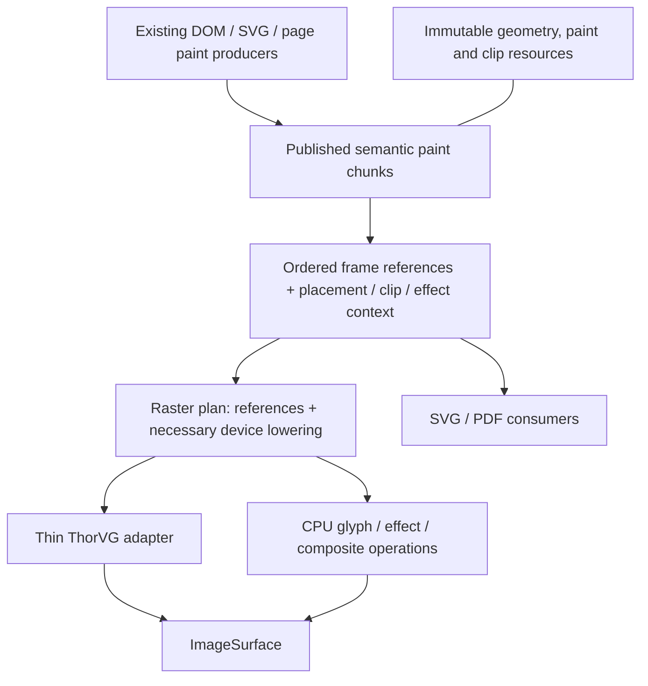

# Radiant Rendering Optimization — Implementation Plan

**Date:** 2026-10-19

**Status:** committed core pass plus a qualified continuation, 2026-10-19.
The committed checkpoint and its qualification limits are in §7. The latest
serial/recording reuse, shared paint buffers, shape lookup, native batching and
storage-budget changes are described in §8, with their own qualification.
The full original M0–M7 acceptance envelope remains open.

**Artifact retention:** an external cleanup removed `./temp/` during continuation
qualification. The earlier temporary receipts cited in §7 and the historical
measurements in §8 were observed before that cleanup; their raw files no longer
exist. The recorded summaries remain here. Regenerated qualification and benchmark
receipts are identified separately below; the benchmark driver is now versioned.

**Current design:** [Radiant Rendering Design](../radiant/Radiant_Design_Rendering.md).

**Baseline:** working tree at `de688f2d5` plus local changes on the audit date;
freeze a new source/binary identity before implementation measurements.

## 1. Outcome and boundaries

Reduce repeated geometry parsing, command/payload copying, retained-subtree
duplication and backend-object construction while preserving paint, ownership
and output behavior. Make unchanged vector content inexpensive to redraw and
make memory scale with unique retained content and its placements.

The first delivery comprises M0–M3: measured costs, non-consuming replay,
compact command storage and shared immutable vector resources. M4 delivers
retained chunk composition. M5–M7 consolidate command definitions and address
backend/layer costs using the earlier measurements. Keep one milestone active;
finish its acceptance cases before expanding the scope.

In scope: continuous raster output, inline/external SVG, serial/tiled/strip/dirty
replay, retained fragments, shared paint resources and their SVG/PDF/edition
consumers. Existing parser, text, clip, effect, resource and painter-order
behavior is the compatibility baseline.

Outside this delivery: new SVG/CSS conformance features, a new GPU backend,
replacement of ThorVG, private ThorVG renderer APIs, vendor patches, unrelated
layout work, automatic expansion of glyph-containing parallel replay, and
rewriting PDF generation or the Lottie player. Do not fold the separate
[PDF suite performance work](Radiant_Impl_PDF_Performance.md) into this plan.

### Authority

**D4.5.3v2** permits downstream retention; **D4.5.1v4 / D4.1.4v5** govern its
region/pool ownership. **D4.2.2v2–D4.2.4** govern context attribution, shared
allocator pins and exclusive reset; **D4.2.6** governs external-resource
cleanup. **D4.5.2** forbids retaining unrooted runtime values. Preserve SVG
admission/source-export/frame contracts (**D2.11.1–D2.11.4**) and PDF's completed
file/evaluator boundaries (**S2.6.6v3 / D2.6.12v3 / D5.4.1**).

These references are to the [formal design](../../doc/Lambda_Formal_Design.md)
and [formal semantics](../../doc/Lambda_Formal_Semantics.md). Milestone labels
are scheduling labels, not new ruling IDs. The proposed data structures below
are implementation sketches, not ratified changes to formal semantics.

## 2. Diagnosed costs and hypotheses

| Observed source behavior | Root cause / hypothesis | Measurement needed |
|---|---|---|
| `DisplayItem` is 872 bytes; a rectangle payload is 20 bytes | Embedded `DlClipShapeStack` enlarges every union element and its zero/copy traffic | Command counts, capacity bytes and payload bytes by opcode |
| Every eligible element marker captures a full range | Ancestor fragments physically duplicate descendant commands | Unique versus retained commands/bytes, nesting depth, capture time |
| Reuse calls `dl_copy_range`, followed by recapture | Cache hits avoid paint production but still allocate/copy payloads | Bytes/path clones per reuse and recapture |
| Paths are cloned in recording, retention and native caches | Geometry identity/lifetime is not shared across those boundaries | Clones, bytes, bounds evaluations and content hashes by stage |
| SVG `d` data is parsed on an uncached recording | Parsed DOM retention does not retain normalized geometry | Path parses under unchanged, placement-only and geometry mutations |
| Raster PaintIR emits/lowers/clears a fragment per primitive | Common payload schemas and transient ownership are duplicated | Gateway/lowering time and dash/clip temporary allocations |
| Serial frame arrays/context are created and destroyed | Capacity and target-independent state do not survive frames | Setup/teardown allocations and time, including small offscreen renders |
| Native cache hits duplicate ThorVG shapes under locks | Cached prototypes avoid API reconstruction but still copy geometry | Hit/miss/admission counts, duplicate bytes/time and lock wait |
| SVG layer capture performs two independent recordings/renders | Alpha reconstruction uses black/white passes and replay can consume pictures | Separate record, raster, resolve-alpha time and peak live surfaces |

Source links and ABI details are in the design document's appendices. This table
records the initial audit; release measurements of the implementation are in §7.

## 3. Proposed representation and ownership



Retain the semantic-to-raster boundary. Shared vector primitives should reuse a
common payload representation; bitmap glyphs and pixel effect programs remain
derived raster data. Export must continue to see text runs, groups and semantic
metadata. Do not make today's raster DisplayList the universal export contract.

Proposed concepts, with names subject to existing-helper discovery:

| Concept | Data and owner | Mutation rule |
|---|---|---|
| Immutable path | Commands/points, local bounds, computed hash and resource identity; document/edition/chunk-owned storage | A geometry edit publishes a replacement; fill/stroke/placement changes reuse geometry when valid |
| Paint/clip resource | Gradient stops, dashes, clip geometry and associated transforms; explicit native owner | Immutable payload; a change publishes a new identity/version |
| Paint chunk | Ordered own commands and child references, local bounds, dependency summary and owner leases | Build privately, validate, publish; replace changed chunks |
| Frame reference | Chunk identity plus placement and inherited clip/effect context | Frame-owned; preserves painter order and instance context |
| Raster plan | References to vector payloads plus lowered glyph/effect operations and device bounds | Derived from chunk/dependency generations and target parameters |
| Backend execution state | Canvas, batch, clip stack and temporary/native cache entries | Confined to its worker/context; never authoritative document state |

Use existing `lib` containers, allocator owners and resource handles. Prefer
chunk/arena-level ownership to a new heap allocation and atomic reference count
for every path command. Readers pin the storage owner, not a raw payload address.
Published storage cannot be rewound while borrowed (**D4.2.4**). Frame-local
resources stay frame-local unless an explicit owner or snapshot makes retention
safe. Mutable image/media handles retain their existing live-versus-snapshot
semantics.

Clipping/effects and placement are part of a chunk's composition contract.
References cannot splice a range into an arbitrary clip stack or skip one side
of an effect scope. Begin/end scopes and bounds must remain valid for serial,
dirty, tile, strip and export consumers.

### ThorVG retention policy to resolve before M6

The current public API constructs owning shapes/scenes; bulk path submission
still copies geometry. Zero temporary ThorVG geometry ownership is not an
achievable optimization within that API.

Two viable policies remain:

| Policy | Consequence |
|---|---|
| Strict batch lifetime for native vector paints | Retain canonical Radiant geometry only; release submitted ThorVG shapes after synchronization. Remove persistent vector prototypes, accepting measured reconstruction cost. |
| Bounded derived native cache | Radiant remains authoritative; permit explicitly owned, evictable native representations keyed by resource identity/generation and worker context. Account for their extra memory. |

Implementation selection: batch-scoped native vector shapes, following the
original no-retained-vector-model preference. The persistent vector paint
prototype cache is removed. A frozen release build with the previous prototype
cache is preserved as a comparison control. Raster-image upload caches and
explicit native fallback picture/text resources retain their existing separate
ownership; this is not a claim of zero native resources or zero temporary native
geometry. No vendor modification is involved.

The user has authorized importing ThorVG source under `lambda/` if needed.
This implementation does not require that import: the existing source already
shows that public `appendPath` copies into native shape storage. Relocating it
would not remove that copy. A future borrowed-geometry rasterizer interface would
need its own lifetime, synchronization and measured-cost design before replacing
this batch-scoped adapter; it is not part of the qualified change below.

## 4. Milestones

### M0 — Establish attributable release measurements

**Owner / hypothesis:** `render_output.cpp`, `render_profiler.cpp`, display-list
storage, retention and the vector adapter. Existing record/replay timing omits
retained capture as a distinct stage; cache byte statistics omit payloads.

Work:

- Separate setup, SVG/paint recording, lowering, validation, retained capture,
  replay, encoding and teardown. Attribute nested offscreen work without
  double-counting it as independent frame wall time.
- Count command capacity, unique/copy payload bytes, path parses/clones/hashes,
  fragment capture/reuse, native paint construction/duplication, batch flushes
  by reason and cache admission/eviction. Track live and peak memory separately
  from cumulative bytes copied.
- Distinguish known Lambda-owned/native-cache bytes from unobserved ThorVG
  allocations. Use a supported profiler for the latter; entry-shell counts are
  not total backend memory. Keep instrumentation out of release hot paths when
  disabled, consistent with **D4.2.5v3**.
- Freeze source/binary identity, viewport, density, fonts, input resources,
  thread budget, cache state and readiness. Reuse existing trace infrastructure.

**Done:** the bounded workload matrix in §5 has reproducible receipts under
`temp/`; stage timing explains the complete measured interval, counters expose
the suspected copies, and no visual baseline changes. Record estimates as
estimates and untracked memory as untracked. Set performance budgets from this
baseline rather than promising an unsupported percentage speedup.

### M1 — Make replay non-consuming

**Owner / cause:** `display_list_replay_vector.cpp`, `rdt_picture_draw`, owned
payload cleanup and offscreen callers. Serial replay consumes native picture
handles while tile replay duplicates them.

Work:

- Audit each opcode's ownership and replay mutations. Make the published
  command/payload read-only contract explicit; execution stacks and caches own
  temporary state. Use const-qualified access where it enforces that contract.
- Preserve native picture resources across submissions through supported
  ownership/duplication mechanisms. Do not share one mutable ThorVG paint across
  concurrent canvases. First reuse the existing safe duplication helper rather
  than inventing a parallel wrapper.
- Keep image read scopes, generation checks and snapshot leases valid through
  backend synchronization. Publication must fail atomically if acquisition
  fails; no partial command may escape with an unowned resource.
- Once repeatability is established, let black/white SVG-layer capture record
  once and replay twice while keeping all recording resources alive.

**Acceptance:** the same frozen list, including fallback native text/pictures,
images, clips and effects, can render twice to fresh identical targets with
identical pixels and unchanged payloads. Serial/tile/strip comparisons agree;
two different backgrounds work; source destruction after a properly owned
record does not invalidate it. Live media still updates when its generation
changes. Teardown releases each resource once. ASan covers repeated replay and
owner retirement.

**Done:** repeated replay is an ownership guarantee, and layer capture performs
one recording. Two raster passes remain until M7; no alpha-policy change belongs
in this milestone.

### M2 — Compact commands and reuse bounded frame storage

**Owner / cause:** `render.hpp`, `display_list_storage.cpp`, record/replay
helpers and `RenderFrameScope`. Large inline clip stacks dominate every command;
frame teardown discards reusable array capacity.

Work:

- Move `DlClipShapeStack` to explicit arena/resource payload storage. Store a
  handle or offset in only the commands that need it; use a canonical empty clip
  state and share equal immutable stacks where ownership permits.
- Keep bounds/opcode access cheap. First measure the smaller tagged union
  after this extraction; choose a variable-payload stream only if it improves
  the measured access/copy workload enough to justify its indexing complexity.
- Update allocation, clone, cleanup, validation and bounds behavior through the
  existing descriptor machinery. Empty, polygon and maximum-depth clip cases
  must use the same lifetime policy.
- Reuse command capacity and suitable serial execution context within the
  owning render session. Reset clips, batches, target, offsets and scratch
  between frames. Keep nested/offscreen calls independently owned; preserve
  existing worker-local reuse.
- Right-size transient PaintIR storage. Reuse prior capacity or a small
  emission buffer instead of reserving a whole retained list for one command.
  Return oversized idle capacity through existing context memory-pressure rules.

**Acceptance:** changing clip-stack capacity no longer enlarges every drawable
record; ordinary rectangles carry no embedded full clip stack. Report before/
after type sizes and total workload bytes. Equivalent warmed forced redraws
reuse array/context capacity without cross-frame clip or target leakage.
Document retirement and repeated large/small jobs release excess owned memory.

**Done:** smaller records and reusable storage are qualified across list,
retention, clip and export controls; no new command-format fork remains.

### M3 — Share immutable vector resources and cached SVG geometry

**Owner / cause:** path creation/visitation, paint/list payload storage, SVG
geometry producers and backend lookup. Equal geometry is copied or reparsed
because recording boundaries lack a stable shared owner.

Work:

- Separate mutable path construction from published immutable geometry. Move
  backend-neutral geometry ownership out of the ThorVG-specific implementation
  as needed, promoting existing helpers rather than copying them.
- Cache local bounds and a content hash at publication. Give geometry stable
  owner-scoped identity/generation; consumers use identity, with exact comparison
  where deduplication still needs collision checking.
- Share the same geometry between fill, stroke, clipping and retained commands.
  Reference gradient stops/dashes similarly. Preserve existing path visitors
  used by export, hit testing and geometry queries.
- Start SVG geometry caching with `path d` and basic shapes. Key geometry on
  source identity and actual geometric dependencies: attributes, viewport or
  font-dependent units, sampled animation and reference context. Cache local
  geometry before transform-dependent adjustments; non-scaling strokes and
  placement-dependent hairline paths need their own derived keys.
- Retain broad style/resource invalidation until dependency-specific tests
  prove it can be narrowed. Shared `use` geometry must retain per-instance
  inherited paints, transforms and reference/resource context.
- Borrow resources while recording; transfer or pin their owner for publication.
  Avoid source, DisplayList, fragment and backend-key copies of the same path.

**Acceptance:** fill+stroke of one path share one published geometry; unchanged
and placement-only redraws do not reparse its `d` or clone its Radiant path data.
A geometry change replaces the affected resource; a color change updates paint
without invalidating independent geometry. Test shared references, relative
units, viewport changes, animations, owner retirement and export consumers.
Do not claim zero ThorVG copies: native-object policy is M6.

**Done:** M0–M3's first delivery eliminates measured avoidable Lambda-side
geometry copies and passes the applicable milestone gates before chunk work.

### M4 — Compose retained chunks by reference

**Owner / cause:** `retained_display_list.cpp`, element markers, dirty tracking
and frame assembly. Whole-range capture/reuse duplicates descendants and
recaptures unchanged content.

Work:

- Publish a chunk's own ordered commands and child references. Parent chunks
  do not physically contain copies of every descendant's commands. Preserve
  the exact interleaving of own paint, children, outlines and state scopes.
- Assemble a frame from chunk references and placement/context records.
  Keep chunk-local indices; reference traversal or a lightweight index view
  replaces payload-copying marker remapping. Bound depth/work and reject cycles.
- Store dependency summaries for layout/style, inherited paint, fonts, images,
  animation and referenced SVG resources. Map dirty reasons to producer rebuild,
  placement/bounds refresh or raster-only invalidation.
- Rebuild only affected chunks. Update ancestor visual bounds or dependency
  summaries without cloning unchanged descendant payloads. Unknown dependencies
  conservatively rebuild; detached/recycled nodes cannot reuse stale identities.
- Preserve the distinction between visual overflow and marker bounds. Dirty
  regions include old and new extents. Backdrop-dependent effects must repaint
  when underlying content changes even if their local commands are unchanged.
- Add byte-budgeted reclamation through the existing memory owner. Eviction
  retires cache ownership; active frame/edition readers remain pinned.

**Acceptance:** nested-depth/width fixtures demonstrate storage proportional to
unique commands plus references, without ancestor payload multiplication.
Unchanged forced redraws perform no fragment payload copy or recapture. A local
edit rebuilds affected content and required metadata, while sibling resource
identities remain stable. Translation, clipping, external dirty sources,
overlapping effects, detached nodes and stale media generations retain correct
pixels and lifetime behavior. Broad document invalidation may still rebuild all
chunks when the dependency itself is broad.

**Done:** the continuous-view retained path uses references with qualified
dirty/tile replay; remove the old deep-copy capture/reuse path once its consumers
are migrated. Published-page ownership remains valid throughout.

### M5 — Consolidate common command storage and lowering

**Owner / cause:** `PaintOp` / `DisplayOp`, gateway wrappers, lowerers and
export/page consumers. Mirrored primitive schemas duplicate emission and
ownership code, although raster and semantic operations have different roles.

Work:

- Define each shared vector payload and its validation/ownership facts once.
  Reuse existing opcode descriptor patterns rather than maintaining a third
  handwritten schema.
- Let the producer sink retain semantic commands or feed a raster builder
  without a temporary heap-backed single-command PaintList. Both routes call
  the same primitive construction and validation helpers.
- Let raster plans reference shared primitive payloads and carry only device
  bounds/placement and necessary expansions. Keep glyph-run-to-bitmap and
  effect-group-to-pixel-work lowering explicit.
- Adapt SVG/PDF and edition borrowing without losing text, semantic groups,
  links or ordering. Preserve streaming export and bounded effect fallback;
  a single whole-document retained PaintList is not mandatory for one-shot jobs.
- Remove migrated wrapper/payload copies after all consumers use the shared
  definition. Keep target-specific operations visibly target-specific.

**Acceptance:** vector recording does not allocate duplicate dash/clip/path
payloads just to cross the PaintIR boundary. Primitive facts have one definition;
raster/export tests cover it. Searchable PDF text, SVG text, semantic groups,
fallback effects and published-edition retirement remain correct.

**Done:** common storage is unified while semantic and device lowering remain
explicit. Do not measure success by deleting type names alone.

### M6 — Reduce measured ThorVG preparation cost

**Dependencies:** M0 and M3; use M4's identity/placement model if available.
Resolve the retention policy in §3 before adopting a persistent native cache.

Work:

- Isolate ThorVG-specific state and translation behind the existing vector
  adapter. A direct list-to-ThorVG implementation is acceptable only if it
  absorbs the same responsibilities without duplicating them elsewhere.
- Compare bulk path submission with per-command replay on cache misses. Expand
  primitive rectangles/circles through shared geometry helpers when required;
  preserve contour topology, fill rules and stroke semantics.
- Replace repeated full-path hashing with published identity/generation keys.
  Measure whether native prototypes save work after duplication and locking.
- Under strict batch lifetime, remove persistent vector prototypes and measure
  the result. Under derived-cache policy, use explicit byte limits, context/
  worker confinement and eviction. Never concurrently mutate or submit one
  native paint through independent canvases. Keep exact clip/placement/effect
  dependencies and ownership around canvas push/remove.
- Preserve batching across stable vector runs. Record each flush reason and
  eliminate only demonstrably redundant boundaries. CPU operations, clip
  changes and backdrop reads keep their required synchronization.

**Acceptance:** chosen policy is documented; geometry/paint cache workloads
below and above the old 256-entry limit have reported preparation, duplication,
lock and memory costs. Tile/serial results agree and release end-to-end results
improve the selected workloads without unexplained regressions. If an experiment
does not help, retain the measured better path and record why.

**Done:** backend preparation improves within public ThorVG APIs and the selected
ownership policy. No vendor modification or unsupported internal API is needed.

### M7 — Simplify SVG-layer capture where alpha permits

**Dependencies:** M1; use M3's shared resources and M0's phase measurements.

Work:

- Retain M1's record-once/two-replay implementation as a comparison control.
  Inventory alpha representation at every writer: vector fills, image sampling,
  bitmap glyphs, blur, masking, group opacity and source-over compositing.
- Establish explicit surface alpha modes and conversion boundaries using
  existing pixel helpers. Rendering once to transparent premultiplied storage
  is eligible only when every participating writer obeys that contract.
- Compare single-pass capture with the current black/white reconstruction for
  translucent overlapping content, antialiasing, text, images and effects.
  Keep backdrop-dependent paint out of an independently cached layer unless its
  backdrop is part of the dependency key or composition contract.
- Preserve size budgets, admission behavior, transform eligibility, density
  invalidation and the existing layer-placement policy. Sampling-policy changes
  need separate visual evidence; do not hide them inside this optimization.

**Acceptance:** supported layers use one recording and one raster pass, with
equivalent compositing on multiple opaque and transparent destinations. Peak
surface memory and capture time fall on the selected workloads. If any writer
still requires the existing route, state the eligible subset and retain the
correct fallback; do not claim universal single-pass capture.

**Done:** the qualified subset is documented by behavior and alpha contract,
with unsupported combinations recorded as deferred work.

## 5. Bounded workload and correctness matrix

Select existing fixtures first and add only cases that distinguish the cause.
Use generated size/depth variants for scaling evidence, not fixture-specific
production branches. Suggested workload families:

| Workload | Scenarios | Evidence |
|---|---|---|
| Static vector page | Cold first render; warmed forced redraw; true idle separately | Setup/record/capture/replay/teardown, allocations, native cache state |
| SVG geometry | Long paths, fill+stroke, repeated `use`, gradients and dashes | Parse/clone/hash counts; unique geometry versus placements |
| Deep/wide retained content | Increasing marked depth and sibling count; one local edit | Retained bytes versus unique content, copied bytes, rebuild set |
| Movement and dependencies | Translate, resize, inherited color, external definition/font/image change | Correct invalidation, old/new damage bounds, resource reuse |
| Mixed vector/raster | Text, images, nested clips, opacity, filters and backdrop dependencies | Painter order, batch barriers, serial/dirty/tile/strip parity |
| Cache pressure | More unique paints/images than existing limits; large/small jobs | Admission/eviction, bytes retained, peak memory and teardown |
| SVG layer | Cold/stable/animated; black/white and transparent destinations | Record count, raster passes, alpha equivalence, scale/placement |
| Export and edition | PNG/SVG/PDF; retained pages after source relayout/cache retirement | Native/selectable text, geometry, fallback pixels and owner lifetime |

Run relevant cases at device densities 1 and 2 with fixed resources and settled
animation time. For performance, use the existing layer/cache policies as the
default and explicit diagnostic variants to isolate masked costs. Report
medians and tail samples from a fixed repeat protocol, CPU and wall time, command
and payload bytes, peak live memory and copied bytes. Record cold/warm definitions;
process-warm is not proof that OS caches were cold in the other run.

Do not set a speedup claim from structure sizes. Deterministic acceptance
properties such as no unchanged-fragment copy or no repeated `d` parse can be
tested directly; runtime budgets come from M0 on the named workload/hardware.

## 6. Verification budget and integration

Follow [Radiant's development workflow](../../radiant/README.md), the
[test map](../../test/README.md) and
[Developer Guide §7](../../doc/dev/Developer_Guide.md#7-worktrees-and-agent-gotchas).
Use the project's release build workflow for timing; never time a debug build
or run `make release` in a worktree. Freeze measured binaries before tests that
rebuild a different profile. All scratch artifacts belong under `temp/`.

During each milestone, build the affected native targets and run focused
selectors from these existing harnesses:

| Area | Harness / useful existing coverage |
|---|---|
| Commands and lowering | [test_display_list_gtest.cpp](../../test/test_display_list_gtest.cpp): `DisplayListTest`, `PaintIrParityTest`, ownership/validation cases |
| Retained composition | [test_retained_display_list_gtest.cpp](../../test/test_retained_display_list_gtest.cpp): dirty sources, marker/visual bounds, deep clip copies, stale resources and replaced views |
| Vector/alpha/clips | [test_rdt_vector_gtest.cpp](../../test/test_rdt_vector_gtest.cpp): batch clipping, gradient order, transforms, density and paint ownership |
| Published editions | [test_paged_media_gtest.cpp](../../test/test_paged_media_gtest.cpp): retained paint/font/image lifetime and source relayout |
| SVG/PDF output | [test_pdf_render_visual_gtest.cpp](../../test/test_pdf_render_visual_gtest.cpp), `make test-svg-export`, `make test-svg-paint`: output parity, text, gradients and effects |
| End-to-end mutations | Existing UI/DOM fixtures for edits, media, clipping, animation and resource replacement |

At a stable engine milestone, run `make test-radiant-baseline`. Shared export
changes also require `make test-pdf-render` and the relevant SVG gates; the PDF
suite is separate from the Radiant baseline. PDF package/runtime changes, if
unavoidably required, add their package/core gates through the test map rather
than silently expanding this plan. Run focused ASan ownership checks for M1,
M3 and M4; use the supported sanitizer profile and report its coverage/leak
settings. Run layout integer-cast lint when layout code changes.

Reuse passing evidence until relevant code changes or a failure gives reason to
repeat it. Never weaken goldens, comparator thresholds or lifetime checks for a
performance result. Store failures and unresolved environmental limits with the
milestone receipt; a passing isolated rerun does not erase an aggregate failure.

Migration must keep one implementation of shared geometry and ownership helpers.
Introduce compatible readers/writers at bounded boundaries, migrate their
consumers, then remove the superseded representation. Temporary comparison
switches belong to qualification and should not become permanent parallel paint
algorithms. Do not reset a borrowed arena, drop generation checks or bypass
effects to make a benchmark faster.

## 7. Committed core checkpoint — 2026-10-19 (`689eb13d0`)

The implementation follows **D4.5.1v4 / D4.2.4 / D4.5.3v2**. No formal ruling
has changed. Qualification receipts below distinguish implemented behavior
from the full original acceptance envelope.

| Milestone | Implemented behavior | Remaining scope / qualification |
|---|---|---|
| M0 | Opt-in release metrics: frame stages through teardown, tracked start/end/process peak bytes, capacity, geometry and payload copies, native construction/duplication, batches and layer passes; tile workers inherit the probe. Frozen release controls and paired fixtures live under `temp/rendering-optimization/`. | Native ThorVG bytes remain untracked. Fine-grained lowering/native-lock/flush-reason attribution and the complete workload matrix remain open. |
| M1 | Serial and tile replay duplicate native picture submission; source handles survive repeated rendering. SVG capture records once; source retirement/replay regression passes. Native picture duplication preserves transforms and handles allocation failure. | Qualified by the focused native/ASan and output checks below; the aggregate has the separately identified existing failures. |
| M2 | Optional immutable arena clip payloads; direct-pixel recording fails before publishing an incomplete clip. Empty frame command arrays are reused per ViewTree, nested frames get independent storage, oversized/pressured idle arrays are released. Transient PaintList starts at eight commands. Copied chunks reserve their actual range rather than the frame-sized floor. | Serial canvases still have frame lifetime; worker canvases retain their existing reuse. |
| M3 | Backend-neutral copy-on-write path storage; cached bounds/hash; fill/stroke/clip/retained snapshots share entries. An 8 MiB document cache retains sampled `d` geometry and marker topology, and interns resolved basic shapes. Geometry survives paint/placement/viewBox changes; a changed `d` publishes another resource. | Basic-shape inputs are still resolved and temporarily constructed before interning. Gradient/dash payloads are not globally interned. Standalone offscreen SVG without a persistent document has job-local caching. |
| M4 | Parent chunks own commands and ordered child references. Frame descriptors borrow payloads and pin owners. Reused chunks avoid recapture; stale cache entries retire; high memory pressure drops cache ownership between frames. A 64-level regression captures exactly the source command count and zero new commands on recapture, with frame lifetime beyond cache destruction. | Frame descriptors are still copied into a flat execution list. Reuse still requires selective dirty painting/matching placement; general forced-redraw references, placement-only reflow, fine dependency summaries and per-cache byte/LRU policy remain open. |
| M5 | Common raster primitives flush pending semantic work and call the shared display-list builder directly. This removes transient primitive commands and duplicate dash/clip boundary copies. Rectangle/rounded-rectangle/picture payload types are shared. Semantic text/effect/subscene lowering remains explicit. | Further payload-schema consolidation remains open; semantic/raster representations retain their different ownership fields. Output checks below preserve searchable PDF text and published-page behavior. |
| M6 | Removed persistent native vector prototypes; pure path command runs use public bulk submission. Compact primitive contour handling and batching barriers are preserved. Raster image/picture owners remain separate. | The paired comparison below does not establish a general speedup; fine-grained preparation/locking attribution and the original improvement criterion remain open. |
| M7 | Descriptor-qualified vector fills/strokes/gradients/images/clips/markers render into one premultiplied surface. CPU/effect/native-picture recordings retain record-once/two-replay reconstruction. Native test compares opaque and translucent backdrops within two channel units. | Universal one-pass capture is deferred. The off/eager paint and output checks below qualify the selected subset and preserve the mixed-writer fallback. |

Focused receipts before the last geometry-cache adjustment:
`m6-vector-full.log` (173 passing tests), `m6-display-full.log` (86),
`m6-retained-full.log` (31); earlier focused alpha/cache/ownership tests are
also in `temp/rendering-optimization/`. These are release correctness checks,
not sanitizer evidence. The frozen five-repeat paired release comparison,
final gates and their failures are recorded below. Do not interpret
the table as completion of the remaining acceptance cases.

### Qualification receipts

The three native ASan runners passed: 21 vector/ownership selectors, 32 retained
cases and 86 display-list cases. A final native-picture transform regression
also passed ASan. Configuration: `debug_asan_native`, `ASAN_OPTIONS=detect_leaks=0`;
this is memory-access/lifetime coverage, not a leak-free certification. Logs:
`temp/rendering-optimization/asan-vector.log`, `asan-retained.log`,
`asan-display.log` and `asan-picture-final.log`. The subsequent nested-frame
arena correction requires its separate release regression and aggregate check.

The required Radiant integer-cast lint passes. Local documentation links and
`git diff --check` pass.

Release qualification (`release_native`):

- The Radiant aggregate passed all 174 vector, 86 display-list and 32 retained
  tests, and its completed neighboring text, DOM, animation, paged-media,
  snapshot, input and media checks. Its raw invocation did not pass: sandboxed
  graphics initialization timed out, local HTTP startup was denied, and two UI
  subprocesses aborted. The blocked graphics run was stopped after diagnosis;
  its log remains `radiant-gate.log`.
- The two exclusive checks that had not started before that interruption also
  pass: all 20 native map tests and the render visual baseline (207 strict
  passes, four expected failures and one skipped of 212 inputs; no recorded
  baseline regression). Receipts: `map.log`, `render-baseline-report.json`.
- With native graphics/local HTTP access, all 180 not-yet-passed view selectors
  passed, as did all 28 scene unit tests (`view-native-access-rerun.log`,
  `scene-unit-native-access.log`). The 15 layout suites meet their recorded
  baselines: 3,141 fully passing, 153 partially passing, zero failed
  (`layout-native-access-results.txt`). Partial support remains partial.
- UI automation reported 642/644 passing. `controlled_bindings` and
  `dtna_controlled_controls` aborted intermittently. Both pass isolated reruns;
  repeated `controlled_bindings` also aborts in the frozen original binary.
  The baseline/current crash reports share the allocator invalid-free signature;
  the current release linker map resolves the native frame to `fn_float` in
  `lambda/runtime/lambda-eval-num.cpp`. This is an existing runtime qualification
  limit, not a rendering-test waiver or a repaired runtime bug. Receipts:
  `ui-isolated-reruns.json`, `baseline-controlled-stress.json`,
  `baseline-controlled-crash.json`, `controlled-crash.json`.
- All 406 PDF import/export/output-parity tests pass (`pdf-output.log`), covering
  searchable Unicode text, semantic groups, page borrowing and effect fallback.
  No PDF golden was changed.
- All 12 SVG native paint variants pass (three fixtures, two densities, off/eager
  layers). The portable PNG/SVG/PDF matrix passes 178/180 variants. Its two
  failures are PDF rounded containment in `css_containment_boxes` at 1×/2×.
  The frozen original produces identical complete raster pixels and the same
  failed assertions at both densities (`containment-baseline-results.json`).
  SVG structure, embedded resources and vector text checks pass. Reports:
  `svg-paint/report.json`, `svg-export-report.json`.

The original full acceptance envelope is still incomplete: see each milestone's
remaining column. Passing component reruns do not rewrite the failed raw
aggregate verdict. Test artifacts are under `temp/rendering-optimization/`.

### Release comparison

Five interleaved fresh-process renders per variant/fixture/density, alternating
variant order, fixed 800×600 viewport and `--no-log`. OS caches were uncontrolled.
Three frozen binaries: original review baseline, optimized storage with the old
native prototype cache, and the batch-scoped native-vector implementation.
Binary SHA-256 receipts, raw CPU/wall samples and PNG hashes are in
`temp/rendering-optimization/`; the driver is `compare_release.py` and raw result
is `paired-results.json`.

| Fixture | Density | Original median ms | Optimized median ms |
|---|---:|---:|---:|
| Repeated long paths | 1 | 204.2 | 197.8 |
| Repeated long paths | 2 | 444.9 | 477.5 |
| Deep marked content | 1 | 128.1 | 115.9 |
| Deep marked content | 2 | 236.6 | 243.5 |
| Mixed text/vector | 1 | 130.2 | 141.7 |
| Mixed text/vector | 2 | 393.9 | 408.8 |
| 128 unique paints | 1 | 36.0 | 35.3 |
| 128 unique paints | 2 | 72.9 | 75.5 |
| 512 unique paints | 1 | 75.3 | 73.2 |
| 512 unique paints | 2 | 137.8 | 131.7 |

Every compared PNG matched byte-for-byte across all three variants and repeats.
The preserved native-cache control is close to the batch-scoped variant; the
experiment supports removing duplicate retained geometry with limited measured
cost, rather than claiming a universal rendering speedup. Mixed/high-density
end-to-end regressions remain a performance qualification limit. Earlier
non-interleaved timings taken during development are superseded by this paired
comparison. A serial-versus-eight-worker probe also had density-dependent results,
so scheduling was preserved.

Final storage/counter probe (`final-metrics-stdout.txt`, serial vector fixture):
`DisplayItem=224` bytes versus the original 872 (74.3% smaller before variable
payloads). The 514 recorded commands copy 115,136 descriptor bytes into retained
own-command storage exactly once; path parsing is one cache miss, entry-copy
bytes are zero, and transient PaintList capacity is zero for that primitive-only
recording. In eager-layer mode the corresponding admitted vectors show 63
recordings and 63 raster passes. These counters are fixture-specific, not general
speedup percentages.

The normal release process disables allocation tracking. Enable
`MEMTRACK_MODE=STATS` alongside `RADIANT_RENDER_METRICS=1` for the tracked-byte
fields; zeros with tracking off are not evidence of zero live memory. Process
peak remains a process high-water mark, and ThorVG internals remain untracked.

The nested-frame regression passes without arena ownership diagnostics
(`nested-frames-final.log`). Nested list and scratch arenas are selected before
context initialization. After output qualification, the only engine addition is
the opt-in `retained_command_capacity_bytes` counter plus a regression asserting
that reserved chunk command slots scale within twice the unique commands in the
64-level fixture. This verifies capacity as well as live command count; no extra
capacity-policy change was needed. The final release build and focused rerun are
recorded in `final-metrics-build.log` and `final-retained.log`.
The full vector runner also passes all 174 cases after that metrics-only build
(`final-vector.log`). `qualified-binary.txt` identifies the final release binary;
`output-qualification.json` identifies the earlier, behavior-equivalent build
used for the output gates. ASan predates this counter/assertion addition.

The final probe with `MEMTRACK_MODE=STATS` confirms 115,136 reserved chunk-command
bytes for 514 unique commands, equal to their descriptor bytes on that fixture
(`qualified-metrics-stdout.txt`). The tracked frame scope starts at 3,762,997
bytes and ends at 4,780,738 bytes, with a process peak of 5,179,742 bytes. The
remaining live storage includes retained chunks, document caches and the reusable
frame array; these are known Lambda-tracked bytes, not the total process or
ThorVG footprint. This probe is not a baseline-versus-optimized memory comparison.

## 8. Continuation delivery

The user requested implementation of the remaining work after commit `689eb13d0`.
This delivery continues **D4.5.3v2 / D4.5.1v4 / D4.2.4**; no formal ruling changes.

This delivery covers native cost attribution, clip-segment submission,
serial canvas reuse, unchanged full-frame recording reuse, and basic-shape cache
lookup before contour construction. Required acceptance cases are pixel parity
across nested clip changes and CPU barriers; default SVG layer warm-up; visible
SVG paint mutation; opaque/transparent targets; and independent nested frames.
Reuse must reject unknown/foreign dependencies and incomplete dirty recordings.

Verification budget: focused native ownership/geometry/clip tests during edits;
one interleaved release comparison against the frozen parent implementation;
ownership ASan after stabilization, including the previously uncovered nested
arena correction; then the Radiant baseline and affected SVG/PDF output gates.
Keep earlier independent runtime/PDF failures visible. The same continuation
also implements the shared primitive field declarations, shared gradient/dash
buffers, a managed retained-storage budget, and the extended premultiplied capture
subset described below. Placement-only composition remains a separate milestone.

The initial release timing probe (`continuation-profile.stdout`) attributes the
dense 2× serial vector fixture's work to about 356 ms of native drawing versus
0.073 ms of path submission, with 63 clip-triggered draws. This identifies
clip-triggered canvas submission as a measured target. Phase timers accumulate
worker wall time and may overlap; their sum is not another frame duration.
ThorVG internal allocation bytes remain untracked.

### Implemented continuation behavior

| Area | Change and boundary |
|---|---|
| M0 attribution | Separate lowering, native shape/path/clip/submit/draw/sync/remove/duplicate/canvas time, flush reasons, tile/native lock waits, basic-shape construction, shared-array leases and full-frame reuse. Worker times overlap; native internal bytes remain untracked. |
| M2 serial state | ViewTree owns a reusable serial vector context. A frame rebinds its target and zeroes tile offsets; nested frames use separate contexts and arenas. Pressure/teardown releases ownership. |
| M3 geometry | Resolve basic-shape geometry before a content lookup; construct the path only on a miss. Shared paint buffers use one immutable allocation per distinct value within a list and explicit list-index leases. Copies from owned or borrowed chunks retain buffers after all source owners retire; unrelated lists are not globally interned. |
| M4 unchanged recording | Eligible complete frames retain their document prefix. Matching document/style/state/layout/font/image/SVG/video and target stamps plus current resource handles bypass traversal, descriptor assembly and capture. Pending reflow, selective recordings and producers without complete dependency stamps reject reuse. Default SVG layers warm before publication. Overlays always append/rollback their own commands, array references and arena allocations. Admission is conservatively limited to 8 MiB; unused arena chunks are reclaimed only with exclusive scope ownership and no live/earlier arena data. |
| M4 reclamation | A 32 MiB per-cache managed command-storage ledger follows admitted chunks. Reclamation chooses old roots by last use and retires their old descendants together. Current-frame publications and active reader leases prevent premature reclamation; new admission can fail. Charges include command/span capacity, arenas, shared arrays and conservative per-reference paths; they exclude ThorVG/native-picture internals and separately owned image/font data. |
| M5 schema | Common path-fill, stroke and gradient field declarations complement the existing rectangle/picture payload types. Raster shared-buffer and semantic owned-buffer annotations remain explicit. PaintIR and DisplayList keep their distinct semantic/device roles. |
| M6 submission | Clip changes seal ordered native segments. A single segment uses its own scene; multiple segments share a submission wrapper. CPU access, target changes and batch completion synchronize. No native vector prototype survives a batch. Fewer submissions alone do not establish a speedup. |
| M7 alpha | CPU surface fills, scaled image blits and monochrome coverage glyphs join the qualified premultiplied capture subset. Emoji, effects and native pictures keep black/white reconstruction. The SVG pass declares its destination alpha mode explicitly. |

### Reproducible release comparison

The versioned [benchmark driver](../../utils/benchmark_radiant_rendering.py)
generates bounded vector, deep, mixed and cache-pressure fixtures, pins
Liberation Sans, alternates variant order and checks every PNG and event result.
The final frozen release is SHA-256
`f285b823a4bb2d9b9e1e5776c2607a95a3998a4f263fb94e1c3a832e7bab6a42`.
The clean committed control is `7b857b860`, SHA-256
`ffa8ede1b836a65a71145832eb4fa92f58dc3032257947a12db24c858bf871ce`.
Both include the concurrently committed PDF/font changes. The earlier,
deleted-receipt comparisons used different fixtures/controls and are superseded
by this protocol.

Environment: macOS 26.3 arm64, 800×600 viewport, densities 1 and 2, one renderer
thread, default SVG-layer policy, five alternating-order fresh-process pairs.
Warm sessions use the same binary with `RADIANT_RECORDING_CACHE=off`/enabled:
one live tree and twelve forced PNG render events after initial presentation.
Logging is disabled for wall samples; metrics use separate processes. Times
include startup and PNG encoding. OS caches and scheduling are uncontrolled.
No builds or other test sweeps ran during collection.

| Workload | Density | Cold control → final (ms) | Warm cache off → on (ms) |
|---|---|---|---|
| vector | 1× | 98.31 → 100.16 | 365.52 → 340.65 |
| vector | 2× | 139.88 → 156.20 | 897.02 → 921.89 |
| deep | 1× | 83.75 → 85.81 | 224.38 → 220.45 |
| deep | 2× | 105.64 → 105.39 | 684.00 → 643.84 |
| mixed | 1× | 106.64 → 105.14 | 444.90 → 379.58 |
| mixed | 2× | 171.45 → 171.85 | 1088.95 → 1058.23 |
| pressure-128 | 1× | 55.59 → 54.18 | 204.44 → 207.98 |
| pressure-128 | 2× | 78.82 → 78.13 | 679.75 → 642.32 |
| pressure-512 | 1× | 127.96 → 126.54 | 387.15 → 393.50 |
| pressure-512 | 2× | 178.59 → 176.95 | 974.75 → 999.99 |

All ten cold and ten warm scenarios produce byte-identical PNGs. Medians remain
mixed; these results do not establish a general latency improvement. Individual
cold vector 2× samples overlap: control 133.50–156.15 ms, final 131.78–157.06 ms.
The median difference must not be presented as a stable isolated backend cost.

After discarding the first two profiled frames, all eleven remaining frames in
each warm scenario reuse the recording, copy zero command bytes and create no
serial canvas. Off-mode frames copy 3,584–202,496 descriptor bytes. The cold
vector 2× profile copies 576 paint-array bytes versus 18,432 in the control;
native batches remain 793 versus 794 because analytic-gradient CPU barriers
still require synchronization. These counters prove eliminated work, separately
from the noisy end-to-end timing.

Across the ten scenarios, profiled per-scenario median record/lower time falls
from 0.016–0.219 ms to 0.002–0.003 ms; capture falls from 0.005–0.051 ms to
0.001–0.002 ms. These are logging-enabled stage measurements, not wall samples.

The regenerated pre-trim three-pair peak-RSS probe reports vector 2× medians
52,822,016 → 52,871,168 bytes and pressure-512 2× 46,186,496 → 46,055,424 bytes
(`continuation-peak-rss.json`). This is total process peak, not native-only
allocation or steady retained memory; it establishes no broad memory reduction.

Receipts are below `temp/rendering-optimization/`: `final-binaries.json`,
`final-benchmark-cold/results.json`, `final-benchmark-warm/results.json` and their
logs. To repeat after building/freezing the release binaries:

```sh
python3 utils/benchmark_radiant_rendering.py --mode warm --profile \
  --executable temp/rendering-optimization/lambda-final-qualified.exe \
  --out temp/rendering-optimization/final-benchmark-warm
python3 utils/benchmark_radiant_rendering.py --mode cold --profile \
  --executable temp/rendering-optimization/lambda-final-qualified.exe \
  --control temp/rendering-control/lambda.exe \
  --out temp/rendering-optimization/final-benchmark-cold
```

### Recording admission correction

The regenerated warm probe exposed a real 2× admission miss: a prior capture
left 8,047,632 reserved arena bytes with zero live arena bytes, pushing a small
recording to 8,509,584 bytes against the 8 MiB admission limit. The correction
retires overlay marks, then trims unused chunks only when there is exactly one
arena scope, no earlier arena allocations and no live scratch data or nested
scope. The same recording then reserves 4,096 arena bytes and charges 462,848
bytes on reuse. The admission limit is unchanged (**D4.2.4 / D4.5.1v4**).
`trim-admission/results.json` first reproduced successful admission; the full
final warm matrix above confirms it across all ten scenarios.

### Continuation correctness qualification

The final release focused suites pass 179 vector, 90 display-list, 34 retained
and 25 state-store cases (`trim-*-release.log`). All four full suites also pass
under `debug_asan_native`, `ASAN_OPTIONS=detect_leaks=0` (`trim-*-asan.log`).
Coverage includes nested frames, live/earlier arena-data protection, repeated
recording reuse, buffer/checkpoint retirement, CPU/clip painter order and pinned
budget-ledger teardown. Leak detection was disabled; vendor libraries are not
claimed as instrumented. Changed ASan shared archives were retired before the
release rebuild (`trim-retired-asan-products.json`, `final-release-build.log`).

An older clip assertion read pixels before batch synchronization. Its pixel
assertions now run after synchronization; the dedicated segment test checks
deferred submission and CPU ordering independently. No tolerance was relaxed.
Integer-cast lint, local documentation links and scoped diff checks pass.

The final unchanged `make run-radiant-baseline` invocation on this release
completed in 405,387 ms: 5,913 passed, one failed, 157 partial and one skipped
of 6,072 reported cases. All 644 UI, 208 view, 500 paged-media, 160 DOM, 32 input,
20 map and the focused native cases pass. Layout retains 3,141 fully passing
and 153 partial cases with zero failures. Render visual completes normally:
207 passing comparisons, four expected differences and one skip; all 211
baseline entries pass. The earlier Node 24 shutdown deadlock did not recur.
Receipts: `final-radiant-baseline.log`, `final-radiant-summary.json` and the
copied `final-*_results.json` files.

The sole aggregate failure is the same Bootstrap kitchen-sink page's 15-second
parallel-load timeout observed earlier. Three isolated runs per configuration
all pass with the original deadline: final 3.45–3.52 s; clean committed control
3.41–8.20 s, from its own checkout. See `final-bootstrap-reruns.json` and its
per-run output. This does not turn the failed aggregate into a passing gate.
The final SVG paint gate passes all twelve off/eager 1×/2× scenarios and their
680 assertions (`final-svg-paint/report.json`, `final-svg-paint.log`). The
portable PNG/SVG/PDF export matrix passes 178/180 format scenarios. Its only
failures are `css_containment_boxes` PDF at 1× and 2×. A fresh control run from
its own checkout produces identical nested assertion results and byte-identical
PNG rasterizations for all six containment outputs, including the two failures
(`final-svg-export-report.json`, `final-containment-control-parity.json`).

The complete current PDF inventory also ran on the final binary: 439/440 pass
in 99,478 ms. All 307 output-parity, 34 source-PDF roundtrip, 53 formatting,
25 gradient and four canvas cases pass. The sole failure is
`PdfImportVisual.CompareLambdaPagesAgainstPopplerReference/04_Ghent_PDF_OutputSuite50_ReadMes`.
Its four full page PNGs are byte-identical to the clean committed control's
files, confirming the existing import-baseline discrepancy is independent of
this continuation (`final-pdf-control-parity.json`). No baseline was changed.
Receipts: `final-pdf-output.log`, `final-pdf-results.json`,
`final-pdf-summary.json`. This supersedes the earlier filtered 406-case pass.
The harness used `node --no-concurrent-sparkplug test/test_run.js
--include-test=test_pdf_render_visual_gtest`, four case workers, and the frozen
host via `RADIANT_TEST_EXECUTABLE`; the Node flag avoids the previously observed
external shutdown issue without changing native tests or expectations.

### Remaining original envelope

Partial/dirty frames still assemble flat descriptors from immutable chunks.
A lightweight reference index, placement-only reflow, fine inherited/reference
dependency summaries and producer-specific invalidation remain open. The new
whole-frame key is deliberately conservative. Semantic/raster validation and
all cross-target ownership metadata are not yet one universal schema. Native
internal peak allocation profiling and a reliable broad latency improvement
remain open. Universal one-pass capture is not claimed; unsupported writers
retain the existing reconstruction path. The final qualification limits are
the parallel page-load timeout and the control-identical PDF import/containment
failures above; the final UI automation and view inventories pass in full.
