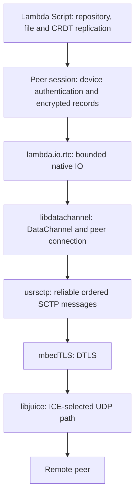

# WebRTC support in Lambda

**Date:** 2026-11-13

**Verified against:** Lambda `691f6aff7`; lambda-input `bd1f317`.

**Status:** Native DataChannels implemented; local macOS qualification complete.
Cross-NAT, browser and other-platform runtime qualification remain pending.

This document describes Lambda's libdatachannel integration, its dependency
configuration, and its use by data synchronization. It records the current
implementation; it introduces no new language or security rulings.

The governing rulings are **D9.3.4** (`lambda.*` module paths), **D11.1.2**
(the central IO boundary), **D11.2.1–D11.2.4** (security clients and explicit
authority), **D6.3.3** (precise native roots), **S12.4.4v4 / S13.1.2v2**
(task/resource ownership), and **D9.1.5** (Make/Premake builds). See the
[formal design](../../doc/Lambda_Formal_Design.md) and
[formal semantics](../../doc/Lambda_Formal_Semantics.md).

## Supported profile

Lambda uses the C API of **libdatachannel v0.24.6**, pinned to
`6b1e2e620f1e37f0eafeee702eaea0043cb305fd`. The native module is
`lambda.io.rtc`; application policy and replication remain Lambda Script.

The exposed profile provides:

- A reliable, ordered, binary DataChannel, negotiated out of band on stream 0.
- Explicit SDP offer/answer exchange, including fully gathered ICE candidates.
- Host candidates and optional STUN-assisted connectivity through libjuice.
- DTLS encryption using the same mbedTLS provider selected for Lambda's host.
- Bounded messages, backpressure, deadlines, status counters and task cleanup.

The channel label is `lambda-sync`, and its protocol identifier is
`lambda-peer-lan-p256-1`. The wrapper creates one channel per peer connection
and disables automatic negotiation. It exchanges complete descriptions rather
than exposing trickle-ICE candidate callbacks to scripts.

Audio/video media, RTP/SRTP tracks, unreliable/unordered channels, dynamic channel
creation and libdatachannel's WebSocket APIs are outside this exposed profile.
The API is a native Lambda module, not a browser `RTCPeerConnection` interface.

## Transport and dependency architecture

WebRTC DataChannels carry SCTP over DTLS over an ICE-selected UDP path. This
is the data transport defined by [RFC 8831](https://www.rfc-editor.org/rfc/rfc8831).
SDP signaling travels separately from the eventual peer data connection.



| Dependency | Role | Sharing in Lambda |
|---|---|---|
| libdatachannel | Peer connections, SDP and DataChannel integration | WebRTC carrier; its optional media and WebSocket features are disabled |
| libjuice | ICE connectivity checks and NAT traversal | Used by libdatachannel; curl does not use it |
| usrsctp | User-space SCTP for DataChannel messages | Used by libdatachannel; curl does not use it |
| mbedTLS / mbedX509 / mbedCrypto | DTLS, certificates and cryptographic primitives | Same selected provider as the host and curl; no OpenSSL fallback |
| nghttp2 | HTTP/2 | curl's HTTP transport, including applicable signaling/storage requests |
| Brotli decoder/common | HTTP response and WOFF2 decompression | Shared dependency selection for curl and font decoding |
| zlib | Compression/decompression | Shared by curl, PDF/font processing and Node zlib support |
| plog | Upstream logging headers | Build-time headers; no separate runtime library; logging compiled out in the release dependency |

These dependencies are statically linked into the current native host. The
macOS audit found one definition of each checked representative entry point.
That is local build evidence, not a guarantee about every future platform build.
See the [dependency build record](<../impl/Lambda_Impl_Sync_Dependency_Build (done).md>)
and [mbedCrypto migration record](<../impl/Lambda_Impl_MbedCrypto_Only (done).md>).

## Build and configuration

The platform `setup-mac-deps.sh`, `setup-linux-deps.sh` and
`setup-windows-deps.sh` entry points prepare this dependency after the owning
input setup prepares mbedTLS 3. To prepare WebRTC separately, run from the
Lambda checkout:

```sh
make build-sync-connectivity JOBS=4
make build
```

The direct preparation helper is:

```sh
python3 utils/prepare_sync_connectivity.py --dry-run
python3 utils/prepare_sync_connectivity.py --jobs 4
```

Under **D9.1.5**, `build_deps_config.json` describes the dependency projects;
the shared builder generates Premake/GNU Make builds. This integration invokes
no CMake. Lambda's wrapper is C++17; libdatachannel's upstream implementation
is C++17, and libjuice/usrsctp are built as C17 dependencies. Upstream sources
and pinned submodules remain unmodified.

| Setting | Selected configuration |
|---|---|
| TLS provider | `USE_MBEDTLS=1`, `USE_GNUTLS=0`; no OpenSSL dependency |
| ICE backend | libjuice; `USE_NICE=0` |
| Media | `RTC_ENABLE_MEDIA=0` |
| Upstream WebSockets | `RTC_ENABLE_WEBSOCKET=0` |
| Linkage | `RTC_STATIC`, `JUICE_STATIC`; static dependency archives |
| Logging | `PLOG_DISABLE_LOGGING` in the installed release dependency |
| Examples/tests | Not built by the dependency recipe |

The preparation helper checks the exact libdatachannel revision and submodule
state before building. It selects mbedTLS headers/archives from the host build
configuration rather than finding another TLS installation independently.

| Location | Contents |
|---|---|
| `temp/sync-connectivity/libdatachannel/` | Pinned source checkout and submodules |
| `temp/dependency-build/<system>-<architecture>/libdatachannel/` | Generated dependency build and object files |
| `build/deps/connectivity/include/` | Installed native headers |
| `build/deps/connectivity/lib/` | `libdatachannel.a`, `libjuice.a`, `libusrsctp.a` |
| `build/deps/connectivity/provenance.json` | Source pins, recipe identity, TLS selection and feature/logging configuration |

The host detects RTC availability when compiling the native wrapper. Without
the prepared dependency it reports `rtc:false`, and channel acquisition fails
explicitly. After adding the dependency to a previously RTC-disabled build, use
`make rebuild KEEP_CONNECTIVITY=1` from the main checkout to refresh that probe.

Two recorded size/build candidates remain unimplemented: libjuice's `NO_SERVER`
switch, and removing `SCTP_DEBUG` from the usrsctp release recipe. Disabling
media/WebSockets also leaves some upstream translation units empty; the recipe
still lists them. Do not infer that every optional source file has been removed.

## Lambda API and resource lifecycle

Import the full native module path, as required by **D9.3.4**:

```lambda
import rtc: lambda.io.rtc
```

All calls below are procedures. The authoritative API reference is
[Lambda system functions](../../doc/Lambda_Sys_Func.md#lambdaiortc-and-lambdaiodiscovery);
the implementation is [io_connectivity.cpp](../../lambda/runtime/io_connectivity.cpp).

| Procedure | Current behavior |
|---|---|
| `rtc.capabilities()` | Returns `{rtc,bonjour}` availability; this reports the build/host, not peer reachability |
| `rtc.create(options)` | Creates the task-owned peer connection/channel; options are `stun` and optional native `bind` address |
| `rtc.description(channel, role, timeout_ms)` | Creates one local `"offer"` or `"answer"`; waits for gathering to complete |
| `rtc.remote(channel, sdp, role)` | Applies an explicit remote description; the caller supplies authenticated signaling |
| `rtc.send(channel, bytes)` | Sends one bounded binary message; waits for open state/backpressure with a fixed 15-second budget |
| `rtc.receive(channel, timeout_ms)` | Waits for one binary message and returns `{type:"binary",data:bytes}`; timeout raises an error |
| `rtc.status(channel)` | Returns `open`, `closed`, `failed`, `queued`, `buffered`, `sent_bytes`, `received_bytes` |
| `rtc.close(channel)` | Idempotently closes/releases the resource; it provides no replication or persistence acknowledgment |

Current bounds are 256 KiB per binary message, 2 MiB and 64 messages in the
native receive queue, 60,000 bytes per SDP description, and explicit timeout
arguments of 1–60,000 ms. `stun` accepts at most four `stun:` URLs, each at most
512 bytes. TURN URLs and credentials are not exposed by this wrapper, even
though the upstream libraries provide broader capabilities. An empty STUN list
uses host candidates. No ICE-TCP option is exposed.

Send and receive waits park the Lambda task. A handle rejects concurrent sends
or concurrent receives; the intended owner serializes protocol operations.
Worker callbacks copy bounded native bytes and update mutex-protected native
state. Lambda values are constructed on the script side, not inside library
worker callbacks. Task completion/cancellation closes resources and joins
callbacks before native state is reclaimed. Handles and values crossing waits
use precise roots (**D6.3.3, S12.4.4v4, S13.1.2v2**).

Queue overflow or invalid message input surfaces as failure; the wrapper does
not silently discard messages and continue an apparently healthy session.
Byte counters measure accepted DataChannel payload bytes, excluding SCTP,
DTLS and UDP overhead. A successful send indicates local transport acceptance;
the replication protocol supplies the peer/application acknowledgment.

## Minimal native example

This example connects two handles in one process with trusted local SDP. It
exercises the carrier. Production synchronization authenticates signaling and
runs the enrolled-device handshake described below.

```lambda
import rtc: lambda.io.rtc

pn main() {
    let a = rtc.create({stun:[]})^
    let b = rtc.create({stun:[]})^
    let offer = rtc.description(a,"offer",10000)^
    rtc.remote(b,offer,"offer")^
    let answer = rtc.description(b,"answer",10000)^
    rtc.remote(a,answer,"answer")^
    rtc.send(a,b'68656c6c6f')^
    let received = rtc.receive(b,10000)^
    rtc.close(a)^
    rtc.close(b)^
    return received.type == "binary" and received.data == b'68656c6c6f'
}
```

For example, save this as `temp/webrtc-example.ls` and run
`./lambda.exe run temp/webrtc-example.ls`. It returns `true` when the optional
dependency is installed and local UDP connectivity is permitted.

## Sync integration, signaling and trust

The sync package has two direct carriers behind
[peer_transport.ls](../../lmd/package/sync/peer_transport.ls). Both reuse the
same repository objects, file/directory reconciliation, CRDT packets and
application authentication; choosing a carrier does not change saved history.

| Profile | Discovery/signaling | Data carrier and fallback |
|---|---|---|
| `lambda demo sync` / native LAN agent | Private Bonjour hints and explicit device pairing | Lambda's native WebSocket peer transport; event-driven batches and connection reuse; closes after 10 quiet seconds |
| Cloud/ICE connectivity agent | Signed/encrypted finite HTTP rendezvous requests with periodic polling | WebRTC DataChannel when a direct path establishes; periodic function/object-store synchronization on failure |

The LAN demo works without preparing WebRTC. Its WebSocket implementation is
Lambda's existing transport, not the disabled libdatachannel WebSocket feature.
The cloud/ICE agent can also try a discovered LAN WebSocket path.

The WebRTC connection sequence is:

1. Load independent device credentials and explicit membership grants.
2. Discover advisory presence; select an enrolled peer and a fresh attempt ID.
3. Create a native channel and gather a complete offer/answer.
4. Exchange SDP through the finite rendezvous operations `rendezvous_current`,
   `rendezvous_put` and `rendezvous_get`.
5. Validate signatures, membership, recipient, expiry, attempt/process instances
   and the answer's binding to the exact offer before applying remote SDP.
6. Wait for ICE/DTLS/SCTP establishment within the attempt deadline.
7. Run the application's signed ephemeral handshake and encrypted record
   protocol, then exchange missing repository/CRDT data and materialize changes.
8. Close the finite session; retry/fallback policy and cloud publication remain
   owned by Lambda Script.

Current sync identities use P-256/SHA-256 signatures and separate X25519 agreement
keys. The application handshake derives ordered AES-GCM record keys. DTLS
secures the carrier; explicit enrolled-device grants establish application
authority (**D11.2.3–D11.2.4**). Neither an address, a Bonjour advertisement nor
an ICE connection grants access. Bound security clients cannot acquire these
unbrokered native resources (**D11.2.1–D11.2.4**).

Rendezvous uses expiring, signed, encrypted records with monotonic sequence/CAS
replacement. Serverless functions do not hold persistent signaling WebSockets.
STUN is a separate UDP service; an HTTP function does not supply it. With no
exposed TURN relay, a direct path is not guaranteed through every NAT/firewall.
The selected fallback is periodic HTTP polling and object storage. Cloud rounds
also continue after successful direct delivery for long-term storage; a peer
acknowledgment does not establish cloud durability.

The cloud/ICE agent defaults to a 15-second establishment budget, 5-second retry
interval, 1-second scheduling tick and 30-second cloud interval. These are
current package settings, separate from the native API bounds. See
[CONNECTIVITY.md](../../lmd/package/sync/CONNECTIVITY.md) for full scheduling,
signaling limits, request configuration and CLI usage, and
[PEER.md](../../lmd/package/sync/PEER.md) for enrollment and the identity-version
transition.

## Verification and limits

Existing acceptance entry points include:

```sh
./lambda.exe run test/lambda/proc/sync_rtc.ls
python3 test/sync_connectivity/test_goldens.py
python3 test/sync_connectivity/test_goldens.py --gc
python3 test/sync_connectivity/test_connectivity.py
python3 test/sync_connectivity/test_stun.py
```

The native fixture covers offer/answer exchange, binary echo, deadlines, invalid
inputs, repeated close and cancellation. Process tests cover actual DataChannel
repository transfer, a 17,570,000-byte binary, offline merges and recovery after
interrupting both processes. The STUN fixture checks a server-reflexive candidate
using a local UDP service. Separate signaling tests use an operator-provided
isolated S3 configuration; see CONNECTIVITY.md for invocation and ownership.

The [connectivity implementation record](<../impl/Lambda_Impl_Sync_Connectivity (done).md>)
and [crypto migration record](<../impl/Lambda_Impl_MbedCrypto_Only (done).md>) retain
the dated test receipts and their limits. Local process checks and local STUN
do not qualify cross-NAT physical-device operation, browser interoperability,
hosted-provider behavior or nonmacOS runtime builds. The user selected
cross-NAT qualification as pending. Use release builds for any performance
measurement; this document makes no new latency or throughput claim.

## Implementation map and upstream references

| Source | Responsibility |
|---|---|
| [io_connectivity.cpp](../../lambda/runtime/io_connectivity.cpp) | RTC C API wrapper, task-owned handles, queues, status and native DNS-SD |
| [connectivity.ls](../../lmd/package/sync/connectivity.ls) | Signaling requests, validated descriptions and discovery hints |
| [connectivity_agent.ls](../../lmd/package/sync/connectivity_agent.ls) | Peer selection, attempt lifecycle, direct exchange and cloud fallback |
| [peer_transport.ls](../../lmd/package/sync/peer_transport.ls) | Common WebSocket/DataChannel carrier adapter |
| [peer_session.ls](../../lmd/package/sync/peer_session.ls) | Signed ephemeral handshake and encrypted ordered application records |
| [build_deps_config.json](../../build_deps_config.json) | Pinned dependency project configuration and feature flags |
| [prepare_sync_connectivity.py](../../utils/prepare_sync_connectivity.py) | Source preparation, Make build and provenance installation |

Upstream protocol and API descriptions: [WebRTC DataChannels, RFC 8831](https://www.rfc-editor.org/rfc/rfc8831),
[libdatachannel C API](https://libdatachannel.org/pages/reference.html).
Lambda exposes the subset documented here; upstream capabilities do not imply
that the corresponding Lambda API or application policy is implemented.
