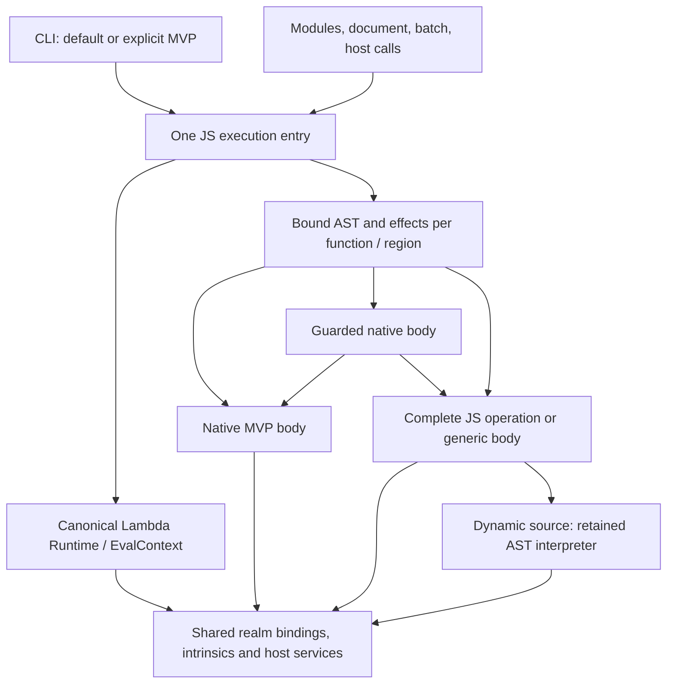

# JS MVP integration: preserve fast execution in one Lambda runtime

**Date:** 2026-10-20

**Status:** ratified by the user's implementation request; implementation and
qualification in progress under **D8.1.3v27**.

Implementation progress and gate results:
[JS MVP integration implementation](../impl/JS_MVP_Integration.md).

**Source baseline:** `222fb3a494d31b08b0cbc0578a23fe2d1e8a91fa` and Result52.

**Scope:** make the fast MVP-Lmd execution model the normal JavaScript path,
unify its ownership and host environment with Lambda, and add complete dynamic
behavior at the smallest boundary that requires it.

## 1. Priorities and acceptance contract

The user directs this rework in the following order:

1. **Preserve the performance of the rewritten JS MVP.** The fast
   `--runtime=mvp-lmd` behavior becomes the default for `lambda.exe js`.
   Performance preservation is the first implementation milestone and a
   continuing acceptance gate for every subsequent milestone.
2. **Make dynamic handling depend on actual semantic need.** Keep native
   arithmetic, direct calls, dense storage and compact MIR wherever facts or
   guards justify them. When correctness requires more general behavior,
   implement a complete slow path for the affected operation, region or function.
3. **Use one runtime environment.** Execution context, globals, host services
   and lifetime management must converge on Lambda's shared ownership model.
   Eliminate the separate standalone environment without transferring the
   current public path's blanket pessimization into the fast compiler.
4. **Broaden dynamic feature support after preserving performance.** Each
   extension must demonstrate correct fallback behavior and unchanged
   performance for programs that do not need it.

A fast result with incorrect output is not accepted performance evidence.
Correctness repairs must preserve unaffected fast paths. If a repair cannot
yet meet both requirements, the milestone remains incomplete and the failing
case stays visible; restoring blanket slow execution is not closure.

Existing supported behavior remains a regression gate during this work.
Expansion beyond that coverage follows the performance milestone. The rework
does not restart an unrestricted Test262 expansion ahead of recovering the
fast default.

### Authority and relation to existing decisions

This proposal refines the integration described in
[JS MVP Lmd §36](JS_MVP_Lmd.md#36-formal-javascript-mir-engine) and the
[formal MIR activation record](../impl/JS_MVP_Lmd_Formal_MIR.md).
That activation qualified functionality while explicitly deferring benchmark
acceptance. This proposal makes performance a prerequisite for integration
closure.

| Contract | Formal authority |
|---|---|
| MVP-Lmd is the normal MIR compiler; explicit AST/AUTO policies remain; dynamic source uses the retained AST interpreter | **D8.1.3v26** |
| Shared Lambda host substrate and `Item` boundary; retain JS semantics | **D1.2v2**, **D1.3v3**, **S1.11** |
| One canonical `EvalContext`, stable context storage and one event loop per context | **D5.4.1–D5.4.4** |
| Precise roots and explicit ownership at every fallback/host boundary | **D1.5v2**, **D5.3.1–D5.3.6v2** |
| Direct native operands; boxed dynamic call boundary and explicit call/construct capabilities | **D6.2.2v2**, **D8.4.2v2** |
| Compile-predicted specialization, immutable code, semantic kernel on a miss; no inline caches | **D8.4.1v2** |
| Errors propagate by explicit completion through each caller | **D1.4v4**, **D8.4.3v2** |

The [formal design](../../doc/Lambda_Formal_Design.md) and
[formal semantics](../../doc/Lambda_Formal_Semantics.md) remain authoritative.
The integration contract is ratified in **D8.1.3v27**. This does not claim that
implementation or qualification is complete. The formal spec and this working
record follow [Doc Convention](../../doc/Doc_Convention.md); no new decision-ID
series is introduced here.

## 2. Problem established by Result52

Both current entries use the rewritten compiler in `lambda/js/mvp-lmd/`.
The normal public path retains the older host/runtime infrastructure and uses
the MVP adapter added during the 2026-10-16 to 2026-10-17 integration. It does not run
the retired JS MIR compiler. The explicit selector enters the standalone
MVP executor.

The public adapter currently makes the presence of `Runtime*` imply an open
compilation mode. This activates dynamic-source, reflection, receiver and
property-callback handling across the unit. Global binding analysis then
loses facts needed for direct calls and native numeric representations.
Shared lifetime ownership has become coupled to broad compiler pessimism.

The 2026-10-20 diagnostic used the **same archived Result52 release binary
and unchanged canonical source in both modes**, with one warm-up and three
alternating measured samples per lane:

| Workload | Normal `js` median, ms | Explicit MVP median, ms | Normal / explicit |
|---|---:|---:|---:|
| `r7rs/fib2.js` | 40.152 | 0.796 | 50.4× |
| `kostya/matmul.js` | 4,853.021 | 5.273 | 920.4× |
| `larceny/array1.js` | 282.428 | 0.259 | 1,090.8× |

Both modes passed the recorded output checks. These are workload execution
times, excluding process startup and compilation; wall times are retained
separately in the raw artifacts. They establish three severe entry-path
regressions, not a full-suite speedup prediction.

The recorded `fib` MIR explains the difference: the public function body has
1,102 raw MIR lines, generic arguments, global dispatch and numeric coercion;
the explicit body has 115 lines, native numeric operands and direct recursive
calls. Raw line counts are diagnostic evidence, not a new compiler size budget.

The performance reference for this rework is the **fast explicit MVP entry**.
Merely beating Result52's slow public entry does not satisfy preservation.
Appendix A records the exact artifacts and source locations.

## 3. Default command and target architecture

After this rework, under the same backend policy:

```bash
./lambda.exe js app.js
./lambda.exe js --runtime=mvp-lmd app.js
```

must select the same compiler plan, runtime environment and host behavior.
The flag remains a compatibility spelling for the default MVP engine.
It must not select a separate heap, globals implementation, lifetime contract
or optimization privilege.

With no backend override, normal JS execution uses native MVP MIR, as
**D8.1.3v26** already requires. Preserve explicit `JS_EXEC_BACKEND=ast` and
`auto`; normalize both command forms before applying that policy. The runtime
flag names the MIR engine and does not bypass an explicit backend policy.
Document this precedence and cover it in CLI tests.

File, `-e`, `-p`, Script/Module, arguments, timing, errors and output formatting
use one option parser and execution entry. CLI `-e` source is an entry unit;
it must not be confused with an ECMAScript `eval` operation inside a program.
DOM, batch, module and preamble callers enter the same execution service.

| Aspect | Current normal entry | Current explicit MVP entry | Target |
|---|---|---|---|
| Entry | Public runtime adapter | Standalone shortcut | One MVP execution service |
| Execution context | Caller `Runtime` / `EvalContext` | Embedded, owned `EvalContext` | Canonical Lambda context; CLI obtains it once |
| Globals | Shared mutable Script realm | More self-contained analysis | One environment per realm, with precise binding/effect facts |
| Host integration | Event loop, timers, globals, optional DOM | Standalone arguments/output and optional services | Shared services, initialized only when needed |
| Lifetime | Runtime-retained code and escaping values | Execution-owned code, heap and result | Runtime ownership; units retained for all live users |
| Optimization | Host mode broadly weakens proofs | Direct-call, numeric and array proofs retained | Fast MVP proofs in every host; local guards and complete misses |



The slow path remains part of this runtime. Retired JS MIR and the old
private-value MVP are not fallback engines.

## 4. One ownership and environment model

### Execution context

The application owns the canonical Lambda `Runtime` and `EvalContext`.
An embedded caller supplies its existing owner; the CLI uses the ordinary
Lambda owner it already creates. MVP compilation/execution records borrow
that owner. Remove the embedded standalone `EvalContext` from the final
execution record and consolidate initialization, reset and destruction.

Use existing context capsules for JS state, with stable addresses and lazy
construction (**D5.4**). Resolve the owner and required capsules at entry.
Do not insert TLS rebinding, generic context searches, locks or atomics into
numeric loops or direct calls.

One environment implementation does not mean one global object for all
ECMAScript realms. Legitimate child realms retain separate globals and
intrinsics, represented by the same realm implementation under the shared
context. Separate isolates retain their required isolation. A realm record
does not acquire a second host runtime, heap or event loop.

### Globals, bindings and intrinsics

Use one authoritative storage location for each observable binding.
MVP, the AST interpreter, modules and native host calls must read and write
the same realm records and precisely traced lexical cells. Consolidate
`JsGlobalEnvironment`, MVP realm slots and intrinsic ownership so they are
views of shared storage, rather than independently initialized environments
that require import, copy or synchronization.

Preserve the distinction between Script global object bindings, top-level
lexicals and module live bindings. Sharing substrate with Lambda must not
impose Lambda's immutable capture/global semantics on JS (**D6.2.3v2**,
**D5.4.4**, **S1.11**).

Addressability and performance are compatible:

- An observable binding has a canonical realm/capture cell. A proven stable
  access can use its resolved slot directly.
- A nonescaping local can stay in a native register or native storage lane.
- A native value exposed to dynamic code is published to its canonical cell
  before the observing boundary, and reloaded where that boundary can write it.
  Direct eval uses the live environment contract in **D8.1.3v26**, not a
  separate environment with projection/write-back journals.
- Builtin, prototype and constructor identities are shared by all consumers
  in one realm. Lazy setup must preserve identity, property descriptors,
  enumeration and observable initialization behavior.

An open realm must not make every local numeric parameter unknown. Conversely,
a Script's apparent lack of assignments does not prove its exported global
function can never be replaced by another script or a reentrant callback.
Use local proof or a guard at the actual observation/call boundary.

### Host services

Move arguments, output, timers, promises, module loading, native modules and
DOM hooks behind the existing shared host services. Extend those services
where required instead of keeping a second standalone implementation.
Backend-specific callable adapters may remain; separate global namespaces,
schedulers and module registries may not.

Host availability is a capability, not evidence that a script invokes every
capability. Attaching a document or making timers available must not force
property callbacks, `eval` environments or boxed numeric calls throughout
unrelated code.

Initialize expensive services on demand while preserving their public
availability. A numeric script should pay for its context and required
bindings, not eagerly construct a DOM, full module graph or unused async
machinery. Classify known native calls by their actual effects; unknown
callbacks are conservative at their call boundary.

### Callable and code lifetime

An escaping function keeps its ordinary callable identity and explicit
`[[Call]]`/`[[Construct]]` entries (**D6.2.2v2**). A boxed entry may check
arguments and enter a native body. Proven internal calls can use that body
directly. Escape to a host callback does not by itself require every internal
recursive call to use a boxed argument vector.

Retain AST, MIR, shapes and per-unit metadata through shared Script/runtime
ownership while any result, closure, module or scheduled job can use them.
Keep mutable state in context storage, separate from immutable reusable code
(**D5.4.3**).

Consolidate teardown in the established runtime lifecycle: retire queued users
and active callbacks safely, release heap-owned resources with their metadata
still valid, and retire compiler metadata after its final users/finalizers.
Reset, heap replacement and destruction remain distinct contracts. No new
reference-count increment, root frame or lifetime check belongs on every
scalar arithmetic operation or proven native recursive edge.

## 5. Feature and effect analysis that preserves fast code

Replace host-derived optimization switches with retained facts from the
bound AST, binding identity, escape analysis and known callee effects.
Maintain separate concepts for:

| Information | What it controls |
|---|---|
| Host capability | Which services the embedding makes available |
| Realm/binding exposure | Which values another script, callback or dynamic environment can observe or change |
| Function/region effects | Which cells, objects or assumptions an operation can invalidate |
| Representation proof | Which native operands, storage and direct callees are valid |

Refine the existing analysis and planner; do not create a second AST walk and
independent fact database for the new entry. The presence of `Runtime*`,
module loading, a harness or a receiver-capable wrapper is never sufficient
reason to set every optimization fact to unknown.

Analysis must be sound for computed access, aliases, getters, proxies,
coercion and callbacks. An absence of the source word `eval`, for example,
does not prove that an unknown callback cannot mutate a global binding.
Missing facts require a guard or generic behavior at the affected site.
Feature detection is semantic analysis, not source-name matching, benchmark
whitelisting or a user promise that a script is safe.

### Placement of fast and slow behavior

| Case | Fast behavior | Required general behavior |
|---|---|---|
| Local numeric recursion | Native arguments, return lanes and direct recursive calls | Boxed entry for unknown callers; generic body for incompatible operands |
| Public mutable function binding | Direct call when proven stable; otherwise guard the resolved callable at the call site | Call the actual current callable through its executable entry |
| Dense numeric array loop | Native indexed loads/stores with proved bounds/layout | Correct holes, prototypes, descriptors, coercion and representation transitions |
| Typed array loop | Direct valid typed-storage access | Correct conversion, detachment/resizing and unsupported storage handling |
| Known own data property | Predicted shape/slot with an exact admissibility guard | Shared JS property kernel for accessors, proxies, prototypes and misses |
| Direct eval | Keep unrelated functions native; expose the affected lexical environment | Retained AST eval with live caller cells and exact completion behavior |
| Unknown or reentrant call | Retain unaffected local scalar facts | Publish observable state, call normally, then invalidate/recheck affected assumptions |
| Modules and subsequent Scripts | Retain local/native functions and resolved slots | Live imported/global bindings and mutations across entry boundaries |

A dynamic feature inside one function must not automatically make unrelated
functions generic. A function can also contain a fast numeric region and a
dynamic operation. Refine facts at control-flow joins and after effects;
do not erase all type/shape information for the remaining unit.

Hoist a guard only across code proven unable to invalidate its assumptions.
Pure recursion can retain native recursive edges. A loop that calls an
unknown callback may need to recheck an array or binding afterward. Checks
must not invoke getters or coercion merely to decide whether the fast path
is admissible.

All specializations obey **D8.4.1v2**: compile-predicted cases, immutable
generated code, and a semantic miss path. Do not reintroduce feedback vectors,
mutable per-site caches or self-modifying dispatch.

## 6. Complete fallback without replay

“Fix correctness with a full fallback” means that a failed proof or guard
reaches the complete semantics for that operation. It does not mean running
a script, inspecting its result, then rerunning it with another engine.

Use the narrowest sufficient boundary:

1. **Operation:** an arithmetic, property, index, conversion or call miss
   enters the complete shared JS operation. Evaluate its operands once.
2. **Region:** select a generic loop/region before executing its effects, or
   leave a fast region at an explicit boundary with its current values and
   continuation state. Never restart iterations already performed.
3. **Function:** use a generic callable entry/body when its argument or
   environment guards fail. Keep eligible callees and subregions native.
4. **Unit:** select general lowering before execution only if a demonstrated
   semantic dependency truly spans the unit. Record the reason and the
   missing finer analysis; host presence alone is not such a dependency.

The full slow operation/body shares the same context, cells, object identities,
completion rules and GC roots as the fast body. A generic body should reuse
existing MVP lowering and audited JS semantic kernels. Dynamic source remains
in the retained AST interpreter under **D8.1.3v26**. Do not add automatic
whole-script AST retry or resurrect retired compiler/runtime machinery.

An ordinary JS throw is an outcome to propagate, not a request to retry.
An unsupported feature or internal compiler error is reported honestly until
its lowering/fallback is implemented. Guard misses are explicit control flow;
they must not be encoded as language exceptions or nonlocal unwinds.

Fallback must preserve evaluation order, receiver and `new.target`, strict
mode, property effects, live bindings, exception identity, finally blocks and
iterator cleanup. Publish live roots and owned scalar values at each
`MAY_GC` boundary through the shared emitter (**D5.3**, **D8.4.3v2**).

Each correctness repair includes three demonstrations: the triggering case
now has the right behavior; the guard/miss path runs exactly once with the
right effects; and a neighboring case retaining the original proof still
generates and executes the fast code.

## 7. Performance and correctness gates

### Freeze the reference before changing execution

Use the archived Result52 release through its explicit MVP selector as the
initial performance control. Preserve its binary hash, source/import hashes,
arguments, environment, output contract and raw samples. Historical
[MVP_Result10](../../test/benchmark/js_mvp_lmd/MVP_Result10.md) is supporting
context; its rewritten wrappers and mixed capture history are not substitutes
for a fresh comparison using the same canonical sources.

The qualification manifest contains all 71 canonical standard workloads
from Result52 and the applicable 17 MVP microbenchmarks. Before implementation,
identify which rows the exact control executes correctly. Freeze that
successful population as the performance protection set; keep every other
row visible as an explicit failure/coverage item. Never select the matched
population after seeing candidate timings.

Measure these comparisons:

| Comparison | Purpose |
|---|---|
| Candidate default vs archived fast explicit MVP | Required performance preservation |
| Candidate default vs candidate explicit MVP | Entry equivalence; neither spelling has special optimizations |
| Candidate default vs archived normal Result52 | Quantify the recovered integration loss |
| Candidate Lambda untyped/typed vs archived release | Protect the shared Lambda substrate from the unification |

### Measurement and acceptance

Use release binaries only. Archive each binary before baseline commands can
replace `lambda.exe` with a debug build. Use the supported build procedure for
the checkout; follow Developer Guide §7 for any worktree.

Reuse the paired benchmark runner's provenance, output checks and alternating
order, extending it with explicit command/selector metadata where needed.
Start each comparison with a warm-up, then seven alternating pairs. Retain
all samples and report median execution time, paired uncertainty, compilation,
startup and end-to-end time separately. Additional pairs are for unresolved
noise or a diagnosed change, not selecting favorable repeats.

The target is no performance loss. Proposed measurement tolerances for the
frozen protection set are:

- At most **1% geometric-mean overhead** and **3% overhead on each row**,
  with the paired 95% upper bound within the corresponding limit.
- The three diagnosed workloads meet the per-row limit individually and
  retain their native-call/numeric/array structure in generated MIR.
- Any reproducible added overhead is investigated, even within those limits.
  The limits accommodate measurement uncertainty; they are not a budget to
  spend on unnecessary abstraction or generalized dispatch.
- Inconclusive measurements leave acceptance pending. A failure, timeout,
  missing sample or changed output cannot be counted as a speedup or removed
  from the published population.

Report per-suite and per-row results so object-heavy regressions cannot be
hidden by numeric improvements. Run correctness on the full manifest even
when only a subset has a valid historical performance control.

Require the same no-regression review for Lambda untyped/typed when shared
storage, calls, allocation or lifecycle changes. Track startup and compile
cost against the fast control as separate gates; lazy setup must not recover
loop speed by imposing the former public path's eager startup cost.

### Required behavioral coverage

| Boundary | Required cases |
|---|---|
| Entry | Both CLI spellings; unset/MIR/AST/AUTO policy; file/eval/print, arguments, Script and Module |
| Globals | Multiple Scripts in one realm; `var` vs lexical declarations; TDZ/redeclaration; replaced functions/intrinsics before and during callbacks |
| Native functions | Recursive numeric calls; callable escape; unknown argument types; receiver/construct behavior; coercion effects |
| Objects and arrays | Shape change, accessors, proxy traps, prototype mutation, holes, out-of-bounds access, mixed element types and typed-buffer state changes |
| Dynamic source | Direct/indirect eval, aliased dynamic calls, Function-family constructors, live captured cells and early errors |
| Host integration | Reentrant host calls, timers/microtasks/promises, module live bindings, native calls and document callbacks |
| Lifetime | Escaped closures/results, suspension, forced/poisoned GC, reset/heap replacement/destruction and child-realm identities |
| Locality of fallback | A dynamic function alongside a numeric kernel; one guard miss; no duplicate effects; fast code preserved elsewhere |

Use focused fixtures and MIR checks while developing. At milestone boundaries,
run the unchanged `make test-lambda-baseline` and `make test262-baseline`.
Result52 recorded **40,261/40,261** Test262 baseline passes; preserve that
population and disclose exclusions and retry classifications separately.
Do not reroute tests to a different environment or change the harness to hide
runtime failures. Run relevant host/DOM gates when those paths change.

These are future implementation gates. Writing this proposal does not execute
them or establish that the rework passes.

## 8. Delivery order and completion

| Milestone | Deliverable | Exit gate |
|---|---|---|
| 0. Freeze evidence | Exact fast control, canonical source/output manifest, current failures, entry/MIR diagnostics and ownership inventory | Reproducible reference and fixed protection set |
| 1. Recover the fast default | Both CLI spellings use MVP's fast planning with the shared owner; replace blanket host flags with sufficient binding/effect facts and guards | Three diagnostic rows plus the full protected population preserve fast performance; existing correctness gates pass |
| 2. Unify ownership and globals | Canonical context, realm cells, intrinsic identities and Script/code lifetime; remove standalone context/destructor and copy/import bridges | Identity, reentry and precise-GC checks pass; performance gates remain green |
| 3. Unify host execution | One service path for modules, document callbacks, timers, jobs, preambles and explicit AST/AUTO integration | Shared-state and callback/lifetime tests pass without fast-path loss |
| 4. Broaden dynamic behavior | Fix concrete unsupported/incorrect cases with local complete fallbacks, ordered by real usage and failures | Each feature has semantic, fallback and unaffected-performance evidence |
| 5. Retire duplication and publish | Remove obsolete entry/environment branches; update docs, selectors and benchmark labels; publish a new immutable result artifact | One production environment, complete gate report and explicit remaining coverage |

Milestone 1 may consolidate the minimum owner/entry plumbing needed to make
default execution safe. It must not be implemented as a second permanent
“fast CLI” runtime. Remaining temporary ownership branches have named removal
work in milestones 2–3; they prevent declaring the integration complete.

Broad dynamic expansion must not precede milestone 1. Later milestones may
retain a generic operation where necessary, but cannot solve its correctness
by making unrelated functions generic. If unification introduces a regression,
repair the shared design before proceeding.

Final closure requires all of the following:

- Default and explicit MVP commands have identical environment and planning
  contracts.
- Fast MVP performance survives normal CLI and host integration.
- Each semantic binding/intrinsic has one owner and authoritative storage per
  realm; standalone and public execution no longer maintain parallel sets.
- Fallback is correct, local where possible, and never replays side effects.
- Existing baseline coverage is preserved, new feature gaps are listed, and
  the full benchmark population is reported without silently dropping failures.
- Historical Result52 and MVP results retain their original commands and
  numbers; the new integration is measured in a new artifact.

## Appendix A. Verified source and evidence

Locations below were inspected at the source baseline in the header. Symbols
are the durable anchors; line numbers will move during implementation.

| Location | Current behavior / rework target |
|---|---|
| `lambda/main.cpp:2786`, explicit `--runtime=mvp-lmd` branch | Separate option parsing and standalone execution; normalize to the shared entry |
| `lambda/js/js_execution.cpp:465`, `transpile_js_to_mir_core_profile_len` | Public MIR entry routes to MVP; preserve explicit AST/AUTO selection |
| `lambda/js/mvp-lmd/mvp_lmd_mir.cpp:348`, `MvpLmdExecution` | Contains an embedded context plus borrowed owner/runtime; converge on one owner contract |
| `lambda/js/mvp-lmd/mvp_lmd_mir.cpp:10695`, `plan_global_bindings` | Dynamic-source/global exposure weakens binding facts; preserve necessary observability with more precise proof boundaries |
| `lambda/js/mvp-lmd/mvp_lmd_mir.cpp:11109`, realm handling in compilation | Broadly enables dynamic/reflection/property features; separate realm ownership from actual effects |
| `lambda/js/mvp-lmd/mvp_lmd_mir.cpp:11230`, `representation_pass` | Closed-call proof controls native parameters and direct arguments; retain fast bodies behind safe public entries |
| `lambda/js/mvp-lmd/mvp_lmd_mir.cpp:13888`, `mvp_lmd_execute_owned` | `Runtime*` enables receiver ABI and open realm mode; make ownership independent of optimization |
| `lambda/js/mvp-lmd/mvp_lmd_mir.cpp:14197`, `mvp_lmd_execute_in_runtime` | Shared context, host setup and retained Script ownership; reuse without blanket pessimization |
| `lambda/js/mvp-lmd/mvp_lmd_mir.cpp`, `mvp_lmd_import_host_globals`, `mvp_lmd_compile_function_satellite`, `mvp_lmd_destroy` | Audit copied globals/prototypes, AUTO ownership and separate teardown |
| `lambda/js/js_runtime_state.{hpp,cpp}`, `lambda/js/js_globals.cpp` | Shared environment, intrinsic and context capsule ownership |
| `lambda/runtime/runtime-state.{h,cpp}` | Canonical context, execution scopes and module-state ownership |
| `test/benchmark/run_benchmarks.py:669`, `lambdajs_run_cmd` | Result52 pins MIR but uses normal `js`; update stale AUTO labels and record the actual entry/policy |

Release control:

- Binary: [`lambda-v52-222fb3a494`](../../test/benchmark/exe/lambda-v52-222fb3a494).
- SHA-256: `62bb7194afcd5cc9506c4424e37181b559db5c9d33fd5fed277e1218cf6244f8`.
- Original matrix: [Result52 report](../../test/benchmark/Overall_Result52.md)
  and [JSON](../../test/benchmark/benchmark_results_v52.json).
- Local diagnostic samples:
  [`fib_entry_comparison.json`](../../temp/result52_js_mvp_diagnosis/fib_entry_comparison.json)
  and [`array_numeric_entry_comparison.json`](../../temp/result52_js_mvp_diagnosis/array_numeric_entry_comparison.json).
- Local MIR:
  [`fib_formal.mir`](../../temp/result52_js_mvp_diagnosis/fib_formal.mir) and
  [`fib_explicit.mir`](../../temp/result52_js_mvp_diagnosis/fib_explicit.mir).

The diagnostic files are local `temp/` evidence, not durable tracked
publication artifacts. Milestone 0 must retain their relevant provenance in
the implementation capture before relying on them across checkouts.

## Appendix B. Implementation boundaries

Keep the main design above independent of a premature new class hierarchy.
First search for existing helpers and promote or parameterize them where
needed. Reuse the shared frontend, emitter, storage and semantic kernels.
Do not duplicate a third environment adapter or generic operation family.

Extend existing tests in `test/test_js_mvp_lmd_gtest.cpp`, public JS fixtures
and `test/mir/js_opt/` to cover both entry equivalence and the missing proof
boundaries. Adapt `test/benchmark/run_paired_benchmarks.py` to compare archived
explicit MVP with candidate default directly; reuse its existing provenance
and oracle machinery. Record the executable, selector and source for every
lane rather than assuming an engine label identifies the command.

Use optional compile diagnostics to explain lost facts and fallback reasons
by source/function/operation. Keep them outside the timed hot path and do not
make them semantic state. Profile representative failures before adding
helpers, guards or abstraction layers.

The cleanup inventory includes the explicit CLI shortcut, standalone
context/heap teardown, duplicate realm initialization, imported/copied global
and prototype identities, embedded module Runtime controllers, and separate
formal/AUTO ownership bookkeeping. Some compiler records or ABI adapters may
remain necessary; they must reference the same environment rather than create
another one.

Update `JS_MVP_Lmd.md`, the appropriate formal-design linkage, public JS
documentation and benchmark command descriptions as implementation lands.
Preserve the historical activation record and Result52 measurements as
evidence of the behavior being corrected.
