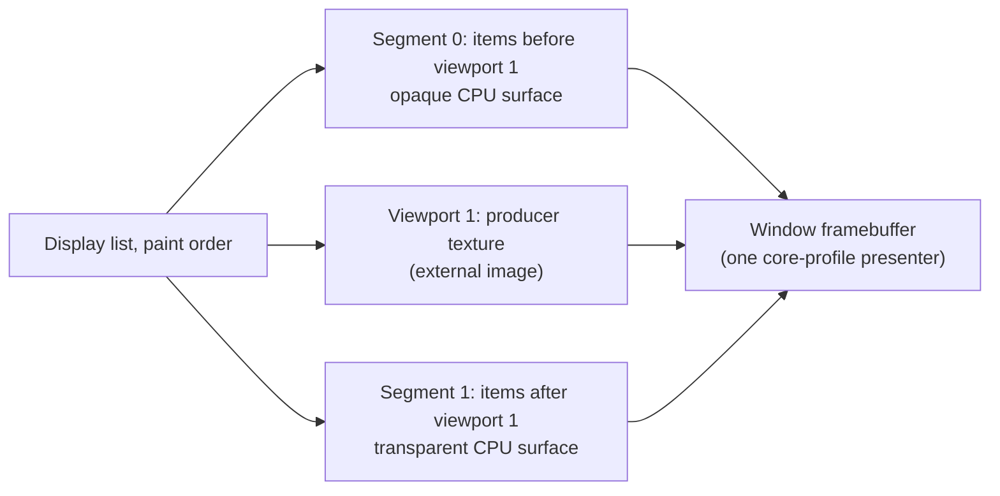

# Radiant — GPU Compositing of Native Graphics Viewports

**Status:** Design accepted, 2026-11-02. The user chose
this direction on 2026-11-02, after the
[Retina frame-pacing measurement](../impl/Radiant_Scene3d_Phase1.md#retina-frame-pacing-midtown-2026-11-02),
over a pipelined readback. The same day the user accepted every recommendation
in §9 as the ruling for Q7–Q13. Staging steps 1 to 4 (§8) are implemented; see the
[step 1](#step-1-checkpoint--2026-11-02), [step 2](#step-2-checkpoint--2026-11-02),
[step 3](#step-3-checkpoint--2026-11-03) and [step 4](#step-4-checkpoint--2026-11-03) checkpoints.
Step 5 is implemented as well: clip shapes
(Q10, [checkpoint](#step-5-checkpoint--2026-11-03-clip-shapes)) and, at the user's request the same day,
WebGL canvas producers ([checkpoint](#step-5-checkpoint--2026-11-03-webgl-canvas-producers)). Since
2026-11-03 the compositor is on by default for live windows, as Q11 provides once qualified
([checkpoint](#default-on--2026-11-03)); `RADIANT_GPU_COMPOSITOR=off` restores CPU presentation.

**Series:** this is stage C of
[Radiant — Repaint for Presentation Animations](Radiant_Design_Animation_Repaint.md),
which deferred "GPU compositing of layers" (its §5). Design items continue that
document's ledger as C1–C7; questions continue its Q-series from Q7.

**Scope:** the live window's presentation of native graphics viewports
(`<scene3d>` now, WebGL2 `<canvas>` in Phase II) and of the page content around
them. Every CPU output path keeps the published-snapshot path: PNG/JPEG/SVG/PDF
export, paged output, headless replays, and pixels read by tests or scripts.

**Governing rulings:**
- **D5.5.1:** Radiant owns native lifetimes; its seam is "pin, gen-check,
  copy-as-value". GPU textures shared with the presenter follow it.
- **D5.5.3:** "restyle, reflow and repaint reuse every retained structure that
  is still valid"; retained segment surfaces and textures are such structures.
- **D9.5.1:** raw native handles never become script-visible. GL names stay
  inside `gl_core`; the compositor sees branded resource IDs only.
- **RC1** ([Radiant_Design_Concurrency](Radiant_Design_Concurrency.md#4-decision-ledger-rc)):
  script, style, layout and display-list build share the page thread. Stage C
  composites on that thread. **RC3** (a compositor thread consuming display
  lists as immutable values) and **RO3** stay future work; nothing here blocks them.
- [Radiant_Design_WebGL §5, "Ownership and validation"](Radiant_Design_WebGL.md#ownership-and-validation):
  each viewport keeps its own context. Q7 revised its sharing rule: one share
  group per window (C3).
- [Radiant_Design_WebGL §7, "Later presentation path: shared GPU texture"](Radiant_Design_WebGL.md#later-presentation-path-shared-gpu-texture):
  an external-image abstraction with fences, generation ownership,
  format/alpha/color-space metadata and a snapshot path for CPU consumers. This
  document is that design.

This design adds no formal ruling: neither formal spec covers native graphics
presentation. Q7 revised a vibe-level decision of the WebGL design, recorded in
its §5 and Appendix S.

---

## 1. The problem, measured

Midtown, a full-window `<scene3d>` under a translucent HUD, on a 2× Retina
MacBook in a 1280×800 window, release build
([evidence](../impl/Radiant_Scene3d_Phase1.md#retina-frame-pacing-midtown-2026-11-02)):

| Per frame (31.2–31.9 ms in all) | ms | Exists only because the GPU image goes through the CPU page |
|---|---:|---|
| GPU wait inside the synchronous `glReadPixels` | 6.0 | yes |
| Readback detile and alpha normalization (16 MB) | 1.7 | yes |
| Blit of the snapshot into the window surface | 1.4 | yes |
| HUD panels re-blended over the moving scene | 3.5 | yes: the panels did not change, their backdrop did |
| Upload of the whole 2560×1600 window surface | 1.5 | yes |
| Scene CPU (pose refresh, draw submission) | ~5 | no |
| Animation tick (physics, Lambda frame handler) | 2.6 | no |

About 14 ms of a 31 ms frame moves pixels the GPU already had. Rendering a
quarter of the pixels cut the readback wait only from 6.6 to 5.3 ms: the wait is
the latency of synchronizing with the GPU, not fill. The photo-album page turn
shows the same upload cost from the other side: 2× windows upload about 20 MB
per frame ([Animation_Repaint §2.4](Radiant_Design_Animation_Repaint.md#24-how-3d-content-is-painted-and-presented)).

## 2. How a frame is presented today

Verified against the working tree of 2026-11-02:

1. **Produce.** Each `<scene3d>` owns a `NativeGlContext`. Each WebGL canvas
   does too. A context is a hidden 1×1 GLFW window with a 4.1 core profile on
   macOS, created with no share context: no two contexts share objects. Before
   the page records, `scene3d_prepare_document` renders each dirty scene into an
   sRGB multisampled target, resolves it, upscales it when `max-pixel-ratio`
   caps the density, and reads it back synchronously (`native_gl_snapshot`).
   The pixels are published as an immutable `ImageSurface` with an owner lease.
2. **Record.** The scene paints through the path canvases share
   (`render_surface_content` → `render_painter_draw_pixels_rect`) as one
   transaction: clip push, `DL_DRAW_IMAGE`, clip pop. The image item retains a
   snapshot lease. No item kind marks native content.
3. **Replay.** The CPU replays the list into the window surface. The snapshot
   is composited by `rdt_draw_image`, as a row copy when placed 1:1. Every
   item above it, such as a translucent HUD panel, blends over the new pixels.
   Retained rasters (stage B paint layers, SVG layers) are CPU surfaces fed back
   into the same list. No compositing layer tree exists.
4. **Present.** `radiant_platform_present` draws one persistent texture with
   the fixed-function pipeline (`glOrtho`, `glBegin(GL_QUADS)`) in the window's
   context, which is GLFW's default legacy context. Stage A's A3 made the
   texture persistent. A paint-only presentation frame uploads only its damage
   rectangle with `glTexSubImage2D`; every other frame uploads the whole surface.
   Midtown's live profile shows a whole-surface `glTexImage2D` in every frame.

## 3. Goals and non-goals

**Goals.**
- **G1.** A live window frame reads no native viewport back to the CPU. Its
  pixels go from the producer's texture to the window framebuffer on the GPU.
- **G2.** Page content is rasterized and uploaded only where it changed. A HUD
  over a moving scene is not re-blended because its backdrop moved.
- **G3.** The composited frame matches the CPU path within the parity tolerances
  stage A/B already use. Blending happens in the same encoded space with the
  same premultiplication.
- **G4.** Every CPU consumer still receives a correct snapshot when it asks.
- **G5.** Any frame or viewport that does not qualify falls back to today's
  path, per viewport and per frame, without a visible difference.

**Non-goals.** A compositor thread (RC3/RO3). GPU rasterization of page content
(a ThorVG GL backend). A Metal backend. Compositing arbitrary HTML subtrees as
layers; C7 only reserves the seam. Changing any CPU output path.

## 4. Alternatives considered

| Option | Removes | Keeps | Verdict |
|---|---|---|---|
| **Pipelined readback**: read frame *n* into a pixel-pack buffer, present frame *n−1* | the 6 ms wait | detile, blit, HUD re-blend, upload (~8 ms); adds a frame of latency between the scene and the HUD, and needs a catch-up frame when the scene stops | Not chosen: the user selected GPU compositing instead (2026-11-02). It could still shorten fallback frames later. |
| **Render the scene into the window context's framebuffer** | everything in §1 | nothing | Rejected: page presenter, native scenes and future WebGL scripts would share one context's state, and a scene failure would take down the window's presentation. |
| **GPU-rasterize the whole page** | everything | nothing | Out of scope: it changes raster semantics for every output, not only presentation. |
| **Composite native viewports as GPU layers between CPU-rasterized page segments** (this proposal) | the first five rows of §1 | CPU raster semantics, CPU output paths | Chosen (USER, 2026-11-02). |

## 5. The model

A frame's display list is already in paint order: stacking contexts, `z-index`,
positioned and floated content have been resolved into one sequence. A native
viewport is one image item in that sequence. Stage C **cuts the sequence at each
eligible viewport item**:

With *N* eligible viewports there are *N* + 1 segments, composited bottom to
top. Because the cut follows the existing order, no stacking logic is new: what
painted above the scene still paints above it. A frame with no eligible viewport
is a single opaque segment, which is today's frame plus C5's damage-limited
upload.

A segment is a **replay window** over the one recorded list, not a separate
list. Clip and effect pairs can straddle element ranges, so copying ranges out
would need their enclosing state rebuilt. Replay for segment *k* walks the list
from the start: it applies every state item (clips, transforms, scroll scopes)
but draws only the items between cut *k* and cut *k* + 1. C1's group rule keeps
any pixel-reading group from straddling a cut.

## 6. Design items

### C1. Eligibility of a viewport

A viewport item is composited on the GPU when all of these hold for the frame:
- the output is a live window, the compositor is enabled (Q11), and the producer
  context shares objects with the presenter (C3);
- the item's accumulated transform is 2D affine. Projective transforms and
  `preserve-3d` planes keep the CPU path, which projects and BSP-orders them;
- its clip is a device-space rectangle; rounded-rectangle clips join in
  staging step 5 (Q10). Masks, `clip-path`, filters, `mix-blend-mode` and `backdrop-filter` on
  the viewport or an ancestor group make it ineligible;
- no opacity or filter group spans the cut. A group that contains the viewport
  and items on both sides of it would need the viewport's pixels on the CPU;
- no item in a later segment reads its backdrop (`backdrop-filter`,
  `mix-blend-mode`) over the viewport's area;
- the viewport is not inside a stage B paint-layer capture or an SVG layer.

Ineligible viewports render and read back exactly as today, inside the segment
where they fall. At most four viewports per frame are composited (Q12); later
ones fall back. Eligibility is decided while recording, from data the recorder
already has (transform, clip stack, open groups); it costs no extra traversal.

**The viewport item.** Today the shared canvas/scene path records a plain
`DL_DRAW_IMAGE` holding a snapshot lease, so pixels must exist before
recording. Stage C records a native-viewport image item instead. It names the
producer's external image (C4) and the eligibility verdict, inside the same
clip transaction. A CPU replay of the item (fallback, export, tile or strip
replay) materializes the snapshot and draws it as `DL_DRAW_IMAGE` does today.
A compositor replay ends the current segment's window there. Scenes and WebGL
canvases share the item because they share the recording path.

### C2. Transparent page segments

Segment 0 is opaque: it starts from the window background. Every later segment
starts transparent and holds premultiplied color. Today's painters assume an
opaque destination for straight-alpha composites. Stage B already solved this
for retained layers, and C2 reuses its policy unchanged: the descriptor-qualified
subset (vector fills, strokes, gradients, images, clips, monochrome glyphs)
renders once into a transparent premultiplied surface; color emoji, effects and
native pictures use the black/white two-pass reconstruction
([Rendering §7](Radiant_Design_Rendering.md#7-retention-and-invalidation)).
No painter gains a new contract (Q9).

Each segment keeps a persistent surface sized to the window. A frame clears and
re-rasterizes only its damaged regions, using stage A's damage machinery:
- the segment's own items changed (old and new bounds, as A1 computes);
- the cut moved: a viewport became ineligible or eligible, or the item order
  around a cut changed. Both affected segments repaint fully for that frame.

A viewport's pixels changing does **not** damage the segments above it. That is
the HUD win of §1: a static panel over a moving scene costs nothing per frame.

### C3. One share group per window

Each window's presenter context and every native graphics context created for
that window's documents join one GL share group. Native contexts are created
with the presenter as the share context. Each context keeps its own state, so
the isolation the WebGL design sought (one scene's state cannot disturb another
or the presenter) holds. What changes is the object namespace: textures created
by a producer become sampleable by the presenter.

That namespace is invisible to scripts and packages: GL names never leave
`gl_core` (**D9.5.1**). Resource budgets stay per context, as today. Loss of
the presenter context is loss of the whole group: every producer falls back and
recreates. Loss of one producer affects only its viewports.

**Prerequisite.** On macOS the presenter context is currently GLFW's default,
a legacy 2.1 context drawing with the fixed-function pipeline. Apple's GL does
not share objects between a legacy and a core-profile context, and native
contexts are 4.1 core. The presenter must become a 4.1 core-profile context
drawing textured quads with a small shader (C5). This is C's first step and
needs no other change.

IOSurface (macOS), dmabuf/EGLImage (Linux) and DXGI shared handles (Windows)
would share textures without a share group and would also serve a later Metal
presenter. They are platform-specific; the external image (C4) is shaped so one
can back it later without changing its consumers (Q8).

### C4. The external image

What a producer publishes to the compositor for a frame:

| Field | Meaning |
|---|---|
| producer context, generation | branded; a different generation invalidates the image |
| texture resource ID | a `gl_core` resource ID, never a GL name |
| size in device pixels, orientation | top-down, as the snapshot path produces |
| color encoding | sRGB-encoded, premultiplied: the bytes the snapshot path would publish |
| fence | inserted by the producer after its last write; the presenter waits on the GPU (`glWaitSync`), never on the CPU |
| frame generation | advances per rendered frame; equal generations mean unchanged pixels |

**Double buffering.** A producer renders into one of two textures per viewport
while the presenter may still sample the other. The presenter's own fence after
its draw guards reuse. A producer that finds its next texture still in use
renders into the same one again after a GPU-side wait; it never blocks the CPU.

**The upscale folds into the composite.** `max-pixel-ratio` currently renders at
the capped density and blits once to device density for readback. A composited
viewport skips that pass: the presenter samples the capped-density texture with
linear filtering over the device rectangle. The 4-bytes-per-device-pixel upscale
target is then needed only for snapshots.

**Snapshots become lazy (G4).** The published `ImageSurface` is materialized only
when a CPU consumer asks: an export, a test assertion, a script-visible pixel
read, or a fallback frame. Materialization reads back the current external
image synchronously and publishes it with today's lease semantics
(**D5.5.1**). Consumers observe the same pixels as today; they no longer pay
for a readback in frames that nobody reads (Q13).

### C5. The presenter

The window presenter becomes a core-profile pass:
1. Upload each segment's damaged rectangles into its persistent texture with
   `glTexSubImage2D`. Textures are recreated only on resize. A3 already does
   this for one texture on paint-only frames; C5 extends it to every frame kind
   and to several segments. Today a frame that changes a scene uploads the whole
   window; under C it uploads only the page regions that changed.
2. Clear, draw segment 0 opaque, then in order each composited viewport and the
   segment above it, with premultiplied source-over (`ONE`,
   `ONE_MINUS_SRC_ALPHA`).
3. Apply each viewport's affine transform in the vertex stage, its rectangular
   clip by scissor (rounded rectangles by a coverage term in the fragment stage,
   once Q10 admits them), and its group opacity as a multiplier.
4. Swap, without `glFinish`, as today.

**Blending space.** The CPU compositor blends sRGB-encoded premultiplied bytes.
The presenter does the same: `GL_FRAMEBUFFER_SRGB` stays off and textures are
sampled without sRGB decode (`EXT_texture_sRGB_decode` `SKIP_DECODE`, or an
RGBA8 producer target), so encoded values blend as they do on the CPU (G3).
Linear filtering of the capped-density texture also happens on encoded values,
as the current upscale blit does.

### C6. Fallback and observability

Fallback is per viewport and per frame (G5): an ineligible viewport is rendered,
read back and painted into its segment exactly as today. Stats report, per
frame: composited viewports, materialized snapshots, segment pixels rasterized
and uploaded. The `RADIANT_FRAME_PROFILE` line gains the same counts, so a
regression to readback is visible in a live run.

### C7. Retained rasters as compositor layers (reserved)

Stage B paint layers, SVG layers and video frames are retained rasters, so they
could be uploaded once and moved by the presenter's transform: true
compositor-side animation. C reserves the seam (a layer item can be cut out like
a viewport) but implements nothing for it. It would need its own eligibility and
damage rules, and is out of scope here.

## 7. Correctness

| Concern | Rule |
|---|---|
| Paint order | Cuts follow the recorded order; no reordering. |
| Hit testing, events, focus | Unchanged: they use layout geometry, not pixels. |
| Opacity groups, filters, blend modes | A group spanning a cut, or a backdrop read over a viewport, makes the viewport ineligible (C1). |
| Text and edges in segments | Rasterized exactly as today; transparent segments use stage B's qualified single pass or two-pass reconstruction. |
| Context loss | Presenter loss: all viewports fall back, the group is rebuilt. Producer loss: its viewports fall back until it recovers. |
| Window screenshots and live-view assertions | Materialize snapshots and compose on the CPU, or read the window framebuffer back; both are explicit and rare. |
| Resize | Segment surfaces and textures are rebuilt; that frame is fully damaged. |
| WebGL `preserveDrawingBuffer` (Phase II) | The external image is the drawing buffer's presented copy; the drawing-buffer rules of [WebGL §7](Radiant_Design_WebGL.md#7-drawing-presentation-and-page-composition) are unchanged. |

## 8. Verification and staging

**Parity.** For each fixture, render a live hidden-window frame with the
compositor on, read the window framebuffer back, and compare it with the CPU
path's frame, using stage A/B's parity measures (mean and worst channel
difference). Fixtures: Midtown (full-window scene, translucent HUD), Skymaster,
a scene inside scrolled HTML with content above and below, two scenes
interleaved with HTML, a scene under `opacity`, a scaled and rotated scene, and
a rounded-clip scene (expected to fall back until Q10).

**Replays.** Event-simulation replays keep the CPU path. A new live-window case
in `Scene3dTest` forces the compositor (`LAMBDA_HEADLESS_GLFW_WINDOW=1`) and
asserts per-frame stats: no materialized snapshot, the expected composited
count, and a bounded upload for an idle HUD.

**Performance.** The §1 table, re-measured. Target (Q13): a median Midtown
frame within one 60 Hz vsync on the reference MacBook.

**Staging.** Each step is shippable and leaves the fallback path intact:

| Step | Delivers | Exit check |
|---|---|---|
| 1 | C5's presenter on a 4.1 core context, one opaque segment, damaged-rectangle uploads on every frame kind | Radiant baseline; window pixels equal today's |
| 2 | C3 share group; C4 external image with fences and lazy snapshots; C1's viewport item; one full-window viewport under one transparent segment (C2) | Midtown parity; no snapshot materialized per frame; exports, tests and script reads unchanged; §1 re-measured |
| 3 | C1 general cut: N viewports, affine transforms, rect clips, opacity; C2 damage per segment, with Q9's black/white reconstruction | all parity fixtures; fallback fixtures unchanged |
| 4 | Upscale folded into the composite; the upscale target allocated only to materialize a snapshot | Midtown parity at `max-pixel-ratio` 1 and 0.5 |
| 5 | Rounded-rect clips (Q10); WebGL canvas producers when Phase II needs them (both built 2026-11-03) | their fixtures |

## 9. Rulings

The user accepted every recommendation below on 2026-11-02; each answer is now
the ruling.

| ID | Question | Ruling (USER, 2026-11-02) |
|---|---|---|
| Q7 | Revise the WebGL design's "isolated contexts per viewport" to "one share group per window; one context per viewport"? | Yes. State isolation remains; only the object namespace is shared, and it never reaches scripts (**D9.5.1**). |
| Q8 | Share textures through the GL share group now, with platform surfaces (IOSurface, dmabuf, DXGI) later? | Yes. The share group is portable and small; C4's external image keeps the platform route open. |
| Q9 | Rasterize transparent segments with stage B's policy (qualified single pass, black/white reconstruction otherwise)? | Yes. It adds no painter contract. **Exception until step 3 (USER, 2026-11-02):** a frame whose upper segment needs black/white reconstruction paints on the CPU instead; step 3 adds the reconstruction for damage-limited segments. Step 3 added it (2026-11-03), which ended the exception. |
| Q10 | First release: rectangular clips only, or rounded rectangles too? | Rectangles in step 3, rounded rectangles in step 5. Rounded clips are common on cards, so they come next. |
| Q11 | Enablement: an opt-in `RADIANT_GPU_COMPOSITOR=on` until parity and the Radiant baseline qualify it, then on by default for live windows? | Yes. Headless and export paths never use it. The user made it the default on 2026-11-03, after step 5; `RADIANT_GPU_COMPOSITOR=off` turns it off. |
| Q12 | Cap on composited viewports per frame? | Four. Each costs two textures and a draw; more is rare and falls back. |
| Q13 | Acceptance: Midtown's median frame within one 60 Hz vsync on the reference MacBook, and snapshots materialized only on request? | Yes. Both are measurable with C6's stats. |

## Step 1 checkpoint — 2026-11-02

### What was built

- **Core-profile windows.** `radiant_platform_create_window` applies
  `native_gl_core_profile_hints`, the same hints native contexts use (4.1 core on
  macOS, 3.3 core elsewhere). The hidden host window used for headless native
  graphics gets them too.
- **The presenter.** `native_gl_presenter_create` wraps the window's own context
  in a `NativeGlContext` flagged as a presenter; destroying it leaves the window.
  It reuses `gl_core`'s entry-point loader, shader compiler, uniform-location
  cache and diagnostics. The platform backend keeps one presenter per window in
  the GLFW user pointer, created on first use, and destroys it before the
  window. `native_gl_present` draws the page texture with a two-triangle shader
  quad: same placement, clear, filters and pixels as the fixed-function quad it
  replaces. No raw GL call remains in `platform_glfw.cpp`.
- **Damage on every frame kind.** `ui_context_add_present_damage` grows
  `present_rect` for paint-only frames (as A3 did), for dirty-region selective
  frames without video, and for each placement the cached video blit writes.
  Full repaints still upload the whole surface.
- **`RADIANT_PRESENT_CHECK=1`.** Before each unscaled swap the presenter reads
  the visible framebuffer back and counts pixels whose color differs from the
  CPU surface. A damage rectangle that missed a write shows up as stale pixels.
  Step 2 reuses it for compositor parity.

### Where implementation differed from §8, and why

1. **The presenter lives in `gl_core`, not the platform backend.** Step 2's
   presenter must sample producer textures by resource ID, which only `gl_core`
   can resolve (**D9.5.1**). Each window's presenter costs one context table,
   about 2.5 MB of CPU memory.
2. **Dirty-region selective frames are rare today.** None of the live replays
   below produced one. CSS color and transform animations, a JS text counter,
   typing and arrow-key caret moves all rendered in full. Partial uploads came
   from paint-only frames and cached video. The dirty-region extension holds by
   the same invariant (a selective frame clears and replays only its dirty
   rectangles), but no live run exercised it.
3. **Centred video overlays reach outside small boxes.** The play button and
   error mark extend up to 40 px from a placement's centre, so the cached
   video's damage includes that reach.

### Verification

Live windows (debug build, 2× Retina), each with `RADIANT_PRESENT_CHECK=1`:

| Run | Presented frames | Partial uploads exercised | Differing pixels |
|---|---:|---|---:|
| Midtown desktop replay (27 assertions) | 213 | no (whole-window scene) | 0 |
| Photo-album book, four turns (`RADIANT_SELECTIVE_SIM=1`) | 168 | 60 paint-only frames | 0 |
| `test/html/video_test2.html`, 4 s of playback | 15 | 13 cached video blits | 0 |
| 13 `test/ui` replays: focus, caret, selection, typing, scrolling, textareas, charts | 9–102 each | idle presents only | 0 |
| Temp page: CSS animations and a JS counter; caret moves in a textarea | 32; 130 | none (full renders) | 0 |

`css_transition_hover` fails its mid-transition sample in a live window with
both the new and the previous binary: real time finishes the transition before
the sample. It passes headless, as the harness runs it.

`make test-radiant-baseline` passes with the totals it had before step 1: 8,726
of 9,031 passed, 2 skipped, the rest expected partials. Its scene3d cases now run
their hidden host window on the core profile.

## Video paint-order correction — 2026-11-13

RI-063 supersedes the placement-only video path described in the historical
step1 checkpoint above. Post-page video blits covered foreground HTML despite
CSS z-order, including Bizzabo's negative-z-index hero. Decoded frames and
controls now publish immutable image snapshots (**D5.5.1**), recorded in the
ordinary native paint stream (**D9.1.1v4 / D9.1.3v2**). Decoder-epoch changes
invalidate retained media and playback wakes repaint the page. Video still
selects CPU replay and a full surface upload; no new GPU composition capability
is claimed. Capture does not advance virtual time (**D10.1.7**).

The native decoded-frame foreground witness fails before the repair and passes
after it. Qualification:34 native video cases,247 raster/ownership cases,
111 online tests,117 existing UI assertions and the17-category layout baseline
(5609 passes/295 recorded partials,0 regressions/0 skips). Historical cached-blit
performance and presentation counts above do not measure this new path;
release playback cost remains unmeasured. Evidence and full online refresh:
`../../temp/online-visual-round19/` and the owning RI-063 fixed-ledger entry.

## Step 2 checkpoint — 2026-11-02

### What was built

- **Share group (C3, Q7).** `native_gl_create` takes the window as share context for scenes and WebGL
  canvases. The presenter keeps a producer across frames, so `native_gl_alive` and the producer's
  generation guard every use of it.
- **External image (C4).** After its last write a scene publishes its final target
  (`native_gl_publish`: resolve, fence, flush). Before its next write it waits on the GPU for the
  presenter's last draw from that target (`native_gl_await_presenter`). The presenter waits on the
  producer's fence with `glWaitSync`, never on the CPU. It samples through its own sampler objects,
  because texture parameters belong to the producer, and applies the snapshot path's
  premultiplied-sRGB conversion in the shader.
- **Lazy snapshots (C4, G4).** `scene3d_frame(..., materialize=false)` publishes a snapshot surface
  that is allocated but not yet read back. `scene3d_snapshot`, `scene3d_materialize` and every CPU
  consumer fill it on demand (`native_gl_snapshot_into`). A live window with the compositor defers
  the readback in `scene3d_prepare_document`.
- **The cut (C1).** `render_scene3d_content` cuts the first eligible scene of a frame out; the cut
  is its image item's top-level index. Eligible means all of these:
  - a compositor frame: the option is on, a live window, a full (non-selective) render, and the
    frame's own recording;
  - no flattened transform and no `preserve-3d` context;
  - clips that do not cut into the viewport (`clip_shapes_rect_inside`);
  - a pixel-copy placement: whole-pixel origin, and a rectangle the size of the image.
- **Cut validation before replay.** No backdrop or shadow scope may be open across the cut. Above
  it, only premultiplied-capture items, outer shadows and shadow clips may appear, and the frame
  must have no video. Otherwise the scene is materialized and the frame replays on the CPU.
- **Segments (C2).** `dl_replay_validated` takes a `DisplayReplaySegment`. State items apply on both
  sides, drawing items only on their own side, and whole elements on the other side are skipped.
  Segment 0 replays into the page surface, unless an opaque viewport covers the whole page; then it
  is neither replayed nor uploaded. Segment 1 replays into a persistent transparent premultiplied
  surface.
- **Presenter (C5).** It draws the page (unless hidden), then the viewport quad with a scissor clip
  and premultiplied blending, then the upper segment. A page texture that last held only segment 0,
  or missed presents while hidden, gets a full upload next time.
- **Retention.** A composited recording is never kept for reuse or captured into retained
  fragments, because it lacks the viewport's pixels.
- **CPU consumers.** Event-simulation renders suspend the compositor. `ui_context_materialize_surface`
  re-renders a composited frame on the CPU before a pixel assertion reads `surface`.
- **Observability (C6).** `[COMPOSITOR] window frames: …` logs each change of outcome with its
  reason. `RADIANT_PRESENT_CHECK=1` compares a composited frame with the CPU replay of the same
  recording, allowing 8 levels per channel.

### Where implementation differed from §6, and why

1. **Q9's black/white fallback is not used yet; the user accepted this until step 3 (2026-11-02).**
   A frame whose upper segment would need it paints on the CPU instead. A full-window two-pass
   replays the upper segment twice and resolves about four million pixels, which costs more than the
   readback it replaces. Once step 3 limits segments to their damage it becomes affordable.
2. **Outer shadows are accepted above the viewport without the premultiplied-capture flag.** Their
   composite (`RENDER_COMPOSITE_REGION_PREMULTIPLIED_FULL`) keeps a premultiplied destination's
   representation. Setting the flag would also change stage B captures, so that is left to an
   audited follow-up.
3. **Only pixel-copy placements, not every 2D affine.** The CPU resamples a fractional placement and
   antialiases its edges into the page; a hard-edged quad differed by up to 150 levels along Skymaster
   mobile's viewport. Affine placements in step 3 need edge coverage in the layer shader.
4. **Opacity groups above the viewport keep a frame on the CPU** (`DL_SAVE_BACKDROP`): Midtown's toast
   fades and Skymaster's controls do this. Auditing opacity groups on transparent targets belongs to
   step 3.
5. **The upper segment is cleared and uploaded whole every frame** until step 3 limits both to damage.
6. **`has_transform_3d` is not an eligibility test.** It is set under any ancestor CSS transform, even
   one that projects to identity; the flattened `has_transform` and `css3d_context` decide.

### Verification

- **Midtown, live, debug build at 2×:** 27 of 27 assertions pass. 200 frames were checked against the
  CPU replay of the same recording: worst channel difference 7, most frames 4, all on antialiased
  HUD panel edges. The check found one defect, now fixed: a stale page texture after hidden frames
  (worst 244 before the fix).
- **Scene3d view cases, live with the compositor and the check:** 13 cases, no frame beyond tolerance.
  The demo collection composites. Most other fixtures fall back, as intended:
  "no eligible native viewport", or op 14 above the viewport. Four cases fail live identically with
  the compositor off; real time breaks their headless-designed timing.
- **Pages without scenes, with the compositor on:** five of step 1's replays are unchanged, with no
  differing pixels.
- **Headless:** 378 scene3d unit tests and 128 scene3d and event-simulation view cases pass.

- **Radiant baseline:** `make test-radiant-baseline` passes with unchanged totals: 8,726 of 9,031
  passed, 2 skipped, the rest expected partials. The compositor is off by default and headless
  runs never use it.

### Measured (release, live Retina 2×, 1280×800 window, same binary)

| Midtown | Compositor off | `RADIANT_GPU_COMPOSITOR=on` |
|---|---:|---:|
| Frame interval, mean | 32.1 ms (31 fps) | 20.6 ms (48.5 fps) |
| Frames presented on the first vsync | 73 of 529 | 657 of 841 |
| Readback: GPU wait, detile, normalization | 7.7 ms | 0 |
| Scene CPU (pose, draw submission) | about 4 ms | 4.2 ms |
| Page or segment replay | 5.9 ms | 6.0 ms, with the segment clear |
| Window upload | 1.5 ms | 1.6 ms (the upper segment) |

On the main thread a composited frame now spends 4.2 ms on the scene, 6.0 ms replaying the
segments, 1.7 ms presenting and 2.3 ms on the animation tick.

## Step 3 checkpoint — 2026-11-03

### What was built

- **Damage per segment (C2).** Each segment keeps a summary of what it drew in the last composited
  frame: per item, its op, bounds and a content fingerprint (`dl_item_fingerprint`, which
  `dl_content_fingerprint` now shares). The next frame compares its items with the summary. A changed
  item damages its old and new bounds, widened by 2 px for antialiased fringes; a different item
  sequence damages the whole segment. An upper segment repaints its damaged rectangles as tiles with a
  4 px margin (`render_output_replay_segment_regions`) and uploads only those. The page segment is
  replayed whole but uploads only its damage (`ui_context_add_present_damage`).
- **Black/white reconstruction (Q9).** An upper segment whose items cannot all paint once onto a
  transparent premultiplied surface (opacity groups, color glyphs, effects) replays each damaged
  rectangle over opaque black and over opaque white and solves for color and coverage
  (`render_pixel_resolve_matte`, promoted from the SVG layer cache). A whole-window matte happens only
  on a first frame or a structural change. This ended Q9's exception.
- **Up to four viewports (C1, Q12).** A frame cuts the eligible scenes in paint order.
  `DisplayReplaySegment` is now a window between two cuts: drawing items strictly inside it draw, state
  items outside it still apply, and whole elements outside it are skipped. The presenter draws the
  page, then each viewport and the segment above it.
- **Validation per cut.** `render_output_cuts_validate` walks the recording once. A shadow scope or a
  group open across a cut drops that cut; an item that reads below (blend, filter, blur, video,
  webview) drops every cut before it. A dropped cut's scene is materialized and painted by the CPU in
  its segment, while the other viewports still composite. The outcome line names the count and the
  reason, for example `GPU (2 of 3 viewports composited; matte above; CPU (a group spans the viewport))`.
- **Viewport opacity (C5).** An opacity group that holds nothing but one viewport stays in the
  recording, where its save and composite cancel out in both segments. The presenter multiplies the
  layer by the group's opacity, rounded to a byte as the CPU composites it; nested groups multiply.
  The group must have no mask, and its region must hold the viewport's clip.
- **Affine and fractional placements (C1, C5).** A composited scene is recorded with
  `SCALE_MODE_LINEAR_EDGE`, so the CPU draws it through `render_image_project_pixels`. That sampler
  maps each pixel center back into the image and filters bilinearly in display bytes, and the quad's
  own edges carry the coverage. The layer shader reproduces it with texel fetches, using edge lines
  from the same helper (`render_image_quad_edges`, extracted from the projector). Pixel copies still
  take the CPU's direct blit, which the shader matches exactly. An edge-covered image is clipped only
  by its ancestors (`render_surface_content`), and the presenter draws the layer's whole-pixel clip
  rectangle.
- **Normal-flow scenes.** Step 2 accepted only the full paint phase, which left out every scene in
  normal flow: replaced content there paints in the foreground phase. A scene is still recorded once.
- **Stale layers.** Each publication of a target advances a counter (`native_gl_publication`). A
  layer whose producer was rebuilt, or whose image was re-rendered after the cut, makes the window
  present a CPU render instead. Event simulation now materializes the page before it reads a scene
  snapshot at its own size (`sim_scene_snapshot`), as it already did before page pixel reads, so the
  window keeps the frame it was showing, as it does without the compositor.
- **Observability (C6).** Debug lines name each scene left on the CPU and why: a nested capture,
  a preserve-3d context, a vector clip, a projective placement, a clip off whole pixels, a minified
  image, or the cap of four.

### Where implementation differed from §6, and why

1. **The CPU path changes at a composited scene's edges.** A fractional, scaled or rotated scene in a
   compositor frame is recorded with edge coverage, not drawn through ThorVG's picture sampler, so that
   the presenter can reproduce it. Frames without the compositor keep the old sampler. The two differ
   only by antialiasing along the scene's edges.
2. **Minified scenes stay on the CPU.** The CPU area-samples an axis-aligned minification, which
   bilinear filtering matches only while the image overshoots its device size by under 1/64: the
   rounded-up pixel of a fractional content box. Scaled-down scenes fall back.
3. **Rectangle clips must fall on whole pixels.** The CPU keeps its rectangular raster clip only then
   (`vector_raster_clip_rect`); a fractional clip edge goes through ThorVG's antialiased clip, which the
   presenter does not reproduce. Rounded clips remain step 5 (Q10).
4. **Readers drop earlier cuts whatever they overlap.** C1 asks only about readers over the viewport's
   area. Bounds of filter and blend effects are not always tight, so the check stays conservative.
5. **Upper segments replay before the page.** The serial CPU fallback replays onto the page without
   clearing it, so a failure after segment 0 had been drawn would paint translucent items twice.
6. **No live-window gtest case (§8 "Replays").** The view gtests run headless, and a composited frame
   needs a visible window. Four parity pages under `test/scene3d/compositor/` take its place; they are
   run by hand with `RADIANT_PRESENT_CHECK=1` (see their README).

### Verification

Live windows (debug build at 2×), each with `RADIANT_GPU_COMPOSITOR=on` and `RADIANT_PRESENT_CHECK=1`:

| Run | Outcome | Frames checked | Worst channel difference |
|---|---|---:|---:|
| `interleaved.html`: two scenes between text, under translucent panels, one at a fractional offset | 2 of 2 composited | 28 | 2 |
| `opacity.html`: a scene alone in an opacity group, one with its own opacity, one sharing its group with text | 2 of 3; the shared group's scene on the CPU | 14 | 1 |
| `transform.html`: a rotated scene, a translated and scaled-up one, a scaled-down one | 2 of 2; the minified scene never cut | 19 | 2 |
| `clips.html`: rounded, fractional and whole-pixel clips | 1 of 1; the other two on the CPU | 24 | 0 |
| 118 scene3d view cases, the demo collection, Skymaster and Midtown | 82 cases composite | 10,549 | within tolerance |

No frame went beyond tolerance. 45 cases fail their assertions live, and 43 of them fail the same
way with the compositor off: the replays were written for headless runs at 1× with a stepped clock.
The other two, Midtown desktop and a scene-clock tick count, depend on real time and failed only while
another checkout's test suites loaded the machine; they pass on a quiet machine.

The first full run found one defect, now fixed. Five cases read a scene snapshot at 1× while the
window showed the scene at 2×. The read re-rendered the scene, and the next present then re-rendered
the page on the CPU, which rendered the scene a third time. Their frame, generation and size
assertions saw that extra render. Event simulation now materializes the page before such a read, and
no run since has needed the present-time fallback.

Headless: 378 scene3d unit tests and 128 scene3d and event-simulation view cases pass.
`make test-radiant-baseline` passes with unchanged totals: 8,726 of 9,031 passed, 2 skipped, the rest
expected partials.

### Measured (release, live Retina 2×, 1280×800 window, same binary)

| Midtown | Compositor off | `RADIANT_GPU_COMPOSITOR=on` |
|---|---:|---:|
| Frame interval, mean | 30.9 ms (32 fps) | 17.7 ms (56 fps) |
| Frame interval, median | 33.3 ms | 16.7 ms: one 60 Hz vsync |
| Frames presented on the first vsync (under 20 ms) | 102 of 547 | 922 of 977 |
| Readback: GPU wait, detile, normalization | 7.6 ms | 0 |
| Page or segment replay | 5.6 ms | 0.1 ms (damaged HUD rectangles) |
| HUD vector rasterization | 3.3 ms | 0.08 ms |
| Window upload | 1.4 ms | 0.02 ms |
| Animation tick | 2.5 ms | 2.0 ms |

Step 2 averaged 20.6 ms. The step 3 difference is damage: the scene covers the window and hides the
page, and only the HUD readouts that changed are repainted and uploaded. The median frame now meets
Q13's acceptance target. What remains on the main thread is the scene's own CPU work (pose and draw
submission, about 4 ms) and the animation tick.

## Step 4 checkpoint — 2026-11-03

### What was built

- **Capped-density targets are published as rendered (C4).** A scene whose `max-pixel-ratio` is below
  the page's raster scale publishes the target it rendered at that density. The presenter upsamples it
  while it composites, so no frame blits to device density any more.
- **The upscale target exists only for snapshots.** A snapshot keeps its device size and contents.
  `scene3d_materialize_entry` allocates the upscale target on the first CPU read, blits into it and
  reads it back. A frame rendered for a CPU consumer takes the same route straight after rendering, and
  a size change releases the target as before.
- **Upsampled layers filter as the snapshot does.** `native_gl_upscale` filters the stored bytes
  (sRGB-encoded premultiplied linear light) before the snapshot conversion, as C4 specified. A layer
  marked `upsampled` filters the stored bytes in the shader and converts afterwards. Other layers
  convert each texel first and filter display bytes, as the CPU projector does. Converting first
  differed by up to 30 levels along a transparent scene's antialiased edges.
- **Placement.** A capped-density scene composites only as a pixel copy of its snapshot. Any other
  placement makes the CPU resample the upsampled snapshot a second time, which a single shader pass
  cannot reproduce, so it stays on the CPU.
- **Repaint tiles start on even pixels.** The density page exposed a defect in step 3's damage tiles,
  which stage A's dirty-region tile shares. ThorVG places a merely shifted image at `nearbyint()` of
  its offset, which rounds halves to even. A tile at an odd origin therefore placed a half-pixel image
  one pixel away from where a whole replay put it (up to 64 levels at a moving edge). Both tile
  builders now use `render_output_region_tile`, which aligns the origin down to an even pixel; only an
  even shift preserves round-half-to-even.

### Where implementation differed from §6, and why

1. **Capped-density scenes at resampled placements stay on the CPU** (see Placement above).
2. **The tile-origin fix reaches stage A.** It changes no pixel of a whole replay. Dirty-region and
   damage repaints now match a whole replay for half-pixel images too, which they did not before.
3. **C4's double-buffered textures are still not built.** A producer waits on the GPU for the
   presenter's last draw before writing its target again (`native_gl_await_presenter`), so it never
   blocks the CPU; a second texture per viewport has not been needed.

### Verification

Live windows (debug build at 2×), each with `RADIANT_GPU_COMPOSITOR=on` and `RADIANT_PRESENT_CHECK=1`:

| Run | Outcome | Frames checked | Worst channel difference |
|---|---|---:|---:|
| Midtown desktop replay, `max-pixel-ratio` 1 (its own), 27 assertions | all pass | 170 | 7 |
| Midtown desktop replay, `max-pixel-ratio` 0.5 (a temp copy), 27 assertions | all pass | 179 | 7 |
| `density.html`: ratios 1 and 0.5, opaque and transparent, one at a fractional offset | 2 of 2 composited; the fractional one on the CPU | 16 | 1 |
| The other four parity pages | as in step 3 | 140 | 2 |
| 118 scene3d view cases, run before and after the resolve fix | 82 composite | 10,386 and 10,146 | within tolerance |

The 43 live failures are the same as in step 3, identical with the compositor off.

The first timing run found a regression, now fixed. With the compositor off, Midtown slowed from 31
to 40 ms a frame because each frame resolved its multisample target twice: once to publish it, and
again inside the upscale blit. `native_gl_resolve_current` now skips a resolve whose copy is current.
Native begins and draws mark a target dirty; WebGL draws bypass them, so WebGL buffers still resolve
every time.

The live table above and the 118 cases were rerun after that fix with the same outcomes. Two cases
failed once in that rerun while another checkout's suites loaded the machine (one killed by the
system, one timing assertion); Effects passed when run again, and Ringworld failed the same 4
assertions it fails with the compositor off.

Headless, after the fix: 378 scene3d unit tests and 128 scene3d and event-simulation view cases pass.
`make test-radiant-baseline` on the final code: 8,725 of 9,031 passed, 2 skipped, the rest expected
partials. The one failure, `CssCascadeMemory.PageLoadAndRecascadeStayWithinBaseline`, was its child
page load exiting after 3 s; it passes when run alone, which restores step 3's totals. An earlier run
(before the resolve fix) had the render visual suite stop partway with no failure recorded; it passed
207 of 212 on both reruns.

### Measured (release, live Retina 2×, 1280×800 window, same binary)

| Midtown | Compositor off | `RADIANT_GPU_COMPOSITOR=on` |
|---|---:|---:|
| Frame interval, mean | 31.4 ms | 18.5 ms |
| Frame interval, median | 33.3 ms | 16.7 ms |
| Frames presented on the first vsync (under 20 ms) | 95 of 538 | 831 of 937 |
| Readback: GPU wait and detile | 6.8 ms | 0 |
| Upscale blits and readbacks in the profile | every frame | none |
| Page replay | 5.9 ms | 0.1 ms |
| Animation tick | 2.6 ms | 2.2 ms |

The composited path no longer blits to device density or allocates the upscale target: 4 bytes per
device pixel, 16 MB at Midtown's 2560 × 1600. Its timing is step 3's within run-to-run variation:
the median stays at one vsync. Two more runs taken while another checkout's test suites loaded the
machine were discarded; they slowed Midtown's own Lambda step and sync times too.

## Step 5 checkpoint — 2026-11-03 (clip shapes)

### What was built

- **Clip masks (C5, Q10).** A clip shape that cuts into a composited scene no longer keeps it on the
  CPU. That covers the rounded corners of an `overflow: hidden` box, nested rounded boxes, and a
  `clip-path` circle, ellipse or inset. The cut copies up to four such shapes by value
  (`CompositorClip`). The composited replay rasterizes their coverage over the layer's clip rectangle
  with the vector backend, through the clip paths a replay pushes (`compositor_clip_coverage`). It
  keeps the mask while the shapes and the rectangle stay the same. The presenter uploads a mask only
  when its key changes, and multiplies the layer by its alpha.
- **What stays on the CPU.** Polygons and transformed shapes, and a fifth shape. An opaque viewport
  under a clip shape no longer hides the page, since the page shows through where the shape cuts.

### Where implementation differed from §6, and why

1. **A rasterized mask, not a coverage term computed in the fragment stage.** C5 planned a distance
   term for rounded corners. ThorVG's antialiased clip differed from it by up to 16 levels at a 36 px
   corner, and from the exact pixel area by up to 8: its coverage follows its own curve flattening. A
   mask from the same backend matches within 2 levels, and covers circles, ellipses and nested clips
   with no extra code. It costs a rasterization and an upload each time the clip changes (a scroll, a
   resize).
2. **WebGL canvas producers were not built in this part.** §8 makes them conditional on Phase II
   needing them. Phase II and III are implemented, so the user decided; they asked for them the same
   day ([checkpoint](#step-5-checkpoint--2026-11-03-webgl-canvas-producers)).

### Verification

Live windows (debug build at 2×), each with `RADIANT_GPU_COMPOSITOR=on` and `RADIANT_PRESENT_CHECK=1`:

| Run | Outcome | Frames checked | Worst channel difference |
|---|---|---:|---:|
| `clips.html`: a rounded box, a whole-pixel clip, `clip-path: circle()`, two nested rounded boxes, a fractional clip | 4 of 4 composited; the fractional clip on the CPU | 26 | 2 |
| The other four parity pages | as in step 4 | 97 | 2 |
| 118 scene3d view cases | 88 composite (82 before); Aquarium and Hamster now do | 10,512 | within tolerance |

Pass and fail outcomes are step 4's. One particles case failed once while the machine was loaded and
passed on four reruns.

Headless: 378 scene3d unit tests and 128 scene3d and event-simulation view cases pass.
`make test-radiant-baseline` passes with unchanged totals: 8,726 of 9,031 passed, 2 skipped, the rest
expected partials.

## Step 5 checkpoint — 2026-11-03 (WebGL canvas producers)

### What was built

- **A presented copy (C4, §7).** A WebGL canvas publishes a copy of its drawing buffer, not the buffer
  itself, as the §7 table requires. `native_gl_webgl_publish` resolves the buffer, blits it with its
  rows flipped into a top-down RGBA8 copy target, fences the copy and returns an unfilled snapshot.
  Publishing consumes the frame by the rules a snapshot follows: without `preserveDrawingBuffer` the
  next draw starts from a cleared buffer, while the copy keeps the frame for the presenter and for a
  later readback. The copy is overwritten only after a GPU wait on the presenter's last draw from it.
- **Lazy canvas snapshots (G4).** Before each frame of a window that composites,
  `radiant_canvas_prepare_document` publishes each WebGL canvas instead of reading it back. A CPU
  consumer fills the snapshot from the copy (`native_gl_webgl_snapshot_into`): `render_canvas_surface`
  (exports, test reads, the CPU paint path), a dropped cut, or the present check's reference. A
  readback of a newer frame leaves the copy stale until the next publication refreshes it; a stale copy
  keeps the canvas on the CPU for that frame.
- **Display-encoded layers.** The copy holds the buffer's display bytes, not a scene's sRGB-encoded
  linear light. The layer shader takes the encoding from the producer: premultiplied bytes as they
  are, straight alpha premultiplied with the truncation the snapshot uses, and no alpha channel as
  opaque. A canvas without alpha is opaque, so it hides the page below where it covers whole pixels.
- **One cut for both producers.** The eligibility checks and the cut moved from scene3d into
  `render_compositor_cut`, which a producer calls with a `CompositorSource`. A viewport now carries its
  element and its materializer, so frame validation and the fallbacks no longer know about scenes. A
  canvas additionally needs `image-rendering: auto` and an image inside its content box: an
  `object-fit` overflow keeps the CPU's vector clip. Its selection overlay still paints above the cut.
- **A presenter fix from step 5.** A layer without a clip mask left the `mask` sampler on texture unit
  1, which held nothing, and Apple's driver logged an unloadable texture once per run. The sampler now
  names the image's own unit when there is no mask.

### Where implementation differed from §6, and why

1. **One presented copy, not two textures.** C4 planned double buffering. The copy is written once a
   frame, after a GPU-side wait on the presenter's last draw from it, as scene targets are; the CPU
   never blocks. A second texture pays off only if that wait shows in frame time, and it did not in the
   benchmark below.
2. **A same-size blit every frame.** Keeping WebGL's drawing-buffer rules independent of presentation
   costs one GPU blit and 4 bytes per buffer pixel. `native_gl_upscale` performs it, with nearest
   filtering at the same size, so the copy is exact.
3. **No capped density.** A canvas bitmap sets its own density (WebGL §7), so the `upsampled` mode
   never applies.

### Verification

Live windows (debug build at 2×), each with `RADIANT_GPU_COMPOSITOR=on` and `RADIANT_PRESENT_CHECK=1`:

| Run | Outcome | Frames checked | Worst channel difference |
|---|---|---:|---:|
| `webgl.html`: premultiplied and magnified under a translucent panel, straight alpha at a fractional offset, opaque in a rounded box, a preserved buffer rotated, and a pixelated canvas | 4 of 4 composited; the pixelated canvas on the CPU | 29 | 2 |
| The other five parity pages | as in step 5 | 142 | 2 |
| 118 scene3d view cases | 100 composite (88 before): the 12 WebGL and Three.js cases | 10,511 | within tolerance |

Pass and fail outcomes are step 5's, except that the particles case that failed once under load now
passes. Four live WebGL cases fail, and each fails the same assertions with the compositor off: two
pixel probes on `api.html` and `three-lifecycle.html`, and one surface assertion each on the Three.js
gallery and the PBR scene. They pass headless.

Headless: 379 scene3d unit tests and 128 scene3d and event-simulation view cases pass. The new
`WebGlPresentedCopyKeepsFrameUnderDrawingBufferRules` test covers, for premultiplied and straight
alpha:
- publication;
- the discard after presentation;
- the copy kept across that discard;
- normalization of the deferred snapshot;
- the refresh after a readback.

`make test-radiant-baseline` passes: 8,727 of 9,032 passed, 2 skipped, the rest expected partials.

### Measured (release, live Retina 2×, 1200 × 717 window, 2400 × 1434 drawing buffer with 4× MSAA)

A temporary Three.js page fills the window under two translucent panels. It rotates a group of
Lambert-shaded cubes and times its own animation frames for 12 s, after 2 s of warm-up. Each
configuration was run twice; the runs agreed within 0.3 ms.

| Scene | Compositor off | `RADIANT_GPU_COMPOSITOR=on` |
|---|---:|---:|
| 24 cubes: frame interval, mean | 36.4 ms | 16.7 ms |
| 24 cubes: median | 33.3 ms | 16.7 ms |
| 24 cubes: frames under 20 ms | 0 of 331 | 721 of 721 |
| 400 cubes: frame interval, mean | 96.2 ms | 64.5 ms |
| 400 cubes: median | 100.0 ms | 66.7 ms |

With the compositor the light scene presents on every vsync. The heavy scene stays slow either way:
its 376 extra cubes cost about 48 ms a frame in both modes. A sample of the release build puts that
time in Three.js's render loop running in the JS tree-walking interpreter (`js_interp_*`), not in
presentation. The compositor removes about 32 ms a frame from the heavy scene, the presentation cost
of the off path at this buffer size.

## Default on — 2026-11-03

At the user's request the compositor is on by default for live windows, as Q11 provides once parity
and the Radiant baseline qualify it. `RADIANT_GPU_COMPOSITOR=off` (or `0`) restores CPU presentation.
Headless runs, exports and suspended windows never composite, as before.

**A fix that default-on needed.** A compositing frame used to bypass both recording caches: whole-frame
reuse and the capture of retained subtrees. While the compositor was opt-in that cost nothing. On by
default, it would have cost every ordinary live page its recording reuse, although such a page has no
viewport to cut. Both caches are now gated on whether the frame cut a viewport. Documents that hold
scenes or canvases still never reuse a whole frame (`render_frame_can_retain`). A live
`css_resize.html` run now records and captures exactly as it does with the compositor off: 17
recordings and 124 retained captures in both.

**Verification.** With the default and no environment setting:
- the six parity pages composite as before, worst channel difference 2;
- the 118 live scene3d cases match the step 5 WebGL run case for case: 100 composite, and no frame
  in 10,564 checks goes beyond tolerance;
- `make test-radiant-baseline` passes: 8,727 of 9,032 passed, 2 skipped, the rest expected partials.

## Appendix A. Implementation notes

Starting points as of 2026-11-02; brief by convention.

| Area | Today | Stage C change |
|---|---|---|
| Window context | `radiant_platform_create_window` ([platform_glfw.cpp](../../radiant/platform_glfw.cpp)) sets only `GLFW_VISIBLE`: default legacy context, no share. Hidden host window: `ui_context_enable_native_graphics` ([ui_context.cpp](../../radiant/ui_context.cpp)). | 4.1 core profile, forward-compatible, on every platform that offers it; the presenter is the share root. |
| Present | `radiant_platform_present`: fixed-function quad, function-static texture, `glTexSubImage2D` only when `partial`; `present_partial` is set for paint-only frames in [render_output.cpp](../../radiant/render_output.cpp) and reset in [window.cpp](../../radiant/window.cpp). | Shader quads; per-segment textures; damaged rectangles on every frame kind; viewport quads with transform, scissor and opacity. |
| Native contexts | `native_gl_create` ([gl_core.cpp](../../radiant/gl_core.cpp)) passes no share context; `NativeGlScope` / `NativeGlCurrent` restore the caller's context. | Pass the window's presenter as share context; add fence create/wait/delete and an external-image export that never yields a GL name to callers. |
| Producer | `scene3d_snapshot` renders, upscales and reads back each frame ([scene3d.cpp](../../radiant/scene3d/scene3d.cpp)); WebGL reads back through `native_gl_webgl_snapshot` ([canvas_2d.cpp](../../radiant/canvas_2d.cpp)). | Publish the external image (two textures, fence, generation); read back only on materialization. |
| Recording | `render_surface_content` → `render_painter_draw_pixels_rect` ([render_painter.cpp](../../radiant/render_painter.cpp)) records clip + `DL_DRAW_IMAGE` + clip; the image item retains the snapshot lease ([display_list_record_vector.cpp](../../radiant/display_list_record_vector.cpp)). | A native-viewport image item with the external-image reference and eligibility; CPU replay materializes. |
| Segment replay | `render_output_clear_surface` and `render_output_replay_region` already replay under a damage clip. | A replay window per segment: state items always, drawing only between cuts; transparent segments use stage B's single-pass or two-pass capture helpers. |
| Damage | `PresentationDamage` / `DirtyTracker` ([event.hpp](../../radiant/event.hpp)), `presentation_damage_mark` ([presentation_damage.cpp](../../radiant/presentation_damage.cpp)). | Damage per segment; a cut change damages both neighbouring segments. |
| Stats | `Scene3dStats` and `RADIANT_FRAME_PROFILE`. | C6's counts: composited viewports, materialized snapshots, rasterized and uploaded segment pixels. |
