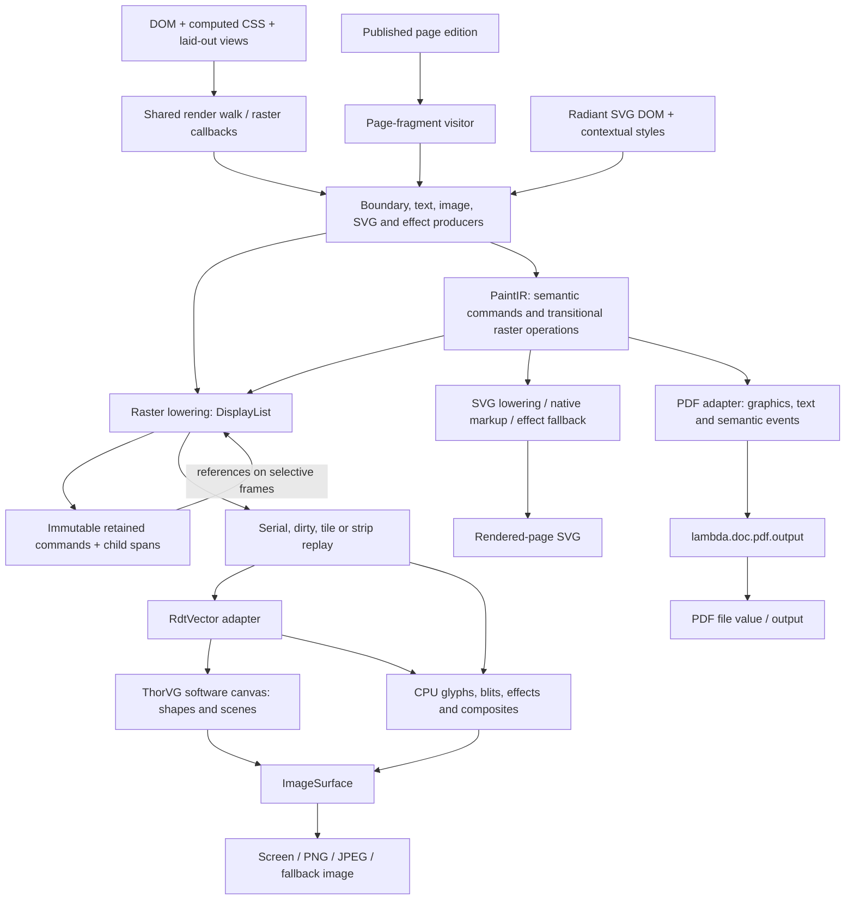

# Radiant Rendering Design

**Date:** 2026-10-20

**Status / ratification:** current-design consolidation, verified against the
2026-10-20 optimization working tree. This document introduces no new formal
ruling. Implementation and qualification receipts are tracked in the
[rendering optimization plan](../impl/Radiant_Impl_Rendering_Optimization.md).

**Scope:** paint production, PaintIR, raster DisplayList, SVG/vector rendering,
ThorVG integration, retained resources, screen/image output and SVG/PDF export.
Layout algorithms and format-support inventories remain in their subsystem docs.

This is the current pipeline overview. The older
[render-path design](Radiant_Design_Render_Paths.md) preserves the motivation and
migration history for the two-level paint model; its early descriptions of
strip rendering and PDF generation are historical. Detailed source inventories
remain in [RAD_12](../../doc/dev/radiant/RAD_12_Paint_IR_Display_List.md),
[RAD_13](../../doc/dev/radiant/RAD_13_Render_Walk_Painters.md),
[RAD_14](../../doc/dev/radiant/RAD_14_SVG_Vector_Graph.md) and
[RAD_23](../../doc/dev/radiant/RAD_23_Paged_Composition.md).

## 1. Responsibilities and authority

Radiant owns document interpretation, CSS resolution, layout, paint order and
the meaning of SVG content. Paint production expresses those decisions for
raster and vector-output consumers. Raster execution combines ThorVG vector
drawing with Radiant's pixel operations. A backend object is derived rendering
state; it does not replace the document's DOM or computed style.

The paint design separates semantic intent from device execution. A glyph run
and an opacity group have meaning across screen, SVG and PDF output; a glyph
bitmap and a saved pixel backdrop are raster implementations of that meaning.
Sharing the former avoids making every exporter reconstruct semantics from
pixels. Sharing traversal and geometry producers avoids separate implementations
of CSS painting rules. Adoption is incremental: current backends still have
different callbacks and some target-specific producers.

The following formal rulings govern the relevant boundaries:

| Design area | Formal authority and consequence |
|---|---|
| SVG admission | **D2.11.1–D2.11.2**: inline HTML SVG and external SVG use the shared HTML5 SVG parsing path and Mark result model; explicit XML/XHTML retain their own admission contract. |
| Source versus rendered export | **D2.11.3**: serializing edited SVG DOM is a source-export operation, separate from rendered-page SVG/PDF output. |
| Animation capture | **D2.11.4**: virtual-frame snapshots settle and retain the selected frame. This requirement does not imply every snapshot feature is implemented. |
| Memory ownership | **D4.5.1v4 / D4.1.4v5**: Radiant uses region arenas, pools, generation handles and RAII; independent scratch stacks have independent arenas. |
| Shared storage | **D4.2.2v2–D4.2.4**: allocators have context owners; shared allocator lifetime is pinned; reset/rewind of published storage requires exclusivity. |
| Foreign resources | **D4.2.6**: owner cleanup releases resources allocated outside a pool's own blocks. |
| Runtime seam | **D4.5.2**: retained Radiant state cannot keep an unrooted GC pointer; copy or maintain the permitted registered root. |
| Incremental presentation | **D4.5.3v2**: “copy at construction, retain downstream”; valid style, layout and paint structures may be reused. |
| PDF generation | **S2.6.6v3 / D2.6.12v3**: generation produces a completed file value; output performs I/O. **D5.4.1** preserves the active evaluator's lifetime. |

See the [formal design](../../doc/Lambda_Formal_Design.md) and
[formal semantics](../../doc/Lambda_Formal_Semantics.md). The representation
descriptions below document implementation and existing design intent; they do
not create exceptions to those rulings.

## 2. Pipeline and representations

This diagram describes the boundaries, not a claim that one whole-document
PaintList is built once and consumed by every target today. Raster painters
emit common primitives directly into DisplayList and lower semantic/effect fragments;
SVG export streams commands;
PDF combines shared paint resources with text and semantic visits. Published
pages can own longer-lived PaintLists.

| Representation | Contents | Usual lifetime |
|---|---|---|
| DOM/view | Document structure, computed styles, layout geometry | Document; mutable between settled frames |
| `PaintList` / `PaintCmd` | Semantic glyph/effect/subscene commands, vector primitives, transitional raster operations | Transient fragment, fallback group, or published edition |
| `DisplayList` / `DisplayItem` | Raster operations, device bounds, element markers and immutable chunk references | Offscreen job, retained unchanged frame, or immutable own-command list in a retained chunk |
| `RdtPath` | Geometry commands used by paint commands, clipping, geometry visitors and the backend | Owned snapshot handles share immutable entry buffers; writes detach |
| `RdtVector` | Raster target and backend execution state | Reusable ViewTree serial context, independent offscreen job, or reusable tile worker |
| ThorVG paint/scene | Backend paths, paint properties, clips and submitted groups | Vector shapes/scenes: submission batch; native picture/image resources have separate owners |
| `ImageSurface` | Pixels with explicit alpha mode and resource identity | Target, document resource, snapshot or temporary effect |

`RdtVector` is not a third complete retained command stream. Its path and
picture types are resources used by the other representations. ThorVG does,
however, maintain its own derived vector objects.

## 3. Paint production and SVG interpretation

### 3.1 Document traversal

The shared render walk owns traversal and stacking order. Raster callbacks use
the richer raster context for dirty tracking, clipping, scroll state and media.
Boundary, border, text, image and effect producers emit through the paint
gateway. UI overlays are recorded after document content. This preserves the
ordering between document paint, selection, caret and other overlays.

Layout coordinates and transform geometry remain floating point. Raster
lowering introduces integer pixel regions where a surface or filter requires
them. Device density, page placement and tile origin are distinct transforms;
replay applies a tile origin to already placed page coordinates.

### 3.2 Inline and external SVG

Radiant parses SVG, resolves its styles and walks its elements. External SVG
images are represented by `RdtPicture::KIND_SVG_DOM`, with an owned parse result
and source path for resource resolution. Inline SVG uses its host document's
style environment; external image documents use isolated style/resource
context. These contextual differences preserve the shared admission model in
**D2.11.1–D2.11.2**.

The SVG painter resolves viewBox/viewport placement, inherited paints,
`currentColor`, transforms, definitions, references, text, gradients, patterns,
masks and supported filters. SVG text normally uses Radiant's positioned text
and font outlines; a ThorVG text bridge remains a fallback. Geometry becomes
backend-neutral `RdtPath` resources. A document-owned, 8 MiB payload budget caches
path `d` geometry and authored marker topology by the actual sampled source
value. Basic shapes resolve their geometry once, then look up kind, resolved
float values and polygon/polyline source before constructing a contour. A hit
acquires the existing immutable path. Paint, placement and reference context
remain per instance.
An admission miss uses ordinary geometry construction. Cache retirement drops
its references while published path snapshots remain valid.

SVG images drawn into a page expand on the recording thread. Replay workers
consume native recorded data rather than traversing SVG DOM and CSS. Offscreen
SVG drawing builds private recording and replay arenas and uses the same
DisplayList machinery. Filter programs have their own document/resource
ownership; execution surfaces belong to the render operation.

The host schedules an outer SVG as one stacking context in foreground, painting
its CSS boundary and content together under
[SVG 2 §3.4–3.4.1](https://www.w3.org/TR/SVG2/render.html#EstablishingStackingContex).
A direct background-only producer visit may paint the SVG boundary, but never
walks its descendants. SVG owns descendant transforms and clipping. Its isolated
foreignObject HTML capture restarts the full paint phase even when the host is
painting foreground content. This avoids
duplicate, untransformed HTML backgrounds escaping the SVG producer.

The semantic `PAINT_SVG_SUBSCENE` command preserves the SVG root, placement and
inherited paint context for target lowering. It is not a promise that every
target renders the subscene natively: capability and resource restrictions can
select raster fallback.

## 4. PaintIR and raster lowering

PaintIR contains three kinds of operations:

1. Shared vector primitives: fills, strokes, gradients, images and clipping.
2. Semantic operations: glyph runs, effect groups, SVG subscenes, transforms
   and semantic groups used by output consumers.
3. Transitional raster operations: saved backdrops, pixel blur/composite
   regions, bitmap glyphs and direct surface operations.

The third category supports the current migration and is not the intended
cross-target abstraction. Raster output expands semantic operations into the
device operations it needs. SVG/PDF preserve native text and geometry where
their lowering supports it and use explicit fallback for unsupported effects.

The ordinary raster gateway flushes any pending semantic/effect fragment, then
calls the shared DisplayList primitive builder. It avoids a temporary PaintCmd
and duplicate dash/clip payloads for each vector primitive. Common rectangle
and picture payload definitions are shared by the semantic and raster command
schemas. Shared field declarations also define path fills, strokes and gradients;
semantic ownership and raster shared-resource annotations remain explicit. Semantic producers continue to use PaintList; glyph/effect/subscene
lowering stays explicit, including streaming export and published editions.

PaintList's initial reserve is eight commands and grows normally. There are
still target-specific payload definitions; this migration does not make the
raster list the universal export model.

Ownership depends on the recording lifetime. Immediate fragments may borrow a
path until lowering acquires a snapshot handle in the DisplayList. Deferred commands can own
paths, dash arrays, gradient stops, text or image resources. A published page
edition can own a PaintList and let transient lists borrow its commands through
`paint_list_borrow_commands` / `paint_list_borrow_range`. The owning edition
must outlive those borrowers and their lowering (**D4.5.1v4 / D4.2.4**).

Validation checks balanced state and valid payloads. Full-list validation and
fragment lowering are separate APIs because a fragment can form part of a
larger clip/effect sequence. That distinction remains necessary if the physical
command formats are later consolidated.

## 5. DisplayList recording and replay

### 5.1 Recording

Each DisplayItem carries an opcode, culling bounds and a tagged payload.
Variable data is either copied into the list's scratch arena or held by an
explicit resource owner. Gradient stops and dash arrays use immutable,
content-indexed buffers. A list holds one reference per distinct value; copying
from another list or a retained chunk acquires the same buffer. Source-list
retirement cannot invalidate the copy. Path handles share refcounted immutable entry buffers;
subsequent builder writes detach. Bounds and hashes are cached before sharing.
Raster clip stacks are immutable optional arena payloads, with null representing
the empty stack. Every command no longer embeds a maximum-size clip stack. Generation-checked
surface handles distinguish live resources from frame-local borrowed pixels.
Snapshot leases preserve immutable image publications when required.

Element begin/end markers delimit subtrees and carry matching indices, marker
geometry and visual bounds. Indices stay local to their recording or immutable
chunk. The command descriptor table centralizes state, culling, batch-flush and
owned-payload properties. Copying an owned range remaps its recording indices;
copying a fragment reference retains that publication. Retained frame assembly
borrows immutable chunk payloads and pins their owners. ViewTree reuses command
capacity, its serial canvas, and eligible unchanged document recordings. Overlays
append after a checkpoint and release their commands, array references and arena
allocations after replay. Small jobs and memory pressure release excess idle
capacity. Nested frames use independent list and scratch arenas and a separate
vector context.

### 5.2 Replay and ordering

Serial replay dispatches vector commands to `RdtVector` and direct-pixel
commands to Radiant's glyph, raster, shadow, filter and composite helpers.
Clip transitions seal ordered native scene segments with the previous clip
state; subsequent segments can share one canvas submission. A pixel operation
flushes preceding vector work before accessing the target. A saved backdrop must observe preceding drawing; a glyph or
CPU blit must preserve its position in painter order. Batching cannot reorder
these boundaries merely to group similar colors or geometry.

Dirty replay skips clean items/subtrees and clips drawing to the damaged area.
Tile replay uses page-space bounds, replays necessary state and shifts output
to a tile surface. The normal parallel route currently excludes lists with
glyph commands and excludes selective dirty replay; the existence of a tile
glyph helper does not mean that scheduling restriction has been lifted.

Replay preserves published picture handles. Both serial and tile submission
duplicate native picture state through the same locked helper. Execution stacks,
canvases and temporary surfaces own replay mutations. The same frozen recording
can be submitted repeatedly, including on different backgrounds.

### 5.3 Resource time

A live image command resolves its owner's current pixels during replay; a
snapshot command has a retained publication. Those are different contracts.
Generation checks prevent stale resources from qualifying an unchanged cached
fragment. Safe structural sharing must preserve both live-media updates and
snapshot stability, rather than silently freezing all images.

## 6. RdtVector and ThorVG

The active vector adapter calls ThorVG's public C API and creates a software
canvas. CoreGraphics exploration source remains excluded from compilation.
The adapter also contains direct-pixel fast paths and special handling for
geometry that cannot use the ordinary affine vector route.

`RdtPath` storage lives in `rdt_path.cpp`, independently of ThorVG. The adapter
constructs native shapes, applies paint/placement, submits them and releases
submitted scenes after synchronization. Pure move/line/cubic/close paths use
ThorVG's bulk path API; compact rectangle/circle commands retain their established
contour expansion. Active clips pin shared Radiant path snapshots. Stable batches
compose their clip mask once. Clip transitions seal segments; CPU operations,
target changes and the batch end synchronize and release the native submission.
A single segment is submitted directly, avoiding an extra wrapper scene.

ThorVG's public API owns its temporary command/point arrays. Zero temporary
native geometry is impossible through that API. Radiant's persistent native
**vector paint prototype cache has been removed**: shapes and gradients have
batch lifetime. Parsed external SVG owners, raster-image upload caches and
native fallback picture/text resources retain their existing explicit owners;
those are separate from the removed path/fill/stroke prototype cache. Backend
memory remains derived state, with no second SVG DOM or computed-style model.

`RdtVector` continues to own target binding, batching, clipping and CPU/projective
fast paths; deleting its name would only relocate those responsibilities.
The standalone Lottie player uses ThorVG animation/picture state directly and
remains a separate media subsystem.

## 7. Retention and invalidation

Retention is permitted by **D4.5.3v2** and constrained by owner lifetimes and
generations under **D4.5.1v4 / D4.2.4**. The current caches have different units:

| Cache / retained owner | Reused unit | Validity and retirement |
|---|---|---|
| Retained display-list cache | Chunk own commands plus ordered child references | Checks marker geometry, dirty-source relation and image/glyph/media generations; borrowed chunks avoid recapture. A 32 MiB managed-storage budget evicts old roots by last use; active readers keep their leases and charges. High pressure drops cache ownership between frames. |
| ViewTree frame recording | Validated document prefix sharing admitted captured root chunks, resource/replay metadata and serial vector context | 8 MiB conservative recording admission; matching document/style/state/layout/resource/target stamps and current handles; overlays record and validate afresh. |
| SVG layer registry | Raster surface for an inline SVG | Document-owned; keyed by element identity/generation, document/style and interaction state, animation, fonts, images, size, scale and inherited paint. |
| External SVG picture caches | Parsed SVG owner plus cheap duplicate handles | Process caches keyed by path or data; cache eviction and retained handles govern parse lifetime. |
| SVG geometry cache | Canonical path buffers and marker topology | Actual path source / resolved basic geometry keys; bounded document ownership; published readers keep snapshots. |
| ThorVG raster-image cache | Native raster picture upload plus lookup data | Process-owned, count-limited; cache teardown releases native objects. |
| Published page edition | Page-local geometry, paint, text/font and image resources | Edition ownership survives source-view relayout; consumers borrow/pin the edition. |
| Tile worker | Vector context and replay scratch | Reused by its worker, reset between jobs and released at worker shutdown. |

Retained fragment reuse currently requires selective dirty painting and matching
marker bounds. A hit appends one `DL_DRAW_FRAGMENT` command, which owns a reference
to the immutable publication. Each parent stores its own commands and ordered
child spans. `DisplayListCursor` walks the graph without flattening descriptors
or remapping chunk-local markers. Serial/dirty/tile replay, validation, media,
resource checks and SVG capture/export consume the same read-only cursor.
Validation rejects cycles, invalid spans and inconsistent marker/count metadata;
subtree culling skips an immutable chunk directly. Capturing a mixed frame
republishes matching chunks, while a different cache copies producer commands into
its own budget ledger. Active references survive cache eviction/destruction.
Broad dirty-generation invalidation remains; placement-only reflow is separate.

An indexed publication borrows its stable fragment entry for capture bookkeeping.
Unchanged chunks refresh that entry directly, preserving its geometry and lease.
Every replacement, failed capture and retirement clears this back-reference
before releasing the entry's publication lease. Pinned frames can therefore
outlive index eviction and later rebind safely. This bookkeeping is private to
the cache; replay reads immutable paint data.

Index entries form a forest of publication groups. Each group borrows its child
entries; the parent's immutable paint spans already own the corresponding child
publications. A complete group covers exactly those bindings and complete child
groups. Refreshing that root stamps its whole subtree without visiting descendant
chunks. An immutable logical-node count preserves reuse statistics for repeated
placements without expanding the graph.

Detaching or replacing an entry materializes inherited paint epoch and recency
before removing its parent link, and invalidates ancestor completeness. Group
rebuilding follows source order. Shared descendants that move between parents and
overwritten view IDs keep unresolved ancestors on the traversal path; a later
child attachment cannot leave an earlier branch falsely complete. Index reuse
therefore skips descendants only while their exact publications remain covered.
Replay consumes no mutable membership bookkeeping.

Expired root groups form a prefix ahead of painted roots. Pruning retires that
prefix and promotes remaining child groups before releasing an entry's publication
lease. Splitting out a painted child keeps its inherited membership while expired
ancestors retire. Budget eligibility also follows inherited current epochs, so
evicting an old parent cannot remove an active descendant's index entry. Lookups
update entry recency separately; split groups carry their last paint-group recency.
Epoch wrap restamps every entry, including nested members. Each entry adds three
parent/child pointers and a completeness flag; each publication adds one logical
count. Existing sibling links are reused. These fields add no allocations or
leases and are included in existing storage charges.

Complete-subtree refresh depends on its root and ancestor chain, rather than its
number of descendants. Fresh capture, incomplete/shared branches, expired-entry
retirement and budget eviction retain their respective traversal costs. Ownership
remains **D4.5.3v2 / D4.5.1v4 / D4.2.4**.

Each publication builds an optional resource summary while capturing commands.
Glyph/video epochs merge up the chunk tree; contradictory epochs reject reuse.
Distinct own surface handles/generations and a filtered list of image-bearing
children preserve live checks without scanning draw commands or unrelated
siblings. Surface lookup remains inside a read scope and rejects destroyed or
recycled owners. Summaries borrow children already pinned by paint spans; their
storage is included in the chunk budget. Resource-free graphs allocate no summary.
Eligible fresh full frames stage an ordered root recording during chunk capture.
Complete document scopes reference their exact captured publication, including
repeated view IDs; commands outside scopes use the existing payload-cloning
helper. Staging has no backing scratch arena, so payloads that cannot be cloned
independently keep the flat-recording fallback. Overlays are excluded from the
staged prefix. Publication, staging or validation failure leaves the replayed
recording intact.

After replay and overlay retirement, a smaller validated staged recording can
replace the original command array. Only heap command/shared-array storage moves;
the registered destination scratch object stays in place and releases obsolete
producer metadata. Frame references pin the same chunks as the index, so index
eviction cannot invalidate a settled frame. Conservative 8 MiB admission charges
chunk storage through those references. A shared charging helper checks the staged
graph, destination arena and snapshot before adoption; a graph above that budget
keeps the reusable flat recording when it fits. Full-frame keys, resource checks
and transient overlay recording remain unchanged
(**D4.5.3v2 / D4.5.1v4 / D4.2.4**).

The whole-frame cache captures the same dependency values once from its immutable
document prefix. Normal flat recordings collect the snapshot during retained
chunk publication, copying each completed root's metadata and excluding overlay
dependencies. Failed publication or snapshot allocation retains the flat scan
fallback after overlays are removed. Unused snapshots are released on render or
admission failure. Flat snapshots coalesce
epochs and distinct surface stamps. Certified private publications contribute
their dependency metadata directly; only image-bearing child summaries need
traversal, while resource-free and glyph/video-only branches skip draw commands.
Foreign or uncertified chunks and fresh commands retain cursor traversal. The
certified fragment-depth peak preserves graph limits inside foreign wrappers.
Snapshots copy values and borrow no chunk or command pointers. Cache hits query
that snapshot without rescanning commands. A composed snapshot exceeding the
remaining admission budget also tries the flat fallback, whose recording order
may coalesce stamps into less storage. Failed fallback or combined recording and
snapshot storage beyond 8 MiB leaves the rendered frame uncached.
Invalidation, failed renders, memory pressure
and teardown release the snapshot with the recording. Resource-free recordings
need no snapshot allocation. Mutable lists and foreign publications retain
command-based validation. These summaries cover resource liveness, not inherited
paint or placement validity
(**D4.5.3v2 / D4.5.1v4 / D4.2.4**).

Raster assembly validates the document prefix and transient overlays as
independently balanced streams. The shared range validator also discovers
glyph/video properties. A `ValidatedDisplayList` binds those properties to the
list, its command storage and a validated count; only successful validation can
publish a usable view. Owners invalidate views before editing an immutable
prefix. Appended storage growth triggers prefix revalidation, while fresh
overlays always validate separately and contribute properties only to that
frame's replay view. The frame cache retains its document view with the existing
recording lifetime. Serial replay consumes a validated view; ad hoc `dl_replay`
still validates at entry. Tiling uses the view's glyph property, including native
text pictures, instead of scanning commands again. Video-free frames retire
old placement bookkeeping without discovery; video-bearing frames retain the
existing post-composite scan. Resource liveness stays a separate live query
(**D4.5.3v2 / D4.5.1v4**).

Private immutable publications also retain successful standalone validation:
glyph/video properties and peak element/fragment nesting. The shared validator
composes a certified chunk after checking that both peaks fit the caller's
remaining nesting space. New publications validate their own commands and use
already-certified child summaries, avoiding repeated descendant expansion.
Chunks that cannot validate independently remain uncertified and use the full
validator, as do foreign publications and mutable commands. Certification owns
no additional payloads, survives with the chunk's existing leases and is charged
with its storage. Resource liveness remains a separate query
(**D4.5.3v2 / D4.5.1v4 / D4.2.4**).

SVG layers avoid both SVG recording and vector rasterization on a hit. Default
admission first observes stable content and captures on the next unchanged
paint; eager/off modes support controlled comparisons. Only supported placement
transforms qualify. Capture records once. A descriptor-qualified subset of vector
fills/strokes/gradients, images, clips, markers, CPU surface fills/scaled blits and
monochrome coverage glyphs renders once into a transparent premultiplied surface.
Color emoji, effects and native pictures retain black/white replay and
straight-alpha reconstruction.
Whole-pixel layer placement avoids resampling but can differ from fractional
direct placement. Layer reuse is therefore a distinct, existing raster policy,
not evidence that vector geometry itself is retained optimally.

Complete unchanged frames can reuse their recorded document prefix without
traversal or flat descriptor copying. The key includes document mutation, style,
interaction/scroll state, layout, fonts/glyphs, images, SVG animation, video,
viewport, density, canvas background and transparency. Pending reflow, selective
incomplete recordings, active animation scheduling, canvas/3D/webview producers,
foreign child-document paint and high memory pressure reject this reuse.
Default SVG layers finish their warm-up before a recording is frozen.
`RADIANT_RECORDING_CACHE=off` provides a controlled comparison.

Before admission, transient overlays retire their command, shared-array and
scratch checkpoints. A rewound capture can leave large unused arena chunks;
these are reclaimed only when the list owns the sole arena scope, has no live
scratch payloads and has no earlier arena allocations. This preserves the
8 MiB limit without charging empty capture capacity to a small recording
(**D4.2.4 / D4.5.1v4**).

The retained budget charges managed command/span capacity, arena storage,
shared arrays and a conservative per-reference path footprint. Shared geometry
can be charged more than once. ThorVG internals and native picture bytes are
untracked; image pixels and font caches retain their separate resource owners
and are outside this command-storage charge. A refcounted ledger follows chunks
beyond cache eviction/destruction; new admission can fail while active readers
retain the remaining charge.

Document-wide style/interaction/resource epochs provide conservative invalidation.
A future dependency-specific cache must account for inherited values and
references outside the local SVG, including `use`, paint servers, fonts and
images, before narrowing those invalidations. Ordinary idle frames that require
no paint are different from forced redraws of unchanged content.

## 8. Output paths

### 8.1 Screen, PNG/JPEG and large PNG

Screen and ordinary image output create a frame context, clear the full surface
or damaged regions, record content and overlays, capture retained fragments,
replay, then present or encode the surface. Serial frame setup creates
or borrows its ViewTree's reusable command-array storage and serial vector
context; nested frames use independent storage. Eligible unchanged recordings
skip traversal and capture, then append current overlays before replay.

Large PNG export records the full page once, with a full-page recording clip,
then replays horizontal strips through the shared tile machinery. Rows stream
to the image encoder. Surface memory is bounded by strip height, but the full
command list and its resources remain live. This is already record-once/replay-
many; the earlier per-strip tree-walk design is retired.

### 8.2 Rendered-page SVG

SVG output uses the shared render walk and SVG backend callbacks. PaintIR
lowering streams native geometry, text, clip/transform state and supported
groups. Unsupported effects use shared raster capture with preceding page
backdrop history. Native SVG output is not obtained by serializing the raster
DisplayList, and exported source SVG remains the separate **D2.11.3** contract.

### 8.3 PDF

PDF generation now belongs to `lambda.doc.pdf.output`. The native export adapter
lends a committed export session; the shared walker and page visitor supply
graphic, text and semantic data. Native graphic lowering supplies supported
SVG paths/strokes and owned raster fallback resources. Text export preserves
positioned text, font resources and searchable/logical mappings where supported.
Simple opacity groups can use PDF transparency forms; richer effects use shared
raster replay and backdrop history.

The Lambda package assembles objects, resources, streams and cross-reference
data into the completed file; the output boundary saves it. This follows
**S2.6.6v3 / D2.6.12v3**. Host/module reuse across batch exports does not permit
values to outlive their evaluator or document owner (**D5.4.1 / D4.5.2**).
The former HPDF path is not the current renderer.

### 8.4 Published pages

Paged layout publishes edition-owned occurrences rather than retaining a view
into the mutable browsing-layout workspace. Common boundary paint can be
recorded into edition-owned PaintLists; font and image resources are retained
with the edition. Page visitors feed preview rasterization and PDF export.
Transient lowering may borrow published commands while the edition stays live.
This is an existing example of retained semantic paint, distinct from the
continuous-view retained DisplayList cache. Detailed layout/publication rules
remain in [RAD_23](../../doc/dev/radiant/RAD_23_Paged_Composition.md).

## 9. Observability and evolution

Existing profiling and event traces report paint categories, path selection,
record/replay time, capabilities and retained outcomes. Opt-in
`RADIANT_RENDER_METRICS=1` adds release-compatible stage timing through teardown,
command/paint capacity, tracked memory, geometry parse/clone/hash/copy counters,
retained descriptor copies/borrows and reserved chunk capacity, shared-array
copies/leases, full-frame reuse and chunk adoption, fragment references/expanded command counts,
resource command/summary/epoch/surface/child checks,
validation command/publication checks, index publications/prune checks, membership node visits/group refreshes,
resource snapshot command/metadata visits
and standalone glyph/media discovery visits,
native construction/duplication and phase timing,
flush reasons, clip segments, lock waits and layer recording/pass counts. Tile dispatch propagates the active measurement
to workers. Disabled counters take no locks. Nested layer work is included in
its containing stage, not added again as frame wall time. Native phase timers
can nest and worker times overlap; their sum is not a frame duration.

Release allocation tracking requires `MEMTRACK_MODE=STATS`; with tracking off,
zero tracked-byte fields do not measure actual live memory. Tracked process
peak memory is a process high-water mark. Native ThorVG internal
bytes are explicitly untracked; cache registry entry-shell statistics are not a
total backend footprint. Release comparisons and remaining limitations belong
in the [implementation plan](../impl/Radiant_Impl_Rendering_Optimization.md).

## Appendix A. Source map

Line anchors are audit conveniences; confirm the named symbol when lines move.

| Boundary | Source and symbols |
|---|---|
| Paint types and gateway | [render.hpp](../../radiant/render.hpp): `PaintOp`, `PaintCmd`, `PaintList`, `PaintRecordTarget`, `paint_record_lower_pending` |
| Paint lifetime/lowering | [paint_ir.cpp](../../radiant/paint_ir.cpp): `PaintList::init`, `paint_list_borrow_commands`, `paint_ir_lower_raster_internal`, `paint_ir_lower_svg_stream` |
| Walk and raster routing | [render_walk.cpp](../../radiant/render_walk.cpp), [render_raster_walk.cpp](../../radiant/render_raster_walk.cpp): `render_walk_children`, `render_raster_dispatch_block` |
| Frame and output | [render_output.cpp](../../radiant/render_output.cpp): `RenderFrameScope`, `render_output_render_raster_target`, `render_output_replay_display_list`, `render_output_render_tiled_png` |
| List storage/copy/validation | [display_list_storage.cpp](../../radiant/display_list_storage.cpp): `DisplayListCursor`, `dl_reference_fragment`, `dl_clone_item_payload`, `dl_copy_range`, `DisplayList::clear`, `dl_validate_recording`, `dl_validate_append`, `dl_validate_chunk` |
| Geometry recording | [display_list_record_vector.cpp](../../radiant/display_list_record_vector.cpp): `dl_record_path_item`, `dl_fill_path`, `dl_stroke_path` |
| Replay | [display_list_replay.cpp](../../radiant/display_list_replay.cpp), [display_list_replay_vector.cpp](../../radiant/display_list_replay_vector.cpp), [tile_pool.cpp](../../radiant/tile_pool.cpp): `dl_replay`, `dl_replay_vector_item`, `dl_replay_tile` |
| Retained fragments/resources | [retained_display_list.cpp](../../radiant/retained_display_list.cpp), [render_block.cpp](../../radiant/render_block.cpp): `retained_dl_cache_capture`, `retained_dl_cache_capture_resources`, `retained_dl_append_fragment`, `render_block_try_retained_fragment`, `dl_resource_summary_capture`, `dl_resource_summary_current` |
| SVG production/layers | [render_svg_inline.cpp](../../radiant/render_svg_inline.cpp): `render_svg_path`, `render_svg_to_display_list_primitives`, `svg_layer_render_passes`, `svg_layer_capture`, `svg_layer_paint` |
| Mutation invalidation | [dom.cpp](../../lambda/dom/dom.cpp): `dom_svg_layer_note_mutation`, `dom_mutation_notify` |
| Vector backend | [rdt_vector_tvg.cpp](../../radiant/rdt_vector_tvg.cpp): `RdtVectorImpl`, `tvg_draw_paint_now`, `rdt_picture_draw` |
| Shared path storage | [rdt_path.cpp](../../radiant/rdt_path.cpp), [rdt_path_internal.hpp](../../radiant/rdt_path_internal.hpp): `rdt_path_clone`, `rdt_path_hash`, `path_append_entry` |
| Native path copies | [vendored tvgShape.h](../../mac-deps/thorvg/src/renderer/tvgShape.h): `ShapeImpl::append`, `ShapeImpl::duplicate`; inspected only, never edited by this work |
| SVG export | [render_svg.cpp](../../radiant/render_svg.cpp): `svg_lower_paint_list`, `svg_make_backend` |
| PDF adapter | [render_pdf.cpp](../../radiant/render_pdf.cpp), [radiant_pdf_walk.cpp](../../lambda/module/radiant/radiant_pdf_walk.cpp), [radiant_pdf_graphic.cpp](../../lambda/module/radiant/radiant_pdf_graphic.cpp): `render_lambda_pdf`, `pdf_walk_graphic`, `pdf_vector_resource` |
| Published pages | [layout_paged.cpp](../../radiant/layout_paged.cpp): `paged_publish_box_paint`, `paged_flow_compose_pages`; see RAD_23 for the publication inventory |
| Profiling | [render_profiler.cpp](../../radiant/render_profiler.cpp), [render_output.cpp](../../radiant/render_output.cpp): `RenderProfiler`, record/replay timing and retained capture ordering |

## Appendix B. Measured storage transition

The original arm64 C++17 release probe measured `PaintCmd=216`,
`DisplayItem=872`, `DlClipShapeStack=776` and `DlBlitSurfaceScaled=848` bytes.
Extracting clip stacks reduced DisplayItem to 216 bytes; the first borrowed
descriptor scheme then added an owner pointer, taking it to 224. Chunk-reference
execution removes that per-command pointer and list-level lease array; the
current command is 216 bytes. Consult the implementation receipt for measured
scaling and runtime qualification. Type sizes alone are not speedup claims.

The original transient PaintList reserve was 1,024 commands; it is now eight.
The display-list initial reserve remains 2,048 commands and is reused across
frames within its ViewTree. Retained chunks reserve only their own command
storage. Basic-shape lookup precedes construction; gradients/dashes share
immutable buffers; serial canvas and unchanged full-frame recording reuse are
implemented. Selective frames now retain chunk references without descriptor
flattening. Placement-only composition and finer invalidation remain follow-up
work. Performance and qualification limits are recorded separately from these
structural changes.
