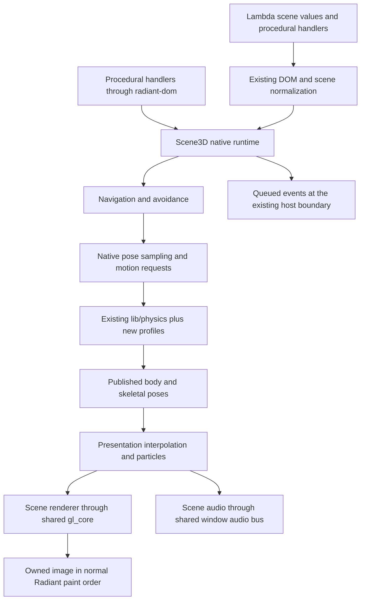

# Radiant Scene3D — Native Gaming Systems

**Status:** design under staged implementation, 2026-10-28. The user requested the six feature areas below
and selected `radiant/scene3d/` as the implementation directory, including
relocation of the existing Scene3D-owned native sources. Algorithms, API
spellings, quality profiles and milestones in this document are recommendations,
not claims of delivered support or newly ratified language rulings.

**Proposal baseline inspected:** checkout `d53f1a043` plus its working-tree
Scene3D, outdoor and audio changes. That source review did not run a new engine
benchmark. Subsequent implementation qualification is recorded separately below.

**Scope:** extend native Scene3D with complete staged physics, navigation,
animation graphs, advanced lighting/effects, ready-made particles, and game
audio. Preserve composition with HTML/CSS/SVG,
Lambda's effect model, and existing native ownership and module boundaries.
M0–M12 deliver core native mechanisms; M13 delivers the deferred Lambda Script
packages. The full scope has not been delivered.

**Scope revision (USER, 2026-10-29):** all editor and authoring UI is excluded,
including visual graph/curve editing, preview panels, timeline scrubbers,
overlays, inspectors and dedicated bake/audio tools. Runtime graph evaluation,
scripted configuration, validation, serialization, playback/seek and copied
inspection data remain in scope under the existing contracts below.

**Phase revision (USER, 2026-10-29):** implement core C/C++ services and their
required GLSL kernels before new high-level Lambda packages. Move scriptable
control logic, composition, presets and orchestration into the dedicated M13
phase (§11.2). Existing packages remain supported. Earlier phases may add thin
host bindings and minimal fixtures to qualify native services; they do not
implement the deferred package algorithms in C++ as an interim solution.

**Relationship to existing designs:** extend the
[native scene and WebGL design](Radiant_Design_WebGL.md),
[physics design](../Lambda_Pkg_Physics.md),
[motion design](../Lambda_Pkg_Motion.md), and
[audio/speech design](Radiant_Design_Speech.md). Their selected foundations
remain in force. Scene3D gaming integration and delivery dependencies live here;
the focused documents retain their detailed contracts. Full implementation
plans and progress belong under `vibe/impl/`, per the
[documentation convention](../../doc/Doc_Convention.md).
Implementation has started; current delivery and qualification limits are in
the [gaming implementation record](../impl/Radiant_Impl_Scene3D_Gaming.md).

## 1. Outcome and scope

Make native Scene3D suitable for small interactive games and simulations without
requiring a JavaScript game framework or a separate engine. A creator should be
able to combine an animated character, a physical environment, agents, effects
and spatial sound with ordinary Lambda scene descriptions and procedural
handlers.

| Requested area | Target capability |
|---|---|
| Physics | Genuine 2D and 3D worlds; static, dynamic and kinematic bodies; character movement; joints, motors and limits; CCD; convex/mesh environments; soft bodies and ragdolls. |
| Navigation | Graph/grid A*, 2D navigation polygons and 3D navigation meshes, baking, path following, agents, links and local obstacle avoidance. |
| Animation | Native clip/pose blending, masks, timing and root-motion kernels; Lambda blend-tree/state-machine control and 1D/2D blend-weight calculation in M13. |
| Lighting/effects | Baked lightmaps and indirect-light probes, bounded dynamic diffuse GI, SSAO, screen-space reflections, volumetric fog and depth of field. |
| Particles | Ready-made CPU/GPU emitters, reproducible seeds, lifetime curves, collision profiles, trails and script-configurable presets. |
| Game audio | Positional 2D/3D sources, listener control, Doppler, microphone capture, configurable bus routing and effect chains. |

Every area has a useful first profile and a finite completion milestone (§11).
Soft bodies, 2D physics, dynamic GI and capture remain explicit deliverables,
even though they follow the first playable core. Completion means the stated
profiles work together, not unrestricted parity with every Godot feature.

All editor interfaces, multiplayer replication, gamepad mapping, XR, mobile/web
export, a new graphics backend, and browser API conformance are separate projects.
Additional gameplay algorithms are kept in view in §13, with Lambda Script as
the preferred implementation layer. These KIV scopes are outside M0–M13's
delivery and acceptance boundaries.

## 2. Current foundation and formal contracts

### 2.1 Reuse the implemented foundation

| Existing facility | Continue from | Remaining gaming work |
|---|---|---|
| Native scenes | `radiant/scene3d.cpp`, `lmd/package/scene3d/`: cameras, meshes, instances, resources, PBR/physical materials, HDR environments, shadows including the current directional-cascade work, fog, culling and LOD | Shared simulation/presentation coordination and the advanced lighting profiles below. |
| Graphics/effects | `radiant/gl_core.*`, shader materials, retained float-target simulations, bloom/FXAA/custom color passes | Reusable depth/normal inputs, visibility histories and bounded volumetric resources. |
| Animation | `radiant/animation_mixer.*`, `animation_value.*`, Scene3D bindings, skinning/morphs, FBX/BVH conversion, retargeting and motion controllers | M5 root motion, marker/completion provenance and wider native plan profiles; deferred Lambda graph control and blend-space weights in M13. |
| Physics | `lib/physics/`, `lambda/core/physics_scene.*`, `lambda/runtime/lambda-physics.*`, Scene3D adapter | Current sphere/box 3D profile needs the additional shapes, solvers, controllers and dimensions in §4. |
| Audio | `radiant/audio_bus.*`, `audio_reverb.*`, `audio.*`, MIDI/speech and decoded-media services | Game routing, spatialization, Doppler, capture and consistent connection of game sources to the existing output bus. |

The [current Scene3D review](Radiant_Scene3D_Review.md),
[Three-feature delivery record](../impl/Radiant_Impl_Scene3d_Three_Features.md),
[outdoor profile](../../doc/Lambda_Scene3d_Outdoor.md), and
[physics guide](../../doc/Lambda_Physics.md) provide the starting inventory.
Older proposal sections are not evidence that their future stages shipped.

### 2.2 Spec-linkage map

| Authority | Consequence for this proposal |
|---|---|
| **S12.1.1v3 / S12.1.3** | Scene constructors, validation and graph descriptions are pure; live commands, input/capture acquisition and scene mutations are procedural. No hidden script execution in a constructor. |
| **S12.1.5v2** | The template owns authored intent; native playback/simulation owns transient state. A higher-tier edit overrides the state it touches, rather than competing with another writer. |
| **D4.5.1v4 / D4.5.2 / D4.5.3v2** | Retain native/document-owned copies and generation handles; borrow GC values only during a call, or keep them through an explicit registered root. Preserve compatible downstream state through regeneration. |
| **D5.3.3** | Script callbacks and result conversion use precise `RootFrame` / `Rooted` ownership. No conservative native-stack scanning. |
| **D2.11.4** | A capture settles the frame selected by the virtual timer. Reading the same frame does not independently advance playback or simulation. |
| **D7.1.1–D7.1.3 / D7.3.3–D7.3.4** | Keep static-library/provider layering. Neither the runtime nor a pure package gains a direct dependency on Radiant internals. Source relocation does not relocate lower-layer providers. |
| **D7.4.1v2 / D7.4.2v2 / D7.4.4** | Use branded handles and the existing host-object protocol. Async delivery crosses the established host boundary, with copied results rather than borrowed runtime/DOM pointers. |
| **D7.2.4v4 / D7.5.3v2** | Public helpers use existing package namespaces; live operations reach Radiant through `radiant-dom`. No second public graphics or callback-registration waist. |
| **D7.1.2v2 / D7.5.2** | Resource acquisition uses existing IO providers. Physics, navigation, baking and audio processing do not open files or sockets themselves. |
| **D7.5.4** | All audible game output keeps the document-origin activation policy. Microphone acquisition requires a separate explicit permission contract (§9). |
| **D7.1.4v2 / D7.1.7v6** | Preserve full-host, runtime-only, null-backend and browser-WASM distinctions. This proposal does not add graphics or capture to an excluded profile. |
| **D7.3.5** | Advertised profiles have registered acceptance cases and applicable aggregate gates. A parsed tag is not feature support. |

See [Formal Semantics](../../doc/Lambda_Formal_Semantics.md) and
[Formal Design](../../doc/Lambda_Formal_Design.md). This proposal revises no
formal ruling and creates no new decision-ID series. Uncovered choices below
remain recommendations for ratification before their implementation milestone.

## 3. One native scene runtime

### 3.1 Ownership and integration

Give each scene root one document-owned runtime coordinating persistent physics,
navigation, animation, particles, audio bindings and disposable graphics
projections. Keep these as separate services with explicit dependencies; an
audio source does not require a physics world, and a navigation query does not
create GPU resources.



The diagram expresses data flow, not a requirement to instantiate every service.
Promote a shared geometry/query helper when multiple consumers need it; do not
copy physics, camera picking, animation interpolation or shader deformation
code into navigation, particles or effects. Start with native structs, explicit
storage and operation tables, following the project's C+ convention.

### 3.2 Tick, presentation and event order

Extend the existing frame scheduler. Each scene has a fixed simulation timestep,
integer tick index, pause/time-scale controls and a presentation interpolation
fraction. Existing independently timed SVG/CSS animations retain their current
contracts; joining a scene timeline is explicit.

Animation-only native views also retain exact selected-frame sampling
(**D2.11.4**): without active physics, one mixer evaluation can consume the
frame interval directly. When physics joins, account for the animation's already
sampled fractional tick before advancing the shared fixed stages. This preserves
existing native visual timelines without creating another scheduler driver.

For each fixed tick:

1. Admit the queued command batch and completed resource updates. Validate
   structural edits before replacing working state.
2. Update paths/avoidance from the last completed world snapshot. Produce desired
   motion, not direct writes to dynamic-body poses.
3. Apply admitted animation weights, phases and transition commands; sample the
   pre-physics pose and root-motion delta. Supply targets to character/kinematic
   controllers. M13's logical graph decisions arrive through the command batch.
4. Step rigid/deformable physics; solve contacts, joints and ragdoll constraints.
5. Apply post-physics skeletal overrides and publish completed poses. Update CPU
   emitter state and immutable audio source/listener parameters.
6. Queue contact, path, animation and particle events for host delivery. Handler
   commands enter a subsequent tick; callbacks never re-enter a running solver.

The current coordinator now admits authored source changes on the main owner
before sampling, then runs native navigation, animation and physics phases.
Invalid authored edits reject that advance without faulting the retained
working solver. Animation-only views keep the selected-frame path when neither
physics nor navigation requires fixed ticks. The new navigation phase and
route-follower/controller foundations do not yet advertise complete agent or
avoidance support (**S12.1.5v2 / D2.11.4 / D4.5.2 / D5.3.3**).

At presentation, interpolate completed state, update GPU particles to the
selected simulation time, render required passes, and publish one owned image.
The audio device runs on its own sample clock; scene events are timestamped and
mapped onto it instead of making audio wait for rendering (§9).

The native phases provide copied completed-tick snapshots and bounded command
batches with scene/service generations and an explicit target tick. Stale,
duplicate and late batches have declared rejection/defer behavior. M13 consumes
these snapshots and computes decisions at ordinary host boundaries for a
subsequent tick; there are no script callbacks inside a native service step or
audio callback. A batched step must expose those boundaries when package logic
needs to run between ticks. The package owns logical control state; native
services own playheads, poses, solver state and resource lifetimes
(**S12.1.1v3 / S12.1.5v2 / D2.11.4 / D5.3.3 / D7.5.3v2**).

Keep the existing physics overload policy: bound steps per presentation,
retain unprocessed tick debt, report lag, and pause with a diagnostic if the
configured debt limit is exceeded. Background pause does not accumulate an
unbounded catch-up interval. Never stretch the physics timestep silently.

Seek is a first-class operation. Animation-only scenes sample directly;
physics, stateful particles and dynamic GI require reset/replay or an explicitly
compatible checkpoint. Reset temporal rendering history after seek. A pose
trace is not a resumable solver checkpoint. GPU simulation is not promised to
replay bitwise across devices.

M13 records or recomputes package decisions explicitly during reset/replay.
Seeking a native service alone does not implicitly rewind Lambda application
state. Native qualification uses explicit recorded command sequences before
the package phase is available.

### 3.3 Regeneration, failures and capabilities

Track separate generations for topology, collision data, animation blend plans,
render resources, navigation tiles and audio routing. A camera or UI edit must
not reset a world, rebuild every navmesh, restart a clip or reopen the device.
Stable scene IDs plus validated generations bind authored descriptions to
runtime objects; DOM addresses are not persistent identity.

Prepare edits transactionally, then replace only affected services at a tick or
audio-buffer boundary. Preserve the last valid scene on preparation failure and
report the rejected node/property. Device loss retires GPU resources without
discarding CPU worlds, retained blend plans or navigation assets.

Expose a capability report with supported profiles, limits and located reasons
for unavailable features. `auto` may choose a documented cheaper profile and
report the choice; an explicitly required profile fails if unavailable. Never
accept CCD, GPU particles or GI and silently omit their effect.

Bake/rebuild workers consume immutable native snapshots and return owned,
generation-tagged results. They never traverse the live DOM or enter its
evaluator. Cancellation, document teardown or a newer source generation prevents
publication; the worker still releases its buffers. Publish only on the owning
host thread through the established completion route (**D7.4.2v2**). When a job
uses a Lambda worker, retain **D6.3.2** share-nothing isolation rather than
sharing a document's execution state.

Replace the current per-service scene scheduling registrations incrementally
with one coordinator registration. Legacy playback operations update that
coordinator; they cannot leave an old callback advancing a service a second
time. Tick/frame identities guard event and simulation publication across
repaint, capture and template regeneration.

## 4. Complete physics in bounded stages

Extend the selected native C engine in `lib/physics/`; keep its header free of
`Item`, DOM, GL and scheduler types. Scene-specific bindings, controllers and
pose publication belong in `radiant/scene3d/`. Preserve pure batch simulation
and headless consumers through the existing lower-layer scene compiler.
This follows **D7.1.1–D7.1.3**, rather than moving the shared solver upward.

### 4.1 Bodies, collision and CCD

Retain fixed/dynamic/kinematic bodies, compound shapes, sensors, filtering,
mass/inertia, sleeping and query semantics. Add the following explicit profiles:

| Profile | Proposed implementation and boundary |
|---|---|
| 3D primitives/convex | Capsule contacts/casts, convex hulls, support mappings, GJK distance and penetration/manifold recovery; preserve existing analytic/SAT fast paths. Degenerate input and nonconvergence produce diagnostics. |
| Mesh environments | Immutable triangle meshes and heightfields with BVH acceleration, sidedness, adjacency/internal-edge handling and scale-aware tolerances. First support fixed/kinematic environment meshes against admitted convex bodies; arbitrary dynamic concave meshes require explicit convex decomposition. |
| Scene queries | Nearest/all ray hits, point queries, exact admitted shape overlaps and swept shape casts. Preserve the current broad-phase AABB query's distinct meaning. |
| CCD | Relative-motion shape sweeps/time-of-impact with bounded conservative advancement and remaining-time integration. Publish supported pair/rotation coverage; start with spheres/capsules against primitives/static triangles, then convex pairs. |
| Genuine 2D | Separate XY positions, scalar rotation/inertia, 2D broad phase/manifolds and circle/capsule/convex-polygon/edge-chain shapes. Reuse solver-row machinery where valid; do not fake 2D with thin 3D boxes or hidden Z constraints. |

The first M2 implementation admits local-Y capsules through the shared native
solver and scene compiler: `radius` and cylindrical `height`, discrete contacts
with spheres/boxes/capsules, compound mass/inertia and exact point/ray tests.
Height zero admits a sphere. The later profiles below extend this initial
delivery; see the linked implementation record for current qualification.
Broad-phase AABB queries retain their existing meaning.

The second M2 delivery cooks inline 4–64-point convex hulls, with polyhedral
mass/inertia, discrete manifolds, primitive/hull contacts, point/ray tests and
bounded named-pair GJK distance queries. This remains an experimental bounded
profile. Resource references, exact overlaps/casts and CCD are covered by the
subsequent deliveries below. Capability reporting distinguishes the admitted
profiles and the wider pending coverage.

The third M2 delivery adds inline indexed meshes and triangulated XZ
heightfields for fixed/kinematic environments. The shared provider owns cooked
geometry and BVHs, validates winding/topology, filters coplanar internal seams
and reduces bounded contact patches. Primitive/convex contacts, front/two-sided
rays, surface points and convex-to-surface distances are admitted. Dynamic
concave bodies and mesh/mesh distances reject explicitly. Sharp creases retain
triangle features; general crease-fan smoothing remains partial. Limits,
description formats and qualification are recorded in
[Lambda Physics](../../doc/Lambda_Physics.md) and the implementation record.
Native/runtime ownership remains **D7.1.1–D7.1.3 / S12.1.5v2**.

The fourth M2 delivery resolves same-scene collider `geometry` references in
that shared compiler. Existing static buffer geometry supplies convex points or
indexed/unindexed mesh triangles. Version-1 `collision-geometry` definitions
inside `resources` also supply the existing convex, mesh and heightfield data.
Forward/shared references, copied ownership, matching shapes and unchanged
storage quotas apply to batch, metadata and live DOM. Compatible edits preserve
runtime motion; rejected edits keep the working world (**S12.1.5v2 / D4.5.3v2**).
The fifth M2 delivery adds exact named-convex overlaps, fixed-orientation
translation casts against convex and environment targets, world offsets and
sorted all-hit query output. Source-body colliders are excluded, mesh casts
honor sidedness/internal seams, and bounded iteration/work/output exhaustion
reports errors. Queries share the pure/live conversion without advancing the
world (**S12.1.1v3 / D2.11.4**).

The sixth M2 delivery starts CCD with one solid sphere per dynamic body,
against other single-sphere dynamics and fixed/translating kinematic convex or
environment geometry. Relative-motion TOI, impact response and remaining-time
integration share the existing solver; forces apply once per whole tick.
Budgets and unsupported pairs fault explicitly. Sensors retain discrete
sampling. Compound/capsule/hull CCD and rotating nonsphere targets remain open;
`ccd_sphere` and `ccd_convex` capabilities distinguish the coverage. See
[Lambda Physics](../../doc/Lambda_Physics.md#continuous-collision-detection).

CCD substeps account for one tick exactly once: forces and impulses are not
reapplied as though every substep were a whole tick. Shape deformation/rotation
coverage, iteration exhaustion and maximum impact count are explicit. An
exhausted CCD budget cannot become a successful collision miss.

2D worlds use physical units and an explicit up direction. An orthographic
Scene3D presentation or a separate SVG adapter maps those coordinates to pixels;
CSS's downward Y and a visual Z layer never enter the 2D solver implicitly.
Mixed 2D/3D worlds do not collide without an explicit application-level bridge.

### 4.2 Joints, characters and ragdolls

Share persistent constraint rows, warm starts and island solving between
contacts and joints. Stage fixed, distance/spring, revolute/hinge, prismatic,
spherical and cone/twist constraints with motors, limits and optional break
thresholds. Define local anchor frames, angular units, motor force/torque limits,
and whether connected bodies collide. Validate singular configurations before
stepping and invalidate only affected cached impulses after edits.

The first M3 delivery implements distance/spring, spherical, fixed, hinge,
prismatic and circular cone/twist descriptions through the shared C provider.
It adds local frames, finite effort motors, hard limits, break records, reaction
inspection, dynamic sleep/wake islands and compatible live edits. Normalized
bilateral blocks and projected limit/motor rows share contact impulse/inertia
operations; bounded position correction also resolves joint/contact drift.
See [joint descriptions and current limits](../../doc/Lambda_Physics.md#joints).
The first capsule-controller slice now shares casts/manifolds for sampled-world
movement, grounding, slope/step limits, platform pose carry and copied contact
inspection. Pure `physics.move` computes a target; the live procedure atomically
queues it for the existing coordinator. Physical bone bindings now feed the
existing skin palette, and the first live ragdoll modes implement measured
velocity handoff and recovery toward moving animation through that same pose
owner (**S12.1.5v2 / D4.5.3v2**). Staged scene seek replays authored modes and
animation without gameplay cues and commits both owners after success.
Animated batch simulation, dynamic pushing, future-motion coupling and
joint/CCD TOI solving remain subsequent work;
this does not close all of M3. See the [admitted movement profile](../../doc/Lambda_Physics.md#capsule-character-movement).
The [physical bone and ragdoll profile](../../doc/Lambda_Physics.md#physical-bones-and-ragdoll-modes)
defines supported frames, roles, mode edits and remaining replay limits.

The character controller consumes a requested displacement/velocity and returns
achieved motion, contacts and grounding. Use capsule sweeps with a shared
move-and-slide loop, slope limits, step-up/down, floor snapping, ceilings and
moving-platform relative velocity. Define pushing of dynamic bodies separately
from kinematic collision resolution. First deliver the 3D controller, then a
2D counterpart using 2D queries. Neither controller is an autonomous game AI.

M3/M8 retain collision resolution, grounding and physical pushing mechanisms.
Input mapping, acceleration/jump rules, coyote time, desired pushing strength
and decisions to activate/recover a ragdoll belong to M13 packages. Native
mode transitions still own velocity transfer and pose continuity. M12 similarly
owns deformable solving/collision; reusable cloth topology, constraint/pin
factories and material presets belong to M13.

Root motion requests movement through the controller; the controller/physics
result owns the character's world transform. Animation may adapt stride to the
achieved motion, but cannot overwrite that transform afterward
(**S12.1.5v2**).

Ragdolls map selected skeletal joints to ordinary rigid bodies/colliders and
joint constraints. Store bind offsets explicitly. Support animated, physical
and blended recovery modes, transferring velocities on activation and restoring
pose continuously on recovery. Physical bones own their final pose; disable
overlapping post-animation writers. Reuse the existing skin palette and pose
publication path rather than creating a second skinned renderer.

### 4.3 Soft bodies

Start with bounded surface meshes for cloth and deformable props. Use a native
position-based solver with timestep-aware compliance (XPBD candidate), stretch
and bend constraints, damping, pinned vertices and rigid-body attachments.
Closed deformable props may add an explicit enclosed-volume constraint; open
cloth does not acquire a volume-preservation claim.
Define mass distribution, substeps, iteration count, collision thickness and
energy limitations; this is a game deformation profile, not an FEM accuracy
claim.

The completion profile includes external rigid contacts, self-collision for
admitted nonadjacent vertex/triangle pairs, and an explicit two-way attachment
coupling policy. Use fixed substep ordering or a tested joint iteration with
the rigid solver; never apply the same coupling impulse twice. Share topology,
BVH and deformation uploads with the rendering/query services. Tearing,
arbitrary volumetric materials and fluid simulation are subsequent work.

**Acceptance:** a capsule climbs allowed stairs, rejects a steep slope and
rides a moving platform; CCD stops an admitted projectile at a thin wall;
joint chains retain bounded drift and obey motors; a ragdoll falls and recovers
without pose jumps; 2D stacks and edge-chain movement behave independently of
render density; pinned cloth contacts a moving body and a deformable prop
retains bounded volume/shape error for its declared constraints. Publish numeric
tolerances and unsupported pairs with each fixture.

## 5. Navigation and pathfinding

Navigation owns traversability and desired motion. Physics owns actual motion.
Keep their collision representations related through explicit source selection,
not by assuming every render triangle is walkable.

### 5.1 Static data and queries

Provide graph/grid A* in 2D/3D with stable node IDs, nonnegative edge costs,
agent filters and a bounded search budget. Use admissible heuristics for the
declared graph metric; arbitrary weighted graphs can use a zero heuristic.
Report complete, partial, unreachable and budget-exhausted results distinctly.

The first M4 graph/grid provider implements these bounded queries through the
pure `lambda.navigation` package, with immutable owned graph data, weighted
admissible A*, stable ties and 2D/3D corner clearance (**S12.1.1v3 /
D7.1.1–D7.1.3 / D7.2.4v4**). Scene3D graph/grid assets now reuse that provider
through `lambda.navigation.scene` and the existing `radiant.scene3d` host waist.
The document owns copied graphs separately from GPU projection/physics; staged
multi-asset reconciliation retains the prior cache on invalid edits, and path
results carry integer asset generations (**D2.11.4 / D4.5.2 / D5.3.3 /
D7.5.3v2**). Camera changes/context recovery preserve compiled navigation;
equivalent template data preserves its generation. The broader navigation
capability remains pending until the remaining profiles and qualification close.
The point-agent surface component now supplies immutable triangulated 2D/3D
assets, slope/area filtering, bounded endpoint projection, centroid-graph
corridors and grounded funnel waypoints. It reports graph cost separately
from grounded travel and retains 3D height changes. Positive-radius clearance,
links, bake jobs and agents are not implied by this component
(**D7.1.1–D7.1.3 / D7.2.4v4 / D7.5.3v2**).
The next component now provides a conservative 3D cell bake: copied triangles,
whole-cell floor coverage, vertical-span headroom, radius erosion, step-limited
four-neighbor connectivity and compatible-profile queries. `lambda.navigation`
can describe/query this pure bake; `navigation-bake` scene assets retain its
compiled owner and version clearance changes independently of the GPU. This
cell representation remains available as a conservative producer profile;
controller/agent integration is subsequent work. CPU collection of explicitly
selected, authored static mesh poses shares the renderer geometry decoder.
Source descriptors now support bounded background start/poll/cancel/export jobs;
workers own copied native inputs, and explicit main-owner publication rechecks
source references, SHA256 provenance, settings and asset generation. Camera edits
and equivalent template redraws retain valid compiled data. Saved versioned
cells preserve complete settings, source/settings hashes and the Y-up frame,
including empty results. Loading validates the profile and reconstructs native
connectivity. An explicit polygon profile now merges equal-clearance/area cells
into convex rectangles with shared partial-edge portals and grounded funnel
routes. Step crossings retain both floor heights; region graph cost is reported
separately from grounded travel, and settings hashes distinguish profiles.
Explicit links now connect ordinary mesh/cell/region corridors with owned
projected endpoints, directional/parallel actions, filtering, clearance admission
and bounded work. Paths retain stable action indices and opaque kind/duration
metadata; native queries do not execute gameplay callbacks. Link-only edits
reuse published geometry, and job exports preserve captured definitions.
The bounded baked-surface agent profile now attaches native Y-up capsule bodies,
queues targets with fair search budgets, follows achieved motion through the
shared scene coordinator, and stops explicit links for script-owned execution
and verified arrival acknowledgement. Both requested motion and the computed
collision/recovery target must remain on the admitted surface. Separate command,
path, asset and physics-world identities protect edits and repathing. This
now includes native ramp/step following: actual capsule elevation is separate
from XZ navigation progress, with measured per-cell support spans, layer
ceilings and verified physical grounding. Stored exports retain support spans;
legacy cells without them certify exact-floor support only. Authored snap
distance bounds downward support seeking. Native agents now include bounded
reciprocal XZ avoidance, explicit responsibility weights and idle-neighbor
handling. One copied world snapshot supplies the solver; final controller
targets pass simultaneous sweep checks and publish as one physics batch.
Gameplay retry/yield policy remains in M13. Bounded dirty-tile updates now
reuse immutable raw clearance/source snapshots and rerasterize changed tiles;
erosion and connectivity rebuild under the existing work quota. Publication
rechecks source/asset generations and never exposes a partial tile result.
Broader agent profiles and qualification remain pending
(**D4.5.2 / D5.3.3 / D7.1.1–D7.1.3 / D7.5.3v2**).
See the [graph/grid profile](../../doc/Lambda_Navigation.md).

Add navigation assets containing 2D polygons or connected 3D walkable surfaces,
area costs, portals, tile bounds and off-mesh links. Recommended bake pipeline:
collect explicitly selected geometry; classify walkable surfaces; voxelize or
construct the corresponding 2D domain; erode for agent radius/clearance;
partition regions; produce polygons and adjacency; validate portals and links.
Store bake settings, source hashes, coordinate frame and schema version.
Different agent sizes require compatible clearance metadata or separate bakes.

Find a polygon corridor, then apply funnel/string-pulling to obtain waypoints.
Bake static meshes offline first; add bounded dirty-tile rebakes with immutable
input snapshots and generation-checked publication. A door can disable a link
or region immediately; a moving obstacle does not require a full-scene rebake.

### 5.2 Agents and avoidance

An agent stores its target, current path/version, radius, speed/acceleration
limits and repath policy. Query work is scheduled fairly within an explicit
per-tick budget; cache static connectivity without sharing mutable agent state.

M4 owns bounded path queries, clearance/dirty-tile kernels, safe route following,
the neighbor index and local avoidance. M13 owns destination selection,
repath/retry timing, application priorities/yielding, door/link rules and scripted
link traversal. Native stale-result rejection and collision/clearance checks
always apply, independently of package policy.

Use one X-sorted index over the copied, completed-tick snapshot. Lookup and
candidate, neighbor and constraint limits fit the existing 32-agent viewport
quota; overflow stops the affected plan with a visible budget status instead of
silently omitting nearby agents. Ignore vertically separated capsule layers.
Build reciprocal velocity-obstacle half-planes from copied preferred velocities
and project into each speed disc with a bounded two-dimensional solve. Equal
priority (0.5) splits correction evenly; priority in [0,1] weights how much
motion the agent yields. A nonresponsive/stopped agent takes no responsibility,
so moving agents account for its prescribed velocity. Controllers then clamp
each preferred result back to the connected baked surface. Check the simultaneous
conservative swept capsule envelopes after those clamps and publish no conflicting batch of targets.
Actual physical movement feeds the next acceleration-limited plan. M13 chooses
repath, retry and yield policy. Local avoidance cannot guarantee deadlock-free
crowd movement or replace narrow-passage path planning.

Events include path ready/failed, target reached, path invalidated and stuck.
They carry agent/path generations and are delivered outside traversal/solving.
Copied query/agent snapshots expose walkable regions, links, corridors,
requested velocity and achieved velocity to scripts.

**Acceptance:** A* agrees with a shortest-path oracle on a weighted graph;
2D polygons and a 3D room/corridor bake respect clearance; agents route around
a hole, use a link, react to a closed door, avoid head-on/crossing neighbors
and complete validated controller sweeps; a
narrow corridor respects explicit priority/stop commands without claiming an
autonomous yield policy; stale tile/path completions cannot revive deleted
geometry. Repeated camera edits do not rebake navigation. Automatic retry,
yielding and link-traversal sequences are M13 acceptance.

## 6. Native animation kernels and deferred graph control

M5 extends the existing mixer and Scene3D bindings with bounded clip/layer blend
plans, copied parameter/weight inputs, exact playheads and pose scratch buffers.
M13 implements logical graph/state-machine evaluation and blend-space weight
calculation in Lambda. It submits clip/layer/phase commands through §3.2's
batch boundary; native execution samples and combines poses. Preserve the
existing `<motion-controller>` compatibility path without expanding it into a
second general policy evaluator.

| Feature | Core native scope (M5) | Deferred Lambda package scope (M13) |
|---|---|---|
| Clip and blend nodes | Sample clips; weighted multi-input and additive pose blending with reference poses and joint masks; shared interpolation and normalized quaternion blending. | Construct/normalize blend trees and emit bounded layer plans and weights. |
| 1D blend space | Consume validated weights and clip identities. | Sorted sample positions, piecewise-linear weights, endpoint clamping and duplicate/invalid-sample rejection. |
| 2D blend space | Consume validated weights and clip identities. | Explicit/generated nondegenerate triangulation, barycentric weights and declared hull projection; collinear samples use a 1D profile. |
| State-machine graph | Execute explicit clip/phase/crossfade commands and publish timing/completion snapshots. | Named states/subgraphs, predicates, priorities, exit-window decisions, interruptions and triggers; bounded transitions per tick. |
| Timing and motion | Time scaling, exact loop/seek sampling, phase application, root-motion extraction and timestamped markers. | One-shot/layer composition, phase-sync policy, cue selection and stride adaptation to achieved movement. |
| Pose modifiers | Apply admitted pose overrides in the declared animation/physics order; retain native retargeted playback and physical-bone handoff. | Reusable two-bone IK/aim target calculations and selection of procedural modifiers. |

M13 validates acyclic blend dependencies, legal state-machine control cycles,
parameter types and descriptions. Native admission independently checks clip
identities/generations, skeleton compatibility, masks, numeric weights and work
quotas; package validation cannot bypass these checks. No arbitrary script
callback executes inside native pose sampling.

Define event provenance and contribution thresholds so a blended footstep does
not fire once from every contributing clip. Default seek samples a pose without
replaying gameplay/audio cues; explicit event replay is separate. Native events
enter the existing host delivery queue. Keep the current `<motion-controller>`
working with its existing simple state interface, requested-state precedence
and crossfade behavior (**S12.1.5v2**).

M5 provides native blend-plan admission and copied playhead/weight/completion
snapshots. M13 adds versioned Mark graph descriptions, normalization,
serialization, parameter control and logical-state traces. Package logical
state and native playheads have separate owners. Compatible plan changes
preserve playback; invalid changes retain working state
(**S12.1.5v2 / D4.5.2 / D5.3.3 / D7.5.3v2**).

The first bounded M5 component adds native per-track masks and copied additive
reference poses to the existing mixer. Numeric references subtract from sampled
components; quaternion references produce local inverse-reference deltas.
Native per-action mask updates validate atomically and retain playheads/fades.
Scene declarations use `keyframe-track` `weight`/`reference`. The next bounded
component stages edited declarations and samples them before publication;
compatible clip IDs, durations, modes and ordered typed targets retain native
timing/fades. Changed controller contracts reset their group; compatible peers
continue. Invalid descriptions retain the old owner/clock. Copied timing
snapshots are exposed through the existing scene boundary. Track-order and
skeleton remapping, root motion and marker/completion provenance remain open.
See the [M5 delivery record](../impl/Radiant_Impl_Scene3D_Gaming.md#m5-bounded-maskedreference-pose-layers--2026-10-30),
the [reconciliation record](../impl/Radiant_Impl_Scene3D_Gaming.md#m5-transactional-declaration-reconciliation-and-timing-snapshots--2026-10-30)
and [layer contract](../../doc/Lambda_Packages.md#masked-and-reference-pose-animation-layers).

**M5 acceptance:** explicit weight/phase commands match pose oracles; crossfades,
masked additive layers, loop/seek markers and blocked root motion preserve
their timing/ownership contracts. Compatible plan changes preserve playback;
invalid plans reject safely. M13 adds speed-driven idle/walk/run, directional
blend spaces, interruptible jump/return, procedural aiming and graph
serialization/decision replay.

## 7. Advanced lighting and effects

### 7.1 Shared rendering prerequisites

Keep the selected system-OpenGL backend and shared `gl_core` waist. The current
qualified macOS OpenGL 4.1 profile does not provide a compute-shader baseline;
new techniques must first have CPU or vertex/fragment-pass implementations.
Do not make Vulkan, Metal, WebGPU or hardware ray tracing an implicit dependency.

Extend the existing ordered pass chain with explicit pass inputs, attachment
formats, sample counts, resolves, lifetimes and color domains. Supply sampleable
opaque depth plus normals/roughness, initially through an optional shared
prepass rather than duplicating the forward renderer. Reuse skin/morph/custom
deformation contracts across visible, shadow and prepass geometry; unsupported
custom depth deformation must be diagnosed or explicitly excluded from an effect.

Depth reconstruction shares the camera's projection convention, including
orthographic and infinite-far cameras. Define opaque/masked versus transparent
coverage for every effect. Reuse the existing opaque scene capture where
lifetimes permit, and reject sampling an attachment currently being written.

### 7.2 Deliverable profiles

| Feature | Native proposal and bounded completion profile |
|---|---|
| SSAO | Depth/normal-based horizon or sampled hemisphere occlusion, half-resolution candidate, bilateral reconstruction, material ambient-occlusion combination and an optional history filter. Affect indirect diffuse lighting, not arbitrary final-color darkening. |
| Screen-space reflections | Depth-pyramid ray marching with thickness checks, roughness-aware filtering, confidence and bounded rays/steps. Fall back to the existing environment or an explicitly available probe for off-screen/disoccluded hits. First profile covers opaque surfaces. |
| Depth of field | Camera focus distance, aperture/blur limits and circle-of-confusion from linear depth; separate near/far filtering and foreground-edge treatment. Start without temporal accumulation; declare transparent-depth limitations. |
| Baked lightmaps | A native offline CPU baker over immutable mesh/material/light snapshots, explicit UV charts/atlas padding, direct visibility and seeded finite-bounce diffuse transport. Store lightmap UVs separately from the existing material UV0/UV1 contract. Include seam/dilation controls and versioned source/settings hashes. |
| Indirect-light probes | Bake irradiance plus visibility data for moving characters and objects; interpolate with leak/visibility rejection. Keep this separate from specular environment reflections and from baked static lightmaps. |
| Dynamic diffuse GI | Bounded irradiance-probe cache updated by budgeted native CPU BVH rays: gather direct-lit/emissive surface radiance at ray hits to estimate indirect diffuse illumination, then upload probe/visibility atlases. Invalidate changed geometry/lights, amortize updates and expose convergence/latency. No claim of instant multi-bounce lighting. |
| Volumetric fog | Camera-aligned low-resolution froxel density/extinction/scattering and shadowed direct lighting, integrated along view rays and reconstructed at full resolution. Use layered fragment passes/atlas storage on the existing backend; bounded local volumes follow global fog. |

Recommended pass dependencies: optional geometry prepass and depth hierarchy;
SSAO/SSR inputs; forward opaque lighting with the selected indirect-light
profile; reflection composition; fog integration/composition; transmission and
transparent draws under their declared fog model; DOF/bloom/tone mapping/FXAA in
their validated domains. Implementations must document their precise ordering
and exclusions. Do not force new optional passes on an unchanged basic scene.

M9–M11 deliver these native pass/resource mechanisms and the required effect
kernels, including GLSL where appropriate. M13 adds reusable effect/shader
presets, quality profiles, composition helpers, source/probe selection and bake
job orchestration. Existing package-supplied shaders remain supported; moving
presets to M13 does not defer the actual SSAO/SSR/DOF, GI or fog implementations.
UV charting/packing, ray transport and probe update kernels remain native.

Baked and dynamic diffuse contributions have an explicit combination policy;
do not count the same indirect term twice. A baked artifact becomes stale after
relevant source changes; report staleness rather than silently showing it as a
fresh bake. Bake acquisition/output is an explicit procedural host job using
the existing IO service; its numeric kernel reads only its copied snapshot.

Default lightmaps store indirect diffuse light only, leaving direct lighting
on the existing real-time path. An optional baked-direct mode must exclude the
same light contribution from real-time shading of its receivers. Mark static
bake participants and moving probe receivers explicitly. The first CPU transport
profile supports opaque/masked diffuse material response and emissive surfaces
with acquired texture data; arbitrary GLSL and refractive transport require an
explicit bake proxy or a diagnostic, not an invented matching CPU shader.

Temporal resources, when enabled, key on scene/camera/projection, viewport,
density and relevant content generations. Resize, camera cuts, scene edits,
seek and context recovery invalidate the appropriate histories. A deterministic
capture resets/warms a declared history sequence or uses the non-temporal profile
(**D2.11.4**); a repeated read does not accumulate extra samples.

Bake results and runtime metadata expose coverage/staleness, UV charts, probe
locations, effect quality and actual resource cost. Quality settings bound
atlas sizes, rays, march steps, froxels and history bytes. Screen-space approximations retain
their visible limitations; renderer availability is reported through §3.3.

**Acceptance:** SSAO responds to a corner without darkening an isolated plane;
SSR reflects an on-screen object and transitions to its declared fallback;
near/far DOF retains foreground edges; a baked room exhibits diffuse color
bleeding and valid UV seams; a moving character receives probe lighting;
moving light/geometry updates bounded dynamic GI; a fog volume scatters a
shadowed light beam. Identity settings preserve existing output. Include
independent numeric/ray controls, depth/normal reference outputs, resize/seek/context
recovery, and resource-budget failures, not only attractive screenshots.

## 8. Ready-made particle systems

Build emitter services over existing native instancing, sprites/points and
float-target simulation. CPU and GPU profiles share one normalized description:
seed, capacity, emission rate/bursts, duration/looping, spawn shape, initial
velocity, lifetime and parameter curves. CPU processing is a real supported
profile, not a placeholder for missing graphics.

Provide point/box/sphere/cone emitters first, followed by mesh-surface emission;
local/world simulation space; gravity, drag and bounded noise; color/opacity,
size, rotation and velocity-over-life curves; texture-sheet frames; billboard
or mesh presentation. Presets include smoke, sparks, fire, rain and an explosion.
Those five presets are M13 package data, configured and serialized through the
same schema; M6 qualifies the emitter primitives directly.

Key randomness by emitter seed, spawn sequence and channel so removing one
particle does not perturb every later spawn. Curves reuse existing sampling
helpers and are compiled to bounded tables when required by the GPU. Document
CPU/GPU precision differences instead of promising identical pixels or events.

Use the existing fixed-step fragment-pass simulation for GPU particles; do not
require compute shaders or read every particle back to the CPU each tick.
CPU collision uses admitted scene queries. GPU collision first uses explicit
analytic planes/volumes; depth-buffer collision is a separate camera-dependent
visual profile and cannot generate authoritative gameplay contacts.

Add bounded ribbon trails, collision response and explicit child-spawn command
queues after the base emitter. M13 maps copied events into sub-emitter rules
at subsequent tick boundaries, with explicit depth/spawn limits. Bound live
particles, trail segments and spawns per tick natively. Capacity behavior is
authored and observable (drop-new, recycle, or error); gameplay-relevant CPU
event overflow fails explicitly. Pause,
rewind/replay, scene edits and context loss have distinct lifetime behavior.

Particles need conservative authored or derived motion bounds. Culled emitters
follow an explicit simulate/suspend policy, so camera movement cannot silently
change gameplay events. Transparent sorting/overdraw limits remain visible in
the selected profile.

M6 owns bounded storage, emission/update/collision, shared curve sampling,
seed/restart/seek mechanisms and native snapshots of bounds/work/resources.
M13 owns emitter/curve/preset builders, normalization/serialization, effect
sequences, burst triggers and event-driven sub-emitter composition. Small
decorative effects may use a bounded script simulation; this does not replace
the required scalable CPU/GPU profiles.

**M6 acceptance:** a seeded CPU burst replays its spawn sequence; CPU/GPU emitters
share documented timing and shape statistics; a rate edit preserves compatible
live particles; pause/restart and detached-emitter cleanup work; CPU collision,
GPU analytic collision and a ribbon trail produce visible results; sustained
emission remains within authored storage/spawn limits without per-frame growth.
M13 adds the five presets, composed effect sequences and bounded child effects.

## 9. Game audio and capture

### 9.1 Extend the existing output service

Keep one window output device and document-owned submixes. Add Scene3D source,
listener and routing integration under `radiant/scene3d/`; extend the shared
audio provider only where MIDI, speech, media or other documents need the same
mechanism. Do not create a device/mixer for every viewport or bypass
**D7.5.4**. Existing decoded-audio paths must be connected through the shared
bus as needed; their present routing is not proof that every source already
uses the same path.

Each scene selects one listener initially, either camera-following or explicit.
Support nonpositional UI/music sources, 2D positional panning/attenuation, and
3D position/orientation, distance rolloff and source cones. First output profile
is stereo equal-power panning; HRTF/surround are later quality profiles, not
implicit promises. M7 supplies smoothed gain/low-pass controls; M13 implements
low-rate spatial occlusion policy using bounded physics ray queries. Full
acoustic propagation is separate.

Doppler uses source/listener velocities and an explicit speed of sound in the
scene's unit system. Teleports reset velocity estimation; apply pitch clamps
and smoothing. Different physics timesteps or presentation density cannot alter
the configured physical units.

### 9.2 Buses, effects and sample-time scheduling

Define named buses beneath the document submix; music/effects/ambience/UI routing
presets belong to M13. Support gain/mute/solo, meters, ordered inserts and
explicit sends; require an acyclic routing graph. Stage low/high-pass filters, parametric EQ,
delay, the existing reverb, compressor/ducking and a final limiter. Reuse the
existing reverb implementation rather than copying it into a Scene3D effect.

Compile routing off the audio callback and publish it at a buffer boundary.
Exchange fixed-capacity command/parameter buffers and owned sample data; the
callback does not allocate, block, fetch resources, touch the DOM/GC or invoke
scripts. Smooth gain/pitch changes, enforce voice limits and explicit native
overflow behavior, and preserve effect tails. Device loss and removal retire
sources only after callback readers have
released them.

Map scene cue timestamps to the document sample clock with explicit pause,
time-scale and late-command behavior. Physics slow motion may alter cue rate
without changing pitch; pitch-following is opt-in. Give cues stable event IDs so
render retries do not duplicate sounds. Offline rendering uses the same graph
with virtual time and device-free PCM capture; it is not microphone input.

### 9.3 Microphone input

Capture is an explicit procedural acquisition through the existing IO/host
capability route, with OS permission and a per-document grant. A scene tag may
describe a capture binding but cannot open a microphone during pure evaluation.
The output activation ruling **D7.5.4** is not a microphone permission grant.
This new capture policy requires ratification before the capture milestone.

Use bounded native PCM rings, timestamps, resampling/channel conversion and
overrun diagnostics. Deliver copied buffers/meters at ordinary host boundaries.
Specify close on explicit stop, document teardown, revocation and device loss;
report unavailable/denied states. Apply the scoped resource contract
(**S12.4.1v3–S12.4.3**) where its cleanup implementation is available; never
invent a new implicit resource lifetime to bypass its current implementation
limits. Monitoring to speakers is off by default and, when enabled, passes
through the ordinary audible-output gate. Voice networking, speech recognition
and acoustic echo cancellation are outside this capture profile.

Scene descriptions and procedural commands configure source/listener positions,
rolloff, buses, effects and sends. Copied meters and offline PCM output support
scripted inspection and verification. Device permission UI is host-owned;
saved scenes do not embed permission grants or automatically start capture.

M7 owns spatialization/Doppler, mixing/DSP, sample scheduling, meters, capture
and device lifetime. M13 owns routing/effect factories, music transitions,
ambience/cue selection, voice-priority/stealing decisions and occlusion policy.
Package commands identify any voice to stop; the native callback still enforces
its hard capacity without evaluating application rules or entering script.

**Acceptance:** source movement produces expected left/right balance and
distance loss; Doppler matches a known velocity case and ignores a teleport;
music/effects routing, mute/solo, ducking and reverb tails work; offline output
matches numeric mixer controls; denied/revoked capture and device loss release
resources; captured PCM arrives with bounded storage. Local/network documents
retain **D7.5.4** activation behavior for every audible game source.

## 10. Public descriptions and runtime boundary

Keep ordinary `<scene3d>` and existing physics/animation elements. Extend the
native schema with versioned descriptions for navigation assets/agents,
animation blend plans, emitters, lighting/bake profiles, sound sources/listeners
and bus graphs. M13's logical animation graphs and other package descriptions
normalize to those native inputs. Preserve existing meanings and defaults;
schema upgrades are explicit and validated.

Recommended package homes are `lambda.physics` for reusable physics and
`lambda.scene3d.navigation`, `.animation`, `.particles`, `.lighting` and `.audio`
for scene descriptions and runtime APIs. Extend existing modules where those
paths already exist. These names are proposed package organization, not new
shipped APIs.

New high-level package implementations are deferred to M13. M0–M12 expose
the required native descriptions, safety validation, copied snapshots/events
and batched command operations through the existing host waist. Thin bindings
and qualification fixtures may accompany each native feature. Already shipped
packages/APIs keep their behavior; no migration or rewrite is required just to
enforce the phase boundary (**D7.1.3 / D7.2.4v4 / D7.5.3v2**).

| Operation category | Contract |
|---|---|
| Construct/normalize/validate | Pure `fn` over supplied data, returning descriptions or structured errors; no device, world or worker acquisition. |
| Existing batch physics | Preserve the existing pure, explicitly bounded simulation/query contract over supplied initial state. |
| Live play/move/target/seek/query | `pn` through the existing `radiant-dom` host operations, reading or commanding the scene-owned services. |
| Bake/import/output/capture | Explicit host job/resource operations; bytes flow through existing IO providers, with progress/cancellation and located errors. |
| Observe | Copied snapshots/events with scene/object generations and tick/sample timestamps; no solver pointers or script-visible GL names. |

Do not expose a pure function that reads a live world's ambient state. A future
pure native navigation helper must live in an appropriate lower provider; it
cannot make `lambda-rt` call into `radiant.a` (**D7.1.3 / D7.3.4**).

Descriptions reuse the same validators, schema and serialization format across
pure helpers and live services. Compatible updates retain runtime state;
incompatible changes require explicit reset/replay. Rejected descriptions
retain the last working native state (**S12.1.5v2 / D4.5.2 / D4.5.3v2**).

## 11. Delivery sequence and acceptance boundaries

The sequence favors playable behavior before expensive rendering/deformation
work. Finish and qualify a bounded milestone before expanding its conformance
tail. Dependencies determine order; estimates and hardware budgets are set in
the implementation plan, not invented as calendar promises here.

### 11.1 M0–M12: core native services

These phases focus on C/C++ mechanisms, required GLSL kernels and their host
integration. Qualify them with direct descriptions/command sequences and
minimal fixtures. New high-level package algorithms and catalogs have their
own later phase; they are not completion requirements for a native milestone.

| Stage | Deliverable and dependencies | Milestone closes when |
|---|---|---|
| M0: relocate | Move existing Scene3D-owned native files into `radiant/scene3d/`; update includes/build/lint ownership. No feature changes. | Existing scene/package/WebGL/shared-animation consumers still build and their required gates retain baseline behavior. |
| M1: runtime coordination | Scene ownership, fixed-tick phases, generation reconciliation, capabilities/counters and copied tick/scheduled-command boundaries for later packages. | Pause/step/seek, command/event order, template regeneration and context recovery preserve owners; stale/duplicate/late batches have tested behavior. |
| M2: collision completion | Capsule/convex queries, fixed mesh/heightfield environments and admitted CCD pairs. | Primitive/mesh contact, thin-wall projectile and sweep/oracle cases pass with explicit pair coverage and exhaustion errors. |
| M3: articulated movement | Joints/motors, 3D controller, physical pushing/coupling and ragdoll pose/velocity handoff; requires M2. | Stairs/slopes/platforms, joint/motor limits and commanded fall/recovery pass numerical and live controls. |
| M4: navigation | A*, 2D polygons/3D bake, corridors/links, dirty tiles, terrain-backed agents, neighbor index and bounded avoidance. | Clearance, door/link commands, crossing agents and explicit narrow-passage priority controls work; stale rebakes reject. Automatic policy is deferred. |
| M5: animation kernels | Clip sampling, weighted/additive layers, masks, phase/crossfade commands, root motion, events and native pose overrides; reuses M3. | Direct command/weight sequences match pose/timing oracles, preserve compatible playback and reject invalid plans; logical graphs/blend spaces are deferred. |
| M6: particle kernels | CPU/GPU storage/emission/update, curve sampling, collision, trails and bounded child-spawn command queues. | Direct emitter descriptions pass seed/replay, collision/trail, lifetime and resource controls; preset catalogs and effect rules are deferred. |
| M7: audio kernels | Source/listener spatialization, Doppler, bus/DSP execution, sample scheduling, offline PCM and explicit microphone capture. | Direct routing/spatial/capture controls pass, including activation, permission denial, device loss and callback limits; music/voice policy is deferred. |
| M8: genuine 2D gameplay | 2D bodies/shapes/joints/CCD, controller and navigation integration using the shared service model. | An orthographic/SVG-integrated platform scene passes collision, moving-platform, joint, path and pixel-density independence cases. |
| M9: depth effects | Shared depth/normal contracts, SSAO, SSR and DOF; preserves existing forward/PBR output. | Numeric/visual controls, effect-off identity, fallback behavior and history/resize/resource cases pass. |
| M10: baked indirect light | UV chart/atlas preparation, finite-bounce lightmaps, dynamic-object probes and explicit bake jobs. | A room's bounce/seam controls and moving-character probe lighting pass; stale/cancelled bakes cannot publish. |
| M11: dynamic lighting | Budgeted probe GI and volumetric fog on the existing backend. | Moving light/geometry and shadowed fog cases converge within stated quality/work budgets and recover from cuts/seek/context loss. |
| M12: deformable/native integration | Surface soft bodies, self/external collision, attachment coupling and combined native-service qualification. | Explicit cloth/deformable descriptions meet bounds; combined 2D/3D scenes driven by recorded commands pass native-service acceptance without M13 packages. |

**Native playable core:** M0–M7 provides character/physics/navigation,
pose blending, emitters and sound controlled by explicit commands. M8–M12
completes the requested native 2D, lighting and deformable mechanisms. M13 then
delivers reusable scripted control/composition; full requested scope is
M0–M13. Existing milestone IDs are retained for implementation history.

### 11.2 M13: Lambda Script gaming packages

This is a separate later implementation phase, after M0–M12 native acceptance.
It remains requested delivery scope, not KIV. Extend existing packages before
adding new ones; package names here describe responsibilities, not shipped APIs.

| Package responsibility | Deferred work | Native prerequisite |
|---|---|---|
| Animation control | Blend-tree normalization, state machines/predicates/priorities, 1D/2D blend weights/triangulation, interruptions, phase-sync/stride policy, procedural IK/aim calculations and logical-state traces. | M5 bounded pose/layer plans, exact timing/root motion, snapshots and M3 movement. |
| Navigation policy | Destination selection, repath/retry/backoff, simple priority/yield helpers, door/link rules and traversal sequences. | M4 paths/agents/avoidance with M3 collision-safe actual movement. |
| Character/physics composition | Input/movement/jump/coyote-time rules, pushing-strength and ragdoll-mode decisions, reusable body/joint factories. | M2/M3/M8 solver/controller/mode commands; no second owner of physical poses. |
| Particle effects | Emitter/curve builders, smoke/sparks/fire/rain/explosion presets, burst/effect sequences and event-driven sub-emitter rules. | M6 bounded emitters, seed/time controls, event batches and native rendering. |
| Audio orchestration | Bus/effect factories, music transitions, ambience/cue selection, voice priorities/stealing and low-rate occlusion queries. | M7 spatial/DSP/capture mechanisms plus M2 queries; host output/capture permissions remain mandatory. |
| Lighting/effect composition | Quality/effect/shader presets, composition helpers, bake configuration/source/probe selection and start/poll/cancel/export orchestration. | M9–M11 render/bake kernels, native resource validation and generation-checked publication. |
| Deformable descriptions | Cloth topology/constraint/pin/attachment factories and material presets. | M12 solver/collision/coupling and deformation publication. |
| Shared package support | Pure normalization/validation, description serialization, bounded snapshot/trace analysis and deterministic control-state reset/replay. | M1 tick/generation command boundaries and service snapshots. |

Native safety admission, quotas, solver/pose integration, sample clocks,
resource ownership and stale-result rejection stay in the earlier phases.
Package policy executes outside native steps, using the boundary in §3.2.
Do not add a parallel C++ policy implementation while waiting for M13. A later
native optimization needs measured evidence and extraction of a shared kernel
under **D7.1.3 / D7.5.3v2**, while preserving **S12.1.1v3 / S12.1.5v2**.

**M13 acceptance:** golden tests cover state/transition and blend-weight math,
description round-trips, effect/audio/physics factories and replayable decisions.
Live fixtures demonstrate speed/direction-driven locomotion, interruptible
jump/return, retry/yield/link sequences, all five particle presets and bounded
child effects, music/voice/occlusion policy, bake orchestration and cloth
factories. Paused/seeked/replayed scenes agree with the declared package/native
tick ordering across interpreter and JIT. Editor interfaces remain excluded.
The four general gameplay AI scopes in §13 remain separately KIV; M13 does not
promote perception, planning, formations/shared reservations or AI inspection.

## 12. Qualification and performance budget

Use independent evidence at the owning layer, then one integrated consumer.
Register meaningful fixtures in the existing test map; do not create a parallel
runner or change tolerances to hide unsupported behavior (**D7.3.5**).

| Area | Focused evidence |
|---|---|
| Physics | Analytical motion/impulse cases, independent distance/time-of-impact controls, conservation/error envelopes, contact/joint drift and finite solver budgets. |
| Navigation | Dijkstra/A* comparisons, geometric clearance and corridor checks, impossible/partial paths, stale generations and crowd/controller interaction. |
| Animation kernels (M5) | Fixed-time pose/weight oracles, quaternion/loop boundaries, masks, commanded crossfade interruption, event deduplication and invalid-plan admission. |
| Lighting | Small independent ray/bake controls, effect-off identity, depth/normal correctness, selected image references and temporal invalidation. |
| Particles | Spawn sequence/count/curve controls, bounded storage, CPU/GPU statistical comparisons and native visible effects. |
| Audio | Offline PCM impulses/tones, panning/attenuation/Doppler math, routing/effect-tail controls, callback lifetime and simulated plus real device/capture paths. |
| Native integration (M12) | A character arena with navigation, physical props, explicit animation weights, emitters/spatial cues and advanced lighting; a genuine 2D scene; recorded commands, pause/seek, native description reload and teardown. |
| Lambda packages (M13) | Graph/blend-space math, policy/factory goldens, serialization, deterministic decisions and live package-driven integration under the declared tick ordering. |

During implementation, run focused native/package/View cases. At milestone
boundaries run `make test-scene3d` and the required Radiant baseline; changes to
packages, runtime, shared physics or DOM additionally require the Lambda and
relevant native/module-boundary gates in [the test map](../../test/README.md).
Changes shared with SVG/WebGL/audio retain those consumers' controls. Every
new golden-driven `.ls` gets its `.txt` companion. Use scoped ASan/forced-GC
checks for lifetime and callback changes.

Before each implementation milestone, set workload, reference hardware, viewport,
quality, p50/p95 timing and peak-memory targets from a measured release baseline.
Measure simulation, native pose evaluation, navigation, particles, rendering/readback,
page composition, audio callback duration and end-to-end input-to-presentation
separately. A small numerical kernel or cached frame is not evidence of game
frame-rate parity. M13 separately measures package decisions and command/snapshot
conversion against the same scene workload; no speed claim follows from moving
an algorithm between languages.

Account for CPU/GPU bytes, solver contacts/rows, nav nodes/tiles, pose scratch,
particle/trail storage, effect histories, voices/PCM and bake working sets.
Bound all queues and per-tick/per-buffer work. Steady-state replays must show no
unbounded resource growth; report missed deadlines, lag and dropped noncritical
work. Audio buffers must meet their device deadline under representative scene
load, not only in a mixer microbenchmark.

Use release builds only for performance. Follow
[Developer Guide §7](../../doc/dev/Developer_Guide.md#7-worktrees-and-agent-gotchas)
before worktree testing; never run `make release` in a worktree. Capture all
temporary artifacts under `./temp/`. This documentation-only proposal needs
document/link checks, not engine builds or regression suites.

## 13. KIV: gameplay algorithms in Lambda Script

**Direction (USER, 2026-10-28):** keep the following four gameplay scopes in
view under Scene3D, with Lambda Script preferred for their implementation.
They are future package work, not additional native C++ services required
to complete this proposal. Their detailed APIs and delivery milestones remain
to be designed when a concrete game needs them.

| KIV scope | Candidate Lambda Script responsibilities | Native Scene3D support to reuse |
|---|---|---|
| Perception | Visibility rules, view cones/ranges, hearing from game-world sound events, nearby-entity filtering, attention, and remembered observations with confidence/expiry. | Bounded spatial/overlap queries, ray casts for occlusion, copied entity poses/IDs and timestamped scene events. |
| Decision-making | General gameplay state machines, behavior trees, blackboards, utility scoring and goal/action planning; reusable conditions, actions and interruption policies. | Existing scene snapshots, navigation requests, character commands and animation/audio operations. Policy and action selection stay in script. |
| Coordination | Task assignment, formations, slot/resource reservations, priorities, shared goals, yielding and conflict resolution between agents. | Batched agent/body state, navigation/path results, movement commands and completion events. |
| Inspection | Records of active goals and selected actions, decision/score explanations, behavior/state transitions, bounded decision traces and replay controls. | Copied snapshots, tick/event identities and the established command/event boundary. |

### 13.1 Package and state ownership

Candidate source home: `lmd/package/scene3d/gameplay/`, imported through the
existing `lambda.scene3d.*` namespace (**D7.2.4v4**). This is a proposed package
location, not a shipped API. Reuse existing package helpers before
introducing another blackboard, history store or reservation
implementation.

Keep policy as pure transformations over explicit state, observations, tick/time
and seeded random input. A decision step returns updated gameplay state,
action intents and optional trace records. The procedural handler gathers live
observations and applies the resulting intents through `radiant-dom`
(**S12.1.1v3 / S12.1.3 / D7.5.3v2**). Pure perception/planning functions never
read an ambient live world or call procedural query functions themselves.

Gameplay memory, goals, blackboards and reservations belong to the Lambda
application/package state. Their transitions produce commands for native
services; they do not also own physical poses or animation playheads
(**S12.1.5v2**). General gameplay state machines in this KIV section select goals
and actions; M13's animation state machines select clip/layer intent, and M5's
native kernels sample/blend poses. An action can request an animation state
without merging those owners. M13's simple navigation priority helpers do not
include this section's task/formation/shared-reservation framework.

### 13.2 Boundaries and useful future profiles

Perception should separate current observations from remembered facts, with
explicit age, uncertainty and invalid/deleted entity handling. Hearing can
consume authored sound stimuli with position, intensity and tick; visibility
uses native geometry queries followed by script-level game rules. Process
observers in bounded batches and share query results where their inputs agree.

Decision-making should start with a small reusable state-machine or behavior-tree
profile before adding utility selection and planning. Declare task statuses,
cancellation and action completion. Bound tree visits, planner expansions and
per-agent work; carrying unfinished work across ticks is explicit script state.
No arbitrary gameplay callback executes inside a native physics/navigation step.

Coordination should use stable entity/task IDs and explicit reservation leases,
expiry and release on cancellation/removal. Resolve competing requests in a
declared order and retain assignment state across ticks. Formations generate
desired slots; native navigation/character services determine achievable motion.

Inspection should explain the policy's inputs, considered choices, selected
intent and observed outcome. Save bounded traces with tick ordering, relevant
inputs, seed/state and policy/schema versions. Decision replay can reproduce
choices from recorded observations; replaying the complete physical world still
requires the native reset/replay or compatible-checkpoint contract in §3.2.
Expose inspection records through script APIs and serialized traces.

If profiling later identifies a shared hot kernel, extract that kernel under
the existing provider/ownership rules (**D7.1.3 / D7.5.3v2**) while retaining the
gameplay policy in script. Native support remains spatial queries, simulation,
presentation and explicit host operations; avoid introducing a parallel C++
gameplay framework in `radiant/scene3d/` for these KIV scopes.

When promoted to active work, define finite acceptance using one small scenario:
an agent observes and remembers a target, selects an action, coordinates a
reserved task/slot with another agent, and exposes a replayable decision trace.
Qualification and implementation records are added then; these examples create
no new completion gate for the current native gaming milestones.

## Appendix A. Source relocation and implementation map

The user-selected directory is `radiant/scene3d/`. Move the following current
Scene3D-owned files there, initially preserving basenames, symbols and behavior:

```text
radiant/scene3d/
    scene3d.cpp
    scene3d.hpp
    scene3d_math.hpp
    scene3d_source.hpp
    scene3d_animation.cpp
    scene3d_animation.hpp
    scene3d_physics.cpp
    scene3d_physics.hpp
    scene3d_physical_shaders.hpp
    scene3d_post_shaders.hpp
    scene3d_drawable_shaders.hpp
    scene3d_outdoor_shaders.hpp
```

As features land, split cohesive implementation units for runtime/commands,
projection/render passes, navigation, animation kernels, particles, lighting/bakes
and scene audio inside this directory. Extract the shared shape before adding a
third near-identical algorithm/pass. Keep a coherent public Scene3D facade and
consolidated subsystem declarations; do not introduce one header per source.

| Owner | Implementation responsibility |
|---|---|
| `radiant/scene3d/` | Scene3D-owned native integration, controllers, navigation/avoidance kernels, animation blend-plan execution, render passes, particles, scene audio, native bake kernels and required shaders; no new high-level policy evaluator. |
| `lib/physics/` | Existing reusable C solver and its 2D/3D, constraint, CCD and deformable extensions; remains below both runtime and Radiant. |
| `lambda/core/physics_scene.*`, runtime physics adapter | Existing shared description conversion and pure batch APIs; extend in place rather than making them depend upward on Scene3D. |
| `radiant/gl_core.*` | Shared native resource/draw/provider mechanisms used by Scene3D and WebGL. Remains outside the Scene3D directory. |
| `radiant/animation_mixer.*`, `animation_value.*`, SVG/CSS animation and frame clock | Shared sampling/mixing/scheduling infrastructure; promote needed helpers here rather than cloning them inside Scene3D. |
| `radiant/audio_bus.*`, `audio_reverb.*`, audio/device providers | Shared window output, document submix and device/DSP mechanisms. Scene routing/spatial integration goes in the new directory. |
| `lambda/input/`, `lambda/format/`, `lambda/io/`, lower `lib` asset helpers | Existing codecs/acquisition/formatters and context-free providers retain their ownership. |
| `lambda/module/radiant/` | Existing public host adapter; includes the relocated facade without new runtime-to-Radiant imports. |
| `lmd/package/scene3d/`, `lmd/package/physics/` and existing feature packages | M13's graph/policy algorithms, composition, presets, validation/serialization and procedural orchestration; earlier phases retain existing packages and only add needed thin bindings/fixtures. |
| `test/lambda/scene3d/`, existing physics tests, `test/scene3d/` and View/native tests | Golden, numerical, visual, lifecycle and script-control acceptance through existing registrations. |

The folder requirement applies to Scene3D-owned code. Moving shared providers
or codecs upward merely to gather all related filenames would break
**D7.1.3 / D7.5.3v2** and remove headless/shared consumers. Newly discovered
cross-layer primitives are promoted to the correct existing lower provider;
their extraction is reviewed explicitly, never hidden behind a forwarding shim.

M0 migration procedure:

1. Inventory includes, explicit build/test source lists, lint paths and document
   links. Move tracked files as renames; include the current outdoor shader
   addition in the inventory. Do not overwrite unrelated working-tree changes.
2. Update callers to `scene3d/scene3d.hpp` or the appropriate consolidated seam;
   fix relative includes inside moved sources. Remove obsolete old-path includes
   in the same change; leave no duplicate implementations or forwarding files.
3. Update `build_lambda_config.json`: its current `radiant/*.cpp` source pattern
   does not discover nested sources. Add the explicit Scene3D directory pattern
   and update any configured per-target references. Generate build files with
   `make`; never edit generated Lua.
4. Reconcile the Radiant coherent-header lint's relocation accounting and allowed
   subsystem seams with no increase in the header-count budget. A renamed
   header must not be treated as permission for new per-file header growth;
   retain reporting of existing debt rather than disabling the rule.
5. Update source links and the focused architecture/test inventory; run the
   migration gates before adding gaming behavior. Then split implementation
   units incrementally as their owning feature milestones require.

Use C++17/C+, project `Str`/`ArrayList`/`HashMap` storage and existing allocation
owners. Layout/presentation coordinates remain `float`; physical solver
precision follows its C-core contract. Promote shared helpers instead of copying
statics. Use project logging with distinct prefixes. No vendor modifications,
manual parser changes, `log.conf` edits or debug-build performance claims.

## Appendix B. Decisions to ratify by milestone

The six areas and source-directory relocation are requested scope. The following
recommendations make that scope concrete; settle each before its dependent
implementation, without treating this proposal as formal-spec ratification.

| Decision | Recommendation / dependency |
|---|---|
| Physics completion profile | Retain the selected native C engine; stage the explicit collision/CCD pair matrix, joint types, XPBD surface model and same-build replay guarantees in M2–M3/M8/M12. |
| Navigation assets | Versioned source-selected polygons/tiles with offline baking first; CPU avoidance and controller-owned actual motion in M4. |
| Phase allocation | M0–M12 deliver native mechanisms and minimal host bindings; M13 delivers the scriptable packages listed in §11.2. Existing packages remain supported and general gameplay AI remains KIV. |
| Animation split | M5 samples/blends bounded clip/layer plans; M13 evaluates logical graphs/state machines and blend-space weights, with serializable Mark descriptions. |
| Package timing | Copied completed-tick snapshots and generation/target-tick command batches; no script inside solver/render/audio callbacks; explicit package reset/replay under §3.2. |
| Renderer profile | Preserve native OpenGL first; CPU/fragment-pass techniques and explicit required/auto capabilities for M9–M11. |
| Lighting quality | Finite-bounce diffuse lightmaps, probe-lit dynamic objects and budgeted probe-cache dynamic GI; no unbounded ray tracing claim. |
| Particle authority | CPU gameplay events; GPU analytic/depth collision explicitly visual where it cannot provide authoritative contacts in M6. |
| Capture and output | Preserve D7.5.4 output gating; separately ratify document/OS capture permission, buffer access and revocation before M7 capture. |
| Work/resource limits | Set measured workload budgets and supported platform matrices at each milestone; preserve explicit errors and reproducible smaller profiles. |

Principal risks are solver stability and collision coverage, navigation deadlocks,
state ownership between animation/physics, depth/transparent effect interaction,
CPU GI/bake cost on the existing backend, and audio callback/device lifetime.
The staged acceptance cases target these shared risks before visual breadth.
Implementation gaps and failures belong in the existing central issue ledger
and delivery records, not a new competing issue list in this design.

## Appendix C. External design references

Reviewed 2026-10-28. These identify useful feature families and workflows;
Godot's APIs, node model and implementations are not dependencies or a claim
of Lambda compatibility. Pin any comparison executable/assets used by a later
implementation gate. Keep third-party code unmodified and oracles separate
from production providers.

- [Godot physics introduction](https://docs.godotengine.org/en/stable/tutorials/physics/physics_introduction.html): body roles and character-controlled movement.
- [Godot navigation overview](https://docs.godotengine.org/en/stable/tutorials/navigation/navigation_introduction_2d.html): graph/grid and navigation-mesh services, agents and avoidance.
- [Godot AnimationTree](https://docs.godotengine.org/en/stable/tutorials/animation/animation_tree.html): blend trees/spaces and state-machine evaluation.
- [Godot 3D rendering features](https://docs.godotengine.org/en/stable/about/list_of_features.html#3d-graphics): lighting/effect families and renderer-dependent availability.
- [Godot particle systems](https://docs.godotengine.org/en/stable/tutorials/3d/particles/index.html): emitters, CPU/GPU processing and lifetime controls.
- [Godot audio buses](https://docs.godotengine.org/en/stable/tutorials/audio/audio_buses.html): routing, inserts and effect chains.
- [Godot audio feature inventory](https://docs.godotengine.org/en/stable/about/list_of_features.html#audio): positional playback, Doppler and microphone input.
